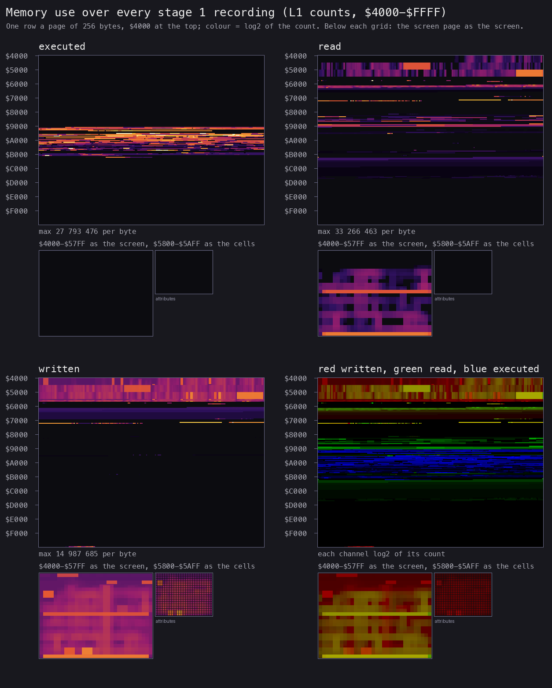
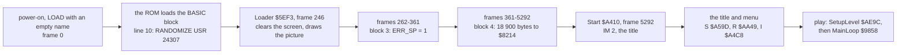
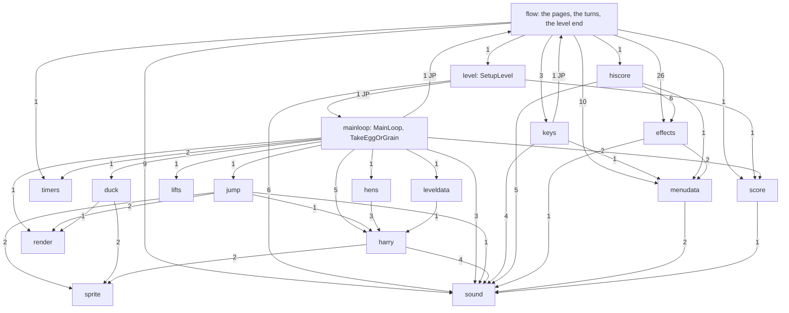
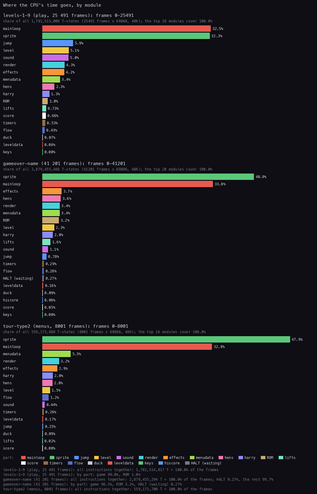
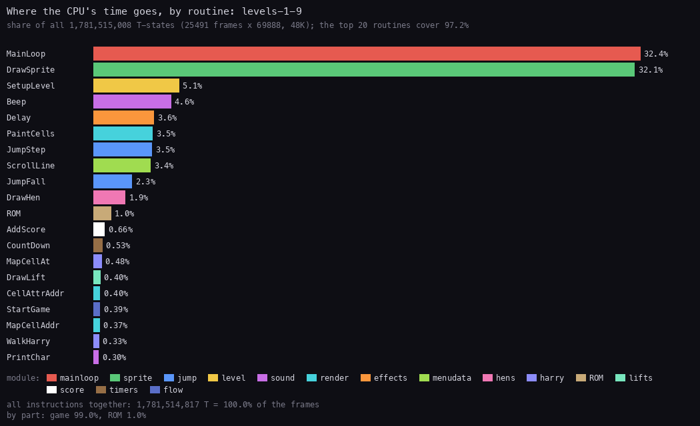
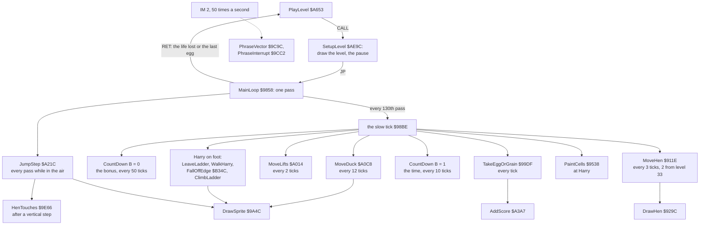
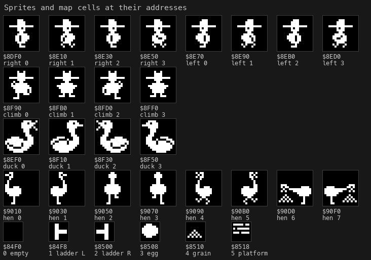

# 2. Architecture

What this covers: the machine budget, the memory map (a figure), the three images, the stages from the tape to play,
the module map of the 22 modules, where the CPU's time goes, the frame, and the main loop's call graph. The
recordings it rests on: `c1` (from power-on, the tape loaded, the menu and play) and the bot's recordings of whole
levels (WALKTHROUGH 6.0). The counts marked "eight builds" are summed over the eight L1 builds that
`tools/l1count.py` reads (`work/game`, the game window of `c1`, and the seven stage 1 recordings).

## 2.1 The machine budget

Chuckie Egg is a 48K game. It uses no extra RAM, no AY, and no port but the ULA's `$FE` and the speech port `$9F`
(doc 9).

**48K and 128K.** Every recording of this case is a 48K machine; no 128K model was tested. From the code: the game
touches no 128K port (`$7FFD`, AY), so it runs in the 128K's page 0 as on a 48K. The IM 2 vector table at `$B200`
is 263 bytes of `$9C`, so any bus value gives `$9C9C` (PhraseVector), on either model. The ROM calls (BEEP `$03F8`,
LD-BYTES `$0556`) are in the 48 BASIC ROM the 128K also holds. What would differ is the timing: the 128K frame is
70 908 T with another contention pattern, so the T counts of this case (the pass and tick lengths, the beam
positions) would shift by a few per cent; the game's speed is set by its own work, not by the frame (2.7).

| Resource | What the machine has | What the game uses |
| --- | --- | --- |
| CPU | Z80 at 3.5 MHz, 69 888 T a frame, 50.08 frames a second | all of it: the main loop never halts (HALT is 0.00 % of `levels-1-9`) |
| Contention | `$4000-$7FFF` slows the CPU while the beam draws the paper | the code at `$911E-$B15E` runs uncontended; the screen, the live maps `$61A8` and the variables `$72A0` are contended |
| RAM | 41 984 bytes from `$5C00` | the image `$8214-$CBE7` (18 900 bytes), the maps and variables `$61A8-$7375`, 34 bytes of stack |
| Interrupt | IM 1 or IM 2, 50 times a second | IM 2 for the speech; IM 1 only in the name entry (doc 4.5) |
| Screen | 6912 bytes at `$4000`, no second buffer | drawn in place, with OR and copies, during the frame (doc 6) |
| Sound | the beeper on port `$FE`, bit 4 | Beep `$9CA4`, and the ROM's BEEP `$03F8` for the tunes (doc 9) |
| Speech | the Fuller Orator (SP0256-AL2) on port `$9F` | 33 phrases of allophones, fed by the interrupt (doc 9) |

The main loop is not tied to the frame. It runs as fast as its work allows: a light pass of 149-168 T, and on every
130th pass a slow tick: about 28 000 T with nothing due, up to about 100 000 T with the duck (the longest seen: 99 289 T, D L T H,
`levels-1-9` frame 592), about 3 000 T during a jump
unless Harry's x is a multiple of 8, where ClimbLadder still redraws him (doc 4.1, 4.6). On level 1 that gives 161.8 passes and 1.25 slow ticks a
frame (doc 4.6).

**A worked example: one tick period on level 1.** The trace of `levels-1-9`, frames 400-600, holds 32 366 pass
lengths (`work/docs/ceA/l19-400-passes.tsv`) and 249 slow ticks (`l19-400-ticks.tsv`). From the first pass start
(frame 403, T 65 496) to the last (frame 599, T 55 041) they cover 13 687 918 T, 195.86 frames:

| Part | Count | T each (measured) | T | Share |
| --- | ---: | ---: | ---: | ---: |
| the tick passes | 249 | mean 34 124, median 28 803 | 8 496 813 | 62.1 % |
| the other passes | 32 117 | mean 162; most 149-168 | 5 191 105 | 37.9 % |
| all | 32 366 | | 13 687 918 | 100 % |

One tick period is 13 687 918 / 249 = 54 971 T, so 1.27 ticks a frame in this stretch. Over the whole 200 frames it
is 1.25 (doc 4.6), because frames 400-403 still hold the end of SetupLevel's pause. A tick pass is the tick's own
work (8 451 807 T from `$98BE`, the lengths of `l19-400-ticks.tsv`) plus about 181 T of pass head each. The other
passes average 162 T, not 149: 55 of them play a step of the pickup sound (Beep from `$987B`, 1011-2300 T, 90 398 T
in all; none of them runs JumpStep); the rest average 159 T. A light pass in a jump runs JumpStep and takes 323-371 T;
one holding the IM 2 interrupt takes 270-288 T (`work/review/fix2A/longpass.py` over the same trace).

**The point**: the CPU is the budget. There is no spare time and no wait. Every T-state saved in a tick makes the
whole game faster.

## 2.2 The memory map

The 48K's RAM as the game uses it, from `tools/l1map.py` over the L1 builds. "Executed", "read" and "written" are
counted in `work/game` (the game window of `c1`, frames 5292-8916) unless the row says "eight builds". The other
recordings add reads to the level maps and no new region (WALKTHROUGH 6.0). The names are those of
`src/game/game.ann`.

| Range | Size | What | Use | Witness |
| --- | ---: | --- | --- | --- |
| `$4000-$5AFF` | 6912 | the screen | 816 202 reads, 694 120 writes | the game draws with OR and copies (`$930D`, `$A20C`) |
| `$5C00-$5CCA` | 203 | the system variables | ERR_SP `$5C3D` read on every pass; the rest is the ROM's (BEEP's calculator, the name entry's LAST_K) | `$9858`, [doc 3.4](03-build-and-load.md#34-err_sp-block-3-and-the-main-loops-check) |
| `$5CCB-$6322` | 1624 | the BASIC block: line 10, the picture's graphics, the loader, the picture's text | dead after the load; `$5DC0-$5DD3` is the ROM's calculator stack (STKBOT and STKEND = `$5DC0`, set by the loader) | [doc 3.2](03-build-and-load.md#32-the-basic-block-line-10-and-the-array-a); L1 writes only at `$5DC0-$5DD3` |
| `$61A8-$6EC7` | 3360 | LiveMap: five maps of 672 bytes, the one in play first, then one a player; laid over the end of the BASIC block | 68 316 reads, 3429 writes | `$A5F4-$A602` (five copies of level 1), `$9E34` (a point's cell) |
| `$6EC8-$6EF3` | 44 | Score, PlayerScores, EggsLeft, Level, PlayerLevels, PlayerLives | | `$A604-$A621` |
| `$6EF4-$729F` | 940 | not used | untouched | L1 |
| `$72A0-$7375` | 214 | SpriteBuffer (48 bytes), Harry (HarryX `$72D8`), PassCounter `$72DC`, CellBuffer, the jump, KeyTable `$732E`, the clocks, the duck, the lifts, Hens `$7357`, the phrase player (`$7373`) | 2 235 417 reads, 1 489 448 writes | the `@equ` lines of `game.ann` |
| `$7376-$8213` | 3742 | not used | untouched | L1 |
| `$8214-$824F` | 60 | LeftoverMapRow: zeros and a few map codes (`01 02`, `A8 A9`) | untouched | the bytes |
| `$8250-$8273` | 36 | KeySets: three sets of 12 bytes, six (mask, port row) pairs each: type 1 `$8250`, type 2 `$825C` (the cursor keys), type 3 `$8268` (the one R redefines) | 467 reads, eight builds; the chosen set is copied to KeyTable at every level start and after every life (SetupLevel) | `$B0A6-$B0BE` |
| `$8274-$838F` | 284 | Zeros8274 (194 zeros) and MenuLeftover (three old menu lines) | untouched | L1 |
| `$8390-$84EF` | 352 | InstructionsText: 11 rows of 32, the bottom row first | 1053 reads, eight builds | `$A4CD LD BC,$8390` |
| `$84F0-$89DF` | 1264 | CharacterSet, codes 0-`$9D`, 8 bytes each, top row first: 0-5 the map cells, `$20-$5F` the font, `$80-$8A` the big CHUCKIE EGG, `$8F-$96` the A+F logo, `$97-$9A` the key names | 9 910 509 reads, eight builds; 9 578 424 of them at `$84F0-$851F`, the map cells | PrintChar `$9C40`; DrawSprite `$9A4C` (the cells behind a sprite) |
| `$89E0-$8B4F` | 368 | HudCharacters, codes `$9E-$CB`: the HUD's digits, the cage, the life icon, the cursor | 1 791 861 reads, eight builds | `$A201 LD HL,$89E0` |
| `$8B50-$8DEF` | 672 | FillFF: 672 bytes of `$FF`, a map's size | untouched | the bytes |
| `$8DF0-$900F` | 544 | Sprites: 17 frames of 16 x 16, 32 bytes each | 94 144 reads | 2.8 |
| `$9010-$910F` | 256 | HenSprites: 8 frames of 16 x 16 | 10 240 reads | 2.8 |
| `$9110-$911D` | 14 | LeftoverSprite | untouched | L1 |
| `$911E-$B15E` | 8257 | the code of 18 modules, with tables between the routines (HenTable `$945B`, TitleText and HudText `$9630-$978A`, LiftTable `$9787`, HiScoreTable `$97AF`, the menu's texts `$ABF2-$AE0B`, the tunes `$AE0C-$AE9B`) | 28.7 million instructions | 2.5 |
| `$B15F-$B34B` | 493 | LevelPhrases, then the author's assembler source text, with VectorTable `$B200-$B306` (263 bytes of `$9C`) inside it | `$B2FF-$B300` read (the vector `$9C9C`) | `$A41A`; NOTES |
| `$B34C-$B380` | 53 | FallOffEdge: code inside the source text | 98 837 calls, 63 falls (`$B368`), eight builds | `$99D6 CALL Z,$B34C` |
| `$B381-$B3AF` | 47 | the rest of that source text | untouched | L1 |
| `$B3B0-$C8AF` | 5376 | LevelMaps: eight maps of 21 rows of 32 cells, the bottom row first | the current level's map is read when a level starts | `$A6E1-$A6F4` |
| `$C8B0-$CBE7` | 824 | SourceLeftoverC8B0, PhraseTable (`$C8C8`) and its phrases (`$C99C-$CB12`), ZerosCBC4 | read by the phrase player | `$9CF2`, `$9CD3` |
| `$CBE8-$FF1D` | 13 110 | not used | untouched | L1 |
| `$FF1E-$FF3F` | 34 | the machine stack: the BASIC one, under RAMTOP | 5982 writes | no `LD SP` in the game |
| `$FF58-$FFFF` | 168 | the ROM's UDGs | untouched | |

- **The stack's low mark** is `$FF1E` over every recording. The lowest byte written in page `$FF00` is `$FF1E` in
  `work/game` and `idle-1p`, `$FF20` in `fall-death`, and `$FF22` in the others (the name entry under IM 1 in
  `gameover-name` included). So the game needs 34 bytes of stack. It keeps the BASIC stack the loader leaves (SP =
  `$FF3E` in play).
- **Every graphic is stored top row first.** The character set, the HUD characters and both sprite tables keep row 0
  of a shape at its lowest address. Two readers walk them backwards: DrawHen `$929C` reads a hen frame from its last
  row up, and erases a cell from its last row (`$84F7` + 8 x code) up, while the screen line goes up with it. The
  texts (InstructionsText, TitleText) and the level maps are the other way round: their bottom row comes first,
  because PrintChar counts character rows from the bottom (the header of `game.ann`).



*The L1 builds of every stage 1 recording summed (`tools/l1merge.py`), drawn by `tools/fig_heatmap.py` with the
counts and colours of `kit/heatmap.py`: four panels (executed, read, written, the three as colours), one row a page
of 256 bytes with `$4000` at the top, and the screen page as the screen below each. The commands are below.*

The code runs in `$911E-$B15E` and in `$B34C-$B380`. The second range is FallOffEdge, a routine assembled into the
middle of the leftover source text. MainLoop calls it on every slow tick when Harry is on foot and not on a lift.
Nothing below `$911E` runs. Reads go to the screen, the live maps (`$61A8`), the variables (`$72A0`), the key sets,
the character set and the sprites (`$8250-$910F`), and the level maps (`$B3B0`). Writes go to the screen, the maps,
the variables and the stack page `$FF00`. Nothing above `$CBE7` but the stack is touched.

```bash
python3 tools/l1merge.py work/stage1/l1-all.json work/game/l1.json work/stage1/rec/*/l1.json
python3 tools/fig_heatmap.py work/stage1/l1-all.json docs/img/heatmap.png
python3 tools/l1count.py --ran 8214-911D    # nothing
python3 tools/l1count.py --ran B15F-CBE7    # $B34C-$B380, 53 bytes: FallOffEdge
```

**The point**: 17 792 bytes of the 48K are free (`$6EF4-$729F`, `$7376-$8213`, `$CBE8-$FF1D`). The game never
needed to pack anything, and it even carries 293 bytes of its author's assembler source.

## 2.3 Three images: as loaded, at the entry, at play

| Image | What it is | How it was made |
| --- | --- | --- |
| as loaded | the tape's bytes where the loader puts them: BASIC `$5CCB-$6322`, `01 00` at `$5C3D`, the game `$8214-$CBE7` | `tools/image.py work/mkgame/original.bin` (= `work/stage1/images/loaded.bin`) |
| at the entry | the memory of `c1` when `$A410` first runs (frame 5292) | `re_session.py build --work work/c1 --stage 2 --into work/game`, `work/game/start.bin` |
| at play | the memory at the first frame of level 1 (after S, 1 player) | `tools/szx.py work/stage1/bot/t4/base.szx` (the bot's start, `tests/inputs/menu-1p.txt` from the title) |

What changes (`cmp`-style runs over `$5B00-$FFFF`, `work/stage1/images/`):

- **Loaded to entry**: nothing in the game block or the BASIC block. The differences are the ROM's: the system
  variables (`$5C00-$5CCA`), the BASIC workspace just past the program (`$6323-$634B`) and the machine stack with
  the UDGs (`$FF18-$FFFE`). Nothing is unpacked or decrypted.
- **Entry to play**: in the game block `$8214-$CBE7`, only data changes. The level setup writes the HUD's text at
  `$9764-$978A` (`$AED2-$AF15`: the level's digits and the like), and StartGame writes LevelDigits `$AD58` ("01")
  (`$A623 LD HL,$9F9E`, `$A626 LD ($AD58),HL`: the HUD codes of 0 and 1), with the values they already hold at level 1. L1 of `c1` shows no other write above `$7400` except the
  stack. No code is modified, and every table (the level maps, the hens, the vector table) is read in place. What
  changes is the RAM below the game:
  - `$61A8-$6EC7`: five live maps of 672 bytes, each a copy of level 1 (`$A5F4-$A5FC`). They lie over the end of the
    BASIC block (the loading picture's text `$601C-$631B`), which the game no longer needs;
  - `$6EC8-$6EF3`: the players' scores, eggs left, levels and lives;
  - `$72A0-$7375`: the sprite buffer and the game's variables (Harry at `$72D8`, the hens at `$7357`);
  - `$FF1E-$FF3F`: the stack (the game keeps the BASIC stack).

**The point**: what the tape loads is what runs. The source build ([doc 3.6](03-build-and-load.md#36-the-source-build))
has to give the tape's bytes and nothing else.

## 2.4 The stages, from the tape to play



*The stages of `c1` (`re_session.py stages`, WALKTHROUGH 1). The BASIC block went through the fast LD-BYTES trap, the
two headerless blocks at signal speed. [Doc 3.5](03-build-and-load.md#35-from-power-on-to-the-games-first-instruction)
has each stage frame by frame.*

The interrupt mode changes once on the way. The ROM runs under IM 1 until Start `$A410` sets I = `$B2` and IM 2.
From then on the game stays in IM 2, except in the name entry (doc 4.5).

## 2.5 The module map

`src/game/game.ann` splits the game image into 22 modules (`@module`). One module is one `.asm` file in `src/game/`.
The ranges follow the code. There are 6343 code bytes in the 18 900, and 3486 instructions, of which 3410 ran in the
eight builds (`kit/mkgame.py --case .`).

| Module | Range | Entries (code) | What it holds | Time in `levels-1-9` | Doc |
| --- | --- | ---: | --- | ---: | --- |
| tables | `$8214-$84EF` | 5 (0) | LeftoverMapRow, KeySets, Zeros8274, MenuLeftover, InstructionsText | | 5 |
| graphics | `$84F0-$911D` | 6 (0) | CharacterSet, HudCharacters, FillFF, Sprites, HenSprites, LeftoverSprite | | 6, 8 |
| hens | `$911E-$9537` | 10 (7) | MoveHen, HenEatGrain, DrawHen, AttrAddrHen, MapCellAddrKeepA, ScreenAddr, MapCellPeek, HenTable | 2.31 % | 7 |
| render | `$9538-$962F` | 4 (3) | PaintCells, CellAttrAddr, MapCellAddr | 4.27 % | 6 |
| screens | `$9630-$9857` | 6 (0) | TitleText, HudText, LiftTable, HiScoreTable, CellAttributes | | 8 |
| mainloop | `$9858-$9A4B` | 3 (2) | MainLoop, TakeEggOrGrain | 32.54 % | 4 |
| sprite | `$9A4C-$9C3F` | 3 (2) | DrawSprite, SpriteAttrAddr | 32.35 % | 6 |
| sound | `$9C40-$9D07` | 9 (5) | PrintChar, PhraseVector, Beep, PhraseInterrupt, StartPhrase | 5.04 % | 8, 9 |
| harry | `$9D08-$A013` | 10 (5) | WalkHarry, MapCellAt, HenTouches, ClimbLadder, LeaveLadder | 1.35 % | 10 |
| lifts | `$A014-$A0C7` | 5 (4) | MoveLifts, DrawLift, LineDown, LineUp | 0.73 % | 7 |
| duck | `$A0C8-$A1B7` | 2 (1) | MoveDuck | 0.07 % | 7 |
| timers | `$A1B8-$A21B` | 2 (1) | CountDown | 0.53 % | 8 |
| jump | `$A21C-$A3A6` | 9 (7) | JumpStep, CatchLift, JumpDrift, JumpFall, JumpLand, DrawHarryFrame, LiftPhrase, LiftPhrases | 5.94 % | 10 |
| score | `$A3A7-$A40F` | 2 (1) | AddScore | 0.66 % | 8 |
| flow | `$A410-$A80B` | 9 (9) | Start, TitlePage, TitleLoop, InstructionsPage, StartGame, PlayerTurn, PlayLevel, LifeLost, GameOver | 0.43 % | 4 |
| hiscore | `$A80C-$A8EB` | 1 (1) | EnterHiScore | | 5 |
| effects | `$A8EC-$AA48` | 10 (10) | DrawBox, Delay, BoxWipe, WaitPhrase, BoxZoom, Message, BoxZoomBox, CompareScore, AttrAddr, FillAttrBlock | 4.21 % | 4, 6 |
| keys | `$AA49-$AB5F` | 5 (5) | RedefineKeys, KeyUsed, DeathPhrase, ReadAnyKey, RedefineOne | 0.00 % | 5 |
| menudata | `$AB60-$AE9B` | 11 (5) | PlayTune, TuneCalc, PlayTuneNote, ScrollLine, ClearScreen, DrawHiScores, DeathPhrases, MenuTexts, Congratulations, TitleTune, DeathTune | 3.41 % | 8, 9 |
| level | `$AE9C-$B15E` | 3 (3) | SetupLevel, FillAttrRow, LevelPhrase | 5.08 % | 10 |
| leveldata | `$B15F-$C8AF` | 14 (1) | LevelPhrases, the source leftovers, VectorTable, FallOffEdge, LevelMaps 1-8 | 0.06 % | 7, 10 |
| speech | `$C8B0-$CBE7` | 3 (0) | SourceLeftoverC8B0, PhraseTable, ZerosCBC4 | | 9 |

The ROM takes the remaining 1.04 % of `levels-1-9` (BEEP for the tunes). A blank in the time column is a module with
no code, or one that did not run in this recording.

Who calls whom between modules: every `CALL` and `JP` in `src/game/*.asm` whose target is in another module. The
number on an arrow is the count of such instructions.



*Made with `python3 work/docs/ceA/callgraph.py`, a scan of the labels and of their `CALL` and `JP` lines.*

- **Three layers.** `flow` is the top: the pages and the turns. `level` and `mainloop` are play. Everything else is a
  service. `sound` (which holds PrintChar) is called from both sides; `sprite` and `render` only from
  play (`jump`, `duck`, `harry`, `mainloop`, `level`).
- **The hens draw themselves.** `hens` holds its own drawer, DrawHen, and its own address helpers (ScreenAddr,
  AttrAddrHen, MapCellPeek). Harry and the duck go through `sprite` (DrawSprite). The two drawers do the same job in
  two ways (doc 6).
- **Two JPs go back to the menu.** MainLoop jumps to Start `$A410` on CAPS SHIFT + A (ABORT), after a `POP HL` that
  drops PlayLevel's return address. RedefineKeys ends with a jump into the title's scroller. The pages themselves are
  joined by jumps, so the stack is empty between them.

**The point**: the module map is a tree of calls. The only ways back up are the two jumps to the title, and both
leave the stack as they found it.

## 2.6 Where the CPU's time goes



*Each module's own T-states as a share of all the frames of three recordings: `levels-1-9` (play, 25 491 frames),
`gameover-name` (41 201 frames, mostly level 4 with Harry standing) and `tour-type2` (the menus and two short games,
8001 frames). Made with `python3 ../../kit/fig_budget.py work/stage1/rec/levels-1-9/l1.json
docs/img/arch/budget-modules.png --ann src/game/game.ann --by module --title "Where the CPU's time goes, by module"
--label "levels-1-9 (play, 25 491 frames)" --state "gameover-name (41 201 frames)=work/stage1/rec/gameover-name/l1.json"
--state "tour-type2 (menus, 8001 frames)=work/stage1/rec/tour-type2/l1.json"`.*



*The 20 routines with the most T-states in `levels-1-9`, coloured by module. Made with `python3
../../kit/fig_budget.py work/stage1/rec/levels-1-9/l1.json docs/img/arch/budget-routines.png --ann src/game/game.ann
--by routine --top 20 --title "Where the CPU's time goes, by routine: levels-1-9" --label "levels-1-9 (play, 25 491
frames)"`.*

| Module | `levels-1-9` | `gameover-name` | `tour-type2` |
| --- | ---: | ---: | ---: |
| mainloop | 32.54 % | 32.96 % | 32.80 % |
| sprite | 32.35 % | 40.89 % | 47.86 % |
| jump | 5.94 % | 0.78 % | 0.15 % |
| level | 5.08 % | 2.29 % | 1.47 % |
| sound | 5.04 % | 1.11 % | 0.44 % |
| render | 4.27 % | 3.35 % | 3.22 % |
| effects | 4.21 % | 3.73 % | 2.88 % |
| menudata | 3.41 % | 3.35 % | 5.47 % |
| hens | 2.31 % | 3.55 % | 1.95 % |
| harry | 1.35 % | 2.00 % | 1.99 % |
| ROM | 1.04 % | 3.21 % | 0.00 % |
| HALT | 0.00 % | 0.27 % | 0.00 % |
| the rest | 2.46 % | 2.51 % | 1.77 % |

The top routines in `levels-1-9` are MainLoop (32.41 %), DrawSprite (32.09 %), SetupLevel (5.08 %), Beep (4.59 %),
Delay (3.59 %), PaintCells (3.51 %), JumpStep (3.46 %), ScrollLine (3.39 %), JumpFall (2.29 %) and DrawHen (1.88 %).
The only HALT is the name entry's wait for a key, under IM 1 (doc 4.5).

**A worked example: what one DrawSprite costs.** In `levels-1-9` DrawSprite `$9A4C` ran 26 350 times (column `l1-9`
of `tools/l1count.py 9A4C`). Its module took 32.35 % of 25 491 x 69 888 T = 1 781 515 008 T, which is 576.3 million
T. So one call costs 576.3 M / 26 350 = 21 870 T on average, almost a third of a frame. In `gameover-name` the same
sum gives 1 177.4 M T / 51 046 calls = 23 070 T. The mainloop module (MainLoop and TakeEggOrGrain), worked out the same way,
is 579.7 M T over 2 894 339 passes: 200 T a pass, the light passes and the tick's own lines together. MainLoop alone
(32.41 %) is 577.4 M T, 199.5 T a pass.

- **Two routines take two thirds.** MainLoop spins, and DrawSprite draws Harry and the duck. Everything that makes
  the game (the hens, the lifts, the clocks, the score) is under 5 % together.
- **The duck is cheap in its own code and dear in DrawSprite.** `duck` is 0.07 %, but each duck step costs two
  DrawSprite calls, about 40 000 T (doc 4.7).
- **The menus are DrawSprite too.** `tour-type2` spends 47.86 % in DrawSprite, because its two short games are played
  on level 1 with Harry walking.
- **SetupLevel's 5.08 % is a pause**: a delay of 30 x 10 000 counts (7.8 million T, 111.6 frames) at the start of
  every level (doc 4.8).

**The point**: the speed of the game is the speed of DrawSprite. A pass is cheap; a tick costs what Harry's redraw
costs.

## 2.7 The frame and the main loop's call graph

The frame is not a unit of the game. The game counts passes of MainLoop `$9858`, and every 130th pass is a slow tick.
The interrupt runs beside the loop and only speaks. Doc 4 has the pass, the tick, the countdowns and the beam.



The program around the loop, in pseudocode:

```text
Start:                      # $A410
    KeyType = 6; TitleTuneDone = 0; I = $B2; IM 2
    TitlePage -> TitleLoop  # S: StartGame, R: RedefineKeys, I: InstructionsPage (all by JP)
StartGame:                  # $A59D
    five copies of level 1 into LiveMap; 5 lives for each player
PlayerTurn:                 # $A62C
    two players or more: announce the player
PlayLevel:                  # $A653
    CALL SetupLevel         # draws, pauses, JP MainLoop; MainLoop's RET comes back here
    if EggsLeft != 0: JP LifeLost          # the next player with lives, or GameOver
    count the bonus into the score
    Level += 1; the next map into the map in play; JP PlayLevel
```

The asm of that turn. The call into play is a `CALL` whose return comes from MainLoop:

```text
PlayLevel:                  ; $A653
        CALL SetupLevel     ; SetupLevel ends in JP MainLoop; MainLoop's RET lands at $A656
        CALL WaitPhrase
        ...                 ; the score into the player's slot
        IM 2                ; defensive: no path reaches here in IM 1 (EnterHiScore ends in IM 2, $A8E9)
        LD A,(EggsLeft)
        AND A
        JP NZ,LifeLost      ; eggs left: the life was lost
PlayLevelBonus:
        LD A,(BonusRunning)
        ...
```

- **One return address deep.** Play runs one return address above the menu's empty stack: SetupLevel's JP hands its
  return to MainLoop. Every way out of the loop is a RET from MainLoop (doc 4.3).
- **The interrupt is apart.** PhraseInterrupt saves AF and HL, touches only PhraseTimer, PhrasePtr and port `$9F`,
  and returns (doc 4.5). So the loop needs no DI.

**The point**: the whole game is one loop with a counter in it. The frame matters only to the beam (doc 4.7) and to
the speech.

## 2.8 The sprites, first look



*Every 16 x 16 sprite of the game and the six map cells, drawn from the image at the addresses under them
(`tools/sprites.py`). Like every graphic of the game, they are stored top row first, and drawn so. Hens are
numbered by frame f = A - 1. Made with `python3 tools/sprites.py work/mkgame/original.bin docs/img/sprites/sheet.png
--at '8DF0;8F90;8EF0;9010;84F0' --count '8;4;4;8;6' --width '2;2;2;2;1' --rows '16;16;16;16;8' --names ...
--title 'Sprites and map cells at their addresses'` (the names as on the sheet).*

| Sprite | Address | Size | Drawn by | Witness |
| --- | --- | --- | --- | --- |
| Harry walking right, four frames | `$8DF0-$8E6F` | 16 x 16, 32 bytes each | DrawSprite `$9A4C`, A = frame (0-3) + direction (0) | `$9DAF-$9DBE`: `LD A,($72DA); INC A; AND 3; ADD A,(IX+3); CALL $9A4C`; `$9A53`: `$8DF0` + A x 32 |
| Harry walking left, four frames | `$8E70-$8EEF` | 16 x 16 | DrawSprite, direction 4 | `$9D5C LD (IX+3),4` |
| the duck, four frames | `$8EF0-$8F6F` | 16 x 16 | DrawSprite, frames 8-11 | MoveDuck: 8 or 10 + DuckFrame |
| blank (32 zero bytes) | `$8F70-$8F8F` | 16 x 16 | DrawSprite, frame 12 | read 6432 times in `c1` (L1) |
| Harry climbing, four frames | `$8F90-$900F` | 16 x 16 | DrawSprite, direction `$0D` (13) | `$9F11 LD (IX+3),$0D` |
| the hens, eight frames | `$9010-$910F` | 16 x 16, 32 bytes each | DrawHen `$929C`: HenSprites - 2 + 32 x A (A 1-8, frame f = A - 1, 0-7), the rows read from the last pair up while the screen line goes up | `$92F6 LD HL,$900E`, `$9308-$9318`; L1 of `c1` reads `$9010-$910F` and nothing at `$900E` |
| the map cells 0-5: empty, the ladder's two halves, the egg, the grain, the brick | `$84F0-$851F` | 8 x 8 | PrintChar `$9C40` and DrawSprite's background; DrawHen erases from the last row, `$84F7` + 8 x code, upwards | `$9398 LD HL,$84F7`, `$93A2-$93A5` (`DEC D; DEC HL`) |

- DrawSprite copies the sprite into SpriteBuffer `$72A0`, three bytes wide (16 rows of two bytes and a zero,
  `$9A6F`). It shifts it right by x AND 7 (`$9A80-$9A91`) and then composes the 3 x 3 map cells under it (`$9A95`
  onwards). Doc 6 has the rest.
- The duck's frames and the blank sprite are named by their place in the table. Their callers (`$A113`, `$A18E`) run
  on every MoveDuck, every 12 slow ticks on every level: in the cage on levels 1-8 as well (doc 4.7).
- The hens' eight frames (f 0-7), by their shapes: two pairs in profile (0-1 and 4-5), two climbing (2-3, from the
  back), two pecking (6-7, with grain on the ground). Which state picks which frame: doc 7.3.

**The point**: 25 frames of 16 x 16 and six cells are the whole cast. Harry, the duck and the blank share one table
and one drawer; the hens have their own.
