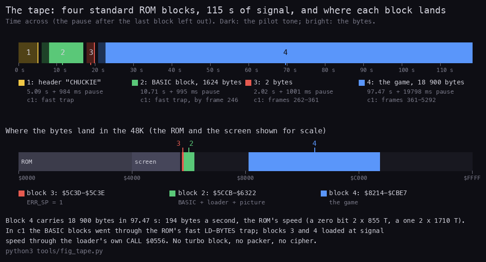
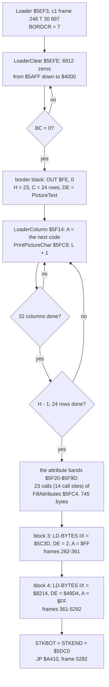
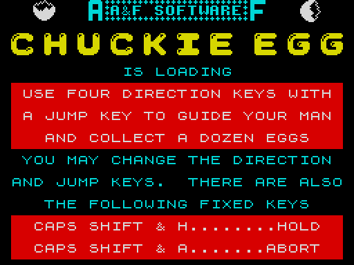
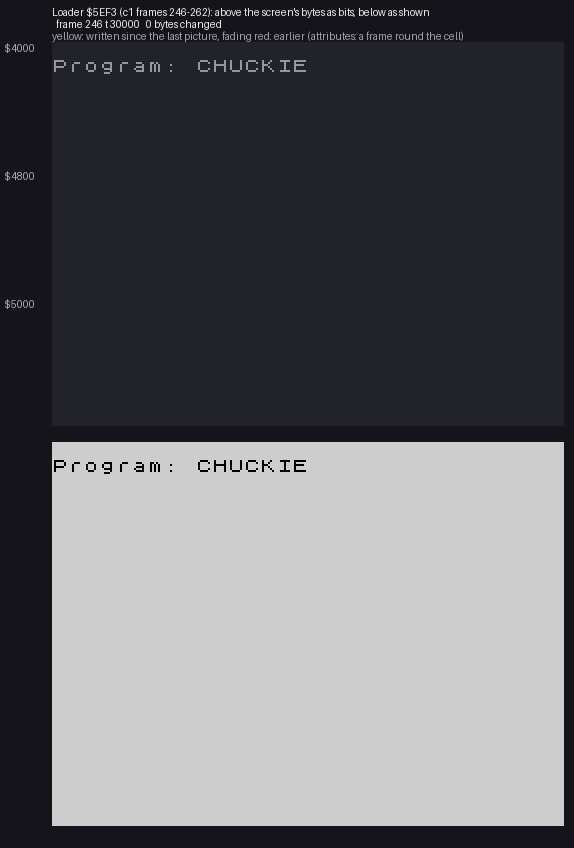
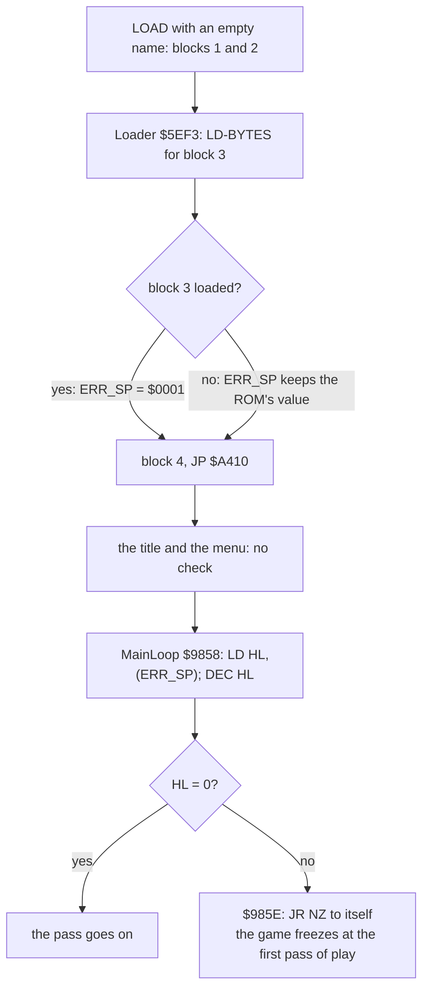
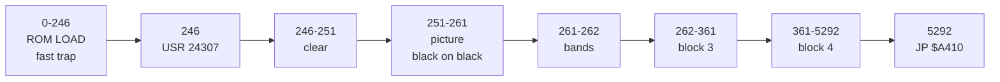
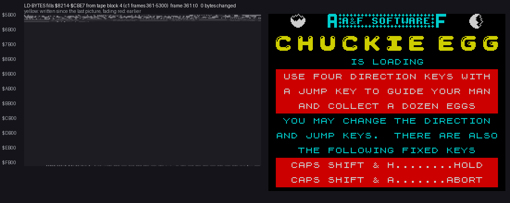
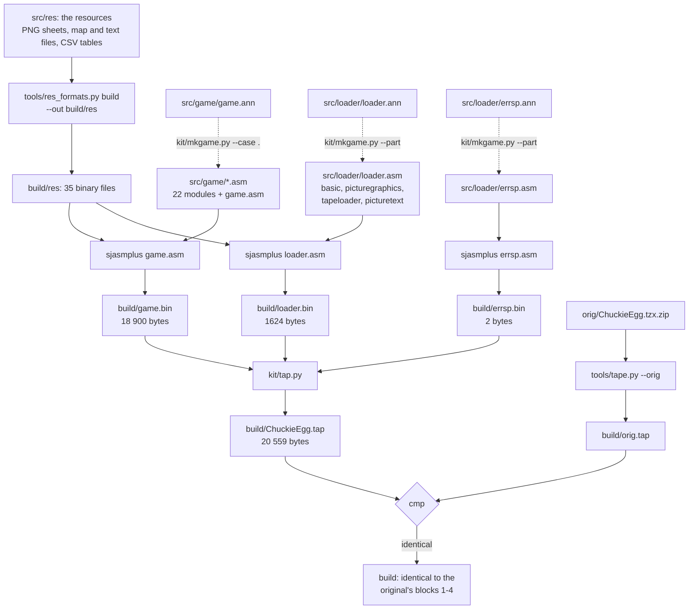

# 3. Build and load

What this covers: the tape block by block, the BASIC block and the array that hides the loader, the loader and its
picture, the ERR_SP block and the main loop's check, the load frame by frame, and the source build. There is no packer
and no cipher, so there is no unpack to show. The recording it rests on is `c1`: from power-on with
`Chuckie Egg.tzx` on the 48K, the BASIC block through the fast LD-BYTES trap, and the two headerless blocks at signal
speed through the loader's own calls of LD-BYTES (WALKTHROUGH 1). Frames are those of `c1`. Memory values were read
with `time_travel memory_at`, which gives the memory at the start of the named frame.

## 3.1 The tape, block by block

The original release (`orig/ChuckieEgg.tzx.zip`, `Chuckie Egg.tzx`) holds a text block and four standard ROM blocks
(TZX block id `$10`). There is no turbo block, no packer and no cipher: the game arrives as plain bytes. The Pick &
Choose re-release holds the same four data blocks byte for byte (README).



*The four data blocks of `Chuckie Egg.tzx` on a time line (dark: the pilot tone, bright: the bytes; the pauses
between them to scale), with the `c1` frames at which each block was met, and below, where each block lands in the
48K. Made with `python3 tools/fig_tape.py` (it reads the TZX through `tools/tzxblocks.py`).*

| Block | Kind | Data (+2 on tape) | Loads at | Time on tape | Pause after |
| ---: | --- | ---: | --- | ---: | ---: |
| 0 | text: "Created with Ramsoft MakeTZX" | | | | |
| 1 | header: Program "CHUCKIE", length 1624, LINE 10, program 18 bytes (the rest is the variables area) | 17 | | 5.09 s | 984 ms |
| 2 | the BASIC program and its variables area: line 10 `RANDOMIZE USR 24307`, then the loader's graphics, code and picture text | 1624 | PROG `$5CCB-$6322` | 10.71 s | 995 ms |
| 3 | headerless: `01 00` | 2 | ERR_SP `$5C3D-$5C3E` | 2.02 s | 1001 ms |
| 4 | headerless: the game | 18 900 | `$8214-$CBE7` | 97.47 s | 19 798 ms |

- Every block has the ROM's timings: pilot 2168 T (8063 pulses for the header, 3223 for data), sync 667 / 735 T,
  zero 855 T, one 1710 T. Each block starts with its flag (`$00` the header, `$FF` the data) and ends with the XOR
  checksum. All four checksums are right.
- The signal lasts 115.29 s, which is 5774 frames of the 48K (69 888 T a frame). With the three pauses between the
  blocks (2.98 s) the tape lasts 118.27 s. The 19.8 s of silence after the game is left out.
- Block 4 carries 18 900 bytes in 97.47 s: 194 bytes a second, the ROM's speed.

```bash
python3 tools/tzxblocks.py list "work/media/tzx6194/Chuckie Egg.tzx"      # the blocks, timings, checksums
python3 tools/image.py work/mkgame/original.bin                            # blocks 2-4 where the loader puts them
```

**The point**: a plain ROM-speed tape. Its only trick is block 3, two bytes that set ERR_SP to `$0001`, which the
game's main loop tests on every pass (3.4).

## 3.2 The BASIC block: line 10 and the array `a$`

Block 2 is 1624 bytes, but the header says the program is only 18 bytes. Those 18 bytes are line 10. The other 1606
bytes are the BASIC variables area, which the ROM loads with the program and keeps after it. It holds one variable: a
character array `a$` of 1600 characters. BASIC never reads the array. Its characters are the loading picture's
graphics, the loader and the picture's text (`src/loader/basic.asm`, `src/loader/loader.ann`).

| Address | Bytes | What | Source |
| --- | ---: | --- | --- |
| `$5CCB-$5CDC` | 18 | BasicLine10: `00 0A` (line 10), `0E 00` (14 bytes follow), `F9` RANDOMIZE, `C0` USR, "24307", `0E 00 00 F3 5E 00` (the number in its hidden five-byte form), `0D` | `basic.asm` |
| `$5CDD-$5CE2` | 6 | ArrayHeader: `C1` (a character array named a), `43 06` (1603 bytes follow), `01` (one dimension), `40 06` (1600) | `basic.asm` |
| `$5CE3-$5EF2` | 528 | PictureGraphics: 66 characters of 8 x 8, codes `$60-$A1`, top row first | `picturegraphics.asm`, `src/res/loader/PictureGraphics.png` |
| `$5EF3-$601B` | 297 | the loader: Loader `$5EF3`, FillAttributes `$5FC4`, PrintPictureChar `$5FC9` | `tapeloader.asm` |
| `$601C-$631B` | 768 | PictureText: 24 rows of 32 character codes, the top row first | `picturetext.asm`, `src/res/loader/PictureText.txt` |
| `$631C-$6322` | 7 | ArrayPadding: seven spaces, the end of `a$` | `picturetext.asm` |

**A worked example: the number in line 10.** USR 24307 is stored twice. "24307" is the text the listing shows. The
ROM runs the hidden form after `$0E`: `00 00 F3 5E 00` is a small integer, sign byte 0, then 24307 = `$5EF3` low byte
first. So the line calls `$5EF3`, the first byte of the loader. The array's length checks out too: 1603 = 1
(the dimension count) + 2 (the dimension) + 1600 (the characters), and 18 + 6 + 1600 = 1624, the block's length.

- **Why an array** (an interpretation). A `REM` full of code is listed and easy to break. An array in the variables
  area is loaded with the program and never shown by `LIST`. The header's LINE 10 starts the program with a jump to
  the line, not with `RUN`, so the variables are not cleared.
- **Nothing in BASIC moves it.** Line 10 makes no variable, so nothing is put in front of `a$` and the loader's
  absolute addresses stay right.

**The point**: one BASIC line and one array. The array is a container: 1600 bytes the ROM loads at a known address
and leaves alone.

## 3.3 The loader `$5EF3`

Loader `$5EF3` runs once, from line 10's USR. It draws the loading picture, loads blocks 3 and 4 with the ROM's
LD-BYTES `$0556`, and jumps to the game. It never returns to BASIC.



In pseudocode:

```text
Loader:                                     # $5EF3
    BORDCR = 7                              # white ink for the lower screen
    for HL = $5AFF down to $4000: (HL) = 0  # 6912 bytes, the attributes first
    border = black
    DE = PictureText
    for H = 23 down to 0:                   # character rows, counted from the bottom
        for L = 0 to 31:
            PrintPictureChar(code = (DE), H, L); DE += 1
    paint the attribute bands               # 23 calls (14 call sites) of FillAttributes
    LD_BYTES(IX = ERR_SP, DE = 2, flag $FF)        # block 3; the result is not checked
    LD_BYTES(IX = $8214, DE = 18 900, flag $FF)    # block 4; the result is not checked
    STKBOT = STKEND = $5DC0
    goto $A410
```

The asm of the clear and the two loads (`src/loader/tapeloader.asm`):

```text
Loader:                     ; $5EF3
        LD A,$07
        LD (BORDCR),A
        LD HL,AttributesEnd ; $5AFF
        LD BC,$1B00         ; 6912
LoaderClear:                ; $5EFE: 42 T a byte
        LD (HL),$00
        DEC HL
        DEC BC
        LD A,B
        OR C
        JR NZ,LoaderClear
        XOR A
        OUT ($FE),A         ; the border black
        ...                 ; the picture and the bands
        LD IX,ERR_SP        ; $5F9E: tape block 3
        LD DE,$0002
        SCF                 ; carry set: load, not verify
        LD A,$FF            ; the flag of a data block
        CALL LD_BYTES       ; $0556
        LD IX,GameBlock     ; $5FAB: tape block 4, $8214
        LD DE,GameLength    ; $49D4 = 18 900
        SCF
        LD A,$FF
        CALL LD_BYTES
        LD HL,PictureGraphics+$00DD ; $5DC0
        LD (STKBOT),HL
        LD (STKEND),HL
        JP GameStart        ; $A410
```

### PrintPictureChar `$5FC9`

PrintPictureChar draws character A at character row H, counted from the bottom (0-23), and column L. It works out
the screen address from H and L, picks the glyph, and copies its 8 bytes down the cell.

```text
PrintPictureChar(A, H, L):
    base = $4000 if H >= 16, $4800 if H >= 8, else $5000     # the third of the screen
    cell = base + ((H AND 7) XOR 7) x 32 + L                 # the character row inside the third
    glyph = $3C00 + 8 x A if A < $5F                         # the ROM font
            else $5CE3 + 8 x (A - $60)                       # PictureGraphics
    for line = 0 to 7: (cell + line x 256) = glyph[line]     # INC D: one pixel line down
```

```text
PrintPictureChar:           ; $5FC9
        ...                 ; PUSH HL, BC, DE, AF; EX DE,HL: D = H, E = L
        LD A,D
        LD HL,Screen
        LD BC,$0800
        CP $10
        JR NC,l_5FDF        ; H 16-23: the top third
        CP $08
        JR NC,l_5FDE        ; H 8-15: the middle third
        ADD HL,BC
l_5FDE: ADD HL,BC
l_5FDF: AND $07             ; the row inside the third
        XOR $07
        ...                 ; five SLA A: x 32; + L
        LD DE,RomFont       ; $3C00
        CP $5F
        JR C,PrintPictureGlyph
        LD DE,PictureGraphics
        SUB $60
PrintPictureGlyph:          ; $6001: glyph = DE + 8 x A
        ...
        LD B,$08
PrintPictureLine:           ; $6011
        LD A,(HL)
        LD (DE),A
        INC HL
        INC D               ; the next pixel line of the cell
        DJNZ PrintPictureLine
```

**A worked example: two characters of the picture.**

| | Row 0, column 3 of PictureText | Row 6, column 11 of PictureText |
| --- | --- | --- |
| code | `$9A` (a piece of the egg picture at the top left) | `$49`, "I" of IS LOADING |
| H | 23 (the loader starts at H = 23) | 23 - 6 = 17 |
| third | H ≥ 16: `$4000` | H ≥ 16: `$4000` |
| row in the third | (23 AND 7) XOR 7 = 0 | (17 AND 7) XOR 7 = 6, x 32 = `$C0` |
| cell | `$4000` + 0 + 3 = `$4003` | `$4000` + `$C0` + 11 = `$40CB` |
| glyph | `$9A` ≥ `$5F`: `$5CE3` + 8 x `$3A` = `$5EB3` | `$49` < `$5F`: `$3C00` + 8 x `$49` = `$3E48` |
| bytes written | `$4003`, `$4103`, ... `$4703` | `$40CB`, `$41CB`, ... `$47CB` |

The first is the top-left area of screen row 0, the second is row 6, column 11, where "IS LOADING" starts. Code `$5F`
would fall between the two cases (`$5CE3` + 8 x `$FF`); PictureText has none.

### The picture, drawn in the dark



*The loading picture from `src/res/loader/` (PictureGraphics, PictureText), the ROM font and the fills of Loader
`$5F20-$5F9D`. Made with `python3 tools/fig_loading.py`.*



*Loader `$5EF3` in `c1` from frame 246, T 30 000 to frame 262, T 40 000, one picture every quarter frame (17 472 T):
above the screen's bytes as bits, below the screen as shown. The picture is drawn while every attribute is 0, black on
black, and appears at once when the bands are painted. Made with the command below.*

```bash
python3 ../../kit/memanim.py --work work/docs/ceA/c1 --from 246:30000 --to 262:40000 --step 17472 \
    --screen-geometry --screen --hold 2500 docs/img/routines/Loader.gif \
    --label "Loader \$5EF3 (c1 frames 246-262): above the screen's bytes as bits, below as shown"
```

The non-zero bytes of the screen, read at frame starts (`memory_at`, `$4000-$5AFF`):

| Frame start | Bitmap bytes not 0 | Attributes not 0 | What is going on |
| ---: | ---: | ---: | --- |
| 246 | 75 | 768 | the ROM's "Program: CHUCKIE" and the BASIC screen's colours; the loader starts at T 30 897 |
| 248 | 81 | 0 | the attributes are gone (the clear runs down from `$5AFF`); the old bitmap is still there, invisible |
| 260 | 1887 | 0 | the picture is almost drawn, all black on black |
| 262 | 2117 | 745 | the bands are painted: the picture appears |

- **The clear takes at least 4.15 frames.** 6912 passes of at least 42 T are 290 304 T. That is the uncontended count:
  LoaderClear `$5EFE` runs in contended RAM and writes the screen, so while the beam draws the paper both its fetches
  and its writes wait. It started at frame 246, T 30 897, so without contention it would end in frame 250 at about
  T 41 600; the waits push the end later, into frame 250 or 251 (not traced pass by pass). The frame 260 count above
  shows it done.
- **The picture takes about ten frames**, frames 251 to 261: 768 calls of PrintPictureChar, about 900 T each.
- **The bands take less than a frame** (745 bytes of FillAttributes, at 261-262). Columns 0 and 31 of the panels keep
  attribute 0 from the clear.
- **The order is chosen so that nothing is seen half drawn.** With the attributes cleared first and painted last,
  the player sees a black screen for 16 frames and then the whole picture.

**The point**: a small loader that hides its drawing. The picture costs 66 graphics and 768 codes in the array, and
LD-BYTES does the rest.

## 3.4 ERR_SP: block 3 and the main loop's check

ERR_SP `$5C3D` is the ROM's error stack pointer. In BASIC it holds the address of a stack slot with the ROM's error
return (MAIN-4 `$1303`). When the ROM reports an error, it loads SP from ERR_SP and returns through that slot.

Block 3 loads `01 00` into it, so ERR_SP = `$0001`. Nothing writes it again. The game's main loop reads it at the
start of every pass:

```text
MainLoop:                   ; $9858
        LD HL,(ERR_SP)
        DEC HL
        LD A,H
        OR L
MainLoopHang:               ; $985E
        JR NZ,MainLoopHang  ; ERR_SP is not 1: a JR to itself, for ever
```

```text
every pass:
    if ERR_SP != 1:
        loop for ever at $985E          # the game freezes on its first pass
```



**A worked example: what if an error happened with ERR_SP = 1.** The game never makes an error, so this never ran
(known only from the code). The ROM's error path, from its bytes:

```text
ERROR-2:  POP HL                ; $0053
          LD L,(HL)             ; the error code
ERROR-3:  LD (IY+0),L           ; $0055: ERR_NR
          LD SP,(ERR_SP)        ; $0058: SP = $0001
          JP SET-STK            ; $005C
SET-STK:  LD HL,(STKBOT)        ; $16C5: $5DC0, set by the loader
          LD (STKEND),HL
          PUSH HL               ; writes $FFFF (and $0000, the ROM: lost)
          LD HL,$5C92
          LD (MEM),HL
          POP HL
          RET                   ; pops $0001-$0002 of the ROM: AF 11, so PC = $11AF
```

`$11AF` is the last byte of a `CALL Z,$19E8` inside REMOVE-FP `$11A7`. Run from there it is `ADD HL,DE` and a loop
that scans memory for `$0D`. The machine is lost. So ERR_SP = 1 also turns any ROM error into a crash, but the game
never calls the ROM in a way that can fail: BEEP gets its tunes' fixed values, and LD-BYTES is not called again.

- **Witness**: 14 873 212 reads of `$5C3D` over the eight builds (`tools/l1count.py --reads 5C3D-5C3E`), all by
  `$9858`. Every pass of every build fell through.
- **The check waits until play.** The title, the menu and the instructions never read ERR_SP. A copy that loads the
  game block some other way, with ERR_SP left at the ROM's value, shows the title and freezes when play starts (known
  only from the code).
- **Other copies keep it.** The zxart TAPs 433872 and 433874 carry block 3 as 88 and 67 bytes (`01 00 FE ...`, `FE`
  the parity of a two-byte load), so their ERR_SP is still `$0001` (WALKTHROUGH 0).

**The point**: block 3 is a loading check. A copier that saved only the game block, or loaded it with `LOAD "" CODE`,
gets a game that freezes. The main loop does not need ERR_SP for anything else.

## 3.5 From power-on to the game's first instruction

| `c1` frames | Stage | What runs | What changes |
| --- | --- | --- | --- |
| 0-246 | the ROM: LOAD with an empty name | the ROM's LD-BYTES, through the emulator's fast trap for blocks 1 and 2 | "Program: CHUCKIE" on the screen; `$5CCB-$6322` loaded |
| 246, T 30 897 | line 10 runs | USR 24307 enters Loader `$5EF3` | |
| 246-251 | the clear | LoaderClear `$5EFE` | the screen to 0, the attributes first |
| 251-261 | the picture | PrintPictureChar `$5FC9`, 768 calls | the bitmap, invisible |
| 261-262 | the bands | FillAttributes `$5FC4`, 23 calls | the picture appears |
| 262-361 | block 3, at signal speed | LD-BYTES `$0556` | `$5C3D-$5C3E` = `01 00` |
| 361-5292 | block 4, at signal speed | LD-BYTES `$0556` | `$8214-$CBE7`, 18 900 bytes |
| 5292, T 39 044 | the game | Start `$A410`: IM 2, the title | |





*LD-BYTES fills `$8214-$CBE7` from tape block 4 in `c1`, frames 361 to 5300, one picture every 80 frames (5 590 000
T): the memory from `$5B00` up, and the screen. The block fills upwards at 194 bytes a second; nothing else in memory
changes. Made with the command below.*

```bash
python3 ../../kit/memanim.py --work work/docs/ceA/c1 --from 361:0 --to 5300:0 --step 5590000 \
    --from-address 5B00 --screen --hold 2000 docs/img/play/tape-block4.gif \
    --label "LD-BYTES fills \$8214-\$CBE7 from tape block 4 (c1 frames 361-5300)"
```

- **Block 3 takes 99 frames for two bytes.** Most of it is the pilot tone: 3223 pulses of 2168 T are 2.0 s.
- **Block 4 takes 4931 frames**, 98.5 s: its 97.47 s of signal and the 1 s pause before it.
- **The images agree.** The memory at frame 5292 is the image `tools/image.py` builds from the tape's blocks, apart
  from the ROM's system variables and stack ([doc 2.3](02-architecture.md#23-three-images-as-loaded-at-the-entry-at-play)):
  nothing is unpacked, moved or decrypted between the load and the game's first instruction.

The static decode (the TZX and the listings) against the recording (`c1`):

| What the static decode says | Where it comes from | What `c1` shows | Agrees |
| --- | --- | --- | --- |
| Block 2 is the BASIC program at PROG `$5CCB-$6322`, line 10 `RANDOMIZE USR 24307` | `tools/tzxblocks.py`, `build/loader.lst` | Loader `$5EF3` entered at frame 246, T 30 897 | yes |
| The loader clears 6912 bytes from `$5AFF` down | LoaderClear `$5EFE` | 6912 passes of `$5EFE`; the attributes 0 at frame 248 | yes |
| The picture is 24 rows of 32 codes | PictureText `$601C` | 768 calls of PrintPictureChar `$5FC9`, frames 251-261 | yes |
| The bands are painted last | FillAttributes `$5FC4` | 23 calls (14 call sites); 745 attributes not 0 at frame 262 | yes |
| Block 3 sets ERR_SP to `$0001` | block 3 = `01 00` | `$5C3D-$5C3E` = `01 00` after frame 361 | yes |
| Block 4 is 18 900 bytes at `$8214` | the block's length and the loader's LD-BYTES call | `tape-block4.gif`: only `$8214-$CBE7` fills, at 194 bytes a second | yes |
| Nothing is unpacked between the load and the game | no code runs between LD-BYTES and `JP $A410` | the memory at frame 5292 equals the image `tools/image.py` builds (doc 2.3) | yes |
| The game starts at `$A410` | the loader's `JP $A410` | Start at frame 5292, T 39 044 | yes |

**The point**: 5292 frames from power-on to the title, 4931 of them for the game block. The loader's own work takes 16
frames.

## 3.6 The source build

`tools/build.sh` builds the tape from the sources and compares it with the original's four data blocks, byte for
byte.



| Step | Input | Output | Checks |
| --- | --- | --- | --- |
| `tools/res_formats.py build --out build/res` | `src/res/` (graphics, sprites, loader, maps, sound, tables, text) | 35 binary files that the modules `INCBIN` | |
| `sjasmplus ... src/game/game.asm` | the 22 modules, `build/res` | `build/game.bin`, `game.lst` | no warnings (`--msg=war`) |
| `sjasmplus ... src/loader/loader.asm` | basic, picturegraphics, tapeloader, picturetext, `build/res` | `build/loader.bin`, `loader.lst` | |
| `sjasmplus ... src/loader/errsp.asm` | errsptext | `build/errsp.bin`, `errsp.lst` | |
| `kit/tap.py ChuckieEgg.tap basic:CHUCKIE:10:loader.bin data:-:-:errsp.bin data:-:-:game.bin` | the three parts | the header "CHUCKIE" (LINE 10, program length 18) and three flag-`$FF` data blocks, each with its XOR checksum | |
| `tools/tape.py --orig orig.tap` | the original's TZX blocks 1-4 | `build/orig.tap` | |
| `cmp ChuckieEgg.tap orig.tap` | the two tapes | | every data byte, flag and checksum of the four blocks |

```bash
tools/build.sh      # build: identical to the original's blocks 1-4 (build/orig.tap); 6 s on 2026-11-10
```

**A worked example: the size of the tape.** A TAP block is a two-byte length, the flag, the data and the checksum.
The header block is 2 + 1 + 17 + 1 = 21 bytes, block 2 is 2 + 1 + 1624 + 1 = 1628, block 3 is 2 + 1 + 2 + 1 = 6, and
block 4 is 2 + 1 + 18 900 + 1 = 18 904. The sum is 20 559 bytes, the size of both `build/ChuckieEgg.tap` and
`build/orig.tap`.

- **The header's program length is 18, not 1624.** Parameter 2 of a program header is the length of the program
  without its variables. Line 10 is 18 bytes; the array `a$` that carries the loader follows it in the variables area.
  `kit/tap.py`'s `basic` finds the 18 the way the ROM's SAVE does: it walks the lines and stops at the first byte that
  is no line number (`$C1`, the string array `a$`).
- **The TZX's timings are not data.** The pilot, the sync and bit lengths and the pauses are not rebuilt. The build
  proves the bytes, not the sound.
- **The `.asm` files are generated.** The `.ann` files are the sources. `kit/mkgame.py` refuses to install modules
  unless sjasmplus gives the image's bytes.

**The point**: three assembler runs and a tape writer give the original tape's bytes exactly. Every byte of the
release is accounted for by a source file.

## 3.7 What is known only from the code

- A failed load: the loader does not test the carry that LD-BYTES returns, so a bad block 3 or 4 runs on.
- ERR_SP other than 1: the hang at `$985E` (no build was made without block 3).
- An error under ERR_SP = 1: the jump to `$11AF` (3.4).
- Code `$5F` in the picture: PrintPictureChar would read `$5CE3` + 8 x `$FF` (PictureText has no `$5F`).
