# 4. Game loop

What this covers: the program's state machine; the main loop `$9858`, which runs free with no HALT; its slow tick
and the countdowns that schedule each task; the IM 2 handler, which only speaks; IM 1 in the name entry; where a pass
and a slow tick fall against the beam; how many passes and ticks a frame holds; and the delays between scenes.

The recordings it rests on are listed below (WALKTHROUGH 6.0; all on the 48K with the tape and no other load):

| Recording | Used for |
| --- | --- |
| `levels-1-9` | level 1, frames 400-600, traced: passes, ticks, the light beam timelines, `MainLoop.gif` |
| `gameover-name` | level 4 with Harry standing (no key), frames 7250-7490, traced: the heaviest tick, `MainLoopTick.gif`; the name entry under IM 1 |
| `c1`, `idle-1p`, `tour-type2`, `tour-redefine`, `levels-1-3`, `fall-death` | the L1 counts of passes, ticks and interrupts (WALKTHROUGH 1, 6.0) |

Times in this document are the emulator's T-states in the frame (0 is the frame start; the INT comes at T 1812 and
the first paper line at T 16 152). A trace gives the T-state at which each instruction starts. Memory values were read
with `time_travel memory_at`, which gives the memory at the start of the named frame.

## 4.1 The shape of the program

Chuckie Egg has no frame lock. The main loop never waits for the interrupt: it runs again as soon as a pass is done.
The game's speed is counted in passes of this loop, not in frames.

- **A pass** is one run from `$9858` to the `JP MainLoop` at `$99DC`. Most passes take 149-168 T and do almost
  nothing: they check ERR_SP, play the pickup sound and step a jump.
- **A slow tick** is the pass in which PassCounter `$72DC` reaches 0, once every 130 passes. Everything else in the
  game happens there: the HUD's clocks, the duck, the lifts, the pickup, a hen, and Harry's walk and climb.
- **The interrupt** (IM 2, 50 times a second) does nothing but feed the speech phrases to port `$9F` (4.5).

So a slow tick comes once for every 130 light passes (about 20 500 T) plus the tick's own work (28 000 to about 100 000 T; the longest seen: 99 289 T, D L T H, `levels-1-9` frame 592).
That is 1.25 ticks a frame on level 1 (4.6).

**The point**: the loop is paced by its own work. A heavier tick makes the game run slower, and nothing makes it
catch up.

## 4.2 The state machine

The program has no dispatcher. The pages are joined by jumps and fall-throughs, with an empty stack between them:
Start sets up IM 2 and falls into the title, TitleLoop jumps to StartGame, RedefineKeys or InstructionsPage,
StartGame falls into PlayerTurn and PlayerTurn into PlayLevel, LifeLost jumps to PlayerTurn and GameOver to
TitlePage. Only two pages are calls: play (`CALL SetupLevel`) and the name entry (`CALL EnterHiScore`). Play is
`CALL SetupLevel` in PlayLevel `$A653`: SetupLevel draws the level and jumps into
MainLoop, and MainLoop's RET returns to `$A656`. The flow code then decides what the return meant.

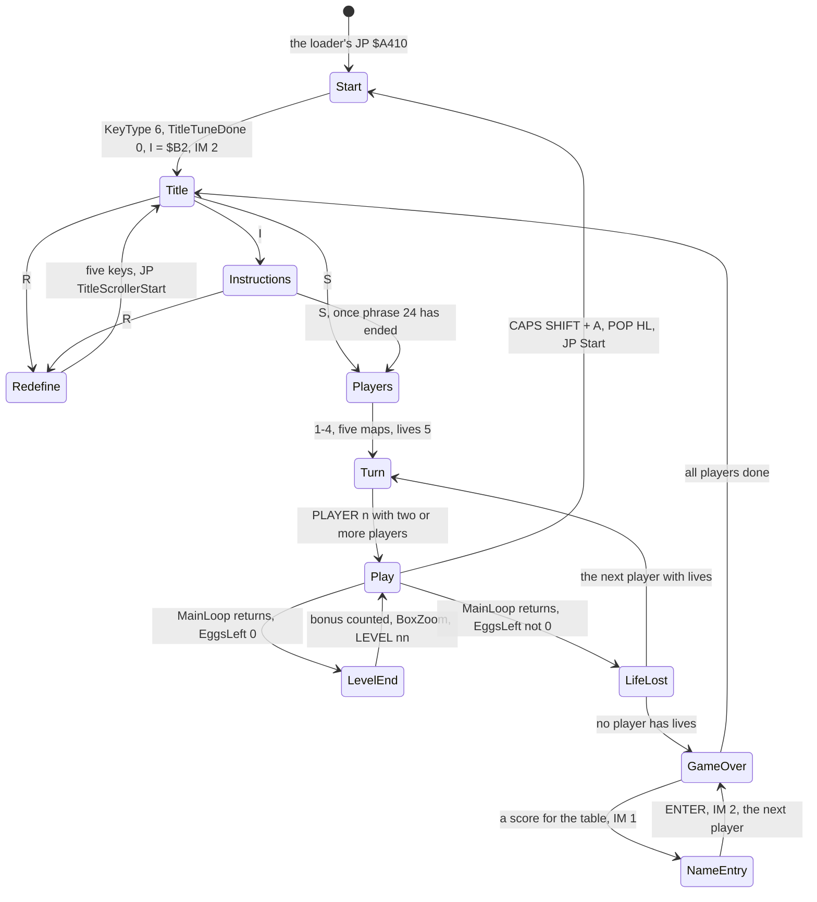

| State | Entry | What runs there | Left by |
| --- | --- | --- | --- |
| Start | `$A410` | KeyType 6, TitleTuneDone 0, `LD I,$B2`, `IM 2` | falling into TitlePage |
| Title | TitlePage `$A420`, TitleLoop `$A47D` | the title tune and phrase 20 while TitleTuneDone is 0 (the first title, and after an abort); ScrollLine and Delay 500 a step | S, R or I |
| Instructions | InstructionsPage `$A4C8` | phrase 24; the scroller; keys 1-3 set KeyType | S, once phrase 24 has ended (PhraseTimer = `$FF`, `$A543`); R |
| Redefine | RedefineKeys `$AA49` | RedefineOne for five keys | `JP TitleScrollerStart` |
| Players | StartGame `$A59D` | BoxWipe twice, the prompt, keys 1-4, five copies of map 1 | falling into PlayerTurn |
| Turn | PlayerTurn `$A62C` | phrase `$19` + player, "PLAYER n", Delay 0 (only with two or more players) | falling into PlayLevel |
| Play | PlayLevel `$A653` | `CALL SetupLevel`, which ends with `JP MainLoop` | MainLoop's RET to `$A656` |
| Level end | `$A675` | the bonus counted in, 2 x Delay 0, BoxZoom, LEVEL nn, the next map | `JP PlayLevel` (`$A6FB`) |
| Life lost | LifeLost `$A6FE` | DeathTune, DeathPhrase, Delay 0, OUT OF TIME, lives - 1 | PlayerTurn, or GameOver |
| Game over | GameOver `$A7BC` | BoxWipe, the scores to ASCII, EnterHiScore for each player | `JP TitlePage` |
| Name entry | EnterHiScore `$A80C`, IM 1 from `$A8A0` | the cursor, HALT, LAST_K | ENTER: `IM 2`, RET |

MainLoop has no exit flag. Every way out of play leaves the loop by taking words off the stack, so that a RET lands in
PlayLevel at `$A656`. The flow code tells the cases apart by EggsLeft.

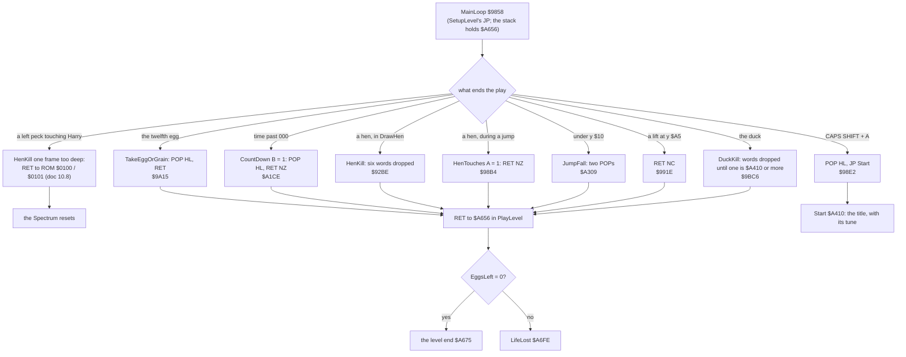

**A worked example: the hen kill of `c1`.** Harry walks into a hen on level 1. MoveHen calls DrawHen to erase the hen,
and DrawHen's box test finds Harry's x within the hen's x - 7 .. x + 5 and his y within y + 1 .. y + `$1C` (the
hen box). HenKill
`$92BE` drops six words: DrawHen's four pushes, its own return, and MoveHen's return into MainLoop. Its RET then takes
the next word, `$A656`, which SetupLevel's caller left. PlayLevel saves the score, sees EggsLeft not 0, and jumps to
LifeLost. In the L1 builds `$92BC` ran 11 times: once in `c1`, five times in `idle-1p` and five in `gameover-name`.

**The point**: the stack is the state. Each exit knows how deep it is called and drops exactly that much. DuckKill is
the one exit that does not know its depth. It is called from DrawSprite at several depths, so it searches the stack
for the return address into the flow code. One exit miscounts: HenKill reached from HenEatGrain's left peck sits one
frame deeper than its six POPs assume, and its RET resets the machine (doc 10.8; known only from the code and a
clone).

## 4.3 One pass of the main loop

The whole pass, from the listing (`build/game.lst`, `src/game/mainloop.asm`):

```asm
MainLoop:                       ; $9858
        LD HL,(ERR_SP)
        DEC HL
        LD A,H
        OR L
MainLoopHang:
        JR NZ,MainLoopHang      ; ERR_SP is not 1: hang (tape block 3, doc 3.4)
        LD HL,SoundSweep
        LD A,(PassCounter)
        AND $0F
        JR NZ,MainLoopJump      ; the pickup sound: one pass in 16
        LD A,(HL)
        AND A
        JR Z,MainLoopJump
        DEC (HL)
        AND $03
        JR NZ,MainLoopJump
        LD A,(HL)
        AND $1F
        ADD A,$06
        LD H,A
        LD L,$02
        CALL Beep               ; two cycles of the pitch
MainLoopJump:
        LD A,(JumpState)
        AND A
        JR Z,MainLoopTick       ; on foot: nothing more on a light pass
        LD A,(PassCounter)
        DEC A
        JR NZ,MainLoopJumpStep
        LD L,$01
        LD A,(HarryY)
        XOR $FF
        LD H,A
        CALL Beep               ; the jump's click, pitch from y, before each tick
MainLoopJumpStep:
        LD A,(JumpDelay)
        PUSH AF
        CALL JumpStep           ; a vertical step every JumpDelay passes
        POP AF
        DEC A
        JR NZ,MainLoopTick
        LD HL,Hens              ; after a vertical step: each hen against Harry
        LD B,$05
MainLoopHenTest:
        ...                     ; HenTouches $9E66; a touch: RET NZ (the life ends)
MainLoopTick:
        LD HL,PassCounter
        DEC (HL)
        JP NZ,MainLoopNext      ; 129 passes in 130 end here
        LD (HL),$82             ; the slow tick: 130 again
        ...                     ; 4.4
MainLoopNext:
        JP MainLoop
```

In pseudocode:

```text
loop:
    if ERR_SP != 1: hang
    if PassCounter mod 16 == 0 and SoundSweep != 0:
        old = SoundSweep
        SoundSweep -= 1
        if old mod 4 == 0: beep (SoundSweep AND 31) + 6, two cycles   # 63 beeps, H 33 down to 9
    if JumpState != 0:
        if PassCounter == 1: click at a pitch from HarryY
        JumpStep()                          # the vertical step when JumpDelay runs out
        if a vertical step was made and a hen touches Harry: return (the life ends)
    PassCounter -= 1
    if PassCounter == 0:
        PassCounter = 130
        slowTick()                          # 4.4
```

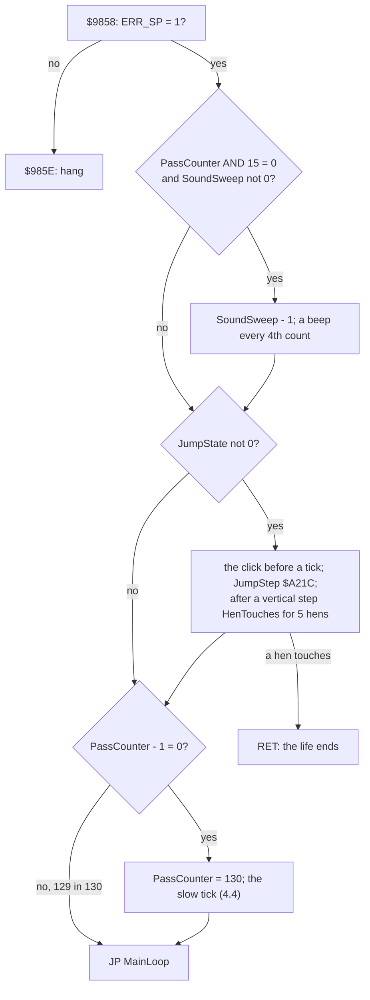

**A worked example: the light pass.** On foot, with PassCounter not a multiple of 16, a pass runs 16 instructions:
`LD HL,(nn)` 16 T, `DEC HL` 6, `LD A,H` 4, `OR L` 4, `JR NZ` not taken 7, `LD HL,nn` 10, `LD A,(nn)` 13, `AND n` 7,
`JR NZ` taken 12, `LD A,(nn)` 13, `AND A` 4, `JR Z` taken 12, `LD HL,nn` 10, `DEC (HL)` 11, `JP NZ` 10 and
`JP MainLoop` 10. That is 149 T.

The trace agrees, and shows a second effect. ERR_SP `$5C3D`, PassCounter `$72DC`, JumpState `$7325` and SoundSweep
`$7370` lie in contended memory (`$4000-$7FFF`). In `levels-1-9` frames 400-600, the passes that start in the border
take 149 T (11 985 of 12 888 such passes). Those that start while the ULA fetches the paper take 156, 160, 164 or
168 T (18 911 passes, median 160). The pass in 16 that tests SoundSweep takes 167 T in the border.

**The point**: a light pass costs about 150 T. With 130 of them before each tick, the loop spends about 20 500 T a
tick on waiting that is really counting. That is the loop's only clock.

## 4.4 The slow tick and its countdowns

The tick runs its tasks in a fixed order. Each periodic task has its own countdown: the tick decrements it, and the task
runs when it reaches 0, which reloads it.

```asm
        LD (HL),$82             ; $98BE: PassCounter = 130
        LD A,$FE
        IN A,($FE)
        BIT 0,A                 ; CAPS SHIFT?
        JR NZ,MainLoopBonus
        LD A,$BF
        IN A,($FE)
        BIT 4,A                 ; H?
        JR NZ,MainLoopAbort
MainLoopHold:
        LD A,$FD
        IN A,($FE)
        BIT 1,A                 ; wait for S
        JR NZ,MainLoopHold
        JR MainLoopBonus
MainLoopAbort:
        LD A,$FD
        IN A,($FE)
        BIT 0,A                 ; A?
        JR NZ,MainLoopBonus
        POP HL
        JP Start
MainLoopBonus:
        LD A,(BonusRunning)
        AND A
        JR Z,MainLoopDuck
        LD HL,BonusDelay
        DEC (HL)
        JR NZ,MainLoopDuck
        LD (HL),$32             ; 50 ticks
        LD B,$00
        CALL CountDown          ; the bonus - 10
MainLoopDuck:
        LD HL,DuckDelay
        DEC (HL)
        JR NZ,MainLoopLifts
        LD (HL),$0C             ; 12 ticks
        CALL MoveDuck
MainLoopLifts:
        LD HL,LiftDelay
        DEC (HL)
        JR NZ,MainLoopPickup
        LD (HL),$02             ; 2 ticks
        CALL MoveLifts
        ...                     ; on a lift: HarryY + 1; at $A5, RET NC (the life ends)
MainLoopPickup:
        CALL TakeEggOrGrain     ; every tick
        LD HL,TimeDelay
        DEC (HL)
        JR NZ,MainLoopHens
        LD (HL),$0A             ; 10 ticks
        LD B,$01
        CALL CountDown          ; the time - 1
        LD HL,$0402
        CALL Beep               ; the clock's tick
MainLoopHens:
        LD HL,HenDelay
        DEC (HL)
        JR NZ,MainLoopHarry
        LD C,$03                ; 3 ticks
        LD A,(Level)
        CP $20
        JR C,MainLoopHenDelay
        DEC C                   ; 2 from level 33
MainLoopHenDelay:
        LD (HL),C
        CALL MoveHen            ; the next of the five hen slots
MainLoopHarry:
        ...                     ; PaintCells; a jump key starts a jump; else LeaveLadder,
                                ; WalkHarry, FallOffEdge, ClimbLadder
```

| Order | Task | Countdown | Period | First at | Routine |
| ---: | --- | --- | ---: | ---: | --- |
| 1 | hold and abort keys | | every tick | 1 | `$98C0` |
| 2 | the bonus - 10 (while BonusRunning) | BonusDelay `$7345` | 50 | 1 | CountDown `$A1B8`, B = 0 |
| 3 | the duck | DuckDelay `$734C` | 12 | 1 | MoveDuck `$A0C8` |
| 4 | the lifts | LiftDelay `$733C` | 2 | 5 | MoveLifts `$A014` |
| 5 | the pickup | | every tick | 1 | TakeEggOrGrain `$99DF` |
| 6 | the time - 1, a beep | TimeDelay `$7346` | 10 | 1 | CountDown `$A1B8`, B = 1 |
| 7 | one hen slot | HenDelay `$736B` | 3 (2 from level 33) | 1 | MoveHen `$911E` |
| 8 | Harry | | every tick | 1 | PaintCells, then the jump start or LeaveLadder, WalkHarry, FallOffEdge, ClimbLadder |

The hen period 2 from level 33 is known only from the code (`$9944`): no recording passed level 10 (doc 1.14), and
the levels after 9 were not traced against the beam.

SetupLevel `$AE9C` starts every countdown at 1, except LiftDelay at 5. So the first tick of a level runs the bonus,
the duck, the time and a hen together. The lifts then run on the odd ticks from 5.

- **MoveLifts runs on every level.** On a level without a lift, LiftX is `$FF` and MoveLifts returns at once.
- **A hen slot, not a hen.** MoveHen advances HenTurn through the five slots and returns at once when the slot is
  empty (x = `$FF`). Each hen therefore moves once every 15 ticks (10 from level 33), however many hens there are.
- **The hens' random walk restarts each level.** SetupLevel sets HenDelay with `LD (HenDelay),HL` and HL = 1, a
  16-bit store. The second byte goes to `$736C`, the low byte of RandomPtr, MoveHen's pointer into the ROM. So every
  level starts the hens' random sequence at the same point (known only from the code).
- **Grain shifts the phases.** It sets BonusDelay and TimeDelay to 255, so after a grain the bonus and the time no
  longer line up with the duck.

```mermaid
flowchart LR
    T["$98BE: tick"] --> K["keys: hold / abort"]
    K --> B{"BonusRunning and<br/>BonusDelay - 1 = 0?"}
    B -->|yes| B1["CountDown B = 0; BonusDelay = 50"]
    B -->|no| D
    B1 --> D{"DuckDelay - 1 = 0?"}
    D -->|yes| D1["MoveDuck; DuckDelay = 12"]
    D -->|no| L
    D1 --> L{"LiftDelay - 1 = 0?"}
    L -->|yes| L1["MoveLifts; LiftDelay = 2;<br/>on a lift HarryY + 1"]
    L -->|no| P
    L1 --> P["TakeEggOrGrain"]
    P --> TT{"TimeDelay - 1 = 0?"}
    TT -->|yes| T1["CountDown B = 1; Beep; TimeDelay = 10"]
    TT -->|no| H
    T1 --> H{"HenDelay - 1 = 0?"}
    H -->|yes| H1["MoveHen; HenDelay = 3 or 2"]
    H -->|no| HA
    H1 --> HA["Harry: PaintCells, jump or walk, edge, ladder"]
```

**A worked example: ticks 1, 13, 61 and 301 of a level with no grain taken.**

| Tick | Bonus (1, 51, ...) | Duck (1, 13, ...) | Lifts (5, 7, ...) | Time (1, 11, ...) | Hens (1, 4, ...) | Tasks |
| ---: | --- | --- | --- | --- | --- | --- |
| 1 | yes | yes | no: LiftDelay 5 to 4 | yes | yes | B D T H |
| 13 | no | 1 + 12 | odd | no | 1 + 4 x 3 | D L H |
| 61 | no | 1 + 5 x 12 | odd | 1 + 6 x 10 | 1 + 20 x 3 | D L T H |
| 301 | 1 + 6 x 50 | 1 + 25 x 12 | odd | 1 + 30 x 10 | 1 + 100 x 3 | B D L T H |

The duck and the time meet every 60 ticks, and the duck, the time and the bonus every 300. So the heaviest tick, B D
L T H, comes once in 300 ticks: `work/stage2/heavy_tasks.out` found exactly one in 300 ticks run from the
`levels-1-3` end state (level 4, Harry standing): 83 985 T. The traced one of `gameover-name` below is 82 312 T; the
spread between the two is the hen slot due and Harry's x. Both are near 84 000 T. The heaviest kind is not the
longest tick: `work/docs/ceA/l19-400-ticks.tsv` holds a D L T H tick of 99 289 T (`levels-1-9` frame 592, T 18 167;
the next are 83 129, 81 745 and 80 080 T). What adds the 16 000 T is not settled (suspected: Harry drawn twice, by
WalkHarry and by ClimbLadder at x AND 7 = 0, or a pickup redraw). So a tick takes 28 000 to about 100 000 T.

**Witness**: `gameover-name`, level 4, Harry standing, no grain taken. At the start of frame 7450 the bonus digits read
3 8 8 and BonusDelay 23, the time digits 8 4 2 and TimeDelay 3. That is 12 bonus steps and 27 ticks, and 58 time steps
and 7 ticks: tick 578 of the life on both counts. Tick 601 is due 23 ticks later. The trace of frames 7450-7490 finds
it at frame 7467, T 4372, as B D L T H, 82 312 T long.

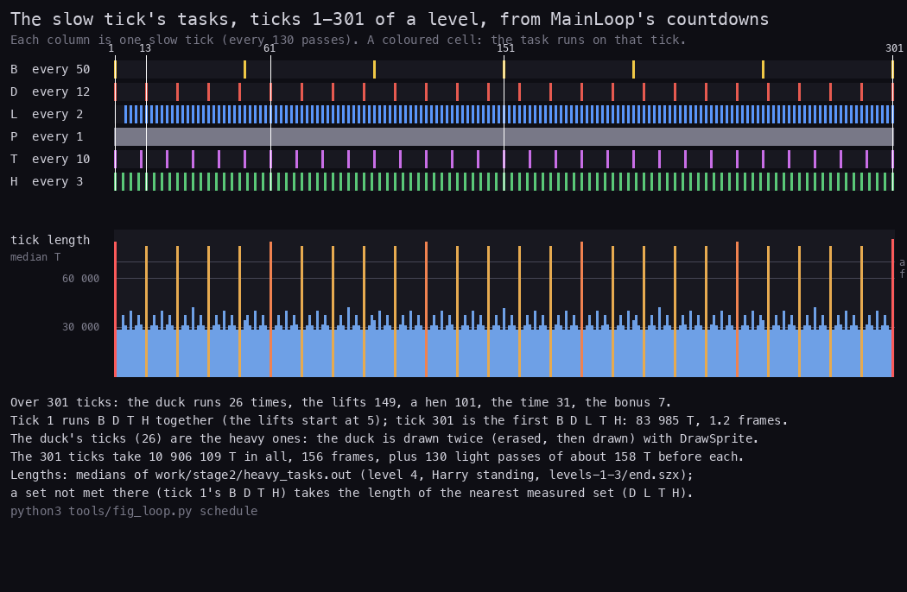

*Which tasks each slow tick 1-301 runs, replayed from the countdowns SetupLevel sets (no recording), with each tick's
length taken from the medians of work/stage2/heavy_tasks.out (`levels-1-3/end.szx`, level 4, Harry standing, 300
ticks). Made with `python3 tools/fig_loop.py schedule`.*

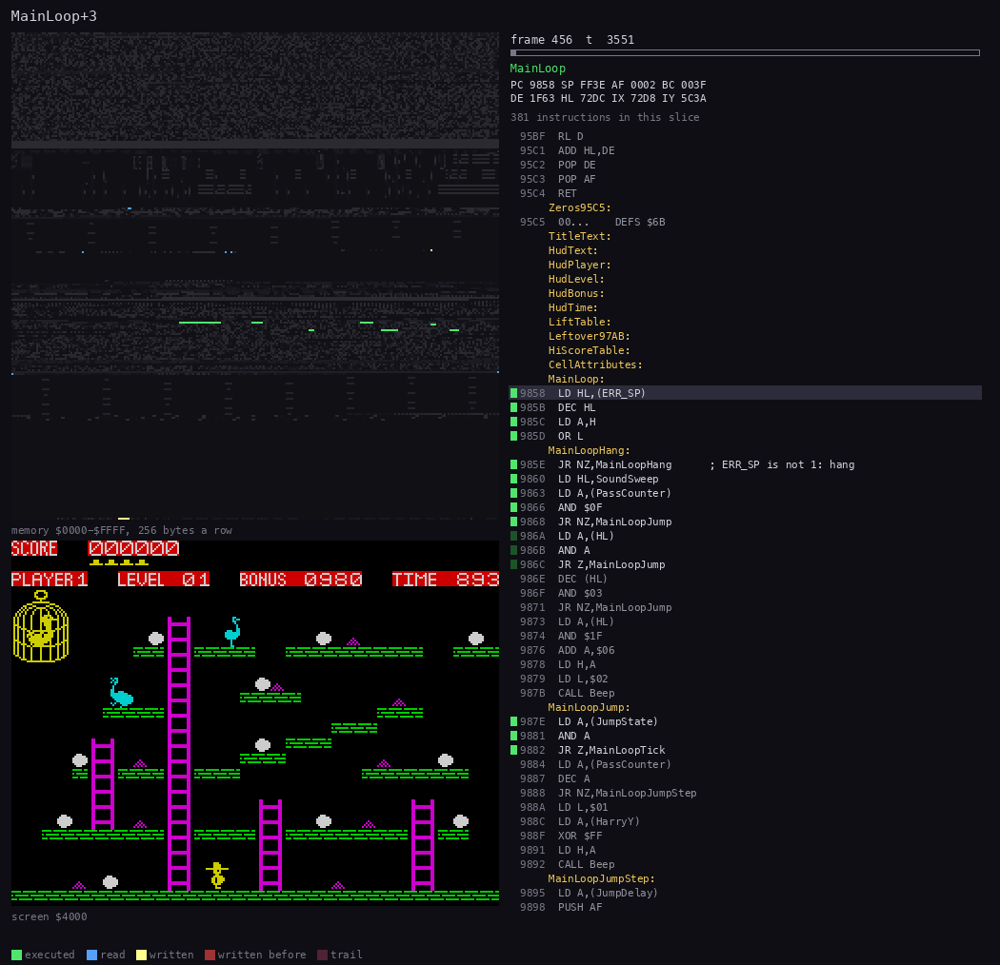

*MainLoop at work in `levels-1-9`, frames 456:0-460:40000 (level 1): the light passes, and the ticks H, L T, none and
D L H, with the duck erased and redrawn in its cage, a hen's step, Harry redrawn, and the time digits. Made with
`python3 ../../kit/routine_anim.py --work work/docs/ceA/l19 --window 456:0-460:40000 --listing build/game.lst
--out docs/img/routines/MainLoop.gif --view screen --pictures 90`.*

**The point**: six countdowns with periods 50, 12, 2, 10 and 3 turn one tick into a fixed 300-tick pattern. The
cost of a tick is set by the duck: every twelfth tick is two to three times as long as the others.

## 4.5 The interrupt: IM 2 for speech, IM 1 for the name entry

Start sets I to `$B2` and selects IM 2. VectorTable `$B200-$B306` holds 263 bytes of `$9C`. On the 48K the data bus
reads `$FF` during the acknowledge, so the CPU takes the vector from `$B2FF-$B300`. That is `$9C9C`, and
PhraseVector `$9C9C` jumps to PhraseInterrupt `$9CC2`. Any bus value would also give `$9C9C`.

```asm
PhraseVector:                   ; $9C9C
        JP PhraseInterrupt
PhraseInterrupt:                ; $9CC2
        PUSH AF
        PUSH HL
        LD A,(PhraseTimer)
        CP $FF
        JR Z,PhraseDone         ; no phrase: nothing to do
        DEC A
        JR Z,PhraseNext
        LD (PhraseTimer),A      ; not yet: count this interrupt
        JR PhraseDone
PhraseNext:
        LD HL,(PhrasePtr)
        LD A,(HL)
        LD (PhraseTimer),A      ; the next pair's wait, in interrupts
        CP $FF
        JR Z,PhraseDone         ; $FF: the phrase is over
        INC HL
        LD A,(HL)
        OUT ($9F),A             ; the allophone to the speech unit
        INC HL
        LD (PhrasePtr),HL
PhraseDone:
        POP HL
        EI
        POP AF
        RETI
```

StartPhrase `$9CEB` takes a phrase number 1-33 in A. It works only while PhraseTimer is `$FF`: it takes the address at
PhraseTable `$C8C8` + 2 x (A - 1) and sets PhraseTimer to 1, so the next interrupt sends the first pair. WaitPhrase
`$A960` spins until PhraseTimer is `$FF` again:

```asm
WaitPhrase:                     ; $A960
        LD A,(PhraseTimer)
        XOR $FF
        JR NZ,WaitPhrase
        RET
```

In pseudocode:

```text
StartPhrase(n):                       # $9CEB, n = 1-33
    if PhraseTimer != $FF: return     # a phrase is playing: the request is lost
    PhrasePtr = PhraseTable[n - 1]
    PhraseTimer = 1                   # the next interrupt sends the first pair

PhraseInterrupt():                    # $9CC2, every interrupt under IM 2
    if PhraseTimer == $FF: return     # idle
    PhraseTimer -= 1
    if PhraseTimer != 0: return       # still holding the last allophone
    PhraseTimer = byte at PhrasePtr   # the next pair's hold, in interrupts
    if PhraseTimer == $FF: return     # the end pair: the phrase is over
    OUT ($9F), byte at PhrasePtr + 1  # the allophone
    PhrasePtr += 2
```

**A worked example: the timing of phrase 7, "high score".** Its pairs are 4 HH2, 5 AY, 16 PA1, 5 SS, 6 KK3, 5 OR,
2 PA1, then the end pair (`src/res/sound/Phrases.txt`). StartPhrase sets PhraseTimer to 1, so interrupt 1 sends HH2
and sets the timer to 4. Interrupts 2-4 count it down to 1, and interrupt 5 takes it to 0 and sends AY. Each pair is
therefore sent 1 + (the holds before it) interrupts after the start: HH2 at 1, AY at 5, PA1 at 10, SS at 26, KK3 at
31, OR at 37, PA1 at 42, and the end pair is read at 44 = 1 + 43. A WaitPhrase after it spins for 44 interrupts,
0.88 s. The traced `OUT ($9F)` values of `gameover-name` (StartPhrase at frame 39 425) are these allophones in this
order (doc 9.5).

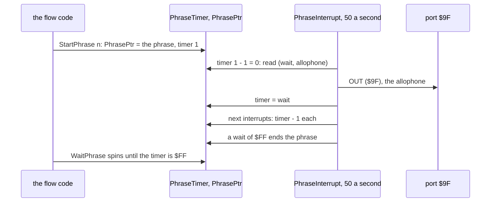

- **The handler costs about 100 T.** On an idle interrupt it runs 102 T of code by the listing's timings (`JP`, two
  PUSHes, `LD A,(nn)`, `CP`, `JR Z`, two POPs, `EI`, `RETI`), 121 T with the 19 T of the IM 2 acknowledge.
  `re_session.py interrupts` measures 106 T an entry on average over `c1`'s game window, the entries that send an
  allophone included (WALKTHROUGH 1). Either way it is under 0.2 % of a frame. The main loop never sees it.
- **The handler does not scan the keyboard.** The game reads the keys through its own `IN` instructions.
- **The phrases time the pauses even with no speech unit.** WaitPhrase waits for the timer, not for the sound. A
  48K without the unit waits just as long; the OUTs to `$9F` go nowhere.
- **The game itself never executes DI.** The ROM's BEEP does, and the tunes are played through it. So interrupts are
  lost while a tune plays: the title tune (46 notes, about 7.2 s, 320 interrupts lost) and the death tune (24 notes, about 5.3 s,
  about 240 lost; doc 9.6).

The L1 builds count the interrupts (`$9C9C`) against the frames:

| Recording | Frames | Interrupts | Lost | Tunes played |
| --- | ---: | ---: | ---: | --- |
| `c1` (game window) | 3 624 | 3 104 | 520 | 320 in the title tune, 199 in the death tune (cut by the window's end at frame 8916), 1 other |
| `idle-1p` | 30 001 | 28 802 | 1 199 | five death tunes: about 5 x 240 interrupts |
| `levels-1-9` | 25 491 | 25 251 | 240 | one death tune |

**IM 1 in the name entry.** EnterHiScore switches to IM 1 at `$A8A0`, so that the ROM's interrupt routine scans the
keyboard into KSTATE and LAST_K. It then waits with HALT, one frame at a time:

```asm
        IM 1                    ; $A8A0: the ROM's keyboard scan
        LD L,$10                ; the column: 16
EnterHiScoreCursor:
        LD A,$B7
        CALL PrintChar          ; the cursor
EnterHiScoreRelease:
        LD A,(KSTATE4)
        XOR $FF
        JR NZ,EnterHiScoreRelease ; wait until no key is held
EnterHiScoreWait:
        HALT                    ; one frame
        LD A,(KSTATE4)
        XOR $FF
        JR Z,EnterHiScoreWait
        LD A,(LAST_K)
        CP $0D
        JR Z,EnterHiScoreDone   ; ENTER
        CP $0C
        JR NZ,EnterHiScoreChar  ; DELETE erases (`name-delete` frame 63, doc 5.8)
        ...
EnterHiScoreChar:
        CP $20
        JR C,EnterHiScoreWait
        ...                     ; column $19 reached: ignored (9 characters at most)
EnterHiScoreDone:
        ...
        IM 2                    ; $A8E9
        RET
```

While IM 1 is on, no phrase advances, because the ROM's routine at `$0038` does not call the game's handler. Phrase 7
(the congratulation) is played to its end (WaitPhrase `$A88F`) before IM 1 `$A8A0`, so no phrase runs under IM 1.
The trace was not taken over the name entry; the order is the listing's (`$A88A-$A8A0`). `gameover-name` shows the name entry
from frame 39 483 to the title at about 39 700. The L1 build counts HALT at 0.27 % of that recording's time.

**The point**: the interrupt is a sound driver, nothing more. The only frame-locked code in the game is the name
entry, and it uses the ROM's interrupt.

## 4.6 Passes and ticks a frame

The trace of `levels-1-9`, frames 400-600 (level 1, the bot playing), counts 32 367 passes and 249 slow ticks in
200 frames: 161.8 passes and 1.25 ticks a frame. The trace of `gameover-name`, frames 7250-7450 (level 4, Harry
standing), counts 32 572 passes and 250 ticks: 162.9 and 1.25.

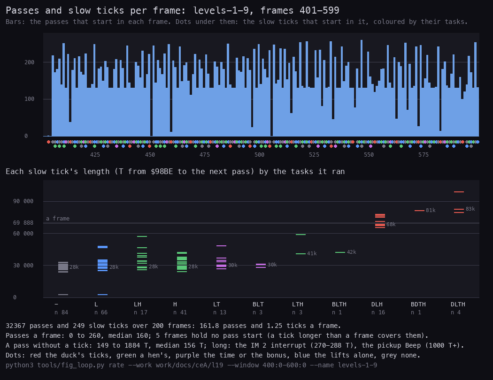

*`levels-1-9`, frames 401-599: the passes that start in each frame (bars), the slow ticks that start in it (dots,
coloured by their tasks), and each tick's length by its tasks. Frames 401 and 402 are the end of SetupLevel's pause.
Made with `python3 tools/fig_loop.py rate --work work/docs/ceA/l19 --window 400:0-600:0 --name levels-1-9`.*

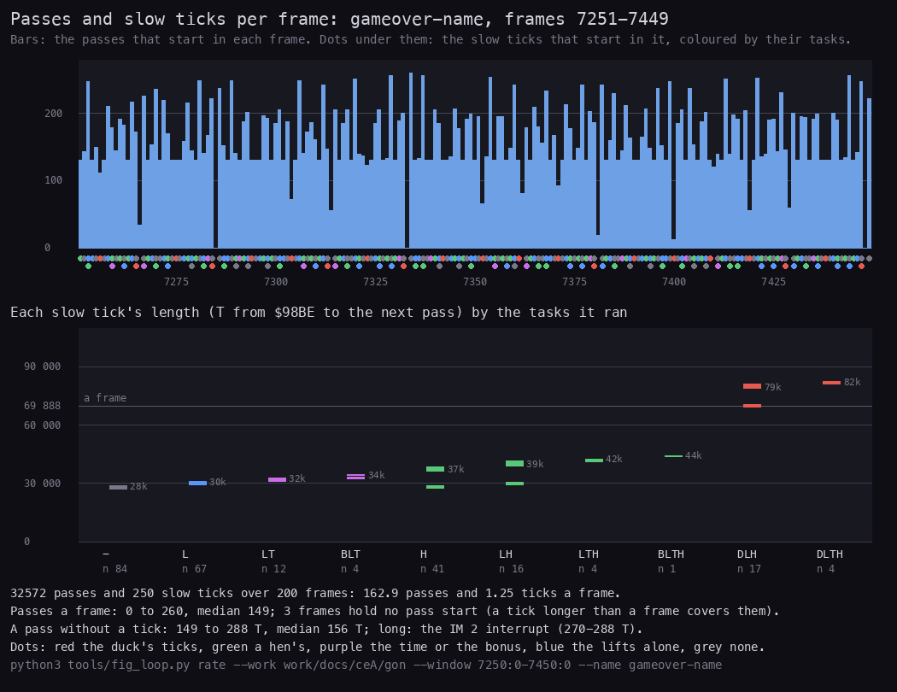

*`gameover-name`, frames 7251-7449: level 4 with a lift, Harry standing. The H ticks fall in two groups: about
28 000 T for an empty hen slot, about 37 000 T for a hen that moves. Made with
`python3 tools/fig_loop.py rate --work work/docs/ceA/gon --window 7250:0-7450:0 --name gameover-name`.*

- **A frame holds 0 to 260 pass starts.** The light passes come in runs of 130 between two ticks, and a frame has
  room for at most two runs (2 x 20 500 T) with a tick between them. A frame covered by a duck tick holds very few
  passes, or none: that tick is longer than a frame.
- **One tick takes about 0.8 frames on average.** That is 130 light passes (about 20 500 T) plus the tick (median
  28 400 T with nothing to do, about 80 000 T with the duck, up to 99 289 T seen).
- **The tick that does nothing is not cheap.** Harry is redrawn on every tick, even when he stands still: WalkHarry
  sets his frame and DrawSprite draws him (about 25 000 T, 4.7). During a jump WalkHarry is not called (`$99C5`), and a
  tick takes about 3 000 T, unless Harry's x is a multiple of 8: ClimbLadder still runs in the air and redraws him
  there (`$9E9F`, `$9F3B`), about 25 000 T. On foot at such an x he is drawn twice a tick, by WalkHarry and by
  ClimbLadder.

The L1 counts over whole recordings give lower rates, because those include the menus, the level ends, the death
tunes and SetupLevel's pauses, where the main loop does not run:

| Recording | Frames | Passes (`$9858`) | Ticks (`$98BE`) | Passes a frame | Ticks a frame |
| --- | ---: | ---: | ---: | ---: | ---: |
| `c1` (game window) | 3 624 | 312 001 | 2 401 | 86.1 | 0.66 |
| `idle-1p` | 30 001 | 2 027 615 | 15 602 | 67.6 | 0.52 |
| `tour-type2` | 8 001 | 1 120 211 | 8 618 | 140.0 | 1.08 |
| `tour-redefine` | 12 001 | 1 676 872 | 12 901 | 139.7 | 1.07 |
| `levels-1-3` | 7 023 | 794 893 | 6 118 | 113.2 | 0.87 |
| `fall-death` | 3 601 | 369 393 | 2 844 | 102.6 | 0.79 |
| `gameover-name` | 41 201 | 5 677 888 | 43 684 | 137.8 | 1.06 |
| `levels-1-9` | 25 491 | 2 894 339 | 22 274 | 113.5 | 0.87 |
| all | 130 943 | 14 873 212 | 114 442 | 113.6 | 0.87 |

Each recording has 130 passes a tick, within one: 14 873 212 / 114 442 = 129.96. The few missing passes are the
ticks that ended the play.

**What this means in play.** Harry walks one pixel a tick, so about 62 pixels a second on level 1. The time loses 1
every 10 ticks, so TIME 900 lasts 9 000 ticks: at 1.25 ticks a frame that is 7 200 frames, 2 minutes 24 seconds. A
hen moves 4 pixels once every 15 ticks: 62.6 ticks a second / 15 x 4, about 17 pixels a second (25 from level 33,
known only from the code).

**The point**: the game runs at about 1.25 ticks a frame in play, and this rate is the speed of everything. A
faster CPU, or an emulator that does not stall for contention, makes the whole game faster.

## 4.7 The beam: a light stretch and the heaviest tick

The screen writes of the main loop, against the beam, from `kit/beam_timeline.py`. A dot left of the diagonal lands
before the beam reaches its line and shows in this frame; a dot right of it shows in the next frame.

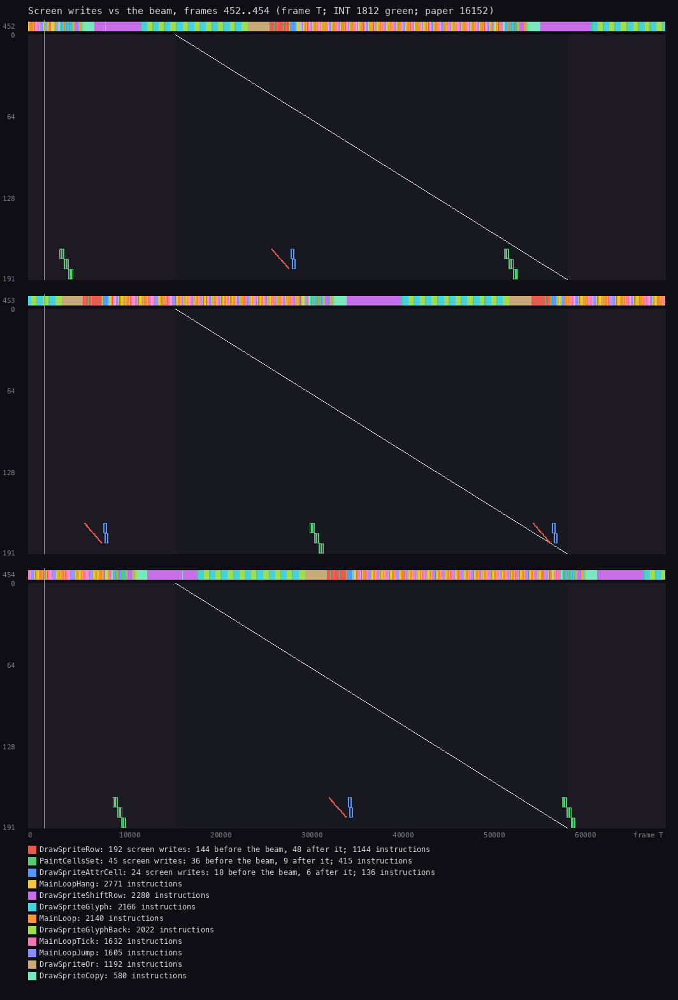

*`levels-1-9`, frames 452-454 (level 1): ticks L, H, L, none, L H. Each tick redraws Harry at the bottom (red: the
sprite rows of DrawSprite; blue: their attributes; green: PaintCells). The strip above each panel shows the routine
the CPU is in; the bands of orange, yellow and pink between the ticks are the light passes (MainLoop, MainLoopHang,
MainLoopTick, MainLoopJump). Made with `python3 ../../kit/beam_timeline.py --work work/docs/ceA/l19 --window
452:0-455:0 --listing build/game.lst --out docs/img/loop/beam-light.png --frames 3`.*

- A tick that only redraws Harry takes about 28 000 T, the length of 125 screen lines. Most of it builds the sprite
  over the background in buffers; Harry's 16 rows reach the screen in about 2 000 T near its end.
- The light passes fill the gaps: about 20 500 T, or 92 screen lines, between two ticks.
- Harry is written wherever the tick happens to fall. In frame 453 his rows land once before the beam (at about
  T 7 000) and once just after it has passed them (at about T 56 000), so that redraw shows a frame late. The game
  makes no attempt to race the beam, and a sprite can tear.

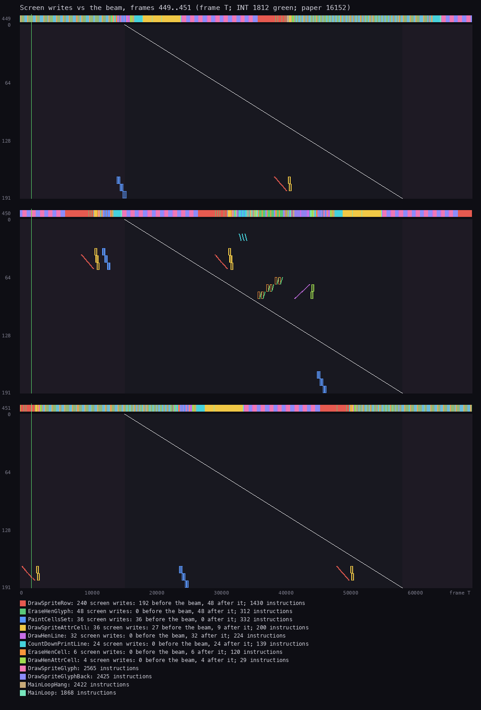

*`levels-1-9`, frames 449-451: the tick D L T H that starts at frame 449, T 63 224, and runs 80 080 T, past the whole
of frame 450. Frame 450 holds no pass start. The duck is erased and redrawn in its cage (red rows near the top), the
time digits change (cyan), a hen steps (purple and green), then Harry. Made with
`python3 ../../kit/beam_timeline.py --work work/docs/ceA/l19 --window 449:0-452:0 --listing build/game.lst
--out docs/img/loop/beam-l1-heavy.png --frames 3`.*

**A heaviest-kind tick.** The B D L T H tick of `gameover-name` starts at frame 7467, T 4372, and ends at frame 7468,
T 16 796: 82 312 T, 1.18 frames. The same kind measured 83 985 T from the `levels-1-3` end state (4.4); the spread
is the hen slot due and Harry's x. In order:

| Frame, T | Task | What is written |
| --- | --- | --- |
| 7467, about 5 000 | the bonus | the three bonus digits (CountDownPrintLine) |
| 7467, about 6 000-25 000 | the duck, erased | DrawSprite with the blank frame 12 at the cage; its rows reach the screen at about 19 000-24 000 |
| 7467, about 25 000-45 000 | the duck, drawn | DrawSprite with the next wing frame; its rows at about 40 000-44 000 |
| 7467, about 46 000 | the lifts | the two platforms one pixel up (DrawLiftLine) |
| 7467, about 49 000 | the time | the three time digits, then the beep `$0402` |
| 7467, about 50 000-60 000 | a hen | erased (EraseHenGlyph) and drawn (DrawHenLine) |
| 7467, about 60 000, to 7468, 16 796 | Harry | PaintCells, then DrawSprite; his rows at 7468, about 12 000-14 000 |

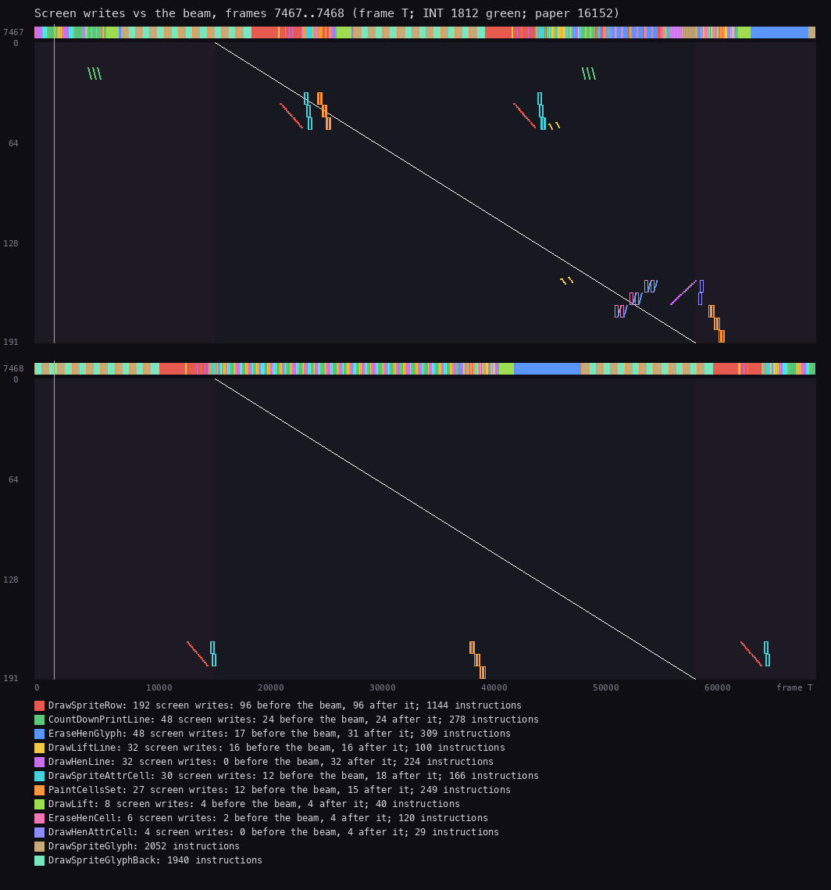

*`gameover-name`, frames 7467-7468 (level 4, Harry standing): the tick B D L T H from 7467:4372 to 7468:16796, then
130 light passes, then the next tick at about 7468:37 000. Made with `python3 ../../kit/beam_timeline.py --work
work/docs/ceA/gon --window 7467:0-7469:0 --listing build/game.lst --out docs/img/loop/beam-heaviest.png --frames 2`.*

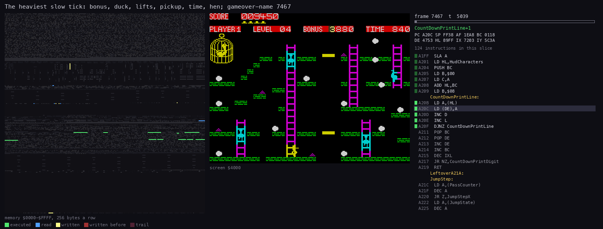

*The same tick at work: `gameover-name` frames 7467:4000-7468:17200, 80 pictures of about 1 040 T each. The cage is
empty for a moment between the duck's erase and its redraw. Made with `python3 ../../kit/routine_anim.py --work
work/docs/ceA/gon --window 7467:4000-7468:17200 --listing build/game.lst --out docs/img/routines/MainLoopTick.gif
--view screen --pictures 80`.*

**The point**: the heaviest-kind tick is just over one frame long, and about half of it is the duck; the worst tick
seen is about 1.4 frames long (99 289 T). The duck costs the same
in its cage as when it flies, because MoveDuck erases and redraws it every twelfth tick on every level.

## 4.8 The delays between scenes

Outside the main loop, the game waits with busy loops of known length and with WaitPhrase:

```asm
Delay:                          ; $A921: BC counts of 26 T
        PUSH AF
DelayLoop:
        DEC BC                  ; 6
        LD A,B                  ; 4
        OR C                    ; 4
        JR NZ,DelayLoop         ; 12
        POP AF
        RET
```

| Wait | Where | Length | Frames |
| --- | --- | ---: | ---: |
| Delay with BC = 0 (65 536 counts) | PlayerTurn, LifeLost; twice at the level end | 1 703 936 T | 24.4 |
| Delay 500 | each step of the title scroller | 13 000 T | 0.19 |
| Delay 5000 | between BoxWipe's boxes | 130 000 T | 1.9 |
| SetupLevel's pause: 30 x 10 000 counts | `$B102`, before `JP MainLoop` | 7 800 000 T | 111.6 |
| WaitPhrase | InstructionsPage entry `$A50D`, after StartGame `$A629`, PlayLevel's return `$A656`, LifeLost `$A707`, EnterHiScore (twice: `$A887`, `$A88F`) | until the phrase's last pair | 1 per interrupt counted |
| The ROM's BEEP | the title tune, the death tune | 7.2 s, 5.3 s | 364, 264 |

**A worked example: the start of level 2 in `levels-1-9`.** The twelfth egg of level 1 is taken during frame 2007.
The bonus is counted in by frame 2016 (doc 1.8). Two Delay 0 take 49 frames, then come BoxZoom (the boxes at frame
2080) and "LEVEL 2" (frame 2170). SetupLevel then draws map 2 and waits 112 frames before `JP MainLoop`. The
screenshot at frame 2300 shows map 2 with no hen on it ([level-drawn.png](img/play/level-drawn.png)). SetupLevel
fills the hen records but does not draw them: each hen appears when MoveHen first moves its slot, one slot every 3
ticks.

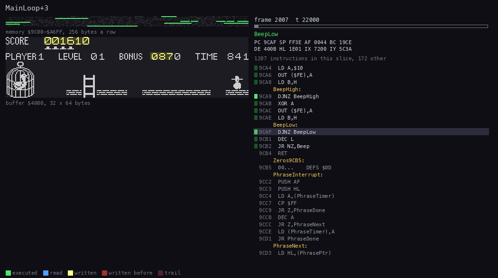

*A screen that holds the loop: the level end of level 1 in `levels-1-3`, frames 2007-2016, where PlayLevelBonus,
CountDown, AddScore and Beep run instead of MainLoop (the same level end as the worked example above, in the bot's
other recording). The bonus runs down from 0880 while the score runs up to 002490, one Beep `$1E04` a step. Made
with doc 8's command: `python3 ../../kit/routine_anim.py --work work/docs/ceD/l13 --listing build/game.lst --window
2007:10000-2016:60000 --out docs/img/routines/CountDown.gif --pc A675-A68C,A1B8-A219,A3A7-A40E,9CA4-9CB4 --view
buffer:4000:32x64:screen --range 9C00-A6FF --step 12000 --delay 150`. Then laid out
narrow (1026 px: the memory grid and the screen at half size on the left, the code on the right) with `tools/anim_compact.py` (`--grid 12,34,1036,78`, `--view 1048,34,2072,290`, `--code 2076`, the two
labels as in the picture).*

**The point**: between levels the game waits about 4 to 6 seconds in fixed loops. These waits are in T-states, so
they too run faster on a faster machine.
