# 5. Controls

What this covers: the one input device (the keyboard on port `$FE`), the three key sets and how a key is tested, the
cursor-key "joystick" and why there is no Kempston, the menu keys, the key redefinition, HOLD and ABORT, the path
from a key to Harry's movement, and the name entry under the ROM's keyboard scan.

The recordings it rests on:

- `tour-type2` (WALKTHROUGH 6.0, `tests/inputs/tour-type2.txt`, 8001 frames): the title, I, key type 2, S, two
  players; Harry walked with 8 and 5, jumps with 4 at 1120 and with 5 + 4 at 1200.
- `tour-redefine` (`tests/inputs/tour-redefine.txt`, 12 001 frames): I, R and the redefine page given Q A O P M.
- `gameover-name` (`tests/inputs/gameover-name.txt`, 41 201 frames): the name prompt at frame 39 483, C E 1, ENTER.
- Three recordings made for this document with `tools/bot.py record --exact`, each from a snapshot with an input
  script and TTD on (no POKE). The commands are in `work/docs/ceB-NOTES.md`:
  - `hold-abort`: from `work/stage1/lab/x0/loaded.szx` (the title, key type 1) with
    `work/docs/ceB/hold-abort.txt`, 1801 frames: S, one player, walk right with 0, CAPS SHIFT + H at 1100, S at
    1300, CAPS SHIFT + A at 1400.
  - `name-delete`: from `work/docs/ceB/name-39520.szx` (`gameover-name` at frame 39 520, the name prompt before any
    key) with `work/docs/ceB/name-delete.txt`, 401 frames: C, E, DELETE (CAPS SHIFT + 0), 1, ENTER.
  - `redefine-odd`: from `loaded.szx` with `work/docs/ceB/redefine-odd.txt`, 1501 frames: R, then 9, Q, W + E,
    1 + Q, O, P, M; then a game on the new keys.

Frames and times: a memory sample "at frame N" is the state at the start of frame N (TTD `memory_at`). An event "at
frame N T t" is an instruction in an access trace that ran in frame N, t T-states into the emulator's
frame; the interrupt comes at T 1812 of it (the ROM's `$0038` runs at T 1826 in `name-delete`), and the first
paper line is drawn from T 16 152. The
counts of runs are from the L1 builds (`l1.json`) of the seven stage-1 recordings and the three above. The terms
[pass](README.md#terms) and slow tick are defined in [docs/README.md](README.md#terms).

## 5.1 One device: the keyboard on port `$FE`

The game reads one device, the keyboard. Every one of its 22 port reads is `IN A,($FE)`, with the half row's high
byte loaded into A just before. The game never reads port `$1F` (Kempston) and never uses `IN r,(C)`, so it has no
joystick reader of its own. The only other reader of the keyboard is the ROM: under IM 1 in the name entry (5.8),
the ROM's KEY-SCAN `$028E` reads the rows through `IN A,(C)` with C = `$FE`.

A half row is read by putting its select byte in the port's high byte. A bit of the result is 0 while its key is
down. Bit 0 is the key at the outer end of the half row.

| High byte | Bit 0 | Bit 1 | Bit 2 | Bit 3 | Bit 4 |
| --- | --- | --- | --- | --- | --- |
| `$FE` | CAPS SHIFT | Z | X | C | V |
| `$FD` | A | S | D | F | G |
| `$FB` | Q | W | E | R | T |
| `$F7` | 1 | 2 | 3 | 4 | 5 |
| `$EF` | 0 | 9 | 8 | 7 | 6 |
| `$DF` | P | O | I | U | Y |
| `$BF` | ENTER | L | K | J | H |
| `$7F` | SPACE | SYMBOL SHIFT | M | N | B |

The 22 sites, with their runs summed over the ten recordings:

| Address | Routine | What it reads | Runs |
| --- | --- | --- | ---: |
| `$98C2` | MainLoopTick | CAPS SHIFT (HOLD and ABORT) | 112 945 |
| `$98CA` | MainLoopTick | H (HOLD) | 2 |
| `$98D2` | MainLoopHold | S (resume) | 357 078 |
| `$98DC` | MainLoopAbort | A (ABORT) | 1 |
| `$9958`, `$9968` | MainLoopHarry | the two jump keys, KeyTable pairs 4 and 5 | 99 748, 99 744 |
| `$9994`, `$99A8` | MainLoopJumpStart | right, then left: the jump's direction | 474, 238 |
| `$9D39`, `$9D72` | WalkHarry | left, then right | 93 752, 88 152 |
| `$9ECA`, `$9F04` | ClimbLadder | up, then down | 5 555, 2 273 |
| `$9F8D`, `$9FB8` | LeaveLadder | left, then right | 93 061, 87 546 |
| `$A4AD`, `$A4B6`, `$A4BF` | TitleLoopKeys | S, R, I | 38 248, 38 240, 38 239 |
| `$A54C`, `$A555`, `$A55E` | InstructionsKeys | S, R, keys 1-3 | 181, 414, 413 |
| `$A5D5` | StartGameKey | keys 1-4 (players) | 2 385 259 |
| `$AAFE` | ReadAnyKey | all eight half rows | 451 252 |

The access traces agree. In the traces of this document (`tour-type2` frames 999-1004, `hold-abort` 1099-1102,
1299-1310 and 1399-1402, `name-delete` 0-130, `tour-redefine` 215-216) every port read had the low byte `$FE`,
from the game's code and from the ROM's `$0296` under IM 1. No read of port `$1F` and no read of any other port
appears.

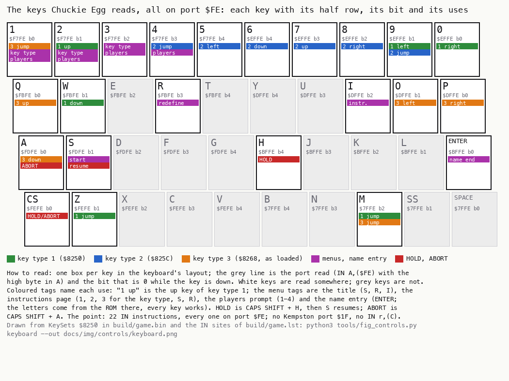

*Figure 5.1: the keys the game reads, with their port, bit and uses. Drawn from KeySets `$8250` in `build/game.bin`
and the IN sites of `build/game.lst`: `python3 tools/fig_controls.py keyboard --out docs/img/controls/keyboard.png`.
No recording: the figure is the image's data.*

How to read:

- One box per key, in the keyboard's layout.
- The grey line in a box is the port read (`IN A,($FE)` with the high byte in A) and the bit that is 0 while the key
  is down.
- White keys are read somewhere; grey keys are never read by the game.
- The coloured tags name each use. "1 up" is the up key of key type 1. The menu tags are the title (S, R, I), the
  instructions page (1, 2, 3, S, R), the players prompt (1-4) and the name entry (ENTER). HOLD is CAPS SHIFT + H, S
  resumes, ABORT is CAPS SHIFT + A.

The point: the game has one input device. There is no joystick port, and the "joystick" of the instructions page is
a joystick interface that maps itself onto the keys 6-0 or 5-8 (5.3).

## 5.2 The key sets and the key test

A key set is a table of six pairs. Each pair is (mask, port row): the mask byte, then the high byte of the port. The
six pairs are, in order: up, down, left, right, jump, jump. Three sets lie at KeySets `$8250`, 12 bytes each.

| Set | Address | KeyType | up | down | left | right | jump | jump |
| --- | --- | ---: | --- | --- | --- | --- | --- | --- |
| type 1 | `$8250` | 6 | 2 `1D F7` | W `1D FB` | 9 `1D EF` | 0 `1E EF` | Z `1D FE` | M `1B 7F` |
| type 2 | `$825C` | 5 | 7 `17 EF` | 6 `0F EF` | 5 `0F F7` | 8 `1B EF` | 4 `17 F7` | 9 `1D EF` |
| type 3 | `$8268` | 3 | Q `1E FB` | A `1E FD` | O `1D DF` | P `1E DF` | M `1B 7F` | 1 `1E F7` |

Set 3 is the one RedefineKeys writes (5.5). Its bytes above are those of the loaded image, the same keys the
redefine page offers by default.

The mask has a 0 at the key's bit and 1 elsewhere in bits 0-4. A key is down when the row's five bits, ORed with the
mask, are not all 1:

```text
KeyDown(pair):
    bits = IN(pair.row * 256 + $FE) AND $1F    ; 0 = a key of the half row is down
    return (bits OR pair.mask) != $1F           ; only the mask's 0 bit can pull it below $1F
```

The game does not test a key set in place. SetupLevel `$AE9C` copies the chosen set into KeyTable `$732E` at the
start of every level and life. The choice is by KeyType `$732D`: 5 takes set 2, below 5 set 3, above 5 set 1.

```text
SetupLevelKeys:
    if KeyType == 5:  source = KeySet2         ; $825C
    elif KeyType < 5: source = KeySet3         ; $8268
    else:             source = KeySets         ; $8250
    copy 12 bytes from source to KeyTable      ; $732E
```

```text
B0A6  3A 2D 73     LD A,(KeyType)
B0A9  FE 05        CP $05
B0AB  21 5C 82     LD HL,KeySet2
B0AE  28 08        JR Z,SetupLevelKeys     ; 5: type 2
B0B0  21 68 82     LD HL,KeySet3
B0B3  38 03        JR C,SetupLevelKeys     ; below 5: type 3
B0B5  21 50 82     LD HL,KeySets           ; above 5: type 1
B0B8  01 0C 00     LD BC,$000C             ; SetupLevelKeys
B0BB  11 2E 73     LD DE,KeyTable
B0BE  ED B0        LDIR
```

Every reader then tests KeyTable with the same five instructions. WalkHarry's test of the left key (pair 2, at
KeyTable+4 and +5) is typical:

```text
9D36  3A 33 73     LD A,(KeyTable+5)       ; the row: the port's high byte
9D39  DB FE        IN A,($FE)
9D3B  E6 1F        AND $1F
9D3D  57           LD D,A
9D3E  3A 32 73     LD A,(KeyTable+4)       ; the mask
9D41  B2           OR D
9D42  FE 1F        CP $1F
9D44  28 29        JR Z,WalkHarryRight     ; $1F: left is not down
```

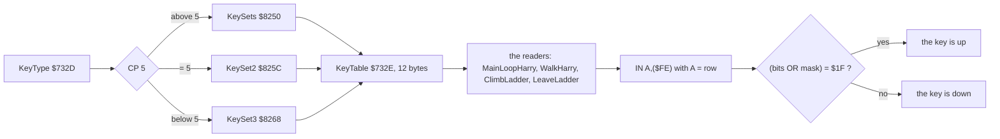

Worked example, key 0 of set 1 (right, pair 3 = `1E EF`) with 0 held:

1. A = `$EF`; `IN A,($FE)` reads port `$EFFE`, the half row 0 9 8 7 6.
2. With only 0 down, the row reads `xxx11110`; AND `$1F` gives `$1E`.
3. `$1E` OR the mask `$1E` = `$1E`, not `$1F`: right is down.
4. Had 9 been held instead, the row would read `$1D`; `$1D` OR `$1E` = `$1F`: right is up.

Where KeyType comes from:

- Start `$A410` sets it to 6 (type 1).
- The instructions page sets it to 10 on entry. Ten plays as type 1 until a key 1-3 is pressed.
- On the instructions page, keys 1-3 store `IN $F7FE AND 7`: 1 gives `$06`, 2 gives `$05`, 3 gives `$03`. The
  value is the bit pattern of the half row, so two of the keys together give 4, 2, 1 or 0, all of which play as
  type 3.
- RedefineKeys sets it to 3.

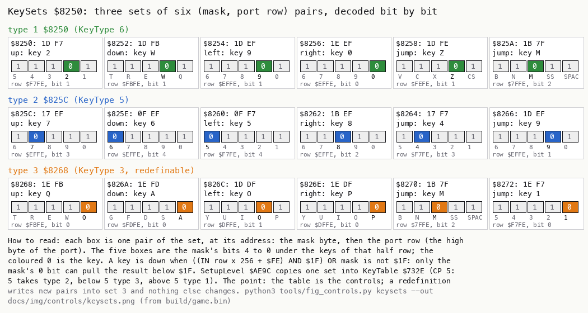

*Figure 5.2: the three key sets as bytes and as keys. Drawn from `build/game.bin`:
`python3 tools/fig_controls.py keysets --out docs/img/controls/keysets.png`. No recording.*

How to read:

- One row per set, one box per pair, at its address: the mask byte, then the port row.
- The five cells under each pair are the mask's bits 4 to 0 under the keys of that half row. The coloured 0 is the
  key.
- Below the cells: the port and the bit.

The point: the key set is the whole of the controls. A redefinition writes new pairs into set 3 and changes nothing
else.

Witness: the KeyTable copies at the level starts of `tour-type2` (KeyType 5: KeyTable = `17 EF 0F EF 0F F7 1B EF 17
F7 1D EF`, the sample at frame 990) and of `redefine-odd` (KeyType 3, frame 1450, the new set 3 of 5.5).

## 5.3 The cursor keys and the "joystick"

Key type 2 is the cursor keys: 5 left, 6 down, 7 up, 8 right. These are the keys a Protek or AGF style cursor
interface pretends to press, so the instructions page calls type 2 the joystick. The jump keys of type 2 are 4 and
9.

The fire button of a cursor interface presses 0. Key 0 is not in set 2, so the fire button does not jump: the
player of a cursor joystick jumps with 4 or 9 on the keyboard. A Sinclair Interface 2 port 2 (6-0 as left, right,
down, up, fire) does not match set 1 either: set 1 reads 9 for left and 0 for right, not 6 and 7.

There is no Kempston reader. The evidence:

- The 22 IN instructions of 5.1 are all `IN A,($FE)` with a row byte in A. None can address port `$1F`
  (`IN A,($FE)` puts A on the high byte and `$FE` on the low byte).
- There is no `IN r,(C)` in `build/game.lst`, so no read with a computed port.
- In the traces listed in 5.1, every port read has the low byte `$FE`.

Witness: `tour-type2`, key type 2 chosen with key 2 at frame 330; Harry walked with 8 from frame 1000 and with 5 from
1060, and jumped with 4 at 1120 (figure 5.6).

The point: "joystick" in Chuckie Egg means a cursor interface. The keys it presses are the controls; nothing in the
game knows a joystick is there.

## 5.4 The menu keys

The title, the instructions page and the players prompt each poll a few fixed keys. None of them uses the key sets.

| Screen | Key | Read | Effect |
| --- | --- | --- | --- |
| title, TitleLoopKeys `$A4AB` | S | `$FD` bit 1 | StartGame `$A59D` |
| title | R | `$FB` bit 3 | RedefineKeys `$AA49` |
| title | I | `$DF` bit 2 | InstructionsPage `$A4C8` |
| instructions, InstructionsKeys `$A543` | S | `$FD` bit 1, only when PhraseTimer `$7373` is `$FF` | StartGame |
| instructions | R | `$FB` bit 3 | RedefineKeys |
| instructions | 1, 2, 3 | `$F7` AND 7 | KeyType = the bits; the flashing bar moves to the type's row |
| players prompt, StartGameKey `$A5D3` | 1-4 | `$F7` AND `$0F` | Players = the count |

The instructions page reads S only once PhraseTimer is `$FF`. So S does nothing while a phrase of the scroller is
still being played out.

The players prompt counts the 1 bits below the lowest 0 bit, plus one:

```text
StartGameKey:
    repeat: bits = IN($F7FE) AND $0F until bits != $0F   ; wait for 1, 2, 3 or 4
    players = 1
    while bits AND 1: bits >>= 1; players += 1           ; skip the keys not down
```

```text
A5D3  3E F7        LD A,$F7                ; StartGameKey
A5D5  DB FE        IN A,($FE)
A5D7  E6 0F        AND $0F
A5D9  FE 0F        CP $0F
A5DB  28 F6        JR Z,StartGameKey       ; none of 1-4
A5DD  06 00        LD B,$00
A5DF  04           INC B                   ; StartGameCount
A5E0  CB 3F        SRL A
A5E2  38 FB        JR C,StartGameCount     ; a 1: that key is up, count on
A5E4  68           LD L,B
A5E5  26 01        LD H,$01
A5E7  22 3A 73     LD (Players),HL         ; Players = B, the current player 1
```

Worked example: key 3 alone gives `$0B` = `1011`. SRL shifts out 1 (B = 1), 1 (B = 2), then 0 (B = 3): three
players. Keys 2 and 3 together give `$09` = `1001`: 1 then 0, so B = 2. The lowest key held wins.

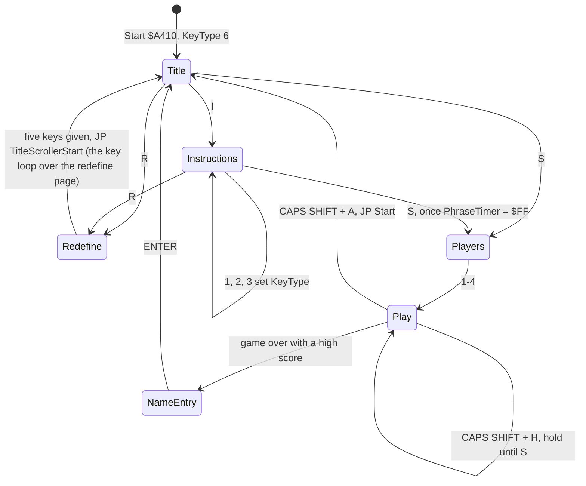

Witness: `tour-type2` (I at 250, 2 at 330, S at 400, 2 at 600: two players); `tour-redefine` (I, R, then four
players); `hold-abort` (S at 50; 1 at 600 for one player). The screens are in WALKTHROUGH 6.1: the title
(`tour-type2`, 200), the instructions (300), the players prompt (500).

The point: the menus are three polling loops with fixed keys. ABORT leads to Start, which resets KeyType to 6: an
aborted game forgets key type 2 or 3 (5.6).

## 5.5 Redefining the keys

R on the title or the instructions page runs RedefineKeys `$AA49`. It asks for five keys: up, down, left, right and
jump. The sixth pair of set 3, the second jump key 1, is never asked for and is kept.

The steps:

1. ClearScreen, KeyType = 3.
2. The first ten bytes of KeySet3 `$8268` are set to 0. The sixth pair `1E F7` (key 1) stays.
3. The prompt "press the key you wish to use to" is printed at row `$11`, and the five labels "move up", "move down",
   "move left", "move right", "jump" at rows `$0E`, `$0C`, `$0A`, `$08`, `$06` from column `$0A`.
4. Row 6 of the attributes (`$58C0`), the prompt's row (H `$11`), is painted with ink 4. The labels' rows keep the
   black ink of ClearScreen, so the labels are invisible.
5. It waits until no key is down.
6. RedefineOne runs five times. Each call paints a 13-cell bar in ink 3 (magenta) under its label, which makes the
   label visible, then waits for a key.
7. JP TitleScrollerStart `$AAB7`: the title's scroller and its key loop run over the redefine page; the title page
   is not redrawn (TitlePage is skipped).

RedefineOne `$AB19`:

```text
RedefineOne(slot, nameCell):
    paint 13 attribute cells with 3                   ; the label shows
    loop:
        repeat: (bits, row, rowNumber) = ReadAnyKey() until bits != 0
        slot.mask = bits; slot.row = row               ; written before the test
        name = KeyNames[5 * (rowNumber - 1) + lowestZeroBit(bits)]
        nameCell = name                                ; into InstructionsText $83F6 + 5k
        if not KeyUsed(): break                        ; a key already taken: read again
    PrintChar(name) at the end of the label
    repeat: ReadAnyKey() until bits == 0               ; the release
```

ReadAnyKey `$AAF4` scans the half rows from `$FE` to `$7F`. It returns the row's bits in L, the row in H, and the
row number in E (8 for `$FE` down to 1 for `$7F`). A second half row with a key down returns HL = 0, as if no key
were down.

```text
ReadAnyKey:
    found = 0; result = 0
    for row in $FE, $FD, $FB, $F7, $EF, $DF, $BF, $7F (rowNumber 8 down to 1):
        bits = IN(row * 256 + $FE) AND $1F
        if bits == $1F: continue
        if found: return 0                       ; keys in two half rows: refused
        found = 1; result = (bits, row, rowNumber)
    return result
```

```text
AAF4  16 00        LD D,$00                ; ReadAnyKey: D = rows found
AAF6  21 00 00     LD HL,$0000
AAF9  06 08        LD B,$08
AAFB  0E FE        LD C,$FE
AAFD  79           LD A,C                  ; ReadAnyKeyRow
AAFE  DB FE        IN A,($FE)
AB00  E6 1F        AND $1F
AB02  FE 1F        CP $1F
AB04  28 0C        JR Z,ReadAnyKeyNext
AB06  15           DEC D
AB07  20 04        JR NZ,ReadAnyKeyFound   ; the first row with a key
AB09  21 00 00     LD HL,$0000             ; the second: nothing
AB0C  C9           RET
AB0D  16 01        LD D,$01                ; ReadAnyKeyFound
AB0F  6F           LD L,A                  ; L = the bits (the mask)
AB10  61           LD H,C                  ; H = the row
AB11  58           LD E,B                  ; E = the row number
AB12  CB 21        SLA C                   ; ReadAnyKeyNext: $FE, $FD, $FB ... $7F
AB14  CB C1        SET 0,C
AB16  10 E5        DJNZ ReadAnyKeyRow
AB18  C9           RET
```

The bits ReadAnyKey returns are stored as the mask unchanged. So two keys of one half row give one mask with two 0
bits, and either key alone then works (5.2's test is true when any 0 bit of the mask meets a key down).

The name comes from KeyNames `$AC54`, five names per half row, row `$7F` first:

| Row number E | Row | Names (bits 0-4) |
| ---: | --- | --- |
| 1 | `$7F` | `$97` (SPACE), `$99` (SYMBOL SHIFT), m, n, b |
| 2 | `$BF` | `$9A` (ENTER), l, k, j, h |
| 3 | `$DF` | p, o, i, u, y |
| 4 | `$EF` | 0, 9, 8, 7, 6 |
| 5 | `$F7` | 1, 2, 3, 4, 5 |
| 6 | `$FB` | q, w, e, r, t |
| 7 | `$FD` | a, s, d, f, g |
| 8 | `$FE` | `$98` (CAPS SHIFT), z, x, c, v |

The codes `$97`-`$9A` are glyphs of the character set made for the key names (doc 08).

```text
AB24  CD F4 AA     CALL ReadAnyKey         ; RedefineOneKey
AB27  7D           LD A,L
AB28  A7           AND A
AB29  28 F9        JR Z,RedefineOneKey     ; no key, or two rows
AB2B  4D           LD C,L
AB2C  43           LD B,E
AB2D  DD 75 00     LD (IX+$00),L           ; the mask
AB30  DD 74 01     LD (IX+$01),H           ; the row
AB33  21 4E AC     LD HL,KeyNames-$0006
AB36  11 05 00     LD DE,$0005
AB39  19           ADD HL,DE               ; RedefineOneRow: + 5 per row number
AB3A  10 FD        DJNZ RedefineOneRow
AB3C  23           INC HL                  ; RedefineOneBit
AB3D  CB 39        SRL C
AB3F  38 FB        JR C,RedefineOneBit     ; up to the lowest 0 bit
AB41  7E           LD A,(HL)               ; the name
AB42  C1           POP BC
AB43  C5           PUSH BC
AB44  02           LD (BC),A               ; into InstructionsText
AB45  F5           PUSH AF
AB46  CD BA AA     CALL KeyUsed
AB49  F1           POP AF
AB4A  05           DEC B
AB4B  28 D7        JR Z,RedefineOneKey     ; B = 1: already used
```

KeyUsed `$AABA` compares the new pair with the pairs before it. It walks back from the new pair, and the count it uses
is the new pair's number plus 2. The two extra pairs lie just before KeySet3: they are the last two pairs of KeySet2,
its jump keys 4 (`17 F7`) and 9 (`1D EF`). So 4 or 9 pressed alone can never be chosen, for any of the five keys; held
with another key of its half row it gives a different mask (4 + 5: `07 F7`) and is accepted, as that combination. The
sixth pair of set 3, key 1, is never compared: key 1 can be given as a direction and then also jumps.

```text
KeyUsed:
    k = the number of the pair just written (0-4)
    for j in k-1 down to -2:                     ; pairs -1 and -2 are KeySet2's 9 and 4
        if KeySet3[j] == KeySet3[k]: return used
    return free
```

```text
AABA  21 67 82     LD HL,KeySet3-$0001     ; KeyUsed
AABD  06 00        LD B,$00
AABF  23           INC HL                  ; KeyUsedEnd: find the first empty row byte
AAC0  23           INC HL
AAC1  04           INC B
AAC2  78           LD A,B
AAC3  FE 06        CP $06
AAC5  28 04        JR Z,KeyUsedLast
AAC7  7E           LD A,(HL)
AAC8  A7           AND A
AAC9  20 F4        JR NZ,KeyUsedEnd
AACB  2B           DEC HL                  ; KeyUsedLast: back to the new pair
AACC  2B           DEC HL
AACD  05           DEC B
AACE  04           INC B
AACF  56           LD D,(HL)               ; D = its row
AAD0  2B           DEC HL
AAD1  5E           LD E,(HL)               ; E = its mask
AAD2  2B           DEC HL                  ; KeyUsedCompare: B pairs back
AAD3  7E           LD A,(HL)
AAD4  2B           DEC HL
AAD5  BA           CP D
AAD6  20 07        JR NZ,KeyUsedNext
AAD8  7E           LD A,(HL)
AAD9  BB           CP E
AADA  20 03        JR NZ,KeyUsedNext
AADC  06 01        LD B,$01                ; used
AADE  C9           RET
AADF  10 F1        DJNZ KeyUsedCompare     ; KeyUsedNext
AAE1  06 00        LD B,$00                ; free
AAE3  C9           RET
```

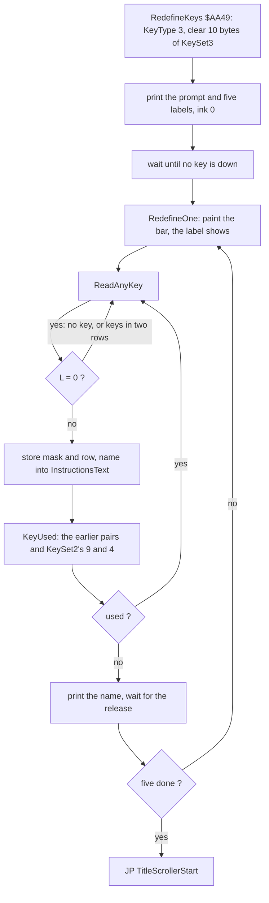

Worked example, Q for up (`tour-redefine`, the first key):

1. ReadAnyKey finds a key in row `$FB`, the third row scanned: B = 6, so E = 6. The bits are `11110` = `$1E`.
2. Pair 0 of KeySet3 becomes `1E FB`.
3. The name index is 5 x (6 - 1) + 0 = 25: KeyNames[25] = `$71`, "q".
4. KeyUsed finds the first empty row byte at pair 1, so B = 2. It compares `1E FB` with `1D EF` (9) and `17 F7`
   (4): free.
5. "q" is printed after "move up".

Witnesses:

- `tour-redefine`: Q A O P M given. In its L1, KeyUsedNext `$AADF` runs 20 times and the second compare `$AADA` once.
  The trace of frames 215-216 holds one call.
- `redefine-odd`:
  - 9 for up: the pair `1D EF` is stored at frame 112 and refused by KeyUsed (it equals KeySet2's 9). The prompt
    stays at "move up".
  - Q at 150 replaces it.
  - W and E together at 190 give one pair, `19 FB` (bits 1 and 2 at 0), named "w".
  - 1 and Q together at 230 are in two half rows: ReadAnyKey gives nothing and "move left" waits.
  - O, P, M follow. The final KeySet3 is `1E FB 19 FB 1D DF 1E DF 1B 7F 1E F7`.
  - In the game from frame 1000, KeyType is 3; the sample at 1450 shows KeyTable equal to that set.

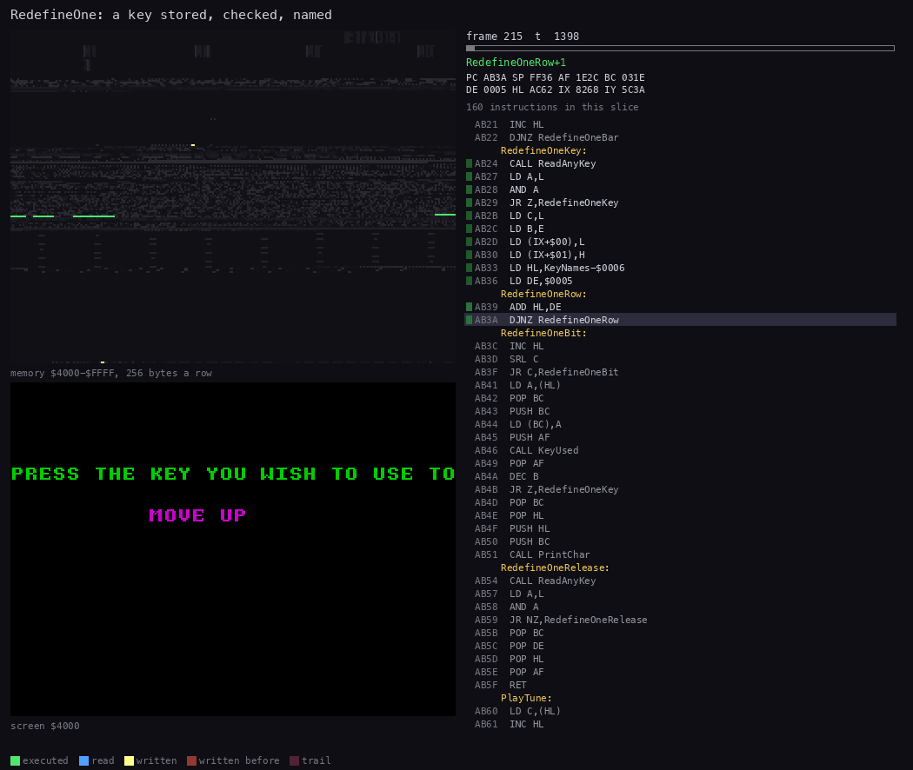

*Animation 5.1: RedefineOne and KeyUsed storing one key. `tour-redefine`, frames 215:0-216:0, 50 pictures:
`python3 ../../kit/routine_anim.py --work work/docs/ceB/tour-redefine --window 215:0-216:0 --listing build/game.lst
--view screen --pc AABA-AB5F,9C40-9C8D --range 4000-FFFF --pictures 50 --title "RedefineOne: a key stored, checked,
named" --out docs/img/routines/RedefineOne.gif`.*

How to read:

- Three panes: the memory map at the top left, the screen at that moment under it, and on the right the listing
  with the current instruction.
- The memory map is `$4000-$FFFF`, 256 bytes a row: the write to KeySet3 `$8268` and the read of KeyNames `$AC54` show
  as dots in the rows of `$82xx` and `$ACxx`, the code of `$AAxx-$ABxx` in green.
- The frame and T of each picture are in its header.

The point: the pair is written before the check, the check also refuses KeySet2's two jump keys, and only the release
wait separates one key from the next.

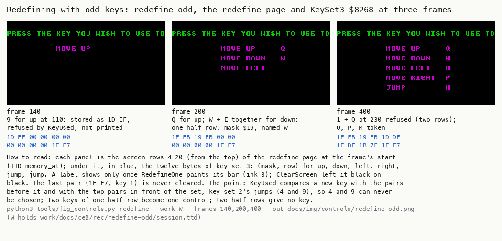

*Figure 5.3: the redefine page and KeySet3 `$8268` at frames 140, 200 and 400 of `redefine-odd`:
`python3 tools/fig_controls.py redefine --work W --frames 140,200,400 --out docs/img/controls/redefine-odd.png`
(W holds `work/docs/ceB/rec/redefine-odd/session.ttd`). Samples at the frames' starts.*

How to read:

- Each column is one frame: a crop of the screen, then the 12 bytes of KeySet3 below it.
- At 140, 9 has been refused: pair 0 holds `1D EF`, but "move up" still has no name.
- At 200, Q is up and W + E is down as `19 FB`.
- At 400, all five are given; "move left" got O after 1 + Q was ignored.

The point: the redefinition takes any one half row's keys as a group, refuses keys in two half rows, and silently
refuses 4 and 9.

## 5.6 HOLD and ABORT

Two keys are read in play outside the key sets, in the slow tick of the main loop. CAPS SHIFT is tested first. With
CAPS SHIFT down:

- H holds the game. MainLoopHold `$98D0` loops on S and nothing else runs; S resumes.
- Otherwise A aborts. POP HL drops the return address into PlayLevel and `JP Start` goes back to the title.

```text
MainLoopTick:
    PassCounter -= 1
    if PassCounter != 0: goto MainLoopNext     ; 129 of 130 passes stop here
    PassCounter = $82
    if CAPS SHIFT down:
        if H down:
            repeat until S down                ; HOLD
        elif A down:
            drop PlayLevel's return; goto Start   ; ABORT
    ... the bonus, the duck, the lifts, the hens, Harry
```

```text
98B7  21 DC 72     LD HL,PassCounter       ; MainLoopTick
98BA  35           DEC (HL)
98BB  C2 DC 99     JP NZ,MainLoopNext
98BE  36 82        LD (HL),$82             ; the slow tick: every 130 passes
98C0  3E FE        LD A,$FE
98C2  DB FE        IN A,($FE)
98C4  CB 47        BIT 0,A                 ; CAPS SHIFT
98C6  20 1E        JR NZ,MainLoopBonus
98C8  3E BF        LD A,$BF
98CA  DB FE        IN A,($FE)
98CC  CB 67        BIT 4,A                 ; H
98CE  20 0A        JR NZ,MainLoopAbort
98D0  3E FD        LD A,$FD                ; MainLoopHold
98D2  DB FE        IN A,($FE)
98D4  CB 4F        BIT 1,A                 ; S
98D6  20 F8        JR NZ,MainLoopHold
98D8  18 0C        JR MainLoopBonus
98DA  3E FD        LD A,$FD                ; MainLoopAbort
98DC  DB FE        IN A,($FE)
98DE  CB 47        BIT 0,A                 ; A
98E0  20 04        JR NZ,MainLoopBonus
98E2  E1           POP HL
98E3  C3 10 A4     JP Start
```

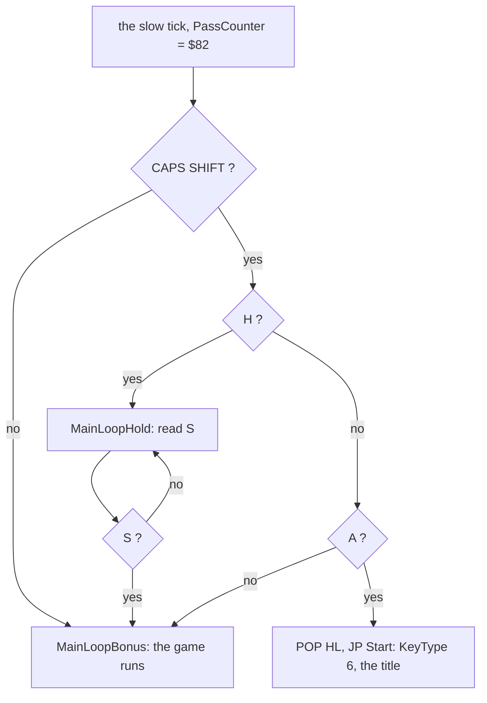

The hold is a busy loop inside the main loop. The IM 2 interrupt still runs (the phrase player and its sounds of
doc 09), but Harry, the hens, the duck, the clock and the bonus all stop. The hold is not a pause screen: nothing is
printed, and the play area stays as it was.

ABORT has a side effect. Start `$A410` sets KeyType to 6, so the next game plays with key type 1 unless the player
chooses again. Start also sets TitleTuneDone 0, so the title after an abort plays the title tune and phrase 20
again (witnessed: `hold-abort` aborts at frame 1400; at frame 1410 TitlePage's `$A45F` falls through, PlayTune
plays all 46 notes, 46 BEEPER calls, then StartPhrase 20 at `$A466`). The score of the aborted game is not entered
in the table (known only from the code: Start leads to the title, not to GameOver).

Worked example, `hold-abort`:

1. CAPS SHIFT + H is held from frame 1100 to 1110. The trace shows the first `$98D0` at frame 1100 T 54 699.
2. MainLoopHold runs 357 078 times. HarryX stays at 136, the hens stay where they are (the samples at 1100,
   1150 and 1299 are equal), and TIME stops.
3. S at frame 1300: the loop leaves at frame 1300 T 305 (`$98D8`).
4. Harry walks on with 0 from 1310.
5. CAPS SHIFT + A from 1400: `$98DC` runs once, then `JP Start` at frame 1400 T 29 350 (`$A410`, one run). The title
   follows.

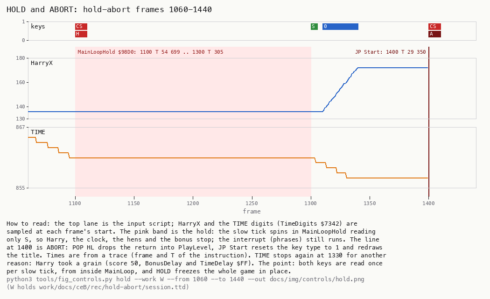

*Figure 5.4: the keys, HarryX and TIME across the hold and the abort. `hold-abort`, frames 1060-1440, samples at the
frames' starts; the times of the events are from traces of frames 1099-1102, 1299-1310 and 1399-1402:
`python3 tools/fig_controls.py hold --work W --from 1060 --to 1440 --out docs/img/controls/hold.png`
(W holds `work/docs/ceB/rec/hold-abort/session.ttd`).*

How to read:

- The top lane is the input script.
- HarryX and the TIME digits (TimeDigits `$7342`) are sampled at each frame's start.
- The pink band is the hold. The line at 1400 is ABORT.
- TIME stops again from about 1330 for another reason: Harry took a grain (score 50; BonusDelay and TimeDelay
  `$FF`).

The point: both keys are read once per slow tick from inside MainLoop, and HOLD freezes the whole game in place.

## 5.7 From the key to Harry

The keys of the key set are read only in the slow tick, by four routines. Left, right and jump are read every tick
(in a jump only ClimbLadder runs); up and down only when Harry is aligned on a ladder column (x AND 7 = 0) and the
cell above his head, or below his feet, is a ladder:

1. MainLoopHarry `$9949` (after PaintCells): when Harry is on foot (JumpState 0), the two jump keys. A jump key down
   starts a jump: JumpState 2, the jump's counters set, and the direction taken from right (tested first), then left.
   The tick then ends: `JR MainLoopNext`.
2. Otherwise, on foot: LeaveLadder (left, then right) and, unless Harry is on a ladder (HarryDir `$0D`), WalkHarry
   (left first, then right).
3. FallOffEdge, unless Harry is on a lift.
4. ClimbLadder, also during a jump: at x AND 7 = 0 only, up when the cell above his head is a ladder, else down when
   one lies below his feet. A jump can catch a ladder.

WalkHarry and ClimbLadder each end with the DrawSprite of Harry (6.7 of doc 06).

```text
SlowTickHarry:
    PaintCells(HarryX, HarryY)
    if JumpState == 0:
        if KeyDown(jump1) or KeyDown(jump2):
            JumpState = 2; set the jump's counters
            if KeyDown(right): dx = +1, dir = 0
            elif KeyDown(left): dx = -1, dir = 4
            else: dx = 0, dir unchanged         ; straight up
            return                              ; the tick ends
        LeaveLadder()                           ; left, right
        if HarryDir != $0D: WalkHarry()         ; left, right; DrawSprite
        if not OnLift: FallOffEdge()
    ClimbLadder()                               ; also in a jump

ClimbLadder:
    if HarryX AND 7 != 0: return                ; no key read, no draw
    if the cell above his head is a ladder and KeyDown(up): climb up
    elif a ladder lies below his feet and KeyDown(down): climb down
    DrawSprite(Harry)
```

```text
9949  2A D8 72     LD HL,(HarryX)          ; MainLoopHarry
994C  CD 38 95     CALL PaintCells
994F  3A 25 73     LD A,(JumpState)
9952  A7           AND A
9953  20 6C        JR NZ,MainLoopFoot      ; in a jump: no new jump
9955  3A 37 73     LD A,(KeyTable+9)       ; jump key 1
9958  DB FE        IN A,($FE)
995A  E6 1F        AND $1F
995C  4F           LD C,A
995D  3A 36 73     LD A,(KeyTable+8)
9960  B1           OR C
9961  FE 1F        CP $1F
9963  20 10        JR NZ,MainLoopJumpStart
9965  3A 39 73     LD A,(KeyTable+11)      ; jump key 2
9968  DB FE        IN A,($FE)
996A  E6 1F        AND $1F
996C  4F           LD C,A
996D  3A 38 73     LD A,(KeyTable+10)
9970  B1           OR C
9971  FE 1F        CP $1F
9973  28 4C        JR Z,MainLoopFoot       ; no jump key: walk, climb
9975  DD 21 D8 72  LD IX,HarryX            ; MainLoopJumpStart
9979  DD 36 4D 02  LD (IX+$4D),$02         ; JumpState 2
```

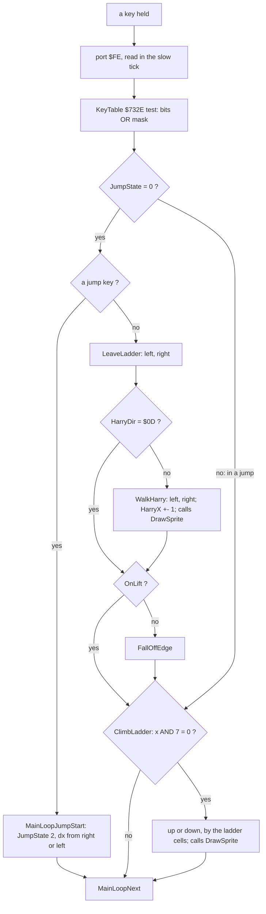

Nothing buffers a key. A key acts in the first slow tick after it goes down and stops acting in the first tick after
it goes up. A slow tick comes about 1.25 times a frame on level 1 (doc 04), so the delay is under one frame.

Worked example, `tour-type2` with key type 2 (8 right, 5 left, 4 jump), samples at the frames' starts:

| Frame | Script | HarryX | HarryY | JumpState |
| ---: | --- | ---: | ---: | ---: |
| 999 | none | 100 | 23 | 0 |
| 1000 | 8 down | 100 | 23 | 0 |
| 1001 | 8 | 101 | 23 | 0 |
| 1002 | 8 | 103 | 23 | 0 |
| 1010 | 8 | 112 | 23 | 0 |
| 1050 | none since 1040 | 149 | 23 | 0 |
| 1150 | 4 at 1120 | 99 | 30 | 2 |
| 1201 | 5 + 4 at 1200 | 99 | 23 | 2 |
| 1220 | 5 | 81 | 34 | 2 |
| 1260 | none since 1230 | 63 | 23 | 0 |

- The first step right is in the trace at frame 1000 T 34 427: the key pressed in frame 1000 moves Harry in frame
  1000.
- The walk is one pixel per slow tick: 49 pixels in 40 frames, about 1.2 a frame.
- The jump at 1120 goes straight up (no direction key): 11 pixels, from y 23 to 34, and back in about 38 frames.
- At 1200, 5 is held with 4: the jump goes left, 36 pixels in 40 frames.

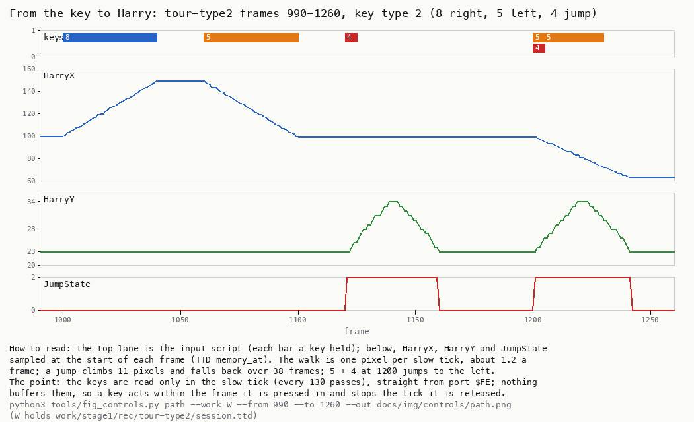

*Figure 5.5: the input script against HarryX, HarryY and JumpState. `tour-type2`, frames 990-1260, samples at the
frames' starts: `python3 tools/fig_controls.py path --work W --from 990 --to 1260 --out docs/img/controls/path.png`
(W holds `work/stage1/rec/tour-type2/session.ttd`).*

How to read:

- The top lane is the input script; each bar is a key held.
- Below: HarryX, HarryY and JumpState at the start of each frame.
- The walks are the slopes of HarryX; the jumps are the humps of HarryY with JumpState 2.

The point: the keys are read straight from the port in the slow tick; a key acts within the frame it is pressed in
and stops at the tick it is released in.

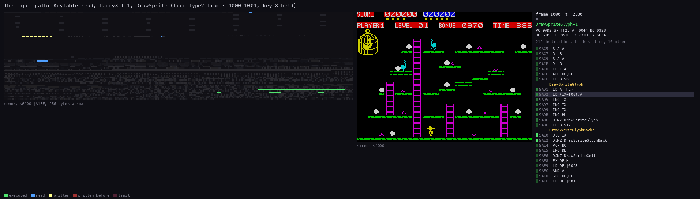

*Animation 5.2: one key, from the port to the screen. `tour-type2`, frames 1000:0-1002:0, 60 pictures:
`python3 ../../kit/routine_anim.py --work work/docs/ceB/tour-type2 --window 1000:0-1002:0 --listing build/game.lst
--view screen --pc 9858-99DC,9D08-9DF0,9A4C-9BFE --range 4000-FFFF --pictures 60 --title "From key 8 to Harry's
step" --out docs/img/routines/WalkHarry.gif`.*

How to read:

- Three panes: the memory map `$4000-$FFFF` at the top left (256 bytes a row: the screen at the top, LiveMap at
  `$61A8`, the code from `$8214`), the screen under it, and the listing on the right.
- The listing pane follows MainLoop, WalkHarry and DrawSprite; the current instruction is highlighted.
- The screen pane shows Harry on level 1. Each step right is one WalkHarry pass followed by one DrawSprite.
- The frame and T of each picture are in its header.

The point: the read, the test, the step and the redraw are one straight path in one slow tick, with no input state
kept between ticks.

Code oddities seen on this path:

- WalkHarry tests left first, the jump start tests right first. With left and right both held, Harry walks left but
  jumps right.
- A jump key ends the tick at once, so the frame a jump starts has no walk step.
- LeaveLadder and WalkHarry run only on foot (JumpState 0); FallOffEdge only on foot and not on a lift (OnLift 0,
  `$99D2-$99D6`); ClimbLadder runs in every tick.

## 5.8 The name entry

After a game over with a score in the table, EnterHiScore `$A80C` asks for a name. It is the only part of the game
that runs under IM 1 and uses the ROM's keyboard scan: the ROM's interrupt at `$0038` runs KEYBOARD `$02BF`, which
decodes the keys into LAST_K `$5C08` and keeps their state in KSTATE `$5C00`. The game keeps IY = `$5C3A` all along,
so the ROM's interrupt finds its system variables (the trace of `name-delete` shows IY = `$5C3A` at `$0038`).

The key codes are the ROM's. With no shift they are lower case: C gives `$63` "c". CAPS SHIFT + 0 gives `$0C`,
DELETE.

```text
EnterHiScore (the input part):
    IM 1
    column = $10
    loop:
        PrintChar(cursor $B7) at column
        wait until KSTATE4 == $FF                ; no key in the ROM's slot: the release
        repeat: HALT until KSTATE4 != $FF        ; a new key, one check per frame
        code = LAST_K
        if code == ENTER ($0D): break
        if code == DELETE ($0C):
            if column == $10: continue waiting   ; nothing to delete
            entry -= 1; *entry = 0
            PrintChar(0) at column; column -= 1  ; the cursor moves back
        elif code >= $20 and column != $19:
            *entry = code; PrintChar(code) at column
            column += 1; entry += 1              ; nine characters at most
    IM 2; D = 2
```

```text
A8A0  ED 56        IM 1
A8A2  2E 10        LD L,$10                ; the first column
A8A4  3E B7        LD A,$B7                ; EnterHiScoreCursor
A8A6  CD 40 9C     CALL PrintChar
A8A9  3A 04 5C     LD A,(KSTATE4)          ; EnterHiScoreRelease
A8AC  EE FF        XOR $FF
A8AE  20 F9        JR NZ,EnterHiScoreRelease
A8B0  76           HALT                    ; EnterHiScoreWait
A8B1  3A 04 5C     LD A,(KSTATE4)
A8B4  EE FF        XOR $FF
A8B6  28 F8        JR Z,EnterHiScoreWait
A8B8  3A 08 5C     LD A,(LAST_K)
A8BB  FE 0D        CP $0D
A8BD  28 25        JR Z,EnterHiScoreDone   ; ENTER
A8BF  FE 0C        CP $0C
A8C1  20 0E        JR NZ,EnterHiScoreChar
A8C3  7D           LD A,L                  ; DELETE
A8C4  FE 10        CP $10
A8C6  28 E8        JR Z,EnterHiScoreWait   ; at the first column: refused
A8C8  AF           XOR A
A8C9  1B           DEC DE
A8CA  12           LD (DE),A               ; the last character cleared
A8CB  CD 40 9C     CALL PrintChar          ; the cursor erased
A8CE  2D           DEC L
A8CF  18 D3        JR EnterHiScoreCursor
A8D1  FE 20        CP $20                  ; EnterHiScoreChar
A8D3  38 DB        JR C,EnterHiScoreWait   ; a control code: ignored
A8D5  47           LD B,A
A8D6  7D           LD A,L
A8D7  FE 19        CP $19
A8D9  28 D5        JR Z,EnterHiScoreWait   ; nine characters: full
A8DB  78           LD A,B
A8DC  12           LD (DE),A               ; stored
A8DD  CD 40 9C     CALL PrintChar
A8E0  2C           INC L
A8E1  13           INC DE
A8E2  18 C0        JR EnterHiScoreCursor
A8E4  E1           POP HL                  ; EnterHiScoreDone
A8E5  F1           POP AF
A8E6  C1           POP BC
A8E7  16 02        LD D,$02
A8E9  ED 5E        IM 2
A8EB  C9           RET
```

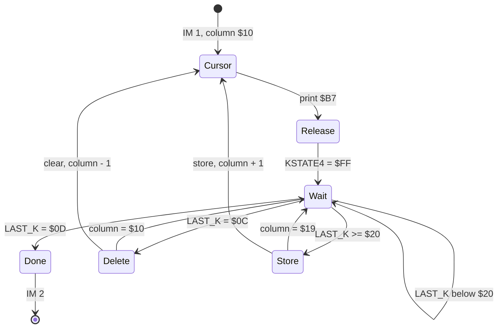

The wait loop HALTs, so it wakes once a frame, after the ROM's interrupt has scanned the keys. A key is taken once:
the next one is accepted only after KSTATE4 has gone back to `$FF`, so holding a key does not repeat it.

Worked example, `name-delete` (events from the trace of frames 0-130, frame and T of the instruction):

| Frame | Key | LAST_K | What happens | Entry at `$97AF` |
| ---: | --- | --- | --- | --- |
| 13 | C | `$63` | stored at T 3360, printed at column `$10` | `63` |
| 38 | E | `$65` | stored, column `$11` | `63 65` |
| 63 | CAPS SHIFT + 0 | `$0C` | DELETE at T 3322: `$97B0` = 0, the cursor back to `$11` | `63 00` |
| 88 | 1 | `$31` | stored at column `$11` | `63 31` |
| 113 | ENTER | `$0D` | EnterHiScoreDone at T 3170, IM 2 | `63 31 00 ...` |

The entry ends as "c1" with the score 009450. After ENTER the BoxWipe of the high score screen begins (blue blocks
from frame about 114).

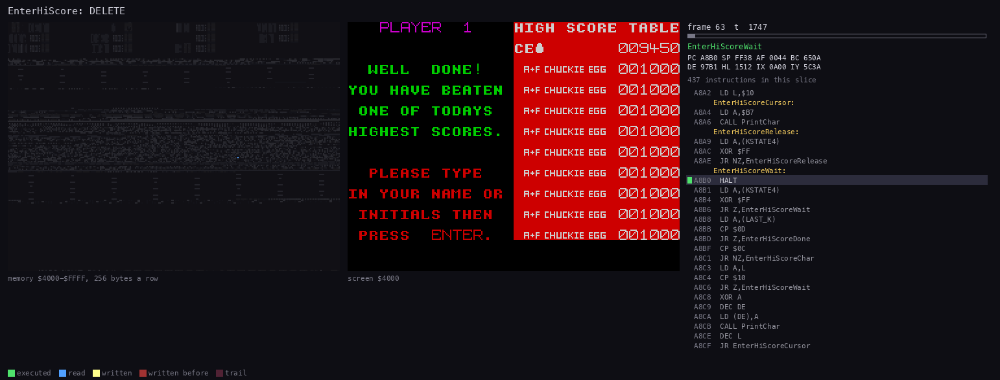

*Animation 5.3: EnterHiScore taking DELETE. `name-delete`, frames 63:0-64:0, 40 pictures:
`python3 ../../kit/routine_anim.py --work work/docs/ceB/name-delete --window 63:0-64:0 --listing build/game.lst
--view screen --pc A80C-A8EB,9C40-9C8D --range 4000-FFFF --pictures 40 --title "EnterHiScore: DELETE" --out
docs/img/routines/EnterHiScore.gif`.*

How to read:

- The listing pane follows EnterHiScore and PrintChar.
- The memory pane is `$4000-$FFFF`, 256 bytes a row; the ROM's system variables KSTATE `$5C00` and LAST_K `$5C08`
  are read in the rows of `$5Cxx`, just under the attributes.
- The screen pane shows the cursor erased at column `$12` and drawn again at `$11`.

The point: the game takes its keys from the ROM's decoded LAST_K here, not from the port, so every key with a code of
`$20` or more is a name character.

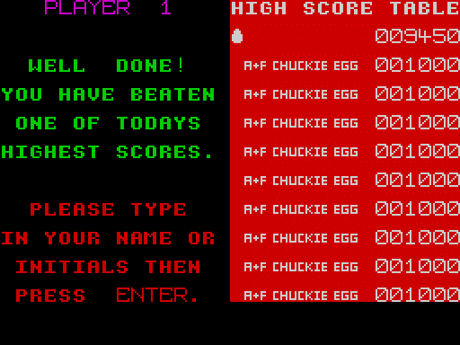

*Animation 5.4: the name entry as the player sees it. `name-delete`, frames 0-116, every frame, scale 2:
`python3 ../../kit/screen_anim.py --work work/docs/ceB/name-delete --from 0 --to 116 --step 1 --scale 2 --delay 40
--hold 2000 docs/img/play/name-entry.gif`.*

How to read:

- One picture per frame, from the screen at the frame's end.
- C appears at 13, E at 38, the E goes at 63, 1 at 88, ENTER at 113 starts the wipe.

The point: DELETE works, the cursor follows, and the name is stored in lower case as the ROM decoded it.

## 5.9 What is known only from the code

- Key type 1's and type 3's jump keys and directions were not all pressed: only 0 (type 1 right) in `hold-abort` and
  Q W E O P M in `redefine-odd` and `tour-redefine`. The others follow from the same KeyTable test.
- KeyUsed refusing 4 is known only from the code; refusing 9 is in `redefine-odd`.
- Key combinations on the instructions page (KeyType 4, 2, 1 or 0) were not pressed.
- The 9-character limit of the name entry (column `$19`) and the DELETE at the first column were not reached.
- Key 1 given as a direction (it is not compared by KeyUsed) was not recorded.
