# 6. Rendering

What this covers: the screen layout and the colours, the character set and PrintChar, the screen build from the
map, the sprite sheets, DrawSprite and its buffers, the erase strategy, the hens, PaintCells, the lifts, the HUD
digits, which routine writes which pixels of a real frame, and the flicker, measured against the beam.

The recordings it rests on:

- `levels-1-3` (WALKTHROUGH 6.0, `tests/inputs/levels-1-3.txt`, 7023 frames): levels 1, 2 and 3 by the bot. The
  level 1 build is at frames 283-293; play is traced at frames 600-612 (86 382 instructions) and 600-900
  (2 161 730 instructions); level 2 is at frame 2400; the lifts of level 3 are traced at 4100-4102.
- The traces are made with `analysis trace` on the replayed recording (`kit/kitlib.py`, kept in
  `work/docs/ceB/levels-1-3/traces/`); the commands are in `work/docs/ceB-NOTES.md`.

Frames and times: a memory sample "at frame N" is the state at the start of frame N (TTD `memory_at`). An event "at
frame N T t" is an instruction of an access trace, t T-states into the emulator's frame. The interrupt comes at
T 1812 and the beam reads paper line l from T 16 152 + 224 l, two bytes every 8 T (48K timing, as
`kit/beam_timeline.py` uses it). Run counts marked "in the eight builds" are the L1 counts the routine comments of
`src/game` give.

## 6.1 The screen layout and the colours

The screen is a character screen with sprites over it.

- Character rows 0-2 are the HUD: SCORE and the scores on row 0, the life icons on row 1, PLAYER, LEVEL, BONUS and
  TIME on row 2.
- Character rows 3-23 are the play area: the 21 rows of the map in play, LiveMap `$61A8`, one byte per cell.

Three coordinate systems meet on this screen, and two of them count from the bottom:

| System | Used by | Zero | Grows |
| --- | --- | --- | --- |
| character row H | PrintChar `$9C40` | the bottom row (screen row 23) | upwards: screen row = 23 - H |
| map row | LiveMap, 32 bytes a row | the bottom row of the play area | upwards: LiveMap row r is printed at H = r |
| pixel y | Harry, the duck, the hens | the bottom line (line 191) | upwards: screen line = 191 - y |

The colours are attributes per cell, and each object owns a colour:

| What | Ink (paper black) | Set by |
| --- | --- | --- |
| an empty cell (code 0) | 6, yellow | SetupLevel `$AE9C`, PaintCells `$9538`, EraseHen `$935F` from CellAttributes `$984F` |
| ladders (1, 2) and grain (4) | 3, magenta | the same |
| eggs (3) | 7, white | the same |
| bricks (5) | 4, green | the same |
| the cage, codes 9 and up | 6, yellow | the same (codes 9 and up take 6) |
| Harry and the duck | 6, yellow, on their 3 x 3 cells | DrawSprite `$9A4C` |
| a hen | 5, cyan, on 1-2 x 2-3 cells | DrawHen `$929C` |

Colour clash is handled by choosing the colours. An empty cell already has Harry's ink, so Harry walking in the
open never changes a colour. Only where he overlaps a ladder, a brick, an egg or grain do those cells turn yellow
while he is there. PaintCells gives them back their colour before his next step (6.7).

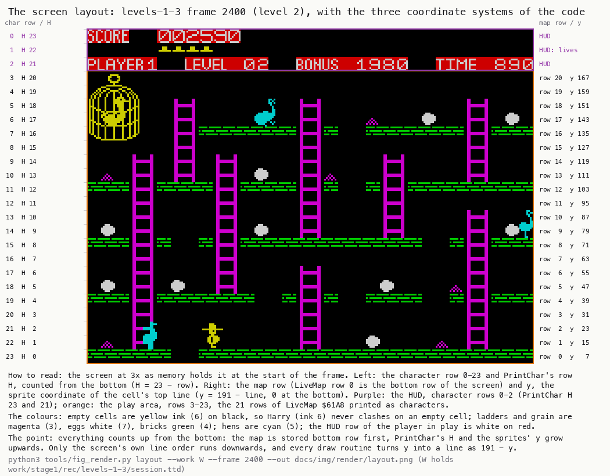

*Figure 6.1: the screen of level 2 with the three coordinate systems. `levels-1-3`, the memory at the start of frame
2400: `python3 tools/fig_render.py layout --work W --frame 2400 --out docs/img/render/layout.png` (W holds
`work/stage1/rec/levels-1-3/session.ttd`).*

How to read:

- The screen at 3x.
- Left: the character row 0-23 and PrintChar's H.
- Right: the map row and the pixel y of the cell's top line.
- Purple frame: the HUD, rows 0-2. Orange frame: the play area, rows 3-23.

The point: everything in the game counts upwards from the bottom of the screen. Every draw routine turns y into a
line as 191 - y, and the map is printed from its row 0 at the bottom.

## 6.2 The character set and PrintChar

One table of 8 x 8 glyphs serves the map, the HUD, the menus and the title. CharacterSet `$84F0` holds codes
0-`$9D`, and HudCharacters `$89E0` follows it without a gap with codes `$9E`-`$CB`. So code c is always at
`$84F0 + 8 c`, and PrintChar prints the HUD characters with the same arithmetic as the font.

The groups:

- 0-5: the map cells: empty, ladder left, ladder right, egg, grain, brick.
- `$0B-$1D`: the HUD labels (SCORE, PLAYER, LEVEL, BONUS, TIME in two-letter pieces).
- `$20-$7F`: the font. There is no lower case: `$41-$5A` are thin capitals and `$61-$7A` a second set of bold
  capitals; `$7E` and `$7F` are the (R) and (C) signs.
- `$80-$8E`: blocks of the big title lettering; `$8F-$96`: the small "A+F CHUCKIE EGG".
- `$97-$9A`: the key names SP, CS, SS, EN; `$9B-$9D`: LEVEL.
- `$9E-$A7`: the HUD digits; `$A8-$B5`: the duck's cage; `$B6`: the life icon; `$B7`: the name entry's cursor;
  `$B8-$CB`: the small "A&F SOFTWARE".

A glyph is stored top row first. PrintChar copies the 8 bytes down one character cell, one line per byte (INC D). It
takes the code in A, the column in L and the row H counted from the bottom.

```text
PrintChar(code, column L, row H):           ; H = 0 is the bottom row
    screenRow = 23 - H
    address = $4000 + $800 * (screenRow / 8) + 32 * (screenRow AND 7) + L
    glyph = $84F0 + 8 * code
    for line in 0..7:                        ; top row first, going down
        memory[address + 256 * line] = glyph[line]
```

```text
9C48  7C           LD A,H                  ; the row, counted from the bottom
9C49  EB           EX DE,HL
9C4A  21 00 40     LD HL,Screen
9C4D  01 00 08     LD BC,$0800
9C50  FE 10        CP $10
9C52  30 06        JR NC,PrintCharRow      ; H 16-23: the top third
9C54  FE 08        CP $08
9C56  30 01        JR NC,PrintCharThird    ; H 8-15: the middle third
9C58  09           ADD HL,BC
9C59  09           ADD HL,BC               ; PrintCharThird
9C5A  E6 07        AND $07                 ; PrintCharRow
9C5C  EE 07        XOR $07                 ; the row in the third, from the top
9C5E  CB 27        SLA A                   ; x 32 (five shifts)
...
9C7D  21 F0 84     LD HL,CharacterSet
9C80  09           ADD HL,BC               ; + 8 x code
9C81  06 08        LD B,$08
9C83  7E           LD A,(HL)               ; PrintCharLine
9C84  12           LD (DE),A
9C85  23           INC HL
9C86  14           INC D                   ; one line down
9C87  10 FA        DJNZ PrintCharLine
```

PrintChar begins with four NOPs (`$9C40-$9C43`). It is called 33 112 times in the eight builds.

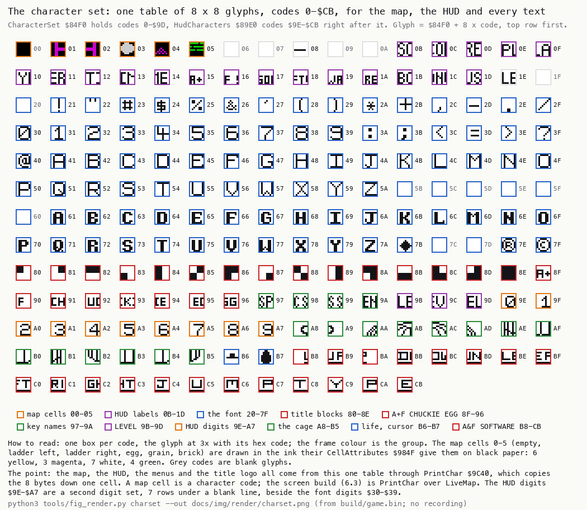

*Figure 6.2: the whole character set, labelled by group. From `build/game.bin`:
`python3 tools/fig_render.py charset --out docs/img/render/charset.png`. No recording.*

How to read:

- One box per code: the glyph at 3x and its hex code; the frame colour is the group.
- The map cells 0-5 are drawn in the ink their CellAttributes give them, on black.
- Grey codes are blank glyphs.

The point: there is one glyph table and one print routine. A map cell is just a character code.

A correction to the case brief: the glyphs are stored top row first, not bottom row first. What is stored bottom row
first are the rows of the maps (LiveMap and LevelMaps) and of the text pages (InstructionsText). Row 0 of a map is
the bottom row of the screen. EraseHen is the one routine that walks a glyph from its last byte up (6.6).

## 6.3 The screen build: SetupLevel

SetupLevel `$AE9C` draws a level from scratch, at every level start and after every life lost:

1. It clears all of `$4000-$5AFF`, bitmap and attributes, to 0: the screen is black on black.
2. It prints the 21 rows of LiveMap with PrintChar: row r at H = r, byte c at column c. The pixels are drawn, but
   with ink 0 on paper 0 nothing shows.
3. It prints the HUD and the scores (doc 08).
4. It sets the hens, the life icons and the HUD colours.
5. It paints the map's attributes from CellAttributes, row 0 at `$5AE0` upwards. Only now does the level appear,
   all at once.
6. It copies the key set (doc 05), sets the lift, speaks a level phrase, pauses and jumps into MainLoop.

```text
SetupLevel (the drawing):
    fill $4000-$5AFF with 0
    for H in 0..20:                           ; LiveMap row 0 is the bottom row
        for L in 0..31:
            PrintChar(LiveMap[32 * H + L], L, H)
    ... the HUD, the hens, the icons
    for row in 0..20:                         ; the attributes, bottom row first
        for col in 0..31:
            code = LiveMap[32 * row + col]
            Attributes[32 * (23 - row) + col] = CellAttributes[code] if code < 9 else 6
```

```text
AE9C  21 FF 5A     LD HL,Attributes+767    ; SetupLevel: clear $5AFF down to $4000
AE9F  01 00 1B     LD BC,$1B00
AEA2  36 00        LD (HL),$00             ; SetupLevelClear
AEA4  2B           DEC HL
AEA5  0B           DEC BC
AEA6  78           LD A,B
AEA7  B1           OR C
AEA8  20 F8        JR NZ,SetupLevelClear
AEAA  01 A8 61     LD BC,LiveMap
AEAD  26 00        LD H,$00                ; H = 0: the bottom row
AEAF  2E 00        LD L,$00                ; SetupLevelRow
AEB1  0A           LD A,(BC)               ; SetupLevelCell
AEB2  CD 40 9C     CALL PrintChar
AEB5  03           INC BC
AEB6  2C           INC L
AEB7  7D           LD A,L
AEB8  FE 20        CP $20
AEBA  20 F5        JR NZ,SetupLevelCell
AEBC  24           INC H                   ; one row up
AEBD  7C           LD A,H
AEBE  FE 15        CP $15                  ; 21 rows
AEC0  20 ED        JR NZ,SetupLevelRow
...
B027  21 A8 61     LD HL,LiveMap
B02A  11 E0 5A     LD DE,Attributes+736    ; row 23: LiveMap row 0
B02D  0E 15        LD C,$15
B02F  06 20        LD B,$20                ; SetupLevelAttrRow
B031  D5           PUSH DE
B032  C5           PUSH BC                 ; SetupLevelAttrCell
B033  7E           LD A,(HL)
B034  FE 09        CP $09
B036  38 04        JR C,SetupLevelAttrTable
B038  3E 06        LD A,$06                ; codes 9 and up: yellow
B03A  18 06        JR SetupLevelAttrSet
B03C  C6 4F        ADD A,$4F               ; SetupLevelAttrTable: CellAttributes $984F + code
B03E  06 98        LD B,$98
B040  4F           LD C,A
B041  0A           LD A,(BC)
B042  12           LD (DE),A               ; SetupLevelAttrSet
```

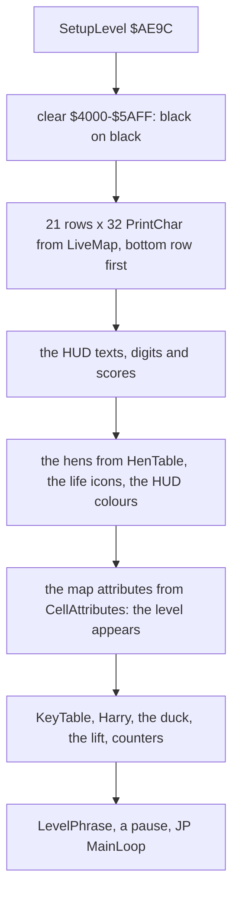

Witness: `levels-1-3`, the level 1 start. The bitmap is all 0 from frame 280. The number of non-zero bitmap bytes
at the frames' starts grows 123, 301, 558, 727, 820, 931, 1140 over frames 284-290 and reaches 1399 at 291. The
attributes are all 0 until frame 291 (46 non-zero) and 292 (695). SetupLevel runs 35 times in the eight builds.

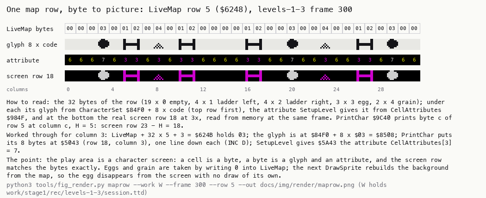

*Figure 6.3: one row of level 1 worked from the bytes to the screen. `levels-1-3`, the memory at the start of frame
300: `python3 tools/fig_render.py maprow --work W --frame 300 --row 5 --out docs/img/render/maprow.png` (W holds
`work/stage1/rec/levels-1-3/session.ttd`).*

How to read:

- Top: the 32 bytes of LiveMap row 5 (`$6248`).
- Then each byte's glyph, the attribute SetupLevel gives it, and the real screen row 18 at 3x.
- The caption works column 3 through: byte 3 (an egg) at `$624B`, glyph `$8508`, screen `$4243`, attribute
  `$5A43` = 7.

The point: the play area is a character screen. Taking an egg is writing 0 into LiveMap; the next DrawSprite
rebuilds the background from the map, and the egg is gone from the screen with no draw of its own.

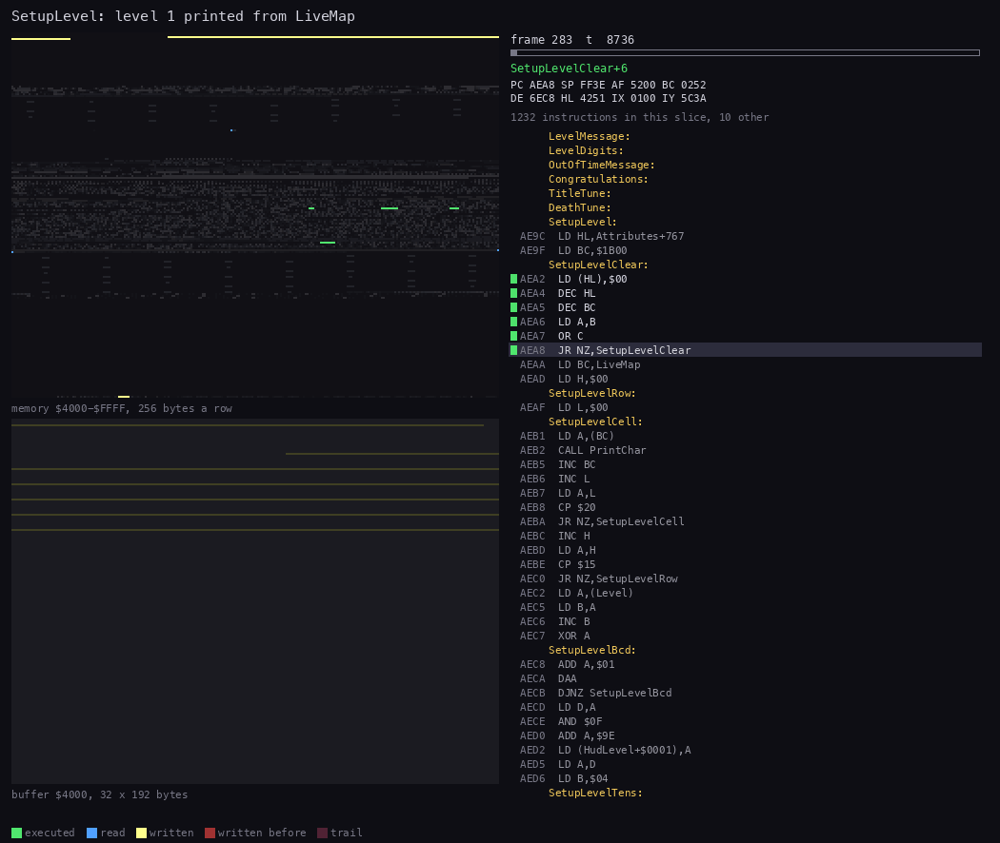

*Animation 6.1: level 1 being printed. `levels-1-3`, frames 283:0-293:0, 80 pictures:
`python3 ../../kit/routine_anim.py --work work/docs/ceB/levels-1-3 --window 283:0-293:0 --listing build/game.lst
--view buffer:4000:32x192:screen --pc AE9C-B15E,9C40-9C8D --range 6100-64FF --pictures 80 --title "SetupLevel: level
1 printed from LiveMap" --out docs/img/routines/SetupLevel.gif`.*

How to read:

- The view is the bitmap `$4000` as ink on black, without the attributes. On the real screen these pixels are black
  on black until frame 291.
- The memory pane shows `$6100-$64FF`; LiveMap is read row by row.
- The rows appear from the bottom up, one PrintChar per cell.

The point: the build is a plain loop of 672 PrintChar calls over the map, hidden behind black attributes until the
colours make the whole level appear at once.

## 6.4 The sprite sheets and DrawSprite

Harry and the duck are drawn by DrawSprite `$9A4C`; the hens by DrawHen (6.6). Both sheets are 16 x 16 frames, two
bytes a row, top row first, with no masks.

| Sheet | Address | Frames | Drawn by |
| --- | --- | --- | --- |
| Sprites | `$8DF0-$900F` | 17: Harry right 0-3, left 4-7, the duck 8-11 (10-11 facing left), blank 12, Harry climbing 13-16 | DrawSprite, frame A at `$8DF0 + 32 A` |
| HenSprites | `$9010-$910F` | 8: left 0, right 1, climbing 2-3, left and right 4-5 (x AND 4 set), pecking 6-7 | DrawHen, frame A - 1, read from its last row up |

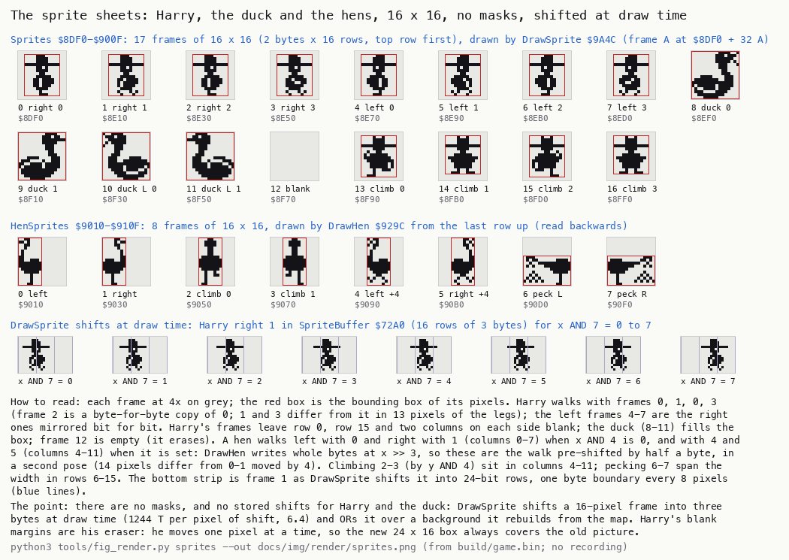

*Figure 6.4: every frame of both sheets, with its address and bounding box, and the eight shifts DrawSprite makes.
From `build/game.bin`: `python3 tools/fig_render.py sprites --out docs/img/render/sprites.png`. No recording.*

How to read:

- Each frame at 4x on grey; the red box bounds its pixels.
- Under each frame: its number, its role and its address.
- The bottom strip: frame 1 shifted into the 24-bit rows of SpriteBuffer for x AND 7 = 0 to 7.

The point: Harry walks with frames 0, 1, 0, 3 (frame 2 is a byte-for-byte copy of 0), the left frames are the right
ones mirrored bit for bit, and Harry keeps a blank border of one row and two columns. Only the hens have a stored
shifted copy (4-5); Harry and the duck are shifted at draw time.

DrawSprite draws a frame at (x, y) with y the sprite's top line. It works in two buffers:

- SpriteBuffer `$72A0`: 16 rows of 3 bytes, the frame shifted to the pixel.
- CellBuffer `$72DD`: 24 lines of 3 bytes, the glyphs of the 3 x 3 map cells under the sprite.

The steps:

1. Copy the frame's 16 rows of 2 bytes into SpriteBuffer as rows of 3 (the third byte 0).
2. Shift the 16 rows right x AND 7 times, through the three bytes (SRL, RR, RR). Each pixel of shift costs 1244 T.
3. Fill CellBuffer with the glyphs of the map cells from LiveMap row y >> 3 and the two rows below it, columns
   x >> 3 to x >> 3 + 2. Each glyph goes down one column of the buffer, top row first.
4. OR the 16 lines of CellBuffer from line 7 - (y AND 7) into SpriteBuffer.
5. Write the 48 bytes to the screen from line 191 - y, column x >> 3, downwards.
6. Paint attribute 6 on 3 x 3 cells: two columns when x is `$F1` or more, two rows when the sprite's top is on a
   cell's top line (y AND 7 = 7) or y is below `$11`.
7. The duck test: a duck within 8 pixels across and 9 up or down of Harry ends the life (doc 10).

```text
DrawSprite(frame, x, y):                      ; y = the top line, counted from the bottom
    for r in 0..15:
        SpriteBuffer[r] = Sprites[frame][r] << 8            ; 24 bits
    repeat (x AND 7) times: shift every SpriteBuffer row right by one
    for row in 0..2:                                        ; map rows y>>3, y>>3 - 1, y>>3 - 2
        for col in 0..2:
            code = LiveMap[32 * ((y >> 3) - row) + (x >> 3) + col]
            CellBuffer lines 8*row .. 8*row+7, byte col = CharacterSet[8 * code .. 8 * code + 7]
    for r in 0..15:
        SpriteBuffer[r] |= CellBuffer[7 - (y AND 7) + r]
    for r in 0..15:
        screen line (191 - y + r), bytes x>>3 .. x>>3 + 2 = SpriteBuffer[r]
    paint 6 on the 3 x 3 (or fewer) attribute cells
    if the duck touches Harry: end the life
```

The copy and the shift:

```text
9A69  11 A0 72     LD DE,SpriteBuffer
9A6C  06 10        LD B,$10
9A6E  AF           XOR A
9A6F  ED A0        LDI                     ; DrawSpriteCopy: two bytes of the frame
9A71  ED A0        LDI
9A73  03           INC BC                  ; LDI counted BC down: put it back
9A74  03           INC BC
9A75  12           LD (DE),A               ; the third byte 0
9A76  13           INC DE
9A77  10 F6        DJNZ DrawSpriteCopy
9A79  3E 07        LD A,$07
9A7B  A1           AND C                   ; C = x
9A7C  FE 00        CP $00
9A7E  28 13        JR Z,DrawSpriteBack     ; on a byte: no shift
9A80  06 10        LD B,$10                ; DrawSpriteShift
9A82  21 A0 72     LD HL,SpriteBuffer
9A85  CB 3E        SRL (HL)                ; DrawSpriteShiftRow: 24 bits right by one
9A87  23           INC HL
9A88  CB 1E        RR (HL)
9A8A  23           INC HL
9A8B  CB 1E        RR (HL)
9A8D  23           INC HL
9A8E  10 F5        DJNZ DrawSpriteShiftRow
9A90  3D           DEC A
9A91  20 ED        JR NZ,DrawSpriteShift
```

The OR and the start of the screen write:

```text
9B08  21 DD 72     LD HL,CellBuffer
9B0B  11 A0 72     LD DE,SpriteBuffer
9B0E  09           ADD HL,BC               ; BC = 3 x (7 - (y AND 7))
9B0F  06 30        LD B,$30                ; 48 bytes
9B11  1A           LD A,(DE)               ; DrawSpriteOr
9B12  B6           OR (HL)
9B13  12           LD (DE),A
9B14  13           INC DE
9B15  23           INC HL
9B16  10 F9        DJNZ DrawSpriteOr
9B18  D1           POP DE                  ; D = y, E = x
9B19  D5           PUSH DE
9B1A  21 00 40     LD HL,Screen
9B1D  01 00 08     LD BC,$0800
9B20  7A           LD A,D
9B21  FE 80        CP $80
9B23  30 06        JR NC,DrawSpriteScreen  ; y 128 and up: the top third
9B25  FE 40        CP $40
9B27  30 01        JR NC,DrawSpriteMiddle
9B29  09           ADD HL,BC
9B2A  09           ADD HL,BC               ; DrawSpriteMiddle
9B2B  E6 38        AND $38                 ; DrawSpriteScreen: the character row
9B2D  4F           LD C,A
9B2E  3E 38        LD A,$38
9B30  91           SUB C
```

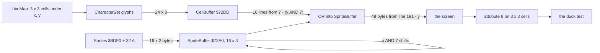

Worked example (figure 6.5): `levels-1-3` frame 606 T 31 168, Harry frame 1 at x 77, y 28.

- x AND 7 = 5: the frame is shifted right 5 times.
- The cells come from LiveMap row 3 (28 >> 3) and rows 2 and 1, columns 9 to 11 (77 >> 3 = 9). Columns 10 and 11
  hold a ladder.
- The OR takes CellBuffer lines 7 - (28 AND 7) = 3 to 18.
- The 48 bytes go to the screen from line 191 - 28 = 163, column 9.
- The call takes 26 212 T from its entry to its return.

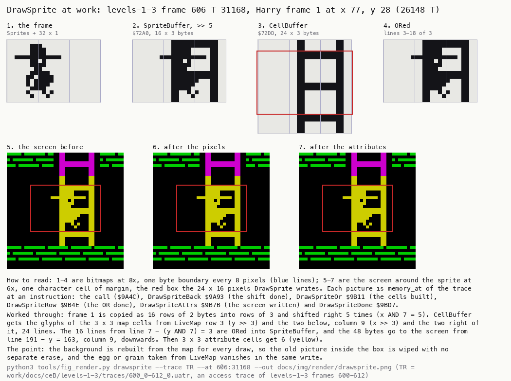

*Figure 6.5: the buffers and the screen at each stage of one DrawSprite call. From the trace of `levels-1-3` frames
600-612, each picture the memory at an instruction of the call:
`python3 tools/fig_render.py drawsprite --trace TR --at 606:31168 --out docs/img/render/drawsprite.png` (TR =
`work/docs/ceB/levels-1-3/traces/600_0-612_0.uatr`).*

How to read:

- 1-4 are bitmaps at 8x with a blue line at every byte boundary: the frame, SpriteBuffer after the shift, CellBuffer
  (the red box is the 16 lines it ORs), and the ORed result.
- 5-7 are the screen around the sprite at 6x before the call, after the pixels and after the attributes; the red box
  is the 24 x 16 pixels written.

The point: the background is rebuilt from the map for every draw. The old picture inside the box is wiped by the
same write that draws the new one.

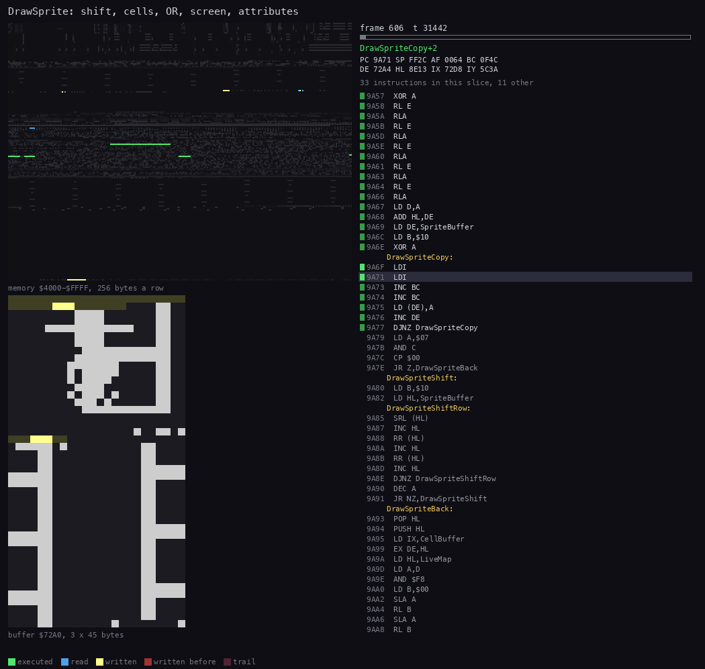

*Animation 6.2: the same call as figure 6.5, seen in its buffers. `levels-1-3`, frame 606:31000-606:57500, 60
pictures: `python3 ../../kit/routine_anim.py --work work/docs/ceB/levels-1-3 --window 606:31000-606:57500 --listing
build/game.lst --view buffer:72A0:3x45 --pc 9A4C-9BFE --range 7200-73FF --pictures 60 --title "DrawSprite: shift,
cells, OR, screen, attributes" --out docs/img/routines/DrawSprite.gif`.*

How to read:

- The view is 45 rows of 3 bytes from `$72A0`. The top 16 rows are SpriteBuffer, rows 17-20 are other variables
  (HarryX `$72D8` among them), and the 24 rows from `$72DD` are CellBuffer.
- The frame is copied, shifted, then the ladder glyphs fill CellBuffer column by column, then the OR.
- The listing pane follows DrawSprite; the trailing colours show the bytes written.

The point: DrawSprite spends most of its time on the background: 9 glyphs of 8 bytes copied with an IX stepping 3
bytes and stepped back 23 times per glyph.

The cost, measured in the trace of frames 600-612: 18 652-18 859 T for an unshifted draw and 20 228 T at a shift of
1. Draws at shifts 5 and 6 took 26 212 and 26 154 T: the shift adds 1244 T a pixel, and the screen writes are slowed
when they meet the beam in contended memory. One DrawSprite is a quarter to a third of a frame. DrawSprite runs
134 270 times in the eight builds.

## 6.5 The erase strategy

DrawSprite has no erase step. Each draw rewrites the whole 24 x 16 box with the map's background ORed with the new
frame. Harry moves one pixel per step (walk, climb, jump and fall), and his frames leave a blank border of one row
at the top and bottom and two columns at each side. So the box at the new position always covers the old picture,
and the old pixels are overwritten.

The blank frame 12 is used where that does not hold:

- The duck fills its whole 16 x 16 box and moves up to 5 pixels per step. MoveDuck `$A0C8` draws frame 12 at the old
  place first, then PaintCells, then the duck at the new place.
- When Harry lands on a lift, CatchLift `$A256` draws frame 12 at his old place before it sets him on the platform.

```text
A10E  2A 48 73     LD HL,(DuckX)           ; MoveDuckMove: the old place
A111  3E 0C        LD A,$0C                ; frame 12, blank
A113  CD 4C 9A     CALL DrawSprite         ; the background alone: the erase
A116  CD 38 95     CALL PaintCells         ; the cells' colours back
```

The hens are ORed onto the screen with no background, so a hen must be erased first (6.6). The lifts are erased and
drawn again (6.8).

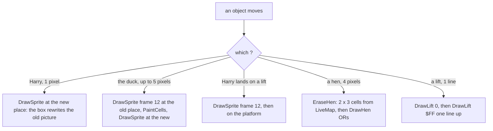

Witness: in `levels-1-3` frames 600-900, MoveDuck's frame-12 draw is followed by the duck's redraw 28 times
(the duck in its cage on level 1; MoveDuck puts it back at (8, `$98`) on levels 1-8). Harry's 322 draws in the same
window use frames 0-7 and 13-16, with no erase call between them.

The point: the erase is part of the drawing. Harry costs one write per line per step; only the objects that jump
more than the border, and the ones drawn without a background, pay for a separate erase.

## 6.6 The hens: DrawHen and EraseHen

A hen moves 4 pixels at a time, so its x is always a multiple of 4. DrawHen `$929C` draws whole bytes at x >> 3:

- Walking frames 0 (left) and 1 (right) are used when x AND 4 is 0. When x AND 4 is set, frames 4 and 5 are used:
  the walk drawn 4 pixels further right in its box, a stored half-byte shift.
- Climbing frames 2-3 change with y AND 4; pecking frames are 6 and 7.

DrawHen first tests the hen against Harry (a touch ends the life, doc 10). Then, with A > 0, it ORs the frame onto
the screen from line 191 - y upwards. It reads the frame from its last row back, so a hen's y is its bottom line.
It writes 2 bytes a line, or 1 at x of `$F9` or more. Last it sets attribute 5 (cyan) on 1-2 columns by 2-3 rows.

With A = 0, DrawHen jumps to EraseHen `$935F`. EraseHen redraws the 2 x 3 map cells under the hen (1 x 3 at x of
`$F8` or more) from LiveMap. It writes each glyph from its last byte up the screen, and the cell's colour from
CellAttributes.

```text
MoveHen step (one hen):
    DrawHen(0, x, y)                 ; EraseHen: 2 x 3 cells from the map
    move x by 4 (or y by 4), maybe turn
    DrawHen(frame, x, y)             ; OR the frame, cyan attributes

DrawHen(frame > 0):
    src = HenSprites + 32 * (frame - 1) + 30      ; the last row
    line = 191 - y
    repeat 16 times:
        screen[line][x>>3]     |= src[0]
        screen[line][x>>3 + 1] |= src[1]          ; unless x >= $F9
        src -= 2; line -= 1                       ; up the screen
    paint 5 on the hen's cells

EraseHen:
    for 3 cell rows from the hen's cell up, 2 cells across:
        code = LiveMap[cell]
        attribute = CellAttributes[code]
        draw the glyph of code from its byte 7 up to byte 0, upwards
```

```text
9308  1A           LD A,(DE)               ; DrawHenLine: the frame byte
9309  0D           DEC C
930A  28 0B        JR Z,DrawHenUp          ; one byte only at x >= $F9
930C  13           INC DE
930D  B6           OR (HL)                 ; OR onto the screen
930E  77           LD (HL),A
930F  23           INC HL
9310  1A           LD A,(DE)
9311  B6           OR (HL)
9312  1B           DEC DE                  ; back one row: the frame is read upwards
9313  1B           DEC DE
9314  1B           DEC DE
9315  77           LD (HL),A
9316  2B           DEC HL
9317  0C           INC C                   ; DrawHenUp: one screen line up
9318  25           DEC H
...
932E  10 D8        DJNZ DrawHenLine

93A2  7E           LD A,(HL)               ; EraseHenGlyph: from CharacterSet + 8 x code + 7
93A3  12           LD (DE),A
93A4  15           DEC D                   ; one line up
93A5  2B           DEC HL                  ; the glyph from its last byte back
93A6  10 FA        DJNZ EraseHenGlyph
```

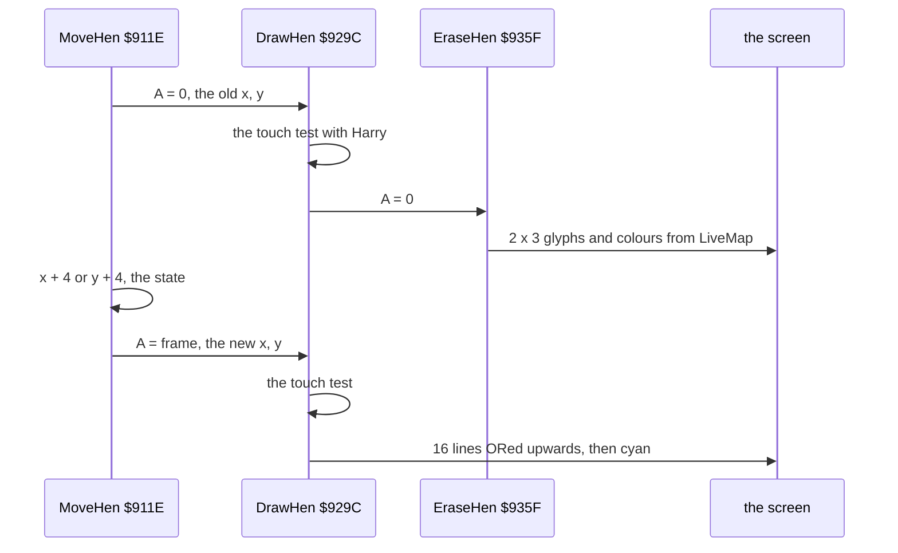

Worked example: `levels-1-3` frame 604. A hen at x 80, y 136 walks left:

- DrawHen with A = 0 (EraseHen) is called at T 20 541 and takes 5092 T; its first screen write is at T 21 678.
- DrawHen with A = 1 at x 76, y 136 is called at T 26 533 and takes 3625 T; x AND 4 = 4, so it draws HenSprites
  frame 4. Its last screen write is at T 30 044.
- The hen is off the screen for its cells from the erase's writes to the draw's: 8366 T, the longest window of the
  44 steps (6.10).

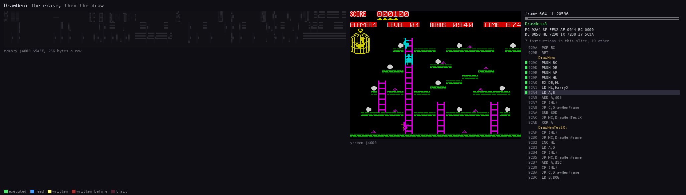

*Animation 6.3: one hen step, the erase then the draw. `levels-1-3`, frame 604:20400-604:30200, 50 pictures:
`python3 ../../kit/routine_anim.py --work work/docs/ceB/levels-1-3 --window 604:20400-604:30200 --listing
build/game.lst --view screen --pc 929C-9420 --range 4000-5AFF --pictures 50 --title "DrawHen: the erase, then the
draw" --out docs/img/routines/DrawHen.gif`.*

How to read:

- The screen pane shows the hen's cells go back to the map (the bricks and the ladder), then the hen appear 4 pixels
  to the left, then the cyan.
- The memory pane is `$4000-$5AFF`: bitmap writes and the attribute writes at the end.

The point: a hen is invisible for the 2000-odd T between the end of its erase and its redraw. That gap is where hens
flicker (6.10).

Witness: DrawHen is called 44 867 times in the eight builds; in `levels-1-3` frames 600-900, 44 hen steps, each an
EraseHen followed by a DrawHen.

## 6.7 PaintCells: the colours back

PaintCells `$9538` paints the attributes, and only the attributes, of the 3 x 3 cells at a sprite's (x, y), from
CellAttributes (codes 9 and up take 6). It uses the same 3 x 3 rule as DrawSprite (two columns at x of `$F1` or
more, two rows at y below `$11`).

It is called before each move:

- MainLoopHarry `$9949` in MainLoop, with Harry's position, every slow tick before the keys are read;
- JumpStep, before each step of a jump;
- MoveDuck, between the erase and the redraw.

DrawSprite paints yellow on its 3 x 3 cells afterwards. So the cells Harry leaves get their colours back, and the
cells he moves into turn yellow.

```text
PaintCells(x, y):
    cols = 2 if x >= $F1 else 3
    rows = 2 if y < $11 else 3
    for each of rows x cols cells from the cell at (x, y) down and right:
        code = LiveMap[cell]
        attribute = 6 if code >= 9 else CellAttributes[code]
```

```text
9555  7E           LD A,(HL)               ; PaintCellsCell: the map code
9556  FE 09        CP $09
9558  38 04        JR C,PaintCellsAttr
955A  3E 06        LD A,$06                ; 9 and up: yellow
955C  18 08        JR PaintCellsSet
955E  C6 4F        ADD A,$4F               ; PaintCellsAttr: CellAttributes $984F + code
9560  C5           PUSH BC
9561  06 98        LD B,$98
9563  4F           LD C,A
9564  0A           LD A,(BC)
9565  C1           POP BC
9566  12           LD (DE),A               ; PaintCellsSet: the attribute
9567  13           INC DE
9568  23           INC HL
9569  10 EA        DJNZ PaintCellsCell
```

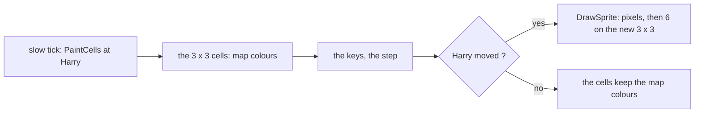

When Harry does not move in a tick, no DrawSprite follows, and his cells keep the map colours. On an empty cell
that is yellow anyway; on a ladder Harry stays magenta until he moves.

Worked example: `levels-1-3` frame 609. Harry is on a ladder at x 80, y 29:

- PaintCells at T 46 085 writes 3 (magenta, the ladder) into the cells of his box.
- DrawSprite (climbing frame 14) starts at T 48 622 and paints 6 into them at the end of its 18 676 T.

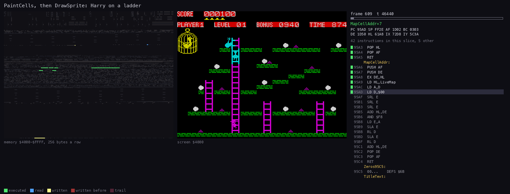

*Animation 6.4: PaintCells and the DrawSprite after it, Harry on a ladder. `levels-1-3`, frame 609:46000-609:68000,
50 pictures: `python3 ../../kit/routine_anim.py --work work/docs/ceB/levels-1-3 --window 609:46000-609:68000
--listing build/game.lst --view screen --pc 9538-95C0,9A4C-9BFE --range 5800-5AFF --pictures 50 --title "PaintCells,
then DrawSprite: Harry on a ladder" --out docs/img/routines/PaintCells.gif`.*

How to read:

- The memory pane is the attributes `$5800-$5AFF`: the nine writes of PaintCells, then the nine of DrawSprite.
- In the screen pane Harry turns magenta with the ladder, then yellow again one pixel higher.

The point: PaintCells is the colour half of the erase. Between it and DrawSprite, Harry wears the colours of the
cells he stands on (6.10 measures how often the beam sees it).

Witness: 147 583 calls in the eight builds; 27 calls in frames 600-612 of `levels-1-3`, each about 1930 T.

## 6.8 The lifts

On levels 3-7 two platforms rise in one shaft (doc 07). MoveLifts `$A014` moves each one up a line every two slow
ticks. For each platform it calls DrawLift `$A07B` with C = 0 at the old address (the erase), moves the address one
line up (LineUp), then calls DrawLift with C = `$FF`. DrawLift clears the byte left of the platform and the byte
right of it, then writes 4 lines of 2 bytes of C down the screen. The platform is a solid 16 x 4 block with no
graphic.

```text
DrawLift(address, C):              ; C = 0 erases, $FF draws
    screen[address - 1] = 0
    if (address + 2) AND $1F != 0: screen[address + 2] = 0
    repeat 4 times:
        screen[address] = C; screen[address + 1] = C
        address = the next line down
```

```text
A07B  E5           PUSH HL                 ; DrawLift
A07C  2B           DEC HL
A07D  36 00        LD (HL),$00             ; the byte to the left
A07F  23           INC HL
A080  23           INC HL
A081  23           INC HL
A082  7D           LD A,L
A083  E6 1F        AND $1F
A085  28 02        JR Z,DrawLiftLines      ; not past the right edge
A087  36 00        LD (HL),$00             ; the byte to the right
A089  E1           POP HL                  ; DrawLiftLines
A08A  06 04        LD B,$04
A08C  71           LD (HL),C               ; DrawLiftLine
A08D  2C           INC L
A08E  71           LD (HL),C
A08F  2D           DEC L
A090  CD 96 A0     CALL LineDown
A093  10 F7        DJNZ DrawLiftLine
```

Worked example: `levels-1-3` frame 4101. MoveLifts at T 34 613; platform 1 is erased at `$4C48` (T 34 694) and drawn
at `$4B48` (T 35 343), one line up; platform 2 is erased at `$56C8` and drawn at `$55C8` (T 35 813 and 36 463).

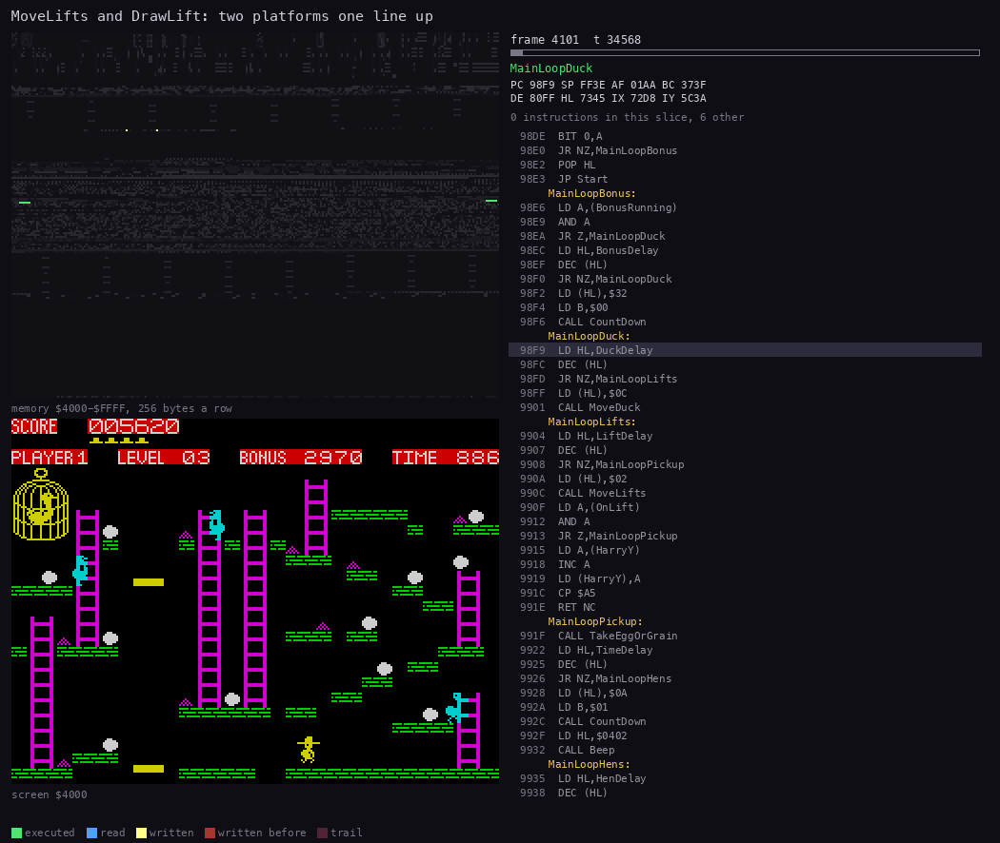

*Animation 6.5: both platforms one line up. `levels-1-3`, frame 4101:34500-4101:37200, 40 pictures:
`python3 ../../kit/routine_anim.py --work work/docs/ceB/levels-1-3 --window 4101:34500-4101:37200 --listing
build/game.lst --view screen --pc A014-A0C7 --range 4800-57FF --pictures 40 --title "MoveLifts and DrawLift: two
platforms one line up" --out docs/img/routines/DrawLift.gif`.*

How to read:

- The screen pane shows the shaft on the right of level 3; each platform vanishes and reappears one line higher.
- The memory pane shows the bytes of the two lower thirds being written.

The point: a lift is drawn by plain stores of `$FF`, erased by stores of 0, a few hundred T apart.

Witness: 109 600 DrawLift calls in the eight builds (only the builds that reach a lift level).

## 6.9 The HUD digits

The HUD uses two digit sets:

- the font digits `$30-$39`, 8 rows each, for the scores (AddScore, doc 08);
- the HUD digits `$9E-$A7` in HudCharacters, 7 rows under a blank top line, for the bonus, the time and the level.

The HUD digits are not larger than the font. They are a second 8 x 8 set, 7 rows high under a blank top line and
one pixel narrower than the font's 8-row digits, which fill the cell from its top row (figure 6.2, codes
`$9E-$A7` against `$30-$39`). CountDown `$A1B8` prints the three bonus digits at `$4053` and the three time digits at `$405D`,
each glyph straight from HudCharacters + 8 x digit, 8 lines down the cell. The digits are stored as 0-9, not as
codes, so CountDown indexes HudCharacters directly instead of calling PrintChar.

```text
A1F9  D5           PUSH DE                 ; CountDownPrintDigit
A1FA  0A           LD A,(BC)               ; the digit 0-9
A1FB  CB 27        SLA A
A1FD  CB 27        SLA A
A1FF  CB 27        SLA A                   ; x 8
A201  21 E0 89     LD HL,HudCharacters
A204  C5           PUSH BC
A205  06 00        LD B,$00
A207  4F           LD C,A
A208  09           ADD HL,BC
A209  06 08        LD B,$08
A20B  7E           LD A,(HL)               ; CountDownPrintLine
A20C  12           LD (DE),A
A20D  14           INC D                   ; one line down
A20E  2C           INC L
A20F  10 FA        DJNZ CountDownPrintLine
```

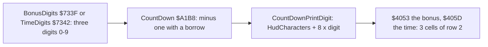

Witness: the code-vs-screen figure 6.7 shows CountDownPrintLine (`$A20C`) writing 48 bytes in frames 600-612 with
72 writes, from `$89E0-$89E7`, `$89F8-$8A07` and `$8A18-$8A2F`: the glyphs of the digits 0, 3, 4, 7, 8 and 9 of
HudCharacters. CountDown runs 17 679
times in the eight builds. The print routine and the score digits are in doc 08.

The point: the bonus and the time bypass PrintChar for speed and use their own digit glyphs; they share only the
table.

## 6.10 Flicker, measured

The game never waits for the beam: there is no HALT in MainLoop (doc 04), and every draw happens wherever the beam
is. So a sprite can be seen half drawn or not at all in one TV frame. Whether it is depends on the draw method:

- DrawSprite writes each line once, with the background and the sprite combined. Harry is never missing; at most the
  beam shows the top of the box at the new place and the bottom at the old, one pixel apart.
- A hen is erased by EraseHen and redrawn by DrawHen about 7900 T later.
- The caged duck is blanked with frame 12 and redrawn by the next DrawSprite about 23 300 T later.
- Harry's colour: PaintCells puts the map colours back about 20 000 T before DrawSprite paints yellow.

The measure: for every erase and redraw pair in `levels-1-3` frames 600-900, `tools/fig_render.py flicker` takes
the T of each screen write from the trace. A line counts as "read blank" when the beam reads it after the erase wrote
it and before the redraw wrote it (line l is read at T 16 152 + 224 l + 4 x column). It also rebuilds the picture
the TV showed: each line from memory at the moment the beam read it.

| Object | Pairs in 300 frames | Read by the beam in between |
| --- | ---: | --- |
| the duck in its cage (frame 12, then 8-11) | 28 | 10: the whole duck (16 lines) missing from one TV frame |
| the hens (EraseHen, then DrawHen) | 44 moves | 7: 1, 3, 5, 8, 10, 11 and 12 lines missing |
| Harry (DrawSprite) | 322 draws | 29 with the beam inside the write: a 1-pixel shear, nothing missing |
| Harry's cells (PaintCells, then DrawSprite's 6) | 888 cells repainted in a colour other than 6 | 338 read in the map colour: 292 magenta (3), 38 green (4), 8 white (7) |
| the lifts | none on level 1 | |

The windows explain the rates. The duck's window is a third of a frame (23 175-23 577 T), and 10 of 28 redraws were
caught. A hen's is a ninth (7332-8366 T), and 7 of 44 were caught.

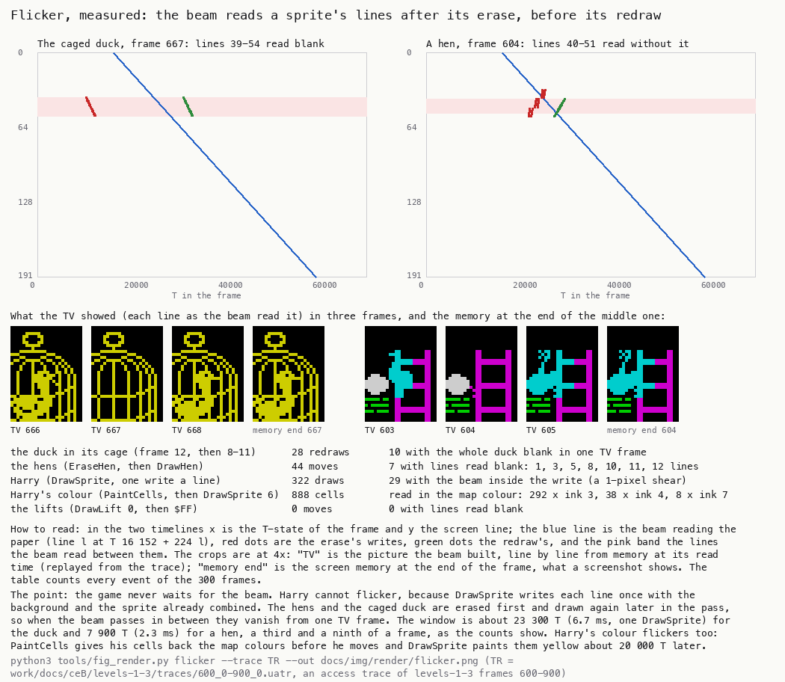

*Figure 6.6: the duck and a hen read blank by the beam. `levels-1-3`, the trace of frames 600-900; the TV pictures
are rebuilt from the trace's writes at the beam's read times; "memory end" is the memory at the end of the frame:
`python3 tools/fig_render.py flicker --trace TR --out docs/img/render/flicker.png --json
work/docs/ceB/flicker.json` (TR = `work/docs/ceB/levels-1-3/traces/600_0-900_0.uatr`).*

How to read:

- The two timelines: x is the T of the frame, y the screen line. The blue line is the beam, red dots are the erase's
  writes, green dots the redraw's. The pink band holds the lines the beam read between them.
- Frame 667 (the duck): the blank is written at about T 10 400, the beam reads lines 39-54 at about T 25 000-28 000,
  the duck comes back at about T 33 700.
- Frame 604 (a hen): the beam crosses lines 40-51 between the erase and the draw.
- The crops at 4x: the TV pictures of three frames and the memory at the end of the middle one. In TV 667 the cage
  is empty; in TV 604 the hen is missing; the memory shows both in place.

The point: Chuckie Egg flickers, and the flicker is measurable. The caged duck vanishes from about one frame in
thirty, and a hen from about one step in six. Harry's pixels never flicker. His colour does, whenever he stands on
a ladder or a brick: the beam caught his cells in the map colour 338 times in 300 frames.

## 6.11 Code vs screen, and the beam

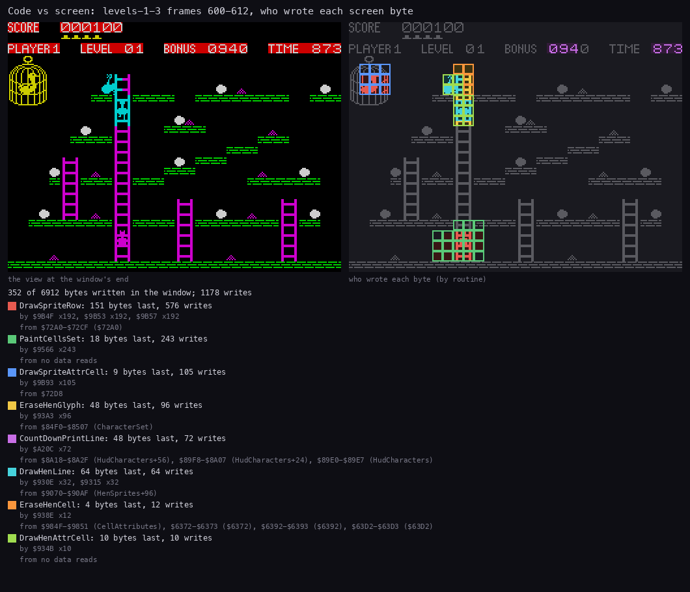

*Figure 6.7: which routine wrote each screen byte in 12 frames of play. `levels-1-3`, the trace of frames 600-612:
`python3 ../../kit/writers_map.py --trace work/docs/ceB/levels-1-3/traces/600_0-612_0.uatr --listing build/game.lst
--out docs/img/render/writers.png --sources --title "Code vs screen: levels-1-3 frames 600-612, who wrote each
screen byte"`.*

How to read:

- Left: the screen at the window's end. Right: each byte coloured by the routine that wrote it last; dark grey bytes
  were not written.
- The legend gives each writer's bytes, writes, the instruction and where its data came from.
- 352 of the 6912 bytes were written, with 1178 writes. DrawSpriteRow (red, 576 writes) wrote Harry's box on the
  ladder and the duck's box in the cage, from SpriteBuffer `$72A0`. DrawHenLine (cyan) wrote the hen from
  HenSprites, and EraseHenGlyph (yellow) wrote the cells behind it from CharacterSet. PaintCellsSet (green, 243
  writes), DrawSpriteAttrCell (blue), EraseHenCell and DrawHenAttrCell wrote attributes. CountDownPrintLine (purple)
  wrote the bonus and time digits from HudCharacters.

The point: in play, only the boxes of the moving objects and the HUD digits are ever written; the rest of the screen
is left as SetupLevel drew it.

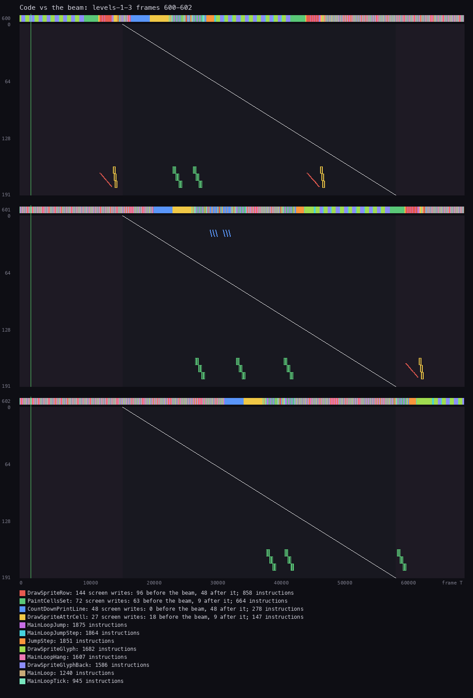

*Figure 6.8: the screen writes of each routine against the raster, three frames. `levels-1-3`, the trace of frames
600-612: `python3 ../../kit/beam_timeline.py --trace work/docs/ceB/levels-1-3/traces/600_0-612_0.uatr --listing
build/game.lst --machine 48k --frames 3 --out docs/img/render/beam.png --title "Code vs the beam: levels-1-3 frames
600-602"`.*

How to read:

- One panel per frame: x is the T of the frame, y the screen line. The diagonal is the beam.
- The bar on top shows which routine runs when; the marks are screen writes by routine.
- A write left of the diagonal lands before the beam reaches its line (shown this frame), right of it after (shown
  in the next frame).

The point: the writes fall anywhere in the frame. Of the 192 bitmap writes of frames 600-602, DrawSpriteRow made
144: 96 before the beam read their byte and 48 after. CountDownPrintLine's 48 all came after. Nothing in the code
orders the drawing against the beam.

## 6.12 What is known only from the code

- DrawSprite at x `$F1` or more: its third byte column passes the right edge into the next character row's column 0
  (INC E without a carry), and its third map column reads the next LiveMap row. Harry's x range keeps him short of
  this in every recording; it was not checked further.
- The duck's kill test in DrawSprite (`$9BC6`) never ran in any recording (stage 2).
- EraseHen's one-column case (x of `$F8` or more) and DrawHen's one-byte case (x of `$F9` or more) were not
  isolated in a trace.
- The lifts' flicker was not measured: frames 600-900 are on level 1, which has no lift.
