# 7. Objects

What this covers: every object of Chuckie Egg and the memory it lives in. Harry, up to five hens, the duck and the two
lift platforms are fields of one block at `$72D8`. The eggs, the grain, the ladders and the bricks are cells of a level
map, and five copies of that map sit at `LiveMap $61A8`. This document gives each record byte by byte, the state
machine of each object kind, the spawn from `HenTable $945B` and `LiftTable $9787`, the collision tests and their order,
and the random numbers. How Harry moves, jumps, falls and dies, and the rules of scoring and difficulty, are doc 10.

The recordings it rests on (WALKTHROUGH 6.0):

- `levels-1-9`, the full run (level 10 from frame 25 248; the recording ends at frame 25 491). Opened on an own instance after `source work/env.sh`:
  `python3 $RS open --work work/docs/ceC/l19 --ttd work/stage1/rec/levels-1-9/session.ttd --model 48K --port-base 36250 --binary $BIN`.
  Sampled with `work/docs/ceC/sample.py` (TTD `memory_at`):
  - the object block `$72D8-$7375` at every frame 0-25 491 (`work/docs/ceC/l19-vars.jsonl`);
  - the game variables `$6EC8-$6EF3` at every frame (`l19-game.jsonl`);
  - the five maps `$61A8-$6EC7` at frames 21 500, 21 700 and 23 300 (`l19-maps.jsonl`);
  - the screen `$4000-$5AFF` at frames 420-500 (`l19-scr-420.jsonl`).
- `idle-1p` (one player who never moves: five lives lost to the hens), opened the same way into `work/docs/ceC/idle`
  and sampled at frames 4700-5170 (`idle-vars.jsonl`, `idle-vars2.jsonl`).
- The L1 execution counts of the eight builds (c1 and the seven recordings), printed by `python3 tools/l1count.py`.

A sample of frame N is the memory at the start of frame N. A trace, and so an animation, shows an instruction in the
frame where it ran. "Hen 1 is at x 112 in frame 437" therefore means the sample of frame 437; the step that put it
there ran in frame 436.

Two clocks drive the objects. A pass is one turn of `MainLoop $9858` ([Terms](README.md#terms)). Every 130 passes
`PassCounter $72DC` runs out and the loop does a slow tick: the hens, the duck, the lifts, the timer and Harry's walk
all count slow ticks. The number of passes in a frame depends on the work in each pass. Measured on the objects
themselves, a frame holds about 1.3 slow ticks on level 1 (7.3) and 1.05 on level 3 with its lift (7.6). Doc 04
explains the loop; this document only uses its two clocks.

## 7.1 The object block and its data sheet

All moving objects share one block of 158 bytes, `$72D8-$7375`. Every routine that moves something loads
`IX = HarryX $72D8` and reaches the other fields by offset: `(IX+$4D)` is `JumpState`, `(IX+$70)` is `DuckX`,
`(IX+$7D)` is `OnLift`. The block is not a table of slots. Each object kind has its own fixed fields, and only the hens
have an array of records.

`$72DD-$7324` (72 bytes) is `CellBuffer`, the sprite work area of DrawSprite (doc 06). It sits between Harry's fields
and the jump fields, so the IX offsets of everything after it are above `$4C`.

| Address | IX offset | Field | Owner | Written by | Read by |
| --- | --- | --- | --- | --- | --- |
| `$72D8` | `+$00` | HarryX, the left edge of the sprite, 0-238; 239-255 only after the jump wrap of doc 10.4 | Harry | WalkHarry `$9D08`, JumpStep `$A21C`, SetupLevel | everything |
| `$72D9` | `+$01` | HarryY, the top line of the sprite, counted up from the screen bottom | Harry | ClimbLadder `$9E98`, JumpFall `$A2B5`, CatchLift `$A256`, MainLoop on a lift, SetupLevel | everything |
| `$72DA` | `+$02` | HarryFrame, the walk or climb phase 0-3 | Harry | WalkHarry, ClimbLadder, SetupLevel | the DrawSprite calls |
| `$72DB` | `+$03` | HarryDir: 0 right, 4 left, `$0D` on a ladder (added to the frame) | Harry | WalkHarry, LeaveLadder `$9F60`, ClimbLadder, the jump start, JumpLanded `$A37C`, SetupLevel | WalkHarry, FallOffEdge `$B34C`, MainLoop `$99CA`, the jump start `$99B6`, JumpLanded `$A378`, DrawHarryFrame `$A382`, WalkOffLift `$9DE1` |
| `$72DC` | `+$04` | PassCounter, passes to the next slow tick (130 down to 1) | clock | MainLoop, SetupLevel `$B0A3` | MainLoop, JumpStep |
| `$7325` | `+$4D` | JumpState: 0 on foot or a ladder, 1 drifting off an edge, 2 in the air | jump | the jump start `$9975`, FallOffEdge, JumpDrift `$A294`, JumpLanded, ClimbLadder, CatchLift, WalkOffLift `$9DDB`, SetupLevel | MainLoop, JumpStep `$A222`, JumpDrift `$A294` |
| `$7326` | `+$4E` | JumpDx: -1, 0 or +1 pixel a slow tick | jump | the jump start, FallOffEdge, JumpBounce, JumpDrift `$A2A5`, JumpStepX (`$A23A`, `$A244`), WalkOffLift | JumpStep |
| `$7327` | `+$4F` | JumpCount: the next delay of a jump or fall, or the drift count | jump | the jump start, FallOffEdge, WalkOffLift, JumpFall, JumpDrift | JumpFall, JumpDrift |
| `$7328` | `+$50` | JumpDelay: passes to the next vertical step | jump | the jump start, JumpFall | JumpFall, MainLoop |
| `$7329` | `+$51` | unused: no instruction reads or writes it, 0 in every sample | | | |
| `$732A` | `+$52` | JumpDy: +1 rising, 0 at the top, -1 falling | jump | the jump start, JumpDrift `$A2AA`, JumpFall | JumpFall, JumpLand |
| `$733C` | `+$64` | LiftDelay: slow ticks to the next lift step (2) | clock | MainLoop, SetupLevel (5, `$B06A`) | MainLoop |
| `$733F-$7341` | `+$67` | BonusDigits: three digits 0-9; a fourth 0 is printed after them | HUD | SetupLevel, CountDown `$A1B8` | CountDown |
| `$7342-$7344` | `+$6A` | TimeDigits: three digits 0-9 | HUD | SetupLevel, CountDown | CountDown, LifeLost |
| `$7345` | `+$6D` | BonusDelay: slow ticks to the next bonus step (50) | clock | MainLoop, TakeGrain, SetupLevel `$B09A` | MainLoop |
| `$7346` | `+$6E` | TimeDelay: slow ticks to the next time step (10) | clock | MainLoop, TakeGrain, SetupLevel `$B09D` | MainLoop |
| `$7347` | `+$6F` | BonusRunning: 1 while the bonus counts down | HUD | SetupLevel, CountDown | MainLoop, PlayLevel |
| `$7348` | `+$70` | DuckX | duck | MoveDuck `$A0C8`, SetupLevel `$B062` | MoveDuck, DrawSprite |
| `$7349` | `+$71` | DuckY | duck | MoveDuck, SetupLevel `$B066` | MoveDuck, DrawSprite |
| `$734A` | `+$72` | DuckDx: -5 to +5 pixels a duck step | duck | MoveDuck, SetupLevel `$B07B` | MoveDuck |
| `$734B` | `+$73` | DuckDy: -5 to +5 | duck | MoveDuck, SetupLevel `$B07E` | MoveDuck |
| `$734C` | `+$74` | DuckDelay: slow ticks to the next duck step (12) | clock | MainLoop, SetupLevel `$B0A0` | MainLoop |
| `$734D` | `+$75` | DuckFrame: the wing phase 0-1 | duck | MoveDuck, SetupLevel `$B081` | MoveDuck |
| `$734E-$734F` | `+$76` | Lift1: the screen address of platform 1 | lift | SetupLevel, MoveLifts `$A014` | MoveLifts |
| `$7350` | `+$78` | LiftX: the shaft's x, `$FF` = no lift | lift | SetupLevel, MoveLifts | MoveLifts, CatchLift, WalkHarry |
| `$7351` | `+$79` | Lift1Row: platform 1's y, 3-165 | lift | SetupLevel, MoveLifts | MoveLifts, CatchLift |
| `$7352-$7353` | `+$7A` | Lift2: the screen address of platform 2 | lift | SetupLevel, MoveLifts | MoveLifts |
| `$7354` | `+$7C` | Lift2Row: platform 2's y | lift | SetupLevel, MoveLifts | MoveLifts, CatchLift |
| `$7355` | `+$7D` | OnLift: 1 from a catch on a platform to the next jump (a walk-off keeps it, doc 10.10) | lift | CatchLift, the jump start, SetupLevel | MainLoop, WalkHarry |
| `$7356` | `+$7E` | HenTurn: the hen record 0-4 that MoveHen moved last (it adds one, wrapping, before the move) | hens | MoveHen `$911E`, SetupLevel | MoveHen |
| `$7357-$736A` | `+$7F` | Hens: five records of 4 bytes (7.3) | hens | SetupLevel, MoveHen, HenEatGrain `$9265` | MoveHen, MainLoop |
| `$736B` | `+$93` | HenDelay: slow ticks to the next hen turn (3, or 2 from level 33) | clock | MainLoop, SetupLevel | MainLoop |
| `$736C-$736D` | `+$94` | RandomPtr: a pointer into the ROM, `$0000-$00FF` (7.11); the high byte `$736D` is always 0 | hens | MoveHen, SetupLevel | MoveHen |
| `$732B-$733B`, `$733D-$733E`, `$736E-$7375` | | the scroller, the key table, the players, the score address (a word), the extra-life digit, the sound and phrase fields | docs 05, 08, 09 | | |

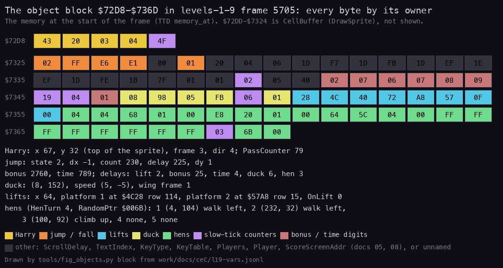

How to read the figure:

- One box a byte of `$72D8-$736D`, in the sample of `levels-1-9` frame 5705 (level 3, Harry in a jump). The rows
  start at `$72D8`, `$7325`, `$7335`, `$7345`, `$7355` and `$7365`, as labelled at the left. CellBuffer is left out.
- The colour names the owner: yellow Harry, orange the jump, cyan the lifts, light yellow the duck, green the hens,
  violet the slow-tick counters, pink the bonus and time digits, dark grey the fields of other documents.
- The text below decodes each group. Harry is at (67, 32), in the air (`JumpState 02`), moving left (`JumpDx FF`) and
  rising (`JumpDy 01`).
- The lifts: `28 4C` is platform 1 at screen address `$4C28`, `40` is LiftX 64, `72` is row 114; `A8 57` and `0F` are
  platform 2 at `$57A8`, row 15.
- The hens: three records in use, `FF` from the fourth on.

**The point**: one fixed block holds the whole cast. There is no object list, no kind byte and no handler table; each
routine knows its own fields by IX offset.

```bash
python3 tools/fig_objects.py block --samples work/docs/ceC/l19-vars.jsonl --frame 5705 --out docs/img/objects/block.png
```

Worked example (the same sample): the hen bytes `04 68 01 00` at `$7357` are hen 1 at x 4, y 104, state 1 (walk left).
`E8 20 01 00` is hen 2 at (232, 32), walking left. `64 5C 04 00` is hen 3 at (100, 92), climbing up. `FF` at `$7363`
ends the list; MoveHen returns at once for such a slot (7.3). The counters read `HenDelay 03` and `RandomPtr 6B 00`: the
next hen turn comes in 3 slow ticks and will read the ROM byte at `$006C` (7.11).

Witness: the slow-tick counters are reloaded by MainLoop at `$98BE` (PassCounter), `$98F2` (bonus), `$98FF` (duck),
`$990A` (lifts), `$9928` (time) and `$9945` (hens). MoveDuck ran 9553 times in the eight builds (`$A0C8`), MoveLifts
57 158 times (`$A014`; L1).

## 7.2 Harry's fields and his reset

Harry has five bytes of his own (`$72D8-$72DC`) and six of the jump (`$7325-$732A`). His position is a pixel position
with y counted up from the bottom of the screen. HarryY is the top line of his 16 x 16 sprite. Standing on the bricks of
map row p, Harry is at y = 8p + 23. His sprite then covers rows p + 1 and p + 2, and his feet are on row p.

The frame drawn is `HarryFrame + HarryDir`: frames 0-3 walk right, 4-7 walk left, 13-16 climb (doc 06, the sprite
sheet). `HarryDir $0D` is therefore both "on a ladder" and the base of the climbing frames. WalkHarry is not called
while it is `$0D` (MainLoop `$99CA`).

SetupLevel `$AE9C` resets Harry and the other movers at the start of every level and every life:

```text
HarryX = 100; HarryY = 23                      ; on the bottom bricks (row 0)
HarryFrame = HarryDir = JumpState = OnLift = 0
DuckX = 8; DuckY = 152; DuckDx = DuckDy = DuckFrame = 0
LiftDelay = 5
BonusRunning = BonusDelay = TimeDelay = DuckDelay = PassCounter = 1   ; all step on the first slow tick
HenTurn = 0; HenDelay = 1; RandomPtr = 0
```

```text
$B056  LD IX,HarryX
$B05A  LD (IX+$00),$64        ; HarryX 100
$B05E  LD (IX+$01),$17        ; HarryY 23
$B062  LD (IX+$70),$08        ; DuckX 8
$B066  LD (IX+$71),$98        ; DuckY 152: in the cage
$B06A  LD (IX+$64),$05        ; LiftDelay 5
$B06E  XOR A
...                           ; zero: the low bonus and time digits, DuckDx, DuckDy, DuckFrame, OnLift,
$B08D  LD (IX+$4D),A          ;   HarryFrame, HarryDir, JumpState
$B090  LD (HenTurn),A
$B093  LD (SoundSweep),A
$B096  INC A
$B097  LD (IX+$6F),A          ; BonusRunning 1
$B09A  LD (IX+$6D),A          ; BonusDelay 1
$B09D  LD (IX+$6E),A          ; TimeDelay 1
$B0A0  LD (IX+$74),A          ; DuckDelay 1
$B0A3  LD (IX+$04),A          ; PassCounter 1
```

The jump fields other than `JumpState` are not cleared. `JumpDelay` keeps whatever the last jump or fall left in it,
and a later fall off an edge starts from that stale value (doc 10.5).

Worked example: in `levels-1-9` the sample of frame 300 (level 1, just set up) reads Harry `64 17 00 00` (100, 23),
the duck `08 98 00 00 01 00` (8, 152, speed 0, DuckDelay 1), the hens `68 88 02 00 48 68 01 00 FF ...`, HenDelay 1 and
RandomPtr 0. The lift bytes are `05 05 FF 00`: level 1 has no lift (LiftX `$FF`).

Witness: the life lost on level 8 (`levels-1-9`, frame 21 623) and the five lives of `idle-1p` each pass through
SetupLevel again: after each, Harry is back at (100, 23) (`idle-1p` sample 5141).

The state machine of Harry (on foot, on a ladder, drifting, in the air, on a lift, dead) is the hero's, so it is in
doc 10.2.

## 7.3 The hens: records and state machine

`Hens $7357` holds five records of 4 bytes. A free slot starts with `$FF`.

| Byte | Field | Values |
| --- | --- | --- |
| +0 | x, the left edge of the sprite | 0-255, a multiple of 4 |
| +1 | y, the bottom line of the sprite, counted up from the screen bottom | a multiple of 4; 8(p + 1) standing on row p |
| +2 | state | 1 walk left, 2 walk right, 3 climb down, 4 climb up, 7 peck left, 8 peck right |
| +3 | pad | never read (always 0 in HenTable) |

A hen moves in steps of 4 pixels. Its sprite is 16 pixels wide, so a hen at a multiple of 8 stands exactly on two map
columns, and a hen with x AND 4 set straddles three. MoveHen decides only at fixed points. A walking hen eats grain and
turns at the multiples of 8, and looks for a ladder right after a step that sets x AND 4. A climbing hen turns and
looks for a brick to step off onto at y AND 4 = 0.

MoveHen `$911E` moves one record a call, and MainLoop calls it every third slow tick (every second from level 33,
`$993D`). `HenTurn` steps 0, 1, 2, 3, 4, 0, ... through all five slots, empty or not, so each hen moves once in five
calls: 4 pixels every 15 slow ticks, about every 11 frames on level 1. MoveHen adds one to HenTurn before it moves
(`$913B-$9142`), so HenTurn names the record moved last, and after SetupLevel (HenTurn 0) the first move is record 1,
hen 2. On levels 9-16 MoveHen returns at once
(`$9127`): those levels have no hens.

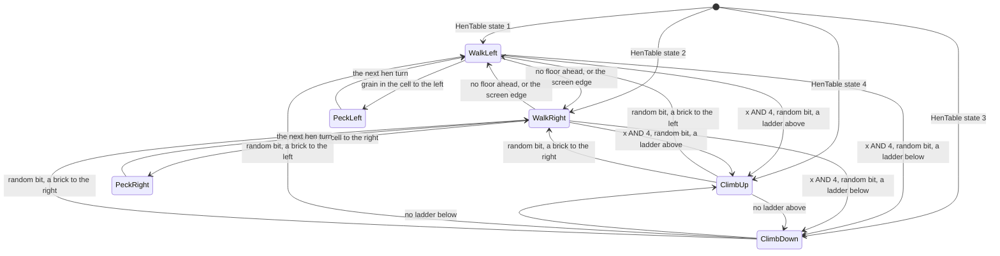

One hen turn, as MoveHen does it:

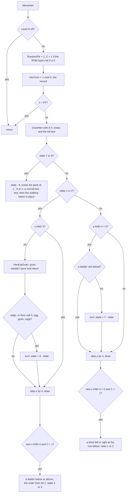

The same as pseudocode:

```text
MoveHen():
    if 8 <= Level < 16: return
    RandomPtr = (RandomPtr + 1) AND $00FF
    c = 1 if (ROM[RandomPtr] AND 1) == 0 else 0
    HenTurn = (HenTurn + 1) mod 5
    hen = Hens[HenTurn]
    if hen.x == $FF: return
    DrawHen(hen.x, hen.y, 0)                  ; erase; may kill Harry (7.10)
    if hen.state >= 7:                        ; a peck lasts one turn
        hen.state -= 6
        DrawHen(hen.x - 8 if left else hen.x, hen.y, 0)   ; erase the peck: a box test at MoveHen depth
        redraw the walking frame in place; return          ;   (a left peck's erase kills in x - 15 .. x - 3)
    if hen.state <= 2:                        ; walking
        if hen.x AND 4 == 0:
            HenEatGrain(hen)                  ; grain beside: peck, return (7.4)
            if hen.x + 8 > 255: turn            ; the carry test is shared by both directions ($9184-$9187)
            ahead = hen.x + 8 (right) or hen.x - 8 (left)
            if cell(ahead, hen.y - 1) in (0, egg, grain, cage):
                hen.state = 3 - hen.state     ; turn, and step at once
        hen.x += 4 (right) or -4 (left); draw
        if hen.x AND 4 and c:                 ; half way across a cell
            ladder below = cell(x, y - 8) is 1; ladder above = cell(x, y + 16) is 1
            take the first found, up first if bit 1 of the ROM byte is 0, down first if it is 1
    else:                                     ; climbing
        if hen.y AND 4 == 0 and cell(x, y + 16 up or y - 8 down) is not 1:
            hen.state = 7 - hen.state         ; reverse
        hen.y += 4 (up) or -4 (down); draw
        if hen.y AND 4 == 0 and c:
            step off onto a brick at (x - 8, y - 8) as state 1 or at (x + 16, y - 8) as state 2,
            right first if bit 1 is 0, left first if it is 1
```

The core of the walk, with the floor test and the step:

```text
MoveHenWalk:
$9178  CP $03                 ; state 1-2: walking
$917A  JR NC,MoveHenClimb
$917C  BIT 2,E                ; x AND 4: half way, just step
$917E  JR NZ,MoveHenStep
$9180  LD B,A
$9181  CALL HenEatGrain       ; may not come back (7.4)
$9184  LD A,E
$9185  ADD A,$08              ; x + 8 ...
$9187  JR C,MoveHenTurn       ;   past 255: turn
$9189  DJNZ MoveHenFloor      ; state 2 keeps x + 8
$918B  SUB $10                ; state 1: x - 8
$918D  JR C,MoveHenTurn       ;   below 0: turn
MoveHenFloor:
$918F  LD E,A
$9190  DEC D                  ; y - 1: the row under the hen's feet
$9192  CALL MapCellPeek
$9196  AND A
$9197  JR Z,MoveHenTurn       ; empty: turn
$9199  CP $03
$919B  JR C,MoveHenStep       ; a ladder (1, 2): floor
$919D  CP $05
$919F  JR Z,MoveHenStep       ; a brick: floor
MoveHenTurn:                  ; egg, grain, the cage or nothing: turn
$91A1  LD A,$03
$91A3  SUB (HL)               ; state = 3 - state
$91A4  LD (HL),A
MoveHenStep:
$91A5  LD B,(HL)              ; x - 4 (state 1) or x + 4 (state 2), then draw
...
$91AA  ADD A,$04
$91AC  DJNZ MoveHenStepSet
$91AE  SUB $08
```

The tests are asymmetric. At x = 8k the hen covers columns k and k + 1. Walking right, the floor test reads column
(x + 8) / 8 = k + 1 at row y - 1: the column under its own right half. Walking left, it reads (x - 8) / 8 = k - 1, the
column beside it, which it steps onto next. A right walker therefore stands with its right half over a hole, an egg or
grain before it turns, and only then steps back; a left walker turns before it overhangs. An egg or grain under the
feet counts as no floor, so a hen never crosses a hole that holds an egg, but walking right it stands half over it.
The worked example below shows it: at x 120 hen 1 covers columns 15 and 16, and cell (16, 16) under its right half is
empty (`src/res/maps/Level1.txt` row 16: `=` at column 15, `.` at 16) when it turns.

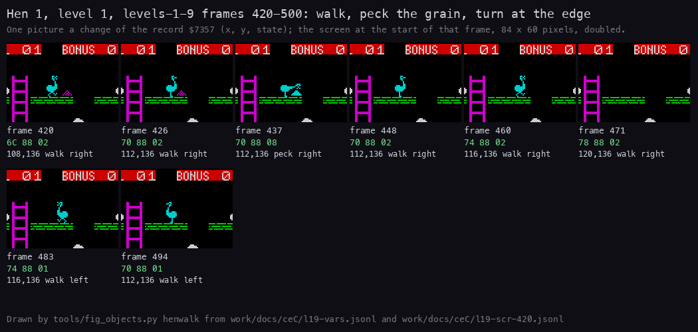

How to read the figure:

- One picture per sample in which hen 1's record `$7357-$7359` changed, `levels-1-9` frames 420-494 (level 1). Each
  picture is an 84 x 60 pixel crop of the screen at the start of that frame, doubled; the crop is fixed on the first
  frame's position.
- Under each picture: the frame, the three record bytes in hex, and the decoded x, y and state.
- The hen walks right on row 16 (y 136), pecks the grain at column 15 (frame 437, state 8), walks on, and turns at x 120
  (frame 483, state 1).

**The point**: a hen is three bytes. It moves 4 pixels every fifth hen turn, and everything else (a peck, a turn, a
ladder) is decided only where it stands squarely on map columns.

```bash
python3 tools/fig_objects.py henwalk --samples work/docs/ceC/l19-vars.jsonl --screens work/docs/ceC/l19-scr-420.jsonl --frames 420-500 --hen 1 --out docs/img/objects/hen-walk.png
```

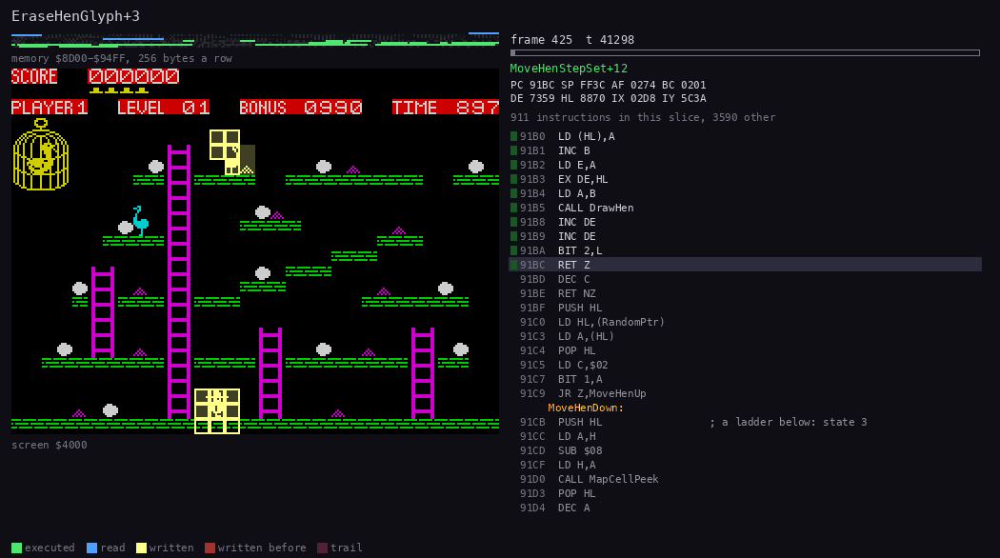

The animation is a trace of `levels-1-9` frames 425-489 (65 frames, 110 pictures). The top left panel is the memory
`$8D00-$94FF` (the hen sprites and HenTable), under it the screen, on the right the listing at the current instruction.
Green is executed, blue read, yellow written. Command:
`python3 ../../kit/routine_anim.py --work work/docs/ceC/l19 --window 425:0-490:0 --listing build/game.lst --view screen --range 8D00-94FF --pc 911E-943D --pictures 110 --out docs/img/routines/MoveHen.gif`.

**The point**: MoveHen runs on one slow tick in three and touches one hen. Most of its turns erase a hen and redraw it 4
pixels on; the peck and the turn are short side branches.

Worked example, hen 1 of level 1 (HenTable row 1 starts it at (104, 136), state 2), from the samples of
`levels-1-9`:

| Frame | Record | What happened in the frame before |
| --- | --- | --- |
| 420 | `6C 88 02` | (108, 136), walk right |
| 426 | `70 88 02` | x 108 + 4 = 112 |
| 437 | `70 88 08` | x 112 is a multiple of 8: HenEatGrain reads cell ((112 + 8) / 8, 136 / 8) = (15, 17), finds grain (4), empties it and sets state 2 + 6 = 8 |
| 448 | `70 88 02` | the peck ends: state 8 - 6 = 2, no step |
| 460 | `74 88 02` | x 116 (x AND 4: no test) |
| 471 | `78 88 02` | x 120 |
| 483 | `74 88 01` | at x 120 the floor test reads cell ((120 + 8) / 8, 135 / 8) = (16, 16): empty. Turn to state 3 - 2 = 1, and step at once: x 116 |
| 494 | `70 88 01` | x 112, walking left |

Each change comes about 11 frames after the one before: 15 slow ticks at about 1.3 slow ticks a frame.

Witness: MoveHen ran 38 158 times in the eight builds (`$911E`). The walking branch called HenEatGrain 6746 times
(`$9181`), and 82 of those calls found grain (`$9281`). The climbing reversal `$920A` ran 521 times, the ladder choices
`$91DB` (down) 324 and `$91EF` (up) 228 times, the step-offs `$924C` (left) 213 and `$9261` (right) 307 times
(`tools/l1count.py`).

## 7.4 HenEatGrain: the peck

HenEatGrain `$9265` runs at each multiple of 8 of a walking hen. It looks at column (x + 8) / 8 for a hen walking
right, (x - 8) / 8 walking left, at row y / 8, the row of the hen's body just above its floor. As with the floor test
(7.3) the two sides differ: walking right, that is the cell under the hen's own right half, so it pecks grain it
already half covers; walking left, it is the cell beside it. If the cell holds grain (code 4), the hen eats it:

```text
HenEatGrain(hen):
    if hen.x + 8 > 255: return                ; tested for either direction ($9268-$926B)
    cx = hen.x + 8 if hen.state == 2 else hen.x - 8
    cell = LiveMap[cx / 8 + 32 * (hen.y / 8)]
    if cell != grain: return
    cell = empty
    hen.state += 6                            ; 7 peck left, 8 peck right
    draw the peck frame at hen.x (right) or hen.x - 8 (left)    ; may kill Harry (doc 10.8)
    return to MoveHen's caller                ; the hen does not step this turn
```

```text
HenEatGrainTest:
$9279  EX DE,HL
$927A  CALL MapCellAt         ; the cell beside the hen
$927D  CP $04
$927F  JR NZ,HenEatGrainNone
$9281  LD (HL),$00            ; the grain is gone from LiveMap
$9283  LD A,(DE)
$9284  ADD A,$06              ; state + 6: peck
$9286  LD (DE),A
$9287  POP HL                 ; HL = the hen's (x, y)
$9288  CP $08
$928A  JR Z,HenEatGrainPeck
$928C  LD A,L
$928D  SUB $08                ; peck left: drawn 8 pixels to the left
$928F  LD L,A
HenEatGrainPeck:
$9290  LD A,(DE)
$9291  CALL DrawHen
$9294  POP HL                 ; drop HL, BC and the return into MoveHen:
$9295  POP HL
$9296  POP HL                 ;   the RET goes back to MainLoop
$9297  RET
```

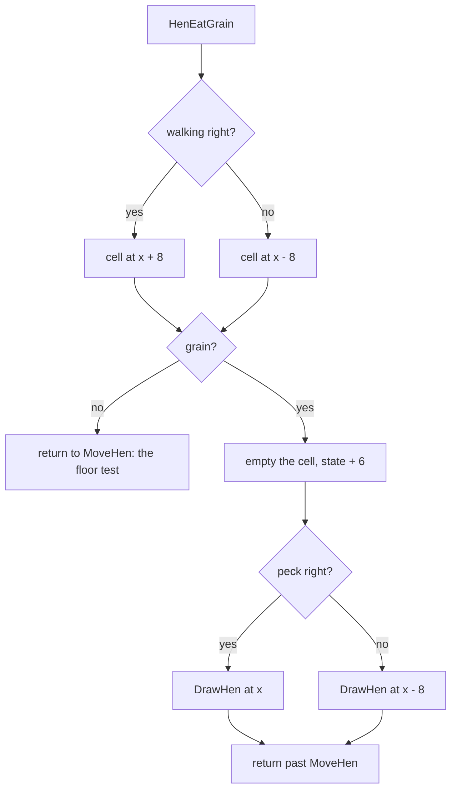

A grain the hen eats is gone for Harry too: there is one map, and the cell is emptied in it. The peck frame is drawn 8
pixels to the left for a left peck, so the beak reaches into the grain's cell beside the hen; a right peck at x already
covers its grain cell. That shift is where the bug of doc 10.8
comes from: DrawHen's kill test uses the shifted position.

Worked example: the peck of 7.3. Hen 1 at (112, 136) walking right; cell (15, 17) is `$61A8 + 15 + 32 x 17 = $63D7`,
code 4. It becomes 0, the state 8, and the peck frame is drawn at x 112 (sample 437). In the next hen turn MoveHen
sees state 8, subtracts 6 and redraws the walking frame without a step (sample 448).

Witness: 82 meals in the eight builds (`$9281`), 44 of them in `levels-1-9`. 40 were left pecks (the shift `$928C`)
and 42 right pecks.

## 7.5 The duck

The duck has six bytes: `DuckX`, `DuckY` (the sprite's left edge and top line, as for Harry), the speeds `DuckDx` and
`DuckDy` (-5 to +5 pixels a duck step), `DuckDelay` and `DuckFrame`. MoveDuck `$A0C8` runs every 12th slow tick, about
every 10 frames, on every level.

On levels 1-8 the duck is in its cage at the top left. MoveDuck still steers and moves it, and then puts it back at
(8, 152) (`$A16E`). From level 9 on that last step is skipped and the duck flies. Its homing (the speeds step one
towards Harry each duck step and bounce off the screen edges) is gameplay: doc 10.9.

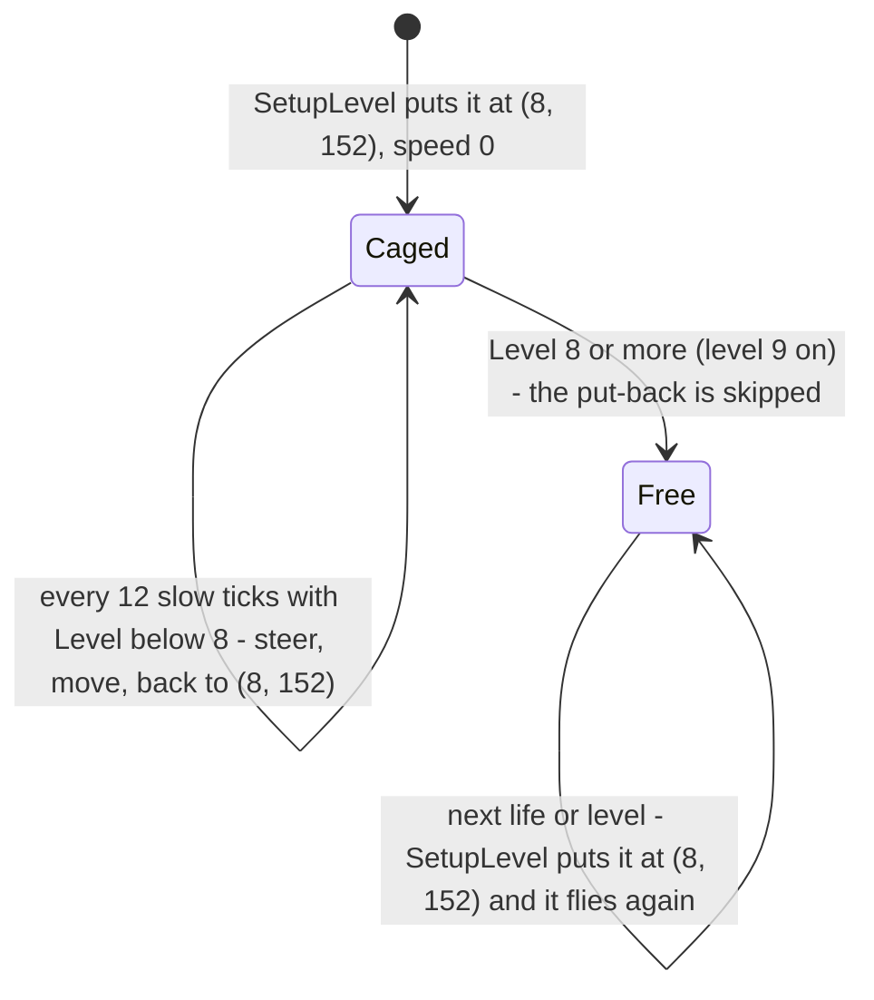

```text
MoveDuckCage:
$A16B  LD (DuckY),A
$A16E  LD A,(Level)
$A171  CP $08
$A173  JR NC,MoveDuckDraw     ; level 9 and up: free
$A175  LD HL,$9808
$A178  LD (DuckX),HL          ; DuckX 8, DuckY $98 = 152: back in the cage
MoveDuckDraw:
$A17B  LD HL,(DuckX)
$A17E  LD C,$08               ; frame 8 ...
$A180  LD A,(HarryX)
$A183  CP (IX+$70)
$A186  JR NC,MoveDuckFrame
$A188  LD C,$0A               ; ... or 10 when Harry is left of the duck
MoveDuckFrame:
$A18A  LD A,C
$A18B  ADD A,(IX+$75)         ; + the wing phase
$A18E  CALL DrawSprite
```

Worked example: in `levels-1-9` on level 1 the caged duck's speed changes while it sits still. The samples read
`DuckDy 251` (-5) up to frame 1901. Harry jumps from y 151 above the duck's y 152 (frames 1888-1926), so the duck
steps in frames 1901 and 1913 add 1 each: `252`, `253` (samples 1902 and 1914). Harry lands at 151, below 152, and the
step in frame 1926 takes 1 off: `252` (sample 1927). DuckDx stays 5 all along: Harry is always right of x 8. The
position is (8, 152) in every sample of levels 1-8.

Witness: the put-back `$A175` ran 1726 times in `levels-1-9`, MoveDuck 1861 times (`$A0C8`): the 135 duck steps
without it are levels 9 and 10. The duck's own kill `$9BC6` ran in no recording.

## 7.6 The lifts

Levels 3-7 have a lift: a shaft at a fixed x with two platforms that rise through it and start again at the bottom.
The lift is four fields for platform 1 and three for platform 2:

| Field | Meaning |
| --- | --- |
| `Lift1 $734E` (word) | the screen address of platform 1's top line |
| `LiftX $7350` | the shaft's x in pixels, `$FF` on levels without a lift |
| `Lift1Row $7351` | platform 1's y, counted up from the screen bottom |
| `Lift2 $7352` (word) | the screen address of platform 2 |
| `Lift2Row $7354` | platform 2's y |

A platform is 16 pixels wide and 4 lines high, drawn straight into the screen as two bytes of `$FF` a line (DrawLift
`$A07B`). MoveLifts `$A014` runs every second slow tick. Each run erases a platform, adds 1 to its row, moves its screen
address one line up (LineUp `$A0A9`) and draws it again; then the same for platform 2. A platform whose row would reach
166 restarts from `LiftTable` row 0 at row 3.

```text
MoveLifts():
    if LiftX == $FF: return
    for each platform p in (1, 2):
        DrawLift(p.address, 0)                ; erase (and clear the bytes beside it)
        p.row += 1
        if p.row >= 166:                      ; the top: restart at the bottom
            p.address = LiftTable[0].address; p.row = 3
        p.address = LineUp(p.address)         ; also after a restart: one line above SetupLevel's start
        DrawLift(p.address, $FF)
```

```text
MoveLifts:
$A014  LD A,(LiftX)
$A017  XOR $FF
$A019  RET Z                  ; no lift on this level
$A01E  LD HL,(Lift1)
$A021  LD C,$00
$A023  CALL DrawLift          ; erase platform 1
$A026  LD A,(Lift1Row)
$A029  INC A
$A02A  CP $A6                 ; 166?
$A02C  JR C,MoveLifts2
$A02E  LD HL,LiftTable        ; restart: LiftTable row 0 = this level's row
$A031  LD BC,$0004
$A034  LD DE,Lift1
$A037  LDIR
$A039  LD A,$03
MoveLifts2:
$A03B  LD (Lift1Row),A
$A03E  LD HL,(Lift1)
$A041  CALL LineUp            ; one screen line up
$A044  LD (Lift1),HL
$A047  LD C,$FF
$A049  CALL DrawLift          ; draw platform 1
...                           ; the same for platform 2 ($A04C-$A077), LDIR of 3 bytes
```

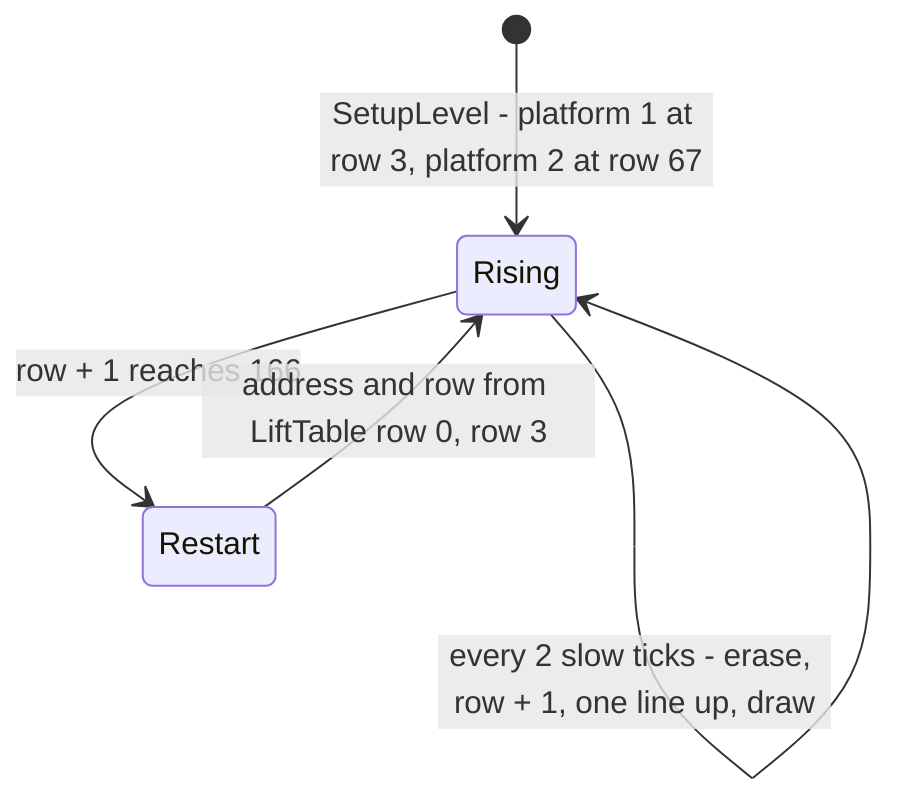

One cycle is 163 steps (rows 3-165 and the restart) of 2 slow ticks each: 326 slow ticks. Platform 2 starts at row 67
(SetupLevel `$B0EF`, address Lift1 - `$800`), 64 rows above platform 1. It reaches the top first and restarts at row 3
while platform 1 is at 102. Round the 163-row cycle the two stay 64 rows apart, which is 99 rows when platform 2 is the
lower one. The restart of platform 2 copies only 3 bytes of `LiftTable`, so `Lift2Row` holds LiftX for a moment, until
`LD A,$03` sets it to 3.

The restart also shifts the drawing by one line. SetupLevel puts each platform at its table address with no LineUp:
line 188 from the top with row 3, so line + row = 191. A restart copies the same table address and then passes LineUp
like every step, so the platform starts again at line 187 with row 3: line + row = 190. After its first restart each
platform is drawn one line above where its row says. CatchLift and the death test use the rows, not the drawn lines, so
the platform on the screen is one line higher than the one the rules use. The next SetupLevel (a new level or a new
life) puts both back to 191.

| Sample (level 3) | Platform 1 line, row | Platform 2 line, row | What happened |
| --- | --- | --- | --- |
| 3801 | 188, 3 (sum 191) | 124, 67 (sum 191) | SetupLevel |
| 4091 | 89, 102 (191) | 187, 3 (190) | platform 2 restarted |
| 4219 | 187, 3 (190) | 123, 67 (190) | platform 1 restarted: both one line up |

The lines are decoded from `Lift1 $734E` and `Lift2 $7352` in the samples of `l19-vars.jsonl`; levels 4-7 repeat the
pattern at every first restart (samples 7164 and 7285 on level 4, for example).

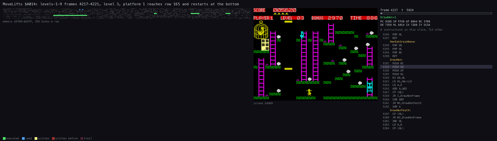

The animation is a trace of `levels-1-9` frames 4217-4221 on level 3 (60 pictures). Platform 1 reaches row 165, and
the next step copies `LiftTable` row 0 back into `Lift1` and sets row 3. Command:
`python3 ../../kit/routine_anim.py --work work/docs/ceC/l19 --window 4217:0-4222:0 --listing build/game.lst --view screen --range 9700-A1FF --pc A014-A0BF --pictures 60 --title "MoveLifts \$A014: levels-1-9 frames 4217-4221, level 3, platform 1 reaches row 165 and restarts at the bottom" --out docs/img/routines/MoveLifts.gif`.

**The point**: a lift is two screen addresses that climb one line every second slow tick. Nothing of it is in the
level map; CatchLift (7.10, doc 10.10) compares Harry with the rows.

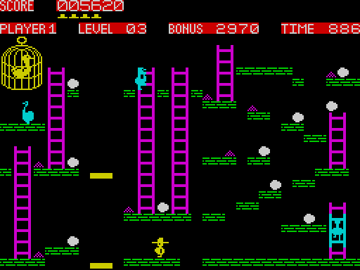

The animation is the screen of `levels-1-9` frames 4219-4531, one picture every 4 frames: one full cycle of platform 1,
from its restart at the bottom (frame 4219) to the next (frame 4529), 310 frames. Command:
`python3 ../../kit/screen_anim.py --work work/docs/ceC/l19 --from 4219 --to 4531 --step 4 --scale 2 --delay 60 --hold 1500 docs/img/play/lift-cycle.gif`.

**The point**: one cycle takes about six seconds. Harry has to time his jump onto a platform and off it before the
top.

Worked example, level 3: LiftTable row 3 is `E8 54 40 03`, so the shaft is at x `$40` = 64 and platform 1 starts at
screen address `$54E8` (column 8, line 188 from the top: y 3) with row 3. Platform 2 starts at `$54E8 - $800 = $4CE8`,
64 lines higher, row 67. In the samples, Lift1Row is 165 in frame 4218 and 3 in frame 4219; the next restart shows in
frame 4529. 326 slow ticks in 310 frames is 1.05 slow ticks a frame on this level. In the block sample of frame 5705
platform 1 is at row 114 and platform 2 at row 15: 99 rows apart.

Witness: MoveLifts ran 57 158 times (`$A014`). Platform 1 restarted 164 times (`$A02E`) and platform 2 167 times
(`$A05C`) in the eight builds. The lift levels 3-7 are all in `levels-1-9`.

## 7.7 The live maps and their cell codes

The level is a map of 21 rows by 32 cells of 8 x 8 pixels: the play area below the HUD. Row 0 is at the bottom, so a
cell's address is a simple function of a pixel position:

```text
cell(x, y) = LiveMap + x / 8 + 32 * (y / 8) = LiveMap + x / 8 + 4 * (y AND $F8)
```

MapCellAt `$9E34`, MapCellAddr `$95A6` and the inlined copies in WalkHarry, ClimbLadder and LeaveLadder all compute
this.

```text
MapCellAt:
$9E36  EX DE,HL               ; E = x, D = y
$9E37  LD HL,LiveMap
$9E3A  LD A,D
$9E3B  AND $F8
$9E3D  LD B,$00
$9E3F  SLA A                  ; 4 x (y AND $F8) = 32 x row
$9E41  RL B
$9E43  SLA A
$9E45  RL B
$9E47  LD C,A
$9E48  ADD HL,BC
$9E4B  LD C,E
$9E4C  SRL C                  ; x / 8
$9E4E  SRL C
$9E50  SRL C
$9E52  ADD HL,BC
$9E53  LD A,(HL)              ; A = the code, HL = its address
```

`LiveMap $61A8` is five maps of 672 bytes (`$2A0`). Slot 0 is the map in play. Slots 1-4 keep each player's map
between turns: LifeLost `$A6FE` copies slot 0 into the slot of the player who died and copies the next player's slot
into slot 0 (`$A72D-$A7B7`). PlayLevel copies a fresh map from `LevelMaps $B3B0` into slot 0 when a level is
completed (`$A6E1`: `LevelMaps + 672 x (Level AND 7)`). An egg taken or a grain eaten therefore stays gone for that
player through a lost life.

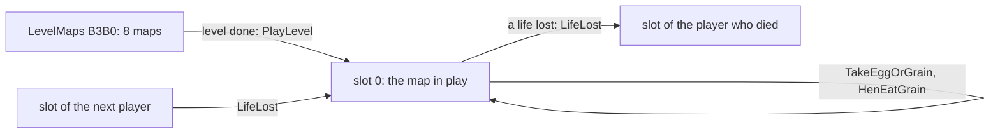

| Code | Cell | Attribute (CellAttributes) | Who reads it |
| --- | --- | --- | --- |
| 0 | empty | 6 yellow | everything |
| 1 | ladder, left half | 3 magenta | ClimbLadder, MoveHen, JumpLand |
| 2 | ladder, right half | 3 magenta | JumpLand, the hen floor test |
| 3 | egg | 7 white | TakeEggOrGrain, FallOffEdge |
| 4 | grain | 3 magenta | TakeEggOrGrain, HenEatGrain, FallOffEdge |
| 5 | brick | 4 green | every floor and wall test |
| `$A8-$B5` | the cage, 14 codes over 18 cells (4 x 5 less two; `ghij` repeats) | 6 (any code of 9 and up) | MoveHen (no floor), the drawing |

A cell's code is also its character: SetupLevel prints the map with PrintChar, code by code, and the attribute comes
from `CellAttributes` for codes 0-8 (doc 06).

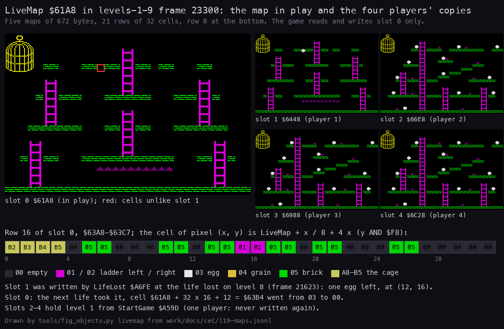

How to read the figure:

- Left: slot 0 (`$61A8`), the map in play, in the sample of `levels-1-9` frame 23 300, drawn from its cells with the
  game's glyphs and colours. A red box marks each cell that differs from slot 1.
- Right: slots 1-4 (`$6448`, `$66E8`, `$6988`, `$6C28`), each drawn the same way and labelled.
- The strip below is row 16 of slot 0, `$63A8-$63C7`, one box a cell with its code; the legend gives the colours.
- The text at the bottom explains the differences.

**The point**: the map is the only record of the eggs and the grain. A pickup is one byte set to 0, and a player's
progress through a level is his copy of the map.

```bash
python3 tools/fig_objects.py livemap --samples work/docs/ceC/l19-maps.jsonl --frame 23300 --row 16 --out docs/img/objects/livemaps.png
```

Worked example: level 8 of `levels-1-9`. The life lost at frame 21 623 made LifeLost copy slot 0 into slot 1 with one
egg left, at cell (12, 16). The next life took it: cell `$61A8 + 32 x 16 + 12 = $63B4` went from `03` to `00` in slot
0 (the sample of frame 23 300 shows it), while slot 1 still holds `03`. Slots 2-4 hold level 1 as StartGame `$A59D`
wrote it; with one player they are never written again.

Witness: `levels-1-9` frames 21 500, 21 700 and 23 300 (`l19-maps.jsonl`). EggsLeft `$6EE6` is saved and restored
next to the map (`$A745`, `$A794`): it is 1 from frame 21 229 and 0 from frame 23 148 (`l19-game.jsonl`).

## 7.8 The level maps with their objects

The eight maps come from `LevelMaps $B3B0` (`src/res/maps/Level1.txt` ... `Level8.txt`). Level n uses map
((n - 1) AND 7) + 1, so levels 9-16, 17-24 and so on repeat them. Each map holds exactly 12 eggs; EggsLeft is set to 12
before each new level (`$A6F6`). The hens come from `HenTable` and the lift from `LiftTable` (7.9), not from the map.

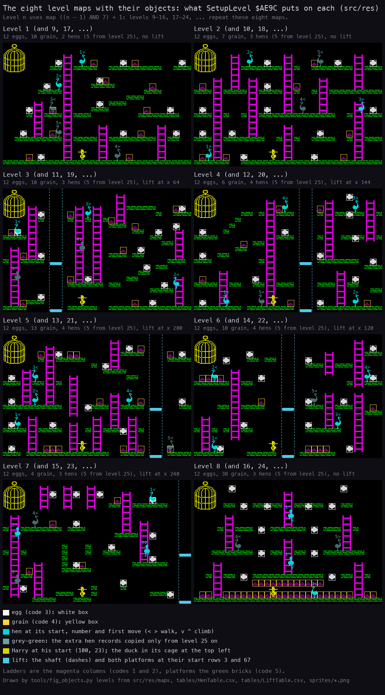

How to read the figure:

- One map per level 1-8, drawn from `src/res/maps` with the game's glyphs and colours (the same as
  `docs/img/maps/Level1-8.png`), with the objects added on top.
- White boxes ring the eggs (code 3), yellow boxes the grain (code 4). Ladders are the magenta columns, bricks the green
  rows.
- Each hen is drawn at its start from HenTable with its number and first move (`<` `>` walk, `v` `^` climb). Solid
  cyan hens are the level's own; grey-green hens are the extra records SetupLevel copies only from level 25 on.
- Harry is drawn at his start (100, 23). Levels 3-7 show the lift: the shaft as dashes and both platforms at their
  start rows 3 and 67.
- The line under each title counts the eggs, grain and hens and gives the lift's x.

**The point**: every map has 12 eggs; the maps differ in their bricks, ladders and grain. A map's difficulty comes from
those, from the hens' starts and from the lift.

```bash
python3 tools/fig_objects.py levels --out docs/img/objects/levels-objects.png
```

Worked example: level 4 (map 4) has two eggs set into the bricks themselves, at cells (26, 16) and (27, 12): each has
a brick on both sides and nothing under it. Walking Harry cannot take them (his egg test reads the row above his feet,
doc 10.7); in `levels-1-9` he took both by dropping into the hole, in frames 8472 and 8517.

Witness: `python3 tools/fig_maps.py` draws the same maps from `src/res`, and the build compares `src/res` with the
image byte for byte (`sh tools/build.sh` prints identical).

## 7.9 The spawner: HenTable and LiftTable

There is no spawning during play. SetupLevel puts every object in place at the start of each level and each life, and
nothing is created or freed until the next SetupLevel. A hen eats grain and a lift restarts, but no record appears or
disappears.

`HenTable $945B` has nine rows of 21 bytes. SetupLevel reads row (Level AND 7) + 1, so row 0 is never read (its bytes
are a leftover). A row is a byte count, then five hen records of 4 bytes.

```text
Hens[0..19] = $FF
if Level < 8 or Level >= 16:                  ; no hens on levels 9-16
    row = HenTable + 21 * ((Level AND 7) + 1)
    count = row[0]                            ; 8, 12 or 16: two, three or four hens
    if Level >= 24: count = 20                ; level 25 and up: all five records
    copy count bytes from row + 1 to Hens
HenDelay = 1; RandomPtr = 0
```

```text
SetupLevelNoHens:
$AF7C  LD (HL),$FF            ; 20 bytes of $FF from Hens
$AF7E  INC HL
$AF7F  DJNZ SetupLevelNoHens
$AF81  LD A,(Level)
$AF84  CP $08
$AF86  JR C,SetupLevelHens
$AF88  CP $10
$AF8A  JR C,SetupLevelIcons   ; Level 8-15: no hens
SetupLevelHens:
$AF8C  AND $07
$AF8E  LD HL,HenTable
$AF91  LD BC,$0015
$AF94  INC A
SetupLevelHenRow:
$AF95  ADD HL,BC              ; HenTable + 21 x ((Level AND 7) + 1)
$AF96  DEC A
$AF97  JR NZ,SetupLevelHenRow
$AF99  LD B,(HL)              ; the count
$AF9A  INC HL
$AF9B  LD A,(Level)
$AF9E  CP $18
$AFA0  JR C,SetupLevelHenCopy
$AFA2  LD B,$14               ; Level 24 and up: 20 bytes
SetupLevelHenCopy:
$AFA4  LD DE,Hens
SetupLevelHenByte:
$AFA7  LD A,(HL)
$AFA8  LD (DE),A
$AFA9  INC DE
$AFAA  INC HL
$AFAB  DJNZ SetupLevelHenByte
```

`LiftTable $9787` has nine rows of 4 bytes: the screen address of platform 1 (low, high), LiftX and the start row.
SetupLevel copies row (Level AND 7) + 1 into row 0 ("current") and into `Lift1`, then sets `Lift2Row` 67 and
`Lift2 = Lift1 - $800`. MoveLifts restarts the platforms from row 0.

```text
$B0D0  LD BC,$0004
$B0D3  LD HL,LiftTable
$B0D6  PUSH HL
$B0D7  POP DE                 ; DE = row 0
$B0D8  LD A,(Level)
$B0DB  AND $07
$B0DD  INC A
SetupLevelLift:
$B0DE  ADD HL,BC
$B0DF  DEC A
$B0E0  JR NZ,SetupLevelLift
$B0E2  LDIR                   ; the level's row into row 0
$B0E4  LD BC,$0004
$B0E7  AND A
$B0E8  SBC HL,BC
$B0EA  LD DE,Lift1
$B0ED  LDIR                   ; and into Lift1, LiftX, Lift1Row
$B0EF  LD (IX+$7C),$43        ; Lift2Row 67
$B0F3  LD HL,(Lift1)
$B0F6  LD BC,$0800
$B0FA  SBC HL,BC
$B0FC  LD (Lift2),HL          ; 64 lines higher
```

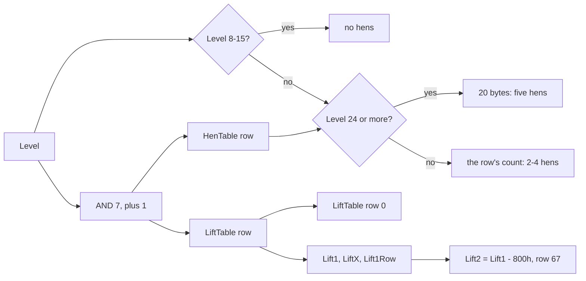

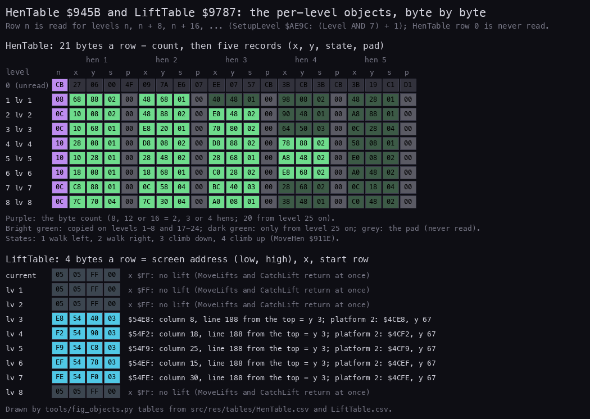

How to read the figure:

- Top: HenTable, one row per map (0-8), one box a byte. Purple is the byte count; bright green the records copied on
  levels 1-8 and 17-24; dark green the records copied only from level 25 on; grey the pad bytes. Row 0, never read, is
  dimmed.
- Bottom: LiftTable, one row of 4 bytes per map and the "current" row 0, with the address decoded into a column and
  line. `FF` in the x byte means no lift.

**The point**: two small tables set up every level. From level 25 on every map gets five hens, the last ones taken from
bytes that levels 1-24 never use.

```bash
python3 tools/fig_objects.py tables --out docs/img/objects/hen-lift-tables.png
```

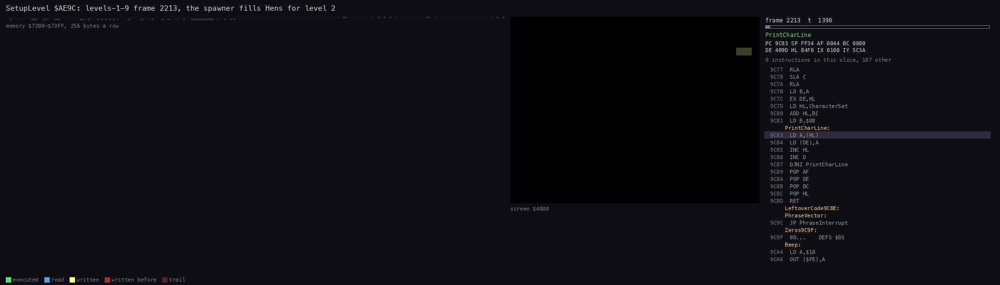

The animation is a trace of `levels-1-9` frame 2213 (50 pictures), the frame in which SetupLevel sets up level 2. The
top left panel is the memory `$7200-$73FF`, where the block `$72D8-$7375` lies; the second row holds Hens. The screen shows
the level being drawn and coloured; the listing follows the copy loop `$AF7C-$AFAB`. Command:
`python3 ../../kit/routine_anim.py --work work/docs/ceC/l19 --window 2213:0-2214:0 --listing build/game.lst --view screen --range 7200-73FF --pc AF77-AFB0 --pictures 50 --title "SetupLevel \$AE9C: levels-1-9 frame 2213, the spawner fills Hens for level 2" --out docs/img/routines/SetupLevel-spawn.gif`.

**The point**: the whole cast of a level is written in one frame, before the level is shown. After that frame no
record is created.

Worked example, level 1 (Level 0): the row is at `$945B + 21 = $9470`: `08 68 88 02 00 48 68 01 00 40 48 01 00 ...`.
The count 8 copies two records: hen 1 at (`$68`, `$88`) = (104, 136) walking right, hen 2 at (72, 104) walking left.
The sample of `levels-1-9` frame 300 holds exactly `68 88 02 00 48 68 01 00`, then `FF`. Level 25 would also copy
(64, 72) walking left, (152, 8) walking right and (72, 40) walking left.

Witness: the sample of frame 2100 still holds level 1's hens; the sample of frame 2214 holds level 2's
`10 08 02 00 48 88 02 00 E0 48 02 00`, row 2 of HenTable. The hen copy `$AFA7` ran 380 times in the eight builds; the
20-byte case `$AFA2` ran in none (no recording reached level 25).

## 7.10 Collisions and their order

Every collision is one of three kinds:

- a box test on pixel positions: a hen against Harry (DrawHen, HenTouches), the duck against Harry (DrawSprite), Harry
  against a lift platform (CatchLift);
- a cell test on the map: eggs and grain (TakeEggOrGrain), floors and walls (WalkHarry, FallOffEdge, JumpLand,
  ClimbLadder, LeaveLadder), the hens' floor and ladders (MoveHen);
- a limit on a coordinate: the screen edges, the lift top (HarryY 165 on a lift) and the bottom of the screen (HarryY
  below 16).

| Test | Where | Box or cell | Outcome |
| --- | --- | --- | --- |
| a hen | DrawHen `$929C`, at every erase and draw of a hen | HarryX in x - 7 .. x + 5 and HarryY in y + 1 .. y + 28 | the hit `$92BC` (then HenKill `$92BE`): 6 words dropped, MainLoop returns to `$A656`, a life is lost |
| a hen, in a jump | HenTouches `$9E66`, from MainLoop on each pass with a vertical step | the same box | MainLoop returns (`$98B4`) |
| the duck | DrawSprite `$9B9E`, at every sprite draw | DuckX in HarryX - 7 .. HarryX + 8 and DuckY in HarryY - 8 .. HarryY + 9 | DuckKill `$9BC8` (entered at `$9BC6`): unwinds the stack to the first word of `$A410` or more, PlayLevel except from inside JumpStep (doc 10.11) |
| a lift platform | CatchLift `$A256`, on each x step of a drift, jump or fall | HarryX in LiftX - 9 .. LiftX + 9 and HarryY in row + 10 .. row + 15 | Harry stands on it: HarryY = row + 17, OnLift 1 |
| an egg or grain | TakeEggOrGrain `$99DF`, every slow tick | the cell at (HarryX + 8, HarryY - 8) | the cell emptied, points (doc 10.7) |
| the floor | FallOffEdge `$B34C`, JumpLand `$A30F` | the cell under the middle of the feet | a fall begins, or a landing |
| the walls | WalkHarry `$9D08`, LeaveLadder | the two cells ahead at the body's rows | no step |

The hen box test, with the clamp at the left edge of the screen:

```text
DrawHen:                      ; E = hen x, D = hen y
$92A1  LD HL,HarryX
$92A4  LD A,E
$92A5  ADD A,$05
$92A7  CP (HL)
$92A8  JR C,DrawHenFrame      ; HarryX > x + 5: no
$92AA  SUB $0D                ; x - 8 (0 if negative)
$92AC  JR NC,DrawHenTestX
$92AE  XOR A
DrawHenTestX:
$92AF  CP (HL)
$92B0  JR NC,DrawHenFrame     ; HarryX <= x - 8: no
$92B2  INC HL
$92B3  LD A,D
$92B4  CP (HL)
$92B5  JR NC,DrawHenFrame     ; HarryY <= y: no
$92B7  ADD A,$1C
$92B9  CP (HL)
$92BA  JR C,DrawHenFrame      ; HarryY > y + 28: no
$92BC  LD B,$06               ; a hit
HenKill:
$92BE  POP HL                 ; drop six words: back to $A656, the return of PlayLevel's CALL SetupLevel
$92BF  DJNZ HenKill
$92C1  RET
```

The order inside one pass of MainLoop decides which test fires first:

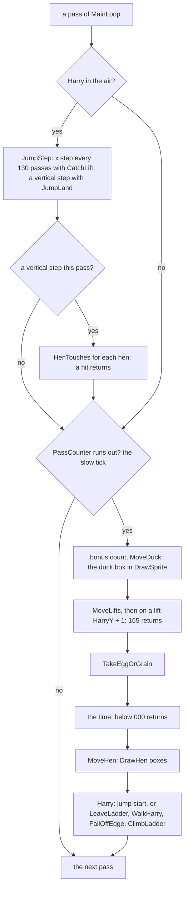

The duck's box test is inside DrawSprite, which also draws Harry. It therefore runs on every draw of Harry as well as
of the duck. Every way out of play but ABORT (`$98E2`: `POP HL`, `JP Start`) is meant as a return from MainLoop to
`$A656` in PlayLevel: the return address of PlayLevel's `CALL SetupLevel`, since SetupLevel enters MainLoop by `JP`
(`$B12D`). PlayLevel then looks at EggsLeft: not zero means a life lost (LifeLost `$A6FE`), zero means the level
is done. Two paths miss: the HenEatGrain peck returns into the ROM (doc 10.8), and the duck's unwind from a draw inside
JumpStep can stop at MainLoop's saved JumpDelay (doc 10.11).

Worked example: `idle-1p`, Harry standing at (100, 23) on level 1. Hen 1 walks left along the bottom. In the sample of
frame 4763 its record is `6C 08 01` (108, 8); in frame 4764 it is `68 08 01` (104, 8). The step in frame 4763 drew the
hen at 104: its box covers HarryX 97-109 and HarryY 9-36, and Harry (100, 23) is inside. DrawHen jumps to HenKill. The
death tune plays, and the next life starts at frame 5141 with the hens back at their HenTable starts.

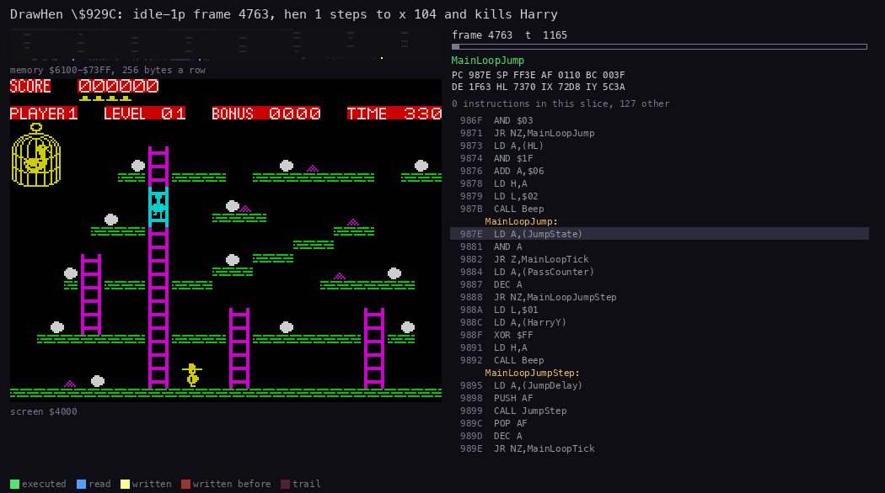

The animation is a trace of `idle-1p` frame 4763 (60 pictures of 1165 T). Picture 5 holds MoveHen's erase of hen 1
(DrawHen at t 5814, no hit). Picture 10 holds the kill: the draw at x 104 enters DrawHen at t 10 966, the box test
`$92A4-$92BA` falls through to `$92BC` at t 11 127, HenKill pops six words and the RET reaches PlayLevel `$A656` at
t 11 277. The fifty pictures after it run no DrawHen code ("0 instructions in this slice"): LifeLost and the ROM's death
tune. Command:
`python3 ../../kit/routine_anim.py --work work/docs/ceC/idle --window 4763:0-4764:0 --listing build/game.lst --view screen --range 6100-73FF --pc 929C-93DC --pictures 60 --title "DrawHen \$929C: idle-1p frame 4763, hen 1 steps to x 104 and kills Harry" --out docs/img/routines/DrawHen-kill.gif`.

**The point**: a hen kills when it is drawn, not when Harry moves. A Harry who never moves is killed by the first hen
whose box reaches him.

Witness: the hit `$92BC` ran 11 times in the eight builds (c1 1, `idle-1p` 5, `gameover-name` 5). HenTouches found a
hit once (`$9E86`, `levels-1-9`, in a jump on level 8 before frame 21 623). The duck's kill (`$9BC6`) and the lift top (`$991E`
taken) killed in no recording (doc 10.11).

## 7.11 Random numbers

The game has no random number generator. Its only source of chance for the objects is the ROM itself.
`RandomPtr $736C` walks the first 256 bytes of the ROM, one byte each MoveHen call, empty slots included:

```text
RandomPtr = (RandomPtr + 1) AND $00FF        ; $0001, $0002, ..., $00FF, $0000, ...
byte = ROM[RandomPtr]
c = 1 if (byte AND 1) == 0 else 0            ; walking: try a ladder; climbing: try to step off
which way first = bit 1 of byte              ; up or down first, right or left first
```

```text
MoveHenRandom:
$9128  LD HL,(RandomPtr)
$912B  INC HL
$912C  LD H,$00               ; stay in $0000-$00FF
$912E  LD (RandomPtr),HL
$9131  LD C,$01
$9133  BIT 0,(HL)             ; a ROM byte
$9135  JR Z,MoveHenNext       ; bit 0 clear: C = 1
$9137  DEC C
```

SetupLevel sets RandomPtr to 0 at every level and every life: `$AFB0` stores the word `$0001` at HenDelay, so the byte
after it, RandomPtr, becomes 0. The hens therefore make the same choices in the same order each life, as long as the
map (the grain) is the same.

The other source of chance is the refresh register R. Three phrase pickers read it with `LD A,R` and `AND $07` and
choose one of eight phrases for the speech output (doc 09): LiftPhrase `$A389` when Harry lands on a lift,
DeathPhrase `$AAE4` when a life is lost and LevelPhrase `$B14F` at each SetupLevel. None of them touches an object.

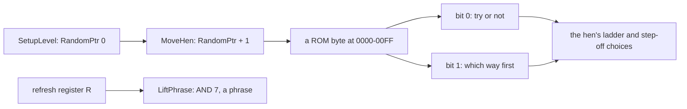

Worked example: in the block sample of `levels-1-9` frame 5705 RandomPtr is `$006B`. The next hen turn reads ROM
`$006C`, which holds `$B5`. Bit 0 is set, so C = 0: that hen will neither look for a ladder nor step off one this turn.

Witness: Harry never moves in `idle-1p`, and the hens kill him at even intervals (doc 10.11). MoveHenRandom `$9128`
ran 37 621 times (L1).

## 7.12 What no recording reached

- Level 25 and up: SetupLevel's 20-byte hen copy (`$AFA2`) never ran. The fifth hen record of each row is known only
  from the code and `src/res/tables/HenTable.csv`.
- Level 33 and up: the shorter hen period (`$9944`) never ran.
- The duck's kill `$9BC6`: the free duck never touched Harry in a recording (it flew on levels 9 and 10 only).
- Walking off a lift (`$9DDB` in WalkHarry): no recording walked off a moving platform; Harry always jumped. The code
  leaves OnLift 1 after it (doc 10.10).
- The duck's unwind from a draw inside JumpStep with JumpDelay `$A4` or more (doc 10.11): the word on the stack is
  JumpDelay x 256 + `$42`, and the RET goes to an address in `$A442-$FF42`. Known only from the code.
- The map slots of players 2-4 written by LifeLost: every life lost in the recordings was a one-player game's, so
  slots 2-4 hold what StartGame wrote.
