# 8. HUD and text

What this covers: the one print routine and its 204 character codes, the texts of the image and their resources, the
HUD panel in screen rows 0-2, the score and the extra life, the bonus and the time, the bonus count-down at the end of
a level, the scrolled messages, the menus and pages, the high score table and the name entry, and a data sheet of
every text.

The recordings it rests on (WALKTHROUGH section 6.1 lists their input scripts):

- `levels-1-3`: 7023 frames from `work/stage1/lab/x0/loaded.szx` (the original tape loaded on a 48K, saved on the
  title). The bot plays levels 1, 2 and 3. The HUD of level 1 is printed in frames 283-291. The first egg is taken in
  frame 568. The level ends count the bonus down in frames 2007-2016, 3583-3601 and 6649-6677. The events of this
  document were traced from it with `tools/sound_events.py` (frames 0-7023, chunks of 100 frames).
- `tour-redefine`: the four-player HUD (frame 1150), TIME 000 (frame 8600) and "OUT OF TIME !" (frame 8750).
- `tour-type2`: the title (frame 200), the instructions (frame 300) and the players prompt (frame 500).
- `gameover-name`: GAME OVER, the congratulation page and the name "CE1" typed under IM 1 (frames 39 450-39 700).
- `idle-1p`: five lives lost and GAME OVER (frame 14 600).
- `levels-1-9`: the extra life at 10 000 points (frame 7984) and the worked tally of level 1, both in doc 1.

Frames are the recording's frames, counted from the snapshot. A screen named by a frame is the screen at the start of
that frame. A T-state is counted from the frame's interrupt; a frame is 69 888 T.

## 8.1 PrintChar and the code space

Every character the game draws goes through PrintChar `$9C40`. The map cells, the HUD, the pages and the scrolled
messages all use it. The only other text writers are AddScore (8.4) and CountDown (8.5). They copy digit glyphs
themselves.

PrintChar takes the code in A, the row in H and the column in L. The row counts from the bottom: H = 0 is screen row
23, H = 23 is screen row 0. The glyph is CharacterSet `$84F0` + 8 x code, eight bytes, top row first. PrintChar copies
them down the cell, one byte per pixel line, with `INC D` between lines. It writes no attribute. The colours come from
the callers' own attribute fills.

The routine begins with four NOPs, room for a patch. It keeps every register.

```text
PrintChar(code A, row H from the bottom, column L):
    third = 0 if H >= 16, 1 if 8 <= H < 16, 2 if H < 8     ; screen thirds from the top
    line  = 7 - (H AND 7)                                    ; character row inside the third
    scr   = $4000 + third * $800 + line * 32 + L
    glyph = $84F0 + 8 * code
    for k in 0..7:  scr[k * 256] = glyph[k]                  ; INC D moves one pixel line down
```

```text
9C40  00 00 00 00   NOP x 4               ; PrintChar: room for a patch
9C44  E5 C5 D5 F5   PUSH HL, BC, DE, AF
9C48  7C            LD A,H                ; the row from the bottom
9C49  EB            EX DE,HL              ; E = the column
9C4A  21 00 40      LD HL,Screen
9C4D  01 00 08      LD BC,$0800           ; one screen third
9C50  FE 10         CP $10
9C52  30 06         JR NC,PrintCharRow    ; H 16-23: the top third
9C54  FE 08         CP $08
9C56  30 01         JR NC,PrintCharThird  ; H 8-15: the middle third
9C58  09            ADD HL,BC
9C59  09            ADD HL,BC             ; PrintCharThird
9C5A  E6 07         AND $07               ; PrintCharRow
9C5C  EE 07         XOR $07               ; 7 - (H AND 7)
9C5E  CB 27 x 5     SLA A                 ; x 32
9C68  4F 06 00 09   LD C,A / LD B,0 / ADD HL,BC
9C6C  4B 09         LD C,E / ADD HL,BC    ; + the column
9C6E  F1 F5         POP AF / PUSH AF      ; the code again
9C70  4F AF         LD C,A / XOR A
9C72  CB 21 17 x 3  SLA C / RLA           ; BC = 8 x code
9C7B  47 EB         LD B,A / EX DE,HL     ; DE = the screen cell
9C7D  21 F0 84      LD HL,CharacterSet
9C80  09            ADD HL,BC
9C81  06 08         LD B,$08
9C83  7E            LD A,(HL)             ; PrintCharLine
9C84  12            LD (DE),A
9C85  23            INC HL
9C86  14            INC D                 ; one pixel line down
9C87  10 FA         DJNZ PrintCharLine
9C89  F1 D1 C1 E1   POP AF, DE, BC, HL
9C8D  C9            RET
```

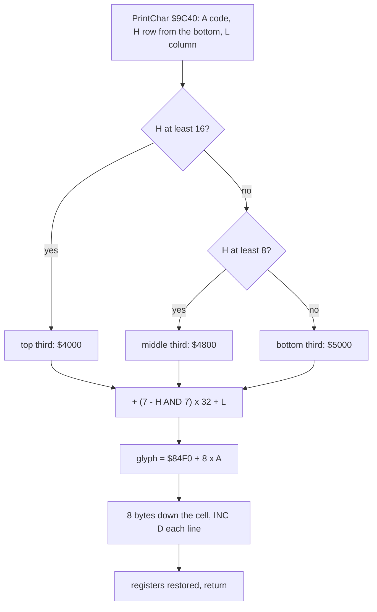

The 204 codes fall into groups. Codes 0-5 are the map cells, so the map in LiveMap is printed with the same routine
as the text.

| Codes | What | Printed by |
| --- | --- | --- |
| `$00-$05` | the map cells: empty, ladder left, ladder right, egg, grain, brick | SetupLevel `$AE9C` |
| `$0B-$1D` | the HUD labels SCORE, PLAYER, BONUS, TIME, two letters a cell | SetupLevel (HudText) |
| `$20-$5F` | the font: digits, signs, thin capitals `A-Z` | the pages, the messages |
| `$60-$7F` | bold capitals `A-Z` at the lowercase codes, the bullet `$7B`, the copyright `$7F` | the pages, the scrollers |
| `$80-$8A` | the big CHUCKIE EGG of the title | TitlePage `$A420` |
| `$8F-$96` | the A+F logo | DrawHiScores `$ABAD` (the default names) |
| `$97-$9A` | SPACE, CAPS SHIFT, SYMBOL SHIFT, ENTER | RedefineOne `$AB19`, the instructions |
| `$9B-$9D` | the HUD label LEVEL | SetupLevel |
| `$9E-$A7` | the HUD digits 0-9 | SetupLevel, PlayLevelBonus, CountDown (direct copy) |
| `$A8-$B5` | the duck's cage | SetupLevel (map) |
| `$B6` | the life icon | SetupLevel, AddScore |
| `$B7` | the name entry's cursor | EnterHiScore `$A80C` |
| `$B8-$CB` | the small "A&F SOFTWARE" lettering of the instructions page | InstructionsPage `$A4C8` |

The text files write the lowercase codes as lowercase letters, but they print as bold capitals. "high score table"
in MenuTexts appears on the screen as HIGH SCORE TABLE. The few uppercase letters in the texts print in the thin
style: the S, R and I of "press S to start game".

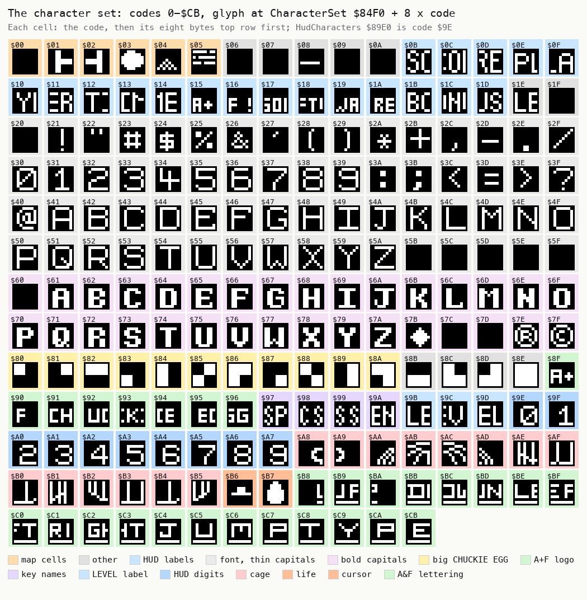

How to read the figure:

- **Each cell** is one code: the hex code on top, then the eight bytes as white pixels on black.
- **The colour behind a cell** is its group (the legend at the bottom).
- **Codes `$9E` and up** are HudCharacters `$89E0`, the tail of the same table. PrintChar reads them like any other
  code.
- **The point**: one table of 204 glyphs holds the map tiles, two capital alphabets, the HUD and the logos. One
  routine prints them all.

```bash
python3 tools/fig_text.py font --out docs/img/text/font.png
```

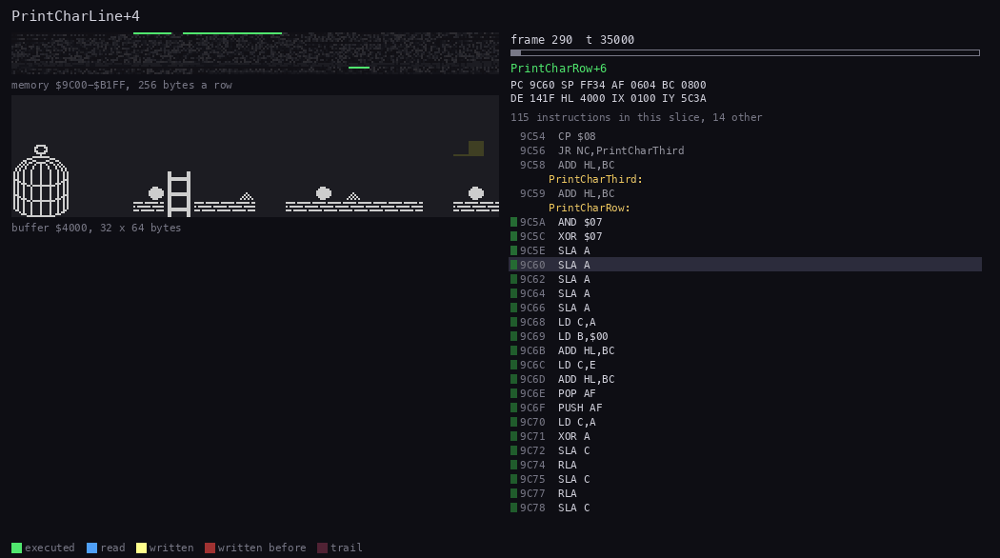

*The routine animation of PrintChar, the HUD part of SetupLevel and AddScore (`$9C40-$9C8D`, `$AF18-$AF77`,
`$A3A7-$A40E`, `$AFAD-$AFD9`) in `levels-1-3` from 290:34000 to 291:12000. It has 48 pictures, one each 1000 T, and
6117 instructions. The view is the top 8 character rows of the screen. Command, from the case folder after
`source work/env.sh`: `python3 ../../kit/routine_anim.py --work work/docs/ceD/l13 --listing build/game.lst --window
290:34000-291:12000 --out docs/img/routines/PrintChar.gif --pc 9C40-9C8D,AF18-AF77,A3A7-A40E,AFAD-AFD9 --view
buffer:4000:32x64:screen --range 9C00-B1FF --step 1000 --delay 120`.*

How to read the animation: the map rows are already on the screen. The highlighted lines step through SetupLevelHudTop
(SCORE), SetupLevelHud (row 2), then AddScore's digit copy (the score, 000000) and the life icons. Each PrintChar call
fills one cell, eight pixel lines from the top down.

Worked example: the BO of BONUS (code `$1B`) sits at row 2, column 15. SetupLevel calls PrintChar with A = `$1B`, H =
`$15` (21) and L = `$0F` (15). H is at least 16, so the cell is in the top third at `$4000`. 7 - (21 AND 7) = 2, so
the cell is `$4000` + 2 x 32 + 15 = `$404F`. The glyph is at `$84F0` + 8 x `$1B` = `$85C8`. Its eight bytes go to
`$404F`, `$414F` .. `$474F`.

Cost: about 650 T a call with the CALL, counted from the listing. The 21 map rows and the 35 HUD codes of SetupLevel
are 707 calls, about 460 000 T, six or seven frames.

Witness: PrintChar ran 2905 times in `levels-1-3` frames 0-7023. 2687 of them were map cells from `$AEB2`, 128 HUD
codes from `$AF2E`, 12 from `$AF21`, 20 life icons from `$AFCD`, 24 message characters from `$A9E7`, 29 characters of
the players prompt from `$A5C5` and 4 erased life icons from `$B12A`. One more was entered right after an interrupt,
so the tracer saw the RETI before it. In the eight builds it ran 33 112 times. The writers map in 8.3 shows that PrintChar's copy loop wrote 1600 of the HUD rows' bytes
in frames 283-292.

The point: a 23-byte loop over one glyph table does all the game's printing. The rows count from the bottom, so every
caller that walks up the screen increments H.

## 8.2 The texts in the image

The texts are byte strings of character codes. They have no end marker and no position. Each caller knows the length
and the place. The build keeps them in `src/res/text/` as UTF-8, one quoted string a line. In those files `·` is code
0 (an empty cell) and the fullwidth digits `０`-`９` are the HUD digits `$9E-$A7`. `\xNN` is any other code.

| Text | Address | Bytes | Layout | Reader |
| --- | --- | ---: | --- | --- |
| InstructionsText | `$8390-$84EF` | 352 | 11 rows of 32, bottom row first | InstructionsPage `$A4C8`, row k at H 3 + 2k |
| TitleText | `$9630-$9763` | 308 | 22 rows of 14, bottom row first | TitlePage `$A420`, row k at H 2 + k |
| HudText | `$9764-$9786` | 35 | 3 codes, then 32 | SetupLevel `$AE9C` |
| HiScoreTable | `$97AF-$984E` | 160 | ten entries of 16 | DrawHiScores `$ABAD`, EnterHiScore `$A80C` |
| MenuTexts | `$ABF2-$AD66` | 373 | 12 strings | DrawHiScores, RedefineKeys, RedefineOne, the scrollers, StartGame, Message |
| Congratulations | `$AD67-$AE0B` | 165 | 11 rows of 15, top row first | EnterHiScore, row k at H 23 - 2k |
| MenuLeftover | `$8336-$838F` | 90 | three old menu lines | none (no access in any build) |

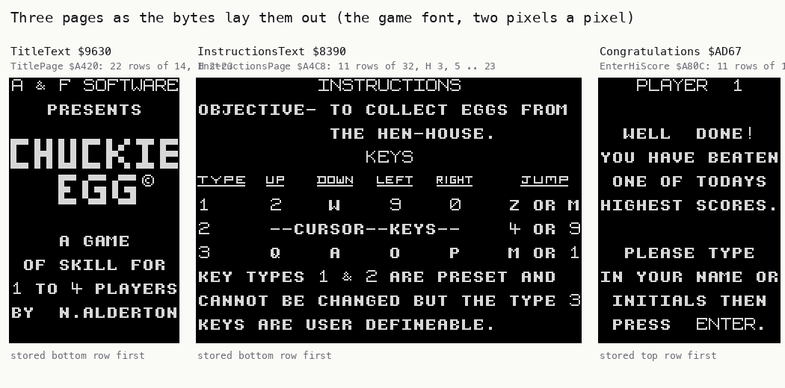

How to read the figure:

- **Each black panel** is one page, drawn from the image bytes in the game font at two pixels a pixel.
- **The rows** are placed as the reader places them: the title on every row, the other two on every other row.
- **"stored bottom row first"** means the first 14 or 32 bytes are the bottom row of the screen.
- **The point**: the pages are plain grids of codes. The big logo and the key-type table are made of glyphs, not
  bitmaps.

```bash
python3 tools/fig_text.py pages --out docs/img/text/pages.png
```

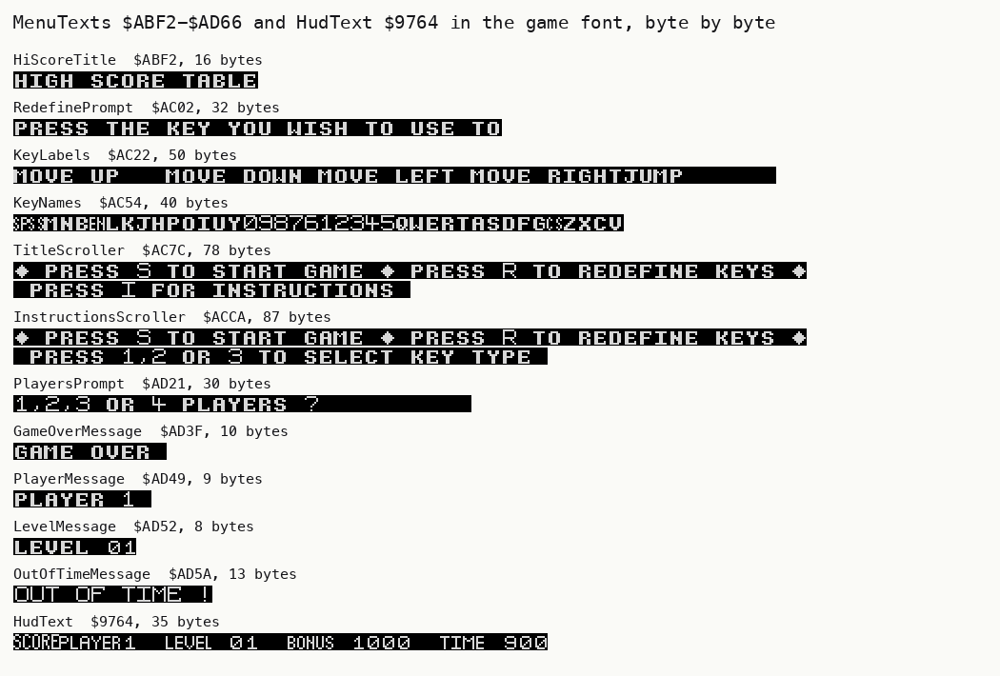

How to read the figure:

- **Each strip** is one string of MenuTexts or HudText. The heading gives its label, address and length.
- **Long strings** wrap after 52 codes.
- **KeyNames** is 40 codes: the 8 keyboard half rows, 5 keys each, bit 0 first. `$97-$9A` are the four key-name
  glyphs.
- **The point**: the menus' words live in one block, in the order the menus use them.

```bash
python3 tools/fig_text.py strings --out docs/img/text/strings.png
```

The scrollers start with the bullet `$7B`, written `{` in the files. LevelMessage holds "level " and two HUD digits.
PlayLevelBonus `$A675` rewrites the digits at `$AD58-$AD59`. PlayerMessage's digit at `$AD50` is rewritten by
PlayerTurn.

Worked example: the title's top row, H 23 (screen row 0), is the last 14 bytes of TitleText, `$9756-$9763`: "A & F
SOFTWARE", with code 0 for the spaces. Its bottom row, H 2 (screen row 21), is the first 14 bytes, `$9630-$963D`, all
code 0. "by  n.alderton" is the third stored row, `$964C-$9659`, at H 4 (screen row 19).

Witness: every page of the figure matches the screens of WALKTHROUGH 6.1 ([title](img/play/title.png),
[instructions](img/play/instructions.png), [name prompt](img/play/name-prompt.png)).

The point: every word on the screen is one of these strings. Section 8.10 gives the data sheet of each one.

## 8.3 The HUD panel

The HUD fills screen rows 0-2. Row 0 holds SCORE and up to four scores. Row 1 holds the spare lives. Row 2 holds the
player, the level, the bonus and the time. SetupLevel `$AE9C` draws it whenever a level or a life starts.

SetupLevel clears the screen, prints the 21 map rows, then writes the digits into HudText before printing it:

1. HudLevel `$9772-$9773`: Level + 1 in BCD, from an `ADD A,1` / `DAA` loop, plus `$9E`. Level is counted from 0, so
   the HUD shows the level modulo 100.
2. HudBonus `$977A`: min(Level + 1, 9), the bonus's thousands. BonusDigits `$733F` gets the same digit.
3. HudTime `$9784`: 9 - min(Level / 16, 5), the time's hundreds. TimeDigits `$7342` gets the same.
4. HudPlayer `$976B`: the player in play.

Then it prints 3 codes (SCORE) at H 23, columns 0-2, and 32 codes at H 21 (screen row 2). Then it prints each player's
score with AddScore B = 0 (8.4). Then it prints the life icons: per player, min(lives, 6) icons `$B6` at H 22 (screen
row 1), from column 5 + 7 x (player - 1). Just before MainLoop it erases the icon of the life in play.

FillAttrBlock and its helpers colour the HUD. Row 0 columns 0-2 and the player in play's score field are `$17`
(white on red). The other score fields are `$0F` (white on blue). Row 1 is `$06` (yellow on black). Row 2 is `$17` on
columns 0-4, 7-12, 15-22 and 25-31.

```text
SetupLevel, the HUD part:
    bcd = 0; repeat Level + 1 times: bcd = DAA(bcd + 1)
    HudLevel = [$9E + bcd >> 4, $9E + bcd AND $0F]
    BonusDigits[0] = min(Level + 1, 9);        HudBonus = $9E + BonusDigits[0]
    TimeDigits[0]  = 9 - min(Level >> 4, 5);   HudTime  = $9E + TimeDigits[0]
    HudPlayer = $9E + Player
    print HudText[0..2]  at H 23, L 0..2
    print HudText[3..34] at H 21, L 0..31
    for each player p:  Score = PlayerScores[p]; ScoreScreenAddr = $3FFE + 7 p; AddScore(0)
    for each player p:  print min(lives, 6) icons $B6 at H 22 from L 5 + 7 (p - 1)
```

```text
AEC2  3A EB 6E      LD A,(Level)
AEC5  47 04 AF      LD B,A / INC B / XOR A
AEC8  C6 01         ADD A,$01             ; SetupLevelBcd
AECA  27            DAA
AECB  10 FB         DJNZ SetupLevelBcd
AECD  57 E6 0F      LD D,A / AND $0F
AED0  C6 9E         ADD A,$9E             ; a HUD digit
AED2  32 73 97      LD (HudLevel+1),A     ; the units
 ...                                      ; the tens the same way, the bonus and the time digits
AF18  21 00 17      LD HL,$1700           ; H 23, L 0: the top row
AF1B  11 64 97      LD DE,HudText
AF1E  06 03         LD B,$03
AF20  1A            LD A,(DE)             ; SetupLevelHudTop
AF21  CD 40 9C      CALL PrintChar
AF24  2C 13         INC L / INC DE
AF26  10 F8         DJNZ SetupLevelHudTop
AF28  21 00 15      LD HL,$1500           ; H 21: screen row 2
AF2B  06 20         LD B,$20
AF2D  1A            LD A,(DE)             ; SetupLevelHud
AF2E  CD 40 9C      CALL PrintChar
AF31  2C 13         INC L / INC DE
AF33  10 F8         DJNZ SetupLevelHud
AF35  21 FE 3F      LD HL,Screen-2
AF38  22 3D 73      LD (ScoreScreenAddr),HL   ; + 7 per player before each AddScore(0)
```

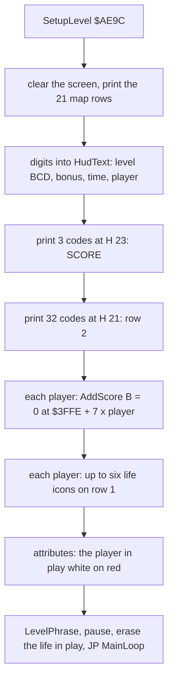

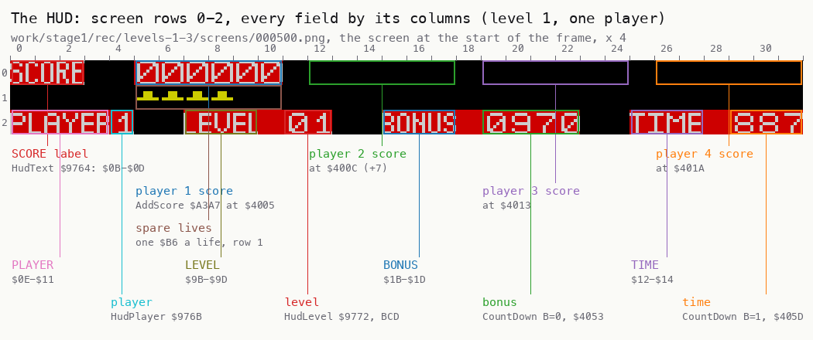

How to read the figure:

- **The strip** is the top three character rows of `levels-1-3` at the start of frame 500, four times enlarged. The
  ruler above counts columns, the numbers at the left count rows.
- **Each box** is one field. The line under it leads to its name and its writer.
- **The empty boxes** of row 0 are the score fields of players 2-4. They stay blank in a one-player game.
- **The point**: the panel is static text with three live fields. AddScore writes the score, CountDown writes the bonus
  and the time, and nothing else touches the HUD in play.

```bash
python3 tools/fig_text.py hud --screen work/stage1/rec/levels-1-3/screens/000500.png --out docs/img/text/hud.png
```

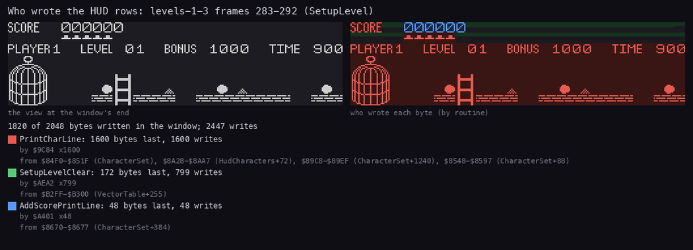

How to read the figure:

- **Left**: the top 8 character rows of the screen bitmap, each byte coloured by the routine that last wrote it.
- **Right**: the same bytes as the screen shows them.
- **PrintCharLine** (the copy loop of PrintChar) wrote 1600 bytes, SetupLevelClear 172 and AddScorePrintLine 48 (the
  six score digits).
- **The point**: the score digits are not PrintChar's. AddScore copies its own glyphs from `$8670`.

```bash
python3 ../../kit/writers_map.py --work work/docs/ceD/l13 --listing build/game.lst --window 283:0-292:0 \
    --view buffer:4000:32x64:screen --by routine --sources --out docs/img/text/hud-writers.png
```

Worked example, level 1 (Level = 0): the BCD loop runs once and gives `$01`, so HudLevel holds `$9E $9F`, "01". The
bonus digit is min(1, 9) = 1, so the bonus shows 1000. The time digit is 9 - min(0, 5) = 9, so the time shows 900.
On level 17 (Level = 16), the bonus shows 9000 and the time 800. From level 81 (Level = 80) on, the time starts at
400.

Witness: `levels-1-3` prints the HUD in frames 290 (level 1), 2213 (level 2), 3798 (level 3) and 6874 (level 4), each
with 32 calls from `$AF2E` and one AddScore B = 0 from `$AF57`. The four-player HUD is in `tour-redefine` frame 1150
([screenshot](img/play/level1-four-players.png)).

The point: the HUD is drawn once per life. In play only three fields change, each by its own routine.

## 8.4 AddScore: the score and the extra life

Score `$6EC8` holds six bytes, one decimal digit (0-9) each, the hundred thousands first. Score+5 (the units) is always
0. AddScore `$A3A7` adds B tens: it increments the tens digit B times and carries up.

After the addition it compares the ten thousands digit (Score+1) with LastTenThousands `$736E`. When they differ, the
player gains a life. The test compares digits, not thresholds. The score only grows, so each change is a new 10 000.
The life icon is drawn only when the player had fewer than six lives.

Then AddScore prints the six digits at ScoreScreenAddr `$733D`. It copies the glyph bytes itself from the font digits
at `$8670` (code `$30` of CharacterSet), not from the HUD digits.

| Call | B | Points |
| --- | ---: | ---: |
| an egg, TakeEggOrGrain `$9A08` | 10 x (1 + min(Level / 4, 9)) | 100 on levels 1-4, up to 1000 |
| grain, `$9A1E` | 5 | 50 |
| a bonus step at the level end, `$A682` | 1 | 10 |
| SetupLevel, `$AF57` | 0 | only prints |

```text
AddScore(B tens):
    repeat B times:
        k = 4                                   ; Score+4: the tens
        Score[k] += 1
        while Score[k] == 10: Score[k] = 0; k -= 1; Score[k] += 1
    if Score[1] != LastTenThousands:
        LastTenThousands = Score[1]
        c = PlayerLives[Player]; PlayerLives[Player] += 1
        if c < 6: PrintChar($B6, H 22, L 7 Player - 3 + c)
    for i in 0..5: copy the 8 bytes of $8670 + 8 Score[i] down the cell at ScoreScreenAddr + i
```

```text
A3A7  78 A7         LD A,B / AND A
A3A9  28 3B         JR Z,AddScorePrint    ; B = 0: print only
A3AB  3E 0A         LD A,$0A
A3AD  21 CC 6E      LD HL,Score+4         ; AddScoreTen: the tens digit
A3B0  34            INC (HL)              ; AddScoreDigit
A3B1  BE            CP (HL)
A3B2  20 05         JR NZ,AddScoreNext
A3B4  36 00         LD (HL),$00           ; 10: 0 and carry
A3B6  2B            DEC HL
A3B7  18 F7         JR AddScoreDigit
A3B9  10 F2         DJNZ AddScoreTen      ; AddScoreNext
A3BB  21 6E 73      LD HL,LastTenThousands
A3BE  3A C9 6E      LD A,(Score+1)
A3C1  BE            CP (HL)
A3C2  28 22         JR Z,AddScorePrint
A3C4  77            LD (HL),A             ; a new 10 000: one life more
 ...                                      ; PlayerLives + 1; the icon when there were under six
A3E6  ED 5B 3D 73   LD DE,(ScoreScreenAddr)   ; AddScorePrint
A3EA  01 C8 6E      LD BC,Score
A3ED  DD 2E 06      LD IXL,$06
A3F0  D5 0A         PUSH DE / LD A,(BC)   ; AddScorePrintDigit
A3F2  CB 27 x 3     SLA A                 ; x 8
A3F8  C5            PUSH BC
A3F9  C6 70 26 86   ADD A,$70 / LD H,$86  ; HL = $8670 + 8 x digit
A3FD  6F 06 08      LD L,A / LD B,$08
A400  7E 12 14 2C   LD A,(HL) / LD (DE),A / INC D / INC L   ; AddScorePrintLine
A404  10 FA         DJNZ AddScorePrintLine
 ...                                      ; next digit, six in all
```

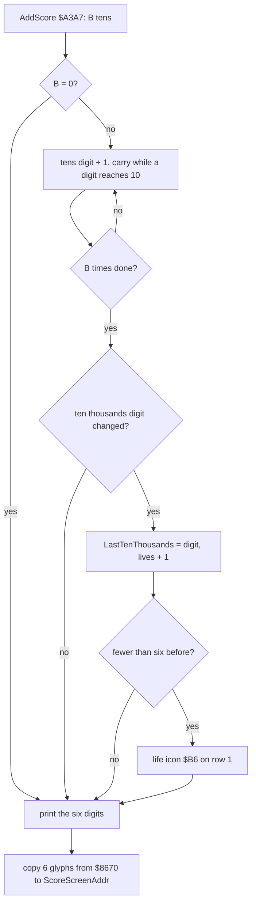

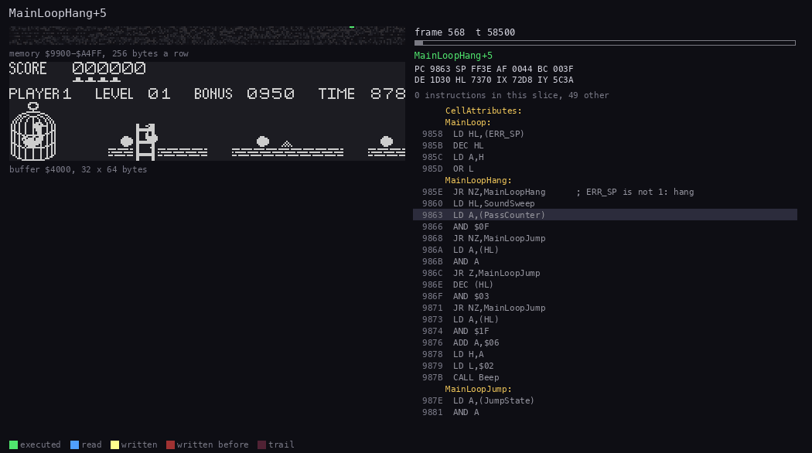

*The routine animation of TakeEggOrGrain and AddScore (`$99DF-$9A2B`, `$A3A7-$A40E`) in `levels-1-3` from
568:58000 to 569:12000. It has 48 pictures, one each 500 T, and 2521 instructions. The view is the top 8 character
rows of the screen. Command: `python3 ../../kit/routine_anim.py --work work/docs/ceD/l13 --listing build/game.lst
--window 568:58000-569:12000 --out docs/img/routines/AddScore.gif --pc 99DF-9A2B,A3A7-A40E --view
buffer:4000:32x64:screen --range 9900-A4FF --step 500 --delay 150`.*

How to read the animation: TakeEggOrGrain finds the egg (code 3) at Harry's feet and empties the cell. AddScore then
loops ten times over the tens digit. The hundreds digit carries on the tenth step. Then the six digits are copied
into row 0, left to right, eight lines each. The score reads 000100 at the end.

Worked example: the first egg of `levels-1-3` is taken in frame 568, AddScore entered at T 64 067 with B = 10. The
score was 000000. Ten increments of Score+4 take the tens to 10 on the last one, which becomes 0 with a carry into
Score+3: 000100. Score+1 is still 0, as is LastTenThousands, so no life. The digits are copied to `$4005-$400A`
(ScoreScreenAddr `$3FFE` + 7 for player 1). Doc 1 shows the extra life: in `levels-1-9` the score goes from 9 900 at
the start of frame 7984 to 10 000 at the start of frame 7985, and the lives from 5 to 6.

Witness: in `levels-1-3`, AddScore ran 573 times: 36 eggs (B = 10, `$9A08`), 13 grains (B = 5, `$9A1E`), 520 bonus
steps (B = 1, `$A682`) and 4 prints (B = 0, `$AF57`). The score after level 3 is 9 450. In the builds the ten
thousands digit changed six times and one icon was drawn ([doc 1](01-game-design.md)).

Known only from the code: AddScore has no limit. Past 999 990 the carry leaves Score `$6EC8` and increments `$6EC7`,
the last byte of LiveMap slot 4. No recording comes near.

The point: the score is six decimal digits with a ripple carry. The extra life costs one byte compare per call.

## 8.5 CountDown: the bonus and the time

BonusDigits `$733F` and TimeDigits `$7342` hold three decimal digits each. The bonus shows a fixed 0 after them in
column 22, so 1000 is stored as 1 0 0. CountDown `$A1B8` takes one from the last digit of either, borrowing from the
digits before. B = 0 selects the bonus, B = 1 the time.

When the digits go under 000, CountDown prints nothing and leaves them at `$FF 9 9`:

- **The bonus** sets BonusRunning `$7347` to 0. The HUD keeps the 0000 it printed last.
- **The time** pops MainLoop's return address and returns to MainLoop's caller. The life ends. LifeLost reads the
  `$FF 9 9` as "OUT OF TIME !".

Otherwise CountDown copies the three digits from HudCharacters `$89E0` + 8 x digit to the screen at `$4053` (the
bonus, row 2 column 19) or `$405D` (the time, column 29).

MainLoop's slow tick (every 130 passes, doc 4) calls it. BonusDelay `$7345` counts 50 ticks for a bonus step of 10
points. TimeDelay `$7346` counts 10 ticks for a time step, followed by Beep H 4, L 2 (doc 9). A slow tick is about 0.75
frames on level 1, so the time steps about every 7.5 frames and the bonus about every 38.

Grain stops both clocks. TakeEggOrGrain writes `$FFFF` to BonusDelay and TimeDelay, so the next steps come after 255
slow ticks, about 190 frames on level 1.

```text
CountDown(B):
    digits = BonusDigits if B == 0 else TimeDigits
    k = 2
    loop:
        digits[k] -= 1
        if digits[k] != $FF: break
        if k == 0:                               ; under 000
            if B == 0: BonusRunning = 0; return
            drop MainLoop's return address; return  ; the life ends
        digits[k] = 9; k -= 1
    for i in 0..2: copy HudCharacters + 8 digits[i] to ($4053 if B == 0 else $405D) + i
```

```text
A1B8  21 41 73      LD HL,BonusDigits+2
A1BB  11 03 00      LD DE,$0003
A1BE  04 05         INC B / DEC B
A1C0  28 01         JR Z,CountDownDigit
A1C2  19            ADD HL,DE             ; B = 1: TimeDigits+2
A1C3  3E FF         LD A,$FF              ; CountDownDigit
A1C5  16 03         LD D,$03
A1C7  35            DEC (HL)              ; CountDownLoop
A1C8  BE            CP (HL)
A1C9  20 13         JR NZ,CountDownPrint
A1CB  15            DEC D
A1CC  20 0B         JR NZ,CountDownBorrow
A1CE  E1            POP HL                ; under 000: drop the return address
A1CF  04 05         INC B / DEC B
A1D1  C0            RET NZ                ; the time: back to MainLoop's caller
A1D2  E5            PUSH HL               ; the bonus: put it back
A1D3  21 47 73      LD HL,BonusRunning
A1D6  36 00         LD (HL),$00
A1D8  C9            RET
A1D9  36 09         LD (HL),$09           ; CountDownBorrow
A1DB  2B            DEC HL
A1DC  18 E9         JR CountDownLoop
A1DE  11 0A 00      LD DE,$000A           ; CountDownPrint
A1E1  21 53 40      LD HL,Screen+83       ; row 2, column 19
 ...                                      ; + 10 for the time; three digits from HudCharacters
```

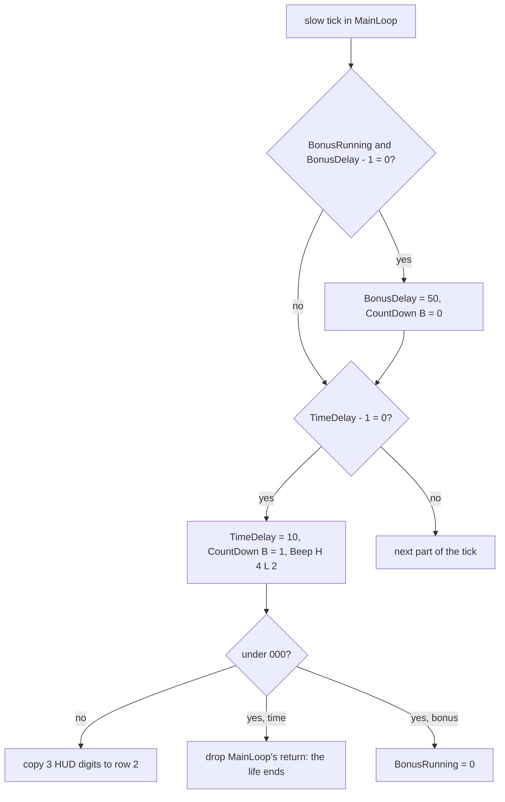

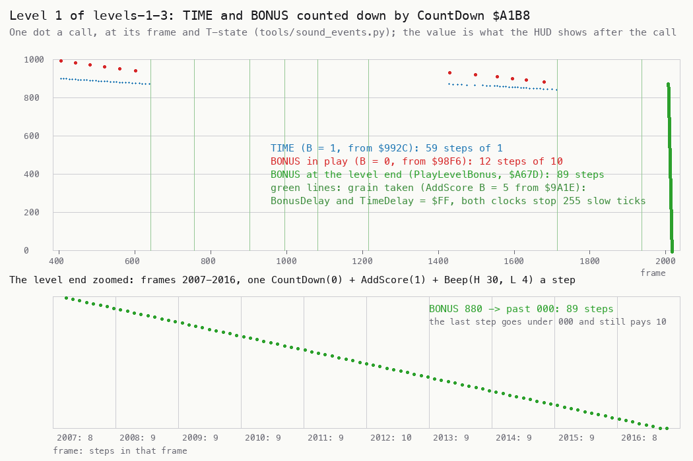

How to read the figure:

- **Top panel**: every CountDown call of level 1 as a dot at its frame and T-state. Blue dots are the time (one a
  step), red dots the bonus in play (ten points a step), green dots the bonus at the level end. The value is what the
  HUD shows after the call.
- **The pale green lines** are the grains taken. After each one both clocks stand still for 255 slow ticks. Grains
  close together keep them stopped from frame 640 to frame 1430.
- **Bottom panel**: the level end zoomed, one dot per step. The labels under it give each frame's number of steps.
- **The point**: the clocks are counters of slow ticks, not of frames. Grain pauses them, and the level end empties
  the bonus at about nine steps a frame.

```bash
python3 tools/fig_text.py countdown --events work/docs/ceD/l13-events.json --out docs/img/text/countdown.png
```

Worked example: level 1 starts with TimeDigits 9 0 0. The first time step comes at frame 404 T 37 669. CountDown
decrements the units: 0 - 1 = `$FF`, so it becomes 9 and the tens are decremented, also `$FF`, so 9 again, and the
hundreds become 8. The digits are 8 9 9 and the HUD shows 899. At the start of frame 500 the screen shows TIME 887
and BONUS 0970 (three bonus steps since frame 403).

Witness: `levels-1-3` has 408 time steps (`$992C`) and 84 bonus steps in play (`$98F6`). `tour-redefine` runs the time
out: TIME 000 at frame 8600 ([screenshot](img/play/time-zero.png)), then "OUT OF TIME !" at frame 8750
([screenshot](img/play/out-of-time.png)). In all the builds 20 under-runs were taken at `$A1CE`, 19 of the bonus and
one of the time.

The point: two three-digit counters share one routine. Only the time's under-run is fatal, and it ends the life by
dropping a return address.

## 8.6 The bonus count-down at the end of a level

When the twelfth egg is taken, TakeEggOrGrain returns twice and MainLoop's caller sees EggsLeft = 0. PlayLevelBonus
`$A675` then moves what is left of the bonus to the score, ten points at a time. Each step is CountDown B = 0 (minus
10 on the HUD), AddScore B = 1 (plus 10 on the score) and Beep H 30, L 4 (doc 9). The loop runs while BonusRunning
is set. CountDown clears it on the step that goes under 000, and AddScore still pays that step: the bonus pays 10
points more than it shows (doc 1, section 1.8).

After the loop come two Delay(0) pauses of about 0.49 s each, then BoxZoom `$A968` (boxes growing from the middle).
The score is saved to PlayerScores. Level is incremented and the "LEVEL n" message scrolls through (8.7).

The level number of the message is (Level + 1) mod 100, after a first reduction mod 200. A SUB 10 loop counts the
tens in B. The units, still minus 10 after the loop, + `$A8` give the HUD digit `$9E` + units. A tens digit of 0
becomes code 0, a blank. The message after level 1 reads "LEVEL  2", while the HUD shows "02" (8.3 uses BCD with a
leading zero).

```text
PlayLevelBonus:
    while BonusRunning:
        CountDown(0); AddScore(1); Beep(H 30, L 4)
    Delay(0); Delay(0); BoxZoom()
    PlayerScores[Player] = Score
    Level += 1
    n = (Level + 1) mod 200 mod 100
    LevelDigits = [$9E + n / 10 if n >= 10 else 0, $9E + n mod 10]
    Message(LevelMessage, 8)
```

```text
A675  3A 47 73      LD A,(BonusRunning)   ; PlayLevelBonus
A678  A7            AND A
A679  28 12         JR Z,PlayLevelPause
A67B  06 00         LD B,$00
A67D  CD B8 A1      CALL CountDown        ; bonus - 10
A680  06 01         LD B,$01
A682  CD A7 A3      CALL AddScore         ; score + 10
A685  21 04 1E      LD HL,$1E04           ; H 30, L 4
A688  CD A4 9C      CALL Beep
A68B  18 E8         JR PlayLevelBonus
A68D  16 02         LD D,$02              ; PlayLevelPause
A68F  01 00 00      LD BC,$0000
A692  CD 21 A9      CALL Delay            ; 65 536 counts, about 0.49 s
A695  15 20 F7      DEC D / JR NZ
A698  CD 68 A9      CALL BoxZoom
 ...                                      ; the score saved, Level + 1
A6C4  D6 0A         SUB $0A               ; PlayLevelTensLoop
A6C6  38 03         JR C,PlayLevelUnits
A6C8  04 18 F9      INC B / JR PlayLevelTensLoop
A6CB  C6 A8         ADD A,$A8             ; PlayLevelUnits: units - 10 + $A8 = $9E + units
A6CD  32 59 AD      LD (LevelDigits+1),A
A6D0  78 A7         LD A,B / AND A
A6D2  28 02         JR Z,PlayLevelMessage ; no tens: code 0
A6D4  C6 9E         ADD A,$9E
A6D6  32 58 AD      LD (LevelDigits),A    ; PlayLevelMessage
A6D9  11 52 AD      LD DE,LevelMessage
A6DC  0E 08         LD C,$08
A6DE  CD CE A9      CALL Message
```

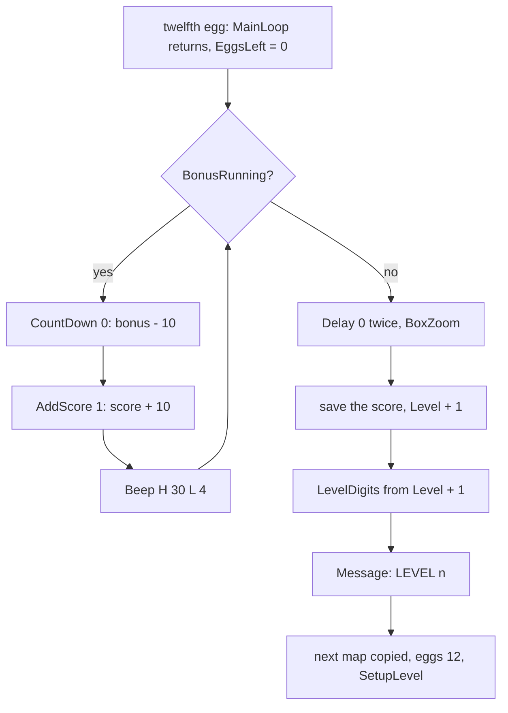

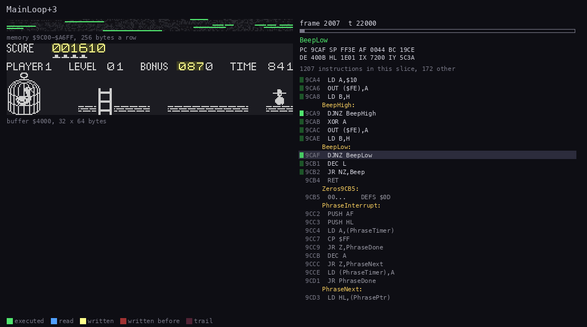

*The routine animation of PlayLevelBonus, CountDown, AddScore and Beep (`$A675-$A68C`, `$A1B8-$A219`, `$A3A7-$A40E`,
`$9CA4-$9CB4`) in `levels-1-3` from 2007:10000 to 2016:60000. It has 57 pictures, one each 12 000 T, and 74 429
instructions. The view is the top 8 character rows of the screen. Command: `python3 ../../kit/routine_anim.py --work
work/docs/ceD/l13 --listing build/game.lst --window 2007:10000-2016:60000 --out docs/img/routines/CountDown.gif --pc
A675-A68C,A1B8-A219,A3A7-A40E,9CA4-9CB4 --view buffer:4000:32x64:screen --range 9C00-A6FF --step 12000 --delay 150`.*

How to read the animation: the BONUS field on row 2 runs down from 0880 to 0000 while the score on row 0 runs up from
001600 to 002490. The highlight moves round the four routines once per step. Beep is the longest part of a step.

Worked example: level 1 of `levels-1-3` ends with 0880 left on the bonus and 1 600 points (11 eggs, 8 grains and the
twelfth egg). The loop runs 89 times: 88 steps take the bonus to 000, the 89th goes under and still pays. The score
ends at 1 600 + 890 = 2 490. A step costs CountDown (about 600 T), AddScore (about 900 T with its print) and Beep
(4 x 827 + 20 = 3328 T), about 4900 T. 89 steps are about 436 000 T, 6.2 frames of CPU. They were measured in frames
2007-2016, 8-10 steps a frame, because the interrupts and the speech take their share.

Witness: `levels-1-3` has 89 steps in frames 2007-2016 (level 1), 173 in frames 3583-3601 (level 2) and 258 in frames
6649-6677 (level 3), all CountDown calls from `$A67D`. The score before the first egg-less step and after the last
one, from the AddScore calls: 1 500 at frame 2007 and 2 490 at frame 2017. The screens are in doc 1: the count-down
([level-end-bonus](img/play/level-end-bonus.png)), the boxes ([level-end-boxes](img/play/level-end-boxes.png)) and
the message ([level-message](img/play/level-message.png)).

The point: the level-end bonus is the in-play bonus moved to the score ten points a beep, plus one step. It is fast
because nothing else runs.

## 8.7 Messages and scrollers

Two scrolling texts exist: the messages across the middle of the screen and the scrollers along the bottom row of the
title and instructions pages. Both use ScrollLine `$AB7B`.

ScrollLine shifts one character row of 30 bytes, columns 1-30, one pixel left. For each of the eight pixel lines,
each byte is shifted left and takes bit 7 of the byte to its right. It keeps every register. Counted from the listing,
a shift costs about 17 000 T.

Message `$A9CE` scrolls C characters from DE:

1. It paints rows 11-14 green (attribute 4).
2. It shifts the row at `Screen+2145` (row 11) once, then prints the next character at H 12 (screen row 11), column 30.
3. It shifts the row eight times per character after that.
4. After the last character it shifts 256 times more, so the text leaves on the left.

The messages are "PLAYER n" (PlayerTurn), "LEVEL n" (PlayLevelBonus), "GAME OVER" and "OUT OF TIME !" (LifeLost),
each from MenuTexts.

The title scroller (TitleLoop `$A47D`, 78 characters) and the instructions scroller (InstructionsPage, 87 characters)
shift the bottom row at `Screen+4321`. They wait Delay 500 (13 000 T) after each shift and print the next character
at H 0, column 30 every eight shifts. They wrap around their text forever, and the keys are tested between shifts.

```text
ScrollLine(HL = the row's top line, column 1):
    for line in 0..7:
        for i in 0..29:
            HL[i] = (HL[i] << 1) | (HL[i + 1] >> 7)
        HL += 256                                   ; $E2 after the 30 INCs
Message(DE text, C count):
    attributes of rows 11-14 = 4
    shifts = 1
    repeat C times:
        repeat shifts: ScrollLine(Screen + 2145)
        PrintChar(*DE++, H 12, L 30); shifts = 8
    repeat 256: ScrollLine(Screen + 2145)
```

```text
AB7B  D5 C5 F5      PUSH DE, BC, AF       ; ScrollLine
AB7E  16 08         LD D,$08
AB80  E5 C1 03      PUSH HL / POP BC / INC BC     ; ScrollLineLine: BC = the byte to the right
AB83  1E 1E         LD E,$1E              ; 30 bytes
AB85  CB 26         SLA (HL)              ; ScrollLineByte
AB87  0A            LD A,(BC)
AB88  CB 7F         BIT 7,A
AB8A  28 02         JR Z,ScrollLineNext
AB8C  CB C6         SET 0,(HL)
AB8E  23 03         INC HL / INC BC       ; ScrollLineNext
AB90  1D 20 F2      DEC E / JR NZ,ScrollLineByte
AB93  01 E2 00 09   LD BC,$00E2 / ADD HL,BC   ; the next pixel line
AB97  15 20 E6      DEC D / JR NZ,ScrollLineLine
AB9A  F1 C1 D1 C9   POP AF, BC, DE / RET
A9CE  21 60 59      LD HL,Attributes+352  ; Message: rows 11-14
A9D1  06 80         LD B,$80
A9D3  36 04 23      LD (HL),$04 / INC HL
A9D6  10 FB         DJNZ MessageColour
A9D8  06 01         LD B,$01
A9DA  21 61 48      LD HL,Screen+2145     ; MessageScroll: row 11, column 1
A9DD  CD 7B AB      CALL ScrollLine
A9E0  10 F8         DJNZ MessageScroll
A9E2  1A            LD A,(DE)
A9E3  21 1E 0C      LD HL,$0C1E           ; H 12, L 30
A9E6  13            INC DE
A9E7  CD 40 9C      CALL PrintChar
A9EA  06 08 0D      LD B,$08 / DEC C
A9ED  20 EB         JR NZ,MessageScroll
A9EF  06 00         LD B,$00              ; 256 shifts out
A9F1  21 61 48      LD HL,Screen+2145     ; MessageOut
A9F4  CD 7B AB      CALL ScrollLine
A9F7  10 F8         DJNZ MessageOut
A9F9  C9            RET
```

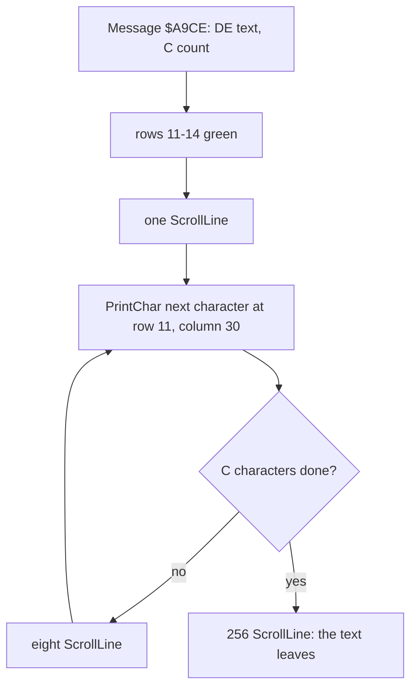

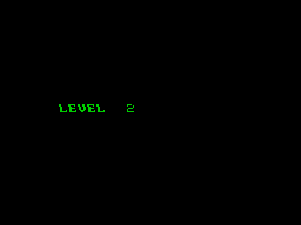

*Doc 1's screen of `levels-1-9` at frame 2170: the message on the green rows 11-14.*

Worked example: "level  2" after level 1 has 8 codes: `$6C $65 $76 $65 $6C $20 $00 $A0`. In `levels-1-3` Message
prints them from `$A9E7` at frames 2119, 2122, 2124, 2126, 2128, 2130, 2132 and 2134, one every 2.1 frames: eight
shifts of about 17 000 T plus the interrupts. Code 0 (the empty tens) prints a blank cell. The 64 + 256 shifts take
about 80 frames, 1.6 s. The text enters at column 30 and leaves by column 1, so columns 0 and 31 stay blank.

Witness: `levels-1-3` has 24 message characters printed from `$A9E7`: "level  2", "level  3" and "level  4" (codes
`$A0`, `$A1`, `$A2` last). The messages of the other recordings are in WALKTHROUGH 6.1: [PLAYER 1](img/play/player-turn.png)
(`tour-type2` frame 700), [OUT OF TIME !](img/play/out-of-time.png) (`tour-redefine` frame 8750) and
[GAME OVER](img/play/game-over.png) (`idle-1p` frame 14 600). ScrollLine ran 49 502 times in the builds.

The point: one 30-byte pixel shifter serves every moving text. The messages hold the game for one or two seconds,
since nothing else runs while they scroll.

## 8.8 The menus and pages

The front end is four screens, each drawn by one routine and left by a key.

| Screen | Routine | Drawn | Keys |
| --- | --- | --- | --- |
| the title | TitlePage `$A420` | TitleText at H 2-23, columns 0-13; DrawHiScores on the right; colour bands magenta, yellow, green; row 23 cyan; the title scroller | S StartGame, R RedefineKeys, I InstructionsPage |
| the instructions | InstructionsPage `$A4C8` | InstructionsText, 11 rows at H 3, 5 .. 23; WaitPhrase, then phrase 24; the instructions scroller | 1, 2, 3 the key type (a `$17` bar and the `$97` marks); S only once the phrase has ended |
| the redefine page | RedefineKeys `$AA49` | RedefinePrompt and the five KeyLabels; RedefineOne `$AB19` prints each key's name | one key for each of the five moves |
| the players prompt | StartGame `$A59D` | BoxWipe `$A929` (twelve nested boxes), PlayersPrompt scrolled in | 1-4 the number of players |

The title tune and phrase 20 play only on the first title after Start `$A410`. TitleTuneDone `$736F` is cleared only by
Start, which the loader and the abort key (CAPS SHIFT + A) enter. The title after a game over is silent (doc 9).

```text
TitlePage:
    ClearScreen
    for H in 2..23: print TitleText row (H - 2), 14 codes, at L 0..13
    DrawHiScores
    colour bands of the left half
    if not TitleTuneDone: PlayTune(TitleTune); StartPhrase(20); TitleTuneDone = 1
    row 23 cyan; TextIndex = 78
TitleLoop:
    ScrollLine(bottom row); Delay(500)
    every 8 shifts: PrintChar(TitleScroller[next], H 0, L 30)
    S: StartGame   R: RedefineKeys   I: InstructionsPage
```

```text
A420  CD 9E AB      CALL ClearScreen      ; TitlePage
A423  26 02         LD H,$02
A425  01 30 96      LD BC,TitleText
A428  2E 00         LD L,$00              ; TitlePageRow
A42A  0A            LD A,(BC)             ; TitlePageChar
A42B  CD 40 9C      CALL PrintChar
A42E  03 2C         INC BC / INC L
A430  7D FE 0E      LD A,L / CP $0E       ; 14 columns
A433  20 F5         JR NZ,TitlePageChar
A435  24 7C FE 18   INC H / LD A,H / CP $18   ; up to H 23
A439  20 ED         JR NZ,TitlePageRow
A43B  CD AD AB      CALL DrawHiScores
 ...                                      ; the colour bands
A458  21 0C AE      LD HL,TitleTune
A45B  3A 6F 73      LD A,(TitleTuneDone)
A45E  A7 20 0D      AND A / JR NZ,TitleScrollerStart
A461  CD 60 AB      CALL PlayTune
A464  3E 14         LD A,$14
A466  CD EB 9C      CALL StartPhrase      ; phrase 20
A469  3E 01 32 6F 73    LD A,1 / LD (TitleTuneDone),A
```

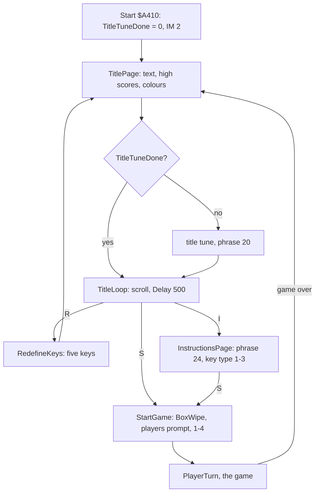

| The title | The instructions | The players prompt |
| --- | --- | --- |
| 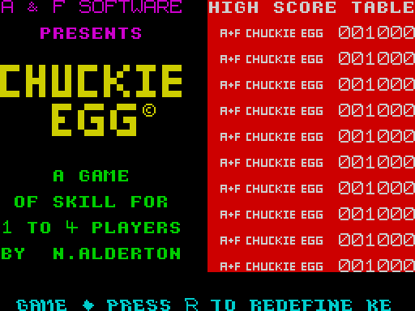 | 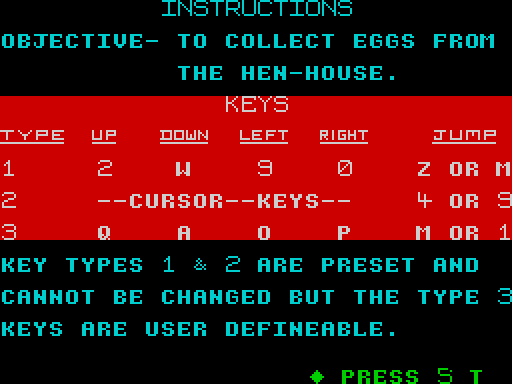 | 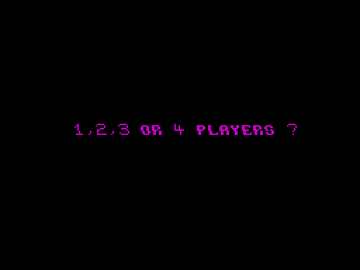 |

*`tour-type2` at frames 200, 300 and 500, from WALKTHROUGH 6.1.*

Worked example: the title scroller moves one pixel per ScrollLine (about 17 000 T) and Delay 500 (13 000 T), about
30 000 T a pixel. A character enters every eight pixels, about 240 000 T or 3.4 frames. The 78 characters take
about 270 frames, 5.4 s, before the text repeats.

Witness: TitlePage ran 4 times in the builds. InstructionsPage and StartGame are in `tour-type2`: phrase 24 starts at
frame 258 from `$A512`, and the players prompt is printed at about frame 500.

The point: the front end is a few static pages and one scroller. The speech, not the code, sets the pace: the
instructions page waits for its phrase.

## 8.9 The high score table and the name entry

HiScoreTable `$97AF` holds ten entries of 16 bytes, the best first. Bytes 0-9 are the name field and bytes 10-15 the
score as six ASCII digits. The defaults are a space, the eight A+F logo codes `$8F-$96`, a space and "001000".
DrawHiScores `$ABAD` prints the title "high score table" at H 23, column 16, and entry k at H 21 - 2k, columns 16-31.
It colours columns 16-31 of rows 0-20 `$17`.

At the end of the game, GameOver `$A7BC` wipes the screen and turns the 24 score digits of PlayerScores into ASCII
(`+ $30`). Then, for each player, it writes the player's digit into the Congratulations page at `$AD72` and calls
EnterHiScore `$A80C`.

EnterHiScore:

1. CompareScore `$AA0C` tests the score against the entries from the top. It returns 1 only when the score is strictly
   greater, so a tie goes below the old entry. If no entry is beaten, EnterHiScore returns with D = 1.
2. At place k, LDDR moves the entries k .. 8 down one place. Entry 9 is lost. Bytes 0-9 of entry k are set to code 0
   and the six digits are copied to bytes 10-15.
3. It prints the Congratulations page (11 rows of 15 at H 23, 21 .. 3), DrawHiScores and the colours. It waits for any
   phrase to end, starts phrase 7 ("high score") and waits for it.
4. It switches to IM 1. The ROM's interrupt then scans the keyboard into LAST_K `$5C08` and KSTATE4 `$5C04`. The game's
   own IM 2 handler does not scan, which is why this is the only place the ROM's interrupt runs.
5. The cursor `$B7` starts at column 16 on the entry's row. HALT waits until KSTATE4 shows a new key. ENTER (13) ends.
   DELETE (12) erases back to column 16. Any code from `$20` up is stored and printed, up to nine characters (columns
   16-24).
6. It switches back to IM 2 and returns D = 2. GameOver then zooms boxes and goes on to the next player, or to the
   title.

The table is never saved. A new game after a reset starts with the defaults.

```text
EnterHiScore(score HL):
    for k in 0..9:
        if score > HiScoreTable[k].digits: break
    else: return D = 1
    move entries k..8 down one (LDDR); entry[k][0..9] = 0; entry[k][10..15] = score
    print Congratulations; DrawHiScores; colours; WaitPhrase; StartPhrase(7); WaitPhrase
    IM 1; L = 16; H = 21 - 2k; DE = entry[k]
    loop:
        PrintChar($B7, H, L)
        wait for a key (HALT, KSTATE4)
        key = LAST_K
        if key == 13: break
        if key == 12 and L > 16: DE -= 1; *DE = 0; PrintChar(0, H, L); L -= 1
        elif key >= $20 and L < 25: *DE++ = key; PrintChar(key, H, L); L += 1
    IM 2; return D = 2
```

```text
A814  CD 0C AA      CALL CompareScore     ; EnterHiScoreCompare
A817  3D            DEC A
A818  28 0E         JR Z,EnterHiScoreInsert
 ...                                      ; the next entry, 10 in all; none: D = 1
A83B  11 4E 98      LD DE,HiScoreTable+$9F
A83E  21 3E 98      LD HL,HiScoreTable+$8F
A841  ED B8         LDDR                  ; entries k..8 down one
A844  06 0A         LD B,$0A              ; EnterHiScoreClear
A846  36 00 23      LD (HL),$00 / INC HL
A849  10 FB         DJNZ EnterHiScoreClearByte
A84B  01 06 00      LD BC,$0006
 ...
A853  ED B0         LDIR                  ; the six digits
 ...                                      ; the page, the table, phrase 7
A8A0  ED 56         IM 1                  ; the ROM scans the keyboard
A8A2  2E 10         LD L,$10              ; column 16
A8A4  3E B7         LD A,$B7              ; EnterHiScoreCursor
A8A6  CD 40 9C      CALL PrintChar
A8A9  3A 04 5C      LD A,(KSTATE4)        ; EnterHiScoreRelease
A8AC  EE FF 20 F9   XOR $FF / JR NZ       ; wait for no key
A8B0  76            HALT                  ; EnterHiScoreWait
A8B1  3A 04 5C      LD A,(KSTATE4)
A8B4  EE FF 28 F8   XOR $FF / JR Z        ; wait for a key
A8B8  3A 08 5C      LD A,(LAST_K)
A8BB  FE 0D         CP $0D
A8BD  28 25         JR Z,EnterHiScoreDone ; ENTER
A8BF  FE 0C         CP $0C
A8C1  20 0E         JR NZ,EnterHiScoreChar
 ...                                      ; DELETE: back one cell
A8D1  FE 20         CP $20                ; EnterHiScoreChar
A8D3  38 DB         JR C,EnterHiScoreWait
A8D5  47 7D FE 19   LD B,A / LD A,L / CP $19  ; column 25: full
A8D9  28 D5         JR Z,EnterHiScoreWait
A8DB  78 12         LD A,B / LD (DE),A
A8DD  CD 40 9C      CALL PrintChar
A8E0  2C 13         INC L / INC DE
A8E2  18 C0         JR EnterHiScoreCursor
A8E4  E1 F1 C1      POP HL, AF, BC        ; EnterHiScoreDone
A8E7  16 02         LD D,$02
A8E9  ED 5E         IM 2
A8EB  C9            RET
```

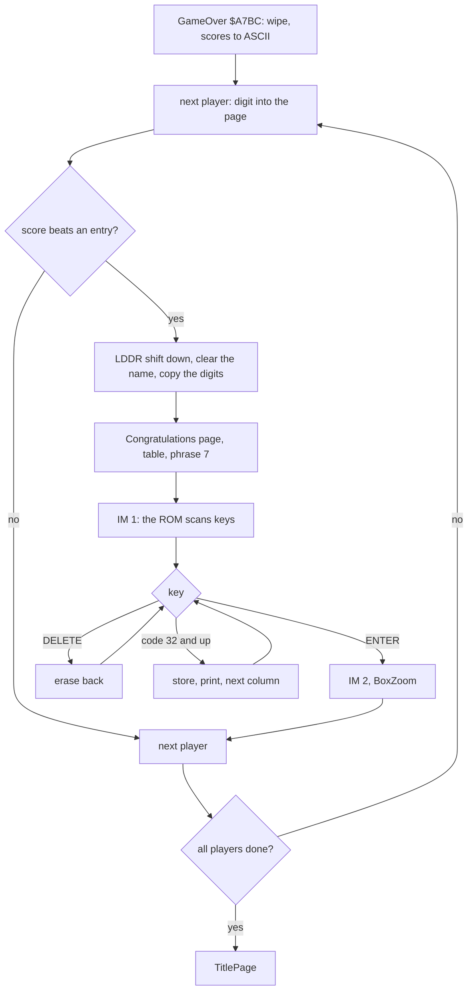

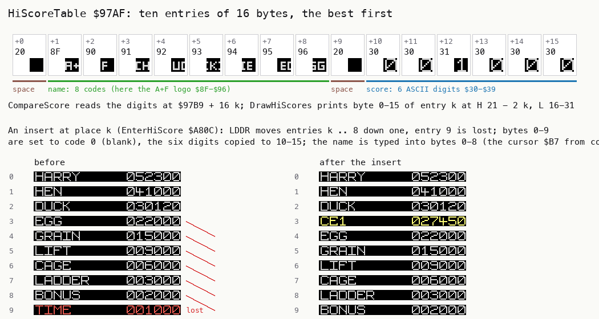

How to read the figure:

- **Top**: the first default entry, one box per byte: the offset, the hex value and the glyph. The coloured lines
  under it mark the fields.
- **Bottom**: a made-up table before and after an insert of 027450. The red lines show the entries LDDR moves down,
  the red row is the entry that falls off, and the yellow row is the new entry.
- **The point**: the table is a fixed array of 16-byte records. An insert is one LDDR, and the name is typed into the
  record in place.

```bash
python3 tools/fig_text.py hiscore --out docs/img/text/hiscore.png
```

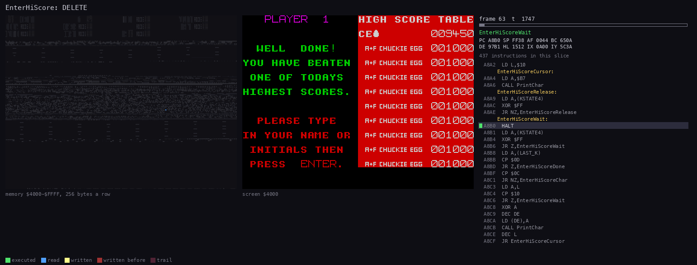

*The routine animation of EnterHiScore in `name-delete` frames 63-64 (DELETE erases a character), made for doc 5 (its caption there gives the window and the
command).*

| The prompt | The name typed | The new entry on the title |
| --- | --- | --- |
| 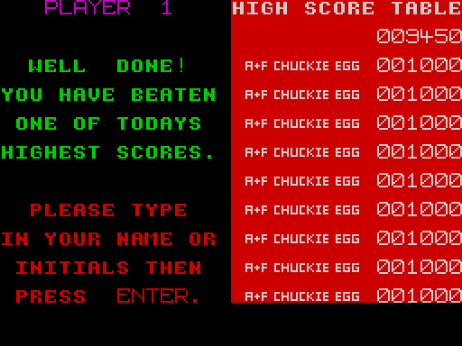 | 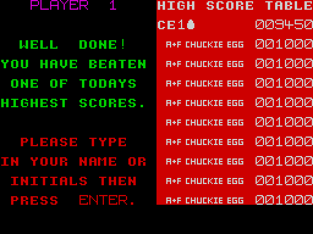 | 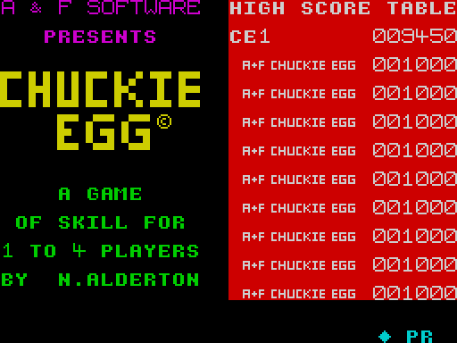 |

*`gameover-name` at frames 39 450, 39 600 and 39 700, from WALKTHROUGH 6.1.*

Worked example: in `gameover-name` the player's score beats the first default entry (001000), so k = 0. LDDR moves
entries 0-8 down one and the tenth "001000" is lost. Bytes 0-9 of entry 0 become code 0. The cursor is printed at
H 21, column 16 (screen row 2). C, E and 1 are typed. Each is stored at entry 0's bytes 0, 1 and 2 and printed at
columns 16, 17 and 18. With no shift held, LAST_K gives the lowercase codes for the letters, which print as bold
capitals. ENTER ends, and the title shows "CE1" at the top.

Witness: `gameover-name` has one entry. Phrase 7 starts at frame 39 425 (from `$A88C`), three characters are stored
(`$A8D5`) and ENTER is taken (`$A8E4`). EnterHiScore ran twice in the builds. DELETE (`$A8C3`) ran in
`name-delete`, frame 63 (doc 5.8). Known only from the code: a tie (never met) and the player loop of GameOver with
more than one player.

The point: the name entry borrows the ROM's keyboard scan for a few seconds by switching to IM 1. The table lives
only in RAM.

## 8.10 Data sheet of the texts

Every text of the image, with the resource file that holds it. All files are in `src/res/text/`.

| Label | Address | Bytes | File | Content | Read by |
| --- | --- | ---: | --- | --- | --- |
| KeySets | `$8250-$8273` | 36 | `KeySets.txt` | three key sets, six (mask, port row) pairs each | SetupLevel, RedefineKeys |
| MenuLeftover | `$8336-$838F` | 90 | `MenuLeftover.txt` | three menu lines with code 0 for spaces | none |
| InstructionsText | `$8390-$84EF` | 352 | `InstructionsText.txt` | the instructions page, 11 rows of 32 | InstructionsPage `$A4C8` |
| TitleText | `$9630-$9763` | 308 | `TitleText.txt` | the title's left half, 22 rows of 14 | TitlePage `$A420` |
| HudText | `$9764-$9786` | 35 | `HudText.txt` | SCORE; the 32 codes of HUD row 2 | SetupLevel `$AE9C` |
| HiScoreTable | `$97AF-$984E` | 160 | `HiScoreTable.txt` | ten entries of 16: name field, six ASCII digits | DrawHiScores, EnterHiScore |
| MenuTexts | `$ABF2-$AC01` | 16 | `MenuTexts.txt` | "high score table" | DrawHiScores `$ABAD` |
| RedefinePrompt | `$AC02-$AC21` | 32 | `MenuTexts.txt` | "press the key you wish to use to" | RedefineKeys `$AA49` |
| KeyLabels | `$AC22-$AC53` | 50 | `MenuTexts.txt` | five labels of 10: move up .. jump | RedefineKeys |
| KeyNames | `$AC54-$AC7B` | 40 | `MenuTexts.txt` | the 40 keys, 8 half rows of 5 | RedefineOne `$AB19` |
| TitleScroller | `$AC7C-$ACC9` | 78 | `MenuTexts.txt` | the title's scroller | TitleLoop `$A47D` |
| InstructionsScroller | `$ACCA-$AD20` | 87 | `MenuTexts.txt` | the instructions' scroller | InstructionsPage |
| PlayersPrompt | `$AD21-$AD3E` | 30 | `MenuTexts.txt` | "1,2,3 or 4 players ?" and spaces | StartGame `$A59D` |
| GameOverMessage | `$AD3F-$AD48` | 10 | `MenuTexts.txt` | "game over" and a space | LifeLost |
| PlayerMessage | `$AD49-$AD51` | 9 | `MenuTexts.txt` | "player 1" and a space; `$AD50` rewritten | PlayerTurn, GameOver |
| LevelMessage | `$AD52-$AD59` | 8 | `MenuTexts.txt` | "level " and two HUD digits at `$AD58` | PlayLevelBonus `$A675` |
| OutOfTimeMessage | `$AD5A-$AD66` | 13 | `MenuTexts.txt` | "OUT OF TIME !" | LifeLost |
| Congratulations | `$AD67-$AE0B` | 165 | `Congratulations.txt` | the name entry page, 11 rows of 15; `$AD72` rewritten | EnterHiScore `$A80C` |
| SourceLeftoverB167 | `$B167-$B1FF` | 153 | `SourceLeftoverB167.txt` | the author's assembler source | none |
| SourceLeftoverB307 | `$B307-$B34B` | 69 | `SourceLeftoverB307.txt` | assembler source | none |
| SourceLeftoverB381 | `$B381-$B3AF` | 47 | `SourceLeftoverB381.txt` | assembler source | none |
| SourceLeftoverC8B0 | `$C8B0-$C8C7` | 24 | `SourceLeftoverC8B0.txt` | assembler source | none |

The routines that rewrite text bytes at run time:

| Address | Written by | What |
| --- | --- | --- |
| `$976B`, `$9772-$9773`, `$977A`, `$9784` | SetupLevel | the HUD's player, level, bonus and time digits |
| `$83F6-$840A` | RedefineKeys | the key-type 3 row of the instructions |
| `$97AF-$984E` | EnterHiScore | a new entry |
| `$AD50` | PlayerTurn | the player's digit of PLAYER n |
| `$AD58-$AD59` | PlayLevelBonus | the level's digits of LEVEL n |
| `$AD72` | GameOver | the player's digit of the Congratulations page |

Worked example: changing "OUT OF TIME !" means editing its line in `MenuTexts.txt`. The string is 13 bytes and
LifeLost passes C = 13 to Message, so a new text of another length also needs the count in LifeLost.

Witness: the build (`sh tools/build.sh`) turns the files back into the image byte for byte; doc 3 checks it.

The point: about 1 300 bytes of text and nine run-time patches cover every word the game shows. A text's length lives
in its caller, not in the text.
