# 9. Sound

What this covers:

- the engines: the 48K beeper reached two ways, and a speech unit on port `$9F` (9.1);
- the game's own tone loop Beep `$9CA4`: its timing, its cost and its call sites (9.2);
- each effect decoded: the walk, the climb, the jump click, the pickup sweep, the time tick, the bonus step (9.3);
- the two tunes, played through the ROM's BEEP with interrupts off (9.4);
- the speech: the Fuller Orator and its SP0256-AL2, the interrupt that feeds it, and what the 33 phrases say (9.5);
- what the sounds cost and what the game loses while they play (9.6);
- the data sheet (9.7), the rendered sounds (9.8) and what no recording reached (9.9).

The names are those of `src/game/game.ann` ([Terms](README.md#terms)). The recordings it rests on, all on the 48K,
each opened on the writer's own instance (port base 36260, muted) from its stage-1 TTD session:

- `levels-1-3` (`l13` below): levels 1, 2 and 3 played by the bot, frames 0-7023 from `work/stage1/lab/x0/loaded.szx`.
  Every Beep effect, the level-end bonus, the level and lift phrases.
- `c1`: the load from tape; frames 5280-8916 hold the title tune, phrase 20, the instructions' phrase 24, a game
  start and the first death tune.
- `idle-1p`: a one-player game left alone; frames 4700-5400 (a death tune and phrases 32 and 11) and 14 200-15 400
  (the last death and phrase 23).
- `tour-type2`: frames 0-1000, the instructions (phrase 24), a player's turn (26) and a level start (12).
- `tour-redefine`: frames 8300-9300, a time-out, the death tune and phrases 30, 27 and 12.
- `gameover-name`: frames 38 900-39 800, the last death (phrase 16) and the name entry (phrase 7).

Every sound event of a window was taken from access traces, 100 or 250 frames at a time (`tools/sound_events.py`):
each `OUT` to port `$FE` and to port `$9F` with its value, T-state and PC, each Beep call with H, L and the caller,
each BEEPER call with HL and DE, each StartPhrase call, each interrupt entry. The figures and the audio files are
drawn from those events by `tools/fig_sound.py`. No sound was played aloud while writing this.

A frame is 69 888 T at 3.5 MHz, one interrupt a frame, 20 ms. A moment is "frame F T t", t counted from the frame's
interrupt.

```bash
. work/env.sh
python3 $RS open --work work/docs/ceD/l13 --ttd work/stage1/rec/levels-1-3/session.ttd --model 48K \
    --ranges 4000-FFFF --port-base 36260 --binary $BIN
python3 tools/sound_events.py --work work/docs/ceD/l13 --frames 0-7023 --out work/docs/ceD/l13-events.json
python3 $RS stop --work work/docs/ceD/l13
sh work/docs/ceD/run_traces.sh        # the same for c1, idle-1p, tour-redefine, tour-type2, gameover-name
python3 tools/fig_sound.py table      # every Beep site, tune note and phrase measured (the numbers below)
```

## 9.1 The engines

- **The beeper, two ways.**
  - Beep `$9CA4` is the game's own loop: L cycles of a square wave of half period H. It runs with interrupts on,
    inside MainLoop and PlayLevelBonus. Eight call sites (9.2, 9.3).
  - PlayTune `$AB60` plays the title tune and the death tune through the ROM's BEEP `$03F8`. BEEP ends with a `JP`
    to BEEPER `$03B5`, which runs with interrupts off (9.4).
- **The speech.** The game writes allophones to port `$9F`, the Fuller Orator's SP0256-AL2. The IM 2 interrupt
  sends them, one each time a count of interrupts runs out (9.5). The status port `$BF` is never read.
- **No AY.** No `OUT` goes to `$FFFD`, `$BFFD` or the Fuller Box's `$3F`/`$5F`. Nothing reads the EAR bit.
- **The border stays black.** Beep writes `$10` and `$00`, BEEPER `$18` and `$08`. Bits 0-2 are always 0.

| Site | What | Engine | H, L or tune | Trigger | Calls in `l13` |
| --- | --- | --- | --- | --- | ---: |
| `$9D6A` | walk left | Beep | `$28`, 5 | WalkHarry `$9D08`, every 4 pixels | 289 |
| `$9DA6` | walk right | Beep | `$28`, 6 | WalkHarry, every 4 pixels | 317 |
| `$9EE8` | climb up | Beep | `$1E`, `$14` | ClimbLadder `$9E98`, every 4 pixels | 170 |
| `$9F22` | climb down | Beep | `$1E`, `$15` | ClimbLadder | 120 |
| `$9892` | jump click | Beep | HarryY XOR `$FF`, 1 | MainLoop `$9858`, the pass before each slow tick in a jump | 1872 |
| `$987B` | pickup sweep | Beep | (SoundSweep AND `$1F`) + 6, 2 | MainLoop, after an egg or grain | 2764 |
| `$9932` | time tick | Beep | 4, 2 | MainLoopTick `$98B7`, each time step | 408 |
| `$A688` | bonus step | Beep | `$1E`, 4 | PlayLevelBonus `$A675` | 520 |
| `$A461` | title tune | PlayTune | TitleTune `$AE0C` | TitlePage `$A420`, once a run | 0 (`c1`: 1) |
| `$A701` | death tune | PlayTune | DeathTune `$AE6A` | LifeLost `$A6FE` | 0 (`idle-1p`: 2) |
| `$9CE0` | an allophone | port `$9F` | PhraseTable `$C8C8` | PhraseInterrupt `$9CC2` | 78 writes |

The counts of the Beep sites leave out a call entered just after an interrupt. The tracer sees its entry come from
the RETI at `$9CE9`, like a loop pass of a call already running. `l13` has five such entries, so each count may be
short by one or two (the pickup sweep of 9.3 lost one at frame 588).

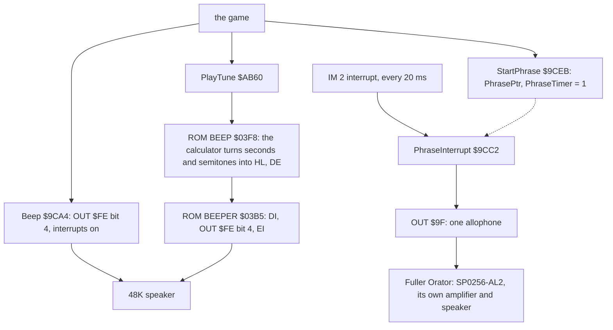

The point: three sound paths share the CPU in three ways. Beep takes the game's time, BEEPER takes it all, and the
speech costs one interrupt's few instructions while the chip does the work.

## 9.2 The Beep loop and its timing

Beep `$9CA4` writes `$10` to port `$FE` (speaker bit up), waits H passes of `DJNZ`, writes `$00`, waits again, and
repeats L times. H = 0 and L = 0 would mean 256, but no caller passes them.

Counted from the opcodes:

- **the high half**, from the `OUT` at `$9CA6` to the one at `$9CAC`: `LD B,H` 4, `DJNZ` 13 H - 5, `XOR A` 4, `OUT`
  11, so 13 H + 14 T;
- **the low half**, from `$9CAC` back to `$9CA6`: `LD B,H` 4, `DJNZ` 13 H - 5, `DEC L` 4, `JR NZ` 12, `LD A,$10` 7,
  `OUT` 11, so 13 H + 33 T;
- **one cycle** is 26 H + 47 T, so the tone is 3 500 000 / (26 H + 47) Hz. The low half is 19 T longer, a duty of
  slightly under 50 %;
- **a call** costs L (26 H + 47) + 22 T: the `CALL` and `RET` add 27 T, the last `JR` not taken saves 5. The
  figures use + 22.

The interrupt may land in the loop. It then stretches the half it lands in by its own length (about 120 T with no
phrase byte to send, 9.5). The `OUT ($FE)` is an I/O cycle to the ULA's port, so it also waits for the ULA while the
screen is fetched. That adds up to 6 T to an edge.

```text
Beep(H half period, L cycles):
    repeat L times:
        OUT ($FE), $10              ; speaker up, border black
        wait H x DJNZ               ; 13 H - 5 T
        OUT ($FE), $00              ; speaker down
        wait H x DJNZ
    A = 0                           ; B = 0, L = 0, H kept
```

```text
9CA4  3E 10         LD A,$10              ; Beep
9CA6  D3 FE         OUT ($FE),A           ; speaker up
9CA8  44            LD B,H
9CA9  10 FE         DJNZ BeepHigh         ; BeepHigh: 13 T a pass, 8 T the last
9CAB  AF            XOR A
9CAC  D3 FE         OUT ($FE),A           ; speaker down
9CAE  44            LD B,H
9CAF  10 FE         DJNZ BeepLow          ; BeepLow
9CB1  2D            DEC L
9CB2  20 F0         JR NZ,Beep
9CB4  C9            RET
```

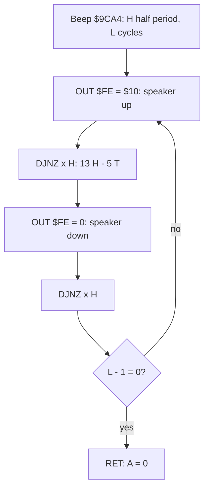

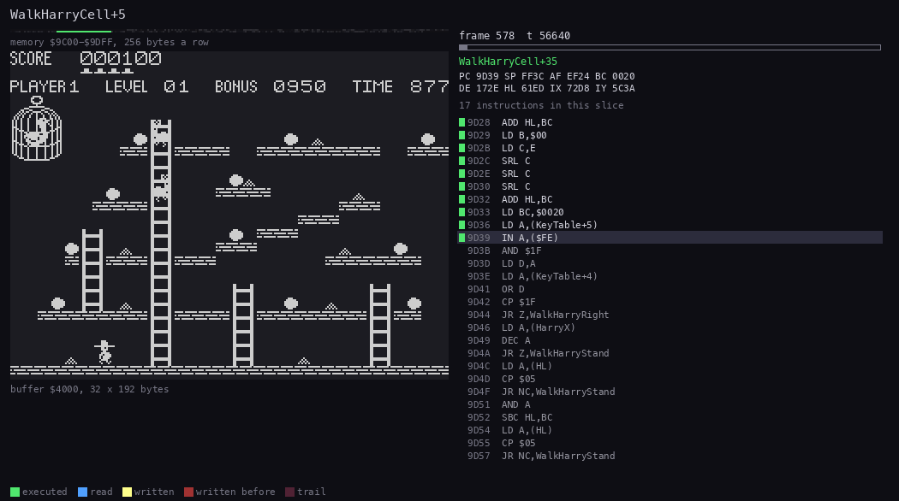

*The routine animation of WalkHarry and Beep (`$9D08-$9DDA`, `$9CA4-$9CB4`) in `levels-1-3` from 578:56500 to
578:63500. It has 50 pictures, one each 140 T, and 580 instructions. The view is the whole screen bitmap. Command,
from the case folder after `source work/env.sh`: `python3 ../../kit/routine_anim.py --work work/docs/ceD/l13
--listing build/game.lst --window 578:56500-578:63500 --out docs/img/routines/Beep.gif --pc 9CA4-9CB4,9D08-9DDA --view
buffer:4000:32x192:screen --range 9C00-9DFF --step 140 --delay 120`.*

How to read the animation: WalkHarry has moved Harry one pixel right and finds HarryX a multiple of 4. It loads HL with
`$2806` and calls Beep. The highlight then circles the four lines of the loop six times, each pass of a `DJNZ` shown as
the same line held. Beep writes no memory, so the screen does not change. The sound is the time the highlight spends
in the loop.

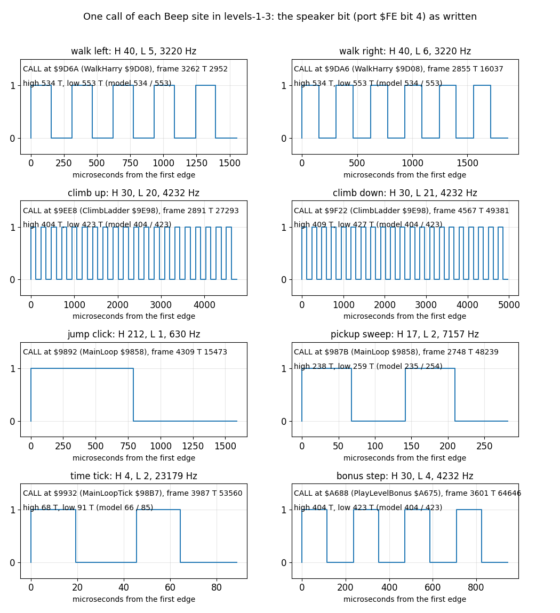

How to read the figure:

- **Each panel** is one call of one site, the call in the middle of that site's calls in `l13`. The title gives H, L
  and the pitch from the model. The first line inside names the call's frame and T-state.
- **The trace** is bit 4 of each `OUT ($FE)` Beep made, held to the next write, against microseconds from the first
  edge.
- **The second line** compares the first high and low halves with the model 13 H + 14 and 13 H + 33.
- **The point**: every effect is the same square wave. Only H (the pitch) and L (the length) change, from a 23 kHz
  click of two cycles to a 4 kHz tone of 21 cycles.

```bash
python3 tools/fig_sound.py effects    # docs/img/sound/effects.png
```

Worked example: the walk step of the animation. WalkHarry calls Beep at frame 578 T 56 965 with H 40, L 6. The model
gives a high half of 13 x 40 + 14 = 534 T and a low half of 13 x 40 + 33 = 553 T, a cycle of 1087 T, 3220 Hz. The
traced edges are 534, 554, 534, 554, 534, 554, 534, 553, 534, 553 and 535 T apart. The odd T is the ULA's wait on
the `OUT`. The eleven spans add up to 5980 T against the model's 5 x 1087 + 534 = 5969. The call costs 6 x 1087 + 22
= 6544 T, a tenth of a frame, and sounds for 1.9 ms.

Witness: every site measured in `l13`, from `tools/fig_sound.py table` (the edge span is first edge to last edge of
one call):

| Site | Sound | Calls | H | L | Hz | T a call, mean | Edge span, measured (model) |
| --- | --- | ---: | --- | ---: | ---: | ---: | --- |
| `$987B` | pickup sweep | 2764 | 9-37 | 2 | 3469-12 455 | 1000 | 734 (724) |
| `$9892` | jump click | 1872 | 73-232 | 1 | 576-1800 | 5581 | 2770 (2770) |
| `$9932` | time tick | 408 | 4 | 2 | 23 179 | 324 | 225 (217) |
| `$9D6A` | walk left | 289 | 40 | 5 | 3220 | 5457 | 4882 (4882) |
| `$9DA6` | walk right | 317 | 40 | 6 | 3220 | 6544 | 5980 (5969) |
| `$9EE8` | climb up | 170 | 30 | 20 | 4232 | 16 562 | 16 169 (16 117) |
| `$9F22` | climb down | 120 | 30 | 21 | 4232 | 17 389 | 16 984 (16 944) |
| `$A688` | bonus step | 520 | 30 | 4 | 4232 | 3330 | 2885 (2885) |

The time tick shows the ULA's wait most: its halves are 68 and 91 T against 66 and 85. A long climb tone gains about
50 T in 41 edges. In the eight builds Beep was called 127 975 times.

The point: one 17-byte loop makes every effect. Its pitch is exact to the T-state, and the only error is the ULA's wait
on the port.

## 9.3 The effects

### The walk and the climb

WalkHarry `$9D08` moves Harry one pixel. When the new HarryX is a multiple of 4 it calls Beep with `$2805` (left) or
`$2806` (right). ClimbLadder `$9E98` does the same with HarryY and `$1E14` (up) or `$1E15` (down). So a step is a short
3220 Hz blip, 1.6 or 1.9 ms long, and a climb rung a 4232 Hz blip of 4.7 or 5.0 ms. Left and right differ by one cycle,
up and down by one cycle. No player would hear the difference, but the code keeps two values.

On level 1 Harry moves one pixel per slow tick, about 0.8 frames (1.25 ticks a frame, glossary). A step sound comes
every 4 pixels, about every 3.2 frames, 16 a second.

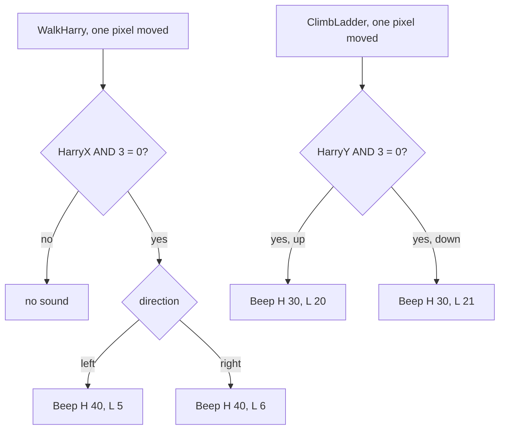

Worked example: the first walk right of `l13` beeps at frame 575 T 34 507, the next at frame 578 T 56 965, 3.3 frames
later: four pixels of slow ticks.

### The jump click

While JumpState is not 0, MainLoop clicks on the pass before each slow tick (PassCounter = 1). The click is one cycle
with H = HarryY XOR `$FF` = 255 - HarryY, so the higher Harry is, the shorter the half period and the higher the click.
HarryY runs from 23 (the bottom floor) to about 180, so H runs from 232 to 73, 580 Hz to 1.8 kHz.

```text
MainLoop, each pass:
    if JumpState != 0 and PassCounter == 1:
        Beep(H = HarryY XOR $FF, L = 1)
```

```text
9884  3A DC 72      LD A,(PassCounter)
9887  3D            DEC A
9888  20 0B         JR NZ,MainLoopJumpStep    ; not the pass before the tick
988A  2E 01         LD L,$01
988C  3A D9 72      LD A,(HarryY)
988F  EE FF         XOR $FF
9891  67            LD H,A
9892  CD A4 9C      CALL Beep
```

### The pickup sweep

TakeEggOrGrain sets SoundSweep `$7370` to `$FF` after an egg or grain. Every 16th MainLoop pass, while SoundSweep is not
0, MainLoop decrements it. When the old value is a multiple of 4 it beeps two cycles with H = (new value AND `$1F`) + 6.
New values 251, 247 .. 3 give H 33, 29, 25 .. 9, then 37 again: a saw of seven falling half periods, rising in pitch
from 3.9 to 12.5 kHz, then H 37 (3.5 kHz) starts the next of eight teeth. The code gives 63 beeps.

```text
MainLoop, each pass:
    if PassCounter AND $0F == 0 and SoundSweep != 0:
        old = SoundSweep; SoundSweep -= 1
        if old AND 3 == 0:
            Beep(H = (SoundSweep AND $1F) + 6, L = 2)
```

```text
9860  21 70 73      LD HL,SoundSweep
9863  3A DC 72      LD A,(PassCounter)
9866  E6 0F         AND $0F
9868  20 14         JR NZ,MainLoopJump    ; every 16th pass
986A  7E            LD A,(HL)
986B  A7            AND A
986C  28 10         JR Z,MainLoopJump     ; no sweep running
986E  35            DEC (HL)
986F  E6 03         AND $03               ; the old value
9871  20 0B         JR NZ,MainLoopJump
9873  7E            LD A,(HL)
9874  E6 1F         AND $1F
9876  C6 06         ADD A,$06
9878  67            LD H,A
9879  2E 02         LD L,$02
987B  CD A4 9C      CALL Beep
```

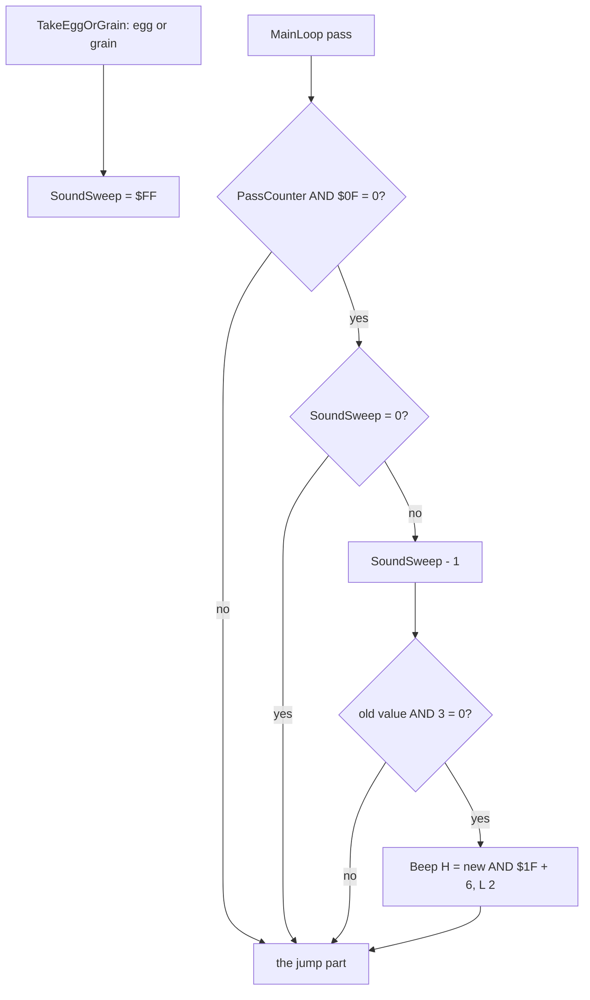

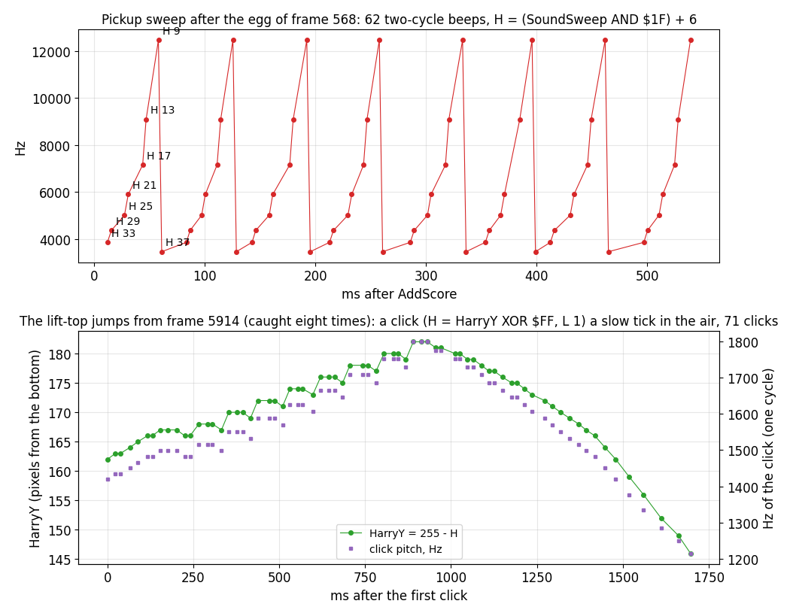

How to read the figure:

- **Top**: each beep of the sweep after the egg of frame 568, its pitch against milliseconds after AddScore. The
  first eight are labelled with H.
- **Bottom**: the longest run of jump clicks in `l13` (frame 5914), the lift-top sequence of 10.10. Green is HarryY at
  each click, purple the click's pitch.
- **The point**: the sweep is a fixed saw that tells "you took something". The jump click is a pitch that follows
  Harry's height, so a jump sounds like its arc.

```bash
python3 tools/fig_sound.py sweep      # docs/img/sound/sweep.png
```

Worked example: the egg of frame 568 (AddScore at T 64 067) starts the sweep. Its first beeps come in frame 569 with H
33 and H 29, 3.9 and 4.4 kHz (3 500 000 / 905 and / 801). The traced sweep has 62 beeps and ends at frame 595, 539 ms
after the egg. The 63rd of the code, an H 17 at frame 588, was entered right after an interrupt (9.1). The longest run
of clicks in `l13` starts at frame 5914 T 7054 with H 93 and makes 71 clicks in 1.70 s, H between 73 and 109. It is not
one jump but the lift-top sequence of doc 10 (10.10): the lift catches Harry eight times (frames 5926/27 to 5958)
and he jumps on each time, so HarryY climbs in steps from 162 to 182 before the last fall.

### The time tick and the bonus step

Each time step of CountDown (doc 8, 8.5) is followed by Beep H 4, L 2: two cycles of 151 T, 23 kHz. That is above
most hearing. On a real speaker it is a click of 86 µs, about every 8 frames on level 1 (doc 8, 8.5: TIME 899 at
frame 404, 887 by frame 500).

The bonus step of the level end (doc 8, 8.6) is Beep H 30, L 4: four cycles at 4232 Hz, 0.95 ms. About ten steps a
frame make a buzz at 500 Hz, the step rate, with the 4.2 kHz tone inside each step.

The point: the effects are tiny. The longest is a climb rung of 5 ms. Their rhythm, not their tone, carries the
meaning: steps, rungs, the arc of a jump.

## 9.4 The tunes through BEEP

PlayTune `$AB60` reads (duration, pitch) byte pairs until a duration of 0. The duration is in tenths of a second,
the pitch in semitones above middle C. For each note it puts the duration on the ROM calculator's stack, runs the
three-byte program TuneCalc `$AB6D` (stk-ten, division, end-calc) to divide it by ten, stacks the pitch and calls the
ROM's BEEP `$03F8`. BEEP is the BASIC command: it turns seconds and semitones into a half-period count HL and a cycle
count DE, and ends with a `JP` to BEEPER `$03B5` at `$0469`, so BEEPER's `RET` returns straight to PlayTune.

BEEPER disables interrupts, toggles the speaker at `$03E1` (`OUT ($FE)` with `$18` and `$08`: bit 4 toggled, bit 3,
MIC, held) DE + 1 times, and enables them again. One cycle costs 8 HL + 241 T. So the pitch is 437 500 / (HL + 30.125) Hz and a
note lasts (DE + 1)(8 HL + 241) T.

The title tune plays once per run, from TitlePage, when TitleTuneDone `$736F` is 0. Start `$A410` clears it, so the
loader and the abort key (CAPS SHIFT + A) bring it back (witnessed: `hold-abort` aborts at frame 1400; from frame 1410
TitlePage plays all 46 notes, 46 BEEPER calls, then phrase 20). The title after a game over is silent. LifeLost plays
the death tune at every life lost, before DeathPhrase.

```text
PlayTune(HL tune):
    loop:
        C = tune[0]; B = tune[1]; tune += 2      ; duration in tenths, pitch in semitones
        if C == 0: return
        stack C; RST $28: stk-ten, division, end-calc   ; C / 10 seconds
        stack B
        BEEP                                     ; HL = 437 500 / f - 30.125, DE = f x t - 1
                                                 ; BEEPER: DI, DE + 1 cycles of 8 HL + 241 T, EI
```

```text
AB60  4E            LD C,(HL)             ; PlayTune
AB61  23            INC HL
AB62  46            LD B,(HL)
AB63  23            INC HL
AB64  79            LD A,C
AB65  A7            AND A
AB66  C8            RET Z                 ; duration 0: the end
AB67  E5            PUSH HL
AB68  C5            PUSH BC
AB69  CD 28 2D      CALL STACK_A          ; the duration
AB6C  EF            RST $28
AB6D  A4 05 38      DEFB $A4,$05,$38      ; TuneCalc: stk-ten, division, end-calc
AB70  C1            POP BC                ; PlayTuneNote
AB71  78            LD A,B
AB72  CD 28 2D      CALL STACK_A          ; the pitch
AB75  CD F8 03      CALL BEEP
AB78  E1            POP HL
AB79  18 E5         JR PlayTune
```

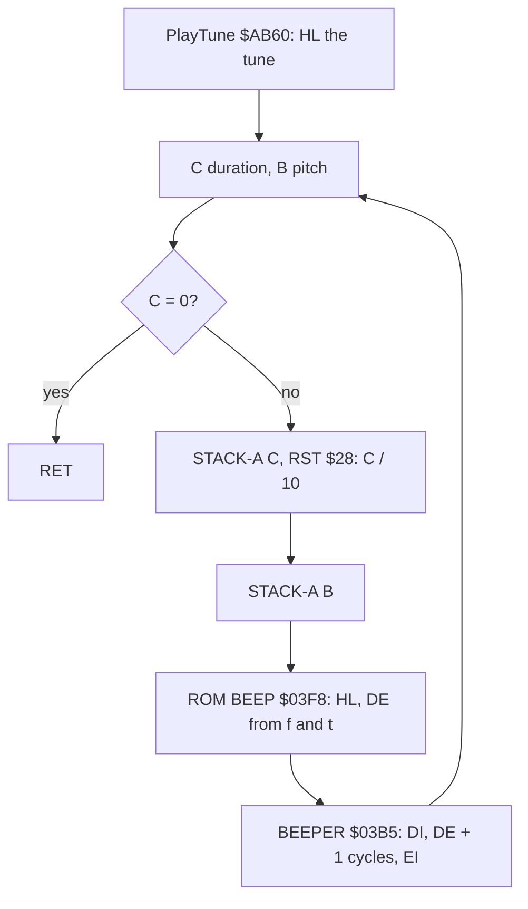

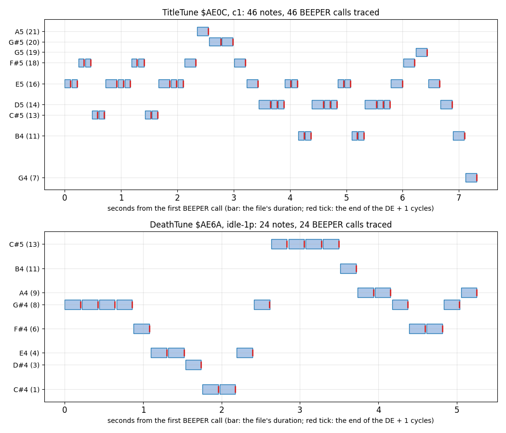

How to read the figure:

- **Each bar** is one note of the resource file at its pitch (the left axis names the note and the semitone number).
  It starts at the traced BEEPER call and is as long as the file's duration.
- **The red tick** is where the traced call's DE + 1 cycles end, at the pitch measured from HL. A tick at the end of
  its bar is a note played as written.
- **The gaps** between bars are the calculator's work between notes, about a frame each.
- **The point**: the tunes are BASIC BEEP statements in machine code. Every note comes out at the written pitch and
  length, at the cost of the ROM's floating point.

```bash
python3 tools/fig_sound.py tunes      # docs/img/sound/tunes.png
```

Worked example: the title tune's first note is "1 16", 0.1 s of E5 (659.3 Hz). BEEP computes HL = 634 and DE = 65.
BEEPER plays 66 cycles of 8 x 634 + 241 = 5313 T, 350 658 T in all, 5.02 frames. The pitch is 437 500 / 664.1 =
658.8 Hz, 0.08 % flat. In `c1` the note starts in frame 5303. With the calculator, a 0.1 s note takes 6 frames and a
0.2 s note 11.

Witness: in `c1`, all 46 notes of TitleTune match the file, from frame 5303 to frame 5659 (`tools/fig_sound.py table`).
Phrase 20 starts at frame 5669, right after the last note. The death tune is traced five times (`c1` frame 8694,
`idle-1p` 4763 and 14 215, `tour-redefine` 8376, `gameover-name` 38 930): 24 notes of 0.2 s each, every one matching,
the first HL 1023 and DE 82 (G#4, 415.4 Hz). The two tunes:

| Tune | Address | Notes | Pitches | Length | Played by |
| --- | --- | ---: | --- | ---: | --- |
| TitleTune | `$AE0C-$AE69` | 46 | G4 to A5, 0.1 and 0.2 s notes | 7.2 s | TitlePage `$A420`, once a run |
| DeathTune | `$AE6A-$AE9B` | 24 | C#4 to C#5, all 0.2 s | 5.3 s | LifeLost `$A6FE`, each life lost |

The point: the tunes are cheap to write and exact, but they stop the game and the interrupt (9.6). The speech waits
for them: each phrase that follows a tune starts after its last note.

## 9.5 The speech

### The hardware

The Fuller Orator is a speech unit for the 48K made by Fuller Micro of Liverpool in 1983 (£39.95). It plugs into the
expansion port, carries its own amplifier and loudspeaker, and also amplifies the Spectrum's beep. Its chip is General
Instrument's SP0256-AL2, which holds 64 allophones (59 speech sounds and 5 pauses) in its internal ROM. The manual
says the unit "is a port mapped device and is enabled by the command OUT 159,a", where a is the allophone's number.
159 is `$9F`. The same chip is in the Fuller Box Master Unit, next to its AY-3-8912. Spectrum Computing lists Chuckie
Egg among the programs that support the Orator.

The SP0256 signals when it can take the next allophone (LRQ, load request). The Orator has a read port at `$BF` for its
status. Chuckie Egg never reads it. It times each allophone by counting interrupts instead.

Sources:

- [Fuller Orator, Spectrum Computing](https://spectrumcomputing.co.uk/alt/1000165/Hardware/Fuller_Orator): the chip,
  the year, the price, the supported programs.
- [The Fuller Orator manual (PDF)](https://spectrumcomputing.co.uk/pub/sinclair/hardware-info/f/FullerOrator.pdf):
  `OUT 159,a`, the amplifier, the allophone set.
- [The SPO256-AL2 datasheet (PDF)](https://people.ece.cornell.edu/land/courses/ece4760/Speech/SPO256-AL2.pdf): the
  64 allophone addresses, their names and durations, LRQ and SBY.
- [ZX Computing, Talkback: speech units assessed](https://everygamegoing.com/larticle/Talkback-Speech-Units-Assessed-000/35097):
  the allophone units of the time and their port.
- [Chuckie Egg, Spectrum Computing](https://spectrumcomputing.co.uk/entry/958): the game's entry.

unreal-ng does not model the Orator. The writes to port `$9F` are traced, but they make no sound, so this document has
no speech audio. What the phrases say is read from their allophones.

### PhraseInterrupt and StartPhrase

Every interrupt goes through VectorTable `$B200` to PhraseVector `$9C9C` and `JP PhraseInterrupt` `$9CC2`. When
PhraseTimer `$7373` is `$FF`, no phrase plays and it returns. Otherwise it decrements the timer. When the timer reaches
0 it reads the next pair at PhrasePtr `$7374`. The first byte is the new timer, the second the allophone it writes to
port `$9F`. A timer byte of `$FF` ends the phrase.

StartPhrase `$9CEB` takes the phrase number in A. When a phrase is playing it returns at once, so the call is lost.
Otherwise it takes the phrase's address from the word at `$C8C6` + 2 A and sets PhraseTimer to 1, so the first
allophone goes out at the next interrupt.

Each allophone is held for its count of interrupts, count x 20 ms. Most phrases end with a short PA1 (10 ms of silence)
held 2 interrupts; phrase 33 ends with PA1 held 6, then PA1 held 11.

```text
PhraseInterrupt (IM 2, every 20 ms):
    if PhraseTimer == $FF: return
    PhraseTimer -= 1
    if PhraseTimer != 0: return
    count, allophone = PhrasePtr[0], PhrasePtr[1]
    PhraseTimer = count
    if count == $FF: return                 ; the phrase is over
    OUT ($9F), allophone
    PhrasePtr += 2

StartPhrase(A):
    if PhraseTimer != $FF: return           ; busy: the request is dropped
    PhrasePtr = word at $C8C6 + 2 A
    PhraseTimer = 1
```

```text
9C9C  C3 C2 9C      JP PhraseInterrupt    ; PhraseVector: every interrupt
9CC2  F5            PUSH AF               ; PhraseInterrupt
9CC3  E5            PUSH HL
9CC4  3A 73 73      LD A,(PhraseTimer)
9CC7  FE FF         CP $FF
9CC9  28 1B         JR Z,PhraseDone       ; no phrase
9CCB  3D            DEC A
9CCC  28 05         JR Z,PhraseNext
9CCE  32 73 73      LD (PhraseTimer),A
9CD1  18 13         JR PhraseDone
9CD3  2A 74 73      LD HL,(PhrasePtr)     ; PhraseNext
9CD6  7E            LD A,(HL)
9CD7  32 73 73      LD (PhraseTimer),A    ; the hold of this allophone
9CDA  FE FF         CP $FF
9CDC  28 08         JR Z,PhraseDone       ; the end
9CDE  23            INC HL
9CDF  7E            LD A,(HL)
9CE0  D3 9F         OUT ($9F),A           ; to the SP0256-AL2
9CE2  23            INC HL
9CE3  22 74 73      LD (PhrasePtr),HL
9CE6  E1            POP HL                ; PhraseDone
9CE7  FB            EI
9CE8  F1            POP AF
9CE9  ED 4D         RETI
9CEB  47            LD B,A                ; StartPhrase
9CEC  3A 73 73      LD A,(PhraseTimer)
9CEF  FE FF         CP $FF
9CF1  C0            RET NZ                ; a phrase is playing
9CF2  21 C6 C8      LD HL,PhraseTable-$0002
9CF5  23 23         INC HL / INC HL       ; StartPhraseFind
9CF7  10 FC         DJNZ StartPhraseFind
9CF9  5E 23 56      LD E,(HL) / INC HL / LD D,(HL)
9CFC  ED 53 74 73   LD (PhrasePtr),DE
9D00  3E 01         LD A,$01
9D02  32 73 73      LD (PhraseTimer),A
9D05  C9            RET
```

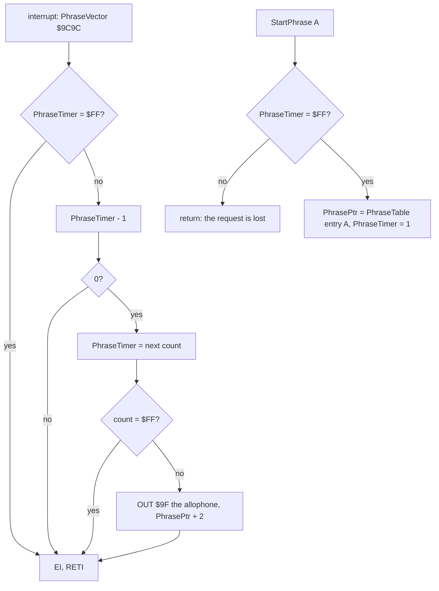

The callers, and how they pick the phrase:

| Caller | Address | Phrase | When |
| --- | --- | --- | --- |
| TitlePage | `$A466` | 20 | after the title tune, once a run |
| InstructionsPage | `$A512` | 24 | after WaitPhrase |
| PlayerTurn | `$A637` | 25 + player: 26-29 | each turn of a game of two or more players, as "PLAYER n" scrolls in |
| EnterHiScore | `$A88C` | 7 | after WaitPhrase, then WaitPhrase again |
| LevelPhrase | `$B15C` | LevelPhrases `$B15F` [R AND 7]: 2, 8, 10, 11, 12, 17, 17, 2 | at each level or life start |
| LiftPhrase | `$A396` | LiftPhrases `$A399` [R AND 7]: 4, 6, 9, 13, 18, 22, 4, 13 | when Harry lands on a lift |
| DeathPhrase | `$AAF1` | DeathPhrases `$ABEA` [R AND 7]: 1, 16, 19, 23, 30, 32, 33, 1 | after the death tune |

The pickers read the refresh register R, which counts instruction fetches. It works as a cheap random number. WaitPhrase
`$A960` loops until PhraseTimer is `$FF`. It is called before the instructions' phrase (`$A50D`), by StartGame
(`$A629`), by PlayLevel when MainLoop returns (`$A656`), by LifeLost after DeathPhrase (`$A707`) and twice by the
name entry (`$A887`, `$A88F`). LevelPhrase, LiftPhrase and PlayerTurn do not wait, so their calls are dropped when a
phrase is still playing.

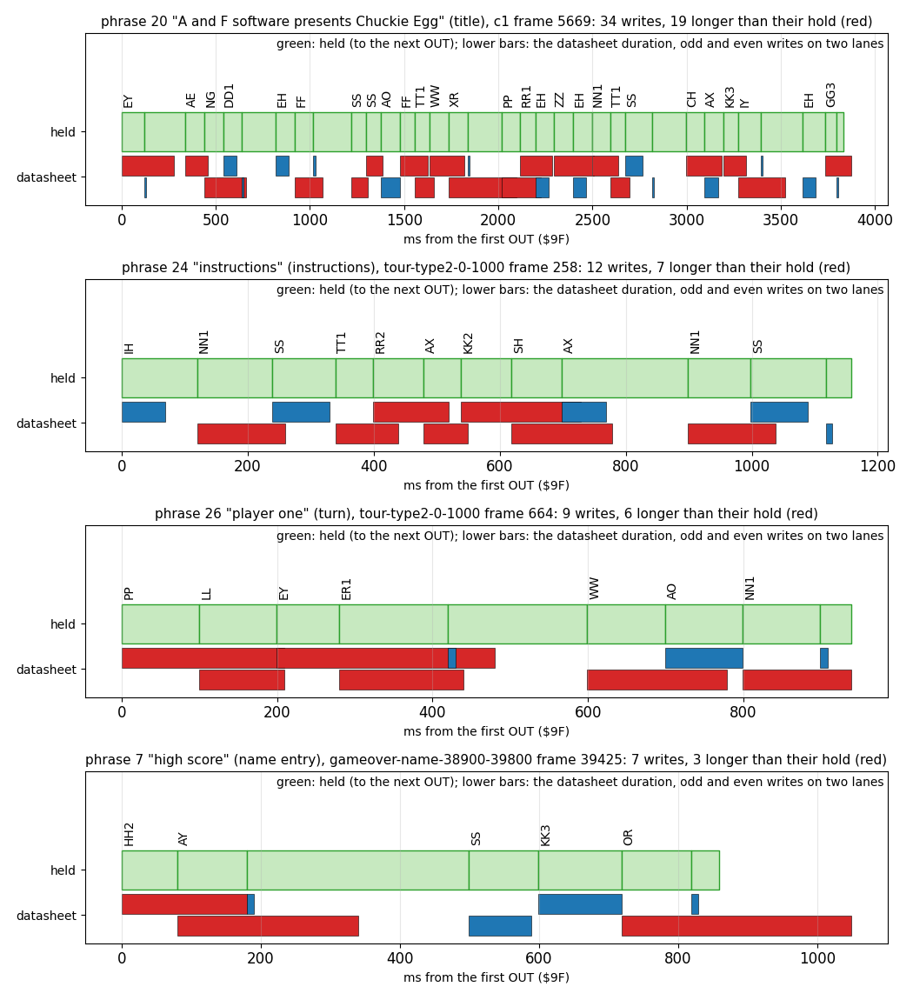

How to read the figure:

- **Each panel** is one phrase as traced: the title (`c1`), the instructions and player one (`tour-type2`), high
  score (`gameover-name`). The title gives the frame and how many allophones outlast their hold.
- **The green bars** are the holds: from one `OUT ($9F)` to the next. The allophone's name stands above.
- **The lower bars** are the datasheet's duration of the same allophone, on two lanes so neighbours do not overlap.
  Red means the chip needs longer than the game waits.
- **The point**: the holds follow the counts of the table exactly, in 20 ms steps. Many allophones are longer than
  their hold, so the game writes the next one before the chip has finished.

```bash
python3 tools/fig_sound.py speech     # docs/img/sound/speech.png
```

Worked example: phrase 7, "high score", in `gameover-name`. EnterHiScore calls StartPhrase at frame 39 425 T 69 292.
PhrasePtr gets the 7th word of the table, PhraseTimer 1. The next interrupt sends the first pair, "4 HH2": allophone
57 to port `$9F` and a hold of 4 interrupts (80 ms). Then "5 AY" (6, 100 ms), "16 PA1" (0, a 320 ms pause between the
words), "5 SS" (55), "6 KK3" (8), "5 OR" (58) and "2 PA1". The next pair is `$FF` and ends it. The holds add up to
43 interrupts, 860 ms; the datasheet's durations add up to 1000 ms. Three of the seven allophones (HH2 80 ms of 180,
AY 100 of 260, OR 100 of 330) need longer than their hold.

Witness: the traced `OUT ($9F)` values are those of the table, pair for pair, in every recording. The phrases traced:

| Recording | Frame: phrase |
| --- | --- |
| `l13` | 292: 17, 2214: 17, 3800: 10, 6875: 2 (level starts); 4251: 9, 5714: 22, 5926: 22, 5958: 22 (lifts) |
| `c1` | 5669: 20, 5918: 24, 6562: 8 |
| `tour-type2` | 258: 24, 664: 26, 783: 12 |
| `tour-redefine` | 8640: 30, 8785: 27, 8905: 12 |
| `idle-1p` | 5027: 32, 5142: 11, 14 479: 23 |
| `gameover-name` | 39 194: 16, 39 425: 7 |

In `l13` LiftPhrase was called 8 times in frames 5926-5958. StartPhrase dropped the six calls at frames 5931-5953,
while phrase 22 still played. Each call was checked against the allophones sent after it. 78 allophones were sent in `l13`.
In the eight builds StartPhrase ran 106 times and PhraseInterrupt 127 166 times, one per interrupt.

### What the phrases say

PhraseTable `$C8C8` holds 33 words, then 34 zero bytes, then the phrases. The table's comment and the resource file's
head say 1-32, but 33 words are used: DeathPhrases picks 33, "hard luck". The words below were read from the
allophones.

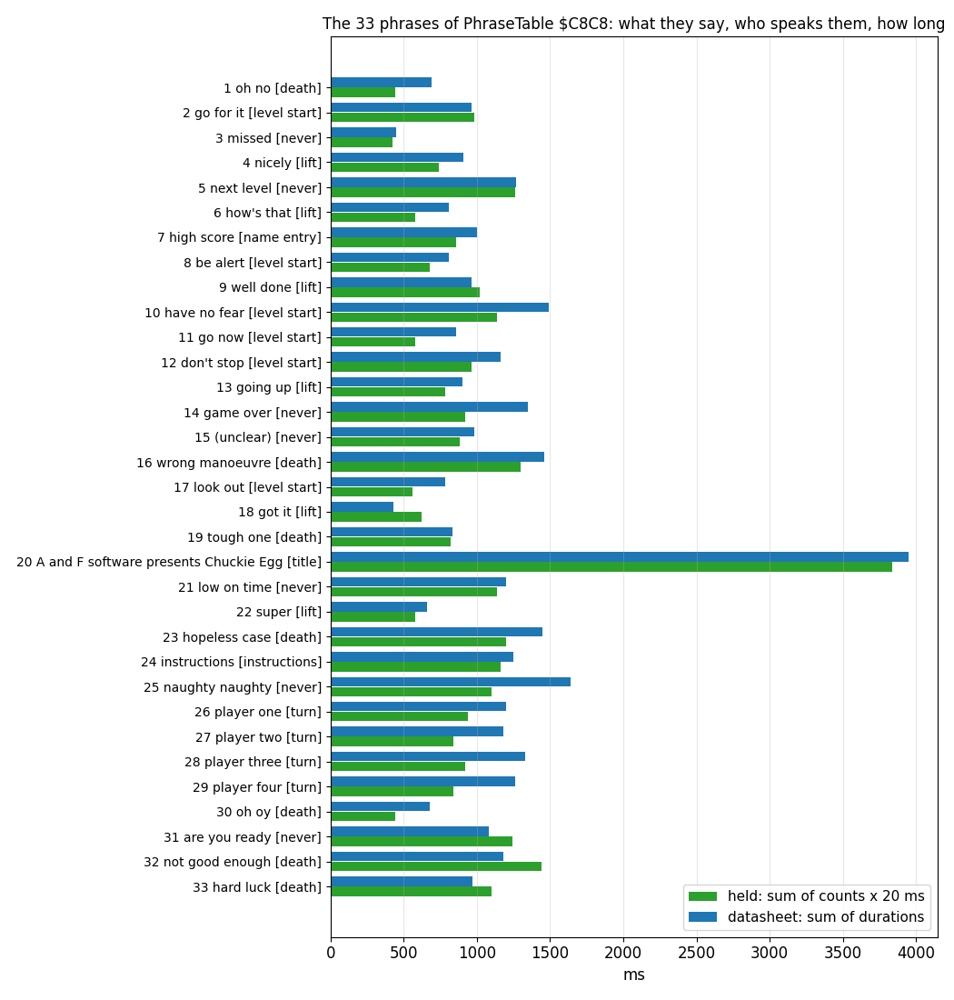

How to read the figure:

- **One row per phrase**: its number, the words and its caller (`never` when no caller can pick it).
- **Green** is the hold, the sum of its counts x 20 ms. **Blue** is the sum of its allophones' datasheet durations.
- **The point**: the game paces most phrases a little faster than the chip speaks. Seven phrases are never spoken.

```bash
python3 tools/fig_sound.py phrases    # docs/img/sound/phrases.png
```

| N | Says | Allophones | Held ms | Datasheet ms | Spoken by |
| ---: | --- | --- | ---: | ---: | --- |
| 1 | oh no | OW PA1 NN2 OW PA1 | 440 | 690 | death |
| 2 | go for it | GG2 OW PA1 FF AR PA1 IH TT2 PA1 | 980 | 960 | level start |
| 3 | missed | MM IH SS TT1 PA1 | 420 | 450 | never |
| 4 | nicely | NN2 AY SS LL IY PA1 | 740 | 910 | lift |
| 5 | next level | NN1 EH KK2 SS TT1 PA1 LL EH VV UH EL PA1 | 1260 | 1270 | never |
| 6 | how's that | AW ZZ AE TT1 PA1 | 580 | 810 | lift |
| 7 | high score | HH2 AY PA1 SS KK3 OR PA1 | 860 | 1000 | name entry |
| 8 | be alert | BB2 IY PA1 EL ER1 TT2 PA1 | 680 | 810 | level start |
| 9 | well done | WW EH EL PA1 DD2 UH UH NN1 PA1 | 1020 | 960 | lift |
| 10 | have no fear | HH2 AE VV PA1 NN2 OW PA1 TH XR PA1 | 1140 | 1490 | level start |
| 11 | go now | GG2 OW PA1 NN2 AW PA1 | 580 | 860 | level start |
| 12 | don't stop | DD2 OW NN1 TT1 PA1 SS TT1 AA PP PA1 | 960 | 1160 | level start |
| 13 | going up | GG3 OW NG PA1 AX PP PA1 | 780 | 900 | lift |
| 14 | game over | GG3 EY MM PA1 OW VV ER2 PA1 | 920 | 1350 | never |
| 15 | unclear | OW NN2 SS PA1 MM AE NN1 PA1 | 880 | 980 | never |
| 16 | wrong manoeuvre | RR2 AO NG PA1 MM AX NN1 UW2 VV ER1 PA1 | 1300 | 1460 | death |
| 17 | look out | LL KK2 PA1 AE OW TT1 PA1 | 560 | 780 | level start |
| 18 | got it | GG2 AA TT1 PA1 IH TT1 PA1 | 620 | 430 | lift |
| 19 | tough one | TT2 UH FF PA1 WW AO NN1 PA1 | 820 | 830 | death |
| 20 | A and F software presents Chuckie Egg | 34 allophones | 3840 | 3950 | title |
| 21 | low on time | LL OW PA1 AO NN1 PA1 TT2 AY MM PA1 | 1140 | 1200 | never |
| 22 | super | SS SS UW1 PP ER1 PA1 | 580 | 660 | lift |
| 23 | hopeless case | HH2 OW PP LL AX SS PA1 KK1 EY SS PA1 | 1200 | 1450 | death |
| 24 | instructions | IH NN1 SS TT1 RR2 AX KK2 SH AX NN1 SS PA1 | 1160 | 1250 | instructions |
| 25 | naughty naughty | NN2 OW TT1 EY PA1 NN2 OW TT1 EY PA1 | 1100 | 1640 | never (PlayerTurn starts at 26) |
| 26 | player one | PP LL EY ER1 PA1 WW AO NN1 PA1 | 940 | 1200 | turn |
| 27 | player two | PP LL EY ER1 PA1 TT2 UW2 PA1 | 840 | 1180 | turn |
| 28 | player three | PP LL EY ER1 PA1 TH RR2 IY PA1 | 920 | 1330 | turn |
| 29 | player four | PP LL EY ER1 PA1 FF OR PA1 | 840 | 1260 | turn |
| 30 | oh oy | OW PA1 OY PA1 | 440 | 680 | death |
| 31 | are you ready | AR PA1 YY2 UH PA1 RR2 EH DD2 YY1 PA1 | 1240 | 1080 | never |
| 32 | not good enough | NN1 AO TT1 PA1 GG3 UH DD2 PA1 EH NN2 FF PA1 | 1440 | 1180 | death |
| 33 | hard luck | HH2 AR DD1 PA1 LL UH KK2 PA1 PA1 | 1100 | 970 | death |

Phrase 20 says "EY PA1 AE NG DD1 PA1 EH FF PA1 SS SS AO FF TT1 WW XR PA1 PP RR1 EH ZZ EH NN1 TT1 SS PA1 CH AX KK3 IY
PA1 EH GG3 PA1": "A, and, F, software, presents, Chuckie, Egg". 19 of its 34 allophones are longer than their hold.
Phrase 15 ("OW NN2 SS / MM AE NN1") reads as no clear English words.

The point: the speech is a 764-byte table and 40 bytes of interrupt code. The SP0256 does the speaking, and the game
only paces it at 20 ms steps.

## 9.6 What the sounds cost

Beep runs in the game's own time. Each effect delays the next MainLoop pass by its length. Counted per frame with the
model of 9.2:

- in play, Beep takes 4.2 % of the CPU on average over `l13`, and under 10 % in 90 % of the frames;
- the highest frame in play is 33.5 % (23 430 T);
- the level end is the peak: 33 300 T in frame 2009, 48 %, ten bonus steps of 3330 T. The rest of those frames is
  CountDown, AddScore and the interrupt.

BEEPER runs with interrupts off. A note of 0.2 s holds the CPU for 10 frames and the interrupt for 10 frames, so 10
interrupts are never taken. The speech then stands still too, but no phrase plays during a tune. The game also stops
while a tune plays, since PlayTune returns only at the end.

PhraseInterrupt costs, with the interrupt's acknowledge and the `JP`, about 120 T with no phrase, 150 T while it counts
down and 240 T when it sends an allophone (counted from the opcodes). That is 0.2-0.3 % of a frame.

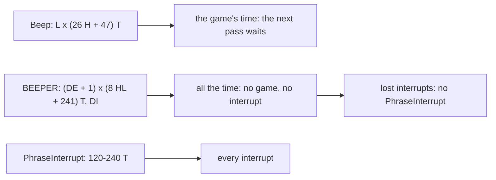

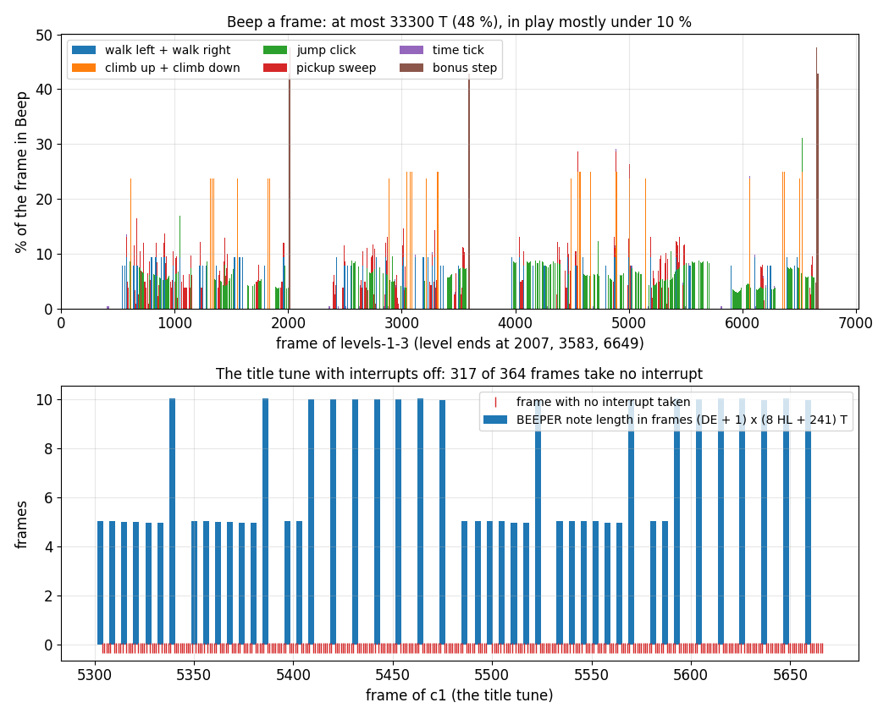

How to read the figure:

- **Top**: for each frame of `l13`, the T-states of the Beep calls of that frame as a share of the frame, stacked by
  effect. The three tall blocks at frames 2007, 3583 and 6649 are the level ends.
- **Bottom**: the title tune in `c1`. Each blue bar is one note's BEEPER time in frames. The red marks below are frames
  with no interrupt taken.
- **The point**: in play the effects cost a few percent. The tunes cost everything, and the interrupt with it.

```bash
python3 tools/fig_sound.py cost       # docs/img/sound/cost.png
```

Worked example: the title tune's 0.2 s note at frame 5339 is HL 634, DE 131: 132 x 5313 = 701 316 T, 10.04 frames
with interrupts off. With the calculator around it the note takes 11 frames, and the interrupt is taken in one of them.
Over the tune, from frame 5302 to frame 5666, 317 of 364 frames take no interrupt.

Witness: `c1` frames 5280-8916 take 3104 interrupts in 3636 frames. The 532 missing are 13 at the start of the window
(the loader, before Start's IM 2), 320 in the title tune (frames 5302-5675) and 199 in the death tune (frames
8690-8916). `l13` takes 7023 interrupts in 7023 frames: it plays no tune.

The point: an effect costs at most half a frame and only at the level end. A tune costs the whole game for 5 to 7 s,
which is why the game plays tunes only where it would wait anyway: on the title and after a death.

## 9.7 The data sheet

The Beep calls, byte by byte (`LD HL,nn` before each call, or the code that sets H and L):

| Site | Bytes | H | L | Hz | Length |
| --- | --- | ---: | ---: | ---: | ---: |
| `$9D67` | `21 05 28` | 40 | 5 | 3220 | 1.6 ms |
| `$9DA3` | `21 06 28` | 40 | 6 | 3220 | 1.9 ms |
| `$9EE5` | `21 14 1E` | 30 | 20 | 4232 | 4.7 ms |
| `$9F1F` | `21 15 1E` | 30 | 21 | 4232 | 5.0 ms |
| `$988A-$9891` | `2E 01`, HarryY XOR `$FF` | 73-232 | 1 | 576-1800 | 0.6-1.7 ms |
| `$9873-$9879` | (SoundSweep AND `$1F`) + 6, `2E 02` | 9-37 | 2 | 3469-12 455 | 0.16-0.58 ms |
| `$992F` | `21 02 04` | 4 | 2 | 23 179 | 0.09 ms |
| `$A685` | `21 04 1E` | 30 | 4 | 4232 | 0.95 ms |

The tunes, in `src/res/sound/` as text: one note a line, "duration pitch", with "end" for the closing 0 0. In the
image a note is two bytes: the duration in tenths, then the pitch in semitones above middle C.

| Label | Address | Bytes | File | Content |
| --- | --- | ---: | --- | --- |
| TitleTune | `$AE0C-$AE69` | 94 | `TitleTune.txt` | 46 notes, then 0 0 |
| DeathTune | `$AE6A-$AE9B` | 50 | `DeathTune.txt` | 24 notes, then 0 0 |
| PhraseTable | `$C8C8-$CBC3` | 764 | `Phrases.txt` | 33 words, 34 zero bytes, the phrases as (count, allophone) pairs, each ended by `$FF` |
| LiftPhrases | `$A399-$A3A0` | 8 | `../tables/LiftPhrases.csv` | 4, 6, 9, 13, 18, 22, 4, 13 |
| DeathPhrases | `$ABEA-$ABF1` | 8 | `../tables/DeathPhrases.csv` | 1, 16, 19, 23, 30, 32, 33, 1 |
| LevelPhrases | `$B15F-$B166` | 8 | `../tables/LevelPhrases.csv` | 2, 8, 10, 11, 12, 17, 17, 2 |

The variables:

| Label | Address | Meaning |
| --- | --- | --- |
| SoundSweep | `$7370` | the pickup sweep's count, `$FF` after an egg or grain, 0 when quiet |
| TitleTuneDone | `$736F` | 1 once the title tune has played; cleared by Start |
| PhraseTimer | `$7373` | interrupts to the next pair; `$FF` when no phrase plays |
| PhrasePtr | `$7374-$7375` | the next (count, allophone) pair |
| VectorTable | `$B200-$B306` | 263 bytes of `$9C`, so every IM 2 vector is `$9C9C`; only `$B2FF-$B300` are read |

Worked example: the pair "4 HH2" of phrase 7 is the bytes `$04 $39` in the image (HH2 is allophone 57, `$39`). The
interrupt that reads it writes `$39` to port `$9F` and sets PhraseTimer to 4.

Witness: the build (`sh tools/build.sh`) turns the files back into the image byte for byte (doc 3).

The point: all the sound data is 932 bytes of tables, plus eight `LD HL` operands in the code.

## 9.8 The sounds rendered

Each beeper sound is rendered from its traced speaker writes, not from the model. The speaker bit is held between two
writes, sampled at 44.1 kHz and passed through a soft high-pass, so a held bit decays as on a speaker. The files hold
what the 48K played in the recording, interrupt gaps included. They are in `docs/img/sound/`.

| File | What | Taken from | Length |
| --- | --- | --- | ---: |
| [`walk-left.wav`](img/sound/walk-left.wav) | the walk-left steps of the busiest 30 frames | `l13` | 0.6 s |
| [`walk-right.wav`](img/sound/walk-right.wav) | the walk-right steps of the busiest 30 frames | `l13` | 0.6 s |
| [`climb-up.wav`](img/sound/climb-up.wav) | the rungs up of the busiest 30 frames | `l13` | 0.6 s |
| [`climb-down.wav`](img/sound/climb-down.wav) | the rungs down of the busiest 30 frames | `l13` | 0.6 s |
| [`jump.wav`](img/sound/jump.wav) | the lift-top jumps (10.10), 71 clicks | `l13` frame 5914 | 1.72 s |
| [`pickup-sweep.wav`](img/sound/pickup-sweep.wav) | the sweep after the first egg | `l13` frames 569-595 | 1.46 s |
| [`time-tick.wav`](img/sound/time-tick.wav) | the time ticks of the busiest 30 frames | `l13` | 0.6 s |
| [`bonus-step.wav`](img/sound/bonus-step.wav) | one bonus step, 4 cycles | `l13` frame 2007 | 21 ms |
| [`level-end-bonus.wav`](img/sound/level-end-bonus.wav) | the whole count-down of level 1, 89 steps | `l13` frames 2007-2016 | 212 ms |
| [`level1-play.wav`](img/sound/level1-play.wav) | ten seconds of play, every Beep | `l13` frames 500-1000 | 9.9 s |
| [`title-tune.wav`](img/sound/title-tune.wav) | the title tune, 46 notes | `c1` frames 5303-5666 | 7.18 s |
| [`death-tune.wav`](img/sound/death-tune.wav) | the death tune, 24 notes | `idle-1p` frames 4763-5027 | 5.12 s |

The short files end with 20 ms of the high-pass decay. The pickup sweep file runs from the first beep to the last of
the trace window it was cut from, so it is longer than the 539 ms sweep. The speech cannot be rendered (9.5).

```text
render(edges):                                ; tools/fig_sound.py render()
    level = 0
    for each sample time s (1 / 44 100 s):
        level = bit 4 of the last write at or before s
        y = 0.995 x (y_prev + level - level_prev)   ; one-pole high-pass, about 35 Hz
        write y x 12 000 as a 16-bit sample
```

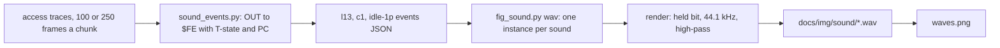

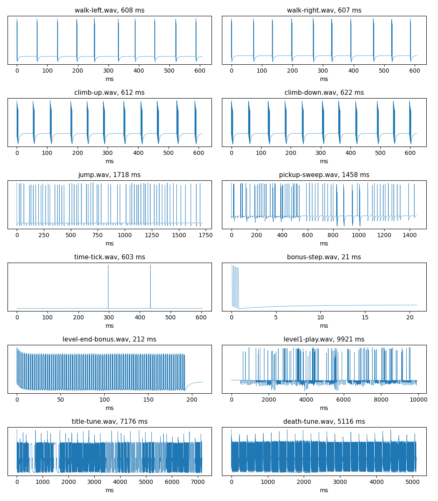

How to read the figure:

- **One panel per file**, the samples against milliseconds, as written to the WAV.
- **A dense block** is a tone. A flat stretch is the speaker left still: the gaps between steps, the calculator's
  work between notes.
- **The point**: the effects are short bursts in long silence. The tunes are the only continuous sound the beeper
  makes.

```bash
python3 tools/fig_sound.py wav        # docs/img/sound/*.wav
python3 tools/fig_sound.py waves      # docs/img/sound/waves.png
```

Worked example: `level1-play.wav` holds frames 500-1000 of `l13`. Its Beep calls are 515 sweep beeps, 135 jump
clicks, 44 steps right, 37 left, 17 time ticks, 9 rungs up and 3 down. The sweeps make most of the sound, since Harry
takes eggs and grain all the time.

The point: the files let a reader hear the game as the 48K played it, without the speech that the Orator added.

## 9.9 Not reached

- **The speech as sound.** unreal-ng has no SP0256 model, so no recording holds the Orator's output. What the phrases
  say is read from the allophones and the datasheet (9.5).
- **An allophone written early.** Many holds are shorter than the allophone (9.5). The game never reads LRQ at `$BF`.
  Whether the SP0256 cuts the sound short, finishes it first or drops the new write cannot be measured here. The
  sources found do not say what the Orator does.
- **Phrases 3, 5, 14, 15, 21, 25 and 31.** No caller can pick them: the pickers' tables and the fixed callers never
  name them. They are in the table, perhaps for a version of the game that used them.
- **PlayerTurn with players 3 and 4** (phrases 28, 29): the four-player recording `tour-redefine` speaks 27; 28 and
  29 follow from the code (25 + player).
