# 10. Gameplay logic

What this covers: the rules of Chuckie Egg as the code plays them. The profile is arcade / platform (R/AGENTS.md
section 4.0), so the centre is Harry's movement as a model with numbers: the walk, the climb, the jump arc, the fall,
the push off an edge and the jump off a ladder. Then come the egg test and why eggs in holes are taken by falling, the
hens' AI and its grain bug, the duck, the lifts, every collision and every way to die, the timer, the bonus, scoring
and the extra life, and the difficulty cycle through level 81 and up. The records these rules move are in doc 07; the
loop that runs them is doc 04.

The recordings (WALKTHROUGH 6.0) are opened on an own instance after `source work/env.sh`:

```bash
python3 $RS open --work work/docs/ceC/l19 --ttd work/stage1/rec/levels-1-9/session.ttd --model 48K --port-base 36250 --binary $BIN
python3 $RS open --work work/docs/ceC/idle --ttd work/stage1/rec/idle-1p/session.ttd --model 48K --port-base 36250 --binary $BIN
python3 $RS open --work work/docs/ceC/fd --ttd work/stage1/rec/fall-death/session.ttd --model 48K --port-base 36250 --binary $BIN
```

The samples were read with `work/docs/ceC/sample.py` (TTD `memory_at`): the object block `$72D8-$7375` and the game
variables `$6EC8-$6EF3` at every frame of `levels-1-9` (`l19-vars.jsonl`, `l19-game.jsonl`), and the block of
`fall-death` and `idle-1p` around their deaths. The counts come from `python3 tools/l1count.py ADDR ...` over the eight
L1 builds.

A sample of frame N is the memory at the start of frame N. A trace, and so an animation, shows an instruction in the
frame where it ran. "Harry is at x 47 in frame 569" means the sample; the step that put him there ran in frame 568.

## 10.1 Two clocks: the pass and the slow tick

The game has no frame clock. MainLoop `$9858` runs free (doc 04). One turn of it is a pass. Every pass runs the jump
(JumpStep `$A21C`), so a jump is timed in passes. Every 130th pass is a slow tick: `PassCounter $72DC` is reloaded
with `$82` and the slow tick runs everything else, in this order:

1. the hold and abort keys;
2. the bonus, every 50 slow ticks;
3. MoveDuck `$A0C8`, every 12;
4. MoveLifts `$A014`, every 2; then, on a lift, HarryY + 1 (10.10);
5. TakeEggOrGrain `$99DF`, every slow tick;
6. the time, every 10, with a tick sound;
7. MoveHen `$911E`, every 3 (every 2 from level 33);
8. PaintCells at Harry;
9. Harry: a jump key starts a jump; otherwise LeaveLadder, WalkHarry, FallOffEdge and ClimbLadder. In the air only
   ClimbLadder runs.

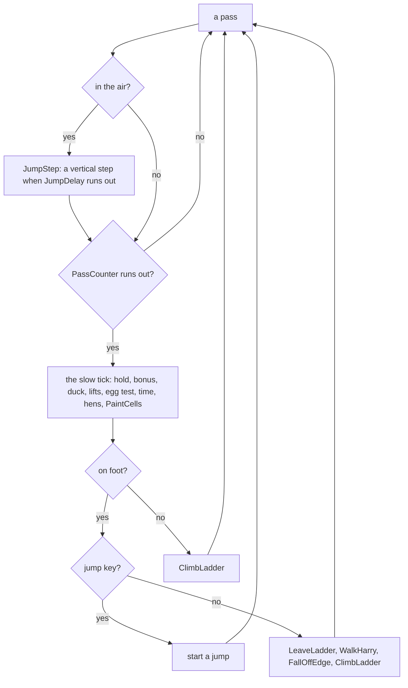

The number of passes in a frame depends on the work in each pass. The measures below come from the recordings:

| Where | Measure | Rate |
| --- | --- | --- |
| level 1, a hen's walk (`levels-1-9` 420-494) | 90 slow ticks in 68 frames | 1.32 slow ticks a frame |
| level 3, one lift cycle (`levels-1-9` 4219-4529) | 326 slow ticks in 310 frames | 1.05 slow ticks a frame |
| level 1, a flat jump (`levels-1-9` 1888-1927) | 4762 passes in 39 frames | 122 passes a frame |

All game rules are written in slow ticks or passes. Their speed on the screen changes with the load: a level with a
lift and many hens runs slower.

**The point**: Chuckie Egg runs as fast as the CPU allows. The rules below are exact in passes and slow ticks; the
frame figures are measures, not constants.

## 10.2 Harry's states

Harry's state is spread over three bytes and the exits of MainLoop: `JumpState $7325` (0 on foot, 1 drifting, 2 in
the air), `HarryDir $72DB` (`$0D` on a ladder) and `OnLift $7355`.

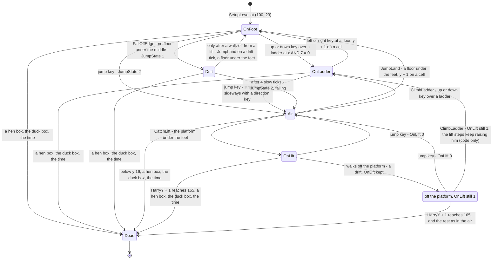

A drift from FallOffEdge cannot land. No walk runs during it (MainLoop runs only ClimbLadder, `$99C1-$99C5`), so x
changes only by its own x steps. FallOffEdge starts it at x AND 7 = 1 walking right or 7 walking left, and the three
x steps before the fall stay over the same column (8k + 2 .. 8k + 4 or 8k + 6 .. 8k + 4; a bounce stays inside that
range). y does not change either. So JumpLand reads the very cell that FallOffEdge found empty, an egg or grain, and
never lands on it (`$A356-$A35F`). All 63 drifts of the recordings became falls, as they must (10.5). Only the drift
of a walk-off from a lift can land, because WalkOffLift tests no floor: Harry would have to step off over a brick with
y + 1 on a cell boundary. That is known only from the code.

The other ways out of a drift are the deaths of any state on foot: during it the hen boxes (MoveHen), the duck box
(MoveDuck's draws and JumpLand's) and the time all still run. Walking off
a platform is the odd one out: it starts a drift but leaves `OnLift` at 1, so the lift still moves Harry and can still
kill him until his next jump (10.10).

**The point**: the jump, the fall and the drift are one state machine with one counter. A fall is a jump that starts at
its top, and a drift is a fall that starts with a short sideways push.

## 10.3 Walking, climbing and leaving a ladder

### Walking

WalkHarry `$9D08` runs on every slow tick on which Harry is on foot and not on a ladder. A held left key moves him one
pixel left, a held right key one pixel right. The left key wins when both are held. He stops at x 1 on the left, at
x `$EE` (238) on the right, and at a brick (any code of 5 and up) in either of the two cells ahead at his body's rows.

```text
WalkHarry():
    col = (HarryX - 1 if HarryDir == 0 else HarryX) / 8
    row = HarryY / 8                          ; the upper body row; the lower one is row - 1
    if left key:
        if HarryX == 1 or cell(col, row) >= 5 or cell(col, row - 1) >= 5: stand
        else: HarryX -= 1; HarryDir = 4; a step sound every 4 pixels
    elif right key:
        if HarryX >= $EE or cell(col + 2, row) >= 5 or cell(col + 2, row - 1) >= 5: stand
        else: HarryX += 1; HarryDir = 0; a step sound every 4 pixels
    else: stand                               ; HarryFrame = 3, so the next frame is 0
    HarryFrame = (HarryFrame + 1) AND 3; draw frame HarryFrame + HarryDir
    if OnLift and HarryX is outside LiftX - 9 .. LiftX + 9:
        JumpState = 1; JumpDx = his direction; JumpCount = 4     ; walks off the lift
```

```text
$9D46  LD A,(HarryX)
$9D49  DEC A
$9D4A  JR Z,WalkHarryStand    ; x 1: the left wall
$9D4C  LD A,(HL)
$9D4D  CP $05
$9D4F  JR NC,WalkHarryStand   ; a brick at the upper body row
$9D51  AND A
$9D52  SBC HL,BC              ; one row down
$9D54  LD A,(HL)
$9D55  CP $05
$9D57  JR NC,WalkHarryStand   ; a brick at the lower body row
$9D59  DEC (IX+$00)           ; x - 1
$9D5C  LD (IX+$03),$04        ; HarryDir 4: facing left
$9D60  LD A,(HarryX)
$9D63  AND $03
$9D65  JR NZ,WalkHarryLeftDone
$9D67  LD HL,$2805
$9D6A  CALL Beep              ; a step every 4 pixels
```

The wall test reads the column under the edge Harry has, not the column he steps into. Walking left from x 8k, he tests
column k and steps to 8k - 1, one pixel into column k - 1. Only the next step tests that column. Harry therefore stops
with one pixel of his sprite in a wall cell, on either side.

Worked example: `levels-1-9` level 1, Harry walks right along row 12 (y 119). In the samples x is 189 at frame 900 and
208 at frame 916: 19 pixels in 16 frames, 1.2 pixels a frame.

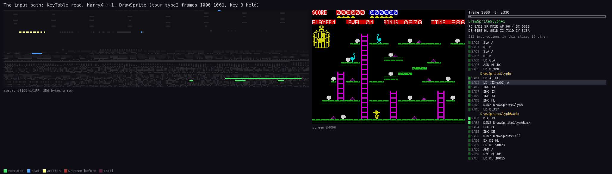

The animation is writer ceB's (doc 05, animation 5.2): a trace of `tour-type2` frames 1000-1002, 60 pictures, from the
key read to Harry's step. It shows the key test and the two wall tests above. At page width only the screen panel is legible; the memory and listing panels need the GIF at full size. Command:
`python3 ../../kit/routine_anim.py --work work/docs/ceB/tour-type2 --window 1000:0-1002:0 --listing build/game.lst --view screen --pc 9858-99DC,9D08-9DF0,9A4C-9BFE --range 6100-A1FF --pictures 60 --out docs/img/routines/WalkHarry.gif`.

Witness: WalkHarry ran 95 138 times; left steps `$9D59` 5749, right steps `$9D95` 6073, standing `$9DAB` 83 316. Walking
off a lift (`$9DDB`) ran in no recording.

### Climbing

ClimbLadder `$9E98` runs on every slow tick, also in the air. It acts only when `HarryX AND 7` is 0, so Harry must stand
exactly over a ladder's left half. With the up key and a ladder's left half (code 1) in the cell at (x, y + 1), he
climbs one pixel up. Otherwise, with the down key and code 1 two rows below his top (three when y + 1 is on a cell
boundary), he climbs one pixel down. Either step sets `HarryDir $0D`, cycles the climbing frame and sets JumpState to 0.

```text
$9E9C  LD A,(IX+$00)
$9E9F  AND $07
$9EA1  RET NZ                 ; only over a column
$9EA2  LD HL,(HarryX)
$9EA5  INC H                  ; the cell at (x, y + 1)
...
$9EC3  LD A,(HL)
$9EC4  DEC A
$9EC5  JR NZ,ClimbLadderDown  ; not a ladder's left half
...                           ; the up key
$9ED7  LD (IX+$03),$0D        ; on the ladder
$9EDB  INC (IX+$01)           ; y + 1
...
$9F25  LD A,(IX+$02)
$9F28  INC A
$9F29  AND $03
$9F2B  LD (IX+$02),A          ; the climbing frame
$9F2E  LD (IX+$4D),$00        ; JumpState 0: a jump is caught here
```

Because ClimbLadder also runs in the air and clears JumpState, Harry catches a ladder in the middle of a jump or a fall.
He must pass a column boundary at x AND 7 = 0 over the ladder with up or down held.

Worked example: `levels-1-9` level 1, the long ladder at x 80. Harry catches it in the middle of a jump: the samples of
frames 1288-1290 show JumpState 2 at x 83 to 81, and the sample of frame 1291 shows x 80, y 31, HarryDir `$0D` and
JumpState 0. He climbs to y 112 (sample 1350): 81 pixels in 59 frames, 1.37 pixels a frame, about the speed of walking.
At frame 1351 he jumps left off the ladder (JumpState 2, JumpCount 140, HarryDir 4, y 112, which is no floor level);
10.5 follows that jump.

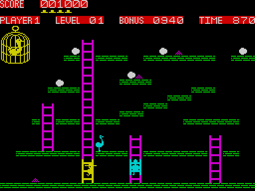

The animation is the screen of `levels-1-9` frames 1288-1354, one picture a frame. Command:
`python3 ../../kit/screen_anim.py --work work/docs/ceC/l19 --from 1288 --to 1354 --step 1 --scale 2 --delay 80 --hold 1500 docs/img/play/climb.gif`.

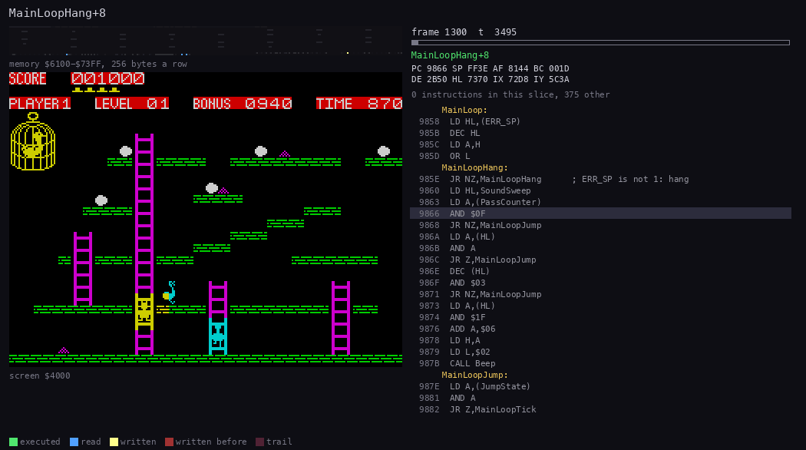

The animation traces `levels-1-9` frames 1300-1302 (60 pictures): the cell test at `$9EA2-$9EC5`, the key read and the
step. At page width only the screen panel is legible; the memory and listing panels need the GIF at full size. Command:
`python3 ../../kit/routine_anim.py --work work/docs/ceC/l19 --window 1300:0-1303:0 --listing build/game.lst --view screen --range 6100-73FF --pc 9E98-9F3E --pictures 60 --out docs/img/routines/ClimbLadder.gif`.

Witness: ClimbLadder ran 113 934 times; up steps `$9ED7` 3570, down steps `$9F11` 1810.

### Leaving a ladder

LeaveLadder `$9F60` runs before WalkHarry. When y + 1 is on a cell boundary (Harry's feet level with a floor), a held
left or right key turns HarryDir to 4 or 0. The two cells beside him at his body's rows must be no bricks, and the cell
under them must be a floor (a code from 1 to 8). WalkHarry then runs on the same slow tick, because HarryDir is no
longer `$0D`.

```text
$9F60  LD A,(HarryY)
$9F63  INC A
$9F64  AND $07
$9F66  RET NZ                 ; only with the feet on a cell boundary
...
$9F9A  DEC HL                 ; the cell to the left
$9F9B  LD A,(HL)
$9F9C  CP $05
$9F9E  RET NC                 ; a brick: stay
...
$9FA9  LD A,(HL)              ; the cell under it
$9FAA  AND A
$9FAB  RET Z                  ; no floor: stay
$9FAC  CP $09
$9FAE  RET NC                 ; the cage: stay
$9FAF  LD A,$04
$9FB1  LD (HarryDir),A        ; face left: WalkHarry may run
```

Witness: LeaveLadder ran 100 660 times; left `$9FAF` 4663, right `$9FDA` 5530.

**The point**: Harry moves one pixel a slow tick, on foot and on a ladder alike. He gets on a ladder only over a column
and off it only level with a floor. Those two grids are all the precision the controls ask for.

## 10.4 The jump arc

A jump key on foot starts a jump (MainLoop `$9975`). JumpState becomes 2, JumpCount `$8C` (140), JumpDelay 0, JumpDy 1
(rising) and OnLift 0. The direction comes from the keys at that moment: right gives JumpDx 1 and HarryDir 0; left gives
JumpDx -1 and HarryDir 4; neither gives JumpDx 0 and keeps HarryDir. With both held the jump goes right (`$9991-$999F` tests the right key
first), although the walk goes left (10.3).

```text
MainLoopJumpStart:
$9975  LD IX,HarryX
$9979  LD (IX+$4D),$02        ; JumpState 2
$997D  LD (IX+$4F),$8C        ; JumpCount 140
$9981  LD (IX+$50),$00        ; JumpDelay 0: the first step after 256 passes
$9985  LD (IX+$52),$01        ; JumpDy 1: rising
$9989  LD (IX+$7D),$00        ; off the lift
$998D  LD D,$01               ; right: Dx 1, Dir 0
$998F  LD E,$00
...
$99A1  LD D,$FF               ; left: Dx -1, Dir 4
$99A3  LD E,$04
...
$99B5  INC D                  ; neither: Dx 0, Dir kept
$99B6  LD E,(IX+$03)
MainLoopJumpDir:
$99B9  LD (IX+$4E),D
$99BC  LD (IX+$03),E
```

From then on JumpStep runs on every pass. On the pass before each slow tick (PassCounter 1) it moves x by JumpDx and
tests the lifts (10.10). On every pass JumpFall `$A2B5` counts JumpDelay down and makes a vertical step when it runs out.
The delay of each step is set by the step before:

```text
JumpFall():                                   ; every pass while JumpState is 2
    JumpDelay -= 1                            ; 0 - 1 wraps to 255: 256 passes
    if JumpDelay != 0: return
    if JumpDy == 1:                           ; rising
        if HarryY >= $A7: HarryY += 1; start falling (below)   ; the step of -1 cancels the + 1: no move
        JumpCount += 10                       ; 150, 160, ..., 250, then 260 wraps to 4
        if JumpCount == 4: JumpDy = 0; JumpCount = 0     ; the top: no move, a 256-pass wait
    elif JumpDy == 0:                         ; past the top: start falling
        JumpDy = -1; JumpCount = 250
    else:                                     ; falling
        JumpCount = max(JumpCount - 10, 40)
    JumpDelay = JumpCount
    y = HarryY + JumpDy
    if y < 16: return from MainLoop           ; fell off the bottom: a life lost
    HarryY = y; JumpLand()                    ; land or bounce (10.6)
```

```text
JumpRiseStep:
$A2ED  LD A,(JumpCount)
$A2F0  ADD A,$0A              ; the delay grows by 10 passes a step
$A2F2  CP $04                 ; 260 wrapped: the top
$A2F4  JR NZ,JumpSetDelay
$A2F6  LD (IX+$52),$00        ; JumpDy 0
$A2FA  XOR A
JumpSetDelay:
$A2FB  LD (JumpCount),A
$A2FE  LD (HL),A              ; JumpDelay
$A2FF  LD A,(HarryY)
$A302  ADD A,(IX+$52)         ; y + JumpDy
$A305  CP $10
$A307  JR NC,JumpSetY
$A309  POP HL                 ; below 16: drop MainLoop's return and its saved AF
$A30A  POP HL
$A30B  RET                    ; back to PlayLevel
```

A flat jump therefore has 23 vertical steps:

| Steps | Move | Passes before each step | Sum |
| --- | --- | --- | --- |
| 1 | y + 1 | 256 (JumpDelay 0 wraps) | 256 |
| 2-11 | y + 1 each | 150, 160, ..., 240 | 1950 |
| 12 | none: the top | 250 | 250 |
| 13 | y - 1 | 256 (the top's delay 0) | 256 |
| 14-23 | y - 1 each | 250, 240, ..., 160 | 2050 |
| all | up 11, down 11 | | 4762 |

x moves one pixel every 130 passes: 4762 / 130 = 36.6, so a running jump carries Harry 36 or 37 pixels. A fall that
goes on past the start height speeds up by 10 passes a step down to 40 passes a pixel, about three pixels a frame.

At y 167 (`$A7`) and above, a rising step is turned into the start of the fall (`$A2E8`). JumpRise adds 1 to HarryY and
jumps to JumpFallStart, which sets JumpDy -1 and a delay of 250; the step of -1 then cancels the + 1, so Harry does not
move. A jump that starts at y 167 or higher therefore hangs at its start height for 256 + 250 = 506 passes, about four
x steps, before the first fall pixel. The lift-top trick lives on that hang (10.10).

The x step bounces at the screen's edges. JumpStepX adds JumpDx to HarryX; a result of 0 sets JumpDx to 1 (`$A23A`), a
result of `$EE` (238) or more sets it to -1 (`$A244`). The new x is kept, so Harry touches the edge pixel and comes back:

```text
JumpStepX:
$A22A  LD HL,(HarryX)
$A22D  CALL PaintCells
$A230  LD A,L
$A231  ADD A,(IX+$4E)         ; x + JumpDx
$A234  LD (HarryX),A
$A237  AND A
$A238  JR NZ,JumpStepRightWall
$A23A  LD (IX+$4E),$01        ; x 0: turn right
$A23E  JR JumpStepLifts
JumpStepRightWall:
$A240  CP $EE
$A242  JR C,JumpStepLifts
$A244  LD (IX+$4E),$FF        ; x 238 or more: turn left
```

The left test looks for exactly 0. In `levels-1-9` on level 7 Harry reaches x 0 in a jump (sample 14326, JumpDx now 1),
lands there at y 39 and jumps again at once with the left key held: JumpDx -1 (sample 14327, JumpCount 140). The next x
step gives 0 - 1 = 255, which is not 0, and the right test sets JumpDx -1 once more. Harry goes on leftwards from x 255
(sample 14328) and is back at 238 in the sample of frame 14348: he has wrapped from the left edge to the right one.
WalkHarry stops at x 1, so only a jump brings Harry to x 0, and only a landing there followed by a jump to the left
wraps him.

Witness: the left bounce `$A23A` ran 5 times and the right `$A244` 33 times in the eight builds.

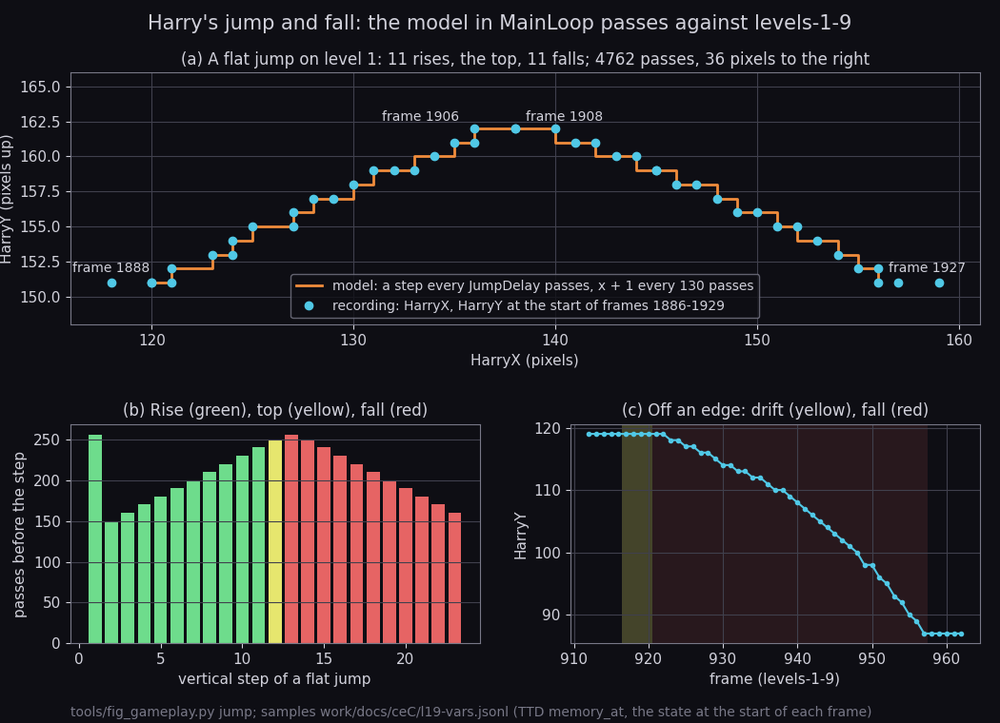

How to read the figure:

- Panel (a): the orange stair is the model of 10.4 in MainLoop passes. It starts at Harry's position in the sample of
  frame 1888 and moves x by 1 every 130 passes. The blue dots are HarryX and HarryY in the samples of `levels-1-9`
  frames 1886-1929, at the start of each frame. The labels name a few frames.
- Panel (b): the passes before each of the 23 vertical steps. Green is the rise, yellow the top, red the fall.
- Panel (c): a fall off an edge, HarryY in the samples of frames 912-962. Yellow shades the drift, red the fall
  (10.5).

**The point**: the arc is a pure function of the pass count. The recording follows the model to the pixel: x 120 to
156, top at y 162.

```bash
python3 tools/fig_gameplay.py jump --samples work/docs/ceC/l19-vars.jsonl --out docs/img/gameplay/jump-arc.png
```

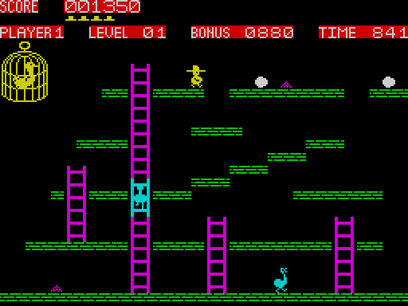

The animation is the screen of `levels-1-9` frames 1884-1932, one picture a frame (pictures that repeat the one
before are merged). Command:
`python3 ../../kit/screen_anim.py --work work/docs/ceC/l19 --from 1884 --to 1932 --step 1 --scale 2 --delay 80 --hold 1500 docs/img/play/jump.gif`.

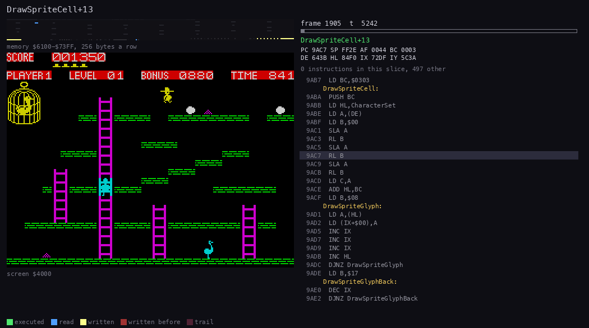

The animation traces `levels-1-9` frames 1905-1910 (80 pictures): the top step (JumpDy 0) and the first fall steps.
At page width only the screen panel is legible; the memory and listing panels need the GIF at full size. Command:
`python3 ../../kit/routine_anim.py --work work/docs/ceC/l19 --window 1905:0-1911:0 --listing build/game.lst --view screen --range 6100-73FF --pc A21C-A388 --pictures 80 --out docs/img/routines/JumpFall.gif`.

Worked example: the jump of the figure. In the sample of frame 1888 Harry stands at (120, 151) on row 16. The jump
starts on the next slow tick. The samples reach y 162 at frame 1906 and keep it to frame 1908, the 256-pass top. Harry
lands on row 16 again at y 151 in the sample of frame 1927, at x 156. 39 frames for 4762 passes is 122 passes a frame.

Witness: jumps started `$9975` 477 times in the eight builds (286 in `levels-1-9`); the top `$A2F6` 243 times. The rise
was cut at y 167 (`$A2E8`) 41 times, 19 of them in `levels-1-9`. Harry reaches y 167 by standing on the top floor (row
18) or by riding a lift (10.10).

## 10.5 The fall, the push off an edge, the jump off a ladder

### The push off an edge

FallOffEdge `$B34C` runs on every slow tick on which Harry is on foot and not on a lift. It looks only when x AND 7 is
not 0, so that Harry straddles three columns. The cell it reads is the middle column (x / 8 + 1) in the row of his feet.
If that cell holds no floor (empty, an egg or grain), the drift starts: JumpState 1, JumpDx his direction, JumpCount 4.

```text
FallOffEdge:
$B34C  LD A,(HarryX)
$B34F  AND $07
$B351  RET Z                  ; over two columns: always held
$B352  LD HL,(HarryX)
$B355  CALL MapCellAt
$B358  LD BC,$003F
$B35B  AND A
$B35C  SBC HL,BC              ; (x / 8 + 1, the row under the feet)
$B35E  LD A,(HL)
$B35F  CP $05
$B361  RET NC                 ; a brick or the cage: floor
$B362  CP $01
$B364  RET Z                  ; a ladder: floor
$B365  CP $02
$B367  RET Z
FallOffEdgeStart:             ; empty, an egg, grain: drift
$B368  LD A,$01
$B36A  LD (JumpState),A
...                           ; JumpDx = -1 facing left, +1 facing right
$B37B  LD A,$04
$B37D  LD (JumpCount),A
```

The drift lasts four slow ticks. JumpStep moves x one pixel on each, and JumpDrift `$A294` counts JumpCount down. At 0
the fall starts: JumpState 2, JumpDx 0, JumpCount 250 and JumpDy -1. From there it is the fall of 10.4, with one
difference: JumpDrift does not set JumpDelay. The first fall step waits for whatever count the last jump left in
JumpDelay. Then the steps follow at 240, 230, ... down to 40 passes.

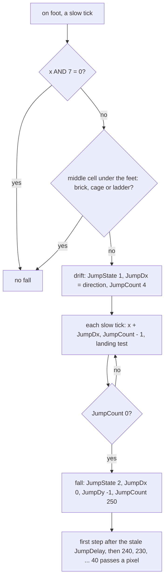

Worked example: `levels-1-9` level 1, frames 916-958, the figure's panel (c).

| Sample | x | y | JumpState | JumpDx | What happened |
| --- | --- | --- | --- | --- | --- |
| 916 | 208 | 119 | 0 | | on row 12, walking right; x AND 7 = 0 |
| 917 | 209 | 119 | 1 | 1 | x AND 7 = 1: cell (27, 12) is empty, the drift starts |
| 918-920 | 210-212 | 119 | 1 | 1 | three more drift ticks |
| 921 | 213 | 119 | 2 | 0 | the fall begins; JumpDelay holds a stale 220 |
| 923 | 213 | 118 | 2 | 0 | the first fall step, then delays 240, 230, ... |
| 957 | 213 | 87 | 2 | 0 | 32 pixels down: row 8 |
| 958 | 214 | 87 | 0 | | landed, walking on |

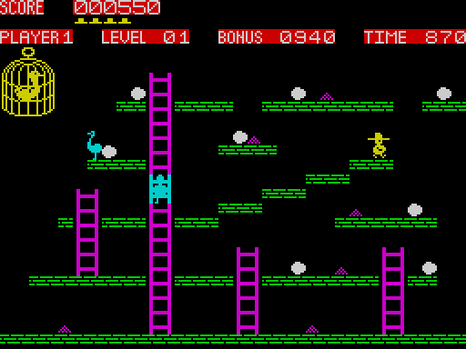

The animation is the screen of `levels-1-9` frames 910-964, one picture a frame. Command:
`python3 ../../kit/screen_anim.py --work work/docs/ceC/l19 --from 910 --to 964 --step 1 --scale 2 --delay 80 --hold 1500 docs/img/play/fall-off-edge.gif`.

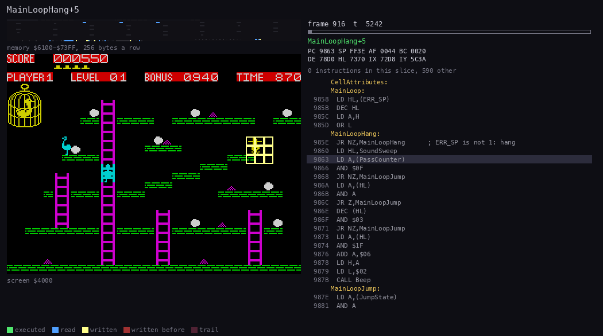

The animation traces `levels-1-9` frames 916-921 (80 pictures): FallOffEdge finds the empty cell, then JumpDrift
counts four slow ticks and starts the fall. At page width only the screen panel is legible; the memory and listing panels need the GIF at full size. Command:
`python3 ../../kit/routine_anim.py --work work/docs/ceC/l19 --window 916:0-922:0 --listing build/game.lst --view screen --range 6100-73FF --pc B34C-B380,A294-A2B4 --pictures 80 --out docs/img/routines/FallOffEdge.gif`.

Witness: FallOffEdge ran 98 837 times and started 63 drifts (`$B368`), 36 in `levels-1-9`; each turned into a fall
(`$A2A2`, 63 times).

### The jump off a ladder

On a ladder HarryDir is `$0D`. The jump key works there as on foot. Without a direction key JumpDx is 0 and HarryDir
stays `$0D`, so Harry jumps straight up in his climbing frame. With a direction key the jump goes sideways and HarryDir
becomes 0 or 4. On landing, JumpLanded `$A37C` turns a HarryDir of `$0D` into 0. A jump that passes a ladder column with
up or down held is caught by ClimbLadder (10.3), which sets JumpState 0 in mid-air.

Worked example: `levels-1-9` level 1, the ladder at x 80 of 10.3. Harry jumps left off it from y 112, half way between
the floors of rows 11 and 12 (y 111 and 119):

| Sample | x | y | JumpState | JumpCount | HarryDir | What happened |
| --- | --- | --- | --- | --- | --- | --- |
| 1350 | 80 | 112 | 0 | | `$0D` | on the ladder |
| 1351 | 80 | 112 | 2 | 140 | 4 | the jump, to the left: HarryDir 4 |
| 1357 | 75 | 115 | 2 | 170 | 4 | rising, one pixel every 150-170 passes |
| 1361 | 71 | 118 | 2 | 200 | 4 | |
| 1363 | 69 | 119 | 0 | | 4 | landed on row 12 while still rising: y + 1 = 120 is on a cell |

The landing test of 10.6 does not ask whether Harry is rising or falling. A jump off a ladder that meets a floor's
height on the way up stands on that floor at once, seven pixels above its start. The animation `climb.gif` of 10.3 ends
with this jump (frames 1351-1354).

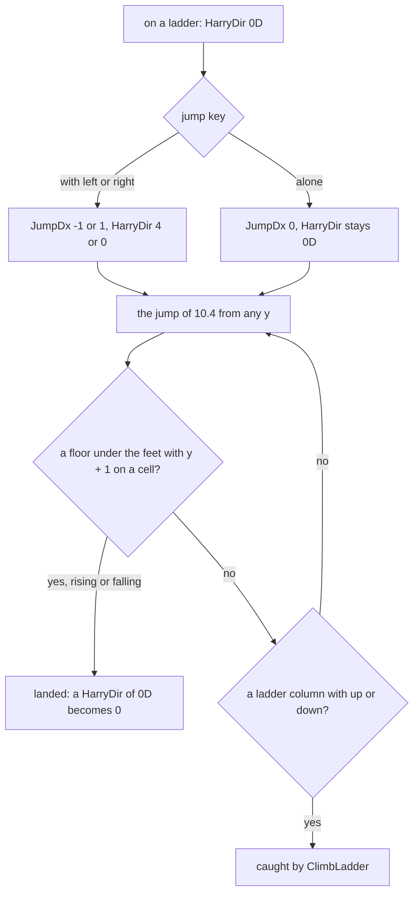

Witness: the jump start `$9975` ran 477 times; the landing `$A371` 338 times; a landing turned HarryDir `$0D` into 0
(`$A37C`, a straight jump off a ladder) 3 times, once in `levels-1-9`.

**The point**: there is one fall. Walking off an edge, jumping off a ladder and dropping through a hole all end in the
same JumpFall steps. Only the start differs: a 4-tick sideways push and a stale first delay.

## 10.6 Landing and bouncing

JumpLand `$A30F` runs after every vertical step, and on the first three of the four drift ticks (the fourth starts the
fall at `$A2B1` without a landing test). It reads the cell under the middle of Harry's
feet (MapCellAt - `$3F`: column x / 8 + 1, row y / 8 - 2).

- Bounce: when Harry is not rising and moves sideways, a brick beside the feet cell turns him round (JumpDx XOR `$FE`
  turns 1 into -1 and back). Moving right, the test needs x AND 7 of 3 or more; moving left, less than 4.
- Landing: the feet cell holds a brick, or a ladder half with a brick beside it, and y + 1 is on a cell boundary. Then
  JumpState becomes 0.

```text
JumpLandTest:
$A356  LD A,(HL)              ; the cell under the feet
$A357  AND A
$A358  RET Z                  ; empty: keep falling
$A359  CP $05
$A35B  JR Z,JumpLanded        ; a brick
$A35D  CP $03
$A35F  RET NC                 ; an egg, grain or the cage: keep falling
$A360  DEC HL                 ; a ladder: look beside it
...
$A366  LD A,(HL)
$A367  CP $05
$A369  RET NZ
JumpLanded:
$A36A  LD A,(HarryY)
$A36D  INC A
$A36E  AND $07
$A370  RET NZ                 ; not level with the floor yet
$A371  LD (IX+$4D),$00        ; landed
```

An egg or grain under the feet is no floor, both for FallOffEdge and for JumpLand. That is why Harry drops into the
holes that hold eggs (10.7).

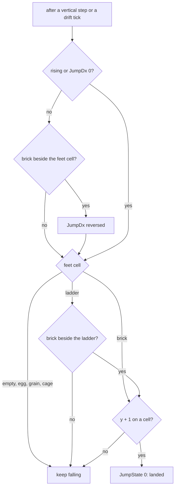

Witness: 813 landing tests reached `$A36A`, 338 landings `$A371` (213 in `levels-1-9`); 101 bounces `$A34E`.

**The point**: a landing needs a brick and an exact height. A drift can bounce between two bricks; level 4's holes
show it (10.7).

## 10.7 The egg test

TakeEggOrGrain `$99DF` runs on every slow tick. It reads one cell, at (HarryX + 8, HarryY - 8). HarryY is the top of
his 16-pixel sprite, so the point is the middle of his lower half. Standing on row p, Harry has y = 8p + 23, and the
point is in row p + 1: the row just above the floor, where the eggs and the grain lie.

```text
TakeEggOrGrain:
$99DF  LD HL,(HarryX)
$99E2  LD A,H
$99E3  SUB $08                ; y - 8
$99E5  LD H,A
$99E6  LD A,L
$99E7  ADD A,$08              ; x + 8
$99E9  LD L,A
$99EA  CALL MapCellAt
$99ED  CP $03
$99EF  JR NZ,TakeGrain
$99F1  LD (HL),$00            ; the egg is gone
$99F3  LD A,(Level)
$99F6  SRL A
$99F8  SRL A                  ; Level / 4
$99FA  CP $09
$99FC  JR C,TakeEggPoints
$99FE  LD A,$09               ; at most 9
TakeEggPoints:
...                           ; B = 10 x (1 + that): 100 to 1000 points
$9A08  CALL AddScore
...
$9A10  LD HL,EggsLeft
$9A13  DEC (HL)
$9A14  RET NZ
$9A15  POP HL                 ; the twelfth egg: return from MainLoop
$9A16  RET
TakeGrain:
$9A17  CP $04
$9A19  RET NZ
$9A1A  LD (HL),$00            ; the grain is gone
$9A1C  LD B,$05               ; 50 points
$9A1E  CALL AddScore
$9A21  LD HL,$FFFF
$9A24  LD (BonusDelay),HL     ; the bonus and the time stop for 255 slow ticks
```

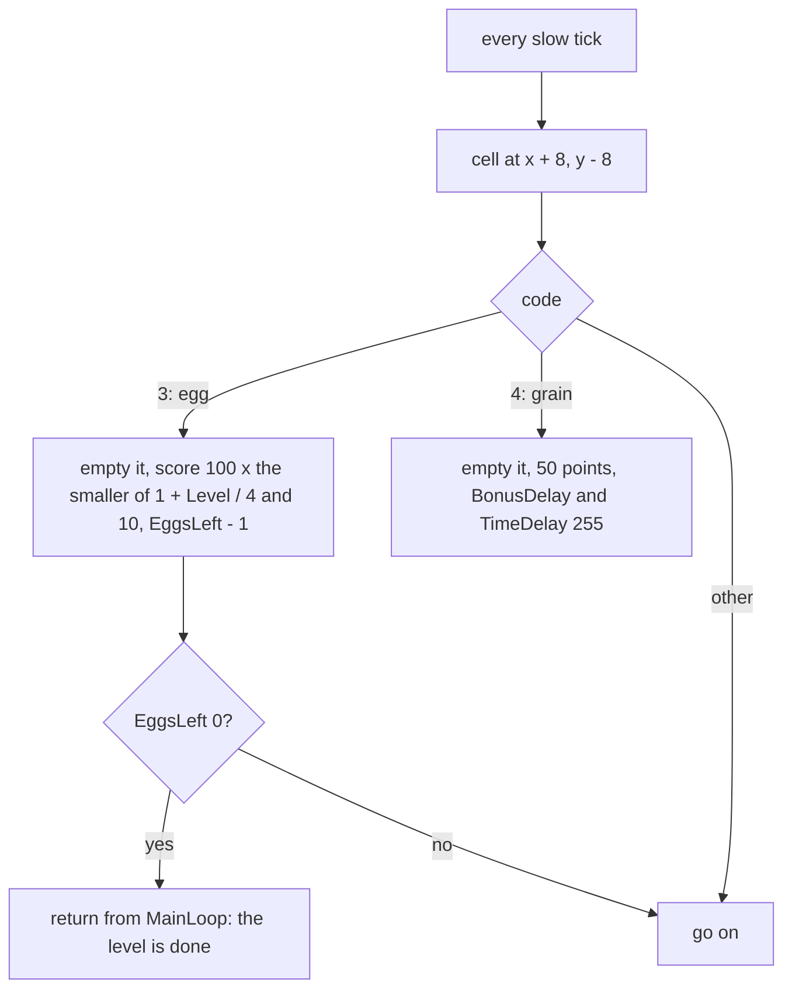

An egg set into a floor row, with bricks on both sides, is in row p, not p + 1. A walking Harry passes over it without
taking it. He takes it only while falling through it: the test point drops through row p as his y goes from 8p + 15
down to 8p + 8. He can fall through it because an egg is no floor (10.6).

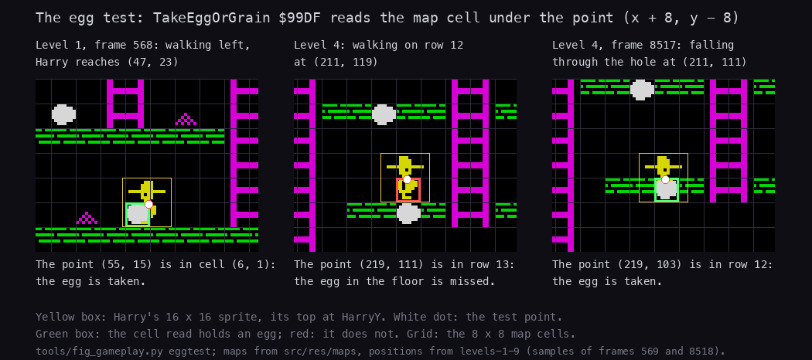

How to read the figure:

- Three crops of the level map, each at 4 times its size, with the 8 x 8 cell grid. The yellow box is Harry's 16 x 16
  sprite with its top at HarryY. The white dot is the test point (x + 8, y - 8).
- Left: `levels-1-9` level 1, Harry walking left at (47, 23) (sample of frame 569). The point (55, 15) is in cell
  (6, 1), which holds an egg: green.
- Middle: level 4, Harry walking on row 12 at (211, 119). The point (219, 111) is in row 13; the egg in the floor at
  (27, 12) is below it: red.
- Right: the same column in frame 8517, Harry falling through the hole at (211, 111). The point (219, 103) is in row 12:
  the egg is taken.

**The point**: one cell, half a sprite above the feet. Eggs on a floor are taken by walking; eggs in a floor only by
falling.

```bash
python3 tools/fig_gameplay.py eggtest --out docs/img/gameplay/egg-test.png
```

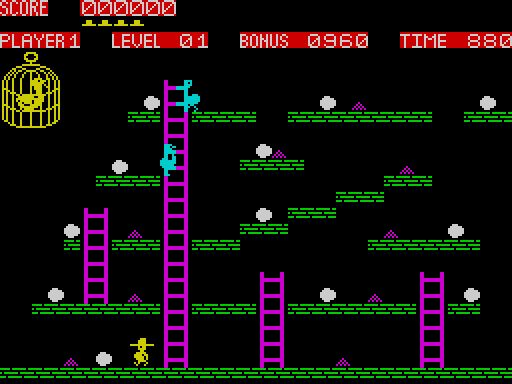

The animation is the screen of `levels-1-9` frames 556-580, one picture a frame. Command:
`python3 ../../kit/screen_anim.py --work work/docs/ceC/l19 --from 556 --to 580 --step 1 --scale 2 --delay 120 --hold 1500 docs/img/play/egg-taken.gif`.

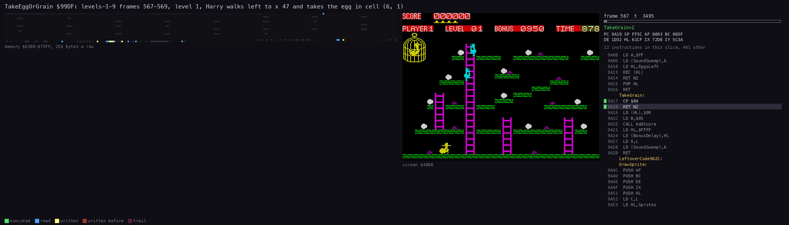

The animation traces `levels-1-9` frames 567-569 (60 pictures). The take runs in frame 568; the egg disappears from
the map cell `$61A8 + 32 + 6 = $61CE`. At page width only the screen panel is legible; the memory and listing panels need the GIF at full size. Command:
`python3 ../../kit/routine_anim.py --work work/docs/ceC/l19 --window 567:0-570:0 --listing build/game.lst --view screen --range 6100-73FF --pc 99DF-9A4B --pictures 60 --out docs/img/routines/TakeEggOrGrain.gif`.

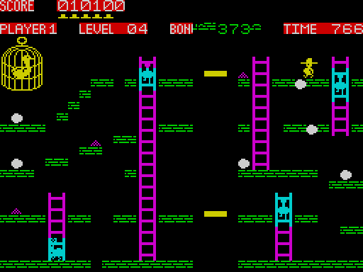

The animation is the screen of `levels-1-9` frames 8452-8522, one picture a frame. Command:
`python3 ../../kit/screen_anim.py --work work/docs/ceC/l19 --from 8452 --to 8522 --step 1 --scale 2 --delay 80 --hold 1500 docs/img/play/egg-in-hole.gif`.

Worked example: level 4, the two holes, from the samples of `levels-1-9`.

| Sample | x | y | JumpState | JumpDx | What happened |
| --- | --- | --- | --- | --- | --- |
| 8454 | 207 | 151 | 0 | | walking left on row 16 |
| 8455 | 206 | 151 | 1 | -1 | cell (26, 16) holds an egg: no floor, the drift starts |
| 8459 | 203 | 151 | 2 | 0 | the fall |
| 8473 | 203 | 143 | 2 | 0 | the point (211, 135) reached row 16 in frame 8472: the egg in (26, 16) is taken |
| 8495 | 204 | 119 | 0 | | landed on row 12, walking right |
| 8499 | 209 | 119 | 1 | 1 | cell (27, 12) holds an egg: the drift starts |
| 8502 | 211 | 119 | 1 | -1 | a brick beside: bounced |
| 8503 | 210 | 119 | 1 | 1 | bounced back |
| 8504 | 211 | 119 | 2 | 0 | the fall, straight down the 1-cell hole |
| 8517 | 211 | 111 | 2 | 0 | the take runs in frame 8517: the egg in (27, 12) is gone |

Witness: egg takes `$99F1` 193 times in the eight builds (108 in `levels-1-9`: 12 a level for 9 levels); grain `$9A1A`
65 times (30); level ends `$9A15` 16 times (9). The stage 1 notes thought the egg test ran every other pass. The code
and the counts show one test a slow tick: 114 442 calls.

**The point**: the egg test and the floor test agree that an egg is not solid. The level designer used that twice on
level 4 to make Harry drop for his eggs.

## 10.8 The hens' AI and the HenEatGrain bug

### What the hens do

The hens do not chase Harry. MoveHen (doc 07.3) moves one of the five records every third slow tick, 4 pixels at a time,
so each hen makes a step every 15 slow ticks: 0.27 pixels a slow tick, about a quarter of Harry's speed. A hen walks to
the end of its floor and turns. It climbs a ladder or steps off one only by chance. Every turn reads a ROM byte through
`RandomPtr $736C`, and the hen tries only when bit 0 is 0: a walker at the half-cell points (x AND 4 set after its step),
a climber at the cell boundaries (y AND 4 = 0). A hen never falls and never jumps. An egg or grain cell counts as no
floor for it too, so it turns at an egg in a hole.

The floor and grain tests are asymmetric (doc 07.3, 07.4). Walking right from x = 8k, the hen tests column k + 1, the
column under its own right half. It therefore stands with that half over a hole or an egg before it turns, and it pecks
grain it already half covers. Walking left, it tests column k - 1, the cell beside it, and turns before it overhangs.
In `levels-1-9` hen 1 stands at x 120 over cell (16, 16), which is empty, before it turns (samples 471-483).

The ROM pointer is set back to 0 at every SetupLevel. With the same map, the hens make the same choices in the same
order in every life. A player can learn them.

| Rule | Code | Value |
| --- | --- | --- |
| period | MainLoop `$993B` | one record every 3 slow ticks, 2 from level 33 |
| step | MoveHen `$91AA`, `$9213` | 4 pixels |
| a hen's speed | | 4 pixels in 15 slow ticks (5 records x 3) |
| choice | MoveHenRandom `$9128` | ROM `$0001-$00FF`, bit 0 = 0: try; bit 1: which way first |
| grain | HenEatGrain `$9265` | at each multiple of 8: the cell under its right half (walking right) or beside it (walking left); the hen pauses one turn |
| kill | DrawHen `$929C` | HarryX in x - 7 .. x + 5, HarryY in y + 1 .. y + 28 |

Witness: MoveHen ran 38 158 times; HenEatGrain found grain 82 times; the hens chose a ladder 552 times (`$91DB`,
`$91EF`) and stepped off one 520 times (`$924C`, `$9261`).

### The bug: a left peck that kills

HenEatGrain draws a left peck 8 pixels to the left (`$928C`), so DrawHen's kill box moves with it: HarryX from x - 15
to x - 3. When Harry stands in that strip but outside the normal box, the erase in MoveHen does not kill him, and the
peck's draw does. HenKill then drops six words from the stack. Those six were counted for MoveHen's stack, but this call
comes from HenEatGrain, one level deeper. The `RET` therefore takes HenEatGrain's pushed BC as its return address: B is
the hen's state (1) and C the random bit, so it jumps to ROM `$0100` or `$0101`.

```text
HenEatGrain:
$9265  PUSH BC                ; B = the state (1 or 2), C = the random bit
$9266  PUSH HL
$9267  PUSH DE
...
$9287  POP HL
$9288  CP $08
$928A  JR Z,HenEatGrainPeck
$928C  LD A,L
$928D  SUB $08                ; a left peck is drawn at x - 8 ...
$928F  LD L,A
HenEatGrainPeck:
$9290  LD A,(DE)
$9291  CALL DrawHen           ; ... and DrawHen's box test moves with it

DrawHen:
$929C  PUSH BC                ; four words, and the return to $9294
...
$92BC  LD B,$06
HenKill:
$92BE  POP HL                 ; six words: DrawHen's four, $9294 and HL of $9266
$92BF  DJNZ HenKill
$92C1  RET                    ; returns to the BC of $9265: ROM $0100 or $0101
```

A right peck is drawn at x itself, where MoveHen's erase has just tested the same box. Only the left peck can reach
this path.

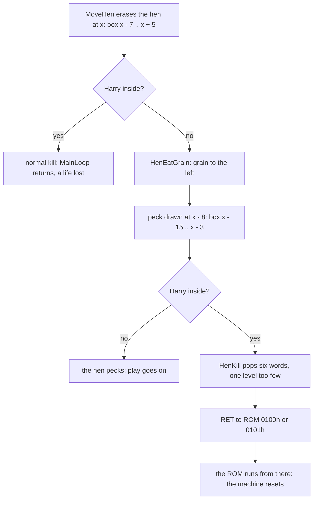

No recording reached the bug, so it was tested on a clone. `work/docs/ceC/heg.py` opens an own instance on port
36250, loads `work/stage1/bot/l8b-row4.szx` (level 8) and pokes one hen at (160, 8) walking left, with HenTurn and
HenDelay set so that it moves on the next slow tick. Cell (19, 1) gets grain, cell (20, 1) is emptied, and Harry stands
at (152, 23) or, for the control, at (153, 23). It runs 240 frames and logs PC, SP, lives and the screen.

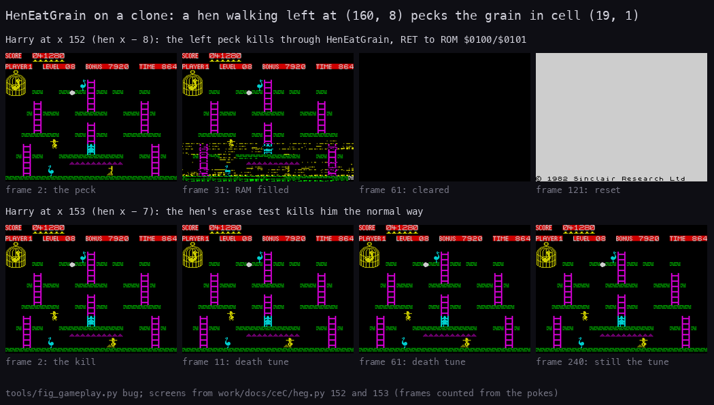

How to read the figure:

- Top row: Harry at x 152, inside the peck's box (145-157) and outside the erase box (153-165). The pictures are the
  screen at frames 2, 31, 61 and 121, counted from the pokes.
- Frame 2: the peck is drawn and the grain is gone. Frame 31: the ROM fills RAM and garbage spreads on the screen.
  Frame 61: the screen is cleared. Frame 121: the Spectrum's reset screen, "© 1982 Sinclair Research Ltd".
- Bottom row: Harry at x 153, inside the erase box. MoveHen's erase kills him; the death tune plays (PC in the ROM
  BEEPER) and the game goes on.

**The point**: the bug is real. A hen that pecks grain to its left while Harry stands 8 to 15 pixels left of it resets
the computer instead of taking a life.

```bash
python3 tools/fig_gameplay.py bug --bug work/docs/ceC/heg/bug --control work/docs/ceC/heg/control --out docs/img/gameplay/heneatgrain-bug.png
```

Worked example: the log of the bug run. In the sample of frame 1 the PC is `$0051`, in the ROM's error handler, and the
hen's state is already 7 (pecking). Frames 2-13 run the ROM calculator (`$3369-$3402`). By frames 31-93 the PC is in
the ROM's RAM fill `$11DE-$11ED`, part of the start-up code that clears memory. At frame 61 the screen is black, and
at frame 121 the copyright line shows. In the control run the PC sits in `$03D6-$03D7`, the BEEPER loop, from frame 2
on: the death tune.

Witness: `work/docs/ceC/heg/bug/log.json` and `heg/control/log.json`; the pictures `heg/*/f*.png`. The recordings never
took this path: every one of the 11 HenKill runs was followed by the normal life lost.

## 10.9 The duck: release and homing

MoveDuck `$A0C8` runs every 12 slow ticks on every level. It steers first: DuckDx moves one toward Harry's x, DuckDy
one toward Harry's y, each held within -5 .. 5. Then the duck moves by its speeds and bounces off the screen's edges: x
at 0 and `$EE`, y at `$14` and `$A6`. A bounce sets the speed to 5 or -5 away from the edge. On levels 1-8 the duck is
put back at (8, 152) in its cage after the move; from level 9 on it is not.

```text
MoveDuck:
$A0CC  LD A,(DuckX)
$A0CF  CP (IX+$00)            ; HarryX
$A0D2  JR Z,MoveDuckY         ; level: no change
$A0D4  JR C,MoveDuckRight
$A0D6  LD A,(DuckDx)
$A0D9  DEC A                  ; Harry to the left: one more to the left
$A0DA  CP $FA
$A0DC  JR NZ,MoveDuckLeftDone
$A0DE  INC A                  ; not below -5
...
$A10E  LD HL,(DuckX)
$A111  LD A,$0C
$A113  CALL DrawSprite        ; erase
...
$A16E  LD A,(Level)
$A171  CP $08
$A173  JR NC,MoveDuckDraw     ; level 9 and up: free
$A175  LD HL,$9808
$A178  LD (DuckX),HL          ; levels 1-8: back in the cage
```

```text
MoveDuck():                                   ; every 12 slow ticks
    DuckDx += sign(HarryX - DuckX); clamp to -5 .. 5
    DuckDy += sign(HarryY - DuckY); clamp to -5 .. 5
    erase; x = DuckX + DuckDx; y = DuckY + DuckDy
    if x leaves 0 .. $ED: x = DuckX - DuckDx; DuckDx = -5 or 5
    if y leaves $14 .. $A5: y = DuckY - DuckDy; DuckDy = -5 or 5
    DuckX, DuckY = x, y
    if Level < 8: DuckX, DuckY = 8, 152       ; caged
    draw frame 8 + DuckFrame, or 10 + DuckFrame when Harry is left of it
    DuckFrame ^= 1
```

The steering changes the speed, not the position. The duck therefore flies in loops round Harry, overshooting and
turning back. At 5 pixels every 12 slow ticks it is slower than a walking Harry (12 pixels in the same time), but it
ignores walls, floors and ladders. It touches Harry when DuckX is in HarryX - 7 .. HarryX + 8 and DuckY in
HarryY - 8 .. HarryY + 9. That test is inside DrawSprite (doc 06), which runs on every draw of Harry and of the duck.

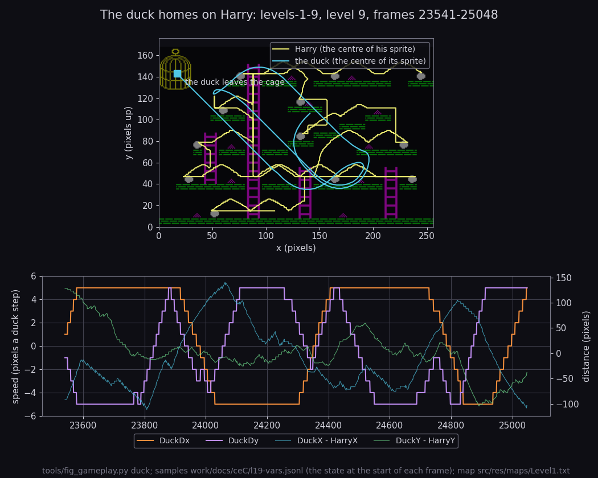

How to read the figure:

- Top: the map of level 9 (map 1) with Harry's path in yellow and the duck's in blue, the centres of their sprites,
  from the samples of `levels-1-9` frames 23541-25048 (the whole level until the last egg).
- The blue square marks the duck's start in the cage, where it leaves.
- Bottom: DuckDx (orange) and DuckDy (violet) on the left axis, the distances DuckX - HarryX and DuckY - HarryY on the
  right axis, against the frame.
- Each speed runs to its limit and stays there while the distance keeps its sign. It turns, one step a duck step, after
  the duck passes Harry.

**The point**: one step of speed a duck step makes a slow pendulum. The duck never stops; it swings past Harry and
back, and a player keeps out of the line of its swing.

```bash
python3 tools/fig_gameplay.py duck --samples work/docs/ceC/l19-vars.jsonl --out docs/img/gameplay/duck.png
```

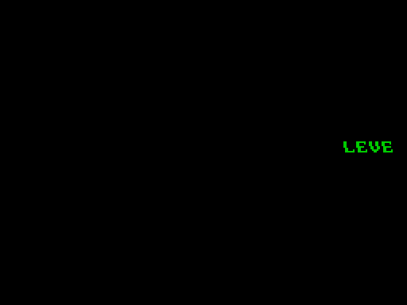

The animation is the screen of `levels-1-9` frames 23340-24340, one picture every 10 frames. Command:
`python3 ../../kit/screen_anim.py --work work/docs/ceC/l19 --from 23340 --to 24340 --step 10 --scale 2 --delay 80 --hold 1500 docs/img/play/duck-homing.gif`.

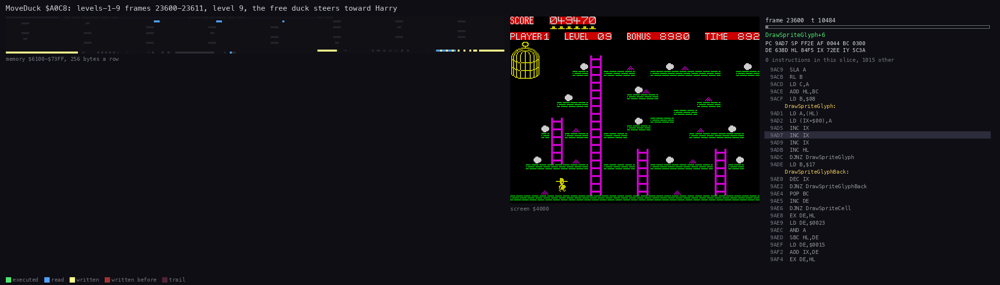

The animation traces `levels-1-9` frames 23600-23611 (80 pictures), one duck step on level 9. At page width only the screen panel is legible; the memory and listing panels need the GIF at full size. Command:
`python3 ../../kit/routine_anim.py --work work/docs/ceC/l19 --window 23600:0-23612:0 --listing build/game.lst --view screen --range 6100-73FF --pc A0C8-A1B7 --pictures 80 --out docs/img/routines/MoveDuck.gif`.

Worked example: the duck is steered while caged too. On level 1 its DuckDy is -5 (251) until the sample of frame 1901.
Harry jumps above the duck's y 152 (frames 1888-1926), so the duck steps in frames 1901 and 1913 add one each: 252 and
253 in the samples of 1902 and 1914. Harry lands at y 151, below the duck, and the step of frame 1926 takes one off: 252
in the sample of 1927. None of that carries over: SetupLevel zeroes DuckDx and DuckDy at every level and life (`$B07B`,
`$B07E`). On level 9 the duck starts at (8, 152) with speed 0 (sample 23429: `08 98 00 00`), and its first step steers
it to (1, -1) and moves it to (9, 151) (sample 23541: `09 97 01 FF`).

Witness: MoveDuck ran 9553 times; the put-back `$A175` 9418 times. The 135 free steps are levels 9 and 10 of
`levels-1-9`. The duck's kill (`$9BC6`) ran in no recording.

## 10.10 The lifts, CatchLift and the lift-top trick

The two platforms of a lift (doc 07.6) rise one pixel every second slow tick, from row 3 to row 165, and restart at
the bottom. Harry gets on one only from the air: CatchLift `$A256` runs on the x step of every drift, jump or fall
(the pass before a slow tick; `$A21C-$A220` branches on PassCounter before JumpState), for platform 1, then for platform 2.

```text
CatchLift(row):
    if LiftX == $FF: return
    if HarryX not in LiftX - 9 .. LiftX + 9: return
    if HarryY not in row + 10 .. row + 15: return
    OnLift = 1; JumpState = 0
    erase Harry; HarryY = row + 17            ; standing on the platform
    drop the rest of JumpStep; LiftPhrase      ; one of eight phrases (doc 09)
```

```text
CatchLift:
$A25E  SUB $09                ; LiftX - 9
$A260  LD B,A
$A261  LD A,(HarryX)
$A264  CP B
$A265  RET C                  ; left of the platform
$A266  SUB $13
$A268  CP B
$A269  RET NC                 ; right of it
$A26A  LD B,$06
$A26C  LD A,(HL)
$A26D  ADD A,$10
CatchLiftRow:
$A26F  DEC A                  ; row + 15 down to row + 10
$A270  CP (IX+$01)
$A273  JR Z,CatchLiftLand
$A275  DJNZ CatchLiftRow
$A277  RET
CatchLiftLand:
$A278  LD (IX+$7D),$01        ; OnLift
$A27C  LD (IX+$4D),$00        ; standing
...
$A289  LD A,(DE)
$A28A  ADD A,$11              ; HarryY = row + 17
$A28C  LD (HarryY),A
```

On a lift, MainLoop adds 1 to HarryY after each lift step (`$9915`). If the new y is 165 or more, MainLoop returns: a
life lost (`$991E`). A platform carries Harry up to y 164, at row 147, and kills him on the next step. A jump takes him
off at once: the jump start clears OnLift (`$9989`).

```text
MainLoopLifts:
$9904  LD HL,LiftDelay
$9907  DEC (HL)
$9908  JR NZ,MainLoopPickup
$990A  LD (HL),$02            ; a lift step every 2 slow ticks
$990C  CALL MoveLifts
$990F  LD A,(OnLift)
$9912  AND A
$9913  JR Z,MainLoopPickup    ; OnLift 0: no ride, no test
$9915  LD A,(HarryY)
$9918  INC A                  ; the rider rises with the platform
$9919  LD (HarryY),A
$991C  CP $A5
$991E  RET NC                 ; y 165 or more: a life lost
```

### Walking off a platform

WalkHarry calls WalkOffLift `$9DDB` when Harry's x leaves LiftX - 9 .. LiftX + 9. WalkOffLift starts the drift of
10.5 (JumpState 1, JumpDx his direction, JumpCount 4) but does not clear OnLift. Only the jump start (`$9989`) and
SetupLevel (`$B084`) write OnLift 0.

```text
$9DC1  LD A,(OnLift)          ; WalkHarry, after the draw
$9DC4  AND A
$9DC5  RET Z
...                           ; x outside LiftX - 9 .. LiftX + 9:
WalkOffLift:
$9DDB  LD (IX+$4D),$01        ; JumpState 1: the drift
$9DDF  LD D,$FF
$9DE1  LD A,(HarryDir)
$9DE4  AND A
$9DE5  JR NZ,WalkOffLiftDir
$9DE7  LD D,$01
WalkOffLiftDir:
$9DE9  LD (IX+$4E),D          ; JumpDx his direction
$9DEC  LD (IX+$4F),$04        ; JumpCount 4; OnLift stays 1
$9DF0  RET
```

So after a walk-off, until Harry's next jump:

- every lift step still adds 1 to HarryY, on top of the drift and the fall;
- the 165 death test still applies to him, wherever he is;
- FallOffEdge is skipped (MainLoop `$99D2` calls it only with OnLift 0);
- once he stands again, WalkHarry finds him outside the platform's x range on every slow tick and calls WalkOffLift
  again: a new drift each time.

Known only from the code: no recording walked off a platform (`$9DDB` ran 0 times), so what the player sees is not
recorded.

```mermaid
stateDiagram-v2
    [*] --> Air
    Air --> Riding: CatchLift - x within 9 of LiftX, y 10 to 15 over the row
    Riding --> Riding: every 2 slow ticks - HarryY + 1
    Riding --> Dead: HarryY + 1 reaches 165
    Riding --> Air: jump key - OnLift 0
    state "off the platform, OnLift still 1" as Off
    Riding --> Off: walks past LiftX - 9 or LiftX + 9 - a drift
    Off --> Off: every 2 slow ticks HarryY + 1; on foot, WalkOffLift again
    Off --> Dead: HarryY + 1 reaches 165
    Off --> Air: jump key - OnLift 0
    Off --> OnLadder: ClimbLadder - OnLift still 1, the lift steps keep raising him (code only)
```

### Getting on: CatchLift

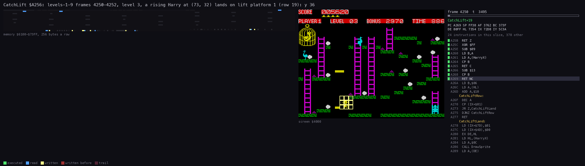

The animation traces `levels-1-9` frames 4250-4252 (60 pictures) on level 3. At page width only the screen panel is legible; the memory and listing panels need the GIF at full size. Command:
`python3 ../../kit/routine_anim.py --work work/docs/ceC/l19 --window 4250:0-4253:0 --listing build/game.lst --view screen --range 6100-73FF --pc A256-A293 --pictures 60 --title 'CatchLift $A256: levels-1-9 frames 4250-4252, level 3, a rising Harry at (73, 32) lands on lift platform 1 (row 19): y 36' --out docs/img/routines/CatchLift.gif`.

Worked example: level 3, LiftX 64. In the sample of frame 4250 Harry rises at (75, 32) (JumpDy 1, JumpCount 230) and
platform 1 is at row 19. Frame 4250 holds two x steps, 75 to 73: x 73 is LiftX + 9, the edge of the range. y 32 is in
29 .. 34, so CatchLift lands him in frame 4250, on the way up. The sample of 4251 already shows OnLift 1 with y still 32:
it was taken inside CatchLift, between `$A278` (OnLift set) and `$A28C` (HarryY set), while the erase was drawing.
HarryY becomes 19 + 17 = 36. After the next lift step it is 37 (sample 4252), and it climbs with the platform: 40 at
frame 4256.

### The lift-top trick

A rider who jumps from a high platform can be caught again by the same platform higher up. At y 167 and above, the
first vertical step of a rise is turned into a fall (`$A2E8`, 10.4). The INC and the step of -1 cancel, so Harry does
not move: he hangs at the same y for about 500 passes (256 before the step, 250 after it), and the rising platform can
catch him in that time. Each catch puts him at row + 17, higher than before.

The death test runs only after a lift step while OnLift is 1. A catch runs on the pass before a slow tick, and that
slow tick runs the lifts before Harry's keys (10.1). In all eight catches below LiftDelay was 2: a lift step had just
run, because with Harry hanging still it is the platform's step that brings his y into the catch window. The slow tick
after the catch therefore has no lift step, and a held jump key starts the next jump in that same slow tick, which
clears OnLift. Harry is on the platform for less than one pass. A catch with LiftDelay 1 would meet a lift step first,
and above y 164 that step kills; it did not happen in the recording.

Worked example: `levels-1-9` level 3, frames 5913-6001.

| Sample | x | y | State | Platform 2 row | What happened |
| --- | --- | --- | --- | --- | --- |
| 5913 | 59 | 162 | on the lift | 145 | riding, two safe lift steps left (164 is the last safe y) |
| 5914 | 59 | 162 | in the air | 145 | a jump |
| 5921-5924 | 66-68 | 167 | in the air | 149-150 | the rise cut at y 167: JumpDy -1, JumpCount 250 from sample 5923, no move |
| 5927 | 71 | 168 | in the air | 151 | caught (row 151 + 17), and jumped again |
| 5959 | 68 | 182 | in the air | 3 | jumped after the eighth catch; the platform restarts at the bottom |
| 6001 | 98 | 143 | on foot | 18 | the fall ends on the floor of row 15 |

The eight catches, each on platform 2, from the samples around them:

| Catch | Frames | Row | y before | y after (row + 17) |
| --- | --- | --- | --- | --- |
| 1 | 5926/27 | 151 | 166 | 168 |
| 2 | 5931 | 153 | 167 | 170 |
| 3 | 5935/36 | 155 | 169 | 172 |
| 4 | 5940 | 157 | 171 | 174 |
| 5 | 5944/45 | 159 | 173 | 176 |
| 6 | 5948/49 | 161 | 175 | 178 |
| 7 | 5953/54 | 163 | 177 | 180 |
| 8 | 5958 | 165 | 179 | 182 |

The samples of frames 5931, 5940 and 5958 fall inside CatchLift, as 4251 above: PassCounter 1, JumpState 0, OnLift
already 1 and HarryY not yet set. The next sample shows the new y and JumpState 2 again.

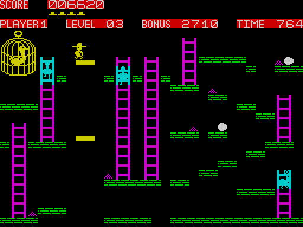

The animation is the screen of `levels-1-9` frames 5905-5995, one picture a frame. Command:
`python3 ../../kit/screen_anim.py --work work/docs/ceC/l19 --from 5905 --to 5995 --step 1 --scale 2 --delay 80 --hold 1500 docs/img/play/lift-top.gif`.

### The HUD damage at the top of the shaft

The last pictures of the animation show "LEVEL 03" overwritten by bricks, a ladder top in the row above it and one of
the four life icons gone. The level map has 21 rows (0-20). HarryY is the sprite's top line and the sprite covers lines
y - 15 .. y, so from y 168 it reaches map row 21, and from y 176 (catch 5, frame 5945) also row 22. DrawSprite builds his background from the 3 x 3 map cells under him and PaintCells paints their attributes, both
with `LiveMap + x / 8 + 32 x row`. Rows 21 and 22 lie past slot 0 (672 bytes), in the first two rows of slot 1, player
1's map at `$6448`. In a one-player game on level 3 that slot still holds level 1 as StartGame wrote it (doc 07.7):
row 0 all bricks, row 1 empty at column 8 and a ladder at columns 10-11. Those cells are drawn into the HUD's
character rows 2 and 1.

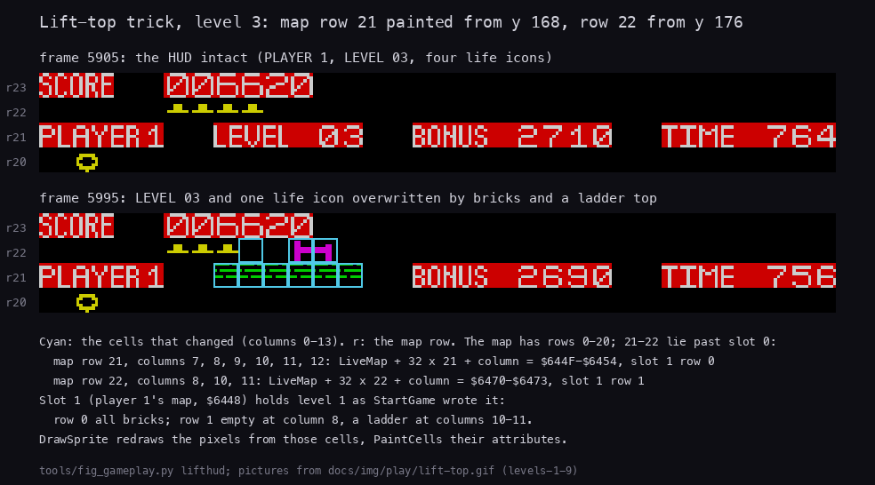

How to read the figure:

- Top: the top four character rows of the screen in frame 5905, the first picture of `lift-top.gif`. At the left of
  each row is its map row, 23 at the top.
- Middle: the same rows in frame 5995, the last picture. Cyan boxes mark the cells that changed in columns 0-13 (the
  counters at the right change anyway).
- Bottom: the changed cells with their addresses. Map row 21, columns 7-12: `$644F-$6454`, slot 1 row 0, all bricks.
  Map row 22, columns 8, 10 and 11: `$6470`, `$6472-$6473`, slot 1 row 1: empty, then the ladder halves.

**The point**: the map has no rows for the HUD, and nothing keeps Harry out of them. The damage is only drawn: the
cells are read, never written, so slot 1 and the lives count (5 in both samples) are unchanged. The damage is still on
the screen in frame 5995, eleven frames after Harry left row 21
(y 167 in the sample of frame 5984).

```bash
python3 tools/fig_gameplay.py lifthud --out docs/img/gameplay/lift-top-hud.png
```

Witness: the first sample with y 168 (row 21) is frame 5927; the screen of frame 5995 is the last picture of
`lift-top.gif`. The slot contents are the samples of `l19-maps.jsonl` (frame 21 500: slot 1 equals slots 2-4, level 1
as StartGame wrote it, until the life lost at frame 21 623).

Witness: CatchLift ran 26 662 times and landed Harry 50 times (`$A278`), 30 in `levels-1-9`. Harry rode 920 lift steps
(`$991E`). The lift-top death never happened in a recording.

**The point**: the lift kills only a rider after a lift step. The catch comes right after a lift step and the jump
leaves before the next, so a player who keeps jumping at the top of the shaft survives it.

## 10.11 Collisions and every way to die

Every death the code means is a return from MainLoop to `$A656` in PlayLevel `$A653`: the return address of
PlayLevel's `CALL SetupLevel`, since SetupLevel enters MainLoop by `JP` (`$B12D`) and MainLoop has no caller of its own. PlayLevel looks at EggsLeft: not 0 means a
life lost (LifeLost `$A6FE`), 0 means the level is done. Two paths miss PlayLevel: the HenEatGrain peck (10.8) and the
duck's kill from inside JumpStep (below). The order of the tests inside a pass is in doc 07.10.

| Way to die | Where | Test | Count (eight builds) |
| --- | --- | --- | --- |
| a hen, when it is drawn or erased | DrawHen `$92BC` | HarryX in x - 7 .. x + 5, HarryY in y + 1 .. y + 28 | 11 (c1 1, `idle-1p` 5, `gameover-name` 5) |
| a hen, after a vertical jump step | MainLoop `$98B4` via HenTouches `$9E66` | the same box | 1 (`levels-1-9`, level 8) |
| falling below y 16 | JumpFall `$A309` | y + JumpDy below 16 | 1 (`fall-death`) |
| the time below 000 | CountDown `$A1CE` | the third digit borrows past 000 | 1 (`tour-redefine`) |
| the lift top | MainLoop `$991E` | on a lift, HarryY + 1 of 165 or more | 0 |
| the duck | DrawSprite `$9BC6` | DuckX in HarryX - 7 .. + 8, DuckY in HarryY - 8 .. + 9 | 0 |
| the HenEatGrain path | HenEatGrain `$9291` | the left peck box, x - 15 .. x - 3 | 0 (a reset: 10.8) |

There are no deadly bricks and no fall height limit: Harry survives any fall that ends on a floor. Only a fall through
a gap in the bottom floor kills.

### The duck's kill and its depth

The duck test sits at the end of DrawSprite, which pushes five words (AF, BC, DE, IX, HL). DuckKill drops those five
and then every word below `Start $A410`, and returns through the first word of `$A410` or more:

```text
$9BC6  LD B,$05
DuckKill:
$9BC8  POP HL                 ; DrawSprite's five saved words
$9BC9  DJNZ DuckKill
$9BCB  LD BC,Start            ; $A410
DuckKillUnwind:
$9BCE  POP HL
$9BCF  PUSH HL
$9BD0  AND A
$9BD1  SBC HL,BC
$9BD3  RET NC                 ; the first word of $A410 or more: return there
$9BD4  POP HL                 ; a lower word: drop it
$9BD5  JR DuckKillUnwind
```

From MainLoop's own draws (WalkHarry, ClimbLadder, MoveDuck) the words between are return addresses below `$A410`, and
the search ends at the return into PlayLevel. JumpStep is different. MainLoop calls it as

```text
$9895  LD A,(JumpDelay)
$9898  PUSH AF                ; JumpDelay x 256 + F on the stack
$9899  CALL JumpStep
```

and three draws inside JumpStep can meet the duck: JumpLand on a drift tick (from JumpDrift `$A29D`), the draw at the
start of the fall (`$A2B1`) and CatchLift's erase (`$A286`). At those draws the word JumpDelay x 256 + F lies on the
stack above MainLoop's return. All three come on the x-step pass (PassCounter 1), and on that pass MainLoop plays the
jump click first (`$988A-$9892`, Beep with L = 1). Beep ends with `XOR A` (carry 0) and `DEC L` from 1 to 0 (`$9CB1`),
so F is `$42` (Z and N) every time, and the word is JumpDelay x 256 + `$42`. With JumpDelay `$A4` (164) or more it
passes the test (`$A442` is above `$A410`), and the RET goes to an address in `$A442-$FF42` instead of PlayLevel. The draws after a vertical step are safe: there JumpDelay was 1 when MainLoop pushed
it. A stale JumpDelay of 220 (`$DC`) is what a drift carries in `levels-1-9` frames 917-921 (10.5).

Worked example, the stack at the recorded catches. In the lift-top trick (10.10) the samples of frames 5931, 5940 and
5958 were taken inside CatchLift's erase draw (`$A286`: PassCounter 1, JumpState 0, OnLift 1, y not yet set), and
each shows JumpDelay 227 (`$E3`). JumpFall had not run on that pass, so 227 is the value MainLoop pushed: the word
was `$E342`. A duck touching Harry at any of those draws would have returned to `$E342`, not to PlayLevel. At the
level-3 catch of frame 4250 (sample 4251, JumpDelay 17) the word was `$1142`: the unwind would have dropped it and
reached `$A656`. Where a RET to `$E342` goes is not known.

| Sample | Where | JumpDelay | Word on the stack | The unwind |
| --- | --- | --- | --- | --- |
| 5931, 5940, 5958 | CatchLift `$A286`, lift-top catches 2, 4, 8 | 227 | `$E342` | stops there |
| 4251 | CatchLift `$A286`, level 3 | 17 | `$1142` | drops it, ends at `$A656` |
| 917-920 | a FallOffEdge drift | 220 | `$DC42` | would stop there |

```text
DuckKill():
    drop 5 words
    while top of stack < $A410: drop it
    return to it                  ; $A656 in PlayLevel, or JumpDelay x 256 + $42 from inside JumpStep
```

Known only from the code: no recording ran DuckKill (`$9BC6` 0 times), so where such a RET ends is not known.

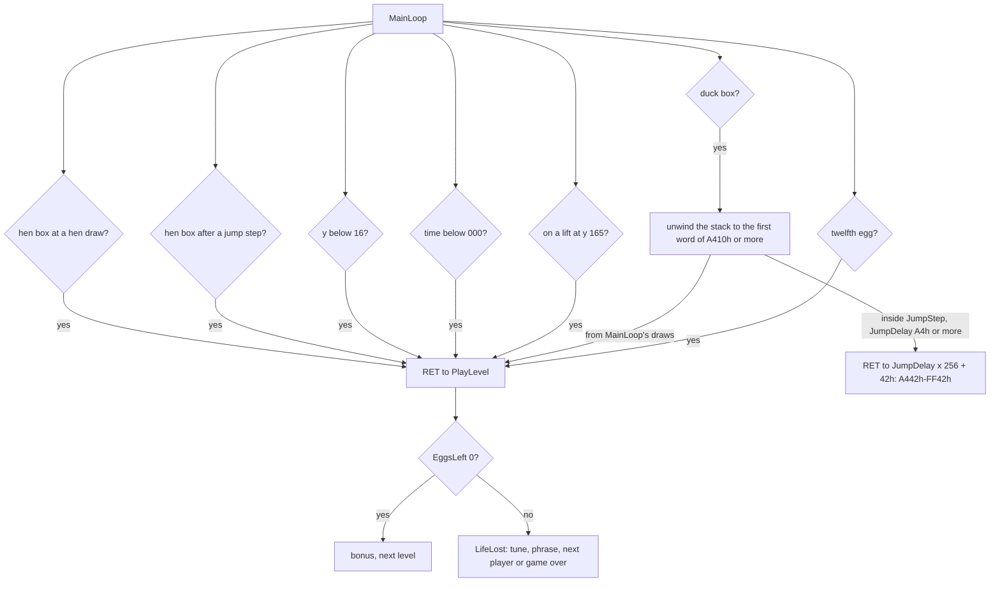

Worked example, a hen: `idle-1p`, Harry stands at (100, 23) on level 1 and never moves. In the sample of frame 4763 hen
1 is at (108, 8). The step in frame 4763 draws it at 104, and its box 97-109 holds HarryX 100. The life ends in that
frame; the next one starts at frame 5141.

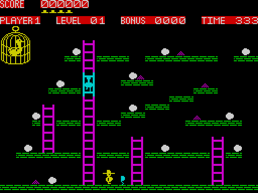

The animation is the screen of `idle-1p` frames 4736-4790, one picture a frame (repeats merged). Command:
`python3 ../../kit/screen_anim.py --work work/docs/ceC/idle --from 4736 --to 4790 --step 1 --scale 2 --delay 100 --hold 2000 docs/img/play/hen-kill.gif`.

Worked example, a fall: `fall-death`, level 2. Harry walks left on the bottom floor (y 23) into its gap at columns 6-7.

| Sample | x | y | JumpState | JumpCount | What happened |
| --- | --- | --- | --- | --- | --- |
| 2687 | 56 | 23 | 0 | | walking left |
| 2688 | 55 | 23 | 1 | 4 | cell (7, 0) is empty: the drift |
| 2691 | 52 | 23 | 1 | 1 | the last drift tick |
| 2693 | 51 | 23 | 2 | 250 | the fall |
| 2694-2705 | 51 | 22 to 16 | 2 | 240 to 180 | seven pixels down |

The next step would put y at 15, under 16. JumpSetDelay drops two words and returns from MainLoop (`$A309`), and the
death follows (WALKTHROUGH: frame 2710).

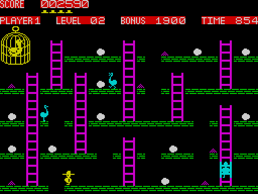

The animation is the screen of `fall-death` frames 2684-2730, one picture a frame (repeats merged). Command:
`python3 ../../kit/screen_anim.py --work work/docs/ceC/fd --from 2684 --to 2730 --step 1 --scale 2 --delay 100 --hold 2000 docs/img/play/fall-death.gif`.

Witness, the time: `tour-redefine` lets TIME run to 000 (frame 8600) and prints "OUT OF TIME !" at frame 8750
(WALKTHROUGH 6.1). LifeLost picks that message when the time digits read `$FF 9 9` (`$A725`, run once).

The stage 1 notes and WALKTHROUGH 6.0 put the five lives of `gameover-name` down to the timer. The counts say
otherwise: HenKill ran 5 times there, and CountDown's time under-run never ran in that build.

**The point**: three ways to die happen in the recordings: hens, a gap in the bottom floor and the time. The lift top
and the duck are known from the code. A hen kills by being drawn onto Harry, so standing still is no defence.

## 10.12 The timer, the bonus, scoring and the extra life

Both counters live as three digits in the object block (doc 07.1). CountDown `$A1B8` takes one from the last digit and
borrows through the others.

- The time starts at `100 x (9 - min(Level / 16, 5))` and loses 1 every 10 slow ticks, with a tick sound (`Beep $0402`).
  Under 000 it ends the life (10.11).
- The bonus starts at `1000 x min(Level + 1, 9)` (its fourth digit is a printed 0) and loses 10 every 50 slow ticks.
  Under 000 it stops (BonusRunning 0). At the level's end PlayLevel counts what is left into the score (doc 08).
- Grain stops both: TakeGrain writes `$FFFF` to BonusDelay and TimeDelay, so each waits 255 slow ticks before its next
  step.

```text
CountDown:                    ; B = 0 the bonus, 1 the time
$A1C3  LD A,$FF
$A1C5  LD D,$03
CountDownLoop:
$A1C7  DEC (HL)               ; a digit - 1
$A1C8  CP (HL)
$A1C9  JR NZ,CountDownPrint   ; no borrow
$A1CB  DEC D
$A1CC  JR NZ,CountDownBorrow
$A1CE  POP HL                 ; all three borrowed: under 000
$A1CF  INC B
$A1D0  DEC B
$A1D1  RET NZ                 ; the time: return from MainLoop
$A1D2  PUSH HL
$A1D3  LD HL,BonusRunning
$A1D6  LD (HL),$00            ; the bonus: stop
$A1D8  RET
```

Worked example, the countdown and grain: `levels-1-9`, level 1 (TimeDigits `$7342-$7344`, BonusDigits
`$733F-$7341`, the delays `$7345` and `$7346`).

| Sample | TIME | BONUS | BonusDelay | TimeDelay | What happened |
| --- | --- | --- | --- | --- | --- |
| 620 | 872 | 940 | 29 | 9 | counting down |
| 630 | 871 | 940 | 19 | 9 | ten slow ticks later: the time lost 1, the bonus delay 10 |
| 639 | 870 | 940 | 10 | 10 | |
| 641 | 870 | 940 | 255 | 254 | grain eaten in frame 640: `$9A24` wrote `$FFFF` |
| 659 | 870 | 940 | 234 | 233 | both stand still, the delays count down one a slow tick |
| 757 | 870 | 940 | 254 | 253 | a second grain starts the wait again |
| 899 | 870 | 940 | 100 | 100 | still standing |

Between samples 620 and 630 TimeDelay ran through its whole cycle of 10 and TIME lost one step. From sample 639 to
past 899 TIME 870 and BONUS 940 do not change. The rises of a delay to 250 or more in the samples are the grains that
hit a running bonus.

Scoring is in tens: AddScore `$A3A7` adds B tens to the six score digits. Every point value is a multiple of 10:

| Event | Points | Code |
| --- | --- | --- |
| an egg, levels 1-4 | 100 | TakeEggOrGrain, B = 10 |
| an egg, levels 5-8, 9-12, ..., 33-36 | 200, 300, ..., 900 | B = 10 x (1 + Level / 4) |
| an egg, level 37 and up | 1000 | B = 100 |
| grain | 50 | B = 5 |
| the bonus left at the level's end | 10 a bonus step | PlayLevel (doc 08) |

The extra life comes from AddScore. After each addition it compares the 10 000s digit with `LastTenThousands $736E`.
When the digit has changed, the player gets a life, and a life icon is printed if he had fewer than six. The digit
changes at every 10 000 points, so a life comes every 10 000. SetupLevel copies the score's digit into
`LastTenThousands` at every life (`$AF74`), so a life is never paid twice.

```text
$A3BB  LD HL,LastTenThousands
$A3BE  LD A,(Score+1)         ; the 10 000s digit
$A3C1  CP (HL)
$A3C2  JR Z,AddScorePrint
$A3C4  LD (HL),A
...
$A3CD  LD C,(HL)              ; the player's lives
$A3CE  INC (HL)               ; + 1
...
$A3D2  LD A,C
$A3D3  CP $06
$A3D5  JR NC,AddScorePrint    ; six or more: no icon
...
$A3E1  LD A,$B6
$A3E3  CALL PrintChar         ; a life icon
```

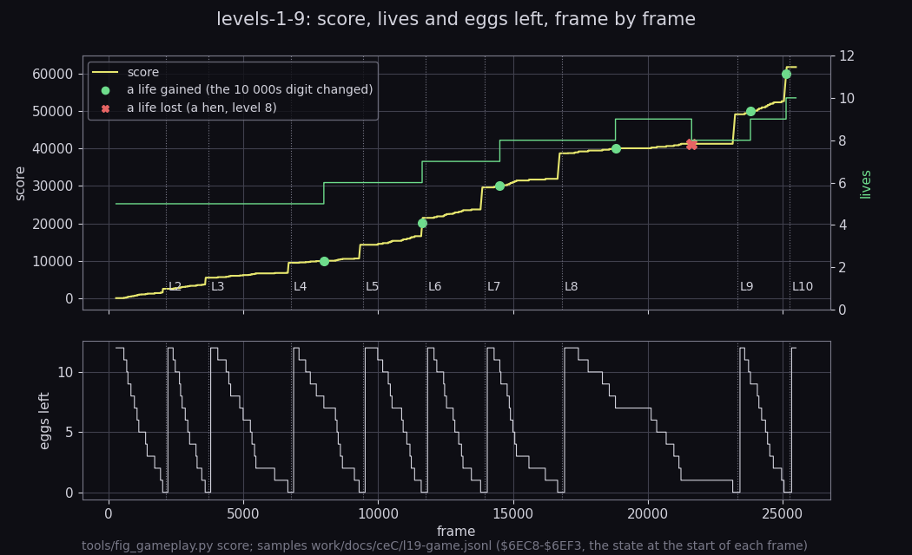

How to read the figure:

- Top: the score (yellow, left axis) and the lives (green, right axis) in the samples of `levels-1-9` (`$6EC8-$6EF3`,
  the state at the start of each frame). Green dots mark the lives gained, the red cross the life lost on level 8.
  Dotted lines and the labels L2-L10 mark the level starts.
- Bottom: EggsLeft. It runs from 12 to 0 on each level and jumps back to 12 at the next.
- The steps in the score at each level start are the bonus counted in at the level's end.

**The point**: the score is eggs, grain and the bonus. A life comes with every 10 000 points, about one a level from
level 4 on.

```bash
python3 tools/fig_gameplay.py score --game work/docs/ceC/l19-game.jsonl --out docs/img/gameplay/score-lives.png
```

Worked example: in `levels-1-9` the 10 000s digit changed in frames 7985, 11 630, 14 511, 18 798, 23 805 and 25 126.
The lives went from 5 to 6 at the first (level 4), and an icon was printed (`$A3E1`, once). The later lives found six or
more and drew no icon. The life lost on level 8 (frame 21 623) took them from 9 to 8.

Witness: AddScore ran 5659 times; the 10 000s digit changed 6 times (`$A3C4`); CountDown ran 17 679 times with 19
bonus under-runs and one time under-run.

## 10.13 The difficulty cycle

Everything that gets harder is derived from the `Level` byte (`$6EEB`, level - 1). The map repeats every eight levels:
`LevelMaps + 672 x (Level AND 7)`. The other rules change on their own steps:

| Rule | Formula (Level = level - 1) | Code | Steps |
| --- | --- | --- | --- |
| time at the start | `100 x (9 - min(Level / 16, 5))` | SetupLevel `$AEF3` | 900 on 1-16, 800 on 17-32, 700, 600, 500, 400 from 81 |
| bonus at the start | `1000 x min(Level + 1, 9)` | SetupLevel `$AEE1` | 1000 on level 1 up to 9000 from level 9 |
| egg value | `100 x (1 + min(Level / 4, 9))` | TakeEggOrGrain `$99F3` | 100 on 1-4, up to 1000 from level 37 |
| hens | the map's 2-4, none on Level 8-15, all five from Level 24 | SetupLevel `$AF81` | none on 9-16, five from level 25 |
| hen period | 3 slow ticks, 2 from Level 32 | MainLoop `$993D` | faster hens from level 33 |
| the duck | caged while Level is below 8 | MoveDuck `$A16E` | free from level 9 |

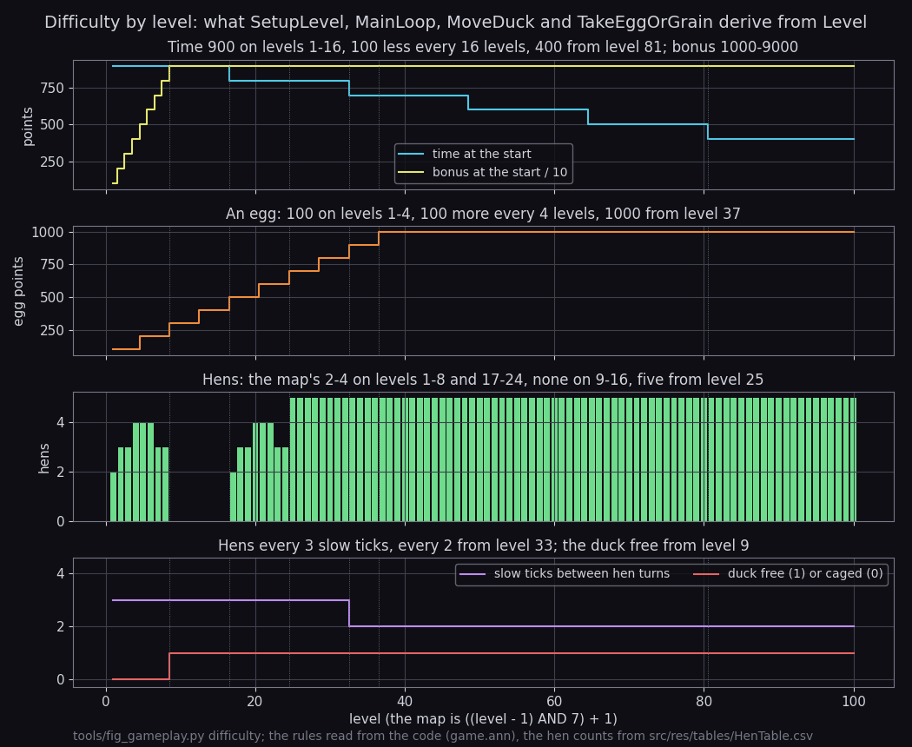

How to read the figure:

- Four panels against the level, 1-100; dotted lines mark levels 9, 17, 25, 33, 37 and 81.
- Top: the time at the start (blue) and the bonus at the start divided by 10 (yellow).
- Second: the points of an egg.
- Third: the number of hens, from HenTable for levels 1-8 and 17-24, none on 9-16, five from 25.
- Bottom: the slow ticks between hen turns (violet) and whether the duck is free (red).

**The point**: the game has no level 9 of its own. It replays the eight maps with less time, more points, the duck,
five hens and faster hens, and from level 81 on nothing changes any more.

```bash
python3 tools/fig_gameplay.py difficulty --out docs/img/gameplay/difficulty.png
```

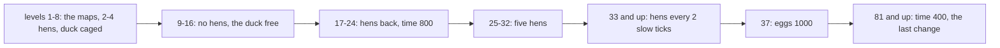

The level counter itself is one byte. The HUD prints Level + 1 as two BCD digits (SetupLevel `$AEC2`), so level 100
shows as 00. The byte wraps after 256 levels, and level 257 would play with level 1's rules: 900 time, 100-point eggs,
a caged duck. No recording came near; `levels-1-9` ends at level 10.

Worked example: level 10 of `levels-1-9` (Level 9) starts at frame 25 248 with TIME 900 (Level / 16 = 0), BONUS 9000
(the smaller of 10 and 9), no hens (Level 8-15) and a free duck. Its eggs are worth 300 (1 + 9 / 4 = 3).

Witness: the difficulty rules are read from the code. The recordings confirm the part for levels 1-10: time 900, the
bonus 1000-9000 in the HUD, no hens and the free duck on levels 9-10.

## 10.14 Notable features

- **A loop with no clock.** MainLoop never waits for the frame (doc 04). Every speed in the game is a count of passes or
  slow ticks, so the game runs slower when there is more to draw: 1.32 slow ticks a frame on level 1, 1.05 on level 3.
- **The ERR_SP lock.** MainLoop's first instruction checks that `ERR_SP $5C3D` is 1, which only the game's own tape
  block 3 sets (doc 03). A copy loaded another way hangs at `$985E`.
- **The jump is a pass count.** JumpCount grows and shrinks by 10 passes a step; the 256-pass waits at the start and at
  the top come from a delay of 0 that wraps. The model matches the recording to the pixel (10.4).
- **One fall for everything.** Walking off an edge, dropping into a hole and jumping all use JumpFall. The drift off an
  edge starts from a stale JumpDelay (10.5).
- **Eggs are not solid.** The floor tests and the egg test agree that an egg is no floor, and level 4 uses it: two eggs
  set into the bricks are taken only by falling through them (10.7).
- **The lift-top trick.** The lift kills only a rider after a lift step, so a player who keeps jumping at the top of
  the shaft survives (10.10).
- **The HenEatGrain reset.** A hen pecking grain to its left with Harry 8-15 pixels away resets the Spectrum: HenKill
  pops one level too few and returns into the ROM (10.8). Shown on a clone; no recording reached it.
- **The duck's kill unwinds, and can miss.** DuckKill `$9BC8` drops five words, then every word below `$A410`. From
  MainLoop's own draws this ends at the return into PlayLevel. From a draw inside JumpStep (JumpLand on a drift tick,
  the fall start `$A2B1`, CatchLift `$A286`), MainLoop's `PUSH AF` at `$9898` lies on the stack. The word is
  JumpDelay x 256 + `$42` (F after the jump click's Beep). If JumpDelay is `$A4` or more, it passes the test and the
  RET goes to an address in `$A442-$FF42` (10.11); the lift-top catches had `$E342` there. Known only from the code; no
  recording ran DuckKill (`$9BC6` 0 times).
- **Walking off a lift keeps OnLift.** WalkOffLift `$9DDB` starts a drift but leaves OnLift 1, so the lift steps still
  raise Harry and the top-row death test still applies until his next jump (10.10). Known only from the code.
- **The HUD is in reach.** At the top of the lift shaft Harry's sprite reaches map row 21 from y 168 and row 22 from
  y 176, past the 21-row map,
  and draws cells of player 1's map slot over "LEVEL" and the life icons (10.10).
- **A jump can wrap Harry.** The jump's left edge test looks for x exactly 0. A landing at x 0 followed by a jump to
  the left gives x 255, and Harry comes back from the right edge (10.4, `levels-1-9` frame 14328).
- **Chance from the ROM.** The hens' choices come from the first 256 bytes of the Spectrum ROM, read one by one. The
  pointer is reset at every life, so the hens repeat themselves (doc 07.11).
- **The duck is steered in its cage.** On levels 1-8 MoveDuck changes the speeds every duck step and then puts the duck
  back. The speeds do not carry over: SetupLevel zeroes them, and on level 9 the duck leaves the cage from speed 0
  (10.9).
- **Code inside text.** FallOffEdge `$B34C-$B380` lies inside the author's leftover assembler source, which starts at
  `$B167` (doc 02).
- **Leftover bytes.** Two copies of the end of TakeGrain, at `$9A2C` and `$9A3C`, and runs of zeros between routines are not
  executed in any recording (doc 02).

## 10.15 What no recording reached

| Rule | Code | Known from |
| --- | --- | --- |
| five hens from level 25 | SetupLevel `$AFA2` | the code |
| hens every 2 slow ticks from level 33 | MainLoop `$9944` | the code |
| the time 400 and the egg value 1000 | SetupLevel, TakeEggOrGrain | the code |
| the Level byte wrapping at 256 | SetupLevel, PlayLevel | the code |
| the duck's kill | DrawSprite `$9BC6` | the code |
| walking off a lift, and OnLift kept after it | WalkHarry `$9DDB` | the code |
| the duck's kill from inside JumpStep with JumpDelay `$A4` or more | DrawSprite `$9BC6`, MainLoop `$9898` | the code |
| a catch with LiftDelay 1 above y 164 (the lift step kills) | CatchLift `$A278`, MainLoop `$991E` | the code |
| a walk-off drift that lands before it falls (a FallOffEdge drift cannot) | WalkOffLift `$9DDB`, JumpDrift `$A29D`, JumpLand | the code |
| a walk-off Harry on a ladder, still raised by the lift | ClimbLadder `$9F2E`, MainLoop `$9915` | the code |
| the lift-top death | MainLoop `$991E` taken | the code |
| the HenEatGrain reset | HenEatGrain `$9291` | the code and the clone experiment (10.8) |

One more case follows from the code: the duck test also runs while the duck is caged. A Harry at x 0-15 and y 143-160
on levels 1-8 would touch the duck at (8, 152). No recording went there.
