# 1. Game design

What this covers: the game as a player meets it. Every screen, each with a screenshot named by its recording and
frame. The goal and the rules: the beam, the cells, the receiver, the energy, the overload, the lives, the score. Every
element of a level and what it does to the beam. The 60 levels and the three practice levels in contact sheets, with a
table of what each holds. How a level is solved, on level 1 as the stage 2 bot played it. What no recording reached.

The recordings it rests on ([WALKTHROUGH 6.0](../WALKTHROUGH.md#60-the-recordings)):

- `c1`: power-on, the 10 Mega Games tape at ROM speed, the title, the options panel, level 1 with the keyboard.
- `menu`: from the title after the same load (`work/stage1/probe/menu.szx`): the tune, the options, 5 DEMO, 6, U + G.
- `controls`: 1 KEYBOARD, P (the pause), U + G (GAME ABORTED), 4 PROTEK, 2 SINCLAIR.
- `energy`: level 1 with no key: ENERGY LOW, CRITICAL, DRAINED, two lives lost.
- `mine`, `gameover`: level 1 from POKEd states (the overload bar full, the beam on a mine): BOOM, GAME OVER.
- `rzx-NNNNNN` (60 segments): the RZX archive's play of all 60 levels and the ending (someone else's play).
- `L01`, `L03` and 18 more (stage 2, `work/stage2/rec/LNN`): levels completed by the case's bot with its own input.
- `hof`, `ending`, `energy-out` (stage 2, `work/stage2/rec`): a name entered, the ending, game over by energy alone.
  `hof` and `ending` start from clones where earlier levels were skipped by a POKE of LevelDone `$8ED2`.
- `practice` (new for this document, `work/docs/dfA/rec/practice`): from `menu.szx`, SPACE at frame 300, key 6 at
  400, then cursor keys; 2500 frames, port base 37485, inputs `work/docs/dfA/practice.txt`. It is the only recording
  that reaches a practice level (in `menu` the 6 did not take: its "practice" screen is level 1).

Frame numbers count from each recording's start. A screenshot of frame N shows the screen at the start of frame N
(`kit/screen_shot.py`, TTD `memory_at`).

## 1.1 The game

Deflektor is a puzzle game by Costa Panayi, published by Gremlin Graphics in 1987 (the title says "(c)1987 VORTEX
SOFTWARE"). It is a 48K game. The player steers a laser beam across a field of 15 by 9 cells by turning mirrors. The
beam must burn every cell (the magenta balls) on the field. When the last cell burns, the element in front of the
receiver explodes. The beam into the receiver then ends the level ("CONTACT!").

Three things press the player:

- the energy bar empties at a fixed rate a level; empty, a life is lost;
- the overload bar fills while the beam goes back into the laser or lies on a mine; full, a life is lost;
- gremlins appear on most levels and turn the mirrors they walk onto, which spoils the beam's course.

A life lost restarts the same level with the score it had at the level's start. Every level starts with three lives:
the lives are a budget per level, not per game. Three lives lost on one level end the game.

The point: the game is a pure puzzle under a clock. Nothing kills the player by contact. Every loss comes from the
beam's course or from the time.

## 1.2 The screens

The front end in one sheet, then the moments of play:

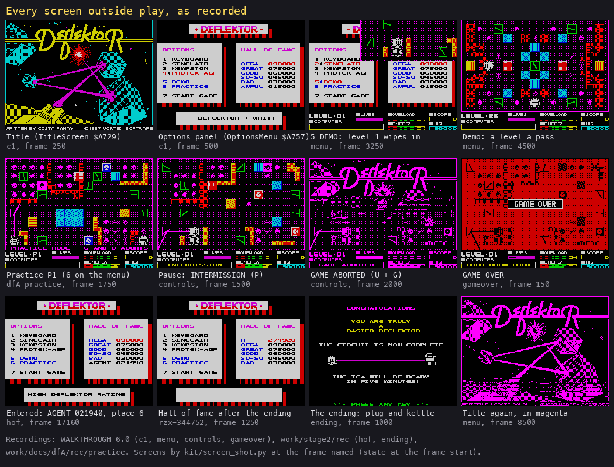

*Twelve screens outside play, each labelled with its recording and frame. How to read it: left to right, top to
bottom, roughly in the order a player meets them. The point: the front end is one options panel; everything else is a
message on the play screen. Command: `python3 tools/fig_play.py docs/img/design` (from the PNGs in the table).*

| Screen | What it shows | How it is reached | Picture |
| --- | --- | --- | --- |
| Title | The DEFLEKTOR logo, a beam between crystals, the credit line; the title tune (35.4 s) | After the load; after every game | [`c1` 250](img/play/title.png); in magenta after an abort: [`menu` 8500](img/play/title-after-abort.png) |
| Options panel | 1 KEYBOARD, 2 SINCLAIR, 3 KEMPSTON, 4 PROTEK-AGF, 5 DEMO, 6 PRACTICE, 7 START GAME, the hall of fame, a scroller | A key on the title | [`c1` 500](img/play/options.png) |
| Demo | Each level in turn, one pass each while the laser charges; DEMO on the COMPUTER line | 5 | [`menu` 4500](img/play/demo.png); level 1 wiping in: [`menu` 3250](img/play/options-menu.png) |
| Practice | P1, P2, P3; "PRACTICE MODE . G AND U ABORTS" | 6 | [`practice` 1750](img/play/practice-001750.png) |
| Play | The field (rows 0-19), the panel (rows 20-23) | 7 START GAME | [`L01` 1000](img/play/l01-001000-play.png) |
| Pause | INTERMISSION ... PRESS ENTER FOR MORE ACTION; a tune | P | [`controls` 1500](img/play/controls-001500-intermission.png) |
| Game aborted | GAME ABORTED, then the title | U + G together | [`controls` 2000](img/play/game-aborted.png) |
| Life lost | BOOM BOOM BOOM, the field red | The overload full, or the energy drained | [`gameover` 100](img/play/gameover-000100.png), [`mine` 500](img/play/life-lost.png) |
| Game over | A GAME OVER banner over the red field | The third life of a level lost | [`gameover` 150](img/play/gameover-000150.png) |
| Name entry | HIGH DEFLEKTOR RATING under the hall of fame; the name typed into its place | A score above 015000 at game over | [`hof` 17160](img/play/hof-017160-name.png) |
| Ending | CONGRATULATIONS / YOU ARE TRULY A MASTER DEFLEKTOR / THE CIRCUIT IS NOW COMPLETE, a plug and a kettle joined by the beam, THE TEA WILL BE READY IN FIVE MINUTES!, PRESS ANY KEY | Level 60 completed | [`ending` 1000](img/play/ending-001000.png) |
| Hall of fame after the ending | The RZX player's entry R 274920 at the top | A key on the ending | [`rzx-344752` 1250](img/play/hall-of-fame.png); its ending: [`rzx-344752` 750](img/play/ending.png) |

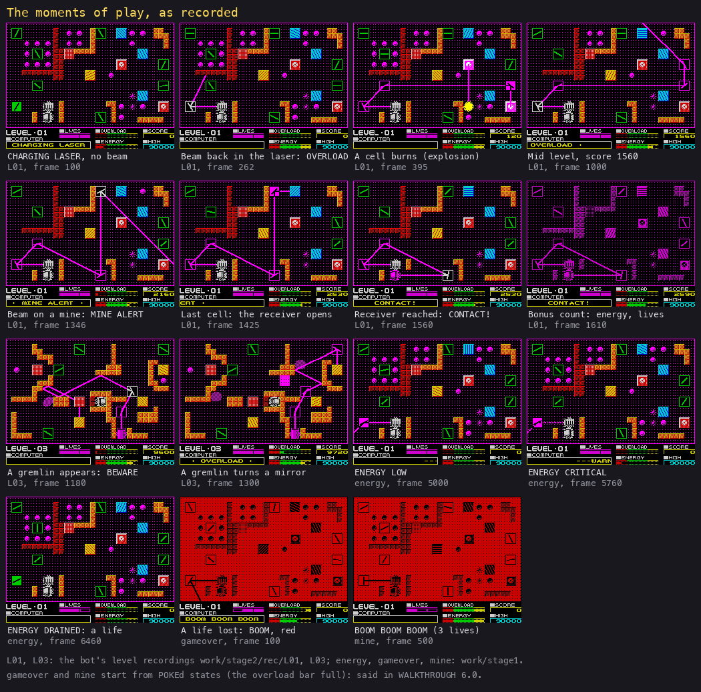

*Fifteen moments of play, each labelled with its recording and frame. How to read it: the first eight are one run of
level 1 (`work/stage2/rec/L01`) from the charge to the bonus; then a gremlin on level 3, the three energy messages of
`energy`, two lives lost. The point: every event of the game shows on the COMPUTER line of the panel and in the colour
of the field. Command: `python3 tools/fig_play.py docs/img/design`.*

The same moments, one by one:

| Moment | Picture | What to see |
| --- | --- | --- |
| The charge | [`L01` 100](img/play/l01-000100-charging.png) | CHARGING LASER; no beam; the energy bar filling from the left |
| Overload | [`L01` 262](img/play/l01-000262-overload.png) | the scrambled mirrors send the beam back into the laser: OVERLOAD, the bar rises |
| A cell burns | [`L01` 395](img/play/l01-000395-burn.png) | the yellow explosion where the beam crossed a cell; the score 120 |
| Mid level | [`L01` 1000](img/play/l01-001000-play.png) | about half the cells gone, the score 1560 (13 cells) |
| A mine | [`L01` 1346](img/play/l01-001346-mine.png) | the beam on a mine: MINE ALERT, the overload bar 4 steps a pass |
| The door | [`L01` 1425](img/play/l01-001425-door.png) | the last cell burnt: the wall in front of the receiver explodes |
| Contact | [`L01` 1560](img/play/l01-001560-contact.png) | the beam in the receiver: CONTACT! |
| The bonus | [`L01` 1610](img/play/l01-001610-bonus.png) | the field magenta; the energy left counted into the score |
| A gremlin | [`L03` 1180](img/play/l03-001180-gremlin.png) | a gremlin appears (BEWARE OF THE GREMLINS) |
| A gremlin later | [`L03` 1300](img/play/l03-001300-gremlin-mirror.png) | the gremlin on the field; the beam elsewhere |
| Energy low | [`energy` 5000](img/play/energy-005000-low.png) | ENERGY LOW, caught in its blink (dashes) |
| Energy critical | [`energy` 5760](img/play/energy-005760-critical.png) | CRITICAL ... WARN; one pixel of energy left; the beam flickers |
| Energy drained | [`energy` 6460](img/play/energy-006460-drained.png) | the beam gone; ENERGY DRAINED; a life |

The animated run of level 1, every 10th frame from 200 to 1620:

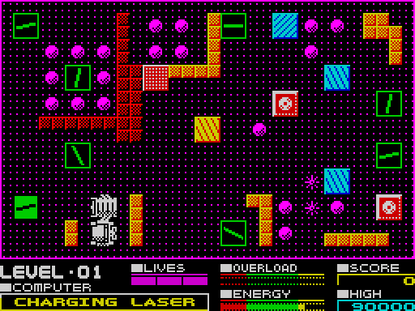

*Level 1 from the end of the charge to the bonus count, 143 pictures, every 10th frame of `work/stage2/rec/L01`
(frames 200-1620). How to read it: the square cursor goes to a mirror, the mirror turns, the beam swings; cells burn
where the beam passes; the receiver's door blows at about frame 1420; CONTACT at 1520. The point: a level is a few
dozen mirror turns. Command: `python3 ../../kit/screen_anim.py --work work/docs/dfA/L01 --from 200 --to 1620 --step 10
--delay 60 docs/img/play/level-01-solve.gif` (the recording opened on port base 37480).*

### The screen flow

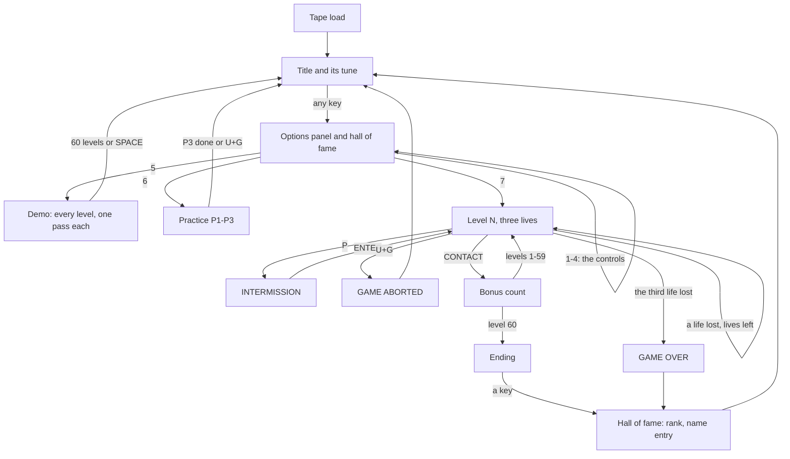

*Every screen and what leads out of it. Code: TitleLoop `$840C`, OptionsMenu `$A757`, NewGame `$8419`, LoseLife
`$866A`, LevelComplete `$87D4`, TheEnd `$8885`, HallOfFame `$9BC0`. How to read it: boxes are screens, arrows the key
or event that leaves them. The point: one loop; every game ends in the hall of fame check.*

## 1.3 The play screen and the controls

The field takes rows 0-19 of the screen: 15 by 9 cells of 2 by 2 characters, in a border one character wide. The
panel takes rows 20-23:

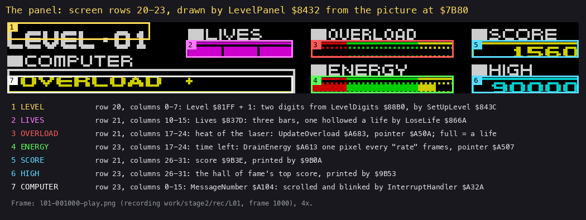

*The bottom panel of `L01` frame 1000 at 4x, each field boxed and numbered. How to read it: the numbers on the picture
match the list; each line names the row and columns, the variable and the routine that writes it. The point: the two
bars are the two ways to lose a life; the COMPUTER line is the game's only voice. Command: `python3 tools/fig_panel.py
docs/img/play/l01-001000-play.png docs/img/design/panel.png`.*

The controls ([doc 5](05-controls.md) has the ports and the decoding):

| Action | 1 Keyboard | 2 Sinclair | 3 Kempston | 4 Protek |
| --- | --- | --- | --- | --- |
| Cursor up / down | Q / A | 9 / 8 | up / down | 7 / 6 |
| Cursor left / right | K / L | 6 / 7 | left / right | 5 / 8 |
| Fire (hold) | the bottom row | 0 | fire | 0 |
| Turn a mirror | fire + left / right | 0 + 6 / 7 | fire + left / right | 0 + 5 / 8 |
| Pause, go on | P, ENTER | P, ENTER | P, ENTER | P, ENTER |
| Abort | U + G | U + G | U + G | U + G |

The cursor moves from cell to cell. Fire held turns the cursor into a square; then left and right turn the mirror
under it one step a pass (16 steps a full turn). Fire on the cell of a gremlin that is turning a mirror kills the
gremlin.

## 1.4 The elements

A level is 135 cells. Each cell holds one element code ([doc 7](07-objects.md) has the format byte by byte):

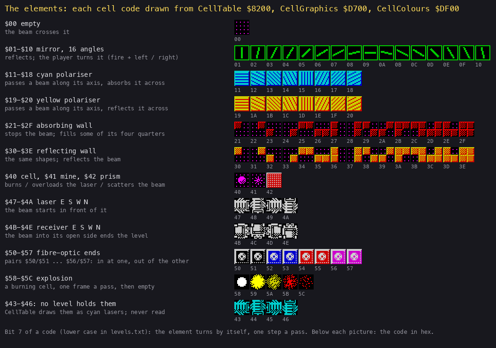

*Every element code as the game draws it, from its own tables: CellTable `$8200` (four characters a code),
CellGraphics `$D700`, CellColours `$DF00`. How to read it: one row a kind; the hex code under each picture. The point:
about 90 codes, of which only the 16 mirror angles are the player's to change. Command: `python3 tools/fig_elements.py
docs/img/design/elements.png`.*

| Element | Codes | What it does to the beam | Witness |
| --- | --- | --- | --- |
| Empty | `$00` | crosses it | every level |
| Mirror | `$01-$10` | reflects it; 16 angles; the player turns it (fire + left / right) | `L01` (7 mirrors turned) |
| Cyan polariser | `$11-$18` | passes it along its axis; stops it across | `L01` row 0, column 10 |
| Yellow polariser | `$19-$20` | passes it along its axis; reflects it across | `L01` row 4, column 7 |
| Absorbing wall | `$21-$2F` | stops it | `L01` (the red walls) |
| Reflecting wall | `$30-$3E` | reflects it | `L01` (the orange walls) |
| Cell | `$40` | burns when the beam crosses it: points | `L01` 395 |
| Mine | `$41` | the beam on it: the overload bar 4 steps a pass | `L01` 1336 |
| Prism | `$42` | sends the beam on in a random direction | RZX segments, level 60 |
| Laser | `$47-$4A` (east, south, west, north) | the beam's start; the beam back into it: overload | `L01` 262 |
| Receiver | `$4B-$4E` (east, south, west, north) | the goal; shut by the element in front of it until the last cell burns | `L01` 1420-1520 |
| Fibre-optic end | `$50-$57` (pairs) | the beam into one end comes out of the other | `L01` (pair 2) |
| Explosion | `$57-$5C` | a burning cell or a blown door, one frame a pass | `L01` 395 |

Bit 7 of a code makes the element turn by itself, one step a pass: turning mirrors and turning polarisers. Gremlins
are not cells: they walk over the field and stop on mirrors. The rules of each element as code are in
[doc 10](10-gameplay-logic.md).

## 1.5 The rules

### A level, start to end

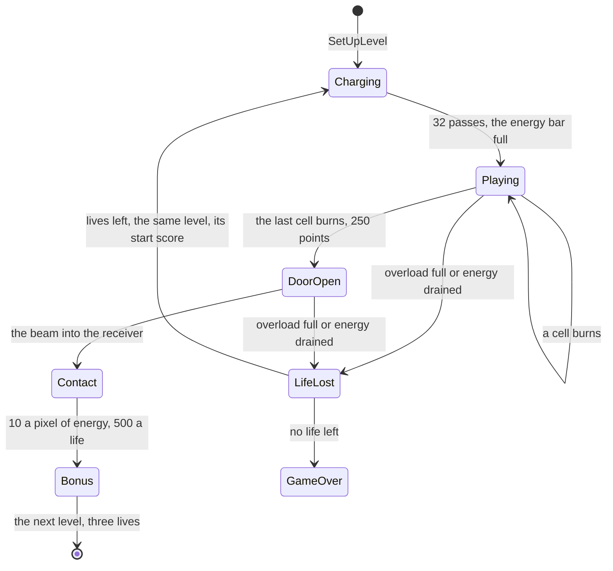

*A level's states. Code: SetUpLevel `$843C`, ChargeLaser `$A57A`, PassEnd `$85AE`, OpenReceiver `$8B3F`,
LevelComplete `$87D4`, LoseLife `$866A`. Witness: `L01` (the charge frames 70-230, the door 1420, CONTACT 1520),
`energy` (drained 6450), `mine` (three lives in a row). The point: the door fixes the order: all the cells, then the
receiver.*

1. **The charge.** A level starts with CHARGING LASER and no beam. For 32 passes the energy bar fills, and every mirror
   may turn one step at random (1 in 2 each pass, 1 in 8 on levels with 30 mirrors or more). So a level never starts
   as its data says. In `L01` the mirror at row 0, column 0 is `$07` in the data and `$09` when the charge ends.
2. **The beam.** From then on, every pass traces the beam from the laser over the field. A beam longer than 40
   steps (about 40 cells) counts as a beam back in the laser: OVERLOAD on every pass; a trace stops at 150 steps.
3. **The cells.** A cell the beam crosses explodes (five pictures over five passes) and is gone: 120 points, or 30 on
   levels with 30 cells or more.
4. **The door.** When the last cell burns, the element in front of the receiver explodes like a cell: 250 points. In
   the 60 levels that element is a mine (23 levels), a wall (32), a block (4) or a fibre-optic end (1).
5. **Contact.** The beam into the receiver's open side: CONTACT!, the field turns magenta, every pixel of energy left
   is 10 points, every life left 500 points. Then the next level, with three lives.

### The pressures

| Pressure | Rises when | Falls when | At the end | Witness |
| --- | --- | --- | --- | --- |
| Overload bar (64 steps) | the beam ends in the laser, or is longer than 40 steps: 1 step a pass (OVERLOAD); the beam on a mine: 4 steps a pass (MINE ALERT) | 1 step a pass otherwise | full: a life (not in practice) | `L01` 262 (OVERLOAD), 1336 (MINE ALERT); `mine`, `overload` |
| Energy bar (64 pixels) | the charge fills it | 1 pixel every "rate" frames (70 to 140 by level; 255 in practice) | 1 pixel: ENERGY CRITICAL, the beam flickers; empty: ENERGY DRAINED, a life | `energy` 5000, 5750, 6450 |
| Gremlins (0-8 a level) | one appears after its delay | fire on its cell kills it (160 points); it comes back later | it turns the mirror it sits on, one random step a pass | `L03` 1170 |

The energy is the level's clock: 64 pixels at 90 frames a pixel is 5760 frames, 115 seconds, for level 1. In `energy`
the bar is full at about frame 650 and drained at 6450: 5800 frames.

### Score

| Event | Points | Code | Witness |
| --- | --- | --- | --- |
| A cell burnt | 120 (30 on a level of 30 cells or more) | CellPoints `$8F62`, set by SetUpLevel | `L01` 395: 120 |
| The last cell burnt, the door opened | 250 | PassEnd `$85EA` | `L01`: 19 x 120 + 250 = 2530 at CONTACT |
| A gremlin killed | 160 | CursorFire `$9A57` | RZX segments only |
| Each energy pixel left at CONTACT | 10 | LevelCompletePause `$8806` | `L01` from 1610 |
| Each life left at CONTACT | 500 | LevelCompletePause `$882A` | `L01` |

A life lost puts the score back to its value at the level's start (SetUpLevel reads the score saved at `$9B44`). The
hall of fame holds six places: MEGA 090000, GREAT 075000, GOOD 060000, SO-SO 045000, BAD 030000, AWFUL 015000. A
score strictly above one of them takes its place; the name is five letters ([doc 8](08-hud-and-text.md)).

The point: the score grows only by burning cells and finishing levels. A life lost costs the whole level's points, so
the energy and lives bonus rewards speed and care.

### The rules as pseudocode

```text
a pass:
    read the keys; move the cursor, or turn the mirror under it (fire held)
    every turning element turns one step
    if charging: scramble the mirrors, fill the energy bar; after 32 passes stop charging
    else: trace the beam from the laser (it burns cells and sets the flags below)
    move the gremlins; a gremlin on a mirror turns it
    overload bar: +4 if the beam lies on a mine, +1 if it ends in the laser, else -1
    if the overload bar is full and not practice: a life
    energy: -1 pixel every rate frames; empty: a life
    if the beam reached the open receiver: CONTACT, the bonus, the next level
    if no cell is left (the first time): blow the receiver's door, +250
```

## 1.6 The 60 levels

LevelData `$B000` holds 64 slots of 135 bytes. Slots 0-59 are levels 1-60, 60-62 the practice levels P1-P3, and slot
63 is never set up. Every picture below is drawn by the game's own BuildLevel `$891A` and renderer in SkoolKit's
simulator, from `src/res/levels/levels.txt`.

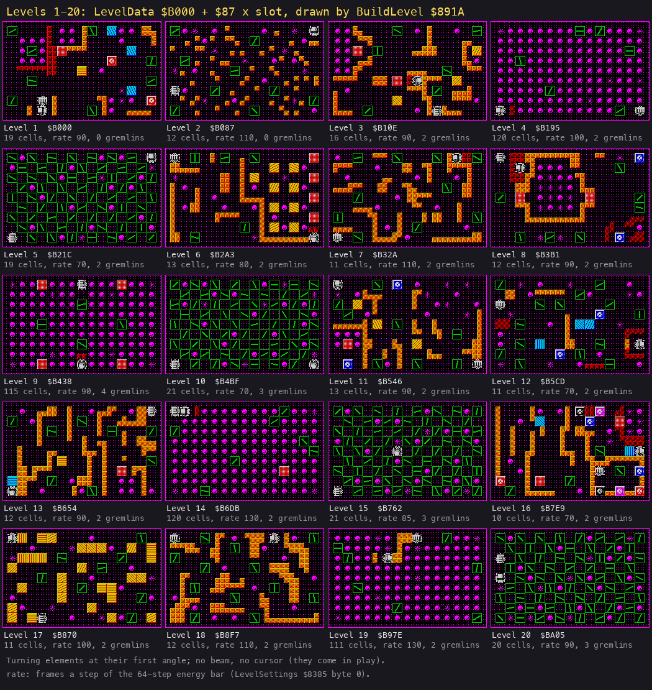

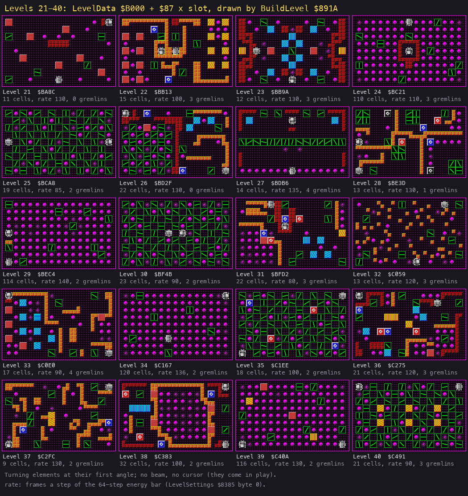

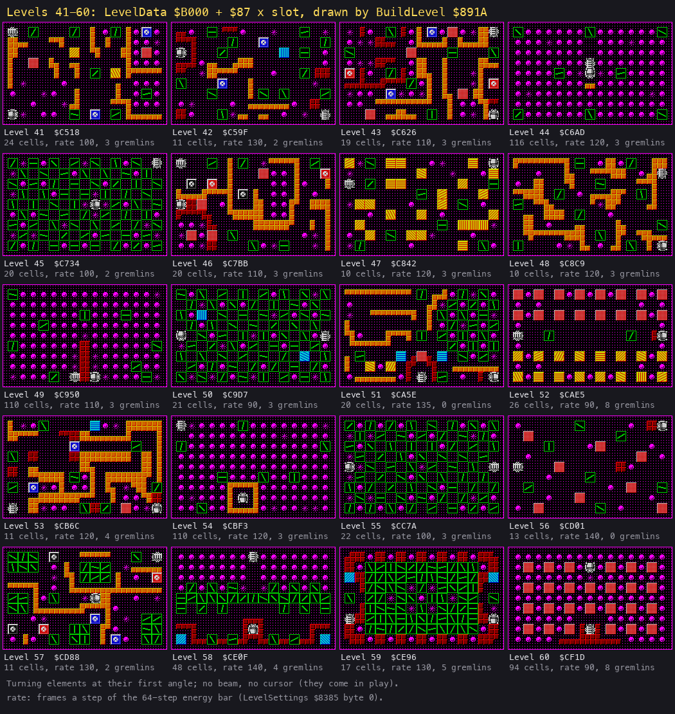

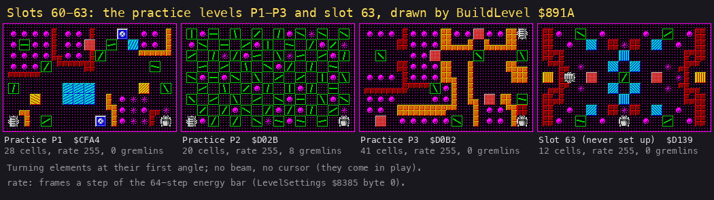

*The 64 level slots in four sheets. How to read it: each picture is the field as BuildLevel draws it, before the
charge scrambles the mirrors; under it the level, its address, its cells, its energy rate (frames a pixel) and its
gremlins. The point: every fifth level from 4 (4, 9, ..., 54) is a field of 110-120 cells, every fifth from 5 (5, 10,
..., 55) a field of 60-66 mirrors; the others are puzzles of 10-30 cells. Command: `python3 tools/fig_levels.py
docs/img/maps --table work/docs/dfA/levels-table.md`. The stage 2 maps, all levels in one picture:
[`all.png`](img/maps/all.png).*

What each slot holds (the codes counted by kind; "Turning" counts every element with bit 7):

| Level | Address | Cells | Mirrors | Turning | Cyan / yellow polarisers | Absorbing / reflecting walls | Mines | Prisms | Fibre ends | Energy rate | Gremlins |
| --- | --- | ---: | ---: | ---: | --- | --- | ---: | ---: | ---: | ---: | ---: |
| Level 1 | `$B000` | 19 | 8 | 3 | 3 / 1 | 8 / 15 | 2 | 1 | 2 | 90 | 0 |
| Level 2 | `$B087` | 12 | 9 | 0 | 0 / 0 | 0 / 48 | 9 | 0 | 0 | 110 | 0 |
| Level 3 | `$B10E` | 16 | 6 | 3 | 0 / 3 | 1 / 41 | 0 | 2 | 0 | 90 | 2 |
| Level 4 | `$B195` | 120 | 6 | 1 | 0 / 0 | 1 / 0 | 5 | 0 | 0 | 100 | 2 |
| Level 5 | `$B21C` | 19 | 66 | 0 | 0 / 0 | 0 / 0 | 3 | 0 | 0 | 70 | 2 |
| Level 6 | `$B2A3` | 13 | 5 | 9 | 0 / 9 | 1 / 33 | 3 | 4 | 0 | 80 | 2 |
| Level 7 | `$B32A` | 11 | 10 | 0 | 0 / 0 | 1 / 47 | 0 | 0 | 0 | 110 | 2 |
| Level 8 | `$B3B1` | 12 | 7 | 0 | 0 / 0 | 12 / 26 | 11 | 2 | 2 | 90 | 2 |
| Level 9 | `$B438` | 115 | 4 | 2 | 0 / 0 | 1 / 0 | 8 | 4 | 0 | 90 | 4 |
| Level 10 | `$B4BF` | 21 | 66 | 0 | 0 / 0 | 0 / 0 | 6 | 0 | 0 | 70 | 3 |
| Level 11 | `$B546` | 13 | 8 | 3 | 0 / 3 | 0 / 30 | 6 | 1 | 2 | 90 | 2 |
| Level 12 | `$B5CD` | 11 | 14 | 0 | 3 / 0 | 8 / 9 | 7 | 0 | 2 | 70 | 2 |
| Level 13 | `$B654` | 12 | 8 | 2 | 1 / 1 | 0 / 53 | 0 | 1 | 0 | 90 | 2 |
| Level 14 | `$B6DB` | 120 | 7 | 1 | 0 / 0 | 1 / 0 | 3 | 1 | 0 | 130 | 2 |
| Level 15 | `$B762` | 21 | 66 | 4 | 0 / 0 | 0 / 0 | 4 | 0 | 0 | 85 | 3 |
| Level 16 | `$B7E9` | 10 | 4 | 0 | 2 / 0 | 6 / 46 | 4 | 2 | 8 | 70 | 2 |
| Level 17 | `$B870` | 11 | 8 | 5 | 0 / 29 | 0 / 0 | 5 | 0 | 0 | 100 | 2 |
| Level 18 | `$B8F7` | 12 | 12 | 0 | 0 / 0 | 0 / 51 | 0 | 0 | 0 | 110 | 2 |
| Level 19 | `$B97E` | 111 | 7 | 1 | 0 / 0 | 0 / 5 | 8 | 0 | 0 | 130 | 2 |
| Level 20 | `$BA05` | 20 | 66 | 4 | 0 / 0 | 0 / 0 | 8 | 0 | 0 | 90 | 3 |
| Level 21 | `$BA8C` | 11 | 5 | 0 | 0 / 0 | 4 / 0 | 0 | 7 | 0 | 130 | 0 |
| Level 22 | `$BB13` | 15 | 5 | 8 | 0 / 8 | 1 / 37 | 0 | 8 | 2 | 100 | 3 |
| Level 23 | `$BB9A` | 12 | 5 | 1 | 10 / 2 | 34 / 0 | 7 | 2 | 0 | 130 | 3 |
| Level 24 | `$BC21` | 110 | 9 | 3 | 0 / 0 | 9 / 0 | 4 | 0 | 0 | 110 | 3 |
| Level 25 | `$BCA8` | 19 | 66 | 0 | 0 / 0 | 0 / 0 | 10 | 0 | 0 | 85 | 2 |
| Level 26 | `$BD2F` | 22 | 27 | 3 | 3 / 0 | 17 / 20 | 8 | 1 | 2 | 130 | 0 |
| Level 27 | `$BDB6` | 14 | 19 | 15 | 2 / 0 | 18 / 0 | 2 | 0 | 0 | 135 | 4 |
| Level 28 | `$BE3D` | 13 | 19 | 0 | 0 / 0 | 0 / 35 | 3 | 0 | 6 | 130 | 1 |
| Level 29 | `$BEC4` | 114 | 10 | 1 | 0 / 0 | 0 / 1 | 7 | 0 | 0 | 140 | 2 |
| Level 30 | `$BF4B` | 23 | 66 | 0 | 0 / 0 | 0 / 0 | 17 | 0 | 0 | 90 | 2 |
| Level 31 | `$BFD2` | 22 | 7 | 5 | 4 / 1 | 10 / 18 | 8 | 1 | 4 | 80 | 3 |
| Level 32 | `$C059` | 13 | 9 | 0 | 0 / 0 | 0 / 46 | 9 | 0 | 0 | 120 | 3 |
| Level 33 | `$C0E0` | 17 | 5 | 7 | 7 / 0 | 1 / 31 | 8 | 5 | 0 | 90 | 4 |
| Level 34 | `$C167` | 120 | 6 | 1 | 0 / 0 | 0 / 0 | 6 | 0 | 0 | 136 | 2 |
| Level 35 | `$C1EE` | 18 | 62 | 0 | 0 / 0 | 0 / 0 | 11 | 0 | 4 | 100 | 2 |
| Level 36 | `$C275` | 21 | 9 | 2 | 4 / 3 | 23 / 11 | 3 | 1 | 4 | 120 | 3 |
| Level 37 | `$C2FC` | 9 | 10 | 0 | 0 / 2 | 0 / 39 | 5 | 0 | 2 | 130 | 2 |
| Level 38 | `$C383` | 32 | 4 | 0 | 3 / 0 | 14 / 31 | 16 | 4 | 4 | 100 | 2 |
| Level 39 | `$C40A` | 116 | 7 | 2 | 0 / 2 | 0 / 0 | 5 | 2 | 0 | 130 | 2 |
| Level 40 | `$C491` | 21 | 60 | 6 | 0 / 6 | 0 / 0 | 10 | 0 | 0 | 90 | 3 |
| Level 41 | `$C518` | 24 | 7 | 3 | 0 / 2 | 0 / 34 | 5 | 2 | 2 | 100 | 3 |
| Level 42 | `$C59F` | 11 | 13 | 0 | 1 / 0 | 13 / 15 | 7 | 0 | 2 | 130 | 2 |
| Level 43 | `$C626` | 19 | 7 | 0 | 0 / 0 | 15 / 37 | 12 | 4 | 4 | 110 | 3 |
| Level 44 | `$C6AD` | 116 | 8 | 2 | 0 / 0 | 0 / 1 | 6 | 0 | 0 | 120 | 3 |
| Level 45 | `$C734` | 20 | 66 | 9 | 0 / 0 | 0 / 0 | 13 | 0 | 0 | 100 | 2 |
| Level 46 | `$C7BB` | 20 | 6 | 0 | 0 / 0 | 7 / 38 | 7 | 4 | 4 | 110 | 3 |
| Level 47 | `$C842` | 10 | 9 | 6 | 0 / 25 | 0 / 0 | 8 | 0 | 0 | 120 | 3 |
| Level 48 | `$C8C9` | 10 | 11 | 0 | 0 / 0 | 0 / 54 | 2 | 0 | 0 | 120 | 3 |
| Level 49 | `$C950` | 110 | 9 | 2 | 0 / 0 | 4 / 0 | 9 | 0 | 0 | 110 | 3 |
| Level 50 | `$C9D7` | 21 | 64 | 14 | 2 / 0 | 0 / 0 | 10 | 0 | 0 | 90 | 3 |
| Level 51 | `$CA5E` | 20 | 23 | 2 | 2 / 2 | 7 / 38 | 6 | 1 | 0 | 135 | 0 |
| Level 52 | `$CAE5` | 26 | 2 | 16 | 0 / 16 | 1 / 0 | 0 | 16 | 0 | 90 | 8 |
| Level 53 | `$CB6C` | 11 | 8 | 2 | 1 / 0 | 8 / 54 | 6 | 1 | 2 | 120 | 4 |
| Level 54 | `$CBF3` | 110 | 7 | 1 | 0 / 0 | 0 / 8 | 7 | 0 | 0 | 120 | 3 |
| Level 55 | `$CC7A` | 22 | 66 | 10 | 0 / 0 | 0 / 0 | 10 | 0 | 0 | 100 | 3 |
| Level 56 | `$CD01` | 13 | 7 | 0 | 0 / 0 | 2 / 0 | 0 | 8 | 0 | 140 | 0 |
| Level 57 | `$CD88` | 11 | 29 | 0 | 0 / 0 | 0 / 36 | 6 | 0 | 6 | 130 | 2 |
| Level 58 | `$CE0F` | 48 | 31 | 27 | 2 / 0 | 18 / 0 | 2 | 0 | 0 | 140 | 4 |
| Level 59 | `$CE96` | 17 | 72 | 2 | 2 / 0 | 30 / 0 | 7 | 0 | 0 | 130 | 5 |
| Level 60 | `$CF1D` | 94 | 0 | 0 | 0 / 0 | 9 / 0 | 1 | 26 | 0 | 90 | 8 |
| Practice P1 | `$CFA4` | 28 | 8 | 4 | 7 / 2 | 14 / 10 | 6 | 1 | 2 | 255 | 0 |
| Practice P2 | `$D02B` | 20 | 66 | 0 | 0 / 0 | 0 / 0 | 6 | 0 | 0 | 255 | 8 |
| Practice P3 | `$D0B2` | 41 | 6 | 0 | 0 / 0 | 11 / 34 | 0 | 4 | 0 | 255 | 0 |
| Slot 63 (never set up) | `$D139` | 12 | 5 | 1 | 10 / 2 | 34 / 0 | 7 | 2 | 0 | 255 | 0 |

Patterns read from the table:

- Two kinds of level break the puzzles every five levels: the cell fields (4, 9, ..., 54: 110-120 cells, 30 points a
  cell) and the mirror fields (5, 10, ..., 55: 60-66 mirrors, so the charge scrambles at 1 in 8). Level 59 has 72
  mirrors, practice P2 is a mirror field too.
- No gremlins on levels 1, 2, 21, 26, 51, 56; eight on levels 52 and 60.
- The energy rate runs from 70 to 140 frames a pixel; the slowest levels (130-140) cluster from level 19 on.
- Level 60 is 94 cells and 26 prisms: the beam scatters at random until the field is clear.

## 1.7 How a level is solved

A level is solved by turning mirrors so that the beam crosses every cell, then reaches the receiver. The beam need not
cross all the cells at once: a cell burnt is gone for good. So the play is a walk: aim the beam at a few cells, burn
them, turn a mirror, aim at the next ones, and keep the beam off the mines and out of the laser while doing it.

The stage 2 bot (`tools/play_levels.py` with `tools/solver.py`) plays this way. Each time it plans, it runs the game's
own TraceBeam `$8ED6` in a CPU simulator for candidate mirror angles and picks the turns that burn the most cells, then
the turns that reach the receiver. On level 1 it made 49 key changes over 1645 frames:

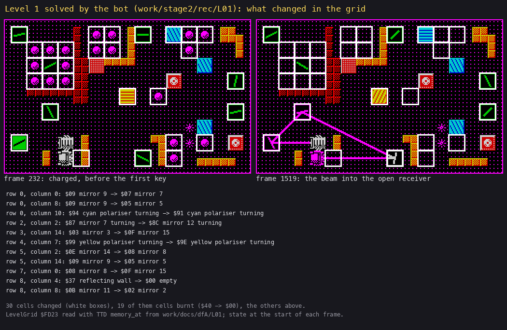

*The field of `L01` at frame 232 (the charge done, before the first key) and at frame 1519 (the beam into the open receiver), every
changed cell boxed; the list names the changes that are not burnt cells. How to read it: of the 30 changed cells, 19
are the cells burnt, 7 are mirrors the bot turned, 1 the turning mirror and 2 the turning polarisers (they turn by
themselves), 1 the receiver's door (the reflecting wall `$37` at row 8, column 4, gone). The point: seven mirrors at
new angles are the whole solution of level 1. Command: `python3 tools/fig_solve.py --work work/docs/dfA/L01 --frames
232,1519 --labels "..." --title "..." docs/img/design/level-01-solved.png` (`work/stage2/rec/L01` opened on port base
37480).*

A worked example: the last turn of level 1.

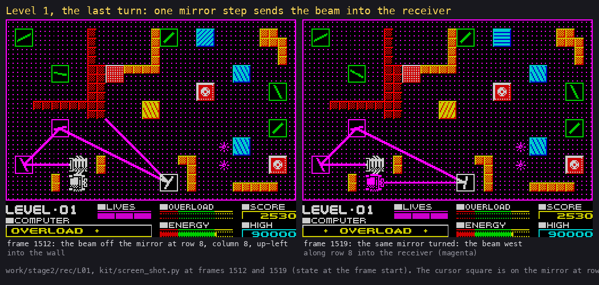

*`L01` at frames 1512 and 1519. How to read it: follow the magenta line from the laser (the grey block at row 7,
column 3). The point: one step of one mirror moves the end of the beam from a wall into the receiver.*

1. At frame 1512 the beam leaves the laser westwards, meets the mirror at row 7, column 0 (`$0F`), goes up and right to
   the mirror at row 5, column 2 (`$08`), then down and right to the mirror at row 8, column 8. That mirror sends it up
   and left into the absorbing wall: the trace ends there.
2. The cursor is on the mirror at row 8, column 8 with fire held (the square). The bot's script holds `0 6` (fire and
   left) from frame 1495 to 1513.
3. The mirror steps down one a pass while fire and left are held (ControlBits `$96C5` = `$11`): `$06` before frame
   1500, then `$05`, `$04`, `$03` (at 1512), `$02` (by 1515; `tools/ttd_watch.py --addr FDB3,96C5`). Mirror 3 sends a
   beam arriving in direction 1 (east, one down in two across) out in direction (3 - 1 - 1 + 8) AND 15 = 9 (west, up):
   into the wall. Mirror 2 sends it out in direction (2 - 1 - 1 + 8) AND 15 = 8: due west along row 8. The door at row 8, column 4 is gone since frame 1420, so the beam meets
   the receiver's open east side at row 8, column 3, and the receiver turns magenta (HighlightCell).
4. BeamStep sets LevelDone `$8ED2` at `$8FA9`; PassEnd runs LevelComplete: CONTACT (message `$18`) from frame 1520.

Levels completed this way by the bot, each a replayable recording `work/stage2/rec/LNN`: 1, 3, 5, 6, 9, 10, 12, 15,
20, 22, 25, 30, 31, 35, 39, 42, 45, 51, 55, 59. The other 40 levels were completed by the RZX player (stage 1, 60
segments, someone else's play); on the bot's clones they were skipped by a POKE of LevelDone `$8ED2`.

## 1.8 Modes and difficulty

| Mode | How | What differs | Code | Witness |
| --- | --- | --- | --- | --- |
| Game | 7 | levels 1-60, three lives a level, the energy and overload bars | NewGame `$8419` | `c1`, the L recordings |
| Practice | 6 | levels P1-P3 (slots 60-62); energy rate 255 (a pixel every 5.1 s); a full overload bar takes no life; after P3 the title | PracticeFlag `$8407`, `$8424`, `$A7E3` | `practice` (P1 played to frame 2500) |
| Demo | 5 | every level for one pass while it charges; SPACE stops it (DEMO ABORTED) | `$8379`, MainLoop `$855F` | `menu` (60 levels) |

The difficulty grows by the puzzles, not by the rules: the rules and the scoring are the same on every level; only the
field, the energy rate and the gremlin count change.

## 1.9 What no recording reached

- A gremlin killed by our own fire: the kill at CursorFire `$9A57` ran only in RZX segments.
- The Y + T level drop `$983E`: never run. The W / S level cheat `$9832` is dormant (jumped over at `$982F`); it ran
  only on a clone with the jump POKEd away (`work/stage2/rec/cheat`, [doc 5](05-controls.md)).
- Practice levels P2 and P3 (P1 only, in `practice`).
- The 40th bounce of a beam (`$96B8`, [doc 10](10-gameplay-logic.md)).
- Slot 63: no code sets Level `$81FF` to 63 before a level is set up.
