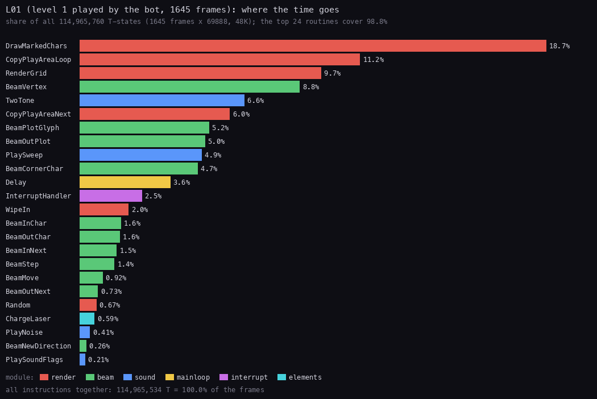
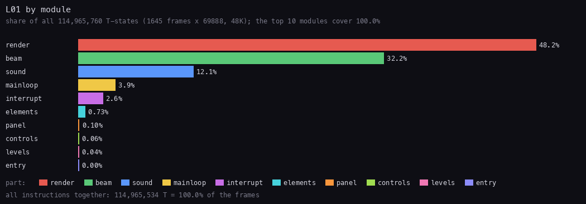
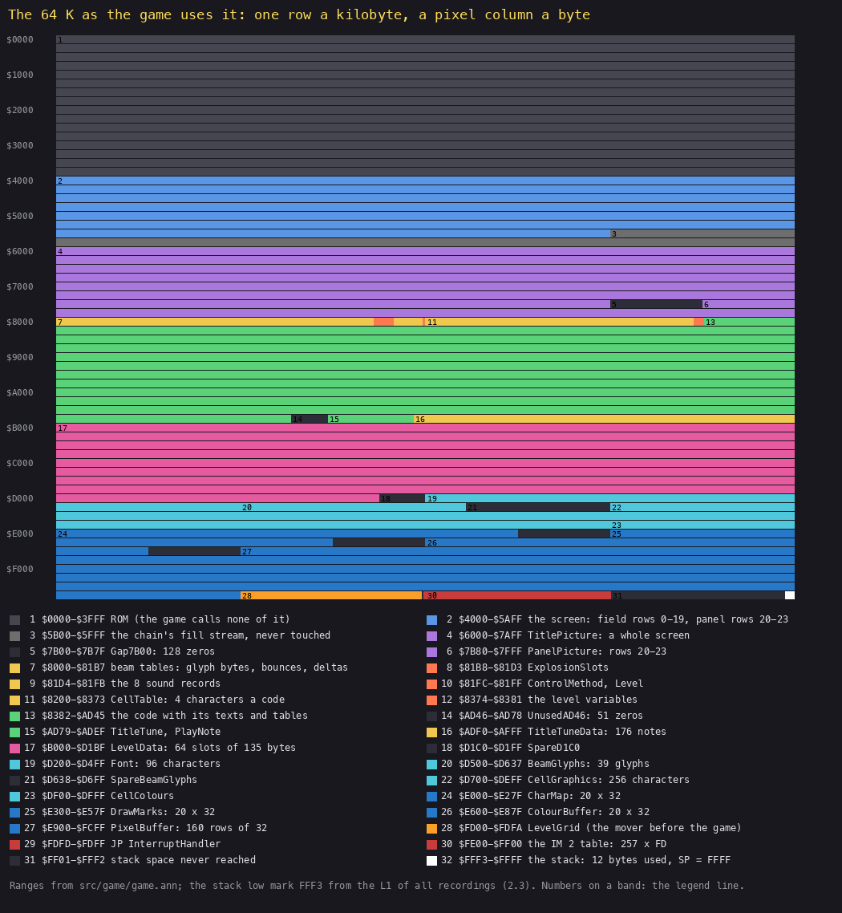
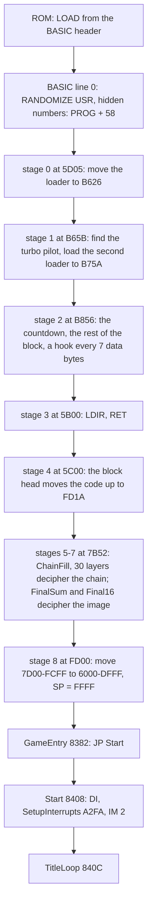
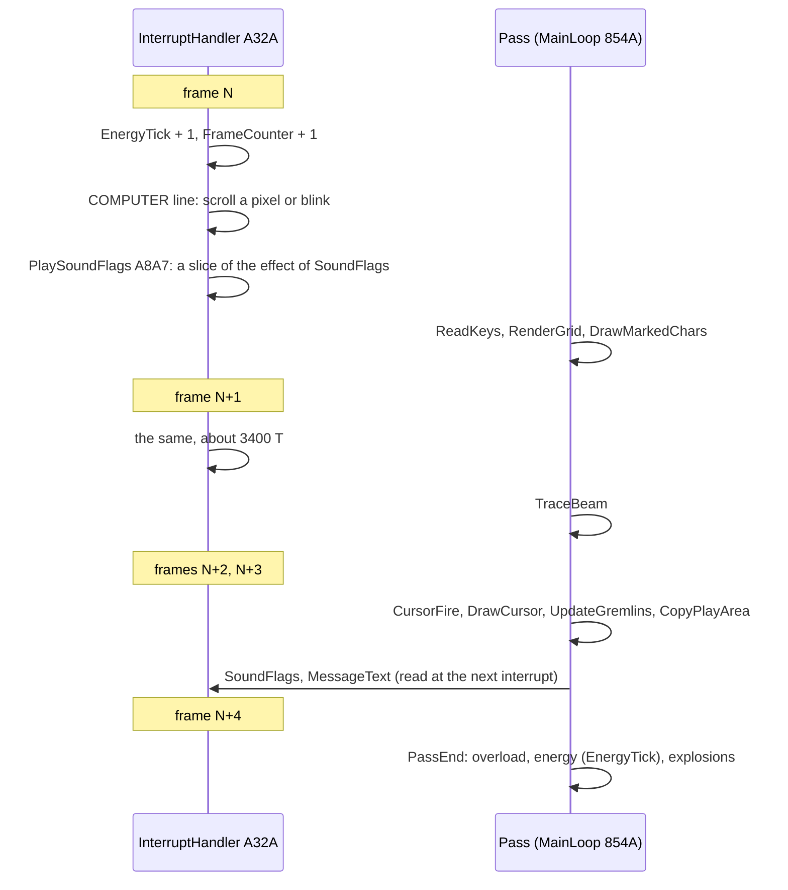
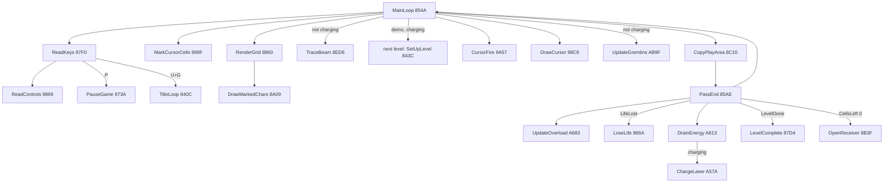

# 2. Architecture

What this covers: the machine and where its time goes, the memory map as a picture and as a table, the heatmap and
the stack, the stages from power-on to play, the frame (the interrupt against the pass), the main loop's call graph,
the module map, the levels in memory, and the leftovers: every byte the game carries but never uses.

The recordings it rests on ([WALKTHROUGH 6.0](../WALKTHROUGH.md#60-the-recordings)):

- `c1` and its game window `c1g`: power-on, the 10 Mega Games copy of the tape at ROM timing, the title, the options,
  level 1.
- `L01` (stage 2, `work/stage2/rec/L01`): level 1 completed by the bot, 1645 frames; the time budget is measured on it.
- The 68 recordings summed for the heatmap: `c1g`, `menu`, `controls`, `kempston`, `energy`, `overload`, `mine`,
  `gameover` and the 60 RZX segments (someone else's play). `overload`, `mine` and `gameover` start on a clone (the
  bars and the beam flags POKEd), so their states are not reached by play from power-on as recorded.

## 2.1 The machine and the budget

Deflektor runs on a 48K Spectrum and uses nothing else: no ROM routine after the load, no AY, no 128K memory. It runs
in interrupt mode 2 with a table of its own. The CPU's time splits between two threads of control:

- **the interrupt**, 50 times a second: two counters, the COMPUTER line's scroll or blink, one slice of a sound effect;
- **the pass** (the main loop, [the term](README.md#terms)): read the keys, redraw the changed characters of the
  field, trace the beam, copy the field to the screen, then the bars, the explosions and the level's end.

The pass never waits for the interrupt: there is no `HALT` in it. A pass takes as long as its work: 5.2 frames on
average in `L01` (277 passes over the level's 1450 frames of play), 4.85 in the RZX run, and 23-25 frames for the
first pass of a level, which draws all 640 characters.



*Every routine's share of all the T-states of `L01` (1645 frames x 69 888 T), the top 24, coloured by module. How to
read it: a bar is a routine's own instructions (labels inside it count for it); the colours are the modules of 2.6.
The point: half the time is drawing (DrawMarkedChars and the copy of the field to the screen), a third is the beam;
the beeper effects played from the main code (TwoTone, PlaySweep) take 12 %, because they are busy loops. Command:
`python3 ../../kit/fig_budget.py work/stage2/rec/L01/l1.json docs/img/arch/budget-l01.png --ann src/game/game.ann
--title "..." --top 24`.*



*The same T-states summed by module. The point: render 48 %, beam 32 %, sound 12 %, everything else together 8 %.
Command: `python3 ../../kit/fig_budget.py work/stage2/rec/L01/l1.json docs/img/arch/budget-modules.png --ann
src/game/game.ann --by module --title "L01 by module"`.*

Worked example, the length of a pass from the counts of `L01`'s L1 (`tools/l1q.py 854A A32A 8ED6`): MainLoop
`$854A` ran 277 times, the interrupt `$A32A` 1621 times (the frames with interrupts on), TraceBeam `$8ED6` 245 times
(the other 32 passes are the charge, which traces no beam). 1621 / 277 = 5.85 interrupts a pass over the whole
recording; the bonus count and the level start add frames with no pass, so a pass in play is close to 5.

## 2.2 The memory map



*The 64 K, one row a kilobyte, each byte coloured by what it holds; numbered regions with the legend below. How to
read it: from the top left, `$0000`, to the bottom right, `$FFFF`; dark grey bands are bytes nobody uses. The point:
the game is one image from `$6000` to `$DFFF` (the loader's mover puts it there), with its work buffers above it in
`$E000-$FCFF`, the level grid and the interrupt table at the top, and a stack of 12 bytes. Command: `python3
tools/fig_memmap.py docs/img/arch/memmap.png` (the ranges from `src/game/game.ann`).*

| Range | What | Witness |
| --- | --- | --- |
| `$0000-$3FFF` | ROM: the font at `$3D00` for the loader only; the game runs no ROM code | the L1 of all recordings: no instruction below `$8382` runs after the entry (2.3) |
| `$4000-$5AFF` | the screen: the field in rows 0-19 (a border and 15 x 9 cells of 2 x 2 characters), the panel in rows 20-23 | screenshots ([doc 1](01-game-design.md#12-the-screens)) |
| `$5B00-$5FFF` | the chain's fill stream: ChainFill writes `$5B00-$7B51` and `$FD1B-$FFFF` before the layers run, so the BASIC, the loader's stubs and the block head are overwritten (`$5B00` reads `95 F0 FC C9` at the entry); never read or written by the game | [doc 3, 3.5](03-build-and-load.md#35-the-cipher) |
| `$6000-$7AFF` | TitlePicture: the title, a whole screen (6912 bytes), copied to `$4000` by TitleScreen `$A729` | L1: read, never written |
| `$7B00-$7B7F` | Gap7B00: 128 zeros | no instruction reads them |
| `$7B80-$7FFF` | PanelPicture: rows 20-23 of the screen, 1024 pixel bytes in plain rows and 128 attributes | LevelPanel `$8432` |
| `$8000-$81B7` | the beam's tables: BeamGlyphBytes `$8000`, OutBounceTable `$8080`, InCornerTable `$8100`, InBounceTable `$8140`, BeamDeltas `$8170`, GrazeOffsets `$8190`, PolariserCells `$81A0` | TraceBeam ([doc 10](10-gameplay-logic.md)) |
| `$81B8-$81D3` | ExplosionSlots: seven 4-byte slots | PassEnd `$85AE` |
| `$81D4-$81FB` | the eight PlaySound records, 5 bytes each | [doc 9](09-sound.md) |
| `$81FD`, `$81FF` | ControlMethod (0 keyboard, 1 Sinclair, 2 Kempston, 3 Protek), Level (0-59 the levels, 60-62 practice) | `controls`; RZX watch |
| `$8200-$8373` | CellTable: four character codes for each cell code `$00-$5C` | RenderGrid `$8960`; [the elements](img/design/elements.png) |
| `$8374-$8381` | the level's variables: the beam's start, the demo flag, MirrorCount, lives, FrameCounter, CellsLeft | SetUpLevel `$843C` |
| `$8382-$AD45` | the code, with its texts and tables between the routines: LevelSettings `$8385`, the LEVEL digits `$88B0`, INTERMISSION `$972C`, the score `$9B3E`, the hall of fame `$9FEB`, the COMPUTER messages `$A10E-$A2C3`, the ending's text `$A984` | the L1 of `c1g`; 4371 instructions run |
| `$AD46-$AD78` | UnusedAD46: 51 zeros | 2.8 |
| `$AD79-$AFFF` | TitleTune, PlayNote and TitleTuneData (176 notes) | `menu` |
| `$B000-$D1BF` | LevelData: 64 slots of 135 bytes (15 x 9 cells): levels 1-60, practice P1-P3, slot 63 | BuildLevel `$891A`; 2.7 |
| `$D1C0-$D1FF` | SpareD1C0: 64 zeros | 2.8 |
| `$D200-$D4FF` | Font: 96 characters (32-127) of 8 bytes | PrintFull `$8E3A` ([doc 8](08-hud-and-text.md)) |
| `$D500-$D637` | BeamGlyphs: 39 glyphs of the beam | [doc 6](06-rendering.md) |
| `$D638-$D6FF` | SpareBeamGlyphs: 25 glyph slots never named | 2.8 |
| `$D700-$DEFF` | CellGraphics: the cell characters, 8 bytes each (`$D700` + 8 x code) | DrawMarkedChars `$8A09` |
| `$DF00-$DFFF` | CellColours: an attribute a character (`$DF00` + code) | DrawMarkedChars `$8A09` |
| `$E000-$E27F` | CharMap: the field's characters, 20 rows of 32 | RenderGrid `$8960` |
| `$E300-$E57F` | DrawMarks: "to draw" counts, one a character | DrawMarkedChars `$8A09` |
| `$E600-$E87F` | ColourBuffer: the field's attributes, 20 rows of 32 | CopyPlayArea `$8C10` |
| `$E900-$FCFF` | PixelBuffer: the field's pixels, 160 rows of 32 bytes in plain order | CopyPlayArea `$8C10` |
| `$FD00-$FDFA` | LevelGrid: the level's cells from `$FD23`, 17 bytes a row; before the game, the loader's mover | BuildLevel `$891A`; [doc 3](03-build-and-load.md#31-the-tape-block-by-block) |
| `$FDFD-$FDFF` | `JP $A32A`, the interrupt's jump | SetupInterrupts `$A2FA` |
| `$FE00-$FF00` | the IM 2 table: 257 bytes of `$FD` | SetupInterrupts `$A2FA` |
| `$FFF3-$FFFE` | the stack (`SP` = `$FFFF` from the mover): 12 bytes, its low mark `$FFF3` | 2.3 |

The point: four buffers in high memory hold the whole field (characters, marks, colours, pixels). The screen is only
ever written by copies from them, so a pass that changes one mirror redraws only that mirror's four characters into
the buffers, then copies the field.

## 2.3 The heatmap and the stack


*The L1s of 68 recordings summed (`tools/l1_merge.py` into `work/stage1/all-l1.json`, drawn by `kit/heatmap.py` with
`work/stage1/regions.txt`): `c1g`, `menu`, `controls`, `kempston`, `energy`, `overload`, `mine`, `gameover` and the
60 RZX segments, 395 379 frames, 4371 distinct instructions. How to read it: one row a page; executions, reads and
writes in their own colours, brighter for more. The point: code runs only in `$8382-$AFFF`; the hot writes are the
buffers and the screen.*

What it shows:

- Code runs only in `$8382-$AFFF` and at `$FDFD` (the IM 2 jump): no ROM routine, nothing in `$5B00-$7FFF` or the
  level area.
- `$5B00-$5FFF` is never read or written after the entry; `$6000-$7FFF` (the title and the panel pictures) is read
  only; the levels `$B000-$D1BF` are read only.
- Inside `$8382-$AFFF`, 376 bytes are written: the variables between the routines and the operands the code changes
  (the noise's operation `$A89F`, CellPoints `$8F62`).
- The heaviest writes are the field's buffers `$E000-$FCFF` and the screen; `$FD00-$FDFF` (the grid) and
  `$FE00-$FF00` (the IM 2 table, written once) follow.
- **The stack's low mark is `$FFF3`**: the lowest byte written in `$FF01-$FFFF` over all recordings, 12 bytes under
  `SP` = `$FFFF`, so the stack never comes near the IM 2 table at `$FF00`.

## 2.4 From power-on to play



*The stages from the tape to the game's first instruction, each with its entry address (the hex in the boxes is an
address). Witness: `c1` (each stage's first instruction by frame and T-state, [doc 3](03-build-and-load.md)). The
point: eight stages of loader and cipher end in one move of the whole image to `$6000-$DFFF`; the game then never
touches the loader's memory again.*

The entry sets up the interrupt and falls into the title loop:

```asm
GameEntry:              ; $8382, where the mover jumps
  JP Start
  ...                   ; LevelSettings $8385 (2 bytes a level), PracticeFlag $8407
Start:                  ; $8408
  DI
  CALL SetupInterrupts  ; $A2FA
TitleLoop:              ; $840C: every game ends here
  XOR A
  LD (DemoFlag),A
  LD (PracticeFlag),A
  CALL HallOfFame       ; the last game's score against the table
  CALL TitleScreen      ; the title, the tune, the options panel
NewGame:                ; $8419
  LD A,$03
  LD (Lives),A
```

```asm
SetupInterrupts:        ; $A2FA
  LD A,$C3              ; JP
  LD (Im2Jump),A        ; $FDFD
  LD HL,InterruptHandler
  LD (Im2Jump+1),HL     ; JP $A32A
  ...                   ; the COMPUTER line blank
  LD HL,Im2Table        ; $FE00
  LD BC,$00FD           ; 256 times, C = $FD
FillVectorTableLoop:
  LD (HL),C
  INC HL
  DJNZ FillVectorTableLoop
  LD (HL),C             ; the 257th byte, $FF00
  LD A,$FE
  LD I,A
  IM 2
  RET
```

Worked example: an interrupt with I = `$FE` and any byte on the bus reads its vector from `$FExx` and `$FExx+1`, both
`$FD`, so it jumps to `$FDFD`, where `JP $A32A` waits. The 257th byte covers a bus byte of `$FF`, whose vector
straddles `$FEFF` and `$FF00`.

## 2.5 The frame: the interrupt and the pass

The interrupt and the pass share nothing but a few counters and flags:

| Owner | Writes | The other side reads |
| --- | --- | --- |
| InterruptHandler `$A32A` | EnergyTick `$A506`, FrameCounter `$837F`, the COMPUTER line on the screen | EnergyTick: DrainEnergy `$A613` (the energy's clock) and PauseGame; FrameCounter: MainLoop `$858D` only (the beam's flicker). UpdateGremlins reads neither |
| the pass | MessageText `$A10E`, MessageNumber `$A104`, SoundFlags `$A8A6` | the interrupt: which message to scroll, which effect to play |



*A typical pass of five frames against the interrupt. How to read it: time runs down; the interrupt cuts into the
pass at each frame and returns to it. The point: the energy and the COMPUTER line run on the frame's clock, the field
on the pass's clock; so a slow pass (a long beam) does not slow the energy. Witness: the L1 of `c1g` (the interrupt
3377 T an entry on average), `L01` (5.2 frames a pass).*

The main loop's call graph:



*The pass's calls in order (the numbers are addresses). Witness: every recording with a level; `tools/l1q.py`
lists the call sites. The point: one flat loop; the only branches out are the pause, the abort, a life lost and the
level's end.*

## 2.6 The module map

The source is cut into 13 modules (`src/game/*.asm`, written by `kit/mkgame.py` from `src/game/game.ann`):

| Module | File | Labels | Lines | What it holds | Share of `L01` |
| --- | --- | ---: | ---: | --- | ---: |
| entry | `entry.asm` | 9 | 140 | GameEntry, LevelSettings, Start, TitleLoop, NewGame | 0 % |
| mainloop | `mainloop.asm` | 57 | 791 | SetUpLevel, MainLoop, PassEnd, LoseLife, LevelComplete, TheEnd, Delay | 3.9 % |
| levels | `levels.asm` | 9 | 120 | BuildLevel, LevelData | 0.04 % |
| render | `render.asm` | 65 | 980 | RenderGrid, DrawMarkedChars, CopyPlayArea, the wipes, the printers, Random | 48.2 % |
| beam | `beam.asm` | 139 | 2385 | FindLaser, OpenReceiver, TraceBeam and its steps, the cursor, the beam's tables and glyphs | 32.2 % |
| elements | `elements.asm` | 66 | 992 | the bars (energy, overload, charge), the gremlins | 0.7 % |
| controls | `controls.asm` | 35 | 386 | ReadKeys, PauseGame, ReadControls, the four control methods, LevelCheat | 0.06 % |
| panel | `panel.asm` | 65 | 612 | the score, the lives, the COMPUTER messages | 0.1 % |
| hiscore | `hiscore.asm` | 60 | 584 | HallOfFame, RankScore, the name entry | 0 % |
| menu | `menu.asm` | 33 | 376 | TitleScreen, OptionsMenu, the scroller | 0 % |
| interrupt | `interrupt.asm` | 35 | 453 | SetupInterrupts, InterruptHandler, the COMPUTER line | 2.6 % |
| sound | `sound.asm` | 43 | 442 | PlaySound, TwoTone, PlaySweep, PlayNoise, TitleTune | 12.1 % |
| ending | `ending.asm` | 15 | 176 | EndingScreen, the plug and the kettle | 0 % |

Labels and lines: `grep -c '^[A-Za-z][A-Za-z0-9_]*:'` and `wc -l` over `src/game/*.asm` (8437 lines in the 13
modules). The point: two modules, the renderer and the beam, are 80 % of the time and two fifths of the source; the
rest is small.

## 2.7 The levels in memory


*Every level slot 0-60 drawn by BuildLevel in SkoolKit's simulator (`tools/level_maps.py`). How to read it: in reading
order, levels 1-60 and P1. The point: the levels are plain data, a byte a cell, read by one routine.*

Each level is 135 bytes at `$B000 + $87 x level` (15 x 9 cells, a byte a cell, row by row); `$891A` copies it to the
grid `$FD23` (17 bytes a row) and `$8960` draws each cell as four characters of the table `$8200`
([the tile sheet](img/sprites/tiles.png)). The picture is `tools/level_maps.py`: SkoolKit's simulator runs `$891A`
for each slot over the entry image and draws the play-area buffers. In reading order: levels 1-60 (`$B000`,
`$B087`, ... `$CF1D`) and practice P1, slot 60 at `$CFA4` (P2, P3 and slot 63 in [doc 1](01-game-design.md#16-the-60-levels)). One picture a level is in `img/maps/level-NN.png`
(61 is P1): [1](img/maps/level-01.png) · [2](img/maps/level-02.png) · [3](img/maps/level-03.png) · [4](img/maps/level-04.png) · [5](img/maps/level-05.png) · [6](img/maps/level-06.png) · [7](img/maps/level-07.png) · [8](img/maps/level-08.png) · [9](img/maps/level-09.png) · [10](img/maps/level-10.png) · [11](img/maps/level-11.png) · [12](img/maps/level-12.png) · [13](img/maps/level-13.png) · [14](img/maps/level-14.png) · [15](img/maps/level-15.png) · [16](img/maps/level-16.png) · [17](img/maps/level-17.png) · [18](img/maps/level-18.png) · [19](img/maps/level-19.png) · [20](img/maps/level-20.png) · [21](img/maps/level-21.png) · [22](img/maps/level-22.png) · [23](img/maps/level-23.png) · [24](img/maps/level-24.png) · [25](img/maps/level-25.png) · [26](img/maps/level-26.png) · [27](img/maps/level-27.png) · [28](img/maps/level-28.png) · [29](img/maps/level-29.png) · [30](img/maps/level-30.png) · [31](img/maps/level-31.png) · [32](img/maps/level-32.png) · [33](img/maps/level-33.png) · [34](img/maps/level-34.png) · [35](img/maps/level-35.png) · [36](img/maps/level-36.png) · [37](img/maps/level-37.png) · [38](img/maps/level-38.png) · [39](img/maps/level-39.png) · [40](img/maps/level-40.png) · [41](img/maps/level-41.png) · [42](img/maps/level-42.png) · [43](img/maps/level-43.png) · [44](img/maps/level-44.png) · [45](img/maps/level-45.png) · [46](img/maps/level-46.png) · [47](img/maps/level-47.png) · [48](img/maps/level-48.png) · [49](img/maps/level-49.png) · [50](img/maps/level-50.png) · [51](img/maps/level-51.png) · [52](img/maps/level-52.png) · [53](img/maps/level-53.png) · [54](img/maps/level-54.png) · [55](img/maps/level-55.png) · [56](img/maps/level-56.png) · [57](img/maps/level-57.png) · [58](img/maps/level-58.png) · [59](img/maps/level-59.png) · [60](img/maps/level-60.png) · [61](img/maps/level-61.png);
and each level's address and bytes in `img/maps/levels.json`. Elements drawn in play are not in it: the beam, the
cursor, and the turning elements are shown at their first angle.

## 2.8 The leftovers

Bytes the game carries but never uses (each checked in the L1 of every recording: never read, written or run):

| Address | Size | What | Why it is there (our reading) |
| --- | ---: | --- | --- |
| `$5B00-$5FFF` | 1280 | the chain's fill stream (ChainFill, [doc 3, 3.5](03-build-and-load.md#35-the-cipher)); the loader's code and the block head are overwritten | the load's workspace; the game does not clear it |
| `$7B00-$7B7F` | 128 | Gap7B00: zeros | pads the panel picture to end at `$7FFF` |
| `$81FC`, `$81FE` | 1 + 1 | zeros between the sound records, ControlMethod and Level | alignment of Level at `$81FF` |
| `$8100-$813F` | 64 | InCornerTable: a diagonal beam's bounce in the incoming pass | read only by ReflectInCorner `$93F2`, a branch no play runs; the clone recording `corner` runs it ([doc 10, 10.12](10-gameplay-logic.md#1012-what-is-known-only-from-the-code)) |
| `$8080-$8087`, `$80A0-$80A7`, `$80C0-$80C7`, `$80E0-$80E7` | 32 | the rows of OutBounceTable for the axis directions 0, 4, 8, 12 | an axis beam grazes or goes straight back (`$8190`); the table is indexed by every direction |
| `$8405-$8406` | 2 | the end of LevelSettings: `$01 $00` | a 65th pair |
| `$8918-$8919` | 2 | a word after BuildLevel: `$0000` | no code reads or writes it |
| `$96D7-$96DA` | 4 | in the pause's save area | never used |
| `$9AF1-$9AF2` | 2 | Unused9AF1: `$06 $04` | no code reads them |
| `$9B49` | 1 | "0" after the saved score | never read |
| `$9B8A-$9BBF` | 54 | after the name entry's variables: zeros | never used |
| `$A102` | 1 | UnusedA102: `$FF` | never read |
| `$A323-$A329` | 7 | RestoreIm1: `LD A,$3E; IM 1; LD I,A; RET` | dead code: no instruction calls or jumps to it; perhaps for a version that returned to BASIC |
| `$AD46-$AD78` | 51 | UnusedAD46: zeros | before the title tune |
| `$D139-$D1BF` | 135 | slot 63 of LevelData: level 23 with five mirrors changed | a test level or an edit left in ([doc 7](07-objects.md)) |
| `$D1C0-$D1FF` | 64 | SpareD1C0: zeros | below the font |
| `$D638-$D6FF` | 200 | SpareBeamGlyphs: 14 dotted beam drawings, then zeros | an older beam style |
| `$DB00-$DB7F` | 128 | CellGraphics `$80-$8F`: the four lasers drawn in cyan, codes `$43-$46` | no level holds those codes |
| `$DDA0-$DEFF` | 352 | SpareCellGraphics: zeros, characters `$D4-$FF` | CellTable names no character above `$D3` |
| `$DF73`, `$DF80-$DF8F` | 1 + 16 | CellColours of character `$73` and of the cyan lasers `$80-$8F` | no level draws them |
| `$DFD4-$DFFF` | 44 | SpareCellColours: zeros | characters `$D4-$FF` have no colour |
| `$982F` | 3 | `JP $9869`: jumps over LevelCheat `$9832` (W / S change the level) | a developer's cheat left in, switched off ([doc 5](05-controls.md)) |
| `$983E` | | the Y + T drop of a return address | a second cheat key, never run |
| `$96B8` | | the 40th bounce of a beam: OVERLOAD | never reached in any recording ([doc 10](10-gameplay-logic.md)) |

The point: the image is tight. The leftovers are zeros between tables, a cheat switched off by one jump, one level
slot, a routine nothing calls and a set of cyan lasers no level uses.
