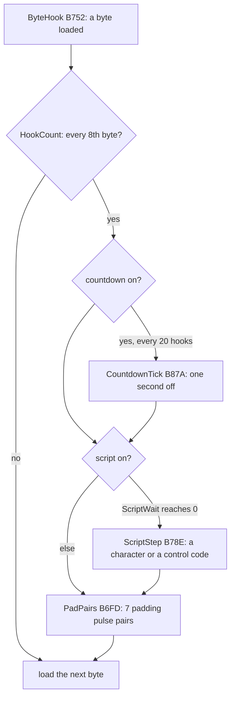
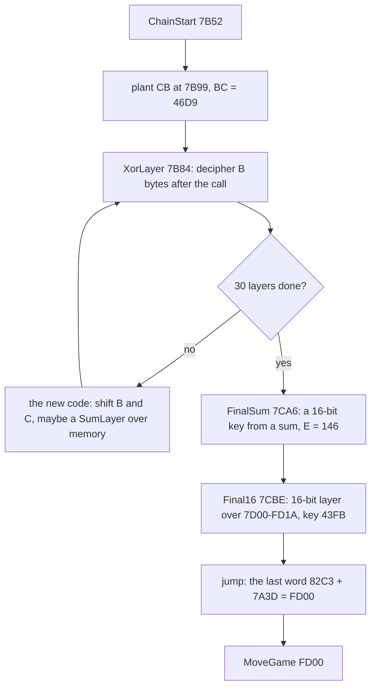
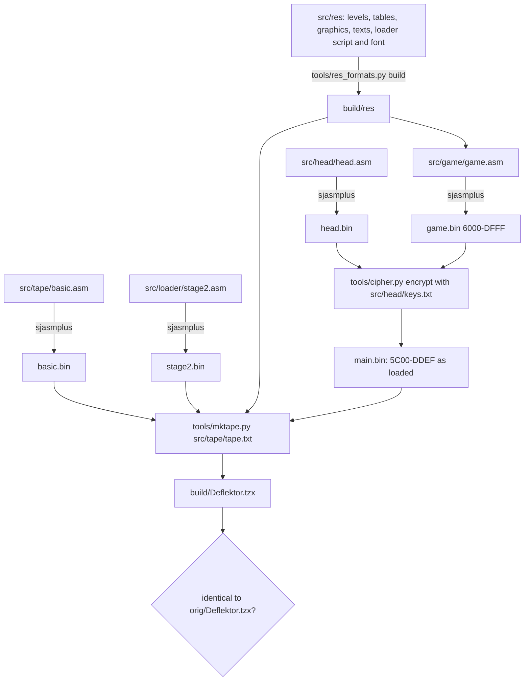

# 3. Build and load

What this covers: the tape block by block and as a picture; the BASIC and the loader's first stage; the turbo block
read in the loader's own code; the second stage that loads over its own end and runs a script and a countdown while
the game loads; the block head that finds its own address; the cipher of 30 layers and the 16-bit layer that turn the
loaded bytes into the game at `$6000-$DFFF`; the build from the sources back to the same tape; why the original TZX
does not load in unreal-ng; the releases.

The recordings it rests on ([WALKTHROUGH 6.0](../WALKTHROUGH.md#60-the-recordings)):

- `c1`: power-on, `--record-load`, the 10 Mega Games copy of the tape at ROM timing (the same three blocks as the
  original, byte for byte); 20 560 frames, the game's entry `$8382` at frame 15 752, T 33 930. Reopened for this
  document as `work/docs/dfA/c1` on port base 37485 for the screenshots and the animations.
- The stage 2 simulations (no recording): `tools/parts.py` and `tools/tapesim.py` run the loader's own code in
  SkoolKit's simulator over the original TZX's pulses ([work/stage2/NOTES.md](../work/stage2/NOTES.md)).

## 3.1 The tape block by block

`orig/Deflektor.tzx.zip` holds `Deflektor.tzx`, three blocks (`tools/tzxblocks.py`, times at 3.5 MHz):

| Block | TZX kind | Bytes | Flag | What it is | Time | Pause after |
| --- | --- | --- | --- | --- | --- | --- |
| 0 | `$10` standard | 19 | `$00` | Program header "DEFLEKTOR", length 384, LINE 0, variables at 52 | 5.09 s | 989 ms |
| 1 | `$10` standard | 386 | `$FF` | the BASIC (384 bytes): `RANDOMIZE USR (PEEK 23635+256*PEEK 23636+58)`, and the loader's code after the line, run at `$5D05` | 4.12 s | 986 ms |
| 2 | `$11` turbo: pilot 2127 T x 4836, sync 693 / 693, zero 836, one 1670, 3 bits used in the last byte | 58 316 | `$19` | the game in the loader's own pulse code | 296.74 s | 0 |


*The tape on a time line, then the turbo block's eight loads by bytes. How to read it: the top bar is time (the
turbo block is 96 % of the tape); the lower bar is the loads in the order the loader asks for them, each colour a
kind. The point: the BASIC loads with the ROM in 10 seconds, everything else is one turbo block of 297 seconds read by
the game's own loader in eight pieces. Command: `python3 tools/fig_tape.py docs/img/load/tape.png` (the loads from
`src/tape/tape.txt`).*

Total 307.9 s, 15 396 frames. The turbo block's pulses are those of the ROM (the zero 836 T and one 1670 T are the
ROM's 855 and 1710 within 3 %); what differs is how the loader reads them, so the block's bytes are not the bytes it
puts in memory.

The stages, each with its first instruction in `c1` (`$RS stages`, the frame and T-state of the jump):

| Stage | Entry | `c1` frame, T | What it does | Witness |
| --- | --- | --- | --- | --- |
| 0 | `$5D05` | 771 | the BASIC's machine code: moves `$134` bytes to `$B626` (LDIR), jumps to `$B65B` | `c1` stages; `work/stage1/blocks/code5d05.bin` |
| 1 | `$B65B` | 771, 61 700 | clears the screen, copies three character rows of the ROM font from `$3D00`, DI, finds the pilot and sync (`$B693`), loads the first `$010F` bytes to `$B75A` (`$B727`); a failed edge or checksum jumps to `$0000` | `c1` stages; `work/stage1/blocks/ldr_b626.bin` |
| 2 | `$B856` | 1006, 38 026 | the second loader just loaded (`$B75A-$B868`): prints the loading text and a countdown while it loads the rest; a per-byte hook at `$B752` falls into code the load has just written | `c1` stages, writes `$B75A-$B868` |
| 3 | `$5B00` | 15 635, 27 704 | `LDIR; RET` (`$ED $B0 $C9`), the loader's last step; its return goes to `$5C00` (what it moves: stage 2) | `c1` stages; `work/stage1/images/loaded.cpu.bin` at `$5B00` |
| 4 | `$5C00` | 15 640, 44 028 | the loaded block's head (`$5C00-$9DEF` written by `$B737`): DI, writes `POP HL; JP (HL)` at `$5B00` and calls it to learn where it runs, then moves `$81C9` bytes up to end at `$FD1A` (LDDR at `$5C21`) and returns to `$7B52` | `c1` stages, writes `$7B52-$FD1A` by `$5C21` |
| 5-7 | `$7B52`, `$7BC0`, `$7C8C` | 15 651 onward | a key from a generator and a sum over memory from `$4000`, an XOR pass over the moved code (known only from the code at `$5C27-$5C68` before the move; proved in stage 2) | `c1` stages |
| 8 | `$FD00` | before 15 752 | `LDIR` `$7D00-$FCFF` to `$6000-$DFFF`, `LD ($5C09),BC` (0), `LD SP,$FFFF`, bit 7 of R cleared, `JP $8382` | `work/stage1/images/entry.cpu.bin` at `$FD00-$FD1A` |
| 9 | `$8382` | 15 752, 33 930 | the game's entry: the menu | `c1` stages; the `c1g` game window starts here |

```mermaid
flowchart LR
    T0[ROM LOAD: header, BASIC] --> S0[5D05: move loader 1 to B626]
    S0 --> S1[B65B loader 1: pilot, sync, load B75A-B868]
    S1 --> S2[B856 loader 2: script, countdown, loads 2-8]
    S2 --> S3[5B00: LDIR, RET]
    S3 --> S4[5C00 BlockHead: own address, move up to 7B52-FD1A]
    S4 --> S5[7B52 chain: 30 layers]
    S5 --> S6[7CA6 FinalSum: 16-bit layer over 7D00-FD1A]
    S6 --> S7[FD00 MoveGame: 7D00-FCFF to 6000-DFFF]
    S7 --> G[8382 GameEntry]
```



*The stages in order (the hex in the boxes is an address). Witness: `c1` (each stage's first instruction), the
SkoolKit simulation of `tools/parts.py`. The point: each stage builds the next one in memory just before it runs;
nothing of the game is readable before the last layer.*

## 3.2 The BASIC and the first stage

Block 1 is a BASIC program of 52 bytes, line 0, and 332 bytes of machine code stored as its "variables":

```text
0 RANDOMIZE USR (PEEK 23635+256*PEEK 23636+58)
```

PEEK 23635 + 256 x PEEK 23636 is PROG, the program's start (`$5CCB` after a normal load); + 58 points past the line
into the code, at `$5D05`. That code copies `$134` bytes to `$B626` (LDIR) and jumps to `$B65B`. The first stage then
clears the screen, copies three character rows of the ROM font from `$3D00`, disables the interrupts and looks for
the turbo block's pilot and sync (`$B693`). It reads bytes with its own edge timing (ReadByte `$B6D4`, EdgeWait
`$B70E`) and loads the first `$010F` bytes to `$B75A`. Every byte calls a hook, ByteHook `$B752`. A failed edge or a
bad checksum jumps to `$0000`: the machine resets.

The point: the BASIC finds its code wherever PROG is, so the loader does not depend on the memory below `$5CCB`.

## 3.3 The second stage: a loader that loads its own end

The first load lands at `$B75A`, right after ByteHook `$B752`, so the hook falls into code the load has just written.
From then on, every 8th byte loaded runs HookWork `$B75A`:

```asm
HookWork:                 ; $B75A, from ByteHook after each byte
  LD (HookCount),A
  RET NZ                  ; 7 bytes in 8: nothing
  LD A,$08                ; every 8th: HookCount = 8 again
  LD (HookCount),A
  LD A,(LoadFlags)
  LD B,A
  LD L,$02
  BIT 0,B                 ; the countdown on?
  JR Z,HookScript
  LD A,(TickHooks)        ; a tick every 20 hooks (5 for the first)
  DEC A
  CALL Z,CountdownTick
  LD (TickHooks),A
HookScript:
  BIT 1,B                 ; the script on?
  JR Z,HookPad
  LD A,(ScriptWait)       ; wait ScriptWait hooks, then one script step
  DEC A
  JR Z,ScriptStep
  LD (ScriptWait),A
HookPad:
  CALL PadPairs           ; the rest of the hook's 7 pulse pairs
  ...
```

The work between two bytes is paid for by the tape: after a hook the loader reads 7 pulse pairs that carry no data
(PadPairs `$B6FD`), so the tape gives the CPU the time it needs. The encoder (`tools/mktape.py`) knows this: it asks
the loader's own code, in SkoolKit's simulator, which pulse pair it waits for next, data bit or padding.



*One byte of the turbo block in the second stage. Witness: `c1` (HookWork and CountdownTick run all through the
load). The point: the loading screen is drawn by the loader between bytes, and the tape holds the padding that makes
room for it.*

The script (`src/res/loader/script.txt`, 6552 bytes loaded at `$998E`) draws the loading screen with its own font
(472 bytes at `$B326`): the DEFLEKTOR logo, a credit line, and pages of instructions ("OVERLOAD SITUATIONS", "2)
OVER-EXTENDED BEAM: THE LASER BEAM IS TOO LONG AND RESULTS IN OVERLOAD."). The countdown prints the seconds left
before the game is in:


*The screen of `c1` from frame 1000 to 15 700, every 100th frame (148 pictures). How to read it: the countdown at the
bottom left counts down in seconds; the script's pages change above it; at the end a DEFLEKTOR plate appears while the main block loads into `$5C00`. The point: the five minutes of loading teach
the rules. Command: `python3 ../../kit/screen_anim.py --work work/docs/dfA/c1 --from 1000 --to 15700 --step 100 --delay
100 --hold 2000 docs/img/load/loading-screen.gif`.*

Seven moments of it:

| Frame | Screen | What |
| --- | --- | --- |
| 700 | [the ROM's "Program: DEFLEKTOR"](img/load/load-000700.png) | the header loaded by the ROM |
| 1000 | [black](img/load/load-001000.png) | the first stage has cleared the screen and waits for the turbo pilot |
| 2000 | [275 DEFLEKTOR SERIAL NO-VX3240](img/load/load-002000.png) | the countdown starts at 275 s, a serial number scrolls |
| 8000 | [154 SECONDS TO LOAD DEFLEKTOR](img/load/load-008000.png) | a page of the instructions: OVERLOAD SITUATIONS |
| 15 000 | [013 SECONDS](img/load/load-015000.png) | the DEFLEKTOR plate; the main block loading |
| 15 700 | [000](img/load/load-015700.png) | the load done; the cipher runs |
| 15 760 | [000](img/load/load-015760.png) | the game's entry has run; the screen not yet cleared |

Worked example, the countdown against the clock: 275 at frame 2000, 0 at frame about 15 640: 13 640 frames is
272.8 s at 50 frames a second, so the 275 is honest to within 1 %. The tick is counted in hooks (one every 20 hooks of 8
bytes), so it measures bytes loaded; the bytes come at a fixed rate because the tape is fixed.

CountdownTick `$B87A` subtracts one from three ASCII digits with the carry as the borrow:

```asm
CountdownTick:
  EXX
  LD HL,Countdown+2       ; the last digit first, with the borrow in
  LD B,$03
  SCF
CountdownDigit:
  LD A,(HL)
  SBC A,$00
  DAA
  CP $30
  SET 4,A
  LD (HL),A
  DEC HL
  DJNZ CountdownDigit
  JR NC,CountdownShow     ; past 000: the countdown off
  ...
```

## 3.4 The main block and the head

The last three loads put the main block at `$C000` (its `$9DF0-$DDEF`), `$5C00-$9BFF` and `$9C00-$9DEF`;
LoadFiles `$BACC` then plants `LDIR; RET` at `$5B00` and moves the `$C000` piece down. The RET goes to `$5C00`, the
block's first byte: BlockHead, the only 39 bytes of the block not enciphered.

```asm
BlockHead:              ; $5C00
  DI
  LD HL,$E9E1           ; POP HL; JP (HL)
  LD (MoveStub),HL      ; at $5B00
  CALL MoveStub         ; returns with HL = $5C0A, its own return address
  LD DE,$001D
  ADD HL,DE             ; HL = $5C27, the first enciphered byte
  LD BC,$81C9           ; 33 225 bytes, $5C27-$DDEF
  LD DE,$7B52
  PUSH DE               ; the RET goes to the copy
  ...                   ; source below target: LDDR from the ends
  LDDR
  RET                   ; to $7B52
```

The point: the head works out where it is (the CALL to a `POP HL; JP (HL)` stub leaves its own address in HL), so the
block would run wherever a loader put it.

## 3.5 The cipher

The block moved to `$7B52-$FD1A` starts with D.G. Cooke's chain (`src/head/head/chain.asm`). Thirty layers each
decipher the code that follows them, and the code after a CALL exists only once the CALL returns:

```asm
XorLayer:               ; $7B84
  POP HL                ; HL = the return address: the layer's key byte
  PUSH HL
  LD E,B
XorLayerByte:
  INC HL
  LD D,A
  ADD A,A               ; A = 17 A + C: the running key
  ADD A,A
  ADD A,A
  ADD A,A
  ADD A,D
  ADD A,C
  XOR (HL)              ; decipher one byte after the call
  LD (HL),A
  DJNZ XorLayerByte
  LD B,E
  POP HL
  ADD A,(HL)            ; the key byte balances the sum
  LD (HL),C             ; C over the key byte
  INC HL
  JP (HL)               ; into the bytes just deciphered
```



*The chain's loop (the hex are addresses and values). Witness: `c1` (the chain's run), `tools/parts.py` (887 532
instructions in SkoolKit's simulator). The point: every key comes from the memory around it, so the cipher cannot be
read without running it, and a change anywhere breaks it.*

Facts of the chain (`tools/cipher.py`, `src/head/keys.txt`):

- The keys are sums of memory over `$4000-$FFFF` that take in the cipher itself, the loading screen and the loader.
  On the original tape every layer's incoming key is 0: the balance bytes after each CALL are chosen so.
- SumLayer1-3 (`$7BD2`, `$7C15`, `$7C54`) fold sums of memory into the key. The chain depends on SP (the real SP at
  `$5B00` is `$5BFE`): a first simulation with SP = `$FFF0` ran wild.
- 3642 byte decryptions on 372 addresses (`$7BC0-$7D33`), up to 17 layers on one address. The text
  "COPYRIGHT D.G.COOKE 1987" (ChainText `$7B9A`) lies inside the layers' range, so it is key material too.
- The last word deciphered, `$FD18` = `$82C3`, plus `$7A3D` gives `$FD00`: the jump to the mover. A wrong key jumps
  wild.

The mover (`$FD00`) copies `$7D00-$FCFF` down to `$6000-$DFFF`, clears REPDEL and REPPER, sets SP = `$FFFF`, clears
bit 7 of R and jumps to `$8382`:

```asm
MoveGame:               ; $FD00
  LD HL,$7D00
  LD DE,$6000
  LD BC,$8000
  LDIR
  LD ($5C09),BC         ; BC = 0: REPDEL, REPPER
  LD SP,$FFFF
  LD A,R
  RES 7,A
  LD R,A
  JP $8382
```


*`$5B00-$FFFF` of `c1` from frame 15 638 to 15 756, one picture every fifth frame (25). How to read it: a byte's grey is its
value; yellow is a byte written since the last picture, fading through red. The point: first the whole block moves
up (one sweep), then for about 100 frames (some 20 pictures) almost nothing is written (the chain reads its sums and deciphers 372
bytes at `$7BC0-$7D33`), then the 16-bit layer and the mover rewrite everything from `$6000` up in two frames (one picture); the
last pictures are the game's first pass writing its buffers at `$E000-$FCFF`. Command: `python3
../../kit/memanim.py --work work/docs/dfA/c1 --from 15638 --to 15756 --step 349440 --cell 3 --label "..." --delay 400
docs/img/load/decipher.gif`.*

## 3.6 The build

The case builds the tape from its sources and compares it with the original, byte for byte (`tools/build.sh`):



*The build. Every `.asm` is written by `kit/mkgame.py` from its `.ann`. Command: `sh tools/build.sh`; its last line
is `build: Deflektor.tzx identical to orig/Deflektor.tzx.zip's Deflektor.tzx` (stage 2). The point: the tape is
rebuilt from the readable game, so an edit of the game or a level gives a tape that loads.*

What the encoder does for the turbo block: it runs the loader's own code in SkoolKit's simulator, and each time the
loader waits for an edge it answers with the pulse pair the loader needs: a data bit, a padding pair after a hook, or
the script engine's runs of ones ending in a 0. A changed script or game changes the block but still loads. The cipher
direction is the chain applied backwards with the keys of `src/head/keys.txt`; `tools/cipher.py check` loads the
built tape in the simulator and checks that `$6000-$DFFF` at the entry is the game.

## 3.7 Why the original TZX does not load in unreal-ng

The turbo block is the tape's last block, with a pause of 0 ms, and its last byte uses 3 bits. The loader, after its
last bit, waits for one more edge to time the bit's second half. In a TZX player that stops at the last pulse that
edge never comes: the load times out at IX = `$9DF0`, about frame 15 640, and the loader jumps to `$0000` (a reset).
`work/stage1/probe/orig.log` shows it. A real tape gives the edge (the signal falls back to silence), and so does
SkoolKit's simulator, which loads the original. The 10 Mega Games copy has the same three blocks, then a pause of
16 561 ms: the pause gives the edge, and it loads. `c1` uses it. The gap is listed for unreal-ng in `R/TODO.md`.

## 3.8 The releases

| Copy | What differs from `orig/Deflektor.tzx` | Loads in unreal-ng |
| --- | --- | --- |
| ZXDB Gremlin tape (`orig/`) | the reference | no (3.7) |
| 10 Mega Games Volume One | the same three blocks byte for byte, a 16 561 ms pause after | yes: `c1` |
| TOSEC 2020 TZX and TAP | the turbo block's last byte only (the unused bits), written at standard timing | yes |
| Erbe (Spain) | the same header and BASIC; the turbo block differs in 32 bytes from offset 306 | not tried |
| ZXDB TAP (a re-save) | a packed 23 266-byte DEFL.CDE at `$6000` | not tried |
| tape hacks in the collection | 84 to 116 of the game's 128 pieces of 256 bytes | not tried |

The release check is `tools/media_compare.py` (`work/stage1/media-compare.txt`) and `tools/copy_compare.py`
(`work/stage1/copy-compare.tsv`); details in [WALKTHROUGH 0](../WALKTHROUGH.md#0-the-medium).
