# 3. Build and load

What this covers: the tape block by block and as a picture; the BASIC line and its hidden numbers, and the loader's
first stage; the turbo block's byte code (8 bits, an invert flag and padding pairs); the second stage that loads over
its own end and runs a script and a countdown while the game loads, and the script's codes; the block head that finds
its own address; ChainFill, the cipher of 30 layers (18 decipher, 12 only sum) and the 16-bit layer that turn the loaded bytes into the game at
`$6000-$DFFF`; the build from the sources back to the same tape; why the original TZX
did not load in unreal-ng before `f13cee7da`; the releases.

The recordings it rests on ([WALKTHROUGH 6.0](../WALKTHROUGH.md#60-the-recordings)):

- `c1`: power-on, `--record-load`, the 10 Mega Games copy of the tape at ROM timing (the same three blocks as the
  original, byte for byte); 20 560 frames, the game's entry `$8382` at frame 15 752, T 33 930. Reopened for this
  document as `work/docs/dfA/c1` on port base 37485 for the screenshots and the animations.
- The stage 2 simulations (no recording): `tools/parts.py` and `tools/tapesim.py` run the loader's own code in
  SkoolKit's simulator over the original TZX's pulses ([work/stage2/NOTES.md](../work/stage2/NOTES.md)).

## 3.1 The tape block by block

`orig/Deflektor.tzx.zip` holds `Deflektor.tzx`, three blocks (`tools/tzxblocks.py`, times at 3.5 MHz):

| Block | TZX kind | Bytes | Flag | What it is | Time | Pause after |
| --- | --- | --- | --- | --- | --- | --- |
| 0 | `$10` standard | 19 | `$00` | Program header "DEFLEKTOR", length 384, LINE 0, variables at 52 | 5.09 s | 989 ms |
| 1 | `$10` standard | 386 | `$FF` | the BASIC (384 bytes): line 0, which LIST shows as `RANDOMIZE USR (PEEK 23641+256*PEEK 23642+4)` but whose hidden numbers run `$5D05` (3.2), and the loader's code after the line | 4.12 s | 986 ms |
| 2 | `$11` turbo: pilot 2127 T x 4836, sync 693 / 693, zero 836, one 1670, 3 bits used in the last byte | 58 316 | none (`$19` is the first 8 pulse pairs, 3.3.1) | the loader's second stage, the loading screen's glyphs and script, the game: eight loads in the loader's own byte code (3.3.1) | 296.74 s | 0 |

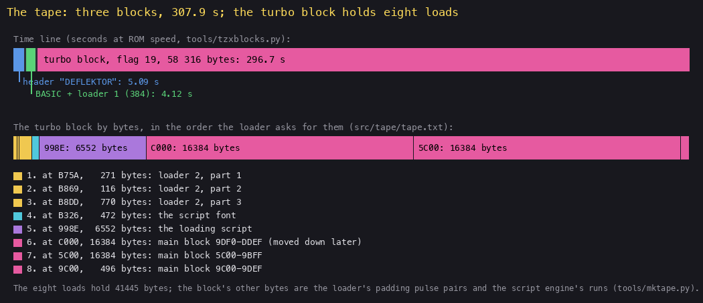

*The tape on a time line, then the turbo block's eight loads by bytes. How to read it: the top bar is time (the
turbo block is 96 % of the tape); the lower bar is the loads in the order the loader asks for them, each colour a
kind. The point: the BASIC loads with the ROM in 10 seconds, everything else is one turbo block of 297 seconds read by
the game's own loader in eight pieces. Command: `python3 tools/fig_tape.py docs/img/load/tape.png` (the loads from
`src/tape/tape.txt`).*

Total 307.9 s, 15 396 frames. The turbo block's pulses are those of the ROM (the zero 836 T and one 1670 T are the
ROM's 855 and 1710 within 3 %); what differs is how the loader reads them, so the block's bytes are not the bytes it
puts in memory.

The stages, each with its first instruction in `c1` (`$RS stages`, the frame and T-state of the jump):

| Stage | Entry | `c1` frame, T | What it does | Witness |
| --- | --- | --- | --- | --- |
| 0 | `$5D05` | 771 | the BASIC's machine code: moves `$134` bytes to `$B626` (LDIR), jumps to `$B65B` | `c1` stages; `work/stage1/blocks/code5d05.bin` |
| 1 | `$B65B` | 771, 61 700 | clears the screen, copies the whole ROM font (768 bytes, characters 32-127) from `$3D00` to `$B326`, DI, finds the pilot and sync (`$B693`), loads the first `$010F` bytes to `$B75A` (`$B727`); a failed edge or checksum jumps to `$0000` | `c1` stages; `work/stage1/blocks/ldr_b626.bin` |
| 2 | `$B856` | 1006, 38 026 | the second loader just loaded (`$B75A-$B868`): prints the loading text and a countdown while it loads the rest; a per-byte hook at `$B752` falls into code the load has just written | `c1` stages, writes `$B75A-$B868` |
| 3 | `$5B00` | 15 635, 27 704 | `LDIR; RET` (`$ED $B0 $C9`), the loader's last step; it moves the `$C000-$FFFF` piece to `$9DF0-$DDEF`, and its return goes to `$5C00` (pushed by LoadMainLow's `PUSH IX`) | `c1` stages; `work/stage1/images/loaded.cpu.bin` at `$5B00` |
| 4 | `$5C00` | 15 640, 44 028 | the loaded block's head (`$5C00-$9DEF` written by `$B737`): DI, writes `POP HL; JP (HL)` at `$5B00` and calls it to learn where it runs, then moves `$81C9` bytes up to end at `$FD1A` (LDDR at `$5C21`) and returns to `$7B52` | `c1` stages, writes `$7B52-$FD1A` by `$5C21` |
| 5-7 | `$7B52`, `$7BC0`, `$7C8C` | 15 651 onward | ChainFill writes a generated stream over `$5B00-$7B51` and `$FD1B-$FFFF` (the BASIC, the system variables and the block head go), ChainSum adds `$4000-$FFFF` into A; then 30 layers in turn: 18 XorLayers each decipher the chain's next piece, 12 SumLayers add memory into the key; FinalSum and Final16 decipher `$7D00-$FD19`, the game and the mover (3.5) | `c1` stages; [the decipher animation](img/load/decipher.gif) |
| 8 | `$FD00` | before 15 752 | `LDIR` `$7D00-$FCFF` to `$6000-$DFFF`, `LD ($5C09),BC` (0), `LD SP,$FFFF`, bit 7 of R cleared, `JP $8382` | `work/stage1/images/entry.cpu.bin` at `$FD00-$FD1A` |
| 9 | `$8382` | 15 752, 33 930 | the game's entry: the menu | `c1` stages; the `c1g` game window starts here |

```mermaid
flowchart LR
    T0[ROM LOAD: header, BASIC] -->|frame 771| S0[5D05: move loader 1 to B626]
    S0 -->|771| S1[B65B loader 1: pilot, sync, load B75A-B868]
    S1 -->|1006| S2[B856 loader 2: script, countdown, loads 2-8]
    S2 -->|15 635| S3[5B00: LDIR, RET]
    S3 -->|15 640| S4[5C00 BlockHead: own address, move up to 7B52-FD1A]
    S4 -->|15 651| SF[7B52 ChainFill: stream over 5B00-7B51 and FD1B-FFFF, sum 4000-FFFF]
    SF --> S5[7BB2 chain: 30 layers, 18 decipher, 12 sum]
    S5 --> S6[7CA6 FinalSum, Final16: 16-bit layer over 7D00-FD19]
    S6 -->|about 15 743| S7[FD00 MoveGame: 7D00-FCFF to 6000-DFFF]
    S7 -->|15 752| G[8382 GameEntry]
```

*The stages in order (the hex in the boxes is an address, the numbers on the arrows the `c1` frame the next stage
starts in). Witness: `c1` (each stage's first instruction), the
SkoolKit simulation of `tools/parts.py`. The point: each stage builds the next one in memory just before it runs;
nothing of the game is readable before the last layer.*

## 3.2 The BASIC and the first stage

Block 1 is a BASIC program of 52 bytes, line 0, and 332 bytes of machine code stored as its "variables". LIST shows:

```text
0 RANDOMIZE USR (PEEK 23641+256*PEEK 23642+4)
```

That is not what runs. A number in a BASIC line is stored twice: its digits, which LIST prints, then `$0E` and a
five-byte value, which the interpreter uses. Here three of the four values differ from their digits:

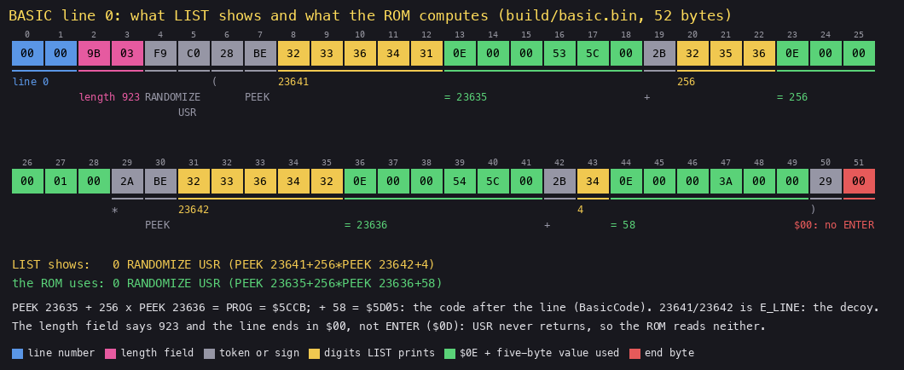

*The 52 bytes of line 0 (`build/basic.bin`), coloured by kind; under each number the digits LIST prints (yellow) and
the value the ROM uses (green). How to read it: bytes 0-1 the line number, 2-3 the length field, then the tokens and
numbers; byte 51 is where ENTER would be. The point: the line LIST shows reads E_LINE + 4, a decoy; the line the ROM
runs reads PROG + 58. Command: `python3 tools/fig_loader.py basic docs/img/load/basic-line.png`.*

| Digits LIST shows | Hidden value used | Bytes (`$0E`, five-byte form) |
| --- | --- | --- |
| 23641 (E_LINE) | 23635 (PROG) | `0E 00 00 53 5C 00` |
| 256 | 256 | `0E 00 00 00 01 00` |
| 23642 (E_LINE + 1) | 23636 (PROG + 1) | `0E 00 00 54 5C 00` |
| 4 | 58 | `0E 00 00 3A 00 00` |

The length field says 923 and the line ends in `$00`, not ENTER (`$0D`). Neither matters: the ROM evaluates USR
before it looks for the statement's end, and the code never returns. The line is the only program line; VARS points
at `$5CFF`, six unused bytes, then the code at `$5D05`.

What the ROM does with it, as pseudocode:

```text
auto-run LINE 0:
    a = PEEK 23635 + 256 * PEEK 23636 + 58     # PROG + 58: $5CCB + $3A = $5D05
    USR a                                      # BC = a on entry
BasicCode ($5D05):
    HL = BC + $12                              # $5D17, the first stage's bytes, wherever PROG is
    SP = $5C00
    copy $134 bytes from HL to $B626 (LDIR)
    jump $B65B                                 # Loader1Start
```

```asm
BasicCode:              ; $5D05, entered by USR with BC = $5D05
  LD HL,$0012
  ADD HL,BC             ; HL = $5D17: the first stage, relative to the code itself
  LD DE,HookCount       ; $B626
  LD BC,$0134
  LD SP,$5C00           ; the stack below the main block's load address
  LDIR
  JP Loader1Start       ; $B65B
```

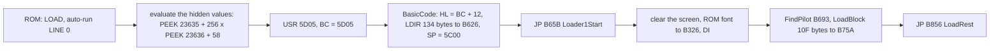

*From the ROM to the second stage (the hex are addresses). Witness: `c1` (USR enters `$5D05` with BC = `$5D05`,
frame 771). The point: the code finds itself through PROG and BC, so it runs wherever the BASIC was loaded.*

Worked example, the address the line computes after a normal load: PROG = `$5CCB`, so PEEK 23635 = `$CB` = 203 and
PEEK 23636 = `$5C` = 92; 203 + 256 x 92 + 58 = 23 813 = `$5D05`. With the digits LIST shows, the same line would read
E_LINE + 4, a point in the editing area past the program and its 332 bytes of "variables", so a reader who trusts
the listing looks in the wrong place. BasicCode then gets BC = `$5D05`, adds `$12`: `$5D17`, the first byte of the first stage.

The first stage then clears the screen, copies the whole ROM font (768 bytes, characters 32-127) from `$3D00` to
`$B326`, disables the interrupts and looks for the turbo block's pilot and sync (FindPilot `$B693`: up to 2000 tries
for an edge, then 256 - H pilot pairs whose count passes `$C6`, then edges counted from `$C9` until one falls short of
`$D4`, the first sync pulse). It reads bytes with its own edge timing (ReadByte `$B6D4`, EdgeWait `$B70E`; 3.3.1) and
loads the first `$010F` bytes to `$B75A`. Every byte calls a hook, ByteHook `$B752`. A failed edge or a bad checksum
jumps to `$0000`: the machine resets. Later the glyphs load replaces characters 32-90 of the font copy with the
loading screen's own.

The point: the BASIC finds its code wherever PROG is, so the loader does not depend on the memory below `$5CCB`.

## 3.3 The second stage: a loader that loads its own end

The first load lands at `$B75A`, right after ByteHook `$B752`, so the hook falls into code the load has just written.
LoadRest `$B856` then sets HookCount to 8: the first hook comes after 8 bytes of the second piece, and from then on
after every 7 data bytes, because the hook counts itself as the eighth (HookPad ends by running ByteHook once more
with L = `$FF`). A load's checksum byte counts as a data byte, so the period holds across the loads. 5882 hooks ran in
`c1`. Each runs HookWork `$B75A`:

```asm
HookWork:                 ; $B75A, from ByteHook after each byte
  LD (HookCount),A
  RET NZ                  ; not yet 0: nothing
  LD A,$08                ; a hook: HookCount = 8 again (7 bytes and the hook itself)
  LD (HookCount),A
  LD A,(LoadFlags)
  LD B,A
  LD L,$02
  BIT 0,B                 ; the countdown on?
  JR Z,HookScript
  LD A,(TickHooks)        ; a tick every 20 hooks (5 for the first)
  DEC A
  CALL Z,CountdownTick
  LD (TickHooks),A
HookScript:
  BIT 1,B                 ; the script on?
  JR Z,HookPad
  LD A,(ScriptWait)       ; wait ScriptWait hooks, then one script step
  DEC A
  JR Z,ScriptStep
  LD (ScriptWait),A
HookPad:
  CALL PadPairs           ; the rest of the hook's 7 pulse pairs
  ...
```

The work between two bytes is paid for by the tape: after a hook the loader reads 7 pulse pairs that carry no data
(PadPairs `$B6FD`), so the tape gives the CPU the time it needs. The encoder (`tools/mktape.py`) knows this: it asks
the loader's own code, in SkoolKit's simulator, which pulse pair it waits for next, data bit or padding.

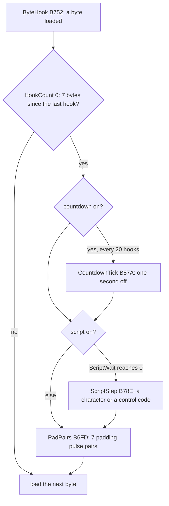

*One byte of the turbo block in the second stage. Witness: `c1` (HookWork and CountdownTick run all through the
load). The point: the loading screen is drawn by the loader between bytes, and the tape holds the padding that makes
room for it.*

The script (`src/res/loader/script.txt`, 6552 bytes loaded at `$998E`) draws the loading screen with its own font
(472 bytes at `$B326`): the DEFLEKTOR logo, a credit line, and pages of instructions ("OVERLOAD SITUATIONS", "2)
OVER-EXTENDED BEAM: THE LASER BEAM IS TOO LONG AND RESULTS IN OVERLOAD."). The countdown prints the seconds left
before the game is in:


*The screen of `c1` from frame 1000 to 15 700, every 100th frame (148 pictures). How to read it: the countdown at the
bottom left counts down in seconds; the script's pages change above it; at the end a DEFLEKTOR plate appears while the main block loads into `$5C00`. The point: the five minutes of loading teach
the rules. Command: `python3 ../../kit/screen_anim.py --work work/docs/dfA/c1 --from 1000 --to 15700 --step 100 --delay
100 --hold 2000 docs/img/load/loading-screen.gif`.*

Seven moments of it:

| Frame | Screen | What |
| --- | --- | --- |
| 700 | [the ROM's "Program: DEFLEKTOR"](img/load/load-000700.png) | the header loaded by the ROM |
| 1000 | [black](img/load/load-001000.png) | the first stage has cleared the screen and waits for the turbo pilot |
| 2000 | [275 DEFLEKTOR SERIAL NO-VX3240](img/load/load-002000.png) | the countdown (from 294) shows 275; the serial number SerialText `$B835`, typed in by the script engine a character at a time |
| 8000 | [154 SECONDS TO LOAD DEFLEKTOR](img/load/load-008000.png) | a page of the instructions: OVERLOAD SITUATIONS |
| 15 000 | [013 SECONDS](img/load/load-015000.png) | the DEFLEKTOR plate; the main block loading |
| 15 700 | [000](img/load/load-015700.png) | the load done; the cipher runs |
| 15 760 | [000](img/load/load-015760.png) | the game's entry has run; the screen not yet cleared |

Worked example, the countdown against the clock. Countdown starts at "294" (`$B628`); the first tick comes after 5
hooks (TickHooks), then one every 20 hooks, that is 160 byte times of 13 short pairs: 3 475 776 T, 0.993 s. In `c1`
the 294 ticks run from 293 at about 2.74 s to 000 at 293.70 s after the pilot, a tenth of a second before the last byte.
Frame 2000, the screenshot above, shows 275; 0 comes at about frame 15 640: 13 640 frames is 272.8 s at 50 frames a
second, so the 275 is honest to within 1 %. The tick is counted in hooks, so it measures bytes loaded; the bytes come
at a fixed rate because every byte lasts the same time (3.3.1).

CountdownTick `$B87A` subtracts one from three ASCII digits with the carry as the borrow:

```asm
CountdownTick:
  EXX
  LD HL,Countdown+2       ; the last digit first, with the borrow in
  LD B,$03
  SCF
CountdownDigit:
  LD A,(HL)
  SBC A,$00
  DAA
  CP $30
  SET 4,A
  LD (HL),A
  DEC HL
  DJNZ CountdownDigit
  JR NC,CountdownShow     ; past 000: the countdown off
  ...
```

### 3.3.1 One byte on tape

The turbo block uses the ROM's pulse lengths (a 0 is a pair of 836 T pulses, a 1 a pair of 1670 T), but not the ROM's
byte. Each data bit is one pulse pair; ReadByte `$B6D4` reads nine pairs, 8 bits MSB first and an invert flag, then
some padding pairs whose value it never tests:

```asm
ReadByte:                 ; $B6D4, from LoadBlock: L = the byte, carry set; NC on a timeout
  PUSH DE
  LD DE,$FC09             ; D = -4 (zeros counted up), E = 9 pairs
ReadByteBit:
  RL L                    ; the last pair's bit into L
  CALL EdgePair           ; two edges, B counts 56 T passes from $B0
  JR NC,ReadByteEnd
  LD A,$CB                ; a count above $CB is a 1
  CP B
  JR C,ReadByteNext
  INC D                   ; a 0: one more zero
ReadByteNext:
  LD B,$B0
  DEC E
  JR NZ,ReadByteBit
  SBC A,A                 ; the ninth bit, the invert flag, complements L
  XOR L
  LD L,A
  INC B                   ; the code's time before the next pair
  SCF
  JR ReadBytePadCount
ReadBytePad:
  CALL EdgePair           ; a padding pair, its value not tested
  JR NC,ReadByteEnd
  LD B,$B0
ReadBytePadCount:
  DEC D                   ; zeros - 5 padding pairs
  JR NZ,ReadBytePad
ReadByteEnd:
  POP DE
  RET
```

```text
read_byte():
    zeros = 0
    repeat 9 times:                      # 8 bits MSB first, then the invert flag
        bit = (EdgePair count from $B0) > $CB
        shift bit into L (the 9th lands in the carry)
        if not bit: zeros += 1
    if flag: L = NOT L                   # the encoder sends the form with at most 4 ones
    repeat zeros - 5 times: EdgePair     # padding, never tested
    return L
```

Why the padding: a 1 lasts as long as two 0s. A byte with z zeros among its nine pairs has 9 - z ones, so its pairs
last 2(9 - z) + z short pairs, and the z - 5 padding pairs bring that to 13 whatever z is. With at most four ones in
the eight bits (the invert flag sees to it), z is 5 to 9 and the padding 0 to 4. Every byte takes the time of 13 short
pairs, 21 720-21 736 T, about 6.2 ms. So the loader can do work between bytes at a fixed rate (the hook, 3.3) and the
countdown counts seconds by counting bytes.

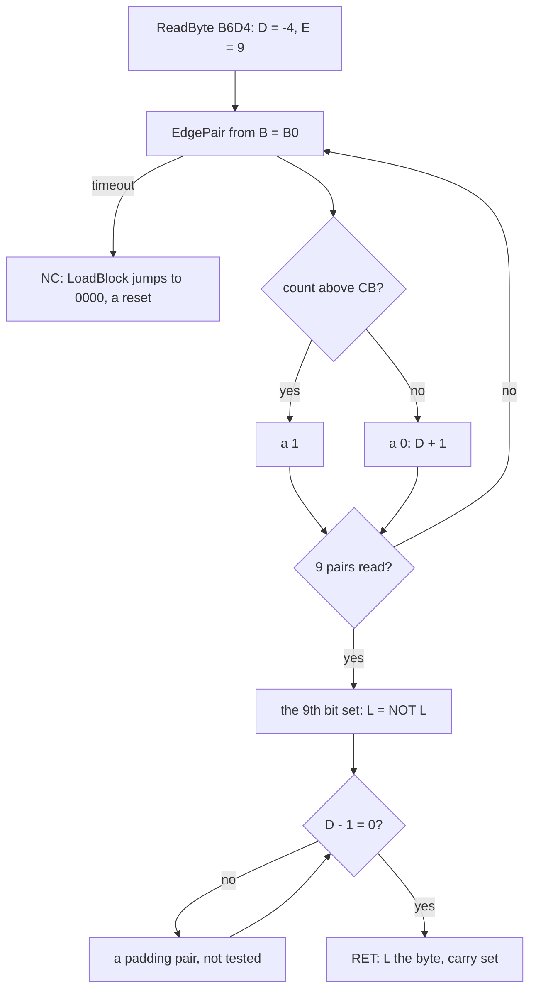

*ReadByte (the hex are addresses and counts). Witness: `c1` (ReadByte 41 453 runs: the 41 445 bytes of the eight loads and
their 8 checksums). The point: the bit is in a pair's length, the byte's length is fixed by the padding.*

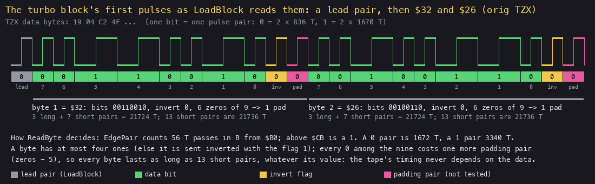

*The first 21 pulse pairs after the sync, from the original TZX, read as LoadBlock reads them. How to read it: the
waveform on top, each pair's bit below it, coloured by its role; the bytes and their times under them. The point: the
TZX block's first byte `$19` is not a flag but eight pairs: LoadBlock's lead pair and the first seven bits of `$32`.
Command: `python3 tools/fig_loader.py byte docs/img/load/turbo-byte.png`.*

Worked example, the block's first byte. The TZX block starts `19 04 C2 4F`, bits `00011001 00000100 11000010 ...`,
one pulse pair each. LoadBlock reads one lead pair first (bit 0). ReadByte then reads `0 0 1 1 0 0 1 0` (bits 7-0)
and the invert flag 0: L = `$32`, the first byte of stage 2's first piece, `LD (HookCount),A` at `$B75A`. Among the
nine pairs six are 0, so D ends at 2 and one padding pair follows (another 0). The byte took 3 long and 7 short pairs:
3 x 3340 + 7 x 1672 = 21 724 T, against 13 x 1672 = 21 736 T for 13 short ones. The next nine pairs, `0 0 1 0 0 1 1 0`
and 0, are `$26`, again six zeros and one padding pair. A byte with five ones, say `$F8`, would go out inverted:
`00000111` and the flag 1, five zeros, no padding.

### 3.3.2 The script's codes

The script engine ScriptStep `$B78E` reads the byte at ScriptPtr: `$04` ends the script, a byte of 32 or more is a
character (PrintGlyph with the loader's font, then the print position moves right, wrapping inside the window), a byte
below 32 is a control code. A step costs one long pulse pair; a hook has room for 6 steps (2 when the countdown
ticks). The codes (ControlCode `$B8DD` and ControlTable `$BB92`):

| Code | Operands | What it does |
| --- | --- | --- |
| `$03` | n | pause: wait n hooks before the next step (ScriptWait) |
| `$04` | | the end of the script (LoadFlags bit 1 off) |
| `$05` | c | FillChar = c, the character `$0C`, `$0E` and `$1D` print |
| `$08`, `$09`, `$0A`, `$0B` | | the print position left, right, down, up; left from the window's first column falls through into up (CodeLeft `$B98E` has no RET there), so it wraps to the last column of the row above |
| `$0C` | | clear the window: FillChar into every cell, one cell a step |
| `$0D` | | to the window's left on the next row |
| `$0E` | n | print FillChar n times (0: 256), one a step |
| `$0F` | row col rows cols | a picture of rows x cols cells at an absolute place; each cell an attribute and 8 pixel bytes from the script, one cell a step |
| `$10`, `$11`, `$12`, `$13` | n | INK, PAPER, FLASH, BRIGHT (the ROM's codes 16-19) |
| `$16` | row col | AT, inside the window (the ROM's 22) |
| `$18` | | swap INK and PAPER |
| `$19` | c, 8 bytes | a new glyph for character c |
| `$1A` | left right top bottom | the window |
| `$1D` | n | fill with FillChar to column n |
| `$1E` | n | BORDER n |
| `$00-$02`, `$06`, `$07`, `$14`, `$15`, `$17`, `$1B`, `$1C`, `$1F` | | nothing (IgnoreCode `$B8DC`), no operand |

```text
script_step():                            # up to 6 a hook, one long pulse pair each
    if a picture is being drawn: draw its next cell; return
    c = next byte
    if c == $04: script off
    elif c < 32: control code c (it may take its operands, or repeat itself next step)
    else: print c at the position, move right, wrap in the window
```

Worked example, the script's first 46 bytes (`src/res/loader/script.txt`, at `$998E`):

| Bytes | Decoded | On the screen |
| --- | --- | --- |
| `16 16 05` | AT 22,5 (the window is still the whole screen) | |
| `53 45 43 ... 52 20 20` | "SECONDS TO LOAD DEFLEKTOR  ", 27 characters | over the serial number in row 22, after the countdown: `154 SECONDS TO LOAD DEFLEKTOR` at frame 8000 |
| `11 00`, `10 07` | PAPER 0, INK 7 | |
| `1A 01 1E 0A 14` | the window: columns 1-30, rows 10-20 | where the instruction pages are printed |
| `03 E6` | pause 230 hooks, about 11 s | |
| `0F 00 00 09 20` | a picture at row 0, column 0, 9 rows of 32 cells | the DEFLEKTOR logo's band at the top |
| `05 FF 80 80 80 80 80 80 80` | its first cell: attribute `$05` (cyan on black), then 8 pixel rows | the band's top left corner |

Before it, while stage 2's own pieces load, ScriptPtr points at SerialText `$B835`: six spaces and "DEFLEKTOR SERIAL
NO-VX3240", then `$04`, typed into row 22 from column 0 in white on black (PrintAttr 7). The countdown overprints
columns 1-3, so frame 2000 shows `275 DEFLEKTOR SERIAL NO-VX3240`. LoadFiles starts the script proper with ScriptWait
= 230 hooks, so frame 2000 is still before its first step.

## 3.4 The main block and the head

The last three loads put the main block at `$C000` (its `$9DF0-$DDEF`), `$5C00-$9BFF` and `$9C00-$9DEF`;
LoadFiles `$BACC` then plants `LDIR; RET` at `$5B00` and moves the `$C000` piece down to `$9DF0-$DDEF`, over the
loader itself (`$B326-$BBDE`): the copy runs from the printer buffer for that reason. The RET goes to `$5C00`, the
block's first byte: BlockHead, the only 39 bytes of the block not enciphered.

```asm
BlockHead:              ; $5C00
  DI
  LD HL,$E9E1           ; POP HL; JP (HL)
  LD (MoveStub),HL      ; at $5B00
  CALL MoveStub         ; returns with HL = $5C0A, its own return address
  LD DE,$001D
  ADD HL,DE             ; HL = $5C27, the first enciphered byte
  LD BC,$81C9           ; 33 225 bytes, $5C27-$DDEF
  LD DE,$7B52
  PUSH DE               ; the RET goes to the copy
  ...                   ; source below target: LDDR from the ends
  LDDR
  RET                   ; to $7B52
```

The point: the head works out where it is (the CALL to a `POP HL; JP (HL)` stub leaves its own address in HL), so the
block would run wherever a loader put it.

## 3.5 The cipher

The block moved to `$7B52-$FD1A` starts with D.G. Cooke's chain (`src/head/head/chain.asm`). It runs with SP =
`$5C00` (BlockHead's RET left it there), so its CALLs keep their return addresses at `$5BFE-$5BFF`.

### ChainFill: wiping what lies around the block

Before any layer, ChainStart `$7B52` overwrites everything below the block down to the printer buffer, and the space
above the mover, with a generated stream, then adds all of `$4000-$FFFF` into A:

```asm
ChainStart:               ; $7B52
  LD DE,$9502             ; D = $95 the stream's first byte, E = 2 passes
  LD HL,MoveStub          ; $5B00
  LD BC,$2052             ; $5B00-$7B51
ChainFill:
  LD A,D                  ; one byte of the stream
  LD (HL),A
  ADD A,A
  ADD A,A
  ADD A,A
  ADD A,A
  ADD A,D                 ; 17 x D
  ADD A,L                 ; + the address's low byte
  ADD A,$0B               ; + 11
  LD D,A
  INC HL
  DEC BC
  LD A,B
  OR C
  JP NZ,ChainFill
  LD HL,$FD1B             ; the second pass: $FD1B-$FFFF, past the mover
  LD BC,$02E5
  DEC E
  JR NZ,ChainFill
  LD HL,$4000             ; the sum of $4000-$FFFF into A
  LD BC,$0001
  LD A,D
ChainSum:
  ADD A,(HL)
  ADD HL,BC
  JP NC,ChainSum          ; the carry out of HL ends it
  JR C,ChainLayers        ; $7BB2
```

```text
chain_start():
    D = $95
    for (lo, hi) in [($5B00, $7B51), ($FD1B, $FFFF)]:
        for a in lo..hi:
            mem[a] = D
            D = (17 * D + (a AND $FF) + 11) AND $FF
    A = D
    for a in $4000..$FFFF: A = (A + mem[a]) AND $FF
    go to ChainLayers with A as the first key
```

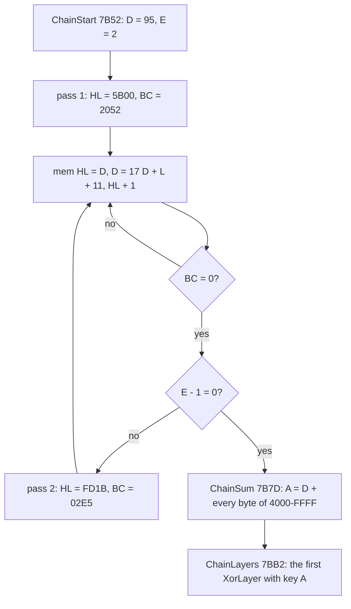

*ChainStart (the hex are addresses and counts). Witness: `c1` (ChainStart runs once at frame 15 651; the entry image
holds the stream at `$5B00-$5FFF`). The point: after the fill nothing of the BASIC, the system variables, the
printer-buffer stubs or the block head is left, and the stream is part of every key that follows.*

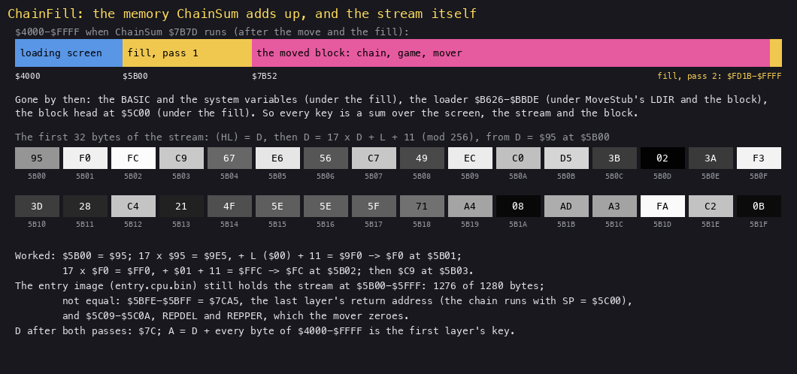

*What `$4000-$FFFF` holds when ChainSum runs, and the stream's first 32 bytes. How to read it: the bar is the 48 K by
address, coloured by what each part holds; below it the stream byte by byte, grey for its value. The point: the
chain's keys are sums over the loading screen, the stream and the block; the loader is gone by then. Command:
`python3 tools/fig_loader.py fill docs/img/load/chainfill.png` (the stream computed and checked against
`work/stage1/images/entry.cpu.bin`).*

Worked example, the stream's first bytes. `$5B00` gets D = `$95`. Then 17 x `$95` = `$9E5`, plus L = `$00` plus 11 =
`$9F0`: D = `$F0` at `$5B01`. 17 x `$F0` = `$FF0`, + `$01` + 11 = `$FFC`: `$FC` at `$5B02`; then `$C9` at `$5B03`.
The game's entry image still reads `95 F0 FC C9` at `$5B00`: the game never touches `$5B00-$5FFF`, and of its 1280
bytes only four differ from the stream, `$5BFE-$5BFF` (`$7CA5`, the return address of the last layer's CALL) and
`$5C09-$5C0A` (REPDEL and REPPER, which the mover zeroes). After both passes D = `$7C`. In the decipher animation below
the fill is the yellow band that grows down from `$5B00` from the fourth picture (frame 15 653) on.

### The 30 layers

Thirty layers run in turn: 18 XorLayers each decipher the code that follows them, and 12 SumLayers add a stretch of
memory into A (the next key) without deciphering anything. Each is a CALL followed by one key byte, and the code
after a CALL exists only once the CALL returns (`src/head/keys.txt` lists them in order: 18 `xor` lines, 12 `sum`).

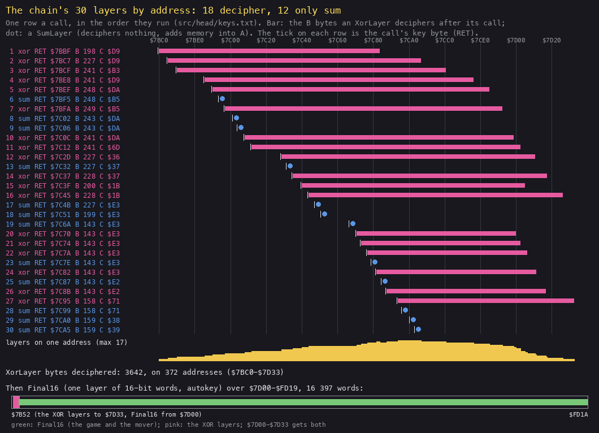

*Each call of the chain as a row, in the order they run. How to read it: a pink bar is the range an XorLayer deciphers
(the B bytes after its key byte), a blue dot a SumLayer, the yellow profile how many layers pass over each address; the
lower bar puts the XOR layers against Final16's range. The point: the 18 XorLayers overlap, up to 17 deep, over 372
bytes at `$7BC0-$7D33`; everything else (the game and the mover) is one 16-bit layer. Command: `python3
tools/fig_loader.py layers docs/img/load/layers.png` (from `src/head/keys.txt`).*

```asm
XorLayer:               ; $7B84
  POP HL                ; HL = the return address: the layer's key byte
  PUSH HL
  LD E,B
XorLayerByte:
  INC HL
  LD D,A
  ADD A,A               ; A = 17 A + C: the running key
  ADD A,A
  ADD A,A
  ADD A,A
  ADD A,D
  ADD A,C
  XOR (HL)              ; decipher one byte after the call
  LD (HL),A             ; the plain byte stays in A: the next byte's key comes from it
  DJNZ XorLayerByte
  LD B,E
  POP HL
  ADD A,(HL)            ; the key byte balances the sum
  LD (HL),C             ; C over the key byte
  INC HL
  JP (HL)               ; into the bytes just deciphered

SumLayer1:              ; $7BD2 (SumLayer2 $7C15, SumLayer3 $7C54: the same code)
  LD HL,$4000
  LD D,L                ; DE = C + 1, the stride
  LD E,C
  INC DE
  ADD A,B
SumLayer1Loop:
  ADD A,(HL)            ; every (C + 1)th byte of $4000-$FFFF
  ADD HL,DE
  JP NC,SumLayer1Loop
  POP HL
  ADD A,(HL)            ; the key byte, then C over it, as in XorLayer
  LD (HL),C
  INC HL
  JP (HL)
```

XorLayer is an autokey cipher: each byte's key is 17 x the previous plain byte + C, and the first "previous" is the
incoming A. On the original tape every layer's incoming A is 0 (`keys.txt`): the key byte after each CALL is chosen so
that the sums balance to 0.

```text
xor_layer(ret, A, B, C):                      # ret = the CALL's return address, its key byte
    prev = A
    for a in ret + 1 .. ret + B:              # B = 0 means 256
        plain = mem[a] XOR ((17 * prev + C) AND $FF)
        mem[a] = plain
        prev = plain                          # autokey: the plain byte keys the next one
    A = (prev + mem[ret]) AND $FF             # the key byte balances the sum
    mem[ret] = C
    go to ret + 1

sum_layer(ret, A, B, C):
    A = A + B + mem[$4000] + mem[$4000 + (C + 1)] + ... (every (C + 1)th byte up to $FFFF), mod 256
    A = (A + mem[ret]) AND $FF; mem[ret] = C; go to ret + 1
```

How the tape was made (`tools/cipher.py encrypt`): the same walk forward over the plain bytes, which are the key source
in both directions, with the layers applied in the reverse order (the last layer first), each with the A, B, C and key
byte of `keys.txt`:

```text
xor_layer_encrypt(ret, A, B, C):
    prev = A
    for a in ret + 1 .. ret + B:
        plain = mem[a]
        mem[a] = plain XOR ((17 * prev + C) AND $FF)
        prev = plain
    mem[ret] = the key byte from keys.txt
```

Worked example, the first call (`$7BBC`: A = 0, B = `$C6` = 198, C = `$D9`). The tape's bytes, moved to `$7BC0`, read
`12 6C 5A AC`. Key 17 x 0 + `$D9` = `$D9`, and `$12` XOR `$D9` = `$CB`. Next key 17 x `$CB` + `$D9` = `$E54`, so
`$54`, and `$6C` XOR `$54` = `$38`. Then `$5A` XOR `$91` = `$CB`, `$AC` XOR `$54` = `$F8`: `CB 38 CB F8` is
`SRL B; SET 7,B`, the code that sets up the second call (`build/head.lst` `$7BC0`).

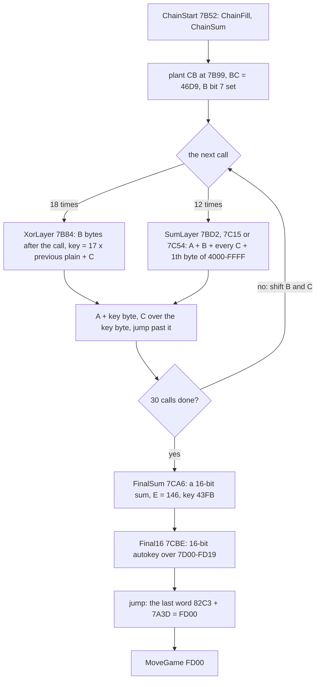

*The chain's loop (the hex are addresses and values). Witness: `c1` (L1: XorLayer entered 18 times, its byte loop
3642 times; SumLayer1 6 times, SumLayer2 and SumLayer3 3 times each; Final16's loop 16 397 times), `tools/parts.py`
(887 532 instructions in SkoolKit's simulator). The point: every key comes from the memory around it, so the cipher
cannot be read without running it, and a change anywhere breaks it.*

Facts of the chain (`tools/cipher.py`, `src/head/keys.txt`):

- The keys are sums of memory over `$4000-$FFFF`: the loading screen, ChainFill's stream and the block itself (the
  cipher included). The loader is gone by then (overwritten by the `$C000` piece's move and by the block), and the
  BASIC by the stream. On the original tape every layer's incoming key is 0: the balance bytes after each CALL are
  chosen so.
- SumLayer1-3 (`$7BD2`, `$7C15`, `$7C54`) fold sums of memory into the key and decipher nothing. The chain depends on
  SP, because its return addresses lie inside the summed memory (SP is `$5BFE` at `$5B00` and `$5C00` in the chain): a
  first simulation with SP = `$FFF0` ran wild.
- 3642 byte decryptions on 372 addresses (`$7BC0-$7D33`), up to 17 layers on one address. The text
  "COPYRIGHT D.G.COOKE 1987" (ChainText `$7B9A`) lies inside the layers' range, so it is key material too.

### Final16: the 16-bit layer

FinalSum zeroes its own operand, adds `$4000-$FFFF` as 16-bit words into DE (`$43FB` on the tape, `keys.txt` key16),
and Final16 deciphers `$7D00-$FD19`, 16 397 words (32 794 bytes): the game and the mover. It is an autokey on words:
the key of each word is made from the previous plain word.

```asm
FinalSum:               ; $7CA6
  LD D,$00              ; DE = A, the 30th layer's key (E = 146)
  LD E,A
  XOR A
  LD (FinalSum+$0001),A ; its own operand zeroed: the sum below does not count it
  LD HL,$4000
  LD BC,$0001
FinalSumLoop:
  LD A,E                ; DE + the word at HL
  ADD A,(HL)
  LD E,A
  INC HL
  LD A,D
  ADC A,(HL)
  LD D,A
  ADD HL,BC
  JP NC,FinalSumLoop    ; to $FFFF: DE = $43FB
Final16:                ; $7CBE
  EX DE,HL              ; HL = $43FB
  LD DE,$7D00
  LD C,$29
  LD B,H                ; B:C = $4329
Final16Loop:
  LD H,L                ; HL = L:L + B:$29, the key word
  ADD HL,BC
  LD A,(DE)
  XOR L                 ; the low byte
  LD (DE),A
  LD L,A                ; L = the plain low byte
  INC DE
  LD A,(DE)
  XOR H                 ; the high byte
  LD (DE),A
  INC DE
  LD B,A                ; B = the plain high byte
  LD A,E
  CP $1A
  JP NZ,Final16Loop
  LD A,D
  CP $FD
  JR NZ,Final16Loop     ; to $FD1A
  LD H,B                ; HL = the last word + $7A3D: the mover's address
  LD DE,$7A3D
  ADD HL,DE
  LD A,R
  SET 7,A
  LD R,A
  JP (HL)               ; $FD00
```

```text
final16():
    L, B = $FB, $43                            # from FinalSum's $43FB
    for a in $7D00 .. $FD18 step 2:
        key = ((L << 8) | L) + ((B << 8) | $29)  (mod $10000)     # H = L; HL += B:$29
        mem[a]     = mem[a] XOR low(key);  L = mem[a]             # the plain low byte
        mem[a + 1] = mem[a + 1] XOR high(key);  B = mem[a + 1]    # the plain high byte
    jump to ((B << 8) | L) + $7A3D             # the last word $82C3: $FD00

final16_encrypt():                             # tools/cipher.py encrypt16, the plain words as the key source
    L, B = $FB, $43
    for a in $7D00 .. $FD18 step 2:
        key = ((L << 8) | L) + ((B << 8) | $29)
        L, B = mem[a], mem[a + 1]              # the plain word, before it is overwritten
        mem[a] = L XOR low(key); mem[a + 1] = B XOR high(key)
```

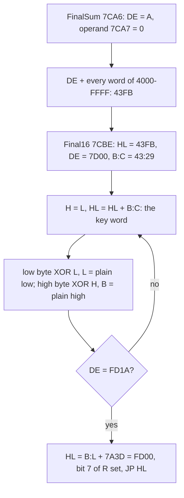

*FinalSum and Final16 (the hex are addresses and values). Witness: `c1` (L1: Final16's loop 16 397 times, entered
once). The point: one key word, made from a sum over all memory, unlocks the whole game, and each word's key comes from
the word before it.*

Worked example, the game's entry. The game's `$8382` is at `$A082` before the mover. The plain word before it, at
`$A080`, is `00 00` (L = 0, B = 0), so the key is `$0000` + `$0029` = `$0029`. The tape's word there is `EA 08`:
`$EA` XOR `$29` = `$C3`, `$08` XOR `$00` = `$08`, so `C3 08`, the first two bytes of `JP $8408`, the game's entry. The
first word's key of all comes from `$43FB`: `$FBFB` + `$4329` = `$3F24`. Recomputed from `build/head.bin`, `game.bin`
and `main.bin`, Final16 gives the tape's bytes in 16 371 of the 16 397 words; the other 26 (`$7D00-$7D33`) are also
under the XOR layers. The last word deciphered, `$FD18` = `$82C3`, plus `$7A3D` gives `$FD00`: the jump to the mover. A
wrong key jumps wild.

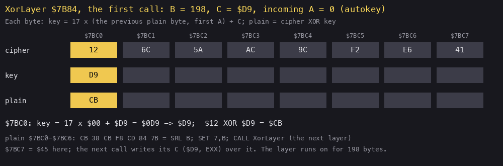

*The first XorLayer over `$7BC0-$7BC7`, then Final16 over the eight words at `$A07A-$A089`, a byte or a word a
picture. How to read it: the rows are the tape's byte, the key and the plain byte; yellow is the step being worked,
and the line under the rows gives its arithmetic. The point: both layers are autokeys, each key made from the byte or
word just deciphered. Command: `python3 tools/fig_loader.py steps docs/img/load/cipher-steps.gif` (from
`build/main.bin`, checked against `build/head.bin` and `build/game.bin`).*

The mover (`$FD00`) copies `$7D00-$FCFF` down to `$6000-$DFFF`, clears REPDEL and REPPER, sets SP = `$FFFF`, clears
bit 7 of R and jumps to `$8382`:

```asm
MoveGame:               ; $FD00
  LD HL,$7D00
  LD DE,$6000
  LD BC,$8000
  LDIR
  LD ($5C09),BC         ; BC = 0: REPDEL, REPPER
  LD SP,$FFFF
  LD A,R
  RES 7,A
  LD R,A
  JP $8382
```

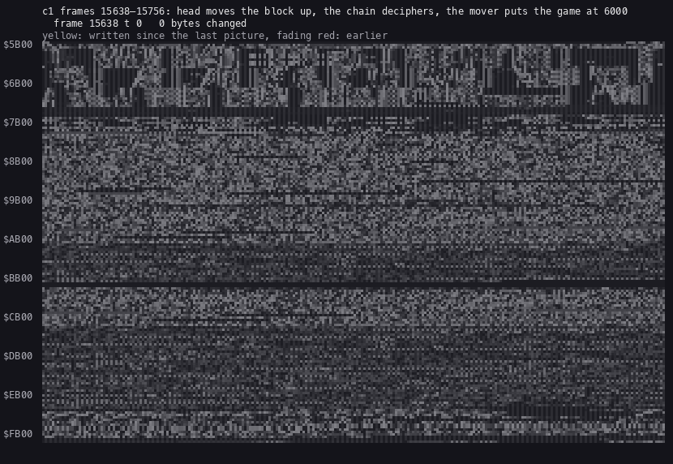

*`$5B00-$FFFF` of `c1` from frame 15 638 to 15 758, one picture every fifth frame (25). How to read it: a byte's grey
is its value; yellow is a byte written since the last picture, fading through red. The point: first the whole block
moves up (one sweep), then for about 55 frames (11 pictures) almost nothing is written (the chain reads its sums and
deciphers 372 bytes at `$7BC0-$7D33`, and FinalSum adds up memory), then the 16-bit layer rewrites `$7D00-$FD19` in
about 27 frames (5 pictures, 92 T a word) and the mover copies the game into place in about 10 more (3 pictures); the
last pictures are the game's first pass writing its buffers at `$E000-$FCFF`. Command: `python3
../../kit/memanim.py --work work/docs/dfA/c1 --from 15638 --to 15756 --step 349440 --cell 3 --label "..." --delay 400
docs/img/load/decipher.gif`.*

### How each stage is known

| Stage | Read from the code (static) | Confirmed in `c1` (frame) |
| --- | --- | --- |
| BASIC, stage 0 | `build/basic.lst`: the hidden numbers, PROG + 58 | `$5D05` runs at 771 |
| 1 | `build/stage2.lst` (`ldr_b626.bin`): font copy, pilot, sync, the first piece | `$B65B` at 771, the font at `$B326` |
| 2 | `build/stage2.lst`: ReadByte, the hook, the script engine, the countdown | `$B856` at 1006; the screens 2000-15 700; ReadByte 41 453 runs |
| 3 | `build/stage2.lst` LoadFiles: the `LDIR; RET` at `$5B00` | `$5B00` at 15 635 |
| 4 | `build/head.lst` BlockHead | `$5C00` at 15 640, the LDDR's writes |
| 5-7 | `build/head.lst`, `tools/parts.py` (the chain in SkoolKit), `tools/cipher.py` | `$7B52` at 15 651; the L1 counts above; `decipher.gif` |
| 8 | `build/head.lst` MoveGame | the entry image at `$FD00-$FD1A`; the mover's writes from about 15 743 |
| 9 | `build/game.lst` GameEntry | `$8382` at 15 752 |

The tape itself is the last check: `tools/build.sh` rebuilds it from these sources, identical to the original (3.6).

## 3.6 The build

The case builds the tape from its sources and compares it with the original, byte for byte (`tools/build.sh`):

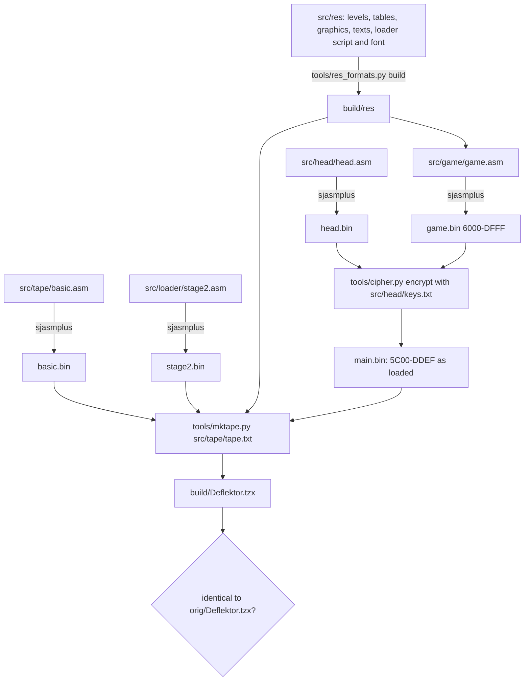

*The build. Every `.asm` is written by `kit/mkgame.py` from its `.ann`. Command: `sh tools/build.sh`; its last line
is `build: Deflektor.tzx identical to orig/Deflektor.tzx.zip's Deflektor.tzx` (stage 2). The point: the tape is
rebuilt from the readable game, so an edit of the game or a level gives a tape that loads.*

What the encoder does for the turbo block: it runs the loader's own code in SkoolKit's simulator, and each time the
loader waits for an edge it answers with the pulse pair the loader needs: a data bit, a padding pair after a hook, or
the script engine's runs of ones ending in a 0. A changed script or game changes the block but still loads. The cipher
direction is the chain applied backwards with the keys of `src/head/keys.txt`; `tools/cipher.py check` loads the
built tape in the simulator and checks that `$6000-$DFFF` at the entry is the game.

## 3.7 Why the original TZX did not load in unreal-ng (fixed in `f13cee7da`)

The turbo block is the tape's last block, with a pause of 0 ms, and its last byte uses 3 bits. The loader, after its
last bit, waits for one more edge to time the bit's second half. That edge is the last pulse of the tape: unreal-ng's
player toggled the level and stopped playback in the same step, before the loader's next `IN`, and a stopped tape
read the board's idle EAR level, on the 48K bit 4 of the last `#FE` write fed back. That level was the one before the
edge, so the edge was undone: the load timed out at IX = `$9DF0`, about frame 15 640, and the loader jumped to `$0000`
(a reset). `work/stage1/probe/orig.log` shows it. A real tape keeps the edge (the signal falls back to silence after
it), and so does SkoolKit's simulator, which loads the original. The 10 Mega Games copy has the same three blocks,
then a pause of 16 561 ms: the pause holds the level, and it loaded even then.

unreal-ng commit `f13cee7da` (on master as `36d3b7675`, 2026-11-13) makes a tape that ran out hold the level of its
last edge (`Tape::handlePortIn`, the unit test `TapePosition_Test.EndedTapeHoldsLastEdgeLevel`). With it the original
TZX loads on the 48K at ROM timing to the title and the options panel and plays (`re_session.py capture --record-load
--frames 20000`, port base 37540; the screens in `work/stage1/probe/fixed/screens.png`). `c1` was recorded before the
fix and stays on the 10 Mega Games copy: the pulses the loader reads are the original's, byte for byte.

## 3.8 The releases

| Copy | What differs from `orig/Deflektor.tzx` | Loads in unreal-ng |
| --- | --- | --- |
| ZXDB Gremlin tape (`orig/`) | the reference | yes since `f13cee7da` (3.7) |
| 10 Mega Games Volume One | the same three blocks byte for byte, a 16 561 ms pause after | yes: `c1` (recorded before the fix) |
| TOSEC 2020 TZX and TAP | the turbo block's last byte only (the unused bits), written at standard timing | yes |
| Erbe (Spain) | the same header and BASIC; the turbo block differs in 32 bytes from offset 306 | not tried |
| ZXDB TAP (a re-save) | a packed 23 266-byte DEFL.CDE at `$6000` | not tried |
| tape hacks in the collection | 84 to 116 of the game's 128 pieces of 256 bytes | not tried |

The release check is `tools/media_compare.py` (`work/stage1/media-compare.txt`) and `tools/copy_compare.py`
(`work/stage1/copy-compare.tsv`); details in [WALKTHROUGH 0](../WALKTHROUGH.md#0-the-medium).
