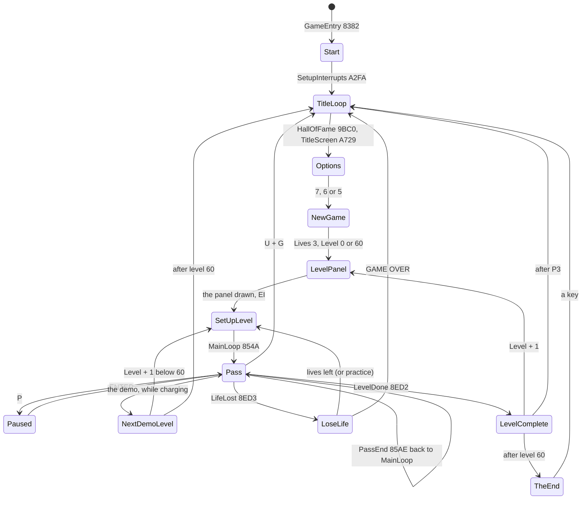
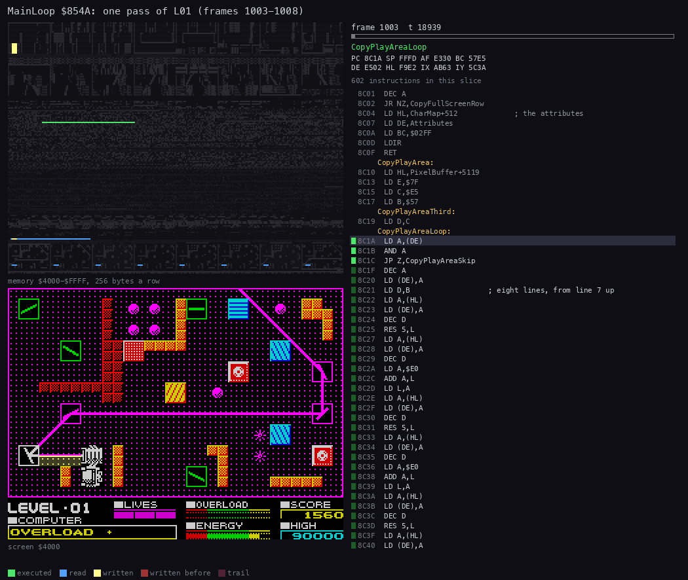
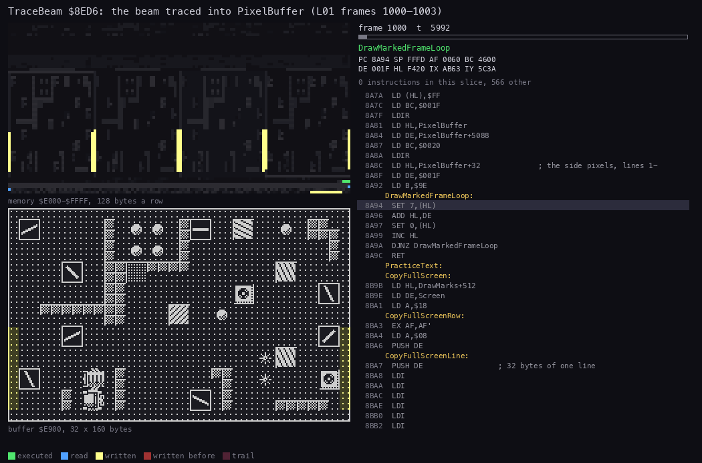
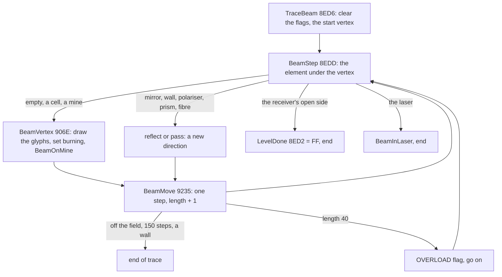
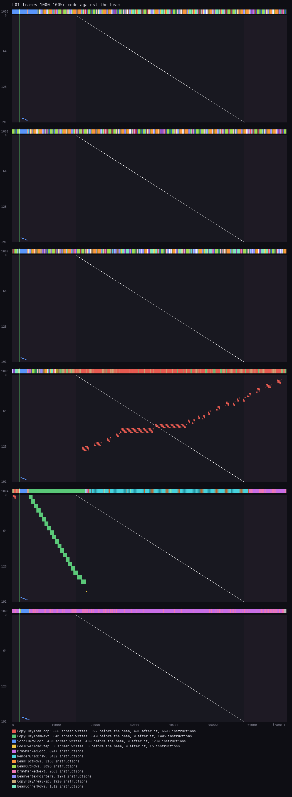
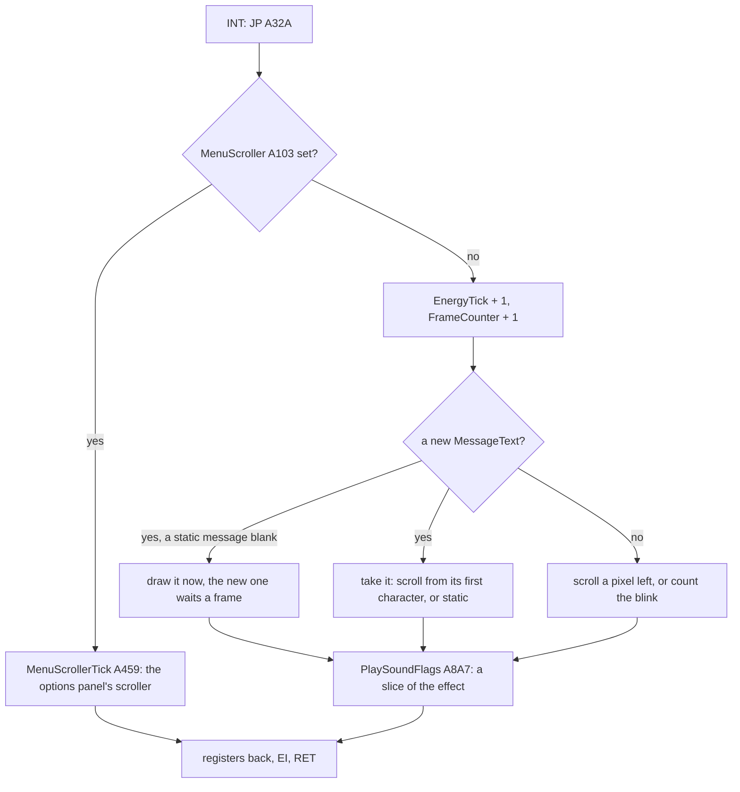

# 4. Game loop

What this covers: the game's states and how one leads to the next; the main loop's pass, its order of work and its
cost; the interrupt handler and what it shares with the pass; the heaviest part of a pass, the beam's trace; one pass
against the raster (a beam timeline); the timing of a level from its set-up to its end.

The recordings it rests on ([WALKTHROUGH 6.0](../WALKTHROUGH.md#60-the-recordings)):

- `L01` (stage 2, `work/stage2/rec/L01`): level 1 completed by the bot, 1645 frames. Reopened for this document as
  `work/docs/dfA/L01` on port base 37480; the traces of frames 1000-1008 (`work/docs/dfA/L01/traces/`) feed the
  animations and the beam timeline.
- `c1g`: the game window of `c1`, for the interrupt's cost; `controls` for the pause; `menu` for the demo; the 60 RZX
  segments for the pass length over a whole game (someone else's play).

## 4.1 The states



*Every state of the game and its routine (the hex are addresses). How to read it: a state is a routine the code
stays in; the arrows are the jumps between them. Witness: `c1` (Start to the pass), `menu` (the demo's 60 levels),
`controls` (P, U + G), `mine` and `gameover` (LoseLife, GAME OVER), `L01` (LevelComplete), `ending` (TheEnd). The
point: there is no state variable; the state is where the program counter is, and every exit leads back to
TitleLoop by a jump, never a return.*

Two exits drop the stack rather than unwind it: U + G in ReadKeys pops its return address and jumps to TitleLoop
(`$840C`); LoseLife and LevelComplete are jumped to from PassEnd and jump on. The stack stays within 13 bytes
([doc 2](02-architecture.md#23-the-heatmap-and-the-stack)).

## 4.2 The pass

```asm
MainLoop:                 ; $854A
  CALL ReadKeys           ; P, U + G, then the controls into ControlBits
  CALL MarkCursorCells    ; the cursor's old and new cells to redraw
  CALL RenderGrid         ; changed and turning cells into CharMap, then DrawMarkedChars
  LD A,(LaserCharging)
  AND A
  JR Z,MainLoopBeam
  LD A,(DemoFlag)         ; the demo: the next level instead of a beam
  AND A
  JR Z,MainLoopRest
  ...                     ; MainLoopDemoNext
MainLoopBeam:
  LD A,(BeamStartDirection) ; no laser: no beam
  CP $FF
  JR Z,MainLoopRest
  ...                     ; the beam's start from FindLaser; the flicker when critical
  CALL TraceBeam          ; $8ED6
MainLoopRest:
  CALL CursorFire         ; fire: the square, a gremlin killed
  CALL DrawCursor
  LD A,(LaserCharging)
  AND A
  CALL Z,UpdateGremlins   ; not while charging
  CALL CopyPlayArea       ; PixelBuffer and ColourBuffer to the screen
PassEnd:                  ; $85AE, falls in
  ...                     ; the gremlin sound
  CALL UpdateOverload     ; a full bar sets LifeLost
  LD A,(LifeLost)
  AND A
  JP NZ,LoseLife
  CALL DrainEnergy        ; the charge, or the energy's step
  LD A,(LevelDone)
  AND A
  JP NZ,LevelComplete
  ...                     ; CellsLeft 0: OpenReceiver, 250 points
  ...                     ; the seven explosion slots, one step each
  JP MainLoop
```

The order of work, with each part's share of the T-states of `L01` ([doc 2](02-architecture.md#21-the-machine-and-the-budget)):

| Step | Routine | What | Share of `L01` |
| --- | --- | --- | ---: |
| 1 | ReadKeys `$97F0` | P (pause), U + G (abort), W / S (dormant), the control method's read into ControlBits `$96C5` | 0.1 % |
| 2 | MarkCursorCells `$999F` | the cursor's cells marked for redraw | small |
| 3 | RenderGrid `$8960`, DrawMarkedChars `$8A09` | turning elements one step; the cells' characters into CharMap; every marked character drawn into PixelBuffer and ColourBuffer | 28 % |
| 4 | TraceBeam `$8ED6` | the beam from the laser: drawn into the buffers, cells set burning, the flags LevelDone, LifeLost's causes | 32 % |
| 5 | CursorFire `$9A57`, DrawCursor `$99C6` | the square or the arrow cursor drawn | small |
| 6 | UpdateGremlins `$AB9F` | every other pass: delays, appearance, a step, a mirror turned | 0.3 % |
| 7 | CopyPlayArea `$8C10` | 5120 pixel bytes and 640 attributes to the screen | 17 % |
| 8 | PassEnd `$85AE` | the overload, a life, the energy, the receiver, the explosions, their sounds | 13 % with the sounds |

Steps 3 and 4 are why the pass length changes: a long beam with many bounces costs more, and a pass that redraws many
characters (the first one of a level, all 640) costs most.

## 4.3 One pass, animated



*`L01` from frame 1003 T 15 000 to frame 1008 T 20 000, 45 pictures of 7877 T. How to read it: top left the memory
map of `$4000-$FFFF` (yellow written, green run, blue read, fading); bottom left the screen; right the listing at
the instruction running, with the lines run in the slice marked. The point: the screen is written in one burst
(CopyPlayArea) at the start; the rest of the pass works in the buffers at `$E000-$FCFF` and the screen does not
change until the next copy. Command: `python3 ../../kit/routine_anim.py --work work/docs/dfA/L01 --window
1003:15000-1008:20000 --listing build/game.lst --view screen --range 4000-FFFF --pictures 45 --delay 160 --title "..." --out
docs/img/routines/MainLoop.gif`.*

## 4.4 The heaviest work: the beam's trace

TraceBeam `$8ED6` starts at the half-cell in front of the laser and steps the beam vertex by vertex until it ends in a
wall, leaves the field, reaches 150 steps or the receiver. At every vertex it reads the character map (not the level
grid) under the beam, decides what the element there does, and draws the beam's glyphs into PixelBuffer and their
colour into ColourBuffer ([doc 6](06-rendering.md), [doc 10](10-gameplay-logic.md)).



*`L01` frames 1000 to 1003, TraceBeam and its callees (`$8ED6-$96FF`) only, 40 pictures of 5992 T. How to read it:
top left the buffers `$E000-$FFFF`; bottom left PixelBuffer `$E900` as a 32 x 160 bitmap (the field without colour);
right the listing. The point: the beam is drawn glyph by glyph into the buffer, each glyph OR-ed in over eight rows,
and every glyph also writes its draw mark at `$E300` and its colour at `$E600`, so the next pass redraws the
characters under the old beam and the beam vanishes. Command: `python3 ../../kit/routine_anim.py --work
work/docs/dfA/L01 --window 1000:0-1003:30000 --listing build/game.lst --view buffer:E900:32x160 --range E000-FFFF
--pc 8ED6-96FF --pictures 40 --delay 160 --title "..." --out docs/img/routines/TraceBeam.gif`.*



*TraceBeam's loop. Witness: every recording with a level (TraceBeam runs once a pass after the charge). The point:
one trace a pass, from scratch; the beam keeps nothing from the last pass, so a turned mirror shows in the next
picture.*

## 4.5 The pass against the raster



*Frames 1000-1005 of `L01`: across each panel the frame's T-states, down the 192 paper lines; the white diagonal is
the line the ULA is showing; each screen write a dot in its routine's colour; the strip above each panel the routine
the CPU is in. How to read it: a dot left of the diagonal lands before the beam reaches that line (it shows this
frame), right of it after (the line shows the old byte until the next frame). The point: the pass ignores the raster.
CopyPlayArea writes the pixels in frame 1003 from the lower field upwards, so its writes cross the beam's path (491 of 888 pixel
writes land after the beam): the field can tear for one frame, which the game accepts. The attributes go in frame
1004 ahead of the beam; the COMPUTER line's scroll (ScrollRowLoop, the interrupt) always lands just after the INT,
ahead of the beam. Command: `python3 ../../kit/beam_timeline.py --work work/docs/dfA/L01 --window 1000:0-1006:0
--listing build/game.lst --out docs/img/loop/beam-pass.png --frames 1000-1005 --title "..."`.*

Worked example from the counts under the figure: in these six frames CopyPlayAreaLoop wrote 888 screen bytes (397
before the beam, 491 after it), CopyPlayAreaNext 640 (the attributes, all before), ScrollRowLoop 480 (the COMPUTER
line, 80 bytes a frame, all before the beam) and CoolOverloadStep 3 (the overload bar's pixels). Frames 1000-1002 are
the trace (BeamOutRows, BeamPlotRows, BeamCornerRows), 1003-1004 the copy, 1004-1005 RenderGrid and DrawMarkedChars of
the next pass: one pass is these five frames and a part.

## 4.6 The interrupt

```asm
InterruptHandler:         ; $A32A, from JP $A32A at $FDFD
  PUSH HL
  PUSH DE
  PUSH BC
  PUSH AF
  LD A,(MenuScroller)     ; on the options panel: the menu's scroller instead
  AND A
  JP NZ,MenuScrollerTick
  LD A,(EnergyTick)       ; the energy's clock
  INC A
  LD (EnergyTick),A
  LD A,(FrameCounter)     ; the frame counter (the beam's flicker)
  INC A
  LD (FrameCounter),A
  LD A,(MessageText+$0001) ; a new message waiting?
  AND A
  JR Z,ScrollMessageTick
  ...                     ; take it, or scroll / blink the current one
  ...                     ; InterruptExit $A450: PlaySoundFlags $A8A7, POP, EI, RET
```



*The handler's branches. Witness: every recording (`c1g`: 3377 T an entry on average). The point: the interrupt does
the work that must keep time (the energy, the COMPUTER line, the continuous sounds), the pass does the rest.*

Worked example, the energy's clock: DrainEnergy compares EnergyTick `$A506` with the level's rate (90 on level 1) and
takes a pixel off the bar each time it is reached. EnergyTick counts frames, not passes, so the bar empties in 64 x 90
= 5760 frames whatever the beam costs. The POKE file's "infinite lives" (POKE 41784,0: `NOP` over the `INC A` at
`$A338`) stops this clock: the energy never drains.

## 4.7 Timing

| Moment | Frames | Witness |
| --- | --- | --- |
| A Delay `$8908` | about 12 (255 x 255 DJNZ, 845 000 T) | used 7 times at a level's end, twice per life counted |
| The charge | 32 passes, about 160 frames | `L01` 70-230 |
| A pass in play | about 5 (5.2 in `L01`, 4.85 in the RZX run) | 2.1 |
| The first pass of a level | 23-25 (all 640 characters drawn) | `L01`, RZX segments |
| An energy pixel | the level's rate, 70-140 frames (255 in practice) | `energy` |
| The bonus | about 36 frames of Delays, a tone per energy pixel, a Delay pair and 500 points per life | `L01` 1520-1645 |
| The pause | as long as the player wants; costs no energy (EnergyTick saved and restored) | `controls` 1400-1800 |

The point: two clocks run the game. The frame clock (the interrupt) runs the energy and the messages; the pass clock
(about 10 passes a second) runs the beam, the cursor, the gremlins and the overload. A mirror turns one step a pass,
so a full turn takes 16 passes, about 1.6 seconds.
