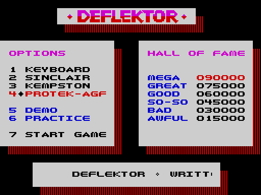
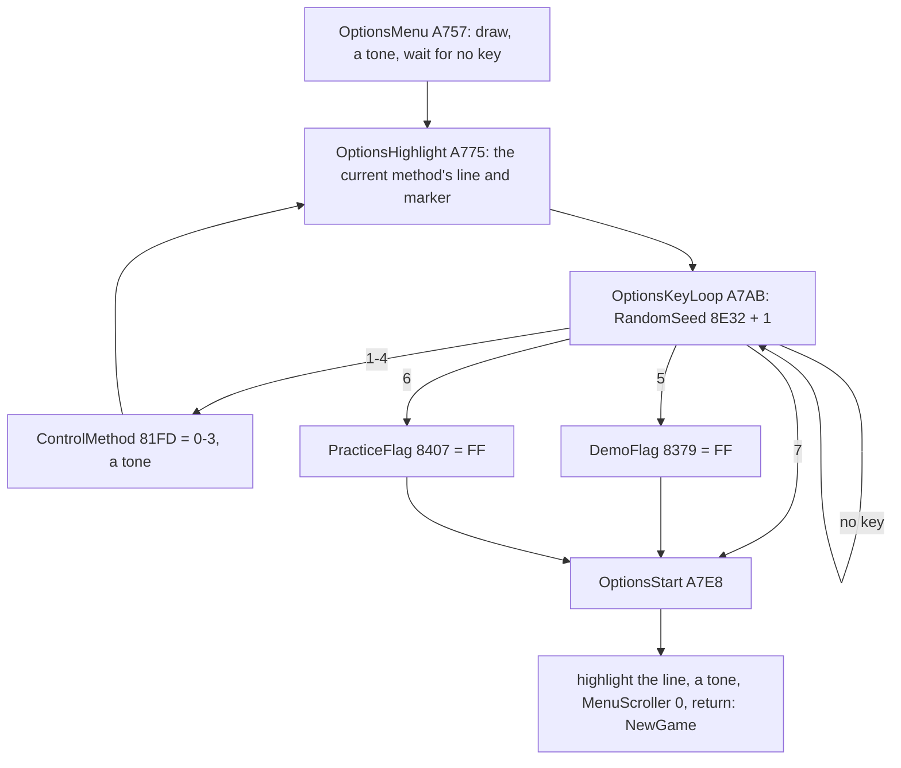
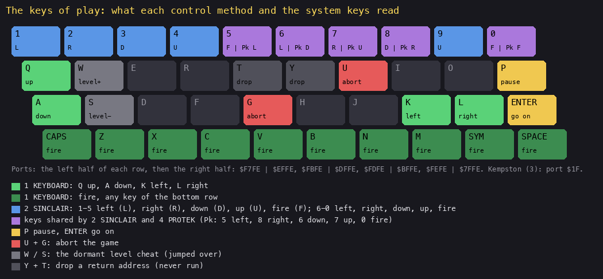
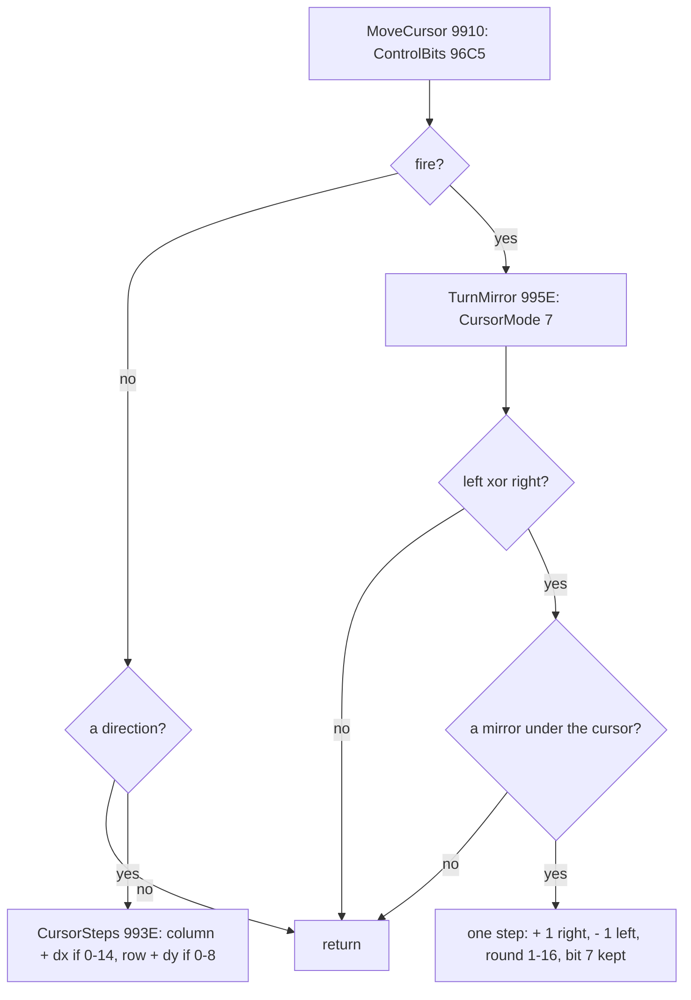
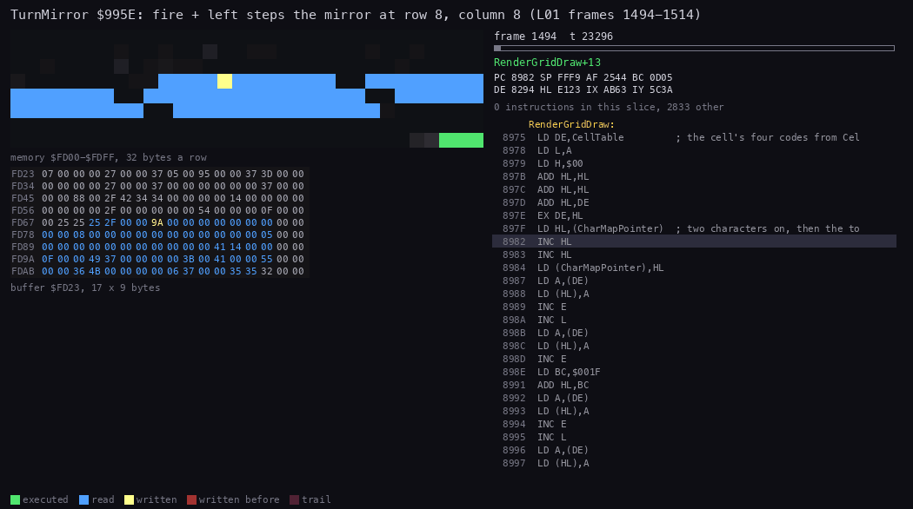
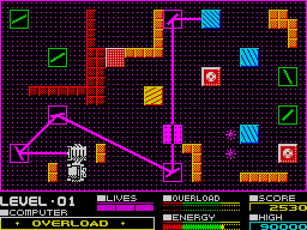
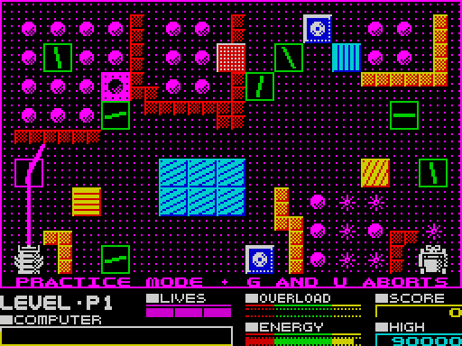
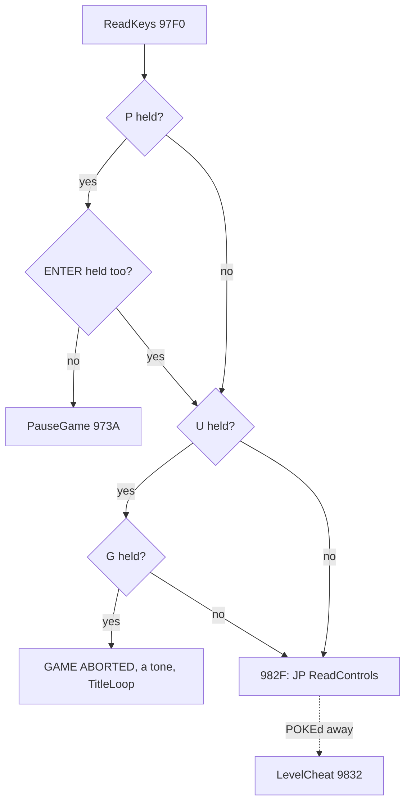
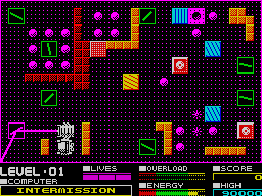

# 5. Controls

What this covers: the options panel and its keys; the four control methods, their ports and how each is decoded into
the same five control bits; the cursor and how fire turns a mirror; practice; the pause; the abort; the dormant level
cheat W / S and the Y + T drop.

The recordings it rests on ([WALKTHROUGH 6.0](../WALKTHROUGH.md#60-the-recordings)):

- `c1`, `c1g`: the options panel (3, 4, 2, 1, 7) and level 1 with the keyboard.
- `menu` (from `work/stage1/probe/menu.szx`): SPACE (it leaves the title for the options panel), 5 DEMO, then U + G
  (DEMO ABORTED); no code reads SPACE in the demo or in play.
- `controls`: 1 KEYBOARD, P and ENTER (the pause), U + G (GAME ABORTED), 4 PROTEK, 2 SINCLAIR; its 3 KEMPSTON did not
  take (pressed while the title was up).
- `kempston`: 3 KEMPSTON, the cursor and a mirror moved by the joystick (port `$1F`).
- `L01` (stage 2): the bot with the Sinclair keys (the default); reopened as `work/docs/dfA/L01` on port base 37480.
- `practice` (new, `work/docs/dfA/rec/practice`): `menu.szx`, SPACE at 300, 6 at 400, 7 at 1400 and 9 at 1500 (the
  cursor right and up); 2500 frames on port base 37485.
- `cheat` (stage 2, `work/stage2/rec/cheat`): level 1 on a clone whose jump over the cheat was POKEd away
  (`$982F-$9831` = 0), then W, W, S.

## 5.1 The options panel



*The options panel of `c1` at frame 500. How to read it: left the options, right the hall of fame; the current
control method is highlighted red on white with a diamond marker; the bottom line scrolls the credits. The point: one
screen holds every choice the game offers.*

OptionsMenu `$A757` waits for a key, and while it waits it stirs the random seed:



*The options loop (the hex are addresses). Witness: `c1` (3, 4, 2, 1, 7), `menu` (5), `practice` (6: the branch
`$A7E3` ran once). The point: the seed counts the loop's turns, so the game's randomness (the charge's scramble, the
prisms, the gremlins) depends on how long the player looks at the panel.*

| Key | Port, bit | What it does | Witness |
| --- | --- | --- | --- |
| 1-4 | `$F7FE` bits 0-3 | ControlMethod `$81FD` = 0 keyboard, 1 Sinclair, 2 Kempston, 3 Protek | `c1`, `controls` |
| 5 DEMO | `$F7FE` bit 4 | the demo: every level for one pass while it charges | `menu` |
| 6 PRACTICE | `$EFFE` bit 4 | practice levels P1-P3 | `practice` |
| 7 START GAME | `$EFFE` bit 3 | a game from level 1 | `c1`, every L recording |

The image holds ControlMethod = 1: Sinclair is the default.

## 5.2 The control methods



*The Spectrum keyboard with every key the game reads in play, coloured by use. How to read it: each key's label is
its meaning in the control method of its colour; L, R, D, U, F are left, right, down, up, fire. The point: four
methods, one result: five control bits. Command: `python3 tools/fig_keys.py docs/img/controls/keys.png`.*

ReadControls `$9869` reads the chosen method into A as five bits: bit 0 left, 1 right, 2 down, 3 up, 4 fire. Each
method ends in MoveCursor `$9910`.

| Method | Routine | Read | Runs in the recordings |
| --- | --- | --- | --- |
| 0 keyboard | ReadKeyboard `$987B` | Q up, A down, K left, L right; fire: any key of the bottom row (`$7EFE`) | 1361 (`c1g`, `controls`) |
| 1 Sinclair | ReadSinclair `$98AD` | both Interface 2 ports: 1-5 left, right, down, up, fire; 6-0 reversed into the same order (6 left, 7 right, 8 down, 9 up, 0 fire); ORed | 88 978 (the default; every RZX segment, the L recordings) |
| 2 Kempston | ReadKempston `$98D2` | port `$1F`: bit 0 right, 1 left, 2 down, 3 up, 4 fire; right and left swapped into place | 301 (`kempston`) |
| 3 Protek / AGF | ReadProtek `$98E7` | 5 left, 8 right, 6 down, 7 up, 0 fire | 276 (`controls`) |

Worked example, the Sinclair read: the 6-0 half-row `$EFFE` gives bit 0 for 0, bit 1 for 9, bit 2 for 8, bit 3 for 7,
bit 4 for 6 (active low). ReadSinclair reverses the five bits, so 6 becomes bit 0 (left), 7 bit 1 (right), 8 bit 2
(down), 9 bit 3 (up), 0 bit 4 (fire), and ORs them with the 1-5 half-row `$F7FE`, whose bits are already in that order.
In `L01` the bot holds 0 and 6: ControlBits `$96C5` = `$11` (fire and left) from frame 1500.

## 5.3 The cursor and the mirror turn

MoveCursor keeps the control bits in ControlBits `$96C5`. Without fire, the four direction bits index CursorSteps
`$993E` and the cursor moves one cell a pass (diagonals included; opposite keys cancel; it stays on columns 0-14, rows
0-8). With fire held, TurnMirror `$995E` turns the mirror under the cursor:

```asm
TurnMirror:               ; $995E, fire held
  LD A,$07
  LD (CursorMode),A       ; the square cursor
  LD A,(CursorX)
  LD C,A
  LD A,(CursorY)
  LD B,A
  LD A,$12                ; HL = $FD23 + 17 x row + column
  INC B
TurnMirrorRow:
  ADD A,$11
  DJNZ TurnMirrorRow
  ADD A,C
  LD L,A
  LD H,$FD
  LD A,(ControlBits)      ; neither or both of left and right: nothing
  LD D,A
  AND $03
  RET Z
  CP $03
  RET Z
  LD A,(HL)               ; a mirror, $01-$10 (bit 7 aside)?
  LD B,A
  RES 7,A
  DEC A
  CP $10
  RET NC
  BIT 1,D                 ; right: + 1
  JR Z,TurnMirrorLeft
  LD A,(HL)
  JR TurnMirrorStore
TurnMirrorLeft:
  BIT 0,D                 ; left: - 1
  RET Z
  LD A,(HL)
  DEC A
  DEC A
TurnMirrorStore:
  AND $0F                 ; round in 1-16, bit 7 put back
  INC A
  LD (HL),A
  BIT 7,B
  RET Z
  SET 7,(HL)
  RET
```

```text
TurnMirror:
    cursor shape = square
    cell = grid[row][column]
    if left == right: return              # neither or both
    if (cell AND 7F) not in 1..16: return  # only mirrors turn
    m = cell + 1 if right else cell - 1
    cell = ((m - 1) AND 15) + 1            # 16 wraps to 1, 0 to 16
    keep bit 7 (a mirror that also turns by itself)
```



*The cursor's decisions each pass. Witness: every recording with a level (MoveCursor 111 148 runs); turned right
`$9988` 7649 times, left `$998F` 4205 times in the RZX segments. The point: up and down do nothing while fire is held,
and one key press of one pass is one sixteenth of a turn.*



*TurnMirror in `L01`, frames 1494-1514, 60 pictures of 23 296 T, the code of `$9910-$999E` followed. How to read it:
top left the page `$FD00-$FDFF` (the level grid; yellow written); below it the grid as 9 rows of 17 bytes in hex,
row 8, column 8 at `$FDB3`; right the listing. The point: one byte changes a pass, `$06` to `$02`; everything else
the player sees follows from that byte. Command: `python3 ../../kit/routine_anim.py --work work/docs/dfA/L01 --window
1494:0-1514:0 --listing build/game.lst --view buffer:FD23:17x9:hex --range FD00-FDFF --pc 9910-999E --pictures 60
--title "..." --out docs/img/routines/TurnMirror.gif`.*



*The same moment on the screen, `L01` frames 1490-1522, one picture a frame. How to read it: the white square is the
cursor with fire held, on the mirror at row 8, column 8; watch the beam's last segment swing from up-left to due
west, into the receiver. The point: four steps of the mirror, four positions of the beam, the last one ends the level.
Command: `python3 ../../kit/screen_anim.py --work work/docs/dfA/L01 --from 1490 --to 1522 --step 1 --delay 120
docs/img/play/l01-turn.gif`.*

Worked example, the steps of `L01` (`tools/ttd_watch.py --work work/docs/dfA/L01 --addr FDB3,96C3,96C4,96C5`): the
cursor walks down column 8 from row 0 (frame 1380) to row 8 (frame 1494), one row every 3-6 frames (a pass each) with
ControlBits = `$04` (down). Then ControlBits = `$11` (fire, left) and the mirror at `$FDB3` = `$FD23` + 17 x 8 + 8
goes `$06`, `$05` (frame 1500), `$04` (1506), `$03` (1509), `$02` (1515). The arithmetic of the last step: `$03`, DEC
A twice gives `$01`, AND `$0F` gives `$01`, INC A gives `$02`.

The cursor's look (DrawCursor `$99C6`): without fire the cell's four colours are inverted (ink and paper swapped);
with fire a white 16 x 16 square is ORed round the cell (CursorGraphic `$9A37`). MarkCursorCells `$999F` marks the
cell's characters for redraw at the start of every pass, so last pass's cursor is wiped.

Fire also kills a gremlin: CursorFire `$9A57` looks for a gremlin standing on the cursor's cell, turning a mirror or
not (it compares only the gremlin's +4/+5 with the cell, `$9AC5-$9AD0`), and resets it
(160 points; [doc 10](10-gameplay-logic.md)).

## 5.4 Practice



*`practice` at frame 1750: LEVEL P1, the line "PRACTICE MODE . G AND U ABORTS" printed into the field's bottom row.
The point: practice is the game with a few switches flipped by one flag.*

PracticeFlag `$8407` (set by key 6, `$A7E5`) is read at six places, one for each thing it changes (the runs in `practice`, `work/docs/dfA/rec/practice/l1.json`):

| Where | What | Runs in `practice` |
| --- | --- | ---: |
| NewGame `$841E` (`$8424`) | the start slot 60 (`$3C`, P1) instead of 0 | 1 |
| SetUpLevel `$84DA` | the score cleared each level | 1 |
| DrawMarkedChars `$8A68`, PrintPlay `$8E47` | the PRACTICE MODE line printed in the field every pass | 615 |
| LoseLife `$86A0` | no life taken (the level restarts) | 0 (no life lost) |
| UpdateOverload `$A6E9` | a full overload bar sets no LifeLost | 0 (the bar never filled) |
| HallOfFame `$9BCA` | no hall-of-fame entry when practice ends | 0 (the recording stops in P1) |

The end of practice is not a flag read: LevelCompletePause `$887D` compares Level with 63 (`CP $3F`). After P3, slot
62, Level becomes 63 and the game goes back to the title; slot 63 is never set up. The `practice` recording reached P1
only, so P2, P3 and this return are known from the code.

The practice slots' energy rate is 255 (LevelSettings `$8385`): a pixel every 255 frames, 5.4 minutes for the bar.

## 5.5 The pause and the abort

ReadKeys `$97F0` runs first in every pass:

```asm
ReadKeys:                 ; $97F0
  XOR A
  LD (CursorMode),A
  LD A,$DF                ; P?
  IN A,($FE)
  BIT 0,A
  JR NZ,ReadKeysAbort
  LD A,$BF                ; P with ENTER: no pause
  IN A,($FE)
  BIT 0,A
  JP NZ,PauseGame
ReadKeysAbort:
  BIT 3,A                 ; U?
  JR NZ,ReadKeysControls
  LD A,$FD                ; and G?
  IN A,($FE)
  BIT 4,A
  JR NZ,ReadKeysControls
AbortGame:
  LD HL,GameAbortedMessage ; message $14
  ...                     ; DEMO ABORTED in the demo
  LD HL,$C814             ; a tone of 41 frames
  CALL TwoTone
  POP HL                  ; the return address dropped
  JP TitleLoop
ReadKeysControls:
  JP ReadControls         ; $982F: the cheat below is jumped over
```



*ReadKeys' tests (the hex are addresses). Witness: `controls` (P at 1400, U + G at 1900), `menu` (U + G in practice
and the demo). The point: the abort leaves by a jump with the return address dropped; the cheat sits behind a jump.*

A quirk: with P and ENTER both held, A holds the ENTER half-row when the U test runs, so bit 3 is J, not U.

PauseGame `$973A` turns the interrupts off, saves the COMPUTER line's state, the energy tick and the sound flags in
CursorVars (`$96C7`), prints INTERMISSION over the COMPUTER line, plays the pause tune, then shows "PRESS ENTER FOR
MORE ACTION" with interrupts on and waits for ENTER; then it puts everything back. Because the energy tick is
restored, a pause costs no energy. In `controls` the pause lasts from frame 1400 to about 1800:



*`controls` at frame 1500: INTERMISSION on the COMPUTER line. The point: the pause overwrites only the panel's
message line.*

## 5.6 The dormant cheat: W / S, and Y + T

At `$982F` a `JP $9869` jumps over 55 bytes no other jump reaches: LevelCheat `$9832`.

```asm
LevelCheat:               ; $9832, never reached in the game
  BIT 4,A                 ; Y held? (A: the half-row $DFFE read last)
  JR NZ,LevelCheatUp
  LD A,$FB                ; and T?
  IN A,($FE)
  BIT 4,A
  JR NZ,LevelCheatUp
  POP HL                  ; both: one return address dropped
LevelCheatUp:
  LD A,$FB                ; W: the next level
  IN A,($FE)
  BIT 1,A
  JR NZ,LevelCheatDown
  LD A,(Level)
  INC A
  LD (Level),A
  POP HL
  JP SetUpLevel
LevelCheatDown:
  LD A,$FD                ; S: the level before, not below 0
  IN A,($FE)
  BIT 1,A
  JR NZ,ReadControls
  POP HL
  LD A,(Level)
  AND A
  JP Z,SetUpLevel         ; S at level 0: the level restarts
  DEC A
  LD (Level),A
  JP SetUpLevel
```

The `cheat` recording (a clone, the jump POKEd to three `NOP`s) shows it working: W twice takes Level `$81FF` from 0
to 1 and 2 (`$9847-$984F`, 2 runs), S back to 1 (`$985A-$9866`, once), each followed by the level's set-up. W has no
upper limit: past 63 it would build a level from the bytes after LevelData.

The Y + T test drops one more return address. With W or S that does no harm (the restart never returns); without
them ReadControls would return past the main pass, into whatever lies on the stack. It looks like a guard whose jump
sense went wrong, or a leftover; no recording ran `$983E`, so it is known only from the code. A `JR $9832` (or no
jump) at `$982F` would bring the cheat back.

The point: the developer's level switch is still in the game, switched off by a single jump.
