# 6. Rendering

What this covers: how the play area reaches the screen. The level grid becomes a character map, the character map
is drawn into a pixel buffer and a colour buffer, and the beam, the cursor and the gremlins are OR-ed into the same
buffers. Only the marked characters are then copied to the screen. Also covered: the draw marks that make this work,
the wipe that brings a new level in, the full-screen buffer of the menus, and the raster.

The recordings it rests on ([WALKTHROUGH 6.0](../WALKTHROUGH.md#60-the-recordings)):

- `L01` (stage 2, `work/stage2/rec/L01`): level 1 completed by the bot, 1645 frames. Reopened as `work/docs/dfA/L01`
  on port base 37480. Every animation, the writers maps and the worked examples come from it. Its milestones:
  - frames 24-30: the set-up;
  - frames 30-63: the wipe;
  - frame 225: the charge ends;
  - frame 246: the first beam;
  - frames 1500-1515: the last turn.
- `menu`, `hof` and `ending`: the full-screen buffer and its two copiers.
- The 60 RZX segments: the witness counts in the listing (how often each routine ran over a whole game).

## 6.1 The screen and its buffers

The play area is the top 20 character rows of the screen (160 lines), and the panel is the bottom four rows
([doc 8](08-hud-and-text.md)). The game never draws the play area on the screen directly. It keeps five areas in the
top 8 K of memory and copies from them:

| Area | Address | Size | Layout | Written by | Read by |
| --- | --- | ---: | --- | --- | --- |
| LevelGrid | `$FD23` (`$FD00` with the guards) | 9 x 17 | one byte a cell, 15 cells and 2 guards a row | BuildLevel, the turns, the burns, the gremlins | RenderGrid, the trace, the cursor |
| CharMap | `$E000-$E27F` | 640 | 20 rows of 32 character codes | RenderGrid (every pass) | DrawMarkedChars, the trace |
| DrawMarks | `$E300-$E57F` | 640 | 20 rows of 32, like the attributes | whoever changes a character | DrawMarkedChars, CopyPlayArea |
| ColourBuffer | `$E600-$E87F` | 640 | 20 rows of 32 attributes | DrawMarkedChars, the beam, the cursor | CopyPlayArea, the wipe |
| PixelBuffer | `$E900-$FCFF` | 5120 | linear: character row r, line l, column c at `$E900` + 256r + 32l + c | DrawMarkedChars, the beam, the cursor, the gremlins | CopyPlayArea, the wipe |

The menus and the hall of fame use a sixth area over the same memory: a 24-row full-screen buffer with its pixels at
`$E500-$FCFF` and its attributes at `$E200-$E4FF` (MenuPixels and MenuAttrs in `game.asm`). A game and a menu never
need both at once, so the two overlap. This is why the animations below show the remains of the options screen in
the pixel buffer until the level is drawn over it.

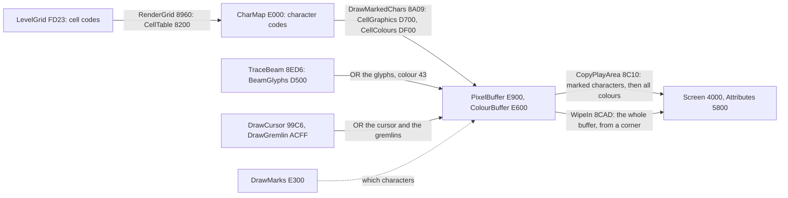

*The data flow of the play area. Witness: the writers maps of 6.7 (`L01` frames 1000-1005) show the writes behind
each arrow. The point: only two copiers ever write the play area on the screen; every drawing routine works on the
buffers.*

## 6.2 A cell to four characters: RenderGrid

A cell is 16 x 16 pixels, four characters. The cell (r, c) covers the characters (2r + 1, 2c + 1) to (2r + 2, 2c + 2).
So the grid's 9 x 15 cells fill rows 1-18 and columns 1-30, and the outer ring of characters is the border.

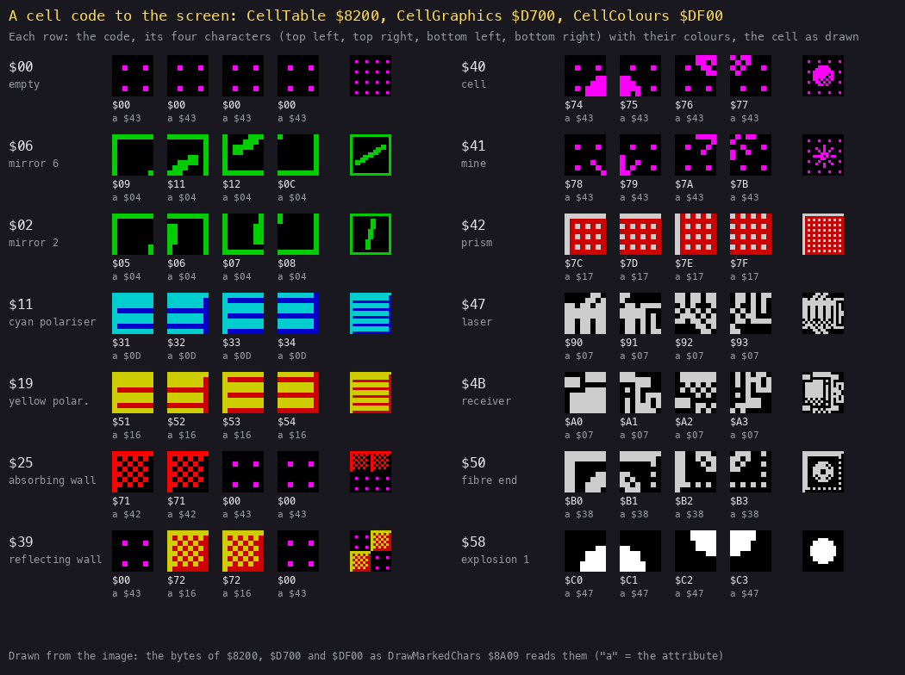

*Drawn by `python3 tools/fig_render.py cells docs/img/render/cell-to-chars.png` from the image. How to read it: each
row is one cell code. Next to the code are the four characters CellTable `$8200` gives it (top left, top right,
bottom left, bottom right). Each is drawn from CellGraphics `$D700` in its CellColours `$DF00` attribute (the "a"
under it), and the last picture is the cell as the game draws it. The point: the elements share characters. Mirror
angles reuse their neighbours' quarters, and a wall is one character, `$71` (absorbing) or `$72` (reflecting), placed
in the quarters its code names. The colour belongs to the character, not to the cell.*

RenderGrid `$8960` walks the grid once a pass:

```asm
RenderGrid:                 ; $8960
  LD HL,CharMap+31
  LD (CharMapPointer),HL
  LD HL,LevelGrid+35        ; the grid, 9 rows of 15
  LD C,$09
RenderGridRow:
  LD B,$0F
RenderGridCell:
  PUSH BC
  PUSH HL
  LD A,(HL)
  BIT 7,A
  JP NZ,RenderGridTurning   ; a turning element steps one angle first
RenderGridDraw:
  LD DE,CellTable           ; the cell's four codes from CellTable + 4 x code
  LD L,A
  LD H,$00
  ADD HL,HL
  ADD HL,HL
  ADD HL,DE
  EX DE,HL
  LD HL,(CharMapPointer)    ; two characters on
  INC HL
  INC HL
  LD (CharMapPointer),HL
  LD A,(DE)                 ; top left, top right
  LD (HL),A
  INC E
  INC L
  LD A,(DE)
  LD (HL),A
  INC E
  LD BC,$001F               ; bottom left, bottom right
  ADD HL,BC
  ...
  JP DrawMarkedChars        ; after the last row
```

```text
RenderGrid():
    p = CharMap + 31                       # one before (1, 1)
    for r in 0..8:
        for c in 0..14:
            code = LevelGrid[0x23 + 17 r + c]
            if code has bit 7:             # a turning element
                code = next angle of (code AND 7F)   # mirrors 01-10, blocks 11-18 and 19-20 wrap round
                LevelGrid[...] = code OR 80
                mark the cell's four characters 1
            p += 2
            CharMap[p], CharMap[p+1], CharMap[p+32], CharMap[p+33] = CellTable[4 (code AND 7F) .. +3]
        p += 34                            # down two rows to column 1
    DrawMarkedChars()
```

RenderGrid writes all 540 characters of the cells every pass but marks only the turning ones. A cell that another
routine changes (a burn, a gremlin, the charge's scramble) is drawn because that routine marks it. The player's turn
needs no mark of its own. TurnMirror `$995E` changes only the grid, and the cell is redrawn because MarkCursorCells
`$999F` marks the cursor's four characters on every pass. In `L01`, RenderGrid and DrawMarkedChars together take
28 % of the CPU ([doc 2](02-architecture.md#21-the-machine-and-the-budget)).

**Worked example: the last turn of level 1.** The mirror at row 8, column 8 (`$FDB3` = `$FD23` + 17 x 8 + 8) turns
from `$06` to `$02` at frames 1500-1513.

- Its top-left character is (17, 17), at CharMap `$E000` + 32 x 17 + 17 = `$E231`.
- For code `$06`, CellTable `$8200` + 4 x 6 = `$8218` holds `$09 $11 $12 $0C`.
- For code `$02`, `$8208` holds `$05 $06 $07 $08`.

The watch `tools/ttd_watch.py --work work/docs/dfA/L01 --addr FDB3,E231 --from 1480 --to 1520` shows `$E231` = `$09`
until frame 1513, while the code passes through `$05`, `$04` and `$03`. Those angles keep the same top-left quarter,
another case of shared characters. The code reaches `$02` at 1513 and `$E231` becomes `$05` at 1514. That is one
frame later, because the turn is made after RenderGrid in its pass and the next pass's RenderGrid writes it.

## 6.3 Characters into the buffers: DrawMarkedChars

DrawMarkedChars `$8A09` walks the 640 draw marks with the pixel buffer in step. For each nonzero mark it takes the
character code at the same place in CharMap and writes two things:

- its attribute, `$DF00` + code, into ColourBuffer;
- its eight lines, from `$D700` + 8 x code, into PixelBuffer, 32 bytes apart.

```asm
DrawMarkedChars:            ; $8A09
  LD HL,PixelBuffer
  LD DE,DrawMarks
DrawMarkedLoop:
  LD A,(DE)
  AND A
  JP Z,DrawMarkedNext       ; not marked: skip
  PUSH DE
  PUSH HL
  LD B,H
  LD C,L
  DEC D                     ; DrawMarks - $300 = CharMap: the character code
  DEC D
  DEC D
  LD A,(DE)
  LD H,$DF                  ; its colour, CellColours + code
  LD L,A
  LD A,D                    ; to ColourBuffer (CharMap + $600)
  ADD A,$06
  LD D,A
  LD A,(HL)
  LD (DE),A
  LD H,$00                  ; the glyph: CellGraphics + 8 x code
  ADD HL,HL
  ADD HL,HL
  ADD HL,HL
  LD DE,CellGraphics
  ADD HL,DE
  ...                       ; eight lines, SET 5,L and ADD HL,$20 alternately
DrawMarkedNext:
  INC DE
  INC L
  BIT 5,L                   ; 32 characters a row
  JP Z,DrawMarkedLoop
  LD L,$00                  ; the next character row: 256 bytes on
  INC H
  LD A,H
  CP $FD
  JP NZ,DrawMarkedLoop
  ...                       ; practice line, then the frame round the play area
```

One register pair indexes three buffers. DrawMarks, CharMap and ColourBuffer are 640 bytes each and lie `$300` apart.
So `DEC D` three times turns a mark's address into its character's address, and `ADD A,$06` on the high byte gives
the colour's address. Along a row, a mark's low byte and the pixel buffer's low byte stay equal.

The drawing writes the glyph over whatever was there (a plain `LD`), and that is how a character with a beam glyph
on it gets cleaned. DrawMarkedChars leaves the marks alone; CopyPlayArea counts them down. Last it draws the frame
round the play area: lines 0 and 159 set, and the outer pixel of columns 0 and 31 on lines 1-158.

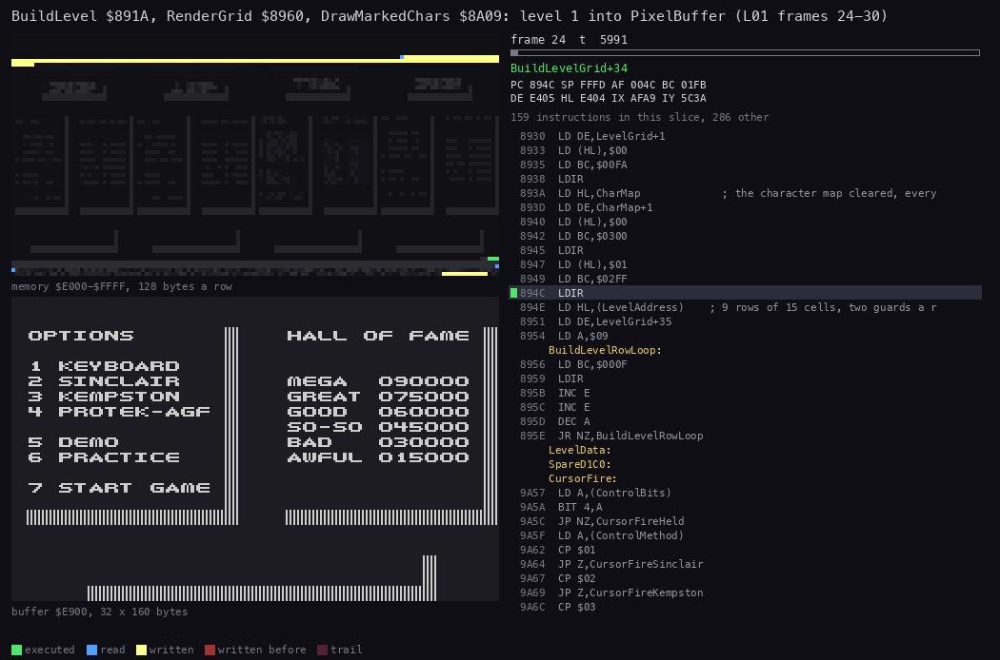

*`L01` frames 24-30, BuildLevel `$891A`, RenderGrid and DrawMarkedChars only (`$891A-$8AC0`), 70 pictures of 5991 T.
How to read it: top left, the buffers `$E000-$FFFF`, 128 bytes a row; bottom left, PixelBuffer `$E900` as a 32 x 160
bitmap; right, the listing at the current instruction. The point: BuildLevel marks every character with 1, so the
first DrawMarkedChars draws the whole level, row by row, over the options screen still in the buffer. The frame round
the play area comes last, and the wipe (6.9) starts while the bottom rows are still being drawn. Command: `python3
../../kit/routine_anim.py --work work/docs/dfA/L01 --window 24:0-30:0 --listing build/game.lst --view
buffer:E900:32x160 --range E000-FFFF --pc 891A-8AC0 --pictures 70 --title "..." --out
docs/img/routines/BuildLevel.gif`.*

## 6.4 The draw marks

A draw mark says how many more passes a character must be copied to the screen. The marks are laid out like the
attributes: the mark of (row, column) is at `$E300` + 32 x row + column. That address has two useful parts:

- its page, `$E3`, `$E4` or `$E5`, is the character's screen third;
- its low byte is the low byte of the character's screen address.

CopyPlayArea uses both parts directly (6.5).

| Setter | Mark | When |
| --- | ---: | --- |
| BuildLevel `$891A` | 1, all 640 | a new level |
| RenderGrid (`$89B1`) | 1 | a turning element stepped |
| ChargeLaser `$A57A` | 2 | the charge turned a mirror at random |
| MarkCursorCells `$999F` | 2 | the cursor's four characters, every pass |
| BeamPlotGlyph `$92B3`, BeamLightChar `$92F0` and the other passes | 2 | the beam is on this character |
| HighlightCell `$8FCA` | 2 | the receiver reached, or the beam back in the laser |
| PassEnd's explosions (`$85AE`) | 2 | a burning cell's next frame |
| DrawGremlin `$ACFF` | 2 | a gremlin's 2 x 2 characters |

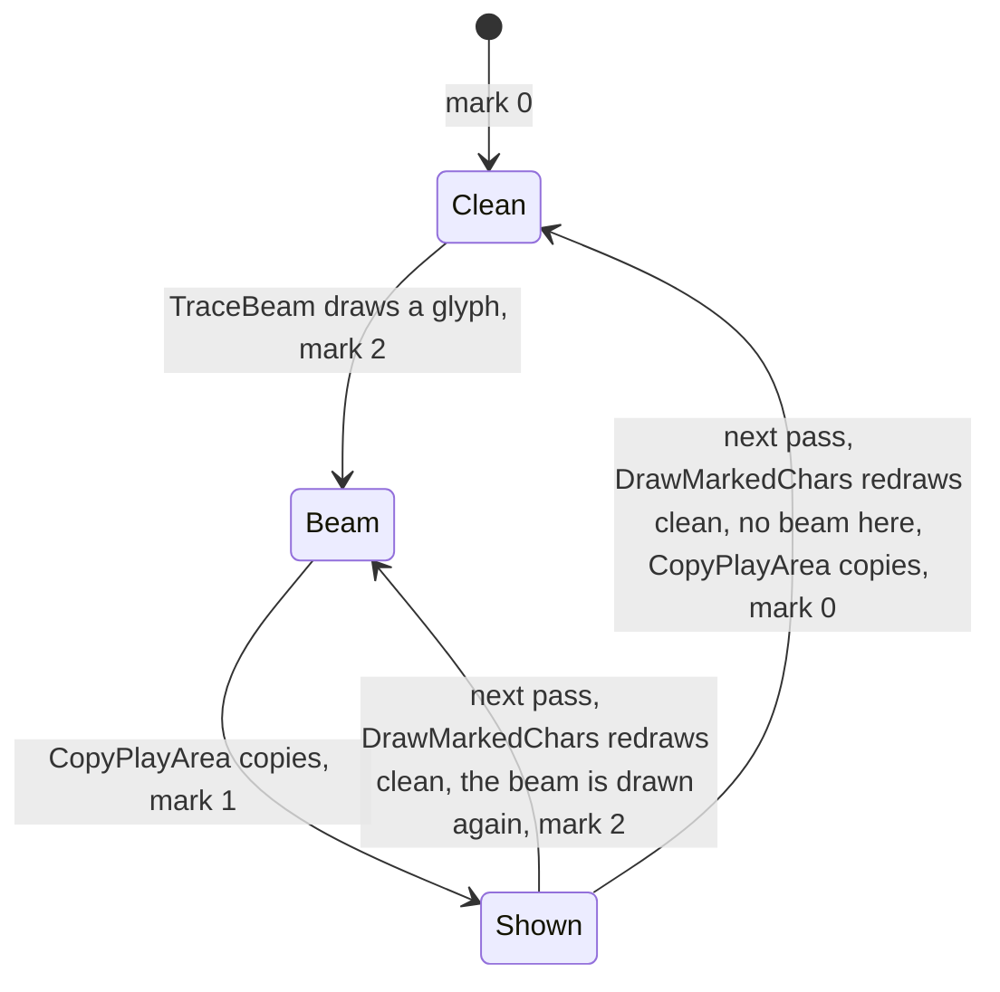

*A character under the beam. Witness: `tools/ttd_watch.py --work work/docs/dfA/L01 --addr E474 --from 995 --to 1012`
(row 11, column 20, on the long horizontal beam). The point: the game never erases the beam on purpose. A mark of 2
survives one copy, so the next pass redraws the character from its clean glyph. If the beam is still there, it is
OR-ed back on and the mark is 2 again. If not, the clean character is copied and the mark reaches 0.*

**Worked example: the beam moves.** The watch above gives this cycle, one round per pass of about 5.2 frames:

| Frame | `$E474` | What happened |
| --- | --- | --- |
| 995 | `$00` | no beam here |
| 996 | `$02` | the beam arrives after a mirror turn |
| 998 | `$01` | copied |
| 1002 | `$02` | drawn again |
| 1004 | `$01` | copied |
| 1008 | `$02` | drawn again |
| 1010 | `$01` | copied |

A wider watch over all 640 marks (`--addr E300,...,E57F --from 985 --to 1000`) shows the other half of the cycle. At
frame 992, 28 marks go from 1 to 0, and at 993 another 17. These are the characters of the old path, after the turn
moved the beam: each was cleaned and copied once.

## 6.5 The buffers to the screen: CopyPlayArea

CopyPlayArea `$8C10` walks the marks backwards, from `$E57F` (row 19, column 31) to `$E300`. It walks the pixel
buffer backwards with them, from `$FCFF` (that character's line 7). For each nonzero mark it decrements the mark and
copies the character's eight lines to the screen, from line 7 up. Then it copies all 640 colours with one `LDIR`.

```asm
CopyPlayArea:               ; $8C10
  LD HL,PixelBuffer+5119    ; row 19, column 31, line 7
  LD E,$7F                  ; its mark $E57F: E = the low byte of mark and screen
  LD C,$E5                  ; C = the marks' page (the third)
  LD B,$57                  ; B = the screen page of line 7 of the bottom third
CopyPlayAreaThird:
  LD D,C
CopyPlayAreaLoop:
  LD A,(DE)
  AND A
  JP Z,CopyPlayAreaSkip
  DEC A                     ; count the mark down
  LD (DE),A
  LD D,B                    ; DE = the screen byte of line 7
  LD A,(HL)
  LD (DE),A
  DEC D                     ; line 6: one screen page up
  RES 5,L                   ; and 32 bytes back in the buffer
  ...                       ; lines 5-0 alike
  LD D,C                    ; back to the marks' page
CopyPlayAreaSkip:
  DEC E                     ; the next character to the left
  DEC L
  BIT 5,L
CopyPlayAreaNext:
  JP NZ,CopyPlayAreaLoop
  LD L,$FF                  ; the character row above
  DEC H
  ...                       ; at a third's end: B - 8, C - 1, until C < $E3
  LD HL,ColourBuffer        ; all 640 colours
  LD DE,Attributes
  LD BC,$0280
  LDIR
  RET
```

```text
CopyPlayArea():
    for mark at E57F down to E300:                 # page C = E5, E4, E3 (the third); E = the low byte
        if Marks[mark] != 0:
            Marks[mark] -= 1
            for line 7 down to 0:
                Screen[4000 + 800 x third + 100 x line + E] = PixelBuffer[the character's line]
    Attributes[0..639] = ColourBuffer[0..639]       # every pass, marked or not
```

The trick is in the addresses. The low byte of a mark is already the low byte of the screen address. The screen page
is `$40` + 8 x third + line; it is kept in B and stepped down a line at a time with `DEC D`. No row or column is ever
computed.

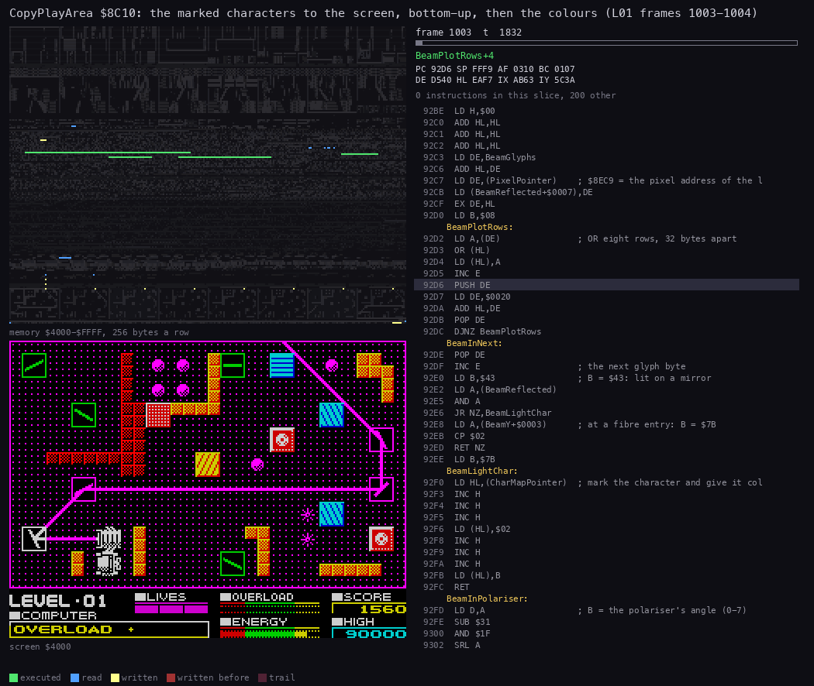

*`L01` frames 1003 to 1004 (40 000 T in), CopyPlayArea only (`$8C10-$8C87`), 60 pictures of 1832 T. How to read it:
top left, memory `$4000-$FFFF`, 256 bytes a row; bottom left, the screen; right, the listing. The point: the copy
runs from the bottom-right corner up to the top-left and touches only the marked characters, the beam's path and the
cursor. Then the colours' `LDIR` (frame 1004) sweeps the whole attribute area at once, and RenderGrid starts the next
pass. Command: `python3 ../../kit/routine_anim.py --work work/docs/dfA/L01 --window 1003:0-1004:40000 --listing
build/game.lst --view screen --range 4000-FFFF --pc 8C10-8C87 --pictures 60 --title "..." --out
docs/img/routines/CopyPlayArea.gif`.*

**Worked example: the mirror's top-left character.** The character (17, 17) is in the bottom third (rows 16-23), row
1 of the third, column 17. Its addresses:

| What | Address | How |
| --- | --- | --- |
| mark | `$E531` | `$E300` + 32 x 17 + 17 |
| screen pixels | `$5031` (line 0) to `$5731` (line 7) | third 2, row 1 of it, column 17 |
| buffer, line 0 | `$FA11` | `$E900` + 256 x 17 + 17 |
| buffer, line 1 | `$FA31` | line 0 + 32 |
| colour | `$E831` | `$E600` + 32 x 17 + 17 |
| screen colour | `$5A31` | copied from `$E831` |

The watch `tools/ttd_watch.py --work work/docs/dfA/L01 --addr FDB3,E531,E831,FA31,5131,5A31 --from 1480 --to 1520`
shows one pass at frames 1496-1499:

| Frame | `$E831` (colour) | `$FA31` (buffer line 1) | `$5131` (screen line 1) | `$5A31` (screen colour) | `$E531` (mark) | What ran |
| --- | --- | --- | --- | --- | --- | --- |
| 1496 | `$04` | `$80` | `$81` | `$43` | 2 | DrawMarkedChars: the clean mirror glyph, green |
| 1497 | `$43` | `$81` | `$81` | `$43` | 2 | TraceBeam: the beam's pixel OR-ed in, the mirror lit magenta |
| 1498 | `$07` | `$81` | `$81` | `$43` | 2 | DrawCursor: fire held, colour 7 |
| 1499 | `$07` | `$81` | `$81` | `$07` | 1 | CopyPlayArea: the mark counted down, the colour copied |

The mirror glyph's line 1 is `$80` (`$D748` + 1, character `$09`), and the beam adds bit 0. The buffer goes back to
`$80` at the start of every pass, while the screen keeps `$81` (beam on) all along. In the next passes `$FA31` takes
`$8C` and then `$E0`, the beam's and the cursor's pixels at the new angles, and the screen follows one copy later
each time.

## 6.6 The beam drawn

The beam is drawn vertex by vertex. A vertex is the point where four characters meet. BeamVertex `$906E` draws those
four characters in up to three passes, with glyphs from a table of four bytes for each of the 16 directions:

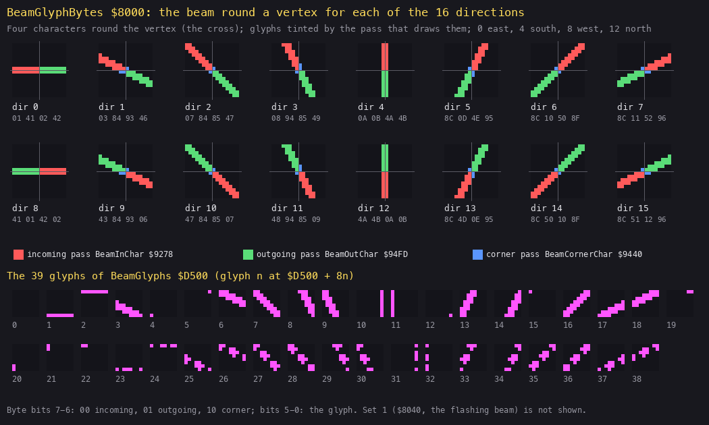

*Drawn by `python3 tools/fig_render.py beam docs/img/render/beam-glyphs.png` from the image. How to read it: the top
two rows show, for each direction 0-15, the four glyphs that BeamGlyphBytes `$8000` + 4 x direction puts round a
vertex (the cross). Each glyph is tinted by the pass that draws it (bits 7-6 of its byte), and the four bytes are
printed under it. The bottom shows the 39 glyphs of BeamGlyphs `$D500`. The point: the incoming pass (red) draws the
two characters behind the vertex and the outgoing pass (green) the two ahead. When a slanted beam cuts a character's
corner, the corner pass (blue) draws it. Each half is drawn once, so a beam that reflects at a vertex is drawn as two
halves that meet there. Direction 8 is direction 0 with the passes swapped.*

The incoming pass draws a glyph with BeamPlotGlyph `$92B3`:

```asm
BeamPlotGlyph:              ; $92B3, HL = the character in CharMap, C = the glyph number
  INC H                     ; the draw mark: CharMap + $300
  INC H
  INC H
  LD (HL),$02               ; drawn on this pass and cleaned on the next
  INC H                     ; the colour: CharMap + $600
  INC H
  INC H
  LD (HL),$43               ; bright magenta on black
  LD L,C                    ; DE = the glyph, BeamGlyphs + 8C
  LD H,$00
  ADD HL,HL
  ADD HL,HL
  ADD HL,HL
  LD DE,BeamGlyphs
  ADD HL,DE
  LD DE,(PixelPointer)      ; kept: a wall at the next character erases it
  LD (BeamReflected+$0007),DE
  EX DE,HL
  LD B,$08
BeamPlotRows:
  LD A,(DE)                 ; OR the eight rows, 32 bytes apart
  OR (HL)
  LD (HL),A
  INC E
  PUSH DE
  LD DE,$0020
  ADD HL,DE
  POP DE
  DJNZ BeamPlotRows
```

```text
BeamVertex(x, y, dIn, dOut):                      # x, y in half-cells; the up-left character (y - 1, x - 1)
    bytes = BeamGlyphBytes[GlyphSet + 4 dIn]       # GlyphSet 0, or 40 while the energy is critical (flashing)
    for each of the 4 characters k: if bytes[k] bits 7-6 == 00: PlotGlyph(k, bytes[k] AND 3F)   # incoming
    for each k inside the play area: if bytes[k] bits 7-6 == 10: PlotGlyph(k, ...)              # corner
    if dOut == dIn + 8: back into the laser (OVERLOAD), end
    bytes = BeamGlyphBytes[GlyphSet + 4 dOut]
    for each k: if bytes[k] bits 7-6 == 01: PlotGlyph(k, ...)                                   # outgoing
PlotGlyph(k, g):
    Marks[k] = 2; Colours[k] = 43; Pixels[k] |= BeamGlyphs[8 g .. 8 g + 7]
```

Before drawing, each pass tests the character under the glyph ([doc 10](10-gameplay-logic.md) has the rules):

- a wall character absorbs or reflects the beam;
- a polariser lets it through only along its axis;
- a laser or receiver character absorbs it;
- a mirror's own characters are not drawn over, because the beam stops at the mirror's centre.

At a mirror, BeamLightChar `$92F0` gives the character the beam's colour `$43`, which is why a mirror the beam
bounces off turns magenta. At a fibre-optic entry the colour is `$7B` instead.

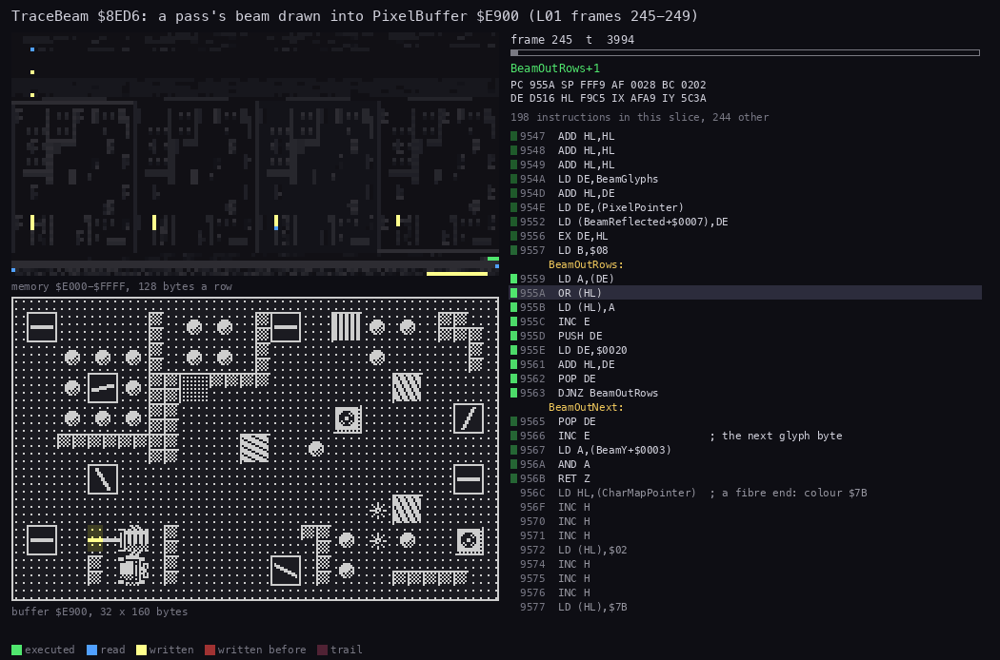

*`L01` frames 245-249, the first pass with a beam after the charge, TraceBeam and its callees only (`$8ED6-$96FF`),
70 pictures of 3994 T. How to read it: as the BuildLevel animation. The point: the beam leaves the laser westward,
glyph by glyph, each glyph OR-ed into the clean picture DrawMarkedChars has just made. The buffer view also shows the
pass's other work: RenderGrid in frame 246, then CopyPlayArea and the colours' `LDIR` in 248. Command: `python3
../../kit/routine_anim.py --work work/docs/dfA/L01 --window 245:0-249:0 --listing build/game.lst --view
buffer:E900:32x160 --range E000-FFFF --pc 8ED6-96FF --pictures 70 --title "..." --out
docs/img/routines/TraceBeam-draw.gif`.*

**Worked example: the beam leaves the laser going west.** Direction 8's bytes at `$8020` are `$41 $01 $42 $02`
(up-left, up-right, down-left, down-right).

- `$01` and `$02` have bits 7-6 = 00, so the incoming pass draws them on the vertex's right, where a westward beam
  comes from. Glyph 1 (`$D508`: seven empty rows and a full bottom row) goes up-right, and glyph 2 (`$D510`: a full
  top row) goes down-right.
- `$41` and `$42` are the same two glyphs for the outgoing pass, drawn on the left.

So a straight horizontal beam is two pixel lines: the bottom line of one character row and the top line of the next.
That is the double line in the pictures.

## 6.7 One pass, code against the buffers and the screen

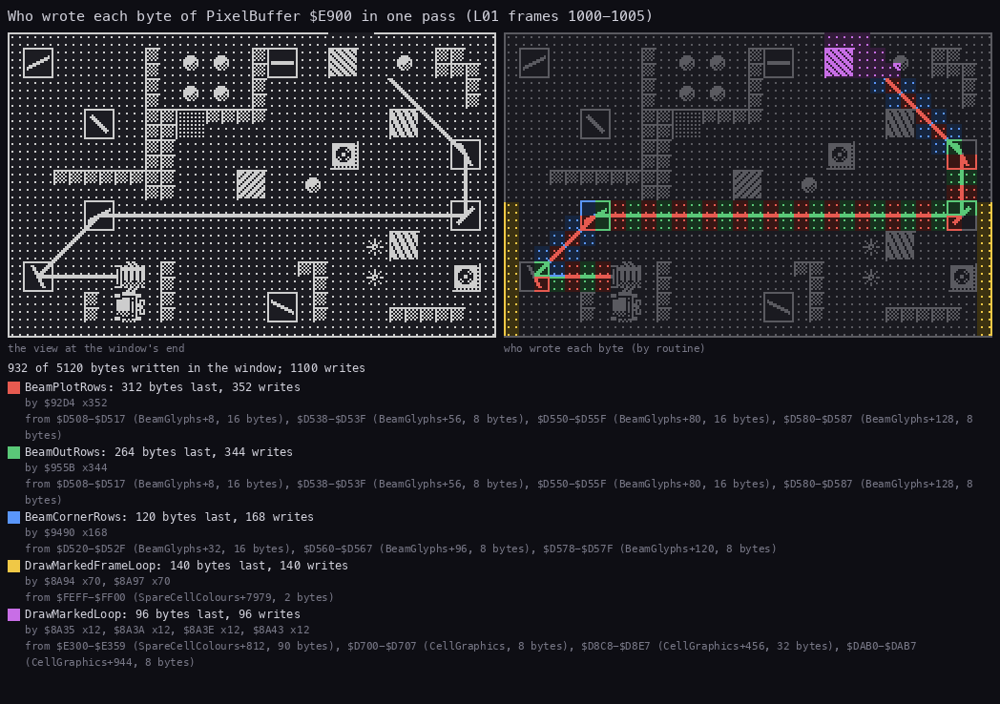

*`L01` frames 1000-1005, one pass. How to read it: left, PixelBuffer at the window's end; right, each byte written in
the window, coloured by the routine that wrote it last; under them, each routine with its count of bytes and writes
and the addresses it read from. The tool names a source by the nearest listing label: `$E300-$E359` is DrawMarks,
not SpareCellColours, and `$FEFF-$FF00` is the IM 2 table round `$FE00`. The point: the beam's three passes write
696 of the 932 bytes written last (BeamPlotRows 312, BeamOutRows 264, BeamCornerRows 120). The frame round the play
area is rewritten every pass (140 bytes). The next pass's DrawMarkedChars had only begun when the window closed (96
bytes). Command: `python3 ../../kit/writers_map.py --work work/docs/dfA/L01 --window 1000:0-1005:0 --listing
build/game.lst --view buffer:E900:32x160 --sources --title "..." --out docs/img/render/writers-buffer.png`.*

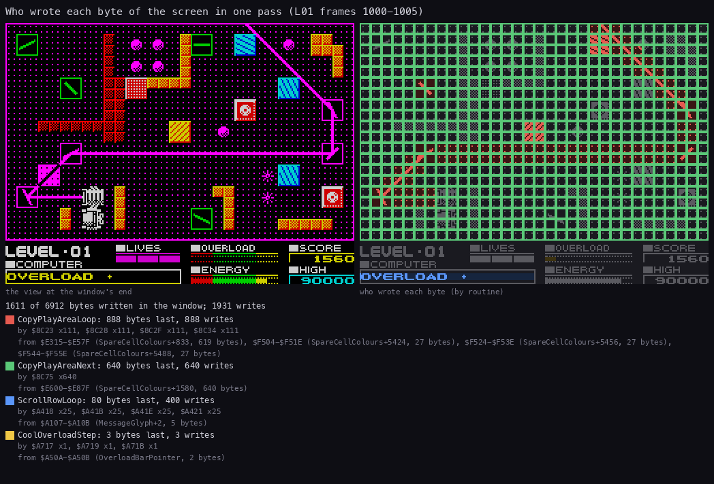

*The same pass on the screen. How to read it: as above. The point: only two routines write the play area.
CopyPlayArea writes 888 pixel bytes (111 marked characters: the beam's path and the cursor) and all 640 attributes.
Outside the play area, ScrollRowLoop (the interrupt's COMPUTER line, [doc 8](08-hud-and-text.md)) writes 80 bytes
five times over, and CoolOverloadStep writes 3 bytes of the overload bar. Command: `python3 ../../kit/writers_map.py
--work work/docs/dfA/L01 --window 1000:0-1005:0 --listing build/game.lst --view screen --sources --title "..." --out
docs/img/render/writers-screen.png`.*

**Worked example from the counts.** Copying a marked character costs about 250 T:

- the test and the count-down: about 36 T;
- eight loads, eight stores and seven `DEC D`: 140 T;
- the four `RES 5,L` and the four 32-byte steps back: about 92 T.

Skipping an unmarked one costs about 47 T, and the colours' `LDIR` costs 640 x 21 T. So this pass costs:

- 111 copied characters: 111 x 250 = 27 750 T;
- 529 skipped ones: 529 x 47 = 24 900 T;
- the colours: 13 440 T.

The total is about 66 000 T, a little under one frame before contention. That matches the beam timeline: the copy
fills frame 1003 and the colours go in early in 1004.

## 6.8 The raster

The game does not wait for the frame. CopyPlayArea writes whenever the pass reaches it, bottom row first, and its
writes cross the ULA's beam ([doc 4, 4.5](04-game-loop.md#45-the-pass-against-the-raster)):

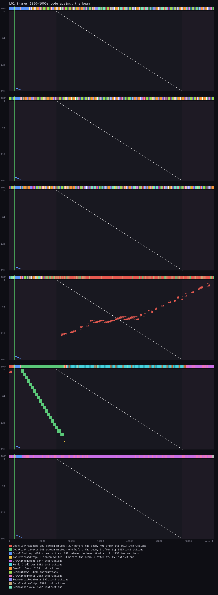

*`L01` frames 1000-1005, the screen writes against the raster (the figure of doc 4). How to read it: across each
panel, the frame's T-states; down, the 192 lines. The white diagonal is the line the ULA is reading, and each dot is
a screen write in its routine's colour. The point: of CopyPlayArea's 888 pixel writes, 491 land after the beam has
passed their line. So for one frame, part of the play area shows the old beam and part the new. The attributes go in
one fast `LDIR` ahead of the beam. Command: `python3 ../../kit/beam_timeline.py --work work/docs/dfA/L01 --window
1000:0-1006:0 --listing build/game.lst --out docs/img/loop/beam-pass.png --frames 1000-1005 --title "..."`.*

The tearing is hard to see. The beam is magenta on black, it changes only where a mirror turned, and a copy covers
only the characters that changed. A torn frame differs from the right one in a few characters at most.

## 6.9 The wipes

A new level does not appear at once: WipeIn `$8CAD` slides it in from a random corner. There are two entries:

- WipeInPlayArea `$8CA2` copies the play buffers onto rows 0-19;
- WipeInScreen `$8C95` copies the menus' full-screen buffer onto all 24 rows.

```asm
WipeIn:                     ; $8CAD
  CALL Random               ; one of the four corners
  LD A,L
  AND $03
  ADD A,A
  ADD A,A
  ADD A,A
  ADD A,A
  LD C,A
  LD B,$00
  LD HL,(WipeTable)         ; PlayAreaWipes $8D95 or ScreenWipes $8DD5
  ADD HL,BC
  LD DE,WipeSteps           ; four steps, four start addresses
  LD BC,$0010
  LDIR
  LD A,$01                  ; one row to start
  LD (WipeRows),A
WipeInRound:
  ...                       ; WipeRows rows of WipeWidth bytes: 8 lines and an attribute row each
  LD A,(WipeWidth)          ; a pause: (33 - width) x 255 DJNZ
  LD B,A
  LD A,$21
  SUB B
WipeInPause:
  LD B,$FF
WipeInPauseInner:
  DJNZ WipeInPauseInner
  DEC A
  JR NZ,WipeInPause
  ...                       ; the four addresses plus their steps
  LD A,(WipeRows)           ; one row and one column more
  INC A
  LD (WipeRows),A
  LD A,(WipeWidth)
  INC A
  LD (WipeWidth),A
  CP $21
  JP C,WipeInRound          ; until the width passes 32
  RET
```

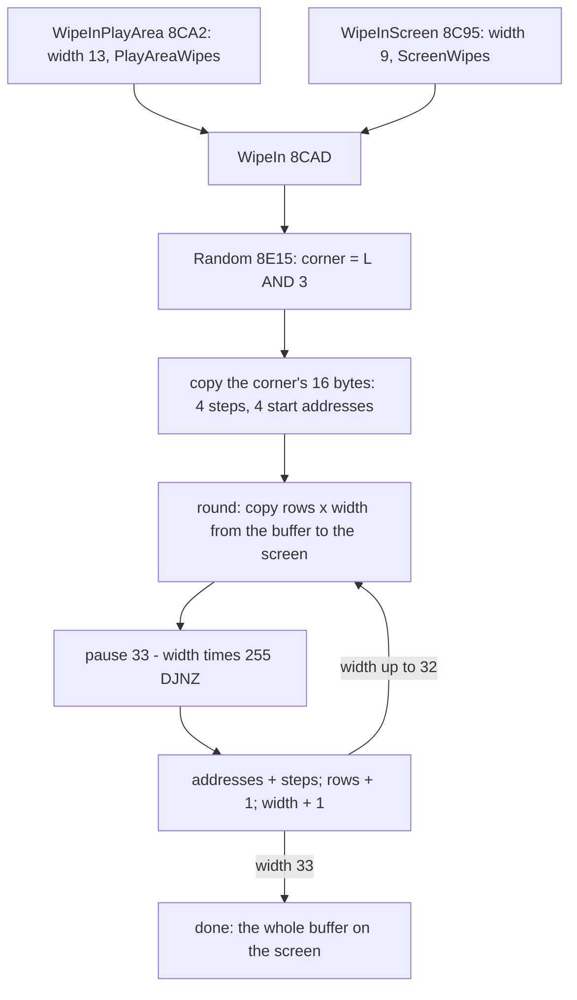

*WipeIn's loop. Witness: WipeIn ran 208 times over all recordings (the listing's witness line), WipeInScreen 12 of
them. The point: one loop serves both buffers and all four corners. A corner is just four steps and four start
addresses.*

The steps make the picture slide rather than grow. Take the top-left corner, the first record of PlayAreaWipes:

- the screen corner stays at `$4000`;
- the source starts at the buffer's row 19, column 19 (`$FC13` for the pixels, `$E873` for the colours);
- each round the source moves up-left by one row and one byte (step `$FEFF` for the pixels, `$FFDF` for the
  colours).

So the rectangle on the screen always shows the bottom-right part of the level, and the level seems to move in from
the top-left. The other three records mirror this.

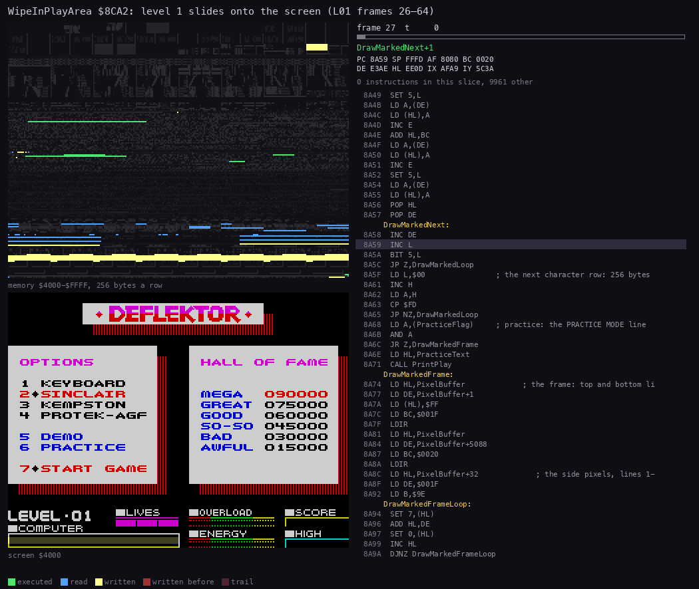

*`L01` frames 26-64, WipeInPlayArea and WipeIn only (`$8CA2-$8D94`), 76 pictures. How to read it: top left, memory
`$4000-$FFFF`, 256 bytes a row (the screen's writes at the top); bottom left, the screen; right, the listing. The
point: this time the corner is the top-left. The level slides in over the options screen, which is still on the
screen. The pause between rounds (WipeInPauseInner) takes most of the time at first and less as the rectangle grows.
Command: `python3 ../../kit/routine_anim.py --work work/docs/dfA/L01 --window 26:0-64:0 --listing build/game.lst
--view screen --range 4000-FFFF --pc 8CA2-8D94 --pictures 76 --title "..." --out
docs/img/routines/WipeInPlayArea.gif`.*

**Worked example: the rounds of level 1's wipe.** The watch `tools/ttd_watch.py --work work/docs/dfA/L01 --addr
8C88,8C89 --from 20 --to 70` (WipeRows, WipeWidth) shows the rounds:

| Rounds | Frames | Pace |
| --- | --- | --- |
| 1 (1 row, 13 bytes) to 6 | 30-35 | one round a frame |
| 7-15 | 37-51 | one to two frames a round |
| 16-20 | 53-60 | two to three frames a round |
| the end (rows `$15`, width `$21`) | 63 | |

Two costs pull against each other:

- The pause shrinks from 20 x 255 to 1 x 255 `DJNZ`, about 66 000 T down to 3 300 T.
- The copy grows from 1 x 8 x 13 bytes to 20 x 8 x 32 bytes, 104 to 5120 `LDIR` bytes, about 2 200 T up to
  107 000 T.

At first the pause dominates and shrinks faster than the copy grows. Later the copy dominates, so the rounds first
speed up and then slow down. The whole wipe is 34 frames, about 0.7 s.

## 6.10 The full-screen buffer and the panel

The menus, the hall of fame and the ending are drawn into the full-screen buffer by PrintFull `$8E3A`
([doc 8](08-hud-and-text.md)). They reach the screen in one of two ways:

- WipeInScreen: width 9 to 32 in 24 rounds, from the options screen (`$9CA3`, `$A758`).
- CopyFullScreen `$8B9B`: a plain copy, 24 rows x 8 lines x 32 `LDI`, then the attributes. It runs for the ending
  (`$A8D4`) and at the end of a hall-of-fame entry (`$9DD6`, run in `hof` after the name AGENT).

CopyFullScreen copies 767 attributes, not 768. Its `LD BC,$02FF` leaves the last one (row 23, column 31) uncopied,
and nothing shows because that corner is black on the screens that use it.

The panel (rows 20-23) is outside every buffer. The game writes the bars, the score, the lives and the COMPUTER line
directly on the screen ([doc 8](08-hud-and-text.md)).

## 6.11 What is known only from the code

- InCornerTable `$8100` and its branch `$93F2`, a diagonal beam meeting two walls in the incoming pass: no recording
  read it.
- Beam glyphs 28 and 36: drawn by no recording.
- The practice line of DrawMarkedChars (`$8A6E`, PrintPlay `$8E47`) was listed as known only from the code. The
  `practice` recording of this document runs it 615 times ([doc 5, 5.4](05-controls.md#54-practice)).
