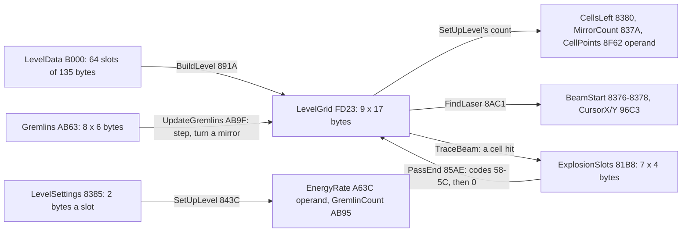
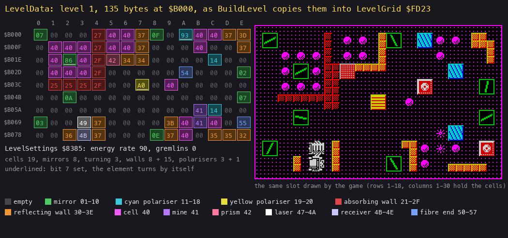
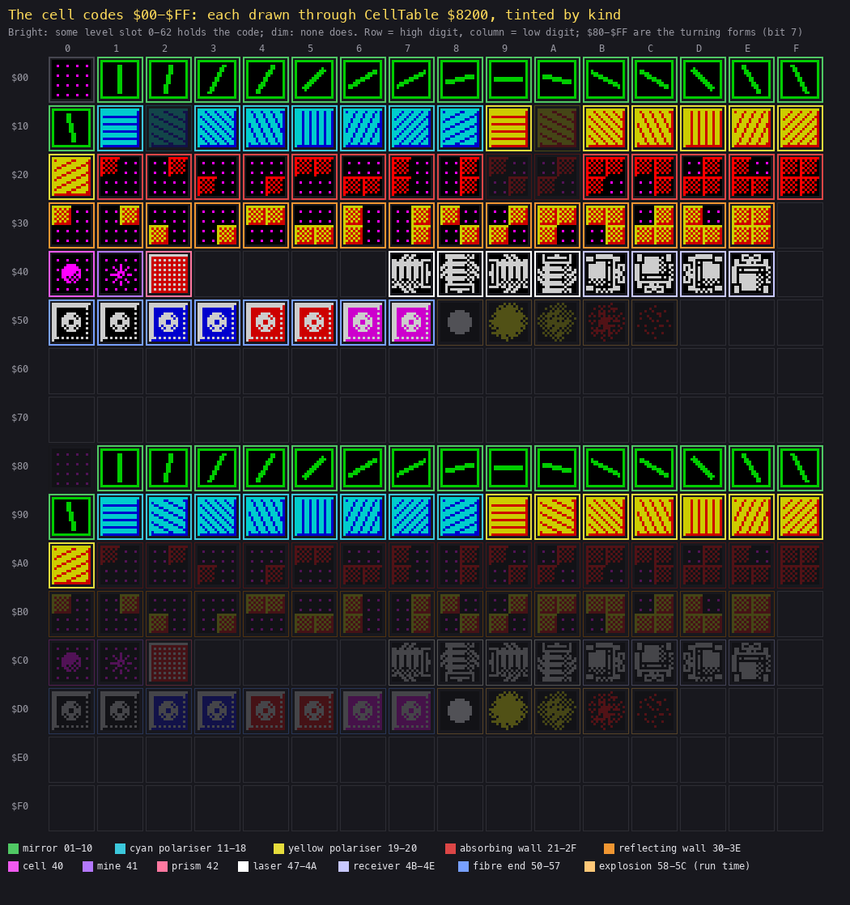
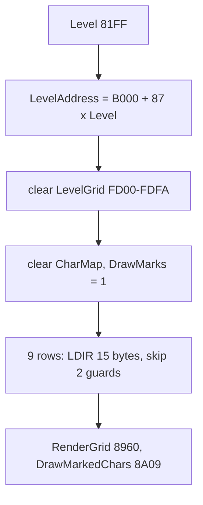
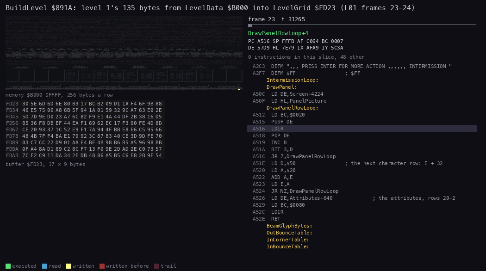
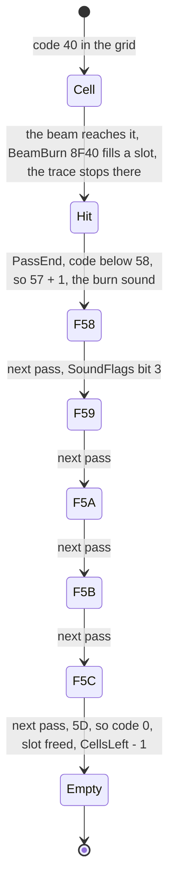
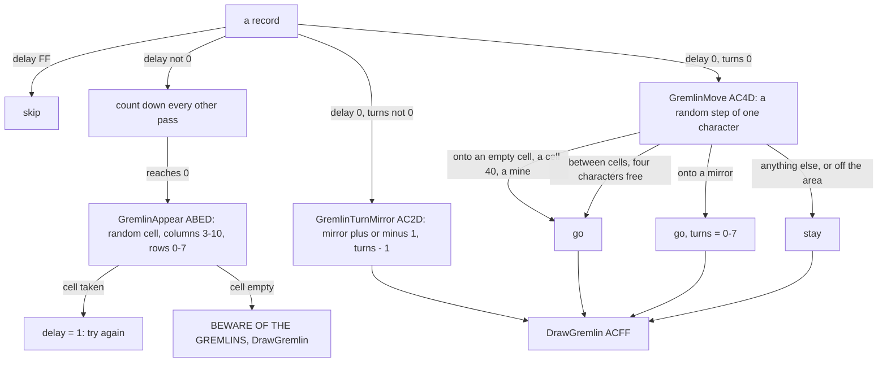
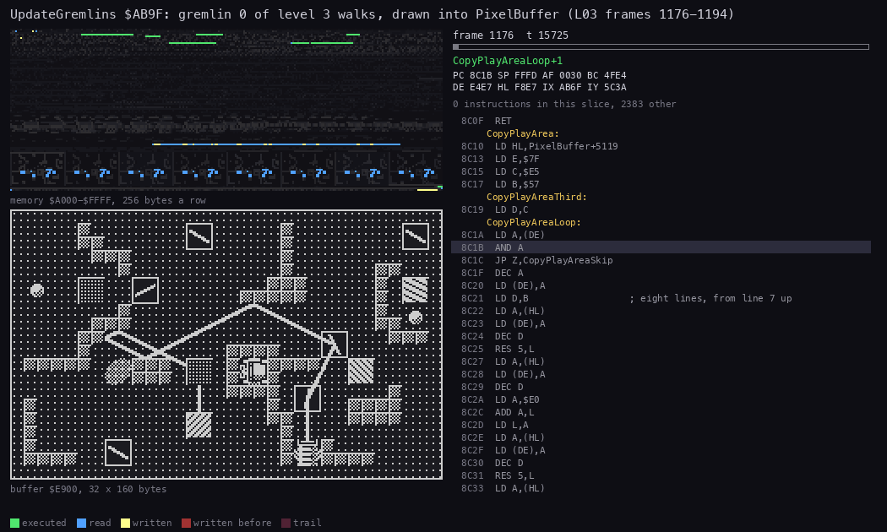
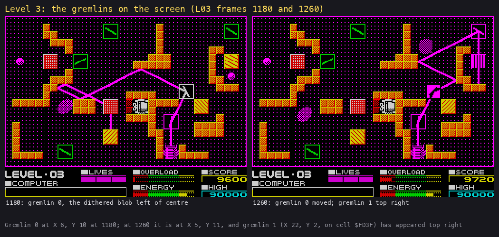

# 7. Objects

What this covers: the game's objects and their records. These are the level slot, byte by byte, and how BuildLevel
decodes it into the grid; the cell codes, every element and the routine that handles it; the level's settings and
the counts made at its set-up; the explosion slots of the burning cells; the gremlin records and their mover; and the
game's state variables.

The recordings it rests on ([WALKTHROUGH 6.0](../WALKTHROUGH.md#60-the-recordings)):

- `L01` (stage 2, `work/stage2/rec/L01`): level 1 completed by the bot, 1645 frames. Reopened as `work/docs/dfA/L01`
  on port base 37480 for the decode animation, the counts and the explosion slot.
- `L03` (stage 2, `work/stage2/rec/L03`): level 3, which has two gremlins. Reopened as `work/docs/dfA/L03` on port
  base 37485 for the gremlin records and the mover's animation. It starts on a clone: the bot ended level 2 by the
  LevelDone POKE ([WALKTHROUGH 6.0](../WALKTHROUGH.md#60-the-recordings)).
- `practice` (`work/docs/dfA/rec/practice`, [doc 5](05-controls.md#54-practice)): slot 60, practice level P1.
- The 60 RZX segments: the witness counts in the listing.

## 7.1 What the objects are

Deflektor has no sprites in the usual sense. Its world is the grid: 9 rows of 15 cells, one byte a cell. Every
element is a code in that grid, and the beam is traced afresh every pass ([doc 4](04-game-loop.md)). Only two things
keep records of their own: a burning cell, while it explodes, and a gremlin, which walks between the cells. The
records and where they live:



*The game's records and the routines that move data between them. Witness: every arrow is run at every level start
or every pass of `L01` and `L03` (the listing's witness lines: BuildLevel 196 runs, SetUpLevel 196, UpdateGremlins
106 709, PassEnd 111 052). The point: the grid is the one shared state. The explosions and the gremlins change it,
and everything else reads it.*

## 7.2 A level slot byte by byte

LevelData `$B000` holds 64 slots of 135 bytes (`$87`), one per level: slot n at `$B000` + 135n. Slots 0-59 are levels
1-60, slots 60-62 are the practice levels P1-P3, and slot 63 is never set up. A slot is 9 rows of 15 cell codes, with
nothing else in it: no header, no count, no terminator. The laser, the receiver and every other element are found by
scanning the codes.



*Drawn by `python3 tools/fig_format.py level 0 docs/img/objects/level-01-bytes.png` from the image. How to read it:
left, the 135 bytes of slot 0 as 9 rows of 15, each coloured by its kind, with each row's address; a byte with bit 7
set is underlined. Right, the same slot drawn by the game's own BuildLevel and RenderGrid. Under the bytes are the
slot's LevelSettings pair and its counts. The point: the slot is the picture, one byte a cell. `$49` is the laser facing west at
row 7, column 3 (`$B06C`), `$4B` the receiver open to the east just below it at row 8, column 3 (`$B07B`), and the
nineteen `$40`s are the cells to burn.*



*Drawn by `python3 tools/fig_format.py codes docs/img/objects/cell-codes.png`. How to read it: one square per code
`$00-$FF` (row = high digit, column = low digit), each drawn through CellTable with bit 7 cleared and framed in its
kind's colour. Bright squares are codes that some level slot 0-62 holds; dim ones are codes that none holds. Empty
frames are codes that name no picture. The point: the codes `$00-$5C` are the whole vocabulary, and bit 7 adds the
turning form of the mirrors and polarisers (`$81-$A0`).*

| Code | Element | Characters (CellTable) | Handled in the trace by | Levels holding it |
| --- | --- | --- | --- | --- |
| `$00` | empty | `$00` x 4 | BeamVertex `$906E` (straight on) | all |
| `$01-$10` | mirror at 16 angles (1 upright, 9 level) | `$01-$30` | BeamMirror `$8FFB` | 59 |
| `$11-$18` | cyan polariser, 8 angles: passes along its axis, absorbs across | `$31-$50` | BeamBlock `$8F7D`, BeamInPolariser `$92FD` | 17 |
| `$19-$20` | yellow polariser, 8 angles: passes along its axis, reflects across | `$51-$70` | as cyan | 17 |
| `$21-$2F` | absorbing wall, by the quarters filled (`$29`, `$2A` unused) | `$71` and `$00` | BeamAbsorbIn `$9344` (by character) | 31 |
| `$30-$3E` | reflecting wall, by the quarters filled | `$72` and `$00` | BeamReflectIn `$938F` (by character) | 32 |
| `$3F` | a cell (no level holds it) | `$74-$77` | BeamBurn `$8F40` | 0 |
| `$40` | cell to burn | `$74-$77` | BeamBurn `$8F40` | all |
| `$41` | mine | `$78-$7B` | BeamMine `$8F6A` | 52 |
| `$42` | prism: sends the beam on at random | `$7C-$7F` | PrismTurn `$9014` | 26 |
| `$43-$46` | lasers drawn in cyan (no level) | `$80-$8F` | BeamAtLaser `$8FAE` | 0 |
| `$47-$4A` | laser facing east, south, west, north | `$90-$9F` | FindLaser `$8AC1`, BeamAtLaser | all, once |
| `$4B-$4E` | receiver open to the east, south, west, north | `$A0-$AF` | BeamReceiver `$8F84` | all, once |
| `$4F` | a fibre end with no picture (no level): its partner code is `$4E`, a north receiver, so the beam would jump to the receiver | `$00` x 4 | FibreEntry `$903E` | 0 |
| `$50-$57` | fibre-optic ends, pairs `$50/$51` to `$56/$57` | `$B0-$BF` | FibreEntry `$903E` | 19 |
| `$58-$5C` | explosion frames (only at run time) | `$C0-$D3` | the trace ends (`RET NC`) | - |
| `$81-$A0` | the turning mirrors and polarisers | as their low code | RenderGridTurning `$89B1` | 37 |

The last column counts the levels 1-60 whose slot holds the code (the slot scan behind the levels table of
[doc 1](01-game-design.md#16-the-60-levels), `tools/figlib.py` `counts`). The trace reads the grid with `RES 7,A`, so a turning element acts as its
current angle ([doc 10](10-gameplay-logic.md) has each element's rules).

```text
BeamStep's dispatch, the code c = grid[cell] AND 7F at a cell's centre:
    c == 00            -> BeamVertex: draw and go on
    c in 01..10        -> BeamMirror
    c in 11..20        -> BeamBlock (polariser)
    c >= 58            -> the trace ends (a burning cell stops the beam)
    c in 4F..57        -> FibreEntry
    c in 4B..4E        -> BeamReceiver
    c in 43..4A        -> BeamAtLaser
    c == 42            -> PrismTurn
    c in 21..3E        -> BeamVertex (the walls act per character, in the passes)
    c == 41            -> BeamMine
    c in 3F..40        -> BeamBurn (3F: a cell that no level holds)
```

**Worked example: one byte of level 1.** The mirror the bot turns last is at row 8, column 8. Its slot byte is
`$B000` + 15 x 8 + 8 = `$B080`, which holds `$0E`. BuildLevel puts it at `$FD23` + 17 x 8 + 8 = `$FDB3`. The watch
`tools/ttd_watch.py --work work/docs/dfA/L01 --addr FDB3 --from 15 --to 25` shows `$FDB3` = `$48` (left over from the
menu) at frame 15, `$00` at 24 (the grid cleared) and `$0E` at 25. The charge's scramble then turns it at random: by
frame 232 it holds `$0B`, and the bot turns it to `$02` ([doc 1](01-game-design.md#17-how-a-level-is-solved)).

## 7.3 The decoder: BuildLevel

```asm
BuildLevel:                 ; $891A
  LD A,(Level)
  LD B,A
  LD HL,LevelData           ; $B000 + $87 x Level, by addition
  LD DE,$0087
  AND A
  JR Z,BuildLevelGrid
BuildLevelAddLoop:
  ADD HL,DE
  DJNZ BuildLevelAddLoop
BuildLevelGrid:
  LD (LevelAddress),HL      ; the grid cleared
  LD HL,LevelGrid
  LD DE,LevelGrid+1
  LD (HL),$00
  LD BC,$00FA
  LDIR
  LD HL,CharMap             ; the character map cleared, every DrawMark 1
  LD DE,CharMap+1
  LD (HL),$00
  LD BC,$0300
  LDIR
  LD (HL),$01
  LD BC,$02FF
  LDIR
  LD HL,(LevelAddress)      ; 9 rows of 15 cells, two guards a row
  LD DE,LevelGrid+35
  LD A,$09
BuildLevelRowLoop:
  LD BC,$000F
  LDIR
  INC E
  INC E
  DEC A
  JR NZ,BuildLevelRowLoop
                            ; falls into RenderGrid
```

```text
BuildLevel():
    LevelAddress = B000 + 87 x Level
    LevelGrid[FD00 .. FDFA] = 0                 # the row above, the guards, old data
    CharMap[E000 .. E2FF] = 0
    DrawMarks[E300 .. E5FF] = 1                 # every character drawn and copied once
    for r in 0..8:
        LevelGrid[FD23 + 17 r .. +14] = LevelData[LevelAddress + 15 r .. +14]
    RenderGrid()                                # and DrawMarkedChars
```



*BuildLevel's steps. Witness: 196 runs, one per level set-up in every recording. The point: the "decoding" is a
copy. The grid's extra row above and two zero guards a row make every neighbour of an edge cell read as empty, so
the trace and the gremlins need no bounds tests on the grid.*



*`L01` frames 23 (30 000 T in) to 24 (36 000 T in), BuildLevel only (`$891A-$895F`), 60 pictures of 1265 T. How to
read it: top left, memory `$B000-$FFFF`, 256 bytes a row (LevelData at the top, the buffers and the grid at the
bottom); bottom left, the grid `$FD23` as 9 rows of 17 hex bytes (15 cells and the two guards); right, the listing.
The point: the grid first holds the mover's left-overs, the clear zeroes it, and nine `LDIR`s of 15 bytes fill it row
by row. Then RenderGrid starts. Command: `python3 ../../kit/routine_anim.py --work work/docs/dfA/L01 --window
23:30000-24:36000 --listing build/game.lst --view buffer:FD23:17x9:hex --range B000-FFFF --pc 891A-895F --pictures 60
--title "..." --out docs/img/objects/BuildLevel-grid.gif`.*

**Worked example: the address of a slot.** Level 3 is slot 2. The `ADD HL,DE` loop runs twice, so LevelAddress =
`$B000` + 2 x `$87` = `$B10E`. Practice P1 is slot 60: `$B000` + 60 x 135 = `$B000` + `$1FA4` = `$CFA4`. The
`practice` recording runs NewGame's practice branch `$8424` once, and SetUpLevel then shows LEVEL P1 (slot 60 - 59 =
1). The last slot, 63, ends at `$B000` + 64 x 135 - 1 = `$D1BF`, just below the 64 spare bytes `$D1C0-$D1FF` and
the font at `$D200`.

## 7.4 The settings and the counts

Each slot has a pair of bytes in LevelSettings `$8385` + 2n: the energy rate (frames per step of the energy bar) and
the number of gremlins. SetUpLevel `$843C` puts them in place and then counts the slot's bytes:

```asm
  LD A,(Level)              ; the level's settings
  ADD A,A
  LD E,A
  LD D,$00
  LD HL,LevelSettings
  ADD HL,DE
  LD A,(HL)
  LD (EnergyRate+$0001),A   ; the operand of CP n at $A63B (self-modifying)
  INC HL
  LD A,(HL)
  LD (GremlinCount),A
  ...
  LD A,$0C                  ; 12 points (x 10) a burnt cell
  LD (CellPoints+$0001),A
  LD DE,$0000               ; D = the cells, E = the mirrors
  LD HL,(LevelAddress)
  LD B,$87
SetUpLevelCountLoop:
  LD A,(HL)
  CP $40
  JR NZ,SetUpLevelNotCell
  INC D
  JR SetUpLevelCountNext
SetUpLevelNotCell:
  DEC A                     ; codes 1-16: a mirror
  CP $10
  JR NC,SetUpLevelCountNext
  INC E
SetUpLevelCountNext:
  INC HL
  DJNZ SetUpLevelCountLoop
  LD A,E
  LD (MirrorCount),A
  LD A,D
  LD (CellsLeft),A
  CP $1E                    ; 30 cells or more: 3 points (x 10) a cell
  JR C,SetUpLevelLaser
  LD A,$03
  LD (CellPoints+$0001),A
```

The count is made from LevelData, not from the grid. It counts plain mirrors only: a turning mirror (`$81-$90`)
fails the `DEC A; CP $10` test. Two of the settings live as instruction operands (`$A63C` and `$8F63`), so the game
patches its own code at every level start.

**Worked example: level 1's set-up.** Slot 0's pair at `$8385` is (90, 0): a step of the energy bar every 90 frames
and no gremlins. The count over `$B000-$B086` finds 19 `$40`s and 7 mirrors (`$07 $0F $02 $0A $07 $03 $0E`; the turning `$86` is not one of
them), so CellsLeft = `$13` and MirrorCount = 7. Since 19 is below 30, each cell is worth 120 points. The watch
`tools/ttd_watch.py --work work/docs/dfA/L01 --addr 8380,837A --from 60 --to 70` shows CellsLeft = `$13` from frame
63, the end of the wipe.

## 7.5 The explosion slots

When the beam reaches a cell (`$40`), BeamBurn `$8F40` takes the first free one of the first six slots at ExplosionSlots `$81B8`,
or the seventh when those six are all busy (`LD B,$06` at `$8F41`: the seventh is written whether free or not):

| Byte | Meaning |
| ---: | --- |
| +0 | the cell's grid address, high byte (`$FD`); 0 = the slot is free |
| +1 | the grid address, low byte |
| +2 | y of the cell's centre, in half-cells |
| +3 | x of the cell's centre, in half-cells |

PassEnd `$85AE` then steps the cell through the explosion, one code per pass:



*A cell's explosion. Witness: the watch below. The point: a cell takes six passes to go, and while it explodes its
codes `$58-$5C` stop the beam (BeamStep's `CP $58; RET NC`). So the beam cannot reach the next cell behind it until
the explosion is over.*

**Worked example: the first cell of level 1 burns.** The watch `tools/ttd_watch.py --work work/docs/dfA/L01 --addr
81B8,FDA4,8380,A8A6 --from 375 --to 420` gives:

| Frame | Slot +0 | `$FDA4` | CellsLeft | SoundFlags | What happened |
| --- | --- | --- | --- | --- | --- |
| 375 | `$00` | `$40` | `$13` | `$00` | the cell at row 7, column 10 (`$FD23` + 17 x 7 + 10) |
| 378 | `$FD` | `$40` | `$13` | `$00` | the beam hit it: slot `$FD $A4 $10 $16` (y 16, x 22) |
| 379 | `$FD` | `$58` | `$13` | `$08` | PassEnd: the first frame, the burning noise on |
| 386 | `$FD` | `$59` | `$13` | `$08` | |
| 391 | `$FD` | `$5A` | `$13` | `$00` | the noise off from `$5A` |
| 397, 403 | `$FD` | `$5B`, `$5C` | `$13` | `$00` | |
| 409 | `$00` | `$00` | `$12` | `$00` | empty, the slot freed, 18 cells left |
| 413 | `$FD` | `$00` | `$12` | `$00` | the next cell hit, the same slot reused |

The slot's y = 16 = 2 x 7 + 2 and x = 22 = 2 x 10 + 2 are the cell's centre in half-cells, the units of the beam
([doc 10](10-gameplay-logic.md)). From the hit to the empty cell takes 31 frames, six passes of about 5.2 frames.

## 7.6 The gremlins: records and mover

A gremlin is the one object that moves. Eight records of six bytes at Gremlins `$AB63`; only the first GremlinCount
`$AB95` are used:

| Byte | Field | Meaning |
| ---: | --- | --- |
| +0 | delay | counted passes until it appears (`$41` + 10k at the set-up, `$C8` after the cursor's kill `$9AD2`); 0 when it walks |
| +1 | turns | while not 0 it stands on a mirror and turns it one step a pass |
| +2 | X | its place in characters of the play area, 0-28 (even: on a cell column) |
| +3 | Y | 0-16 (even: on a cell row) |
| +4 | cell, low | the grid address of the cell it stands on; written only by GremlinMove (`$AC88`) |
| +5 | cell, high | `$FD`, or 0 between cells (`$ACAB`) and after the kill (`$9AD9`) |

Neither the set-up (`$84B3-$84C4` writes +0 and +1) nor GremlinAppear (`$ABED` writes +2 and +3) touches +4/+5.
Until a gremlin first steps onto a cell they keep the cell of an earlier life or level, and CursorFire `$9AC5` tests
only +4/+5, not the delay (7.8).

```asm
UpdateGremlins:             ; $AB9F, once a pass after the charge
  LD A,(GremlinPhase)       ; the animation frame x 32, + $20 a pass
  ADD A,$20
  RES 7,A
  LD (GremlinPhase),A
  LD IX,Gremlins
  LD A,(GremlinCount)
  AND A
  RET Z
  LD B,A
GremlinLoop:
  PUSH BC
  LD A,(IX+$00)
  AND A
  JR Z,GremlinActive
  CP $FF
  JR Z,GremlinNext
  LD B,A                    ; waiting: count down on every other pass
  LD A,(GremlinPhase)
  BIT 5,A
  JR NZ,GremlinNext
  LD A,B
  DEC A
  LD (IX+$00),A
  AND A
  JR NZ,GremlinNext
  CALL GremlinAppear        ; a random empty cell, columns 3-10, rows 0-7
  JR GremlinNext
GremlinActive:
  LD A,(IX+$01)             ; turns left: turn the mirror, else walk
  AND A
  JR Z,GremlinWalk
  CALL GremlinTurnMirror
  JR GremlinShow
GremlinWalk:
  CALL GremlinMove
GremlinShow:
  CALL DrawGremlin          ; marks 2, its frame OR-ed into PixelBuffer
GremlinNext:
  LD BC,$0006
  ADD IX,BC
  POP BC
  DJNZ GremlinLoop
  RET
```



*The mover. Witness: GremlinMove 97 827 runs and GremlinTurnMirror 11 188 in the RZX segments (the listing). The
point: a gremlin walks at random one character a pass and may stand on a mirror and turn it a few times
([doc 10](10-gameplay-logic.md) has the cursor's kill). It walks over cells and mines, but
never through a wall, a polariser or the laser.*



*`L03` frames 1176-1194, UpdateGremlins and its callees (`$AB9F-$AD45`), 80 pictures of 15 725 T. How to read it:
top left, memory `$A000-$FFFF` (the records at `$AB63` near the top); bottom left, PixelBuffer `$E900`; right, the
listing. The gremlin is the dithered 16 x 16 blob left of the centre, on the left of the laser. The point: each pass
GremlinMove picks a step, DrawGremlin marks the 2 x 2 characters and ORs the next of four frames into the buffer, and
the next pass's DrawMarkedChars wipes it like the beam (the marks of [doc 6, 6.4](06-rendering.md#64-the-draw-marks)).
Command: `python3 ../../kit/routine_anim.py --work work/docs/dfA/L03 --window 1176:0-1194:0 --listing build/game.lst
--view buffer:E900:32x160 --range A000-FFFF --pc AB9F-AD45 --pictures 80 --title "..." --out
docs/img/objects/UpdateGremlins.gif`.*



*`L03` at frames 1180 and 1260 (`kit/screen_shot.py`, then `tools/fig_pair.py`). How to read it: the play area and
the panel; the gremlins are the magenta dithered blobs. The point: the gremlins appear only after a long wait, one at
a time, and look like part of the background dither, so they are easy to miss.*

**Worked example: the two gremlins of level 3.** The watch `tools/ttd_watch.py --work work/docs/dfA/L03 --addr
AB63,AB64,AB65,AB66,AB67,AB68,AB69,AB6B,AB6C,AB6D,AB6E` shows:

- At the set-up, record 0's delay is `$41` (65) and record 1's is `$4B` (75).
- The delays count down about every 10 frames, once every other pass: record 0 is `$3E` at frame 525 and `$02` at
  1150.
- Record 0 appears at frame 1167 at X 6, Y 10, both even, so on the cell row 5, column 3. That is GremlinAppear's
  `2 x ((L AND 7) + 3)`, `2 x (H AND 7)` with L AND 7 = 0 and H AND 7 = 5.
- At 1172 it steps to X 5, between cells. At 1176 it is back on the cell, and +4/+5 = `$7B $FD`, the cell `$FD7B` =
  `$FD23` + 17 x 5 + 3. At 1181 it is between cells again and +5 = 0.
- Record 1's delay (ten counts longer) reaches 0 at frame 1251. It appears at X `$14`, Y 2, and by 1260 it
  stands on the cell `$FD3F` (row 1, column 11).

The turns byte (+1) stays 0 throughout: in these frames neither gremlin stepped onto a mirror.

## 7.7 The state variables

The game's state outside the grid and the records, by area (from the listing; each is annotated in the source):

| Address | Name | Values | Set by | Read by |
| --- | --- | --- | --- | --- |
| `$81FD` | ControlMethod | 0 keyboard, 1 Sinclair, 2 Kempston, 3 Protek | the options panel | ReadKeys |
| `$81FF` | Level | 0-59 levels, 60-62 practice | NewGame, LevelComplete, the demo | SetUpLevel, BuildLevel |
| `$8374-$8375` | HighlightX, HighlightY | half-cells | the receiver, the laser | HighlightCell `$8FCA` |
| `$8376-$8378` | BeamStartX, BeamStartY, BeamStartDirection | half-cells; 0, 4, 8, 12, `$FF` none | FindLaser | MainLoop |
| `$8379` | DemoFlag | `$FF` in the demo | the options panel's 5 | MainLoop |
| `$837A` | MirrorCount | the plain mirrors | SetUpLevel | ChargeLaser |
| `$837B`, `$837C` | BurnSoundFlag, GremlinSoundFlag | set for this pass | PassEnd, the cursor's kill | PassEnd |
| `$837D` | Lives | 3 at a new game and after each level | NewGame, LoseLife | the panel |
| `$837E` | EnergyCritical | `$FF` on the energy's last byte | DrainEnergy | MainLoop (the flashing beam) |
| `$837F` | FrameCounter | + 1 a frame | the interrupt | MainLoop |
| `$8380` | CellsLeft | cells to burn; `$FF` when the door is opened, `$FE` once it has exploded | SetUpLevel, PassEnd | PassEnd |
| `$8381` | BeamGlyphSet | 0, or `$40` (flashing) | MainLoop | BeamVertex |
| `$8407` | PracticeFlag | `$FF` in practice | the options panel's 6 | five places ([doc 5](05-controls.md#54-practice)) |
| `$8912-$8917` | LevelAddress, CharMapPointer, PixelPointer | addresses | BuildLevel, RenderGrid, the trace | the same |
| `$8EBF-$8ED5` | the trace's state: BeamSteps, BeamDirection, BeamX, BeamY, LevelDone, LifeLost, BeamOnMine, BeamInLaser | | TraceBeam | PassEnd |
| `$8E32` | RandomSeed | 16 bits | Random `$8E15`, the options panel's wait | Random |
| `$96C3-$96C6` | CursorX, CursorY, ControlBits, CursorMode | 0-14, 0-8, bits, 7 fire | ReadKeys, the cursor | TurnMirror, DrawCursor |
| `$9B3E`, `$9B44` | ScoreDigits, SavedScore | six and five digits | AddScore, SetUpLevel | the panel, the hall of fame |
| `$A104`, `$A10D`, `$A110` | MessageNumber, MessageState, MessagePointer | the COMPUTER line | the messages | the interrupt |
| `$A507`, `$A509`, `$A50A` | EnergyBarPointer, LaserCharging, OverloadBarPointer | screen addresses, `$FF` | ResetBars, DrainEnergy, UpdateOverload | the same |
| `$A8A6` | SoundFlags | bits: 1 mine, 2 the beam in the laser (OVERLOAD), 3 burning, 4 charge | the pass | the interrupt's sound |
| `$AB95`, `$AB96` | GremlinCount, GremlinPhase | 0-8; 0, `$20`, `$40`, `$60` | SetUpLevel, UpdateGremlins | UpdateGremlins |

Two more values live inside instructions: the energy rate at `$A63C` (EnergyRate + 1) and a cell's points at `$8F63`
(CellPoints + 1). The set-up writes both.

## 7.8 What is known only from the code

- Slots 61 and 62 (P2, P3): no recording set them up. The `practice` recording reached P1 (slot 60) only; it is the
  first recording to read a practice slot. Slot 63 is never set up: LevelCompletePause leaves practice at `$3F`.
- A gremlin still waiting, or just appeared, keeps a stale +4/+5 (7.6). If that old cell is the cursor's, fire kills
  it (delay `$C8` again, 160 points) though it is not on the screen there. The code says so (`$9AC5-$9AED`); no
  recording shows it.
- A gremlin record with delay `$FF` (parked): the test is in UpdateGremlins, but no code writes `$FF` there.
- The cell codes `$29`, `$2A`, `$3F`, `$43-$46` and `$4F`: in CellTable and the trace's ranges, but held by no level.
