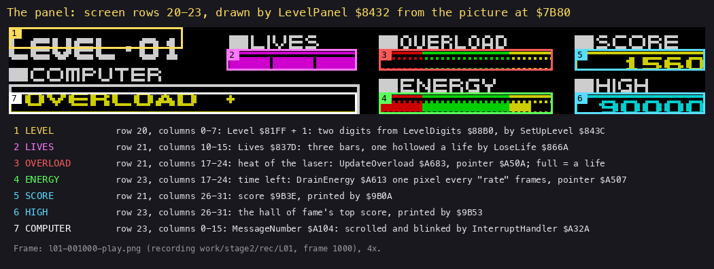
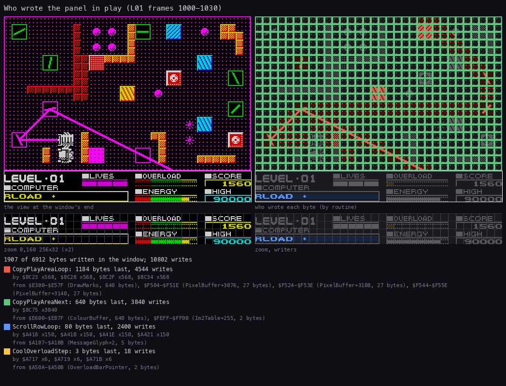
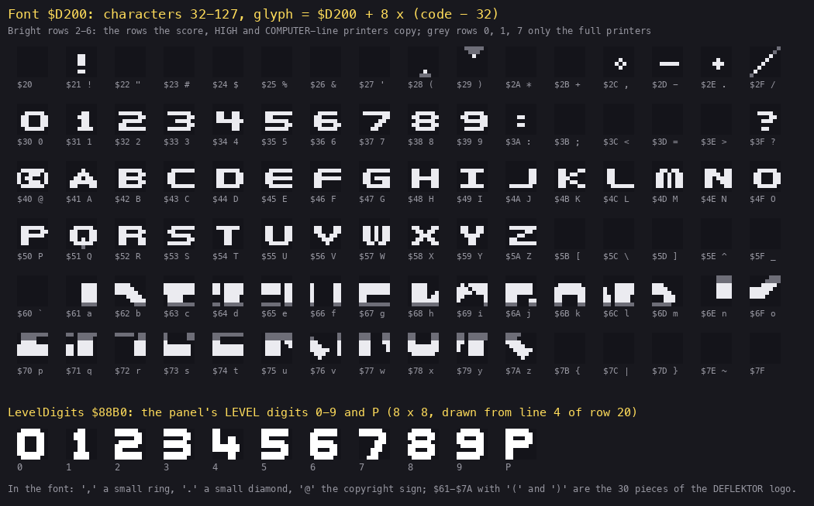
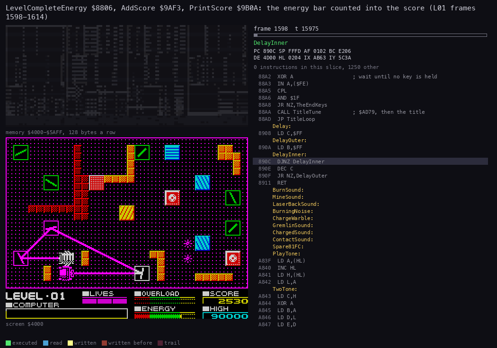
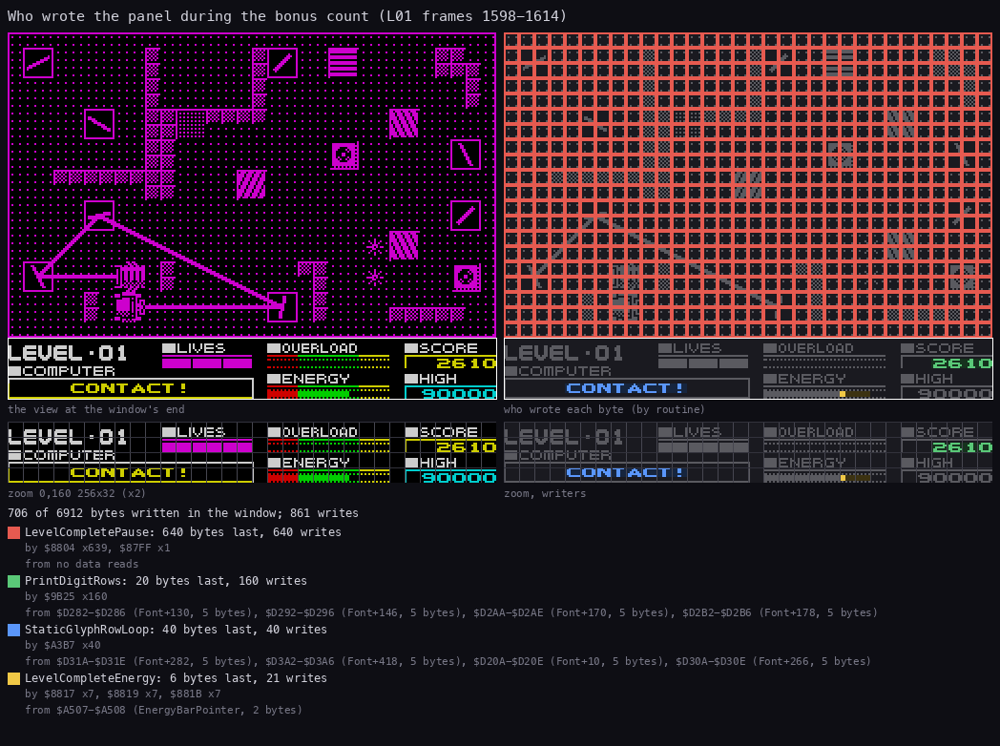
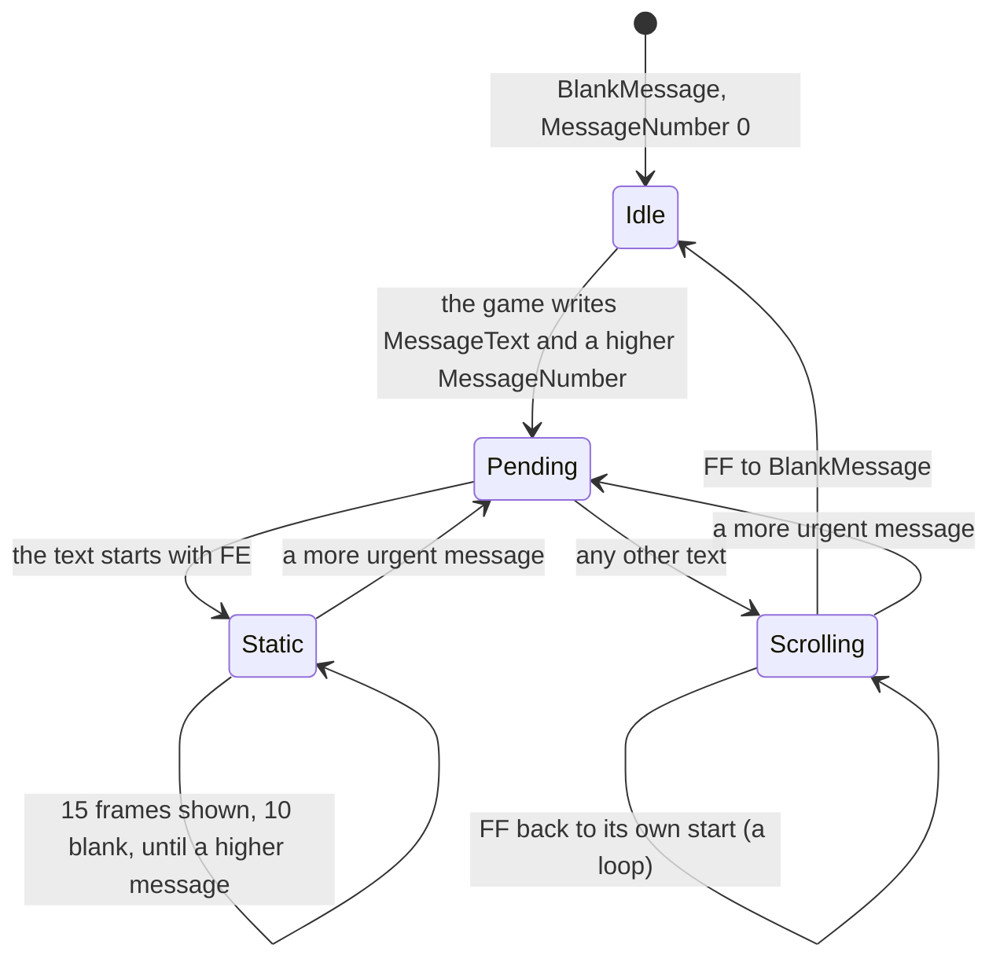
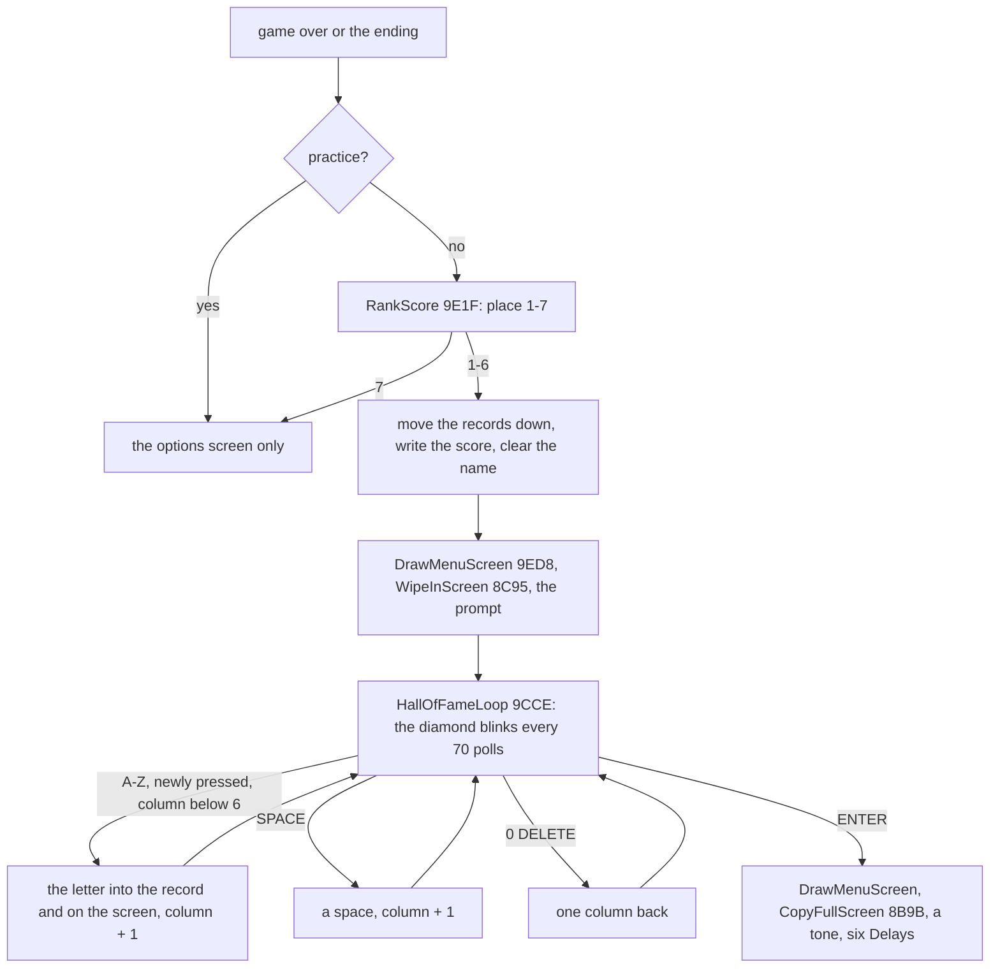
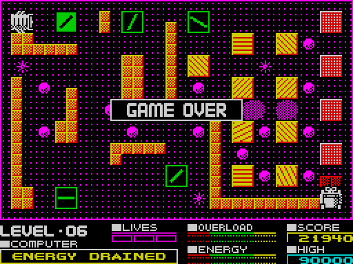
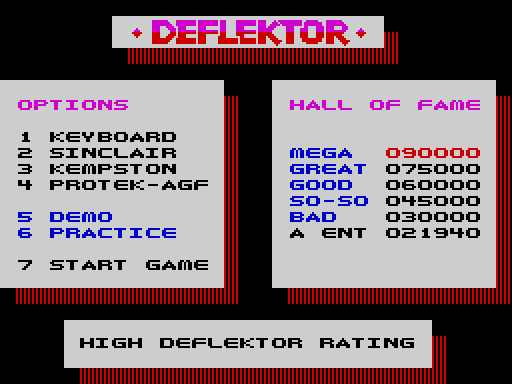

# 8. HUD and text

What this covers: everything the game writes as text or numbers, which falls into five parts:

- the play panel and its picture;
- the font, and the four ways of printing it;
- the text records of the full-screen printer;
- the score, the high score and the end-of-level bonus;
- the COMPUTER line's messages, and the hall of fame with its name entry.

The recordings it rests on ([WALKTHROUGH 6.0](../WALKTHROUGH.md#60-the-recordings)):

- `L01` (`work/docs/dfA/L01`, port base 37480): the panel in play (frames 1000-1030), CONTACT! and the bonus count
  (frames 1515-1645).
- `hof` (stage 2, `work/stage2/rec/hof`, reopened as `work/docs/dfA/hof` on port base 37485): a game over with
  021940 points, sixth place, and the name AGENT typed at frames 17055-17155.
- `energy`: the energy messages (CHARGING LASER at frame 500, ENERGY LOW at 5000, CRITICAL at 5750, ENERGY DRAINED at
  6450).
- `controls`: the pause's INTERMISSION line and GAME ABORTED. `gameover`, `mine` and `overload`: BOOM BOOM BOOM and
  GAME OVER.

## 8.1 The panel



*The panel (rows 20-23) of `L01` at frame 1000, labelled (the figure of [doc 1, 1.3](01-game-design.md)). How to
read it: each field with its name and the routine that writes it. The point: the panel is a fixed picture with a
few live fields cut into it.*

The panel is a 32-row picture, PanelPicture `$7B80`: 1024 pixel bytes in plain rows of 32, then 128 attributes, ending
at `$7FFF`. DrawPanel `$A50C` copies it to rows 20-23 at each new game and level start (LevelPanel `$8432`). After
that, nothing redraws the panel; each live field has its own writer, straight to the screen:

| Field | Place | Writer | When |
| --- | --- | --- | --- |
| LEVEL digits | columns 6-7, line 4 of row 20 to line 3 of row 21 | SetUpLevel `$843C`, from LevelDigits `$88B0` | a level start |
| LIVES | row 21, column 10 + 2 x lives (`$54AA`), three bars | LoseLifeHollow `$86B5` | a life lost |
| OVERLOAD bar | row 21, columns 17-24, from line 4 (`$54B1`) | UpdateOverload `$A683`, CoolOverloadStep | every pass |
| ENERGY bar | row 23, columns 17-24, from line 4 (`$54F1`) | ChargeLaser `$A57A`, DrainEnergy `$A613`, LevelCompleteEnergy `$8806` | every pass |
| SCORE | row 21, columns 26-31, from line 3 (`$53BF`, right to left) | PrintScore `$9B0A` | every AddScore |
| HIGH | row 23, columns 26-31 (`$53FF`) | PrintHighScore `$9B53` | a level start |
| COMPUTER line | row 23, columns 0-15 (`$50E0-$50EF`), five lines | the interrupt `$A32A` | every frame |



*`L01` frames 1000-1030, about six passes of play. How to read it: left, the screen at the window's end with the
panel zoomed under it; right, the bytes written in the window, coloured by their last writer; under them, each
writer's counts and sources. The point: in play the panel costs almost nothing. The interrupt's ScrollRowLoop
rewrites the 80 bytes of the COMPUTER line every frame (2400 writes in 30 frames), and CoolOverloadStep touches 3
bytes of the overload bar. The rest of the writes are the play area's. Command: `python3 ../../kit/writers_map.py
--work work/docs/dfA/L01 --window 1000:0-1030:0 --listing build/game.lst --view screen --zoom 0,160,256,32 --sources
--title "..." --out docs/img/hud/writers-panel-play.png`.*

## 8.2 The font and the printers



*Drawn by `python3 tools/fig_font.py docs/img/hud/font.png` from the image. How to read it: the 96 glyphs of Font
`$D200` (characters 32-127) with their codes; rows 2-6 bright, rows 0, 1 and 7 grey. Below them are the 11 LEVEL
digits of `$88B0`. The point: one font serves every text. The panel's printers copy only rows 2-6, the five rows that
hold the letters. The lower-case codes hold the 30 pieces of the DEFLEKTOR logo of the options screen, not letters.*

Four printers use the font:

| Printer | Rows of the glyph | Target | Used for |
| --- | --- | --- | --- |
| PrintFull `$8E3A` / PrintRecords | 0-7 | the full-screen buffer `$E500` / `$E200` | the options screen, the hall of fame, the ending |
| PrintPlay `$8E47` | 0-7 | the play buffers `$E900` / `$E600` | the PRACTICE MODE line ([doc 5](05-controls.md#54-practice)) |
| PrintDigitsBack `$9B10` | 2-6 | the screen, right to left | the score, HIGH |
| the interrupt's line (`$A39A`, `$A3D3`) | 2-6 | the screen, row 23 (row 21 in the menu) | the COMPUTER line, the credits |

The full printers read text records:

```asm
PrintFull:                  ; $8E3A, HL = the records
  LD A,$E5                  ; the full-screen buffer's pages
  LD (PrintPixelPage),A
  LD A,$E2
  LD (PrintColourPage),A
  LD A,(HL)
  JR PrintRecords
  ...
PrintRecords:
  CP $FF                    ; $FF: the end; else the record's attribute
  RET Z
  RES 7,A
  EX AF,AF'
  INC HL                    ; the column (C) and the character row (B + the pixel page)
  LD C,(HL)
  INC HL
  LD B,(HL)
  LD A,(PrintPixelPage)
  ADD A,B
  LD B,A
  LD (PrintPixel),BC
  ...                       ; the colour address: the colour page x 256 + 32 x row + column
PrintChar:
  LD A,(HL)                 ; bit 7: the next record
  BIT 7,A
  JR NZ,PrintRecords
  ...                       ; the glyph Font + 8 x (code - 32), eight lines 32 bytes apart
  ...                       ; the colour, except under / and \
```

```text
PrintRecords(p):
    while Mem[p] != FF:
        attr = Mem[p] AND 7F; column = Mem[p+1]; row = Mem[p+2]; p += 3
        pixel = (PixelPage + row) x 256 + column        # a linear buffer: 256 bytes a character row
        colour = ColourPage x 256 + 32 row + column
        while Mem[p] < 80:                              # a byte with bit 7 is the next record (or FF)
            copy Font[8 (Mem[p] - 20) .. +7] to pixel, pixel + 20, ..., pixel + E0
            if Mem[p] not in ('/', '\'): Colours[colour] = attr
            pixel += 1; colour += 1; p += 1
```

A record has no length and no terminator. Its first byte has bit 7 set (the attribute + `$80`), and the next byte
with bit 7 set starts the next record. `$FF` ends the list.

**Worked example: "HALL OF FAME".** The record at `$9F49` is `$BB $12 $06` and then `HALL OF FAME`, with `$FF` after
it. The fields:

- the attribute is `$3B` (`$BB` with bit 7 cleared): no FLASH, no BRIGHT, white paper, magenta ink;
- the column is `$12` (18) and the row is 6.

So the pixels of the first letter go to (`$E5` + 6) x 256 + 18 = `$EB12`, `$EB32` and so on to `$EBF2`, the eight
lines of row 6 in the linear buffer. The colour goes to `$E200` + 32 x 6 + 18 = `$E2D2`. The 12 characters fill
columns 18-29, and the wipe or CopyFullScreen later puts the buffer on the screen ([doc 6,
6.10](06-rendering.md#610-the-full-screen-buffer-and-the-panel)).

## 8.3 The score

The score is six ASCII digits at ScoreDigits `$9B3E-$9B43`, after three spaces that stop the printer. The last
digit is a fixed `0`: points come in tens. AddScore `$9AF3` adds B tens one at a time, carrying to the left, and
falls into PrintScore:

```asm
AddScore:                   ; $9AF3, B = the tens to add
  LD HL,ScoreDigits+$0004   ; the tens digit $9B42
AddScoreDigit:
  LD A,(HL)                 ; a space counts as 0
  CP $20
  JR NZ,AddScoreCarry
  LD A,$30
AddScoreCarry:
  INC A                     ; past 9: 0 and carry to the left
  CP $3A
  JR C,AddScoreNext
  LD (HL),$30
  DEC HL
  JR AddScoreDigit
AddScoreNext:
  LD (HL),A
  DJNZ AddScore
PrintScore:                 ; $9B0A
  LD DE,Screen+5055         ; $53BF: row 21, column 31, line 3
  LD BC,$9B43               ; the last digit, leftwards until a space
PrintDigitsBack:            ; $9B10
  LD A,(BC)
  CP $20
  RET Z
  ...                       ; rows 2-6 of the glyph ($D202 + 8 x (c - 32)), five lines down
  DEC E                     ; one column left
  DEC BC
  JR PrintDigitsBack
```

The score is printed in full after every ten points, and the digits are counted in ASCII. Nothing here needs a
binary number or a division.

| Points | Who adds them | B | Where |
| ---: | --- | ---: | --- |
| 120 (30 on levels with 30 cells or more) | a cell burnt | 12 or 3, patched into `$8F63` by SetUpLevel (`$851A`, `$8544`) | CellPoints `$8F62` |
| 160 a gremlin | gremlins killed by the cursor | 16 x the count | CursorFire `$9A57` (the call at `$9AED`) |
| 250 | the receiver's door opened (the last cell burnt) | 25 | PassEnd `$85AE` (the call at `$85EC`) |
| 10 per energy bar pixel | the level completed | 1 a step | LevelCompleteEnergy `$8806` |
| 500 per life left | the level completed | 50 a step | LevelCompleteLife `$882E` |

The level's start score is kept in SavedScore `$9B44`. SetUpLevel copies it back into the score, so a life lost
takes away the points of the unfinished level. PrintHighScore `$9B53` copies the hall of fame's first score
(`$9FEE`) with its leading zeros made spaces and prints it as HIGH.



*`L01` frames 1598-1614, the end-of-level bonus, 70 pictures of 15 975 T. How to read it: top left, memory
`$4000-$5AFF`; bottom left, the screen; right, the listing at the current instruction (`$9AF3-$9B52` highlighted).
The point: the energy bar shrinks a pixel at a time, from the right, and each pixel is one AddScore of 10 points. Each
step plays a short TwoTone `$A843`, so the count is heard as a rising chirp. The play area is magenta (CONTACT!) and
the COMPUTER line blinks CONTACT!. Command: `python3 ../../kit/routine_anim.py --work work/docs/dfA/L01 --window
1598:0-1614:0 --listing build/game.lst --view screen --range 4000-5AFF --pc 9AF3-9B52 --pictures 70 --title "..."
--out docs/img/hud/AddScore.gif`.*



*`L01` frames 1598-1614. How to read it: as the writers map of 8.1. The point: during the bonus there is no pass, so
only four writers are at work:

- LevelCompletePause `$87F3` colours the 640 attributes of the play area once (magenta);
- PrintDigitRows writes the score's 20 bytes 160 times (the eight steps);
- the interrupt's StaticGlyphRowLoop draws CONTACT! (40 bytes);
- LevelCompleteEnergy erases the energy bar (6 bytes, 21 writes).

Command: `python3 ../../kit/writers_map.py --work work/docs/dfA/L01 --window 1598:0-1614:0 --listing build/game.lst
--view screen --zoom 0,160,256,32 --sources --title "..." --out docs/img/hud/writers-panel-bonus.png`.*

**Worked example: the bonus of level 1.** The watch `tools/ttd_watch.py --work work/docs/dfA/L01 --addr
9B40,9B41,9B42,A507,A104 --from 1515 --to 1645` gives:

- At frame 1518, MessageNumber becomes `$18` (CONTACT!), and the score digits `$9B40-$9B42` read `2`, `5`, `3`: 2530.
- From frame 1599 the tens digit steps once every two frames, to 2540, 2550, 2560 and so on, and carries at 1612
  (2590 to 2600).
- EnergyBarPointer `$A507` moves left one byte (`$F7` to `$F6`) at frame 1603, to `$F5` at 1620 and to `$F4` at 1637.
  That is eight score steps per byte, one per pixel of the bar.

The recording ends at frame 1645 with 2760, before the three lives' 1500 points.

## 8.4 The COMPUTER line

The line in the panel's box (row 23, columns 0-15) is driven by the interrupt alone. The game never draws a message.
To show one, it does two things:

- it writes the text's address to MessageText `$A10E`;
- it writes a number to MessageNumber `$A104`, but only if the message is more urgent than the one shown.

```asm
GremlinWarn:                ; $AC17, from GremlinAppear $ABED
  LD A,(MessageNumber)
  CP $04
  JP NC,DrawGremlin         ; a message of 4 or more is shown: keep it
  LD A,$04
  LD (MessageNumber),A
  LD HL,GremlinsMessage
  LD (MessageText),HL
```

The interrupt takes a pending text (`MessageText` high byte not 0) into MessagePointer. Then it shows it in one of
two ways:

- **Static**: a text starting with `$FE`. Its 14 characters are drawn at once (ShowStaticMessage `$A39A`). MessageState
  then counts `$F0` to `$FF` with the text shown (15 frames) and `$E6` to `$EF` with the line blank (10 frames).
- **Scrolling**: any other text. ScrollMessageTick `$A3C7` loads a character's glyph into MessageGlyph `$A105` every
  eight frames. Every frame, ScrollRowLoop `$A415` rotates the line's five rows of 16 bytes one pixel left, with the
  glyph's next bit coming in at the right. A `$FF` in the text is followed by the address where the text goes on: a
  loop back to the start, or BlankMessage `$A199`, which ends the message (MessageNumber 0).



*The COMPUTER line. Witness: the `energy` recording's MessageNumber goes 1 (frame 500), `$0A` (5000), `$0C` (5750),
`$17` (6450) (`tools/ttd_watch.py --addr A104`); ScrollRowLoop runs once a frame in every recording. The point: a
message is a priority and an address. The game posts it once and forgets it, and the line can never fall back to a
less urgent message.*

Every message, by its number (the priority):

| Number | Text | Kind | Posted by | Seen in |
| ---: | --- | --- | --- | --- |
| 0 | BlankMessage, two spaces, looping | scroll | the charge's end (`$A602`), the overload cooled (`$A708`); the number set to 0 when a scroll reaches BlankMessage (`$A3F0`) | every recording |
| 1 | `CHARGING LASER` | static | ResetBars `$A52F` at a level start | every level start |
| 1 | `,,,, DEMO ,,,,` | static | ResetBars in the demo | `menu` |
| 4 | `,,,BEWARE OF THE GREMLINS!,,,` once | scroll | GremlinWarn `$AC21` | `L03`, 51 RZX segments |
| `$0A` | `---WARNING-----ENERGY LOW---` once | scroll | DrainEnergy `$A665` | `energy` 5000 |
| `$0C` | `---WARNING---ENERGY LEVEL CRITICAL-` repeated | scroll | DrainEnergy `$A62F` | `energy` 5750 |
| `$12` | ` . OVERLOAD . ` | static | UpdateOverload `$A6BD` | `overload`, `L01` 262 |
| `$13` | `. MINE ALERT .` | static | UpdateOverload `$A68B` | `mine`, `L01` 1346 |
| `$14` | ` GAME ABORTED ` / ` DEMO ABORTED ` | static | AbortGame `$9811`, `$981F` | `controls`, `menu` |
| `$16` | `BOOM BOOM BOOM` | static | LoseLife `$8677` | `gameover`, `mine`, `overload` |
| `$17` | `ENERGY DRAINED` | static | EnergyDrained `$A671` | `energy` 6450 |
| `$18` | `   CONTACT!   ` | static | LevelComplete `$87DA` | `L01` 1518, all 60 RZX segments |
| - | `,,, PRESS ENTER FOR MORE ACTION ,,,,,, INTERMISSION ` | scroll | the pause `$97B4` | `controls` 1500 |
| - | the credits, `DEFLEKTOR , WRITTEN BY COSTA PANAYI ... SELECT OPTION ,,,` | scroll, row 21 | OptionsMenu `$A76E` | `c1g`, `controls`, `menu` |
| - | `HIGH DEFLEKTOR RATING `, a pause, `, PLEASE ENTER YOUR NAME , ` | scroll, row 21 | HallOfFame `$9CB4` | `hof` |

In the font, `,` is a small ring and `.` a small diamond, so the commas and dots are decoration.

**Worked example: how long a scrolling message lasts.** BEWARE OF THE GREMLINS is 29 characters. At a pixel a frame,
each character takes 8 frames to enter, so the text has fully entered after 29 x 8 = 232 frames. It then reaches
`$FF` and BlankMessage, whose two spaces go round and push it out. The line is 16 bytes wide, so the last
letter leaves after another 16 x 8 = 128 frames: 360 frames in all, 7.2 seconds. A static message
blinks once every 25 frames, twice a second.

## 8.5 The hall of fame and the name entry

At a game over, HallOfFame `$9BC0` ranks the score. RankScore `$9E1F` compares its six digits with the six records
from the bottom upwards; an equal score does not pass. With a place of 1-6:

- the records below move down one and the last drops out (scores 9 bytes a record at `$9FEB`, names 8 bytes at
  `$A022`);
- the new score is written in, the name is cleared to five spaces, and the rows are renumbered (RenumberHallOfFame
  `$9E00`);
- the options screen is drawn into the full-screen buffer and wiped in;
- the line under it scrolls HIGH DEFLEKTOR RATING ... PLEASE ENTER YOUR NAME.



*The entry. Witness: `hof` runs HallOfFame once, with place 6, five letters and ENTER, and CopyFullScreen at the end
(`$9DD6`). `nameedit` (the same start) runs DELETE and SPACE once each (below). The point: a name is typed straight into the hall of
fame's own text record, which is also what the options screen prints, so there is no separate copy to save.*



*`hof` frames 16 890 to 17 200, every fifth frame (`python3 ../../kit/screen_anim.py --work work/docs/dfA/hof --from
16890 --to 17200 --step 5 --scale 2 --delay 100 --hold 1500 docs/img/hud/name-entry.gif`). How to read it: the
screen as the player sees it. The point: the new score 021940 takes the sixth place from AWFUL. The diamond blinks
where the next letter goes, the five letters of AGENT appear one by one, and ENTER redraws the screen.*

**Worked example: AGENT.** The watch `tools/ttd_watch.py --work work/docs/dfA/hof --addr 9B77,9B78,9B81,A103 --from
16880 --to 17200 --step 1` shows:

- Rank `$9B78` goes from 7 to 6 at frame 16 902. The score beats AWFUL's 015000 but not BAD's 030000.
- At the same frame MenuScroller `$A103` becomes `$FF`: the interrupt now scrolls the menu's line.
- LastKey `$9B81` takes `$01`, `$07`, `$05`, `$0E` and `$14` (A, G, E, N, T: ReadLetterKey's letter numbers 1-26) at
  frames 17 051, 17 076, 17 101, 17 126 and 17 151, and goes back to 0 five frames later, when the key is let go.
  Each time NameColumn `$9B77` steps on: 2, 3, 4, 5 and 6.
- A letter is taken only when it is newly pressed (LastKey differs), so a held key types once.

Each letter is read from the keyboard as a TestKey code from LetterKeys `$9EBD`: A is `$26` = 8 x (4 - 0) + 6:
half-row 6 (`$FDFE`, A S D F G), bit 0. It is then written at the record's place: column `$12` + NameColumn - 1 on row 8 +
Rank = 14. The typed name stays in memory only. The game has no save, so the hall of fame resets to MEGA ... AWFUL at
the next load.

**DELETE and SPACE.** `nameedit` (`work/docs/integrate/rec/nameedit`, `tests/inputs/nameedit.txt`) starts as `hof` and
types A, G, DELETE (key 0), SPACE, E, N, T, X and ENTER. DELETE (`$9D15`) runs once: the column goes back over G, and
EraseNameCursor `$9DF5` blanks the place. SPACE (`$9D5A`) runs once: a space is written and the column moves on.
After T the name is full; X is refused by the full-name test `$9D7E` (polled 377 times while X is held). The name
in the record is "A ENT".



*`nameedit` at frame 17 250, as ENTER is pressed (`python3 tools/scr_png.py
work/docs/integrate/rec/nameedit/screens/017250.scr docs/img/hud/name-entry-edit.png`). How to read it: the hall of
fame in the options screen. The point: the sixth place reads A ENT 021940: the deleted G is gone and the space
stands in the name like a letter.*

## 8.6 What is known only from the code

- The characters no recording printed: 34-39, 42, 43, 47, 58-63, 81 and 90-96 (the listing's Font block).
- The ending's text records (`$A8xx`): read once, in `rzx-344752` only.
