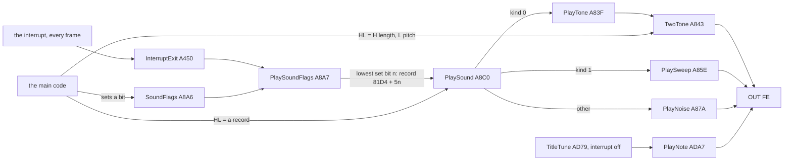
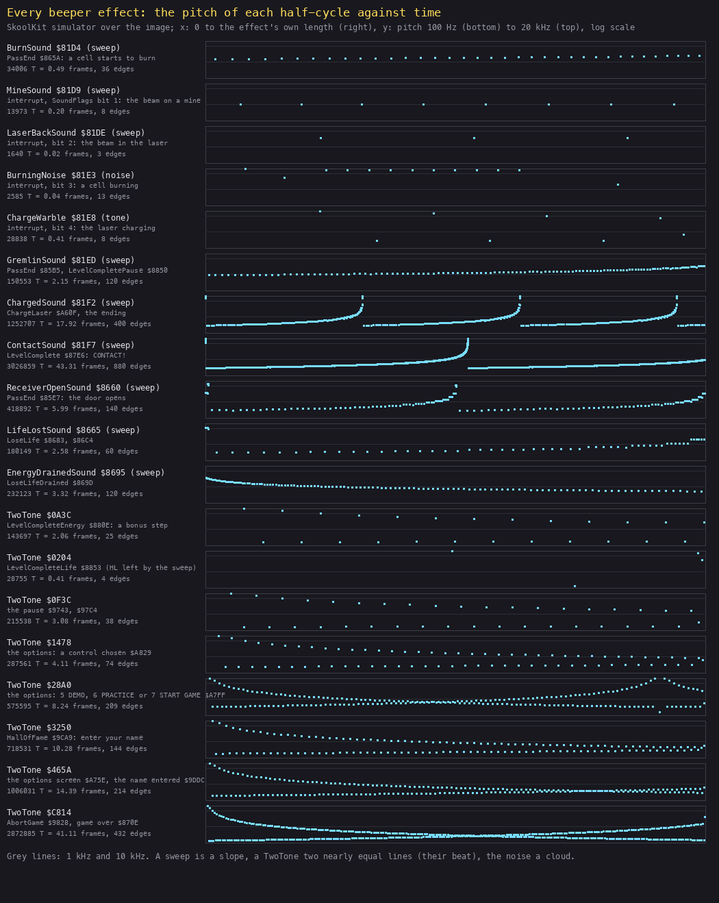
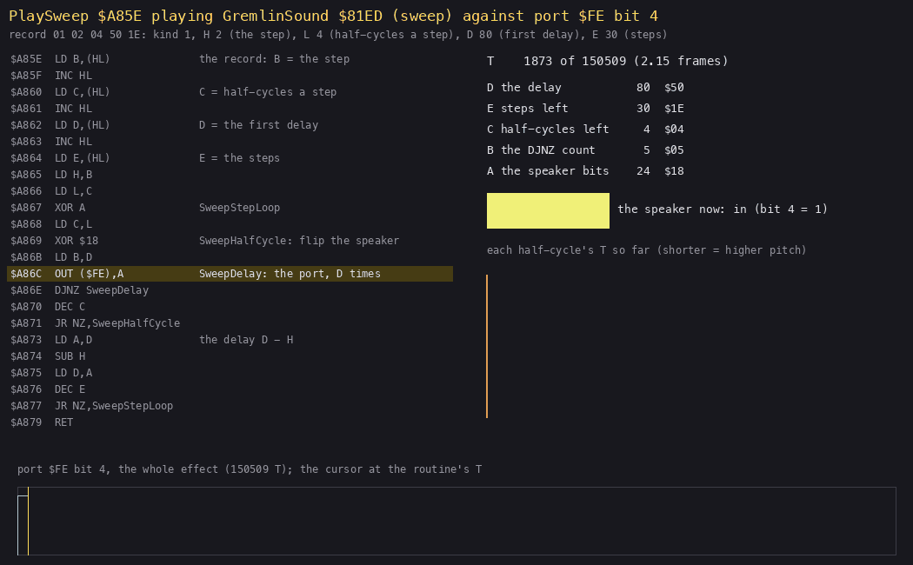
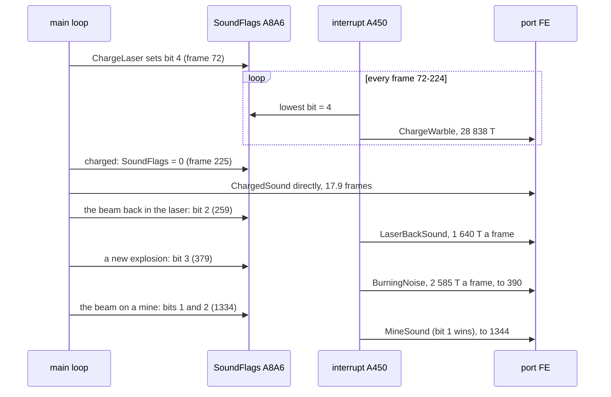
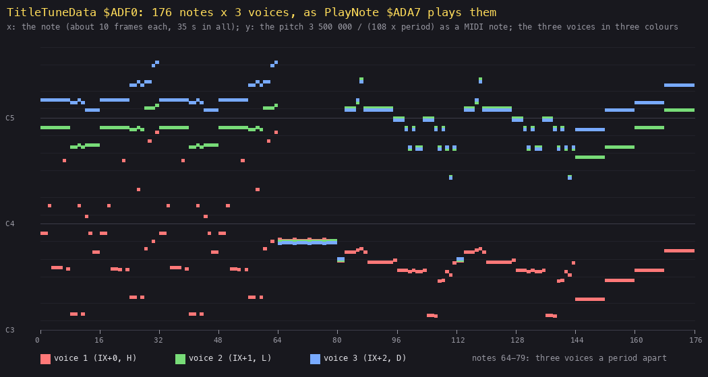

# 9. Sound

What this covers: every sound the game makes. They come from five routines, and all of them drive the beeper alone
(bit 4 of port `$FE`; the game has no AY code):

- the effect player PlaySound `$A8C0`, with three kinds of sound: a two-tone warble, a sweep and a noise;
- the interrupt's PlaySoundFlags `$A8A7`, which plays one effect each frame;
- the title tune's three-voice player TitleTune `$AD79` / PlayNote `$ADA7`.

What it rests on:

- `L01` (`work/docs/dfA/L01`, port base 37480), frames 0-1645: which effect the interrupt played on each frame
  (SoundFlags `$A8A6`).
- SkoolKit's simulator over the entry image, through `tools/sound_render.py`. It runs each routine from its entry
  to its `RET` and records every `OUT ($FE)` with its T-state. The timings, the figures and the WAV renders come
  from it.

The WAVs in [audio/](audio/) were rendered from these OUT lists and never played here.

## 9.1 Who makes a sound



*Every path to the speaker. Witness: the listing's callers (25 `CALL` sites of PlaySound, TwoTone and TitleTune in
`build/game.lst`, and the conditional call at `$85B5`); PlaySoundFlags runs in every interrupt of every
recording (L1 466 704 runs). The point: there is no sound driver and no queue. Each sound is a busy loop on the CPU,
and nothing else runs while it plays. A long sound stops the game for its length.*

There are two ways an effect is asked for:

- **directly**: the main code loads HL with a record or a tone and calls the player. The game waits, so a 43-frame
  CONTACT! sound is a 43-frame stop.
- **by a flag**: the main code sets a bit of SoundFlags `$A8A6`. The interrupt plays the lowest set bit's record
  once a frame, for as long as the bit stays set. A flag sound costs part of every frame, inside the interrupt.

## 9.2 The records and PlaySound

An effect is a 5-byte record: the kind, then four parameters. The eight at `$81D4-$81FB` are one resource,
`src/res/tables/sounds.csv`; three more sit beside their callers (`src/res/tables/sounds-pass-end.csv` `$8660`,
`src/res/tables/sound-drained.csv` `$8695`).

| Record | Bytes | Kind | Name | Played by | Length (T) | Frames |
| --- | --- | --- | --- | --- | ---: | ---: |
| `$81D4` | `01 02 04 2E 09` | sweep | BurnSound | PassEnd `$865A` (a new explosion); SoundFlags bit 0 (never set) | 34 006 | 0.49 |
| `$81D9` | `01 FE 04 46 02` | sweep | MineSound | the interrupt, bit 1 (the beam on a mine) | 13 973 | 0.20 |
| `$81DE` | `01 0A 03 14 01` | sweep | LaserBackSound | the interrupt, bit 2 (the beam back in the laser) | 1 640 | 0.02 |
| `$81E3` | `02 02 04 0A A2` | noise | BurningNoise | the interrupt, bit 3 (a cell burning) | 2 585 | 0.04 |
| `$81E8` | `00 8C 02 00 00` | tone | ChargeWarble | the interrupt, bit 4 (the laser charging) | 28 838 | 0.41 |
| `$81ED` | `01 02 04 50 1E` | sweep | GremlinSound | PassEnd `$85B5` (a gremlin killed), LevelCompletePause `$8850` (a life counted) | 150 553 | 2.15 |
| `$81F2` | `01 08 04 03 64` | sweep | ChargedSound | ChargeLaser `$A60F`, the ending `$8899`, `$889F`, `$A94C` | 1 252 707 | 17.92 |
| `$81F7` | `01 02 04 05 DC` | sweep | ContactSound | LevelComplete `$87E6` | 3 026 859 | 43.31 |
| `$8660` | `01 0F 04 14 23` | sweep | ReceiverOpenSound | PassEnd `$85E7` (the door opens) | 418 892 | 5.99 |
| `$8665` | `01 19 06 06 0A` | sweep | LifeLostSound | LoseLife `$8683`, `$86C4` | 180 149 | 2.58 |
| `$8695` | `01 FE 02 14 3C` | sweep | EnergyDrainedSound | LoseLifeDrained `$869D` | 232 123 | 3.32 |

*Lengths from `python3 tools/sound_render.py table` (SkoolKit's simulator, from PlaySound `$A8C0` to its `RET`,
without contention; a frame is 69 888 T).*

```asm
PlaySound:                  ; $A8C0, HL = the record
  LD A,(HL)                 ; the kind
  INC HL
  AND A
  JP Z,PlayTone             ; 0: two parameters, then TwoTone
  CP $01
  JP Z,PlaySweep            ; 1: a sweep
  JP PlayNoise              ; else: a noise
```

```text
PlaySound(record):
    kind = record[0]
    if kind == 0:   TwoTone(H = record[2], L = record[1])
    elif kind == 1: PlaySweep(step = record[1], half_cycles = record[2], delay = record[3], steps = record[4])
    else:           PlayNoise(period_mask = record[1], bursts = record[2], length_mask = record[3], op = record[4])
```



*Every effect and tone as a pitch track, drawn by `python3 tools/sound_render.py effects docs/img/sound/effects.png`
(SkoolKit's simulator over the image; each effect from its entry to its `RET`). How to read it: one row an effect,
with its length in T and frames at the left. In each row, x runs from the start to the end of that effect (the
lengths differ), and y is the pitch of each half-cycle, on a log scale from 100 Hz to 20 kHz. The grey lines are 1
and 10 kHz. The point: the three kinds look different.*

- *A sweep is a rising or falling line.*
- *ChargedSound and ContactSound are saw teeth: their delay wraps round 256.*
- *A TwoTone is two lines that converge: the high and low parts of one pulse wave whose width slides.*
- *The noise is a scatter.*

## 9.3 TwoTone: the warble

TwoTone `$A843` is the game's plain beep. It takes H (the length in 256 loops) and L (the pitch). The menu, the
pause, the name entry and the bonus count call it directly with a fixed HL; the charge's record reaches it through
PlayTone `$A83F`.

```asm
TwoTone:                    ; $A843, H = length (x 256 loops), L = pitch
  LD C,H
  XOR A
  LD B,A                    ; B = 0: 256 loops
  LD D,L                    ; counter 1 from L
  LD E,D
  DEC E                     ; counter 2 from L - 1
TwoToneLoop:
  OUT ($FE),A               ; 56 T a loop when neither counter wraps
  INC D
  JR NZ,TwoToneSecond
  LD D,L                    ; counter 1 wrapped: reload, flip the speaker
  XOR $18
TwoToneSecond:
  INC E
  JR NZ,TwoToneNext
  LD E,L                    ; counter 2 wrapped: reload from L - 1, flip again
  DEC E
  XOR $18
TwoToneNext:
  DJNZ TwoToneLoop
  DEC C
  JR NZ,TwoToneLoop
  RET
```

```text
TwoTone(H, L):
    d = L; e = L - 1; speaker = 0
    repeat H x 256 times:                     # 56 T a loop
        out(speaker)
        d += 1; if d == 256: d = L;     speaker ^= 18
        e += 1; if e == 256: e = L - 1; speaker ^= 18
```

There are two counters, with periods 256 - L and 257 - L loops. Each flips the speaker when it wraps, so the speaker
level is the XOR of two square waves of almost the same period. The XOR of two equal square waves is a pulse wave at
twice their frequency, and its width is their phase difference. Here the phase difference grows by one loop in
every period. So the tone sounds at 3 500 000 / ((256 - L) x 56) Hz, and its pulse width slides from nothing to a
square wave and back, once every (256 - L)(257 - L) loops. The ear hears a tone that swells and fades: the warble.

| HL | Called by | Pitch | Length | Frames |
| --- | --- | ---: | ---: | ---: |
| `$0A3C` | LevelCompleteEnergy `$880E`, each bonus step | 319 Hz | 143 697 T | 2.06 |
| `$0204` | LevelCompleteLife `$8853`, each life (HL left by the sweep before it) | 248 Hz | 28 755 T | 0.41 |
| `$0F3C` | the pause, `$9743` and `$97C4` | 319 Hz | 215 538 T | 3.08 |
| `$1478` | the options: a control chosen `$A829` | 460 Hz | 287 561 T | 4.11 |
| `$28A0` | the options: 5 DEMO, 6 PRACTICE or 7 START GAME `$A7FF` | 651 Hz | 575 595 T | 8.24 |
| `$3250` | HallOfFame `$9CA9`, enter your name | 355 Hz | 718 531 T | 10.28 |
| `$465A` | the options screen `$A75E`, the name entered `$9DDC` | 377 Hz | 1 006 031 T | 14.39 |
| `$C814` | AbortGame `$9828`, game over `$870E` | 265 Hz | 2 872 885 T | 41.11 |
| `$028C` (record `$81E8`) | the interrupt, bit 4, every frame of the charge | 539 Hz | 28 838 T | 0.41 |

*Pitch = 3 500 000 / ((256 - L) x 56); the lengths from `tools/sound_render.py table`.*

**Worked example: the options screen's `$465A`.** H = `$46` = 70 and L = `$5A` = 90.

- The counters' periods are 166 and 167 loops.
- One period of the pulse wave is 166 x 56 = 9296 T, so the tone is 377 Hz.
- The whole sound is 70 x 256 = 17 920 loops, about 1 000 000 T: 14.4 frames.
- In that time the phase difference grows to 17 920 / 167 = 107 loops of 166.
- So the pulse starts as a click train (a one-loop pulse), is a square wave at about 83 loops (frame 11), and is
  thinning again when the sound ends.

The `$465A` row of the effects figure shows the two lines converging at about three quarters of the way: that is
the square wave.

**The life tone `$0204`.** LevelCompletePause plays GremlinSound and then calls TwoTone without loading HL. PlaySweep
leaves H = 2 and L = 4 (the record's step and half-cycles), so each life counted ends with a 0.41-frame TwoTone of
`$0204`. It is an accident of the registers, but it is always the same.

## 9.4 PlaySweep: the sweeps

```asm
PlaySweep:                  ; $A85E, HL = the record + 1
  LD B,(HL)                 ; the step
  INC HL
  LD C,(HL)                 ; half-cycles a step
  INC HL
  LD D,(HL)                 ; the first delay
  INC HL
  LD E,(HL)                 ; the steps
  LD H,B
  LD L,C
SweepStepLoop:
  XOR A
  LD C,L
SweepHalfCycle:
  XOR $18                   ; flip the speaker
  LD B,D
SweepDelay:
  OUT ($FE),A               ; D loops of 24 T (B = 0: 256)
  DJNZ SweepDelay
  DEC C
  JR NZ,SweepHalfCycle
  LD A,D                    ; the delay D - H, modulo 256
  SUB H
  LD D,A
  DEC E
  JR NZ,SweepStepLoop
  RET
```

```text
PlaySweep(step, half_cycles, delay, steps):
    repeat steps times:
        speaker = 0
        repeat half_cycles times:
            speaker ^= 18
            out(speaker) for (delay or 256) loops of 24 T      # a half-cycle of 24 x delay + 22 T
        delay = (delay - step) AND FF
```

A half-cycle is 24 D + 22 T, so the pitch is 3 500 000 / (2 (24 D + 22)) Hz.

- A positive step shortens D, and the pitch rises.
- `$FE` (-2) lengthens it, and the pitch falls: the mine and the drained energy.
- D is a byte. When it passes 0 it wraps to a long delay, and the sweep starts again from a low note.

ChargedSound (step 8, D 3, 100 steps) wraps at once and then three more times, and ContactSound (step 2, D 5, 220 steps) about twice. That
is why they sound as a run of rising sirens rather than one sweep.



*PlaySweep playing GremlinSound `$81ED`, 80 pictures over its 150 509 T (2.15 frames), drawn by `python3
tools/sound_render.py anim docs/img/routines/PlaySweep-port.gif gremlin` (SkoolKit's simulator over the image). How
to read it:*

- *left, the routine with the instruction under way;*
- *right, D, E, C, B and A at that moment, and the speaker's state;*
- *the bars: each half-cycle's length so far;*
- *bottom, bit 4 of port `$FE` over the whole effect, with a cursor at the current T.*

*The point: the sweep is nothing but a delay loop whose count drops by 2 every four half-cycles. The bars fall in
steps of four, and the square wave tightens from 901 Hz to 3182 Hz.*

**Worked example: GremlinSound.** The record is `01 02 04 50 1E`: a sweep with step 2, 4 half-cycles a step, the
first delay `$50` = 80, and 30 steps.

- The first half-cycle is 24 x 80 + 22 = 1942 T, which is 3 500 000 / 3884 = 901 Hz.
- The delays go 80, 78, ..., 22. The last half-cycle is 24 x 22 + 22 = 550 T: 3182 Hz.
- That gives 30 x 4 = 120 half-cycles, matching the 120 edges the simulator counted.
- The total is the sum over the 30 steps of 4 x (24 D + 22), plus 30 step overheads: 150 509 T. That is 2.15
  frames, during which the game stops.

## 9.5 PlayNoise: the burning cell

```asm
PlayNoise:                  ; $A87A, HL = the record + 1
  LD D,(HL)                 ; the period mask
  INC HL
  LD E,(HL)                 ; bursts
  INC HL
  LD C,(HL)                 ; the length mask
  INC HL
  LD A,(HL)                 ; an opcode: written into the code below
  LD HL,NoiseOp
  LD (HL),A
  LD B,$02
  LD L,$02
NoiseBurstLoop:
  XOR A
NoiseHalfCycle:
  XOR $18
  PUSH BC
NoiseDelay:
  OUT ($FE),A
  DJNZ NoiseDelay
  POP BC
  DEC L
  JR NZ,NoiseHalfCycle
  PUSH DE
  CALL Random               ; HL = the next random number
  POP DE
  LD A,L
  AND C                     ; the next length: (random AND C) + 1
  INC A
  LD L,A
  LD A,H
NoiseOp:                    ; $A89F
  AND D                     ; the record's opcode ($A2 = AND D): the next delay (H op D) + 1
  INC A
  LD B,A
  DEC E
  JR NZ,NoiseBurstLoop
  RET
```

The noise plays bursts of random length and period. The record's fourth byte is an instruction: PlayNoise writes
it over NoiseOp `$A89F` before it starts. The only noise record, BurningNoise `$81E3`, holds `$A2`, which is `AND
D`, the byte the image already has there. So the self-modifying write never changes anything in this game. It
shows the routine was written for other records, which could combine the random byte with D in another way (`OR D`,
`XOR D`).

**Worked example: BurningNoise.** The record is `02 02 04 0A A2`: D = 2, 4 bursts, C = `$0A`, `AND D`.

- The first burst is 2 half-cycles with a delay of 2.
- Then each burst takes a delay of (H AND 2) + 1, which is 1 or 3 loops, and a length of (L AND `$0A`) + 1, which is
  1, 3, 9 or 11 half-cycles.
- The whole noise is 2585 T (0.04 frame), with half-cycles of 2 to 20 kHz: a click of hiss.
- The interrupt plays it on every frame while SoundFlags bit 3 is set: while a new explosion is at its first two
  codes (`$58-$59`, [doc 7, 7.5](07-objects.md#75-the-explosion-slots)). So a burnt cell hisses for about 12 frames, and the
  hiss is the same 0.04 frame repeated at 50 Hz with new random numbers.

## 9.6 SoundFlags and the interrupt

```asm
PlaySoundFlags:             ; $A8A7, from InterruptExit $A450, every frame
  LD A,(SoundFlags)
  LD B,$05
SoundFlagsLoop:
  RRA                       ; bit 0 first
  JR C,SoundFlagsFound
  DJNZ SoundFlagsLoop
  RET                       ; no bit: silence
SoundFlagsFound:
  LD A,$05
  SUB B                     ; the bit number n
  LD B,A
  ADD A,A
  ADD A,A
  ADD A,B
  LD C,A
  LD B,$00
  LD HL,BurnSound           ; $81D4 + 5n
  ADD HL,BC                 ; and on into PlaySound
```

```text
every interrupt:
    n = the lowest set bit of SoundFlags (bits 0-4)
    if any: PlaySound(81D4 + 5 n)          # with the interrupt still off
```

| Bit | Set by | Cleared by | Record |
| ---: | --- | --- | --- |
| 0 | nothing | - | BurnSound (dormant through the flag) |
| 1 | the beam on a mine, BeamMine `$8F75` | UpdateOverload `$A6AB` (bit 2 takes over), CoolOverload `$A6F7` | MineSound |
| 2 | the beam back in the laser, UpdateOverload `$A6A9` | CoolOverload `$A6F7` | LaserBackSound |
| 3 | an explosion at `$58-$59`, PassEnd `$860F` | each pass, PassEnd `$85D6` | BurningNoise |
| 4 | ChargeLaser `$A5DA` | the charge done, the whole byte cleared `$A609` | ChargeWarble |

The whole byte is cleared at a level start (`$84AD`), a life lost (`$866B`), CONTACT! (`$87D5`) and the menu
(`$9BC2`). The pause saves it and puts it back (`$9756`, `$97EB`).



*`L01`, frames 0-1645. Witness: `python3 tools/ttd_watch.py --work work/docs/dfA/L01 --addr A8A6,837B,837C,A104
--from 0 --to 1645 --step 1`. The point: the flags are a priority by bit number, the lowest bit first. On the mine
both the mine's bit 1 and the overload's bit 2 are set, and the mine's falling sweep is the one heard.*

**Worked example: the cost of a flag sound, from `L01`.**

- SoundFlags is `$10` from frame 72 to 224: the laser charging. On each of those 153 frames the interrupt spends
  28 838 T on ChargeWarble, 41 % of the frame, with the interrupt off. The charge is a still screen, so it costs
  nothing the player sees.
- At frame 379, BurnSoundFlag `$837B` is `$57` (a new explosion this pass), and PassEnd plays BurnSound directly
  (0.49 frame). Then SoundFlags is `$08` up to frame 390: twelve frames of BurningNoise, 2585 T each.
- From frame 1330 the watch shows bit 2 (`$04`, OVERLOAD `$12`) and then `$06` at 1334. MINE ALERT (`$13`) follows
  at 1336, and the flags are clear at 1345 when the life is lost.

These figures are T-states of the effect alone, without contention: the routines run from `$A8xx` and `$81xx`, which
are uncontended, and they write no screen.

## 9.7 The title tune

The tune plays on the title screen, in the pause and after the ending, with the interrupt off. It runs until a key is
pressed:

```asm
TitleTune:                  ; $AD79
  DI
TitleTuneRestart:
  LD B,$B0                  ; 176 notes
  LD IX,TitleTuneData       ; $ADF0
TitleTuneNoteLoop:
  PUSH BC
  LD H,(IX+$00)             ; the three voices' periods
  LD L,(IX+$01)
  LD D,(IX+$02)
  LD BC,$1770               ; 6000 loops a note
  CALL PlayNote
  POP BC
  XOR A
  IN A,($FE)                ; any key: stop
  CPL
  AND $1F
  JP NZ,TitleTuneEnd
  INC IX
  INC IX
  INC IX
  DJNZ TitleTuneNoteLoop
  JP TitleTuneRestart
TitleTuneEnd:
  EI
  RET
```

PlayNote `$ADA7` counts the three periods down together, once a loop of 108 T. When a counter reaches 0, that voice
sends a pulse: the speaker goes to 0 for 15 `DJNZ` loops (190 T) and back to `$10`. Then the counter is reloaded
from its note. The speaker is up between pulses. So each voice is a train of short dips whose rate is its pitch,
and the three trains mix on the one speaker bit.

```text
PlayNote(h, l, d):                          # the note's three periods
    a, b, c = h, l, d
    repeat 6000 times:                      # 108 T a loop with no pulse
        a -= 1; if a == 0: pulse(); a = h
        b -= 1; if b == 0: pulse(); b = l
        c -= 1; if c == 0: pulse(); c = d
    pulse(): out(0) for 15 loops, out($10)
```



*TitleTuneData `$ADF0-$AFFF` (the resource `src/res/tables/title-tune.csv`, a row a note) drawn by `python3 tools/sound_render.py tune docs/img/sound/title-tune.png` (from the
image). How to read it: one column a note, 176 in all; each voice is a bar at its pitch, 3 500 000 / (108 x
period), on the semitone grid. The point:*

- *voice 1 (red) is the bass and the low melody;*
- *voices 2 and 3 (green, blue) hold a chord above it;*
- *notes 64-79 are three voices one period apart (`$8A $8B $8C`), a chorus: they beat against each other like
  TwoTone's two counters;*
- *the shape is a 32-note phrase played twice (notes 0-63), the chorus, a second 32-note phrase played twice (80-143),
  and a coda of four chords held for eight notes each (144-175).*

**Worked example: the first note.** It is `$84 $42 $37`: the periods 132, 66 and 55.

- Voice 1 pulses every 132 loops: 3 500 000 / (132 x 108) = 245 Hz, a B3.
- Voice 2 pulses every 66 loops: 491 Hz, B4, the octave.
- Voice 3 pulses every 55 loops: 589 Hz, D5.

So the tune opens on B and D, a B minor sound. The note is 6000 loops. That would be 648 000 T at 108 T a loop, but
the pulses add their own time: 6000/132 + 6000/66 + 6000/55 = 245 pulses of about 200 T each. The simulator gives
677 051 to 733 334 T a note (9.7 to 10.5 frames), and 124 037 808 T for the 176 notes: 35.4 seconds before the tune
starts again. The pitches above are about 5 % high for the same reason.

## 9.8 The renders

All rendered by `python3 tools/sound_render.py wav docs/audio`: the simulator's OUT list, bit 4 averaged over each
44 100 Hz sample, 16-bit mono; the title tune then as an MP3 (`lame -V 4`), the effects (all under a second) as WAV. None was played while writing this document.

| Sound | File |
| --- | --- |
| BurnSound, a cell starts to burn | [burn.wav](audio/burn.wav) |
| MineSound, one frame's worth | [mine.wav](audio/mine.wav) |
| LaserBackSound, one frame's worth | [laser-back.wav](audio/laser-back.wav) |
| BurningNoise, one frame's worth | [burning.wav](audio/burning.wav) |
| ChargeWarble, one frame's worth | [charge.wav](audio/charge.wav) |
| GremlinSound | [gremlin.wav](audio/gremlin.wav) |
| ChargedSound | [charged.wav](audio/charged.wav) |
| ContactSound, CONTACT! | [contact.wav](audio/contact.wav) |
| ReceiverOpenSound | [receiver-open.wav](audio/receiver-open.wav) |
| LifeLostSound | [life-lost.wav](audio/life-lost.wav) |
| EnergyDrainedSound | [energy-drained.wav](audio/energy-drained.wav) |
| TwoTone `$0A3C`, a bonus step | [tone-bonus.wav](audio/tone-bonus.wav) |
| TwoTone `$0204`, a life counted | [tone-life.wav](audio/tone-life.wav) |
| TwoTone `$0F3C`, the pause | [tone-pause.wav](audio/tone-pause.wav) |
| TwoTone `$1478`, a control chosen | [tone-option.wav](audio/tone-option.wav) |
| TwoTone `$28A0`, DEMO, PRACTICE or START GAME chosen | [tone-start.wav](audio/tone-start.wav) |
| TwoTone `$3250`, enter your name | [tone-name.wav](audio/tone-name.wav) |
| TwoTone `$465A`, the options screen | [tone-menu.wav](audio/tone-menu.wav) |
| TwoTone `$C814`, game aborted or over | [tone-abort.wav](audio/tone-abort.wav) |
| The title tune, 176 notes (35.4 s, MP3) | [title-tune.mp3](audio/title-tune.mp3) |

A flag sound repeats once a frame in the game. The files hold one repeat; the 50 Hz repetition is not rendered.

## 9.9 What is known only from the code

- SoundFlags bit 0: no instruction sets it. Its record, BurnSound, is played only directly.
- NoiseOp `$A89F`: the self-modifying opcode is always `AND D`, the image's own. Other opcodes would come from noise
  records the game does not have.
- The simulator's timings have no contention and no interrupt. The flag sounds run inside the interrupt; the direct
  ones run with the interrupt on, so the interrupt's own work cuts into them once a frame. The real CONTACT! is
  therefore a little longer than the simulated 43.3 frames.
