# 10. Gameplay logic

What this covers: the rules as the code applies them:

- TraceBeam, the beam's path through the grid, and what each element does to it;
- the cells burnt, the overload and the energy, the mines and the gremlins;
- every way to lose a life, a level completed and the ending;
- the solver as a reading of TraceBeam, and the game's notable features.

The recordings it rests on:

- `L01` (`work/docs/dfA/L01`, port base 37480): level 1 played from the menu to CONTACT! and the bonus, frames
  0-1645. Its memory at frames 256, 377 and 1514 was dumped with `tools/ttd_dump.py` into `work/docs/dfA/dump/`.
- `L03` (`work/docs/dfA/L03`, port base 37485): level 3 with its two gremlins, frames 1150-1330. It starts on a clone:
  the bot ended level 2 by the LevelDone POKE ([WALKTHROUGH 6.0](../WALKTHROUGH.md#60-the-recordings)).

The single traces are replayed from those dumps by SkoolKit's simulator: `tools/fig_trace.py` runs TraceBeam
`$8ED6` on a copy of the dumped memory, from the start MainLoop gives it.

## 10.1 One pass, as rules

The game is a loop of passes ([doc 4, 4.2](04-game-loop.md#42-the-pass)). Each pass:

1. reads the controls;
2. traces the beam from the laser;
3. moves the gremlins and draws the screen;
4. settles the pass's outcome in PassEnd.

The trace does not act on what it finds. It sets four flags, and PassEnd and UpdateOverload turn them into the
rules:

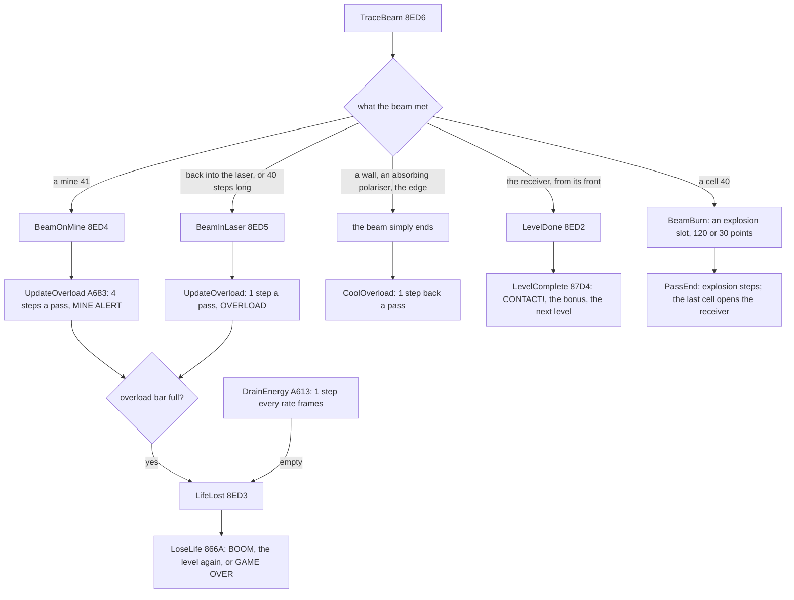

*The rules of a pass. Witness: the flags' writers and readers in the listing (`$8ED2-$8ED5`, [doc 7,
7.7](07-objects.md#77-the-state-variables)), and the `L01` course in 10.9. The point: the beam decides everything.
The only other clock is the energy, which drains whatever the beam does.*

## 10.2 TraceBeam: the path

The beam moves on a lattice of half-cells:

- x runs 0-32 and y runs 0-20;
- a cell (row r, column c) has its centre at x = 2c + 2, y = 2r + 2;
- between centres are the vertices where four characters meet.

There are 16 directions, clockwise from east (4 south, 8 west, 12 north). One step moves the beam by BeamDeltas
`$8170`:

| Directions | Step (dx, dy) | Kind |
| --- | --- | --- |
| 0, 4, 8, 12 | (2, 0), (0, 2), (-2, 0), (0, -2) | axis: one cell a step |
| 2, 6, 10, 14 | (1, 1), (-1, 1), (-1, -1), (1, -1) | diagonal: one character a step |
| 1, 3, 5, 7, 9, 11, 13, 15 | (2, 1), (1, 2), ... | slope: two by one |

So the 16 directions are only roughly 22.5 degrees apart: the slopes are at 26.6 and 63.4 degrees.

```asm
BeamStep:                   ; $8EDD, once a vertex
  XOR A
  LD (BeamAtCentre),A
  LD (BeamReflected),A
  LD (BeamY+$0003),A
  LD A,(BeamDirection)
  CP $FF                    ; ended
  RET Z
  LD (BeamNextDirection),A  ; by default the beam goes straight on
  LD A,(BeamX)              ; x or y odd: between cells, nothing to read
  SRL A
  LD C,A
  JP C,BeamVertex
  LD A,(BeamY)
  SRL A
  LD B,A
  JP C,BeamVertex
  XOR A                     ; HL = $FD11 + 17 (y/2) + x/2: the cell
  INC B                     ; (y/2 + 1) times 17, + x/2: row y/2 - 1, column x/2 - 1
BeamStepRowAdd:
  ADD A,$11
  DJNZ BeamStepRowAdd
  ADD A,C
  LD L,A
  LD H,$FD
  ...
  LD A,(HL)
  RES 7,A                   ; a turning element acts as its current angle
  AND A
  JP Z,BeamVertex           ; empty
  CP $11
  JP C,BeamMirror           ; $01-$10
  CP $21
  JR C,BeamBlock            ; $11-$20 polarisers: decided by their characters
  CP $58
  RET NC                    ; an explosion: the beam ends
  CP $4F
  JP NC,FibreEntry          ; $4F-$57
  CP $4B
  JR NC,BeamReceiver        ; $4B-$4E
  CP $43
  JP NC,BeamAtLaser         ; $43-$4A
  CP $42
  JP Z,PrismTurn            ; $42
  CP $3F
  JP C,BeamVertex           ; $21-$3E walls: decided by their characters
  CP $41
  JR Z,BeamMine             ; $41
BeamBurn:                   ; $3F, $40: a cell
  ...
```

```text
TraceBeam():                                  # from the half-cell in front of the laser
    steps = 0
    loop:
        next = direction
        if x and y are even:                  # a cell's centre
            act on the cell (10.3): may set next, end the beam, or set a flag
        BeamVertex: draw the four characters round (x, y) in three passes;
            a wall or polariser character met may end the beam or bounce it
            if next == direction + 8: BeamBackToLaser (OVERLOAD), end
        if next == FF: end
        direction = next; (x, y) += BeamDeltas[direction]
        if off the field: end
        steps += 1 (a diagonal step only when the new x is odd)
        if steps == 40: BeamBackToLaser (OVERLOAD)  # the beam goes on
        if steps == 150: end
```

The trace reads two maps. The grid (`$FD23`) decides at a cell's centre. The character map (`$E000`) decides at the
vertices between: the walls and polarisers are characters, so a beam can graze a wall's edge or be stopped by one
quarter of it. That is the work of the three drawing passes of BeamVertex `$906E` ([doc 6, 6.6](06-rendering.md)).

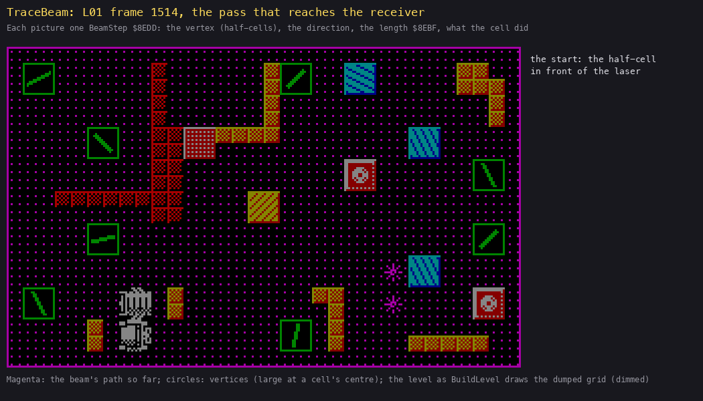

*`L01` frame 1514, one TraceBeam replayed from the dump (`python3 tools/ttd_dump.py --work work/docs/dfA/L01 --frame`
`1514 --out work/docs/dfA/dump/l01-1514 --no-ram`, then `python3 tools/fig_trace.py`
`work/docs/dfA/dump/l01-1514.cpu.bin docs/img/logic/trace-contact.gif --title "..."`): 18 steps, 125 371 T. How to read
it: the level as BuildLevel draws the dumped grid (dimmed); the magenta line is the path so far; circles are the
vertices (large at a cell's centre). The panel on the right gives each step's x, y, direction and length, and the
handler the cell sent it to. The point: from the laser's front, three mirrors turn the beam (west to north-east, to
east-south-east, to west). It enters the receiver from its open side: BeamReceiver sets LevelDone.*

**Worked example: the winning pass of level 1** (`python3 tools/fig_trace.py work/docs/dfA/dump/l01-1514.cpu.bin`
`--list`).

1. The beam starts at x 6, y 16 going west (direction 8): the half-cell in front of the laser `$49` at row 7,
   column 3. The laser's centre is x 8, y 16.
2. At x 2, y 16 (row 7, column 0) the cell holds `$0F`. BeamMirror gives (16 - 8 + 14 + 8) AND 15 = 14:
   north-east.
3. Four diagonal steps reach x 6, y 12 (row 5, column 2), which holds `$08`: (16 - 14 + 7 + 8) AND 15 = 1, east by
   south-east.
4. Six slope steps reach x 18, y 18 (row 8, column 8), which holds `$02`. The player turned this mirror at frame
   1513. It gives (16 - 1 + 1 + 8) AND 15 = 8: west.
5. Five steps west reach x 8, y 18 (row 8, column 3), the receiver `$4B`. The beam is on an axis, and ((8 + 8) AND
   12) / 4 = 0 = (`$4B` - `$4B`) AND 3, so it entered from the front. LevelDone = `$FF`.

The trace's length counter stands at 15 at the end, well under the 40 of 10.4. The cell of step 2 is `$FD11` + 17 x 8
+ 1 = `$FD9A` (row 7, column 0: `$FD23` + 17 x 7), the grid address BeamStep computes from the half-cells.

## 10.3 What each element does

| Code | Element | At the centre | Witness |
| --- | --- | --- | --- |
| `$00` | empty | on | every trace |
| `$01-$10` | mirror (16 angles) | BeamMirror `$8FFB`: out = (16 - in + code - 1 + 8) AND 15 | 212 472 runs |
| `$11-$18` | cyan polariser | by its characters: along its axis it passes, else it absorbs | `elements.py` experiment |
| `$19-$20` | yellow polariser | by its characters: along its axis it passes, else it reflects | `elements.py` experiment |
| `$21-$2F` | absorbing wall | by its characters (`$71`): the beam ends, or grazes a lone quarter (below) | every level |
| `$30-$3E` | reflecting wall | by its characters (`$72`): the beam bounces, by the tables below | 21 949 bounces |
| `$40` | cell | BeamBurn: an explosion slot, the points, the beam ends | 10.5 |
| `$41` | mine | BeamMine: BeamOnMine, SoundFlags bit 1, the beam ends | `mine`, 46 RZX segments |
| `$42` | prism | PrismTurn `$9014`: a random new direction 4-12 sixteenths off the reverse | 16 015 runs |
| `$47-$4A` | laser | BeamAtLaser: from its front on an axis, BeamBackToLaser (OVERLOAD); else the beam ends | 1094 runs |
| `$4B-$4E` | receiver | BeamReceiver: from its front on an axis, LevelDone; else the beam ends | 18 completions |
| `$50-$57` | fibre-optic end | FibreEntry `$903E`: the beam jumps to the partner (code XOR 1) and leaves it in the same direction | 4105 runs |
| `$58-$5C` | an explosion | the beam ends | 10.5 |
| bit 7 | turning | acts as its current angle; ChargeLaser and the gremlins turn it | |

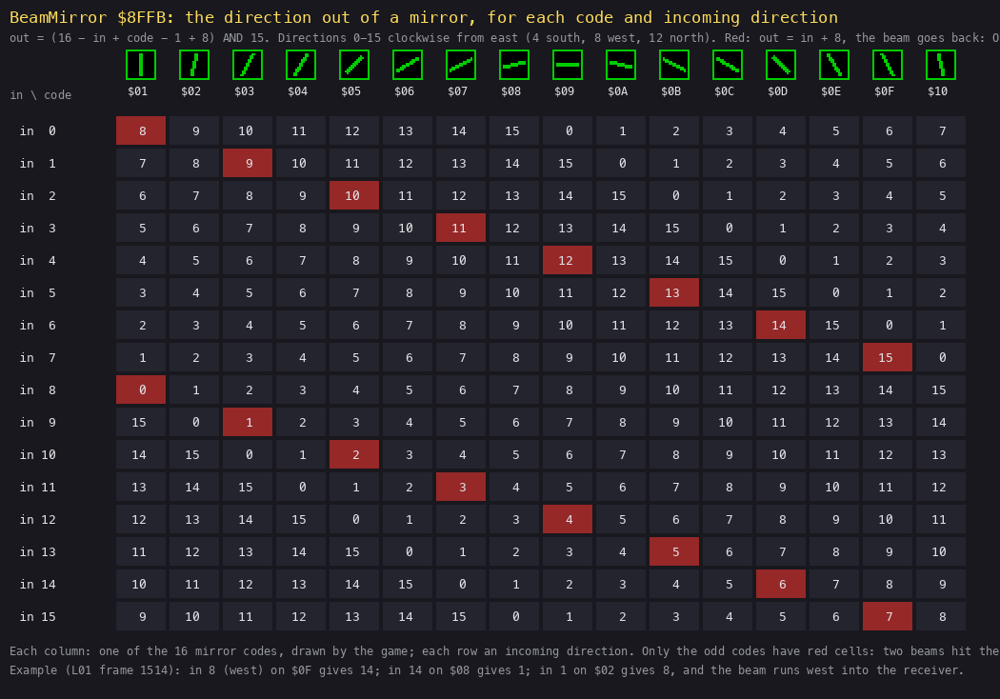

*BeamMirror's answer for all 16 codes and 16 incoming directions, drawn by `python3 tools/fig_logic.py mirror`
`docs/img/logic/mirror-table.png` from the formula of `$8FFB` (each code drawn by the game's CellTable). How to read
it: a column per mirror code, a row per incoming direction, the outgoing direction in the cell. Red marks the out =
in + 8 case: the beam goes back along itself. The point: only the eight odd codes can send a beam back.*

*An even code lies half-way between two square-on angles, so no axis, diagonal or slope beam meets it square. A
mirror one click off square is always safe from OVERLOAD, but the next click may not be.*

**Worked example: a mirror one click off square.** A beam going north (12) meets `$09`, the horizontal mirror: (16 -
12 + 8 + 8) AND 15 = 4. That is south, the reverse, so OVERLOAD. One click to `$0A` gives 5 (south by south-west),
and the beam is away. One click the other way to `$08` gives 3. This is how the `L01` overload at frame 256 below
comes and goes as the player turns the mirror at row 0, column 0.

Three elements are random or remote:

- **The prism** takes a number from Random `$8E15` on every pass. The beam leaves (in + 4 - (H AND 7)) or (in - 4 +
  (H AND 7)), so it flickers from pass to pass. It never goes straight back, so a prism never overloads.
- **A fibre end** finds its partner by scanning the grid backwards for the code XOR 1. The beam is drawn into the
  first end, jumps to the partner's centre, and leaves in its arrival direction. Every level that holds an end holds
  its partner, so the "no partner" branch (FibreNoPartner `$9059`) is dead. The code and the worked example are
  below.
- **The laser and the receiver** both demand an axis beam on their open side. A beam on their back or flank, or a
  slanted one, just ends.

### The fibre jump

```asm
FibreEntry:                 ; $903E, A = the end's code ($50-$57)
  XOR $01                   ; D = the partner's code
  LD D,A
  LD A,$02                  ; $8ED1 = 2: the beam enters a fibre at this vertex
  LD (BeamY+$0003),A
  LD HL,LevelGrid+185       ; the last cell (row 8, column 14), backwards
  LD C,$09
FibreSearchRow:
  LD B,$0F
FibreSearchCell:
  LD A,(HL)
  CP D
  JR Z,FibrePartner
  DEC L
  DJNZ FibreSearchCell
  DEC HL                    ; over the row's two guard bytes
  DEC HL
  DEC C
  JR NZ,FibreSearchRow
FibreNoPartner:             ; $9059: no level gets here
  LD A,$FF
  LD (BeamNextDirection),A
  JP BeamVertex
FibrePartner:               ; $9061: the partner's centre x = 2B, y = 2C
  LD A,B
  ADD A,A
  LD (BeamY+$0001),A
  LD A,C
  ADD A,A
  LD (BeamY+$0002),A
  JP BeamVertex             ; the entry vertex drawn; then FibreJump $91C6
```

```text
FibreEntry(code):
    partner = code XOR 1
    for row 8 down to 0, column 14 down to 0:        # the last match wins: the scan is backwards
        if grid[row][column] == partner:
            target = (2 (column + 1), 2 (row + 1)); mode = 2; draw this vertex; break
    else: the beam ends here (FibreNoPartner)
BeamOutgoing, mode 2 (FibreJump $91C6):
    mode = 1; (x, y) = target; direction = FF (no incoming pass)
    draw the partner's vertex with the outgoing pass only, then step on in the same direction
```

**Worked example: the fibre of level 1.** In the trace of `L01` frame 377 (`trace-burn.gif` in 10.5, `python3
tools/fig_trace.py work/docs/dfA/dump/l01-377.cpu.bin --list`) the beam runs south from the mirror at x 30, y 12 and
reaches x 30, y 16: row 7, column 14, code `$55`. The partner is `$54`; the scan from row 8, column 14 backwards meets
it at row 3, column 10 (B = 11, C = 4), so the target is x 22, y 8. The next vertex the trace counts is x 22, y 10,
one step south of the partner (direction 4 kept), and the beam burns the cell at x 22, y 16. Level 1 holds only this
pair. Witness: FibreEntry ran 4105 times over the recordings (the listing: `L` x6, RZX x15), 21 of them in `L01`.

### Walls and polarisers at the vertices

A wall or a polariser is not decided at a cell's centre: BeamStep sends those codes on to BeamVertex `$906E`, and the
three drawing passes of the vertex ([doc 6, 6.6](06-rendering.md)) look at each character round it in the character
map `$E000`. The incoming pass (BeamInChar `$9278`) runs over the characters the beam enters, the outgoing pass
(BeamOutChar) over those it leaves by. Each pass reacts to the character it is about to draw:

| Character | Incoming pass | Outgoing pass |
| --- | --- | --- |
| `$71` (absorbing wall) | BeamAbsorbIn `$9344` | BeamAbsorbOut |
| `$72` (reflecting wall) | BeamReflectIn `$938F` | BeamReflectOut `$960D` |
| `$31-$70` (polariser) | BeamInPolariser `$92FD` | the outgoing polariser test |
| `$80-$AF` (laser, receiver) | absorbed (BeamAbsorbIn) | absorbed |

The polariser test takes its angle from the character, (character - `$31`) AND `$1F` / 4 = 0-7, and compares it with
the beam's direction AND 7:

```asm
BeamInPolariser:            ; $92FD, A = the character ($31-$70)
  LD D,A
  SUB $31
  AND $1F
  SRL A
  SRL A
  LD B,A                    ; the polariser's angle 0-7
  LD A,(BeamDirection)
  AND $07
  CP B
  JR Z,PolariserPassIn      ; along its axis: passed, its other three characters lit ($81A0)
  LD A,D
  CP $51
  JR C,BeamAbsorbIn         ; cyan ($31-$50): absorbed
  JP BeamReflectIn          ; yellow ($51-$70): reflected like a wall
```

A reflecting wall (or a yellow polariser across the beam) then acts by the beam's kind:

- **Axis beam** (direction AND 3 = 0): the character across the beam line (GrazeOffsets `$8190`, one offset for each
  character of the pass and axis) decides. If it is free (below `$31` or above `$72`), the beam grazes the wall's
  side and goes on. If it is a wall too, the beam goes straight back: BeamBackToLaser `$8FC5`, OVERLOAD, and the trace
  ends. A second wall character at the same vertex always sends it back.
- **Slope or diagonal, incoming pass** (ReflectInSlant `$93DC`): InBounceTable `$8140` + 3 x direction gives the
  new direction and a step (dx, dy) back to the vertex the beam leaves from; BeamMove `$9235` takes the step. A slope
  is mirrored off the wall it can meet (1 and 7, 9 and 15 off an upright wall; 3 and 13, 5 and 11 off a level one). A
  diagonal's entry is `$80` + n: InCornerTable `$8100` + n holds two neighbours to test and four answers with their
  steps (10.12).
- **Slope or diagonal, outgoing pass** (ReflectOutSlant `$965A`): OutBounceTable `$8080` + 8 x the new direction
  holds two offsets from the wall character met, to the two neighbours that tell which way the wall runs, then four
  answers: neither of them a wall, the first (+1), the second (+2), both (+3). The answer that is the reverse of the
  incoming direction is OVERLOAD. Any other answer turns the beam in place: the direction becomes `$FF` (no incoming
  pass), a bounce counter `$8EC0` counts one, and the vertex is drawn again with the new direction. At 40 bounces
  OVERLOAD, at 150 the trace stops (`$96B8`, never reached).

```asm
ReflectOutSlant:            ; $965A, B = the new direction
  POP DE
  POP DE
  LD HL,OutBounceTable      ; $8080 + 8 x direction
  LD A,B
  ADD A,A
  ADD A,A
  ADD A,A
  ADD A,L
  LD L,A
  EX DE,HL
  XOR A
  EX AF,AF'                 ; A' = 0: the answer's index
  LD BC,(CharMapPointer)    ; the wall character met
  ...                       ; the first offset: a wall ($31-$72)? A' + 1
  ...                       ; the second offset: a wall? A' + 2
ReflectOutPick:             ; $9694
  EX AF,AF'
  ADD A,E                   ; DE = the row's +4, + A'
  LD E,A
  LD A,(DE)
  LD (BeamNextDirection),A
  LD B,A
  LD A,(BeamDirection)
  ADD A,$08
  AND $0F
  CP B                      ; the reverse: OVERLOAD
  JP Z,BeamBackToLaser
  LD A,$FF                  ; turned in place: no incoming pass
  LD (BeamDirection),A
  LD A,(BeamSteps+$0001)    ; the bounce count
  INC A
  LD (BeamSteps+$0001),A
  CP $28
  JP C,BeamVertex           ; draw the vertex again, with the new direction
```

```text
a pass meets character ch at the vertex, the beam's direction d:
    if ch in 31..70 (polariser): angle = ((ch - 31) AND 1F) / 4
        if d AND 7 == angle: pass, light its other three characters (PolariserCells $81A0)
        elif ch < 51: absorb (as 71)            # cyan
        else: reflect (as 72)                   # yellow
    if absorb: axis beam and the character across is free: graze on; else the beam ends
    if reflect:
        if d AND 3 == 0:                        # axis
            the character across (GrazeOffsets) free: graze on; else OVERLOAD, the trace ends
        elif incoming pass:
            new, dx, dy = InBounceTable[d]       # a slope: never its own reverse
            if new >= 80:                        # a diagonal
                new, dx, dy = InCornerTable[new - 80] by the walls round the corner
                if new == d + 8: OVERLOAD, the trace ends
            direction = new; move by (dx, dy); on to the next vertex
        else:                                   # outgoing pass, new = the direction after this vertex
            k = (row[0] is a wall) + 2 (row[1] is a wall), row = OutBounceTable[new]
            out = row[4 + k]
            if out == incoming d + 8: OVERLOAD
            else: bounces += 1; redraw this vertex leaving by out (40 bounces: OVERLOAD; 150: stop)
```

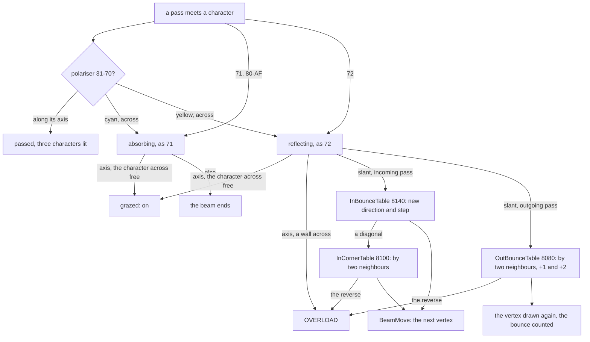

*A wall or polariser met by a pass. Witness: per recording (each `l1.json`), ReflectInSlant `$93DC` and
ReflectOutSlant `$965A` ran 2 and 35 times in `L01`, 211 and 264 in `L03`,
565 and 649 in `L22` (a clone), 2944 and 1472 in `hof` (a clone); ReflectOutBack `$9655` 3 times in `L01`;
PolariserPassIn `$9317` 20 times in `L01`, 184 in `L12`. Over the RZX segments the slope branch of `$93DC` ran 21 949
times. The point: a slanted beam is never simply stopped by a reflecting wall; which way it leaves depends on the
characters beside the one it met, so a wall's corner and its side bounce differently.*

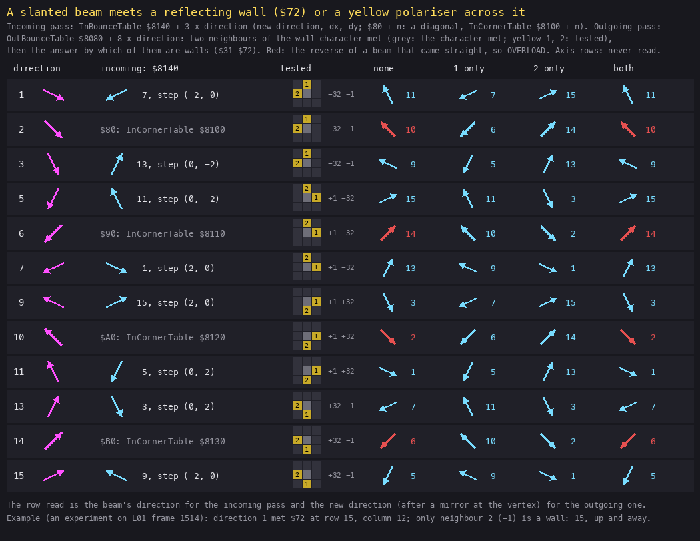

*InBounceTable `$8140` and OutBounceTable `$8080` for the twelve slanted directions, drawn by `python3
tools/fig_logic.py bounce docs/img/logic/bounce-tables.png` from the game's image. How to read it: a row per
direction (magenta arrow); the incoming answer in the second column; then the two neighbours the outgoing pass tests
round the character it met (grey) and its four answers. Red is the reverse of a beam that came straight on: OVERLOAD.
The point: in the outgoing pass the side of the wall decides; a diagonal meeting a lone corner (neither neighbour a
wall) is always sent back.*

The editable forms are `src/res/tables/in-bounce.csv`, `out-bounce.csv`, `in-corner.csv`, `graze-offsets.csv` and
`polariser-cells.csv` ([src/res/tables/README.md](../src/res/tables/README.md)).

**Worked example: two bounces, by experiment.** No dump of the recordings catches a bounce, so the two cases are
replayed on `L01`'s frame 1514 with one cell changed (`tools/fig_trace.py --poke`, which writes the cell into
LevelGrid and its four characters into the character map, as RenderGrid would). The beam leaves the mirror at x 6,
y 12 on direction 1 (east by south-east), as in 10.2:

1. `--poke 6,5=3E`, a full reflecting wall at row 6, column 5 (four characters `$72`). At the vertex x 12, y 15 the
   incoming pass meets the wall's character at row 14, column 11. InBounceTable row 1 (`$8143`) = 7, -2, 0: the beam
   turns to direction 7 (west by south-west) and steps to x 10, y 15. It runs on to the laser's side at x 8, y 16 and
   ends there (a slanted beam at the laser just ends).
2. `--poke 7,5=3E`, the same wall one row lower. Now the incoming pass of x 12, y 15 is clear, and the outgoing pass
   meets `$72` at row 15, column 12 (CharMapPointer `$E1EC`). OutBounceTable row 1 (`$8088`) tests -32 (row 14,
   column 12: empty) and -1 (row 15, column 11: `$72`): only the second, so the answer is the row's +6, `$808E` = 15
   (east by north-east). That is not the reverse of 1 (9), so the vertex is redrawn leaving by 15, and the beam runs
   up and away to the edge at x 32, y 5 (20 steps, 141 755 T).

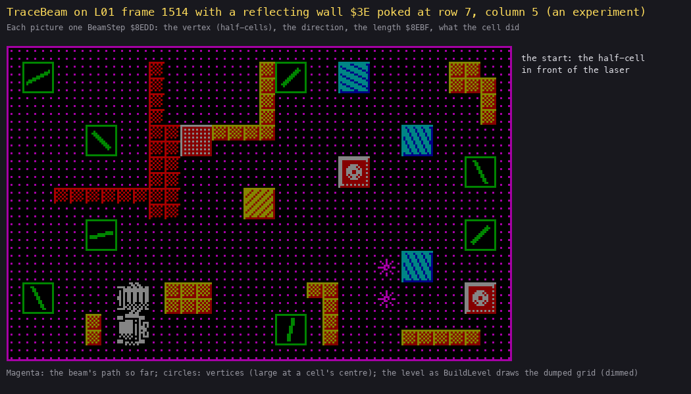

*The second experiment drawn: `python3 tools/fig_trace.py work/docs/dfA/dump/l01-1514.cpu.bin
docs/img/logic/trace-bounce.gif --poke 7,5=3E --title "..."`. How to read it: as the traces above; the poked wall
is the right half of the block at row 7, columns 4-5 (column 4 is level 1's own wall `$37`). The point: the beam is not stopped at the wall; at step 10 the panel names
ReflectOutSlant, and the next vertex already runs on direction 15.*

## 10.4 The overlong beam

```asm
BeamCountStep:              ; in BeamMove $9235
  LD A,(BeamSteps)          ; length + 1 (a diagonal step only at odd x)
  INC A
  LD (BeamSteps),A
BeamLengthCheck:
  LD A,(BeamSteps)
  CP $28                    ; under 40: the next vertex
  JP C,BeamStep
  LD D,A
  CALL Z,BeamBackToLaser    ; exactly 40: OVERLOAD
  LD A,D
  CP $96                    ; under 150: on
  JP C,BeamStep
  RET
```

A beam that runs 40 steps sets BeamInLaser as if it had come back into the laser, but the trace goes on, up to 150
steps. So a long path costs a step of the overload bar every pass, even when it reaches the cells. Lighting a far
cell by a long detour is not free: the player has to burn it before the bar fills (64 passes, 10.6). The RZX run hit
the 40 in 14 of the 59 level segments (`$926D`, 2010 runs).

## 10.5 Burning a cell

```asm
BeamBurn:                   ; $8F40
  EX DE,HL                  ; DE = the cell's grid address
  LD B,$06
  LD HL,ExplosionSlots      ; $81B8: seven slots of 4 bytes
BeamBurnSlot:
  LD A,(HL)                 ; a free slot has high byte 0
  AND A
  JR Z,BeamBurnStore
  INC L
  INC L
  INC L
  INC L
  DJNZ BeamBurnSlot         ; six looked at; the seventh if all are taken
BeamBurnStore:
  LD (HL),D                 ; grid address, y, x
  INC L
  LD (HL),E
  INC L
  LD A,(BeamY)
  LD (HL),A
  INC L
  LD A,(BeamX)
  LD (HL),A
  LD A,$FF                  ; the beam ends at the cell
  LD (BeamNextDirection),A
CellPoints:
  LD B,$18                  ; patched: 12 or 3
  CALL AddScore
  JP BeamVertex
```

The beam stops at the cell and scores at once. The cell is not removed by the trace: PassEnd steps its slot each pass
through the codes `$57`, `$58-$5C` and empties it ([doc 7, 7.5](07-objects.md#75-the-explosion-slots)). While the
cell explodes its code is `$58` or more, which ends the beam (10.3). So the beam stays blocked for the whole
explosion, about 30 frames, and only then runs on to the next element.

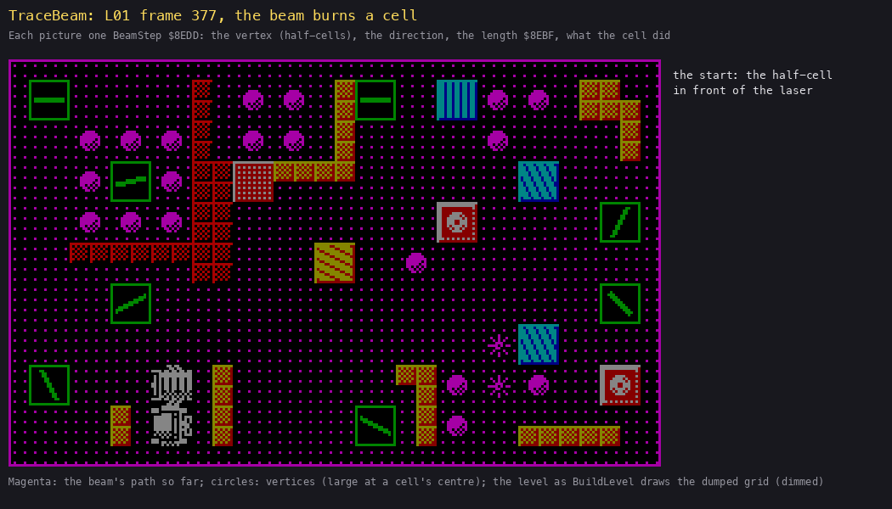

*`L01` frame 377 replayed (`python3 tools/fig_trace.py work/docs/dfA/dump/l01-377.cpu.bin`
`docs/img/logic/trace-burn.gif --title "..."`): 25 steps, 188 552 T. How to read it: as the trace above. The point:
the beam crosses most of the play area and ends at x 22, y 16 (row 7, column 10), a cell: BeamBurn.*

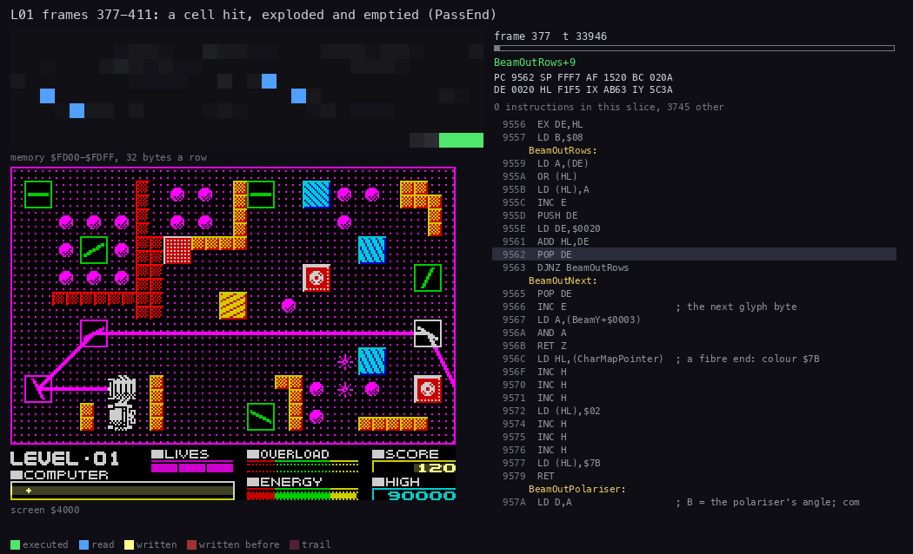

*`L01` frames 377-411, 70 pictures of 33 946 T (`python3 ../../kit/routine_anim.py --work work/docs/dfA/L01 --window`
`377:0-411:0 --listing build/game.lst --view screen --range FD00-FDFF --pc 85AE-865F --pictures 70 --title "..." --out`
`docs/img/logic/PassEnd-burn.gif`). How to read it: top left, LevelGrid `$FD00-$FDFF`, where the cell's byte `$FDA4`
changes; bottom left, the screen; right, PassEnd `$85AE-$865F` with the instruction under way. The point: the cell's
code climbs one step a pass and then goes to 0, and the beam behind it is blocked until it does.*

**Worked example: the cell at row 7, column 10.** The watch over ExplosionSlots `$81B8` and the cell `$FDA4` = `$FD23`
+ 17 x 7 + 10 shows:

| Frame | `$FDA4` | What |
| ---: | --- | --- |
| 378 | `$40` -> slot | the trace hits it: slot 0 = `$FD $A4`, y 16, x 22; 120 points |
| 379 | `$58` | PassEnd: `$57` and then the first frame code; BurnSoundFlag `$57`, BurnSound played |
| 386 | `$59` | SoundFlags bit 3 still on: the hiss |
| 391 | `$5A` | the hiss stops |
| 397 | `$5B` | |
| 403 | `$5C` | |
| 409 | `$00` | emptied; CellsLeft `$13` to `$12`; the slot freed |
| 413 | | the beam, now free, reaches and hits the next cell |

So a cell takes 31 frames (six passes) from the hit to the next hit.

**The last cell.** When CellsLeft reaches 0, PassEnd calls OpenReceiver `$8B3F`. This finds the receiver, puts the
element in front of it into explosion slot 0, sets CellsLeft to `$FF`, plays ReceiverOpenSound and adds 250 points.
The element in front of the receiver is a mine in 23 levels, a wall in 32, a polariser in 4 and a fibre end in 1. It
blows up like a cell, and when its slot empties, CellsLeft is decremented once more, to `$FE`. The receiver's mouth is
now open.

## 10.6 Overload and energy

```asm
UpdateOverload:             ; $A683, once a pass
  LD A,(BeamOnMine)
  AND A
  JR Z,OverloadLaser
  ...                       ; MINE ALERT ($13), then OverloadStep and three OverloadAddStep: 4 steps
OverloadLaser:
  LD A,(BeamInLaser)
  AND A
  JP Z,CoolOverload         ; neither: one step back
  LD A,(SoundFlags)
  SET 2,A                   ; the overload tone on, the mine's off
  RES 1,A
  LD (SoundFlags),A
  ...                       ; OVERLOAD ($12), OverloadStep: 1 step
OverloadAddStep:            ; $A6CD
  ...                       ; the bar full ($54B9): return
  ...                       ; one bit into the byte, SCF; RRA, three lines
  ...                       ; at $54B9: LifeLost = $FF, unless practice
```

The OVERLOAD bar is 8 bytes of 8 pixels: 64 steps. The beam fills it at two speeds:

- **back in the laser** (a mirror square on, or the 40-step beam): 1 step a pass, so 64 passes (about 300 frames)
  before a life is lost;
- **on a mine**: 4 steps a pass, so 16 passes (about 80 frames).

Any pass with neither takes one step back (CoolOverload `$A6F4`). So a brief overload is harmless, and the bar
measures how long the player has left the beam wrong.

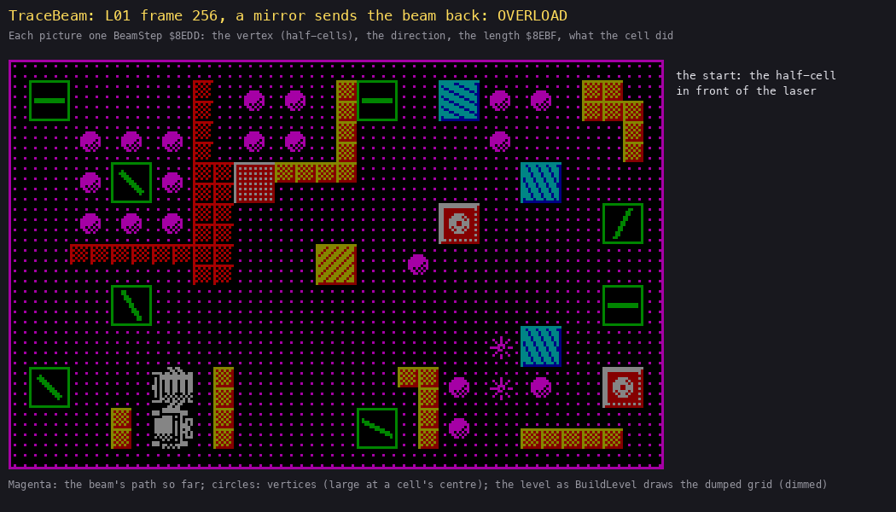

*`L01` frame 256 replayed (`python3 tools/fig_trace.py work/docs/dfA/dump/l01-256.cpu.bin`
`docs/img/logic/trace-overload.gif --title "..."`): 10 steps, 72 309 T. How to read it: as the traces above. The
point: the mirror at row 0, column 0 meets the north-going beam square on. Its answer is the reverse, so BeamVertex
calls BeamBackToLaser, and BeamInLaser is `$FF` at the trace's end.*

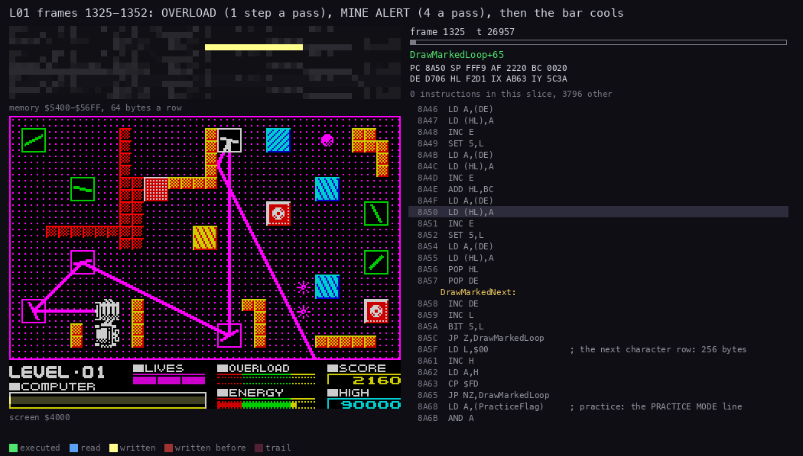

*`L01` frames 1325-1352, 70 pictures of 26 957 T (`python3 ../../kit/routine_anim.py --work work/docs/dfA/L01 --window`
`1325:0-1352:0 --listing build/game.lst --view screen --range 5400-56FF --pc A683-A728 --pictures 70 --title "..."`
`--out docs/img/logic/UpdateOverload.gif`). How to read it: top left, the screen's bytes `$5400-$56FF` (lines 4-6 of
the panel's third, where the bars are); bottom left, the screen; right, UpdateOverload to CoolOverloadStep. The
point: OVERLOAD (frame 1330), then MINE ALERT (1336) add bits to the bar's left byte. When the player turns the beam
off the mine (1345), CoolOverloadStep takes them back one a pass.*

The energy is the level's clock ([doc 8, 8.1](08-hud-and-text.md#81-the-panel)). DrainEnergy `$A613` takes a step off
the ENERGY bar every `rate` frames, the level's first settings byte. The bar is 8 bytes, 64 steps.

| Bar left | What happens |
| --- | --- |
| 2 bytes (`$54F2`) | ENERGY LOW (`$0A`), once |
| 1 byte (`$54F1`) | ENERGY LEVEL CRITICAL (`$0C`), repeated; EnergyCritical `$837E`: the beam flashes (glyph set `$8040`) |
| empty (`$54F0`) | ENERGY DRAINED (`$17`), LifeLost |

```asm
DrainEnergy:                ; $A613, once a pass
  LD A,(LaserCharging)
  AND A
  JP NZ,ChargeLaser         ; still charging: fill instead
  LD A,(EnergyBarPointer)   ; one byte left: critical
  CP $F1
  JR NZ,DrainEnergyTick
  LD A,$FF
  LD (EnergyCritical),A     ; the beam flashes
  ...                       ; CRITICAL ($0C) unless MessageNumber >= $0C
DrainEnergyTick:
  LD A,(EnergyTick)         ; $A506, counted up by the interrupt each frame
EnergyRate:
  CP $64                    ; patched at $A63C: the level's rate
  RET C
  XOR A
  LD (EnergyTick),A
  LD HL,(EnergyBarPointer)  ; a pixel off: the byte shifted left in its three lines
  LD A,(HL)
  SLA A
  LD (HL),A
  INC H
  LD (HL),A
  INC H
  LD (HL),A
  DEC H
  DEC H
  AND A
  RET NZ
  DEC L                     ; the byte empty: one byte left
  LD (EnergyBarPointer),HL
  LD A,L
  CP $F0
  JR Z,EnergyDrained        ; $A66F: ENERGY DRAINED, LifeLost, no test
  CP $F2
  RET NZ
  ...                       ; ENERGY LOW ($0A) unless MessageNumber >= $0A
```

```text
DrainEnergy, once a pass:
    if charging: ChargeLaser; return
    if the pointer is at the last byte ($54F1): EnergyCritical = FF; post CRITICAL if MessageNumber < 0C
    if EnergyTick < rate: return              # the interrupt counts EnergyTick once a frame
    EnergyTick = 0; the bar's byte <<= 1 (three lines)
    if the byte is now 0:
        pointer -= 1
        if pointer == $54F0: ENERGY DRAINED, LifeLost = FF   # a life, in practice too
        elif pointer == $54F2: post ENERGY LOW if MessageNumber < 0A
```

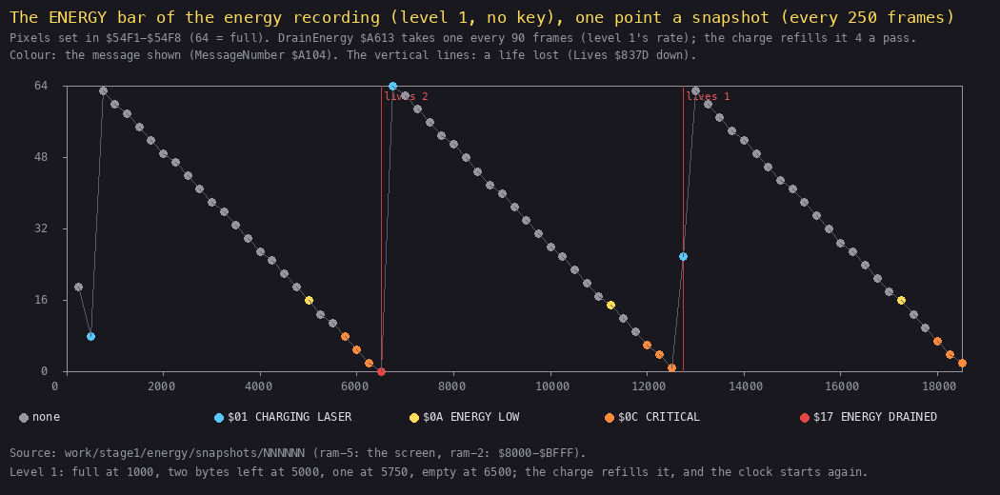

*`energy` (level 1, no key, 18 500 frames), drawn by `python3 tools/fig_logic.py energy
docs/img/logic/energy-course.png` from the recording's snapshots (`work/stage1/energy/snapshots/NNNNNN`, every 250
frames). How to read it: the pixels left in the bar, frame across; the colour is the message shown; a red line is a
life lost. The first point (frame 250) is the panel before the level. The point: the bar falls in a straight line, a
pixel every 90 frames whatever happens on the screen; ENERGY LOW, CRITICAL and DRAINED come at two bytes, one byte
and none; each life lost starts the charge and the same clock again.*

**Worked example: level 1's clock.** The rate is `$5A` = 90 frames, so the level lasts 64 x 90 = 5760 frames: 115
seconds after the charge. The `energy` recording charged at about frame 690 and drained at 6450, which is 5760
frames later. The charge itself takes 32 passes (8 bytes of 4 steps), and it scrambles the mirrors on every pass
(ChargeLaser, [doc 9, 9.6](09-sound.md#96-soundflags-and-the-interrupt) for its sound).

## 10.7 The gremlins

A gremlin ([doc 7, 7.6](07-objects.md#76-the-gremlins-records-and-mover)) appears on a free cell after its delay and
walks a character a pass. On a mirror it may stop and turn the mirror, one step a pass, at random (GremlinTurnMirror
`$AC2D`, 11 188 runs). Each appearance posts BEWARE OF THE GREMLINS (priority 4) unless a more urgent message is shown. The
trace never reads the gremlin records, so a gremlin does not stop the beam. The danger is the mirror it turns,
which can send the beam back into the laser, onto a mine, or off the cells.

The player's weapon is the cursor. CursorFire `$9A57` runs every pass. With fire held, it looks for any gremlin whose
cell (+4, +5) is the cursor's cell, standing or turning a mirror. Each one found is killed:

- its delay becomes `$C8` (200 counts, so it comes back much later);
- its turns and its cell are cleared;
- GremlinSoundFlag is set (PassEnd plays GremlinSound);
- the score gets 160 points.

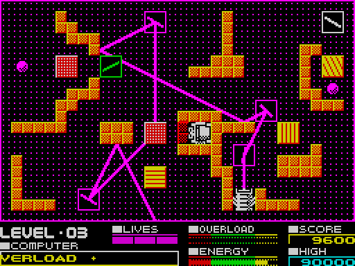

*`L03` frames 1150-1330, every third frame (`python3 ../../kit/screen_anim.py --work work/docs/dfA/L03 --from 1150`
`--to 1330 --step 3 --scale 2 --delay 100 --hold 1500 docs/img/logic/gremlins.gif`). How to read it: the screen as
the player sees it. The gremlins are the dithered magenta blobs. The point: the first gremlin appears at frame 1167
and the second at 1251, and both wander over the cells. The beam meanwhile alternates between the receiver's area
and OVERLOAD as the player turns mirrors: the gremlins and the beam do not interact.*

```asm
  ...                       ; HL = the cursor's cell, $FD12 + 17 (CursorY + 1) + CursorX
  LD A,(GremlinCount)
  AND A
  RET Z
  LD B,A
  LD C,$00                  ; the kills
  LD DE,$0006
  LD IX,Gremlins
CursorFireGremlin:          ; $9AC5
  LD A,(IX+$04)             ; its cell, low and high: only these are compared
  CP L
  JR NZ,CursorFireNext
  LD A,(IX+$05)
  CP H
  JR NZ,CursorFireNext
  XOR A                     ; killed
  LD (IX+$00),$C8
  LD (IX+$01),A
  LD (IX+$05),A
  LD A,$FF
  LD (GremlinSoundFlag),A
  INC C
CursorFireNext:
  ADD IX,DE
  DJNZ CursorFireGremlin
  LD A,C                    ; 16 tens a kill
  ADD A,A
  RET Z
  ADD A,A
  ADD A,A
  ADD A,A
  LD B,A
  CALL AddScore
  RET
```

```text
CursorFire, with fire held:
    cell = the cursor's grid address
    kills = 0
    for each of the GremlinCount records:
        if record.cell (+4, +5) == cell:      # the delay is not looked at
            record.delay = C8; record.turns = 0; record.cell_high = 0
            GremlinSoundFlag = FF; kills += 1
    if kills: AddScore(16 x kills)
```

Since only +4/+5 are compared, a gremlin still waiting, or just appeared and not yet moved, is matched on whatever
cell its record kept from an earlier life or level (+4/+5 are written only by GremlinMove and the kill; [doc 7,
7.6](07-objects.md#76-the-gremlins-records-and-mover)). Fire on that old cell kills it unseen. This is read from the
code; no recording shows it.

**Worked example: a gremlin kill.** Fire with the cursor on the gremlin's cell: the record's +4/+5 must equal the
cursor cell's grid address. In `L03` at frame 1176, record 0 stands on `$FD7B` = `$FD23` + 17 x 5 + 3 (row 5,
column 3) with +4/+5 = `$7B $FD`. A fire then would give +0 = `$C8`, +5 = 0 and 160 points. A gremlin between
cells (+5 = 0, X or Y odd) cannot be hit, so the player must catch it standing on a cell, every other pass at most.

## 10.8 Losing a life

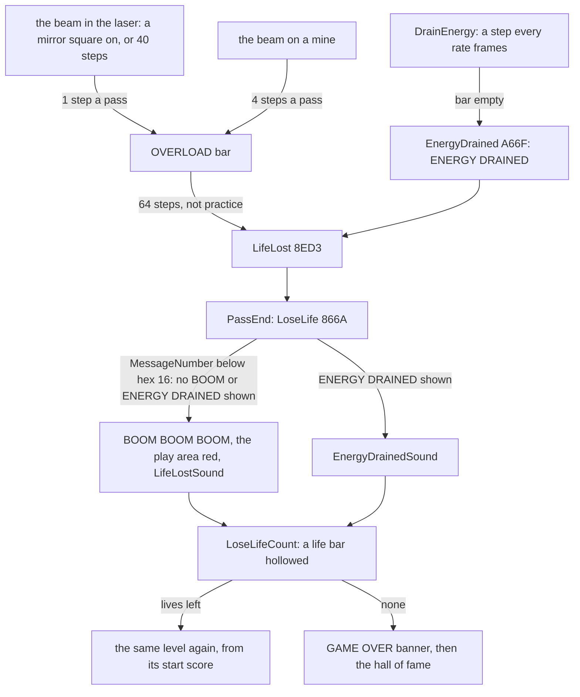

*Every way to lose a life. Witness: LoseLife ran 45 times: `mine`, `overload` and `gameover` (the red screen,
`$8675` 41 times), `energy` (ENERGY DRAINED, `$869A` 4 times), and 36 lives over 26 RZX segments. The point: there
are only two causes, the overload bar and the energy. A mine is not instant death: it only fills the overload bar
four times faster.*

A life lost restarts the level from SetUpLevel: the score goes back to SavedScore (the score at the level's start),
the mirrors are scrambled again by the charge, and the energy is full again. In practice (PracticeFlag `$8407`) a
full overload bar does not stop play (UpdateOverload `$A6E9` sets no LifeLost), while drained energy does: DrainEnergy
sets LifeLost with no practice test (`$A67C`), LoseLife shows ENERGY DRAINED, and LoseLifeCount `$86A0` skips the life
itself, so the level restarts with the same lives. The practice slots' rate is 255, so that takes 64 x 255 = 16 320
frames.

## 10.9 Level complete, the bonus and the ending

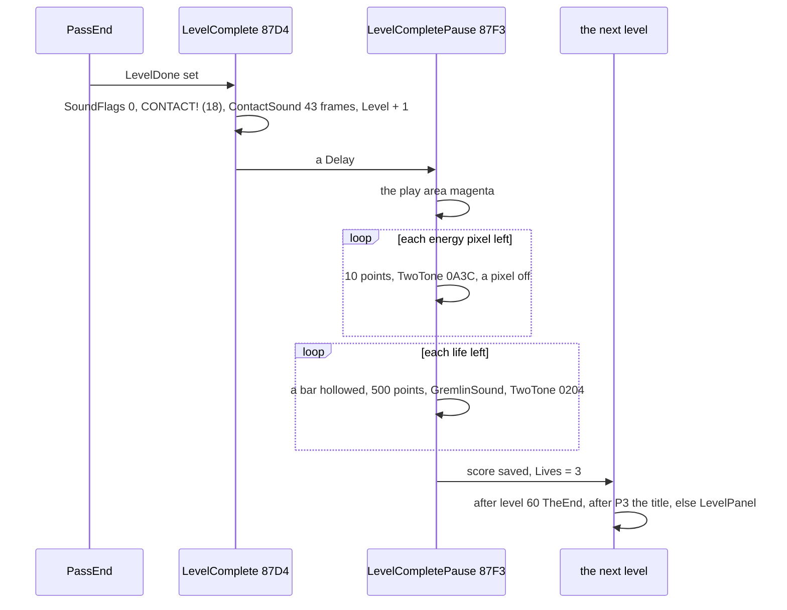

*LevelComplete and its bonus. Witness: `L01` frames 1515-1645 (doc 8's bonus watch) and the 18 completions of the RZX
run. The point: a quick finish is paid twice, by the energy left (10 points a pixel, up to 640) and by the lives
left (500 each). Every level then starts with three lives again, so a life lost costs only its 500-point bonus and
the level's progress.*

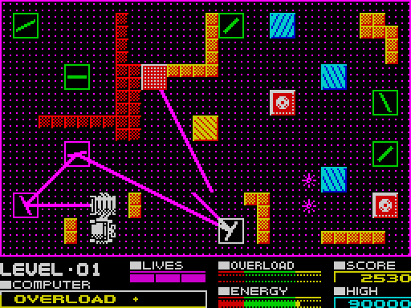

*`L01` frames 1508-1645, every third frame (`python3 ../../kit/screen_anim.py --work work/docs/dfA/L01 --from 1508`
`--to 1645 --step 3 --scale 2 --delay 120 --hold 2000 docs/img/logic/level-complete.gif`). How to read it: the screen
as the player sees it. The point: the last turn (frame 1513), the beam into the receiver, CONTACT! on the line, the
play area turning magenta, and the energy bar counted into the score.*

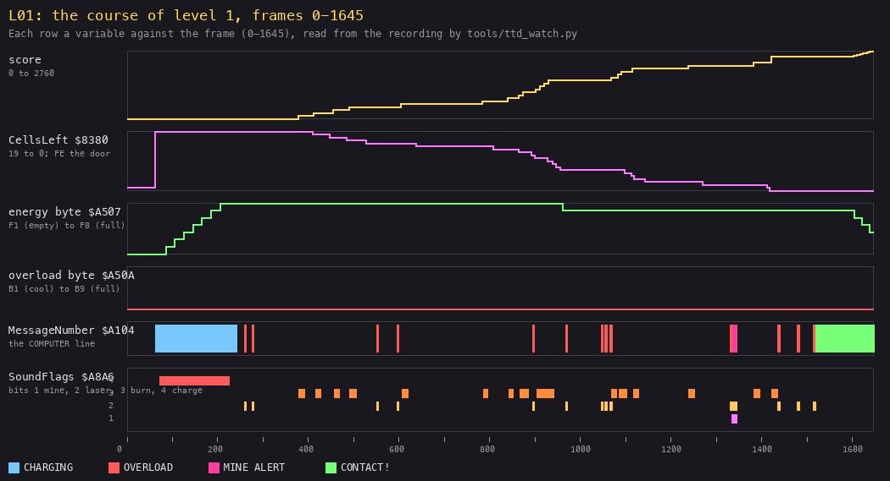

*`L01` frames 0-1645, drawn by `python3 tools/fig_course.py work/docs/dfA/l01-course.txt docs/img/logic/course-l01.png`
`--title "..."` from `python3 tools/ttd_watch.py --work work/docs/dfA/L01 --addr`
`8380,9B3F,9B40,9B41,9B42,A507,A50A,A104,A8A6 --from 0 --to 1645 --step 1`. How to read it: one row a variable, frame
across. The point: the whole level in one picture.*

- *The charge fills the energy byte by byte up to frame 225, with SoundFlags bit 4 on.*
- *The cells go one by one, each a step of the score and of CellsLeft, with a burst of bit 3 (the hiss).*
- *OVERLOAD comes in short spells (red), and the bar never leaves its first byte (`$B1`).*
- *MINE ALERT comes once (1336).*
- *CellsLeft reaches 0, the door opens (`$FE`), and CONTACT! (green) is followed by the bonus, where the score
  climbs in small steps and the energy byte falls.*
- *The energy lost only one byte in 1300 frames of play (rate 90, so 8 steps a byte = 720 frames).*

**Worked example: level 1's score.** Level 1 has 19 cells and fewer than 30, so a cell is worth 120 points.

- 19 x 120 = 2280, and the receiver opening adds 250: 2530 at CONTACT! (frame 1518, doc 8).
- The energy left was 7 bytes and some pixels (the pointer at `$F7`). Each pixel is 10 points, counted from frame
  1599.
- Then the three lives: 3 x 500 = 1500.

**The ending.** After level 60, LevelCompletePause jumps to TheEnd `$8885`:

- it clears the full-screen buffer and draws the ending (EndingScreen `$A8CE`, which itself plays ChargedSound once,
  at `$A949`, after twelve Delays);
- it plays ChargedSound twice more (`$8896`, `$889C`), waits until no key is held, and plays the title tune;
- it returns to the title, where the hall of fame takes the score.

The ending was seen only in `rzx-344752` and the stage-2 `ending` recording. `ending` runs on a clone: it starts at
level 60's CONTACT! on the bot's state `lv2/L61.szx`, where level 60 was completed by the LevelDone POKE
([WALKTHROUGH 6.0](../WALKTHROUGH.md#60-the-recordings)).

## 10.10 The solver as a reading of TraceBeam

`tools/solver.py` (the case's level player, [doc 1, 1.7](01-game-design.md#17-how-a-level-is-solved)) needs no model
of the rules. It copies the running game's 64 K and sets one mirror to a trial angle in LevelGrid. It renders the
character map, because the walls and polarisers are decided by characters, and then runs TraceBeam `$8ED6` in
SkoolKit's simulator from the start MainLoop gives it. The copy's memory is the answer:

- the cells hit are the explosion slots `$81B8` filled;
- LevelDone `$8ED2` means the receiver was reached;
- BeamOnMine `$8ED4` means a mine;
- BeamInLaser `$8ED5` means the laser, or a 40-step beam.

It tries the mirrors the beam met, keeps a turn that burns a cell (or, with none left, reaches the receiver) without a
mine or the laser, and walks the cursor there. `tools/fig_trace.py` is the same idea drawn: the figures of this
document are TraceBeam's own answers, not a re-implementation.

## 10.11 Notable features

- **The beam is the whole game state.** The trace is re-run from the laser on every pass. Nothing remembers where
  the beam went: turning a mirror changes the next pass's path at once.
- **The cells are both targets and walls.** A burning cell blocks the beam for six passes, so a line of cells is
  burnt one at a time, front to back.
- **The 40-step limit makes long paths costly.** A detour through many mirrors overloads the laser on every pass.
- **Odd and even mirrors.** Only odd codes can reflect a beam square back (10.3).
- **Two drawing models.** The grid decides at a cell's centre, the characters between. So the walls have quarter
  shapes that the beam can graze or clip.
- **The randomness** of the play is in three places: the prism, the charge's mirror scramble and the gremlins. All
  of them use the one Random `$8E15`, whose seed the options panel advances while it waits for a key. The wipe's
  corner (WipeIn `$8CAD`) and the burning noise (PlayNoise, the call at `$A896`) draw on the same generator, so every
  wipe and every hiss also moves it.
- **Lives reset at every level** (Lives = 3 in LevelCompletePause). A game over needs all three lost in one level.

## 10.12 What is known only from the code

- The 150-step stop of BeamLengthCheck: the recordings reach 40 steps; how often a trace ran on to 150 was not
  counted.
- FibreNoPartner `$9059`: no level lacks a partner.
- InCornerTable `$8100` (a diagonal beam bouncing in the incoming pass, ReflectInCorner `$93F2`): no play reads it.
  The outgoing pass of each vertex already tests the character the next vertex's incoming pass meets, so only the
  trace's first vertex can reach `$93F2`, and that vertex is the laser's front, on an axis. A search in SkoolKit's
  simulator over level 1 (`work/docs/integrate/corner_search.py`, `corner_level1.py`: mirrors turning the beam onto
  a diagonal with a reflecting wall in its way, and every start vertex) found hits only at the first vertex. The clone
  `corner` (`work/docs/integrate/rec/corner`: `game0.szx` with the beam's start `$8376-$8378` POKEd to x 10, y 16,
  direction 10) shows it: 342 passes run `$93F2`, the wall beside the laser is the one wall found, and the beam is
  turned a quarter, to direction 14.

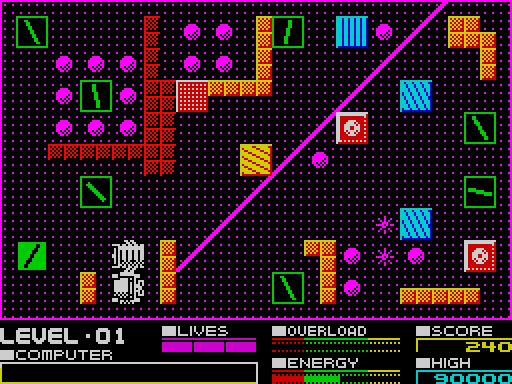

*`corner` at frame 750 (`python3 tools/scr_png.py work/docs/integrate/rec/corner/screens/000750.scr
docs/img/logic/reflect-in-corner.png`). How to read it: level 1 on the clone; the beam starts at the reflecting wall
right of the laser. The point: the beam set off north-west leaves north-east: InCornerTable's "one wall" answer, a
quarter turn.*
- The codes `$3F` and `$43-$46` (a cell and lasers no level holds): the trace treats them as a cell and as lasers.
- A gremlin killed while standing on a mirror it is turning: the kill clears +1, so the turn stops (no recording
  shows it).
- A gremlin killed on a stale cell (10.7): its +4/+5 from an earlier life or level matched while it waits.
- The outgoing bounce counter's 40 and 150 (`$96B8`): the recordings never passed 39 bounces at one vertex.
- The wall bounces have no dump of their own: the worked example of 10.3 is an experiment on `L01`'s frame 1514; the
  recordings witness the routines by their run counts only.
