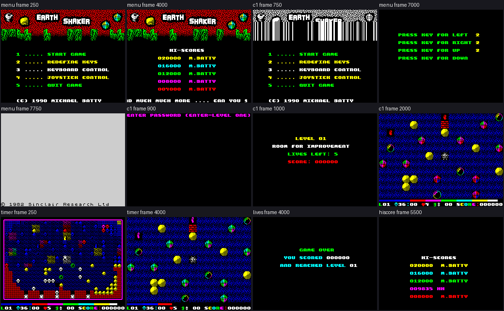
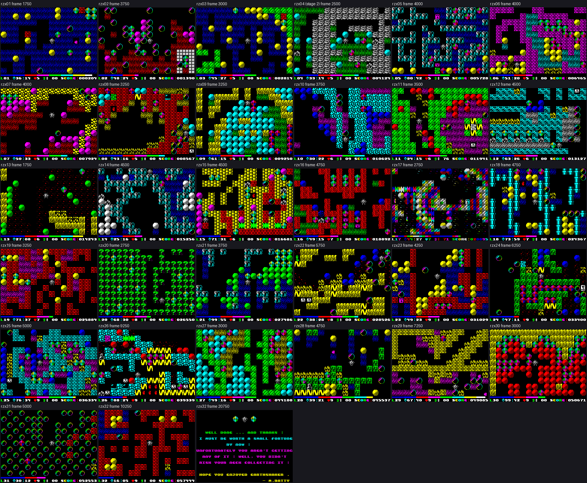

# Earth Shaker: walkthrough

How the reverse was done, step by step, and which unreal-ng call answered each question. Terms:
[docs/README.md](docs/README.md). Recipes: `../recipes/`.

Every recording is named with its load (ROM speed or the fast LD-BYTES trap) beside every frame number.

## 0. The medium

The case starts from ZXDB 1563 (Earth Shaker, Your Sinclair, 1990, Michael Batty). The game was never sold on its
own: it came on the Your Sinclair issue 63 covertape, so the original is that tape, `orig/YSIssue63-SixPack.tzx.zip`
from ZXDB's magazine folder (hashes in [README](README.md)). Its Side 1 holds Earth Shaker as TZX blocks 9-13.

Every other copy found locally (69 files: ZXDB, zxart, TOSEC 2020 and Knobchez 2026, the TOSEC MDR pack, Pardubak)
was copied unchanged into `work/candidates/<source>/` and compared with the two data blocks of the original by
`tools/media_compare.py` (block by block for tapes, the whole file for disks, `$6D42-$FFFF` for snapshots and the RZX
snapshots; `work/stage1/media-compare.txt`). Every TZX dump of the covertape and every cut-out copy holds the same
107-byte BASIC and the same 37 566-byte game block; the WoS TAP is a re-save (another BASIC and header names, the
same game block); the TR-DOS and Microdrive files are conversions, packed or relocated. The table is in the README.

The tape is plain: a BASIC loader and one CODE block, both at ROM speed, no loading screen
([doc 3.1](docs/03-build-and-load.md#31-the-tape-block-by-block)). `tools/image.py` builds the image as loaded
(`work/mkgame/original.bin`, the `case.json` image) from the side's blocks. One unreal-ng detail: its tape
catalogue lists the data blocks only, so the BASIC header that is TZX block 10 is catalogue block 7, the block
`tools/rs_capture.py` and `tools/lab.py` wind to (`/tape/seek`).

## 1. One recording from power-on

`c1` (`tools/rs_capture.py`, inputs `tests/inputs/c1.txt`, port base 37100): a 48K at power-on, the Side 1 TZX
inserted with the fast LD-BYTES trap and turbo off (`fast_tape` and `turbo_tape` PUT false, checked in
`/tape`), the TTD recording on from frame 0. With the recording on, the inserted tape appears in `/tape` only
after frames run, so the capture runs 200 frames first, then winds to catalogue block 7, types `LOAD ""`, plays
the tape and stops it at frame 11 800 (the side goes on with the Switchblade demo). The game's code runs first at
frame 11222, T 46761 (ROM speed; the L1 arrival at GameEntry `$8B20` from USR at `$34BB`, `arrivals[0]` of
`c1/l1.json`; [doc 3.3](docs/03-build-and-load.md#33-from-power-on-to-the-first-pass)): the menu. Then 3850 frames of input:
4 (joystick), 3 (keyboard), 2 and the five keys O P Q A M, 1 (start), ENTER at the password prompt (cave 1), play
with the keys, F (no map: the F at 13 550 fell in the death and the intro, so ShowMap never runs in `c1`; the map is
in `timer`), H (quit the cave: a life lost), G (abort to the menu). `c1/screens.png` shows the menu,
cave 1, the intro screens with 5, 4 and 3 lives and the menu again. 15 650 frames, `c1/session.ttd`.

Interrupts, a first look (L1 of `c1`, `menu`, `lives`, `rzx-earth01`):

- IM 1 (`im 1`, I = `$3F` in the register reads of `rzx-earth01` at its end and of the replay probes; the only IM instruction that runs is the ROM's `IM 1` at `$122E`, at power-on and after 5 quits; the L1 lists hold no `ED 5E`), so the ROM's handler at `$0038` runs each frame while
  interrupts are on: it counts FRAMES and scans the keyboard (the RZX's port reads at PC `$0296` every frame).
- No HALT runs in any recording (the L1 instruction lists hold no `$76`; the `$76` bytes at `$9A22`, `$B7C5`,
  `$B7DD` and `$BF02` are graphics and never run), and no game code reads FRAMES (its reads equal the ROM
  handler's writes). The game never waits for the frame: a pass of the cave takes as long as its work.
- Interrupts go off only around sound: the tune player `$88CE` (DI at `$88CE`, `$88E2`, `$88F8`, EI at `$890E`
  when a key 1-5 ends the tune), the jingles and effects `$86AD-$86D1`, `$8702-$871A`, `$8736-$8757` (DI, the
  ROM's BEEPER `$03B5`, EI) and a few short ones (`$8DE3-$8DFD`, `$9072-$908F`, `$9207`, `$921A`, `$A713-$A749`,
  `$E740-$E77A`, `$E7A9-$E7E3`). So `rzx-earth01`'s 3803 frames took 2898 interrupts: the rest fell while a tune
  or a jingle held them off.
- The pass: the player's controls are read once a pass, the left key (or Kempston) at `$83C3`, right `$8437`, up
  `$84AD`, down `$84F9`, fire `$8759`, abort G `$93A8`, quit H `$872D`, each a self-modified
  `LD A,row; OUT ($FF),A; IN A,($FE); AND mask` whose row and mask the redefine menu writes. In the RZX archive's
  `earth01` the reads of `$83C3` come every 5 frames (247 passes), 6 (224), 7 (33) or 8 (5): a pass is 5 to 8
  frames of work in cave 1.

The pass in our own instance (`tools/passes.py`: 300 passes from one `$8759` to the next with `/skip_until`,
timed by `/video/beam`, no key held, from each state after its intro; `work/stage1/passes.json`):

| State | Median T a pass | Frames (median) | Heaviest pass | Frames |
| --- | --- | --- | --- | --- |
| cave 1 (`probe/level1.szx`) | 383 966 | 5.49 | 396 012 (pass 49) | 5.67 |
| cave 2 (`earth02` start) | 396 280 | 5.67 | 407 942 | 5.84 |
| cave 8 | 427 966 | 6.12 | 438 869 | 6.28 |
| cave 16 | 429 487 | 6.15 | 440 266 | 6.30 |
| cave 24 | 523 644 | 7.49 | 650 218 (pass 8) | 9.30 |
| cave 32 | 394 366 | 5.64 | 405 800 | 5.81 |

So a pass is 5.5 to 7.5 frames of work, more with more moving objects (cave 24 the slowest of these); the heaviest
pass measured is 9.3 frames, in cave 24. The spread of about 12 000 T between passes in one cave comes from the
interrupts that land in a pass and the objects that move.

## 2. Static pass over the medium

## 3. The stages and the packers

## 4. The medium from source

## 5. Tool gaps found and fixed in unreal-ng

| Gap | Fix | unreal-ng commit |
| --- | --- | --- |

## 6. The game

### 6.0 The recordings

Every recording keeps its `session.ttd` in its work folder (the column below); the list with how each was made is in
`work/stage1/NOTES.md` and `work/stage2/NOTES.md`. Every command runs from the case folder after `. work/env.sh`;
each `$RS capture` also takes `--model 48K --ranges 4000-FFFF --binary $BIN` (the scripts `work/stage1/rzx/capture_all.sh` and
`work/stage1/extra.sh` hold them whole). Every instance was muted and stopped after its run.

The writers of docs 01-10 made no new recording: they reopened these sessions in their own work folders
(`work/docs/es*/<name>/`; esA on port base 37150, esB 37160, esD 37180) to trace and animate them.
esB's control experiments (doc 5.3, cases A-D) ran on clones of `work/stage1/probe/after-load.szx`
(`python3 work/docs/esB/exp_controls.py`), not as recordings.

| Recording | `session.ttd` | Start | Input | Command | Frames | What it reaches |
| --- | --- | --- | --- | --- | --- | --- |
| `c1` | `work/stage1/c1/session.ttd` | power-on, the tape at ROM speed | `tests/inputs/c1.txt` | `python3 tools/rs_capture.py --work work/stage1/c1 --media "work/media/Your Sinclair (Issue 63) - Side 1.tzx" --model 48K --record-load --load-frames 11800 --inputs tests/inputs/c1.txt --port-base 37100 --binary $BIN` | 15 650 | the load (the game code from frame 11222), the menu, every menu key but 5, cave 1 with one boulder crush (13 208), quit, abort (the F at 13 550 fell in the death and the intro: ShowMap never runs in `c1`; the map is in `timer`) |
| `menu` | `work/stage1/menu/session.ttd` | `work/stage1/probe/after-load.szx` (the menu after `c1`'s load, ROM speed) | `tests/inputs/menu.txt` | `$RS capture --work work/stage1/menu --snapshot work/stage1/probe/after-load.szx --inputs tests/inputs/menu.txt --port-base 37100` | 7915 | the title tune to its end, the hi-score table under the scroller, the menu again, 4, 3, 2 with the five keys, 5 (quit: `JP 0`, the ROM's copyright screen) |
| `lives` | `work/stage1/lives/session.ttd` | the same | `tests/inputs/lives.txt` | `$RS capture --work work/stage1/lives --snapshot work/stage1/probe/after-load.szx --inputs tests/inputs/lives.txt --port-base 37100` | 6975 | cave 1 and H again and again: five lives lost, the game over, the menu |
| `hiscore` | `work/stage1/hiscore/session.ttd` | the RZX's `earth10` start snapshot (cave 10, score 009 835) | `tests/inputs/hiscore.txt` | `$RS capture --work work/stage1/hiscore --snapshot work/stage1/rzx/start/earth10.rzx.001.z80 --inputs tests/inputs/hiscore.txt --port-base 37110` | 9688 | H until the lives are gone, the game over with the score, the hi-score entry (the table shows 009835 with the name "HHAGENT": H held 10 frames is typed twice, KeyClick lasts 7.65 frames and WaitKey has no release wait; ENTER at 6685), the table |
| `timer` | `work/stage1/timer/session.ttd` | `probe/level1.szx` (cave 1 in play) | `tests/inputs/timer.txt` | `$RS capture --work work/stage1/timer --snapshot work/stage1/probe/level1.szx --inputs tests/inputs/timer.txt --port-base 37110` | 12 000 | F: the whole cave as a map; then no key: the time bar under the play window runs out and a life is lost (5 -> 4) |
| `rzx-earth01` | `work/stage1/rzx01/session.ttd` | the RZX archive's `earth01.rzx` start snapshot (the menu) | `tests/inputs/rzx-earth01.txt` (`tools/rzx_align.py`) | `$RS capture --work work/stage1/rzx01 --snapshot work/stage1/rzx/start/earth01.rzx.001.z80 --inputs tests/inputs/rzx-earth01.txt --port-base 37100` | 3803 | cave 1 played and finished by the RZX's player, cave 2's intro |
| `rzx-earth02` | `work/stage1/rzx02/session.ttd` | `earth02` start snapshot | `tests/inputs/rzx-earth02.txt` | `$RS capture --work work/stage1/rzx02 --snapshot work/stage1/rzx/start/earth02.rzx.001.z80 --inputs tests/inputs/rzx-earth02.txt --port-base 37100` | 7661 | cave 2 finished, cave 3's intro; score 002080, `$FD93` 5 |
| `rzx-earth03` | `work/stage1/rzx03/session.ttd` | `earth03` start snapshot | `tests/inputs/rzx-earth03.txt` | `$RS capture --work work/stage1/rzx03 --snapshot work/stage1/rzx/start/earth03.rzx.001.z80 --inputs tests/inputs/rzx-earth03.txt --port-base 37100` | 6395 | cave 3 finished, cave 4's intro; score 003412, `$FD93` 5 |
| `rzx-earth04` | `work/stage2/rzx04/cap/session.ttd` | `earth04` start snapshot | `tests/inputs/rzx-earth04.txt` (stage 2: `tools/rzx_align.py` with the tie fix) | `$RS capture --work work/stage2/rzx04/cap --snapshot work/stage1/rzx/start/earth04.rzx.001.z80 --inputs tests/inputs/rzx-earth04.txt --port-base 37120` | 5106 | cave 4 finished, cave 5 reached: CaveNumber `$FD91` 5, Lives `$FD93` 5 (stage 2 NOTES 3.10; it replaces stage 1's `work/stage1/rzx04`, 6858 frames, where the aligner pinned itself at frame 2344 and the player ran out of time) |
| `rzx-earth05` | `work/stage1/rzx05/session.ttd` | `earth05` start snapshot | `tests/inputs/rzx-earth05.txt` | `$RS capture --work work/stage1/rzx05 --snapshot work/stage1/rzx/start/earth05.rzx.001.z80 --inputs tests/inputs/rzx-earth05.txt --port-base 37100` | 8309 | cave 5 finished, cave 6's intro; score 006265, `$FD93` 5 |
| `rzx-earth06` | `work/stage1/rzx06/session.ttd` | `earth06` start snapshot | `tests/inputs/rzx-earth06.txt` | `$RS capture --work work/stage1/rzx06 --snapshot work/stage1/rzx/start/earth06.rzx.001.z80 --inputs tests/inputs/rzx-earth06.txt --port-base 37100` | 8283 | cave 6 finished, cave 7's intro; score 007116, `$FD93` 5 |
| `rzx-earth07` | `work/stage1/rzx07/session.ttd` | `earth07` start snapshot | `tests/inputs/rzx-earth07.txt` | `$RS capture --work work/stage1/rzx07 --snapshot work/stage1/rzx/start/earth07.rzx.001.z80 --inputs tests/inputs/rzx-earth07.txt --port-base 37100` | 8120 | cave 7 finished, cave 8's intro; score 008223, `$FD93` 5 |
| `rzx-earth08` | `work/stage1/rzx08/session.ttd` | `earth08` start snapshot | `tests/inputs/rzx-earth08.txt` | `$RS capture --work work/stage1/rzx08 --snapshot work/stage1/rzx/start/earth08.rzx.001.z80 --inputs tests/inputs/rzx-earth08.txt --port-base 37100` | 6892 | cave 8 finished, cave 9's intro; score 009190, `$FD93` 5 |
| `rzx-earth09` | `work/stage1/rzx09/session.ttd` | `earth09` start snapshot | `tests/inputs/rzx-earth09.txt` | `$RS capture --work work/stage1/rzx09 --snapshot work/stage1/rzx/start/earth09.rzx.001.z80 --inputs tests/inputs/rzx-earth09.txt --port-base 37100` | 6659 | cave 9 finished, cave 10's intro; score 009835, `$FD93` 6 |
| `rzx-earth10` | `work/stage1/rzx10/session.ttd` | `earth10` start snapshot | `tests/inputs/rzx-earth10.txt` | `$RS capture --work work/stage1/rzx10 --snapshot work/stage1/rzx/start/earth10.rzx.001.z80 --inputs tests/inputs/rzx-earth10.txt --port-base 37100` | 7530 | cave 10 finished, cave 11's intro; score 011091, `$FD93` 6 |
| `rzx-earth11` | `work/stage1/rzx11/session.ttd` | `earth11` start snapshot | `tests/inputs/rzx-earth11.txt` | `$RS capture --work work/stage1/rzx11 --snapshot work/stage1/rzx/start/earth11.rzx.001.z80 --inputs tests/inputs/rzx-earth11.txt --port-base 37100` | 7331 | cave 11 finished, cave 12's intro; score 012583, `$FD93` 6 |
| `rzx-earth12` | `work/stage1/rzx12/session.ttd` | `earth12` start snapshot | `tests/inputs/rzx-earth12.txt` | `$RS capture --work work/stage1/rzx12 --snapshot work/stage1/rzx/start/earth12.rzx.001.z80 --inputs tests/inputs/rzx-earth12.txt --port-base 37100` | 9351 | cave 12 finished, cave 13's intro; score 014043, `$FD93` 6 |
| `rzx-earth13` | `work/stage1/rzx13/session.ttd` | `earth13` start snapshot | `tests/inputs/rzx-earth13.txt` | `$RS capture --work work/stage1/rzx13 --snapshot work/stage1/rzx/start/earth13.rzx.001.z80 --inputs tests/inputs/rzx-earth13.txt --port-base 37100` | 3818 | cave 13 finished, cave 14's intro; score 014884, `$FD93` 6 |
| `rzx-earth14` | `work/stage1/rzx14/session.ttd` | `earth14` start snapshot | `tests/inputs/rzx-earth14.txt` | `$RS capture --work work/stage1/rzx14 --snapshot work/stage1/rzx/start/earth14.rzx.001.z80 --inputs tests/inputs/rzx-earth14.txt --port-base 37100` | 9244 | cave 14 finished, cave 15's intro; score 016488, `$FD93` 6 |
| `rzx-earth15` | `work/stage1/rzx15/session.ttd` | `earth15` start snapshot | `tests/inputs/rzx-earth15.txt` | `$RS capture --work work/stage1/rzx15 --snapshot work/stage1/rzx/start/earth15.rzx.001.z80 --inputs tests/inputs/rzx-earth15.txt --port-base 37100` | 9175 | cave 15 finished, cave 16's intro; score 017473, `$FD93` 7 |
| `rzx-earth16` | `work/stage1/rzx16/session.ttd` | `earth16` start snapshot | `tests/inputs/rzx-earth16.txt` | `$RS capture --work work/stage1/rzx16 --snapshot work/stage1/rzx/start/earth16.rzx.001.z80 --inputs tests/inputs/rzx-earth16.txt --port-base 37100` | 9728 | cave 16 finished, cave 17's intro; score 020425, `$FD93` 7 |
| `rzx-earth17` | `work/stage1/rzx17/session.ttd` | `earth17` start snapshot | `tests/inputs/rzx-earth17.txt` | `$RS capture --work work/stage1/rzx17 --snapshot work/stage1/rzx/start/earth17.rzx.001.z80 --inputs tests/inputs/rzx-earth17.txt --port-base 37100` | 5978 | cave 17 finished, cave 18's intro; score 021983, `$FD93` 7 |
| `rzx-earth18` | `work/stage1/rzx18/session.ttd` | `earth18` start snapshot | `tests/inputs/rzx-earth18.txt` | `$RS capture --work work/stage1/rzx18 --snapshot work/stage1/rzx/start/earth18.rzx.001.z80 --inputs tests/inputs/rzx-earth18.txt --port-base 37100` | 9517 | cave 18 finished, cave 19's intro; score 025514, `$FD93` 7 |
| `rzx-earth19` | `work/stage1/rzx19/session.ttd` | `earth19` start snapshot | `tests/inputs/rzx-earth19.txt` | `$RS capture --work work/stage1/rzx19 --snapshot work/stage1/rzx/start/earth19.rzx.001.z80 --inputs tests/inputs/rzx-earth19.txt --port-base 37100` | 6642 | cave 19 finished, cave 20's intro; score 026250, `$FD93` 8 |
| `rzx-earth20` | `work/stage1/rzx20/session.ttd` | `earth20` start snapshot | `tests/inputs/rzx-earth20.txt` | `$RS capture --work work/stage1/rzx20 --snapshot work/stage1/rzx/start/earth20.rzx.001.z80 --inputs tests/inputs/rzx-earth20.txt --port-base 37100` | 5728 | cave 20 finished, cave 21's intro; score 026936, `$FD93` 8 |
| `rzx-earth21` | `work/stage1/rzx21/session.ttd` | `earth21` start snapshot | `tests/inputs/rzx-earth21.txt` | `$RS capture --work work/stage1/rzx21 --snapshot work/stage1/rzx/start/earth21.rzx.001.z80 --inputs tests/inputs/rzx-earth21.txt --port-base 37100` | 7548 | cave 21 finished, cave 22's intro; score 027938, `$FD93` 8 |
| `rzx-earth22` | `work/stage1/rzx22/session.ttd` | `earth22` start snapshot | `tests/inputs/rzx-earth22.txt` | `$RS capture --work work/stage1/rzx22 --snapshot work/stage1/rzx/start/earth22.rzx.001.z80 --inputs tests/inputs/rzx-earth22.txt --port-base 37100` | 11551 | cave 22 finished, cave 23's intro; score 030219, `$FD93` 9 |
| `rzx-earth23` | `work/stage1/rzx23/session.ttd` | `earth23` start snapshot | `tests/inputs/rzx-earth23.txt` | `$RS capture --work work/stage1/rzx23 --snapshot work/stage1/rzx/start/earth23.rzx.001.z80 --inputs tests/inputs/rzx-earth23.txt --port-base 37100` | 8923 | cave 23 finished, cave 24's intro; score 031890, `$FD93` 9 |
| `rzx-earth24` | `work/stage1/rzx24/session.ttd` | `earth24` start snapshot | `tests/inputs/rzx-earth24.txt` | `$RS capture --work work/stage1/rzx24 --snapshot work/stage1/rzx/start/earth24.rzx.001.z80 --inputs tests/inputs/rzx-earth24.txt --port-base 37100` | 12620 | cave 24 finished, cave 25's intro; score 035238, `$FD93` 9 |
| `rzx-earth25` | `work/stage1/rzx25/session.ttd` | `earth25` start snapshot | `tests/inputs/rzx-earth25.txt` | `$RS capture --work work/stage1/rzx25 --snapshot work/stage1/rzx/start/earth25.rzx.001.z80 --inputs tests/inputs/rzx-earth25.txt --port-base 37100` | 10250 | cave 25 finished, cave 26's intro; score 037883, `$FD93` 9 |
| `rzx-earth26` | `work/stage1/rzx26/session.ttd` | `earth26` start snapshot | `tests/inputs/rzx-earth26.txt` | `$RS capture --work work/stage1/rzx26 --snapshot work/stage1/rzx/start/earth26.rzx.001.z80 --inputs tests/inputs/rzx-earth26.txt --port-base 37100` | 18581 | cave 26 finished, cave 27's intro; score 043900, `$FD93` 9 |
| `rzx-earth27` | `work/stage1/rzx27/session.ttd` | `earth27` start snapshot | `tests/inputs/rzx-earth27.txt` | `$RS capture --work work/stage1/rzx27 --snapshot work/stage1/rzx/start/earth27.rzx.001.z80 --inputs tests/inputs/rzx-earth27.txt --port-base 37100` | 6483 | cave 27 finished, cave 28's intro; score 044592, `$FD93` 9 |
| `rzx-earth28` | `work/stage1/rzx28/session.ttd` | `earth28` start snapshot | `tests/inputs/rzx-earth28.txt` | `$RS capture --work work/stage1/rzx28 --snapshot work/stage1/rzx/start/earth28.rzx.001.z80 --inputs tests/inputs/rzx-earth28.txt --port-base 37100` | 9773 | cave 28 finished, cave 29's intro; score 047343, `$FD93` 9 |
| `rzx-earth29` | `work/stage1/rzx29/session.ttd` | `earth29` start snapshot | `tests/inputs/rzx-earth29.txt` | `$RS capture --work work/stage1/rzx29 --snapshot work/stage1/rzx/start/earth29.rzx.001.z80 --inputs tests/inputs/rzx-earth29.txt --port-base 37100` | 14620 | cave 29 finished, cave 30's intro; score 050251, `$FD93` 9 |
| `rzx-earth30` | `work/stage1/rzx30/session.ttd` | `earth30` start snapshot | `tests/inputs/rzx-earth30.txt` | `$RS capture --work work/stage1/rzx30 --snapshot work/stage1/rzx/start/earth30.rzx.001.z80 --inputs tests/inputs/rzx-earth30.txt --port-base 37100` | 6154 | cave 30 finished, cave 31's intro; score 051525, `$FD93` 9 |
| `rzx-earth31` | `work/stage1/rzx31/session.ttd` | `earth31` start snapshot | `tests/inputs/rzx-earth31.txt` | `$RS capture --work work/stage1/rzx31 --snapshot work/stage1/rzx/start/earth31.rzx.001.z80 --inputs tests/inputs/rzx-earth31.txt --port-base 37100` | 10024 | cave 31 finished, cave 32's intro; score 054296, `$FD93` 9 |
| `rzx-earth32` | `work/stage1/rzx32/session.ttd` | `earth32` start snapshot | `tests/inputs/rzx-earth32.txt` | `$RS capture --work work/stage1/rzx32 --snapshot work/stage1/rzx/start/earth32.rzx.001.z80 --inputs tests/inputs/rzx-earth32.txt --port-base 37100` | 20931 | the win screen ("WELL DONE ... AND THANKS !"); score 061941, `$FD93` 9 |
| `death-crush` | `work/stage2/death-crush/session.ttd` | `probe/level1.szx` (cave 1 in play) | `tests/inputs/death-crush.txt` (`tools/move_script.py --moves Q,Q,A --tail 250`) | `$RS capture --work work/stage2/death-crush --snapshot work/stage1/probe/level1.szx --inputs tests/inputs/death-crush.txt --port-base 37120` | 265 | up twice under the boulder at row 6, column 15, down once: the boulder falls on the player (Crush, DeathView 27, DeathSound 30); lives 5 -> 4 |
| `death-fire` | `work/stage2/death-fire/session.ttd` | `earth04` start snapshot (cave 4) | `tests/inputs/death-fire.txt` (`tools/move_script.py --moves KL --tail 250`) | `$RS capture --work work/stage2/death-fire --snapshot work/stage1/rzx/start/earth04.rzx.001.z80 --inputs tests/inputs/death-fire.txt --port-base 37120` | 530 | one step left into the fire at row 19, column 2: WalkIntoFire (frame 279, through LeftSpecial `$94D6`), DeathSound 288; lives 5 -> 4 |

The `rzx-earthNN` recordings replay someone else's play (the RZX archive, said so in the README): SkoolKit plays
each RZX and logs every port read and the state `$FD7E-$FFFF` each frame (`tools/rzx_inputs.py`); our instance then
runs one frame a call from the RZX's start snapshot with the keys of the RZX frame it matches, the state compared
each frame (`tools/rzx_align.py`; all 32 caves match to the RZX's last frame, offsets of a frame or two where the
pass timing differs); the script has one line a frame so the capture splits the run the same way. No byte of the
image is patched; the RZX snapshots' key tests read the Kempston port because the RZX's player chose menu 4.
Cave 4 needed stage 2's tie fix in the aligner (stage 2 NOTES 3.10); every cave starts from its own RZX snapshot.

The two deaths are stage 2's own play (`death-crush`, `death-fire`): the RZX's player loses no life that shows. Not
reached by any recording: a valid password, walking up into a potion or fire, a teleport with no teleporter left,
pushing from standing, the fizz of FizzSound `$A773`, the win tune past the end of `rzx-earth32`
(`work/review/open-from-writers.md`).

### 6.1 The screens

Every screenshot of `docs/img/play/` is a screen a capture saved every 250 frames (`work/stage1/<recording>/screens/`),
written at 2 x by `python3 tools/fig_play.py --out docs/img/play REC:FRAME:NAME ...` (the sheets with `--sheet`).
The frames of the cave shots were matched to the capture screens by `work/integrate/match_shots.py`.

The front end, cave 1, the map, the time running out, the game over and the hi-score entry, each labelled with its
recording and frame:

Every cave in play, half way through its `rzx-earthNN` recording, and the win screen at the end of `rzx-earth32`:

| Screenshot | Recording | Frame | What it shows | Documents |
| --- | --- | --- | --- | --- |
| `front.png` | the shots below | (labelled) | the front-end sheet | [1](docs/01-game-design.md), WALKTHROUGH |
| `caves.png` | `rzx-earth01` ... `rzx-earth32` | (labelled) | the 32 caves and the win | [1](docs/01-game-design.md), [6](docs/06-rendering.md), WALKTHROUGH |
| `menu.png` | `menu` | 250 | the menu with the control lines 3 and 4 | [1](docs/01-game-design.md), [5](docs/05-controls.md), [8](docs/08-hud-and-text.md) |
| `menu-joystick.png` | `c1` | 12 550 | the title drawn again after the redefinition (keyboard code in the sites) | [1](docs/01-game-design.md), [5](docs/05-controls.md), [8](docs/08-hud-and-text.md) |
| `hiscores.png` | `menu` | 4000 | the default high-score table under the scroller | [1](docs/01-game-design.md), [8](docs/08-hud-and-text.md) |
| `redefine.png` | `menu` | 7000 | the redefine prompts (key 2) | [1](docs/01-game-design.md), [5](docs/05-controls.md), [8](docs/08-hud-and-text.md) |
| `quit-rom.png` | `menu` | 7750 | key 5: the ROM's copyright screen | [1](docs/01-game-design.md), [5](docs/05-controls.md) |
| `intro-cave01.png` | `c1` | 12 800 | cave 1's intro | [1](docs/01-game-design.md), [8](docs/08-hud-and-text.md), [10](docs/10-gameplay-logic.md) |
| `play-cave01.png` | `c1` | 13 800 | cave 1 in play, 4 lives after the crush at 13 208 | [1](docs/01-game-design.md), [6](docs/06-rendering.md) |
| `map-cave01.png` | `timer` | 250 | the map of cave 1 (F) | [1](docs/01-game-design.md), [6](docs/06-rendering.md) |
| `time-running-out.png` | `timer` | 4000 | the time bar a third full | [1](docs/01-game-design.md), [8](docs/08-hud-and-text.md), [10](docs/10-gameplay-logic.md) |
| `game-over.png` | `lives` | 4000 | the game-over screen after the fifth H | [1](docs/01-game-design.md), [8](docs/08-hud-and-text.md), [10](docs/10-gameplay-logic.md) |
| `hiscore-entered.png` | `hiscore` | 5500 | the name entry with "HH" typed (the name ends "HHAGENT" at 6685) | [1](docs/01-game-design.md), [8](docs/08-hud-and-text.md) |
| `win.png` | `rzx-earth32` | its last screen, 20 750 | the win screen | [1](docs/01-game-design.md), [8](docs/08-hud-and-text.md), [10](docs/10-gameplay-logic.md) |
| `cave-01.png` | `rzx-earth01` | 1750 | cave 1 in play | [1](docs/01-game-design.md), [6](docs/06-rendering.md) |
| `cave-02.png` | `rzx-earth02` | 3750 | cave 2 in play | [1](docs/01-game-design.md), [6](docs/06-rendering.md), [7](docs/07-objects.md) |
| `cave-03.png` | `rzx-earth03` | 3000 | cave 3 in play | [1](docs/01-game-design.md), [6](docs/06-rendering.md) |
| `cave-04.png` | `rzx-earth04 (stage 1's `work/stage1/rzx04`)` | 3250 | cave 4 in play | [1](docs/01-game-design.md), [6](docs/06-rendering.md) |
| `cave-05.png` | `rzx-earth05` | 4000 | cave 5 in play | [1](docs/01-game-design.md), [6](docs/06-rendering.md) |
| `cave-06.png` | `rzx-earth06` | 4000 | cave 6 in play | [1](docs/01-game-design.md), [6](docs/06-rendering.md) |
| `cave-07.png` | `rzx-earth07` | 4000 | cave 7 in play | [1](docs/01-game-design.md), [6](docs/06-rendering.md) |
| `cave-08.png` | `rzx-earth08` | 3250 | cave 8 in play | [1](docs/01-game-design.md), [6](docs/06-rendering.md) |
| `cave-09.png` | `rzx-earth09` | 3250 | cave 9 in play | [1](docs/01-game-design.md), [6](docs/06-rendering.md) |
| `cave-10.png` | `rzx-earth10` | 3750 | cave 10 in play | [1](docs/01-game-design.md), [6](docs/06-rendering.md) |
| `cave-11.png` | `rzx-earth11` | 3500 | cave 11 in play | [1](docs/01-game-design.md), [6](docs/06-rendering.md) |
| `cave-12.png` | `rzx-earth12` | 4500 | cave 12 in play | [1](docs/01-game-design.md), [6](docs/06-rendering.md) |
| `cave-13.png` | `rzx-earth13` | 1750 | cave 13 in play | [1](docs/01-game-design.md), [6](docs/06-rendering.md) |
| `cave-14.png` | `rzx-earth14` | 4500 | cave 14 in play | [1](docs/01-game-design.md), [6](docs/06-rendering.md) |
| `cave-15.png` | `rzx-earth15` | 4500 | cave 15 in play | [1](docs/01-game-design.md), [6](docs/06-rendering.md) |
| `cave-16.png` | `rzx-earth16` | 4750 | cave 16 in play | [1](docs/01-game-design.md), [6](docs/06-rendering.md) |
| `cave-17.png` | `rzx-earth17` | 2750 | cave 17 in play | [1](docs/01-game-design.md), [6](docs/06-rendering.md) |
| `cave-18.png` | `rzx-earth18` | 4750 | cave 18 in play | [1](docs/01-game-design.md), [6](docs/06-rendering.md) |
| `cave-19.png` | `rzx-earth19` | 3250 | cave 19 in play | [1](docs/01-game-design.md), [6](docs/06-rendering.md) |
| `cave-20.png` | `rzx-earth20` | 2750 | cave 20 in play | [1](docs/01-game-design.md), [6](docs/06-rendering.md) |
| `cave-21.png` | `rzx-earth21` | 3750 | cave 21 in play | [1](docs/01-game-design.md), [6](docs/06-rendering.md) |
| `cave-22.png` | `rzx-earth22` | 5750 | cave 22 in play | [1](docs/01-game-design.md), [6](docs/06-rendering.md) |
| `cave-23.png` | `rzx-earth23` | 4250 | cave 23 in play | [1](docs/01-game-design.md), [6](docs/06-rendering.md) |
| `cave-24.png` | `rzx-earth24` | 6250 | cave 24 in play | [1](docs/01-game-design.md), [6](docs/06-rendering.md) |
| `cave-25.png` | `rzx-earth25` | 5000 | cave 25 in play | [1](docs/01-game-design.md), [6](docs/06-rendering.md) |
| `cave-26.png` | `rzx-earth26` | 9250 | cave 26 in play | [1](docs/01-game-design.md), [6](docs/06-rendering.md) |
| `cave-27.png` | `rzx-earth27` | 3000 | cave 27 in play | [1](docs/01-game-design.md), [6](docs/06-rendering.md) |
| `cave-28.png` | `rzx-earth28` | 4750 | cave 28 in play | [1](docs/01-game-design.md), [6](docs/06-rendering.md) |
| `cave-29.png` | `rzx-earth29` | 7250 | cave 29 in play | [1](docs/01-game-design.md), [6](docs/06-rendering.md) |
| `cave-30.png` | `rzx-earth30` | 3000 | cave 30 in play | [1](docs/01-game-design.md), [6](docs/06-rendering.md), [7](docs/07-objects.md) |
| `cave-31.png` | `rzx-earth31` | 5000 | cave 31 in play | [1](docs/01-game-design.md), [6](docs/06-rendering.md) |
| `cave-32.png` | `rzx-earth32` | 10250 | cave 32 in play | [1](docs/01-game-design.md), [6](docs/06-rendering.md) |

The caves drawn whole from their data are in [doc 2.3](docs/02-architecture.md#23-the-cells-and-their-graphics).

### 6.2 The animations

Every animation of the documents, drawn by `kit/routine_anim.py` (a routine at work over an access trace),
`kit/memanim.py` (memory over time) or `kit/screen_anim.py` (the screen, a picture a frame) from a reopened
recording; the full command is in each caption. Frames are `frame` or `frame:T` positions.

| Animation | Document | Recording | Frames |
| --- | --- | --- | --- |
| `docs/img/load/c1-load.gif` | [3](docs/03-build-and-load.md) | `c1` | 200-11 240, a picture every 240 frames |
| `docs/img/routines/UnpackCave.gif` | [4](docs/04-game-loop.md) | `c1` | 13014:58300-13015:22000 |
| `docs/img/routines/UnpackCave-memory.gif` | [4](docs/04-game-loop.md) | `c1` | 13014:58000-13015:24000 |
| `docs/img/routines/UnpackCave-nibbles.gif` | [4](docs/04-game-loop.md), [7](docs/07-objects.md) | `rzx-earth02` | 269 |
| `docs/img/routines/PlayCave.gif` | [4](docs/04-game-loop.md) | `c1` | 13143:35781-13149:10971 (one pass) |
| `docs/img/routines/KeysStep.gif` | [5](docs/05-controls.md) | `rzx-earth01` | 2945:0-3030:0 |
| `docs/img/play/walk-push.gif` | [5](docs/05-controls.md) | `rzx-earth01` | 2945-3030 |
| `docs/img/routines/RedefineKeys.gif` | [5](docs/05-controls.md) | `c1` | 12279:62000-12280:5900 |
| `docs/img/routines/AnimateTable.gif` | [6](docs/06-rendering.md) | `c1` | 14299:0-14321:0 |
| `docs/img/routines/DrawWindow.gif` | [6](docs/06-rendering.md) | `c1` | 14295:55000-14299:3300 |
| `docs/img/play/window-scroll.gif` | [6](docs/06-rendering.md) | `c1` | 14 306-14 420 |
| `docs/img/routines/ShowMap.gif` | [6](docs/06-rendering.md) | `timer` | 243:9000-251:13700 |
| `docs/img/routines/CountGem.gif` | [8](docs/08-hud-and-text.md) | `rzx-earth01` | 814:49000-815:62000 |
| `docs/img/routines/PrintText.gif` | [8](docs/08-hud-and-text.md) | `rzx-earth01` | 403:35000-405:7600 |
| `docs/img/routines/TimeBonus.gif` | [8](docs/08-hud-and-text.md) | `rzx-earth01` | 3668:47000-3676:47000 |
| `docs/img/routines/HiScoreInsert.gif` | [8](docs/08-hud-and-text.md) | `hiscore` | 4361:0-4365:0 |
| `docs/img/routines/EnterName.gif` | [8](docs/08-hud-and-text.md) | `hiscore` | 4959:60000-4976:0 |
| `docs/img/routines/RunScroller.gif` | [8](docs/08-hud-and-text.md) | `menu` | 3284:0-3300:0 |
| `docs/img/routines/PlayTune.gif` | [9](docs/09-sound.md) | `rzx-earth01` | 405:7000-440:0 |
| `docs/img/routines/ScanCells.gif` | [10](docs/10-gameplay-logic.md) | `rzx-earth02` | 1325:3500-1326:31500 |
| `docs/img/routines/Crush.gif` | [10](docs/10-gameplay-logic.md) | `death-crush` | 20:11418-21:31484 |
| `docs/img/play/death-crush.gif` | [10](docs/10-gameplay-logic.md) | `death-crush` | 0-44 |
| `docs/img/routines/SwitchClear.gif` | [10](docs/10-gameplay-logic.md) | `rzx-earth02` | 386:63400-387:38100 |
| `docs/img/play/switch-chain.gif` | [10](docs/10-gameplay-logic.md) | `rzx-earth02` | 376-412 |
| `docs/img/play/bubble-burst.gif` | [10](docs/10-gameplay-logic.md) | `rzx-earth02` | 2426-2490 |

## 7. Review
