# 1. Game design

What this covers: the game as a player meets it. Every screen, with a screenshot named by its recording and frame. The
controls, the sixteen objects and the rules: the gems, the exit, the timer, the lives, the score and the passwords. The
32 caves with their names and parameters. The unused test cave left in the image. What no recording reached.

The recordings it rests on ([WALKTHROUGH 6.0](../WALKTHROUGH.md#60-the-recordings)):

- `c1`: power-on, the tape at ROM speed, every menu key but 5, cave 1 played, the map, H, G. Its screens are numbered
  from frame 11800, so `c1` 750 is frame 12550.
- `menu`: from the menu after `c1`'s load. The title tune to its end, the high-score table, the menu keys, 5.
- `lives`: cave 1 and H until the game is over.
- `hiscore`: from the RZX's cave 10 snapshot. H until the game is over, then a high score typed in.
- `timer`: cave 1 in play, F, then no key until the time runs out.
- `rzx-earth01` to `rzx-earth32`: the RZX archive's play of all 32 caves, replayed frame by frame.
- `death-crush` (stage 2): cave 1, the player walks under a boulder.

The screenshots come from `tools/fig_play.py`. The other recordings count frames from their start snapshot.

## 1.1 The game

Earth Shaker is a boulder-dash game by Michael Batty, published on the Your Sinclair issue 63 covertape in 1990
([doc 3](03-build-and-load.md#31-the-tape-block-by-block)). It is a 48K game. The player digs through 32 caves, one
after another. In each cave he must take a set number of gems, then reach the exit before the time runs out. Boulders,
gems and fire fall when nothing holds them up. A falling object kills the player. So does fire walked into.

The game adds objects to the Boulder Dash formula: jelly beans for time, force fields and the switch that clears them,
anti-gravity, potions, teleporters and bubbles. The scroller says it: "EARTH SHAKER - FEATURING ANTI-GRAVITY".

Each cave's name is its password. Typed at the start of a game, it starts the game at that cave.

## 1.2 The screens

The front end in one sheet:

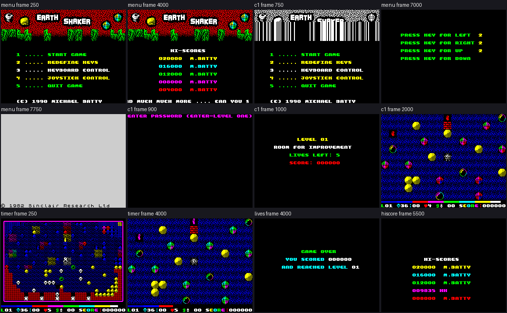

*The menu, the high scores, the joystick menu, the redefine prompts, the quit, the intro, the play, the map, the time
running out, the game over and a high score entered; each labelled with its recording and frame. Command: `python3
tools/fig_play.py --out docs/img/play REC:FRAME:NAME ...` (stage 1).*

| Screen | What it shows | How it is reached | Picture |
| --- | --- | --- | --- |
| the menu | the logo, the five lines, the title tune | after the load, or after each game | `menu` frame 250 |
| the high scores | five records under the scroller | the title tune ran to its end | `menu` frame 4000 |
| the menu, joystick | the control lines changed | keys 3 and 4 | `c1` 750 (frame 12550) |
| redefine | "PRESS KEY FOR LEFT" and the other four | key 2 | `menu` frame 7000 |
| quit | the ROM's copyright screen | key 5: `JP 0` | `menu` frame 7750 |
| the password | "ENTER PASSWORD (ENTER=LEVEL ONE)" | key 1 | `c1` frames 12617-12705 |
| the cave intro | the level, the lives, the score, the cave's name | each cave's start | `c1` 1000 |
| the play | the 16 × 11 window, the time bar, the panel line | after the intro | `c1` 2000 |
| the map | the whole cave in 8 × 8 glyphs | F, once a cave | `timer` frame 250 |
| the game over | "GAME OVER", "YOU SCORED", "AND REACHED LEVEL" | the last life lost | `lives` frame 4000 |
| a high score | the table with the new name | a score above a record | `hiscore` frame 5500 |
| the win | "WELL DONE ... AND THANKS !" | cave 32 done | `rzx-earth32`, its end |

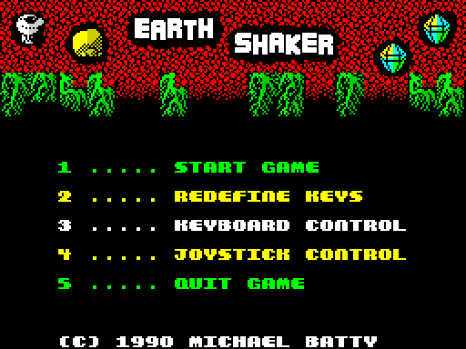

*The menu: recording `menu`, frame 250. Lines 3 and 4 are the control choice, keyboard or joystick.*

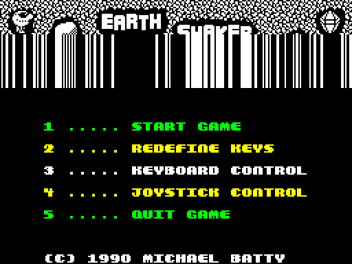

*Recording `c1`, frame 12550, after key 4: Kempston joystick chosen.*

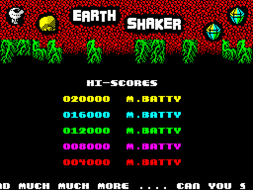

*Recording `menu`, frame 4000: the defaults 020000 down to 004000, all "M.BATTY", under the scroller.*

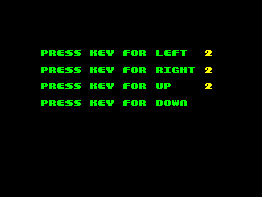

*Recording `menu`, frame 7000: key 2, one prompt a key.*

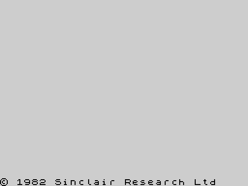

*Recording `menu`, frame 7750: key 5 jumps to `$0000`; the machine starts again.*

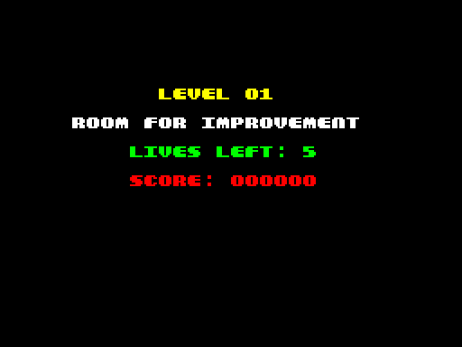

*Recording `c1`, frame 12800: cave 1's intro with the level, the lives, the score and "ROOM FOR IMPROVEMENT".*

The menu line "3 ..... DEMO MODE" is still in the text at `$AB00`. The 1990 version prints the two control lines over
it ([doc 8](08-hud-and-text.md)). There is no demo mode.

The point: the front end is a menu, a password prompt and the intro. Everything else is the caves.

## 1.3 The play screen and the controls

The window shows 16 × 11 cells of the 30 × 20 cave, each cell 2 × 2 characters. It follows the player. Under it are the
time bar and the panel line: the level, the gems needed and taken, the lives, the anti-gravity steps and the score
([doc 8](08-hud-and-text.md)).

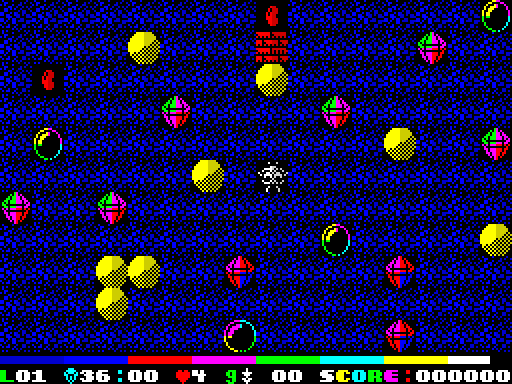

*Recording `c1`, frame 13800: cave 1 in play. The panel reads L01, 36:00 gems, 4 lives (one was lost at frame 13208),
score 000000. The rainbow strip is the time bar.*

The map shows the whole cave at one glyph a cell. F shows it once a cave. The pass stops while it is up
([doc 4.7](04-game-loop.md#47-the-time-limit-is-counted-in-passes)).

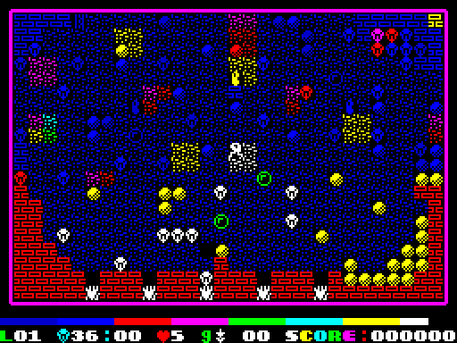

*Recording `timer`, frame 250: F pressed in cave 1.*

| Key | What it does | Where |
| --- | --- | --- |
| left, right, up, down | move one cell a pass; dig earth; take what is there; push a boulder or a bubble sideways | KeysStep `$8759`, PlayerStep `$8556` |
| fire held with a direction | act on the next cell without moving: dig it, take it | FireStep `$8878` |
| F | the map, once a cave | MapKey `$EA96` |
| H | give up the cave: the bar drains, a life is lost | QuitKey `$872D` |
| G | abort to the menu, no game-over screen | AbortKey `$93A5` |
| menu 2 | define the five keys | RedefineKeys `$8C30` |
| menu 3, 4 | keyboard or Kempston joystick | ChooseControl `$ECE3` |

`c1` defines O, P, Q, A and M as left, right, up, down and fire. F, H and G are fixed keys and are not in the manual's
key list. The details are in [doc 5](05-controls.md).

The point: the player has four directions and fire. F, H and G are the hidden extras.

## 1.4 The objects

A cave cell holds one of sixteen codes. Each code is one object with one rule.

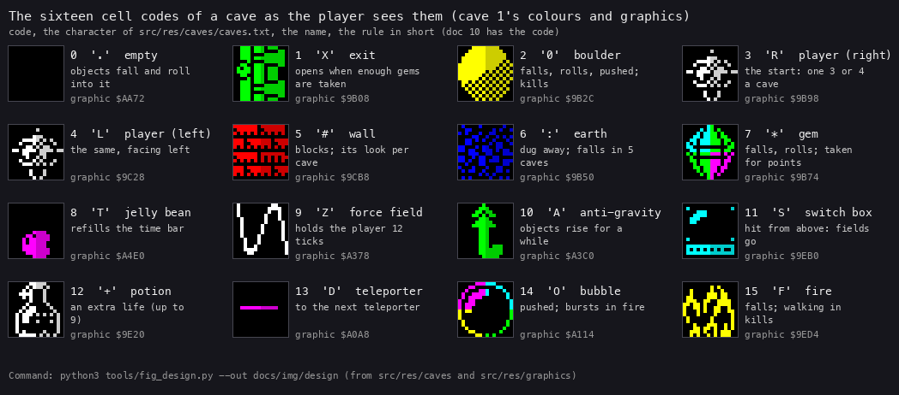

*The sixteen cell codes with cave 1's graphics and colours, the character `src/res/caves/caves.txt` uses for each,
and the rule in short. Command: `python3 tools/fig_design.py --out docs/img/design`.*

| Code | Object | What it does |
| --- | --- | --- |
| 0 | empty | the player moves in; objects fall and roll into it |
| 1 | exit | closed until enough gems are taken; entering it ends the cave |
| 2 | boulder | falls, rolls off other objects, pushed sideways; kills when it falls on the player; dissolves over fire |
| 3, 4 | the player | the start, facing right or left; one in every cave |
| 5 | wall | blocks; its look changes from cave to cave |
| 6 | earth | dug away; in caves 13, 17, 22, 24 and 26 it falls, but never crushes |
| 7 | gem | falls and rolls like a boulder; taken for points |
| 8 | jelly bean | falls; taken, it refills the time bar |
| 9 | force field | holds the player for 12 timer ticks; cleared by the switch |
| 10 | anti-gravity | falls; taken, objects rise instead of falling for a while; 200 points |
| 11 | switch box | an object landing on it clears every force field (and every switch box); 250 points |
| 12 | potion | falls; taken, an extra life up to 9; 20 points |
| 13 | teleporter | walk in: the player reappears at the next teleporter |
| 14 | bubble | pushed by the player; into fire it bursts; 100 points |
| 15 | fire | falls and kills when it lands on the player; walking into it kills |

The rules in full, with the scan that moves the objects, are in [doc 7](07-objects.md) and
[doc 10](10-gameplay-logic.md).

The point: four of the objects (boulder, gem, fire and the falling earth) are the classic falling rules. The other eight
are this game's own.

## 1.5 The rules

**The gems and the exit.** Each cave asks for a number of gems: its GemsNeeded byte. The panel counts the gems taken.
When the count reaches the number, the exit opens with a sound and starts to flash. Entering it ends the cave. In 31
caves the number is every gem in the cave. Cave 30 has 100 gems and asks for 99.

**The time.** The bar under the window is the time. It loses one pixel every four passes and holds 256, so a cave
lasts 1024 passes ([doc 4.7](04-game-loop.md#47-the-time-limit-is-counted-in-passes)). A jelly bean refills it. When the
bar is empty a life is lost. Since a pass takes 5.5 to 9.4 frames, the time limit is 113 to 193 seconds.

**The lives.** A game starts with 5. A potion adds one, up to 9. A life is lost when the player is crushed, walks into
fire, runs out of time or presses H. Then the same cave starts again. When the last life is lost the game is over.

**The score.** Six decimal digits:

| Event | Points |
| --- | --- |
| a gem | the cave's GemValue: 3 to 50, 250 in cave 32 |
| a switch box hit | 250 |
| a bubble burst | 100 |
| anti-gravity taken | 200 |
| a potion | 20 |
| the cave done | 1 a pixel left in the time bar (TimeBonus `$8702`) |

**The high scores.** Five records of six digits and a 9-character name. The defaults run from 020000 to 004000, all
"M.BATTY". A score at least as high as a record goes into the table (HiScoreInsert `$7F7A`), and the player types a name.

**After cave 32.** The win screen and the win tune, then cave 1 again with the score and the lives kept.

### The password

A game starts at the password prompt. FindPassword `$8E91` compares the 20 typed characters with 50 records of 20
bytes from CaveNames `$9700`. Only the first 32 records are cave names. Records 33-50 run on over code, zeros and the
map's glyphs (`$9980-$9AE7`), so no typed name can match them. A match at record B starts the game at cave B + 1. No
match, or ENTER alone, starts cave 1.

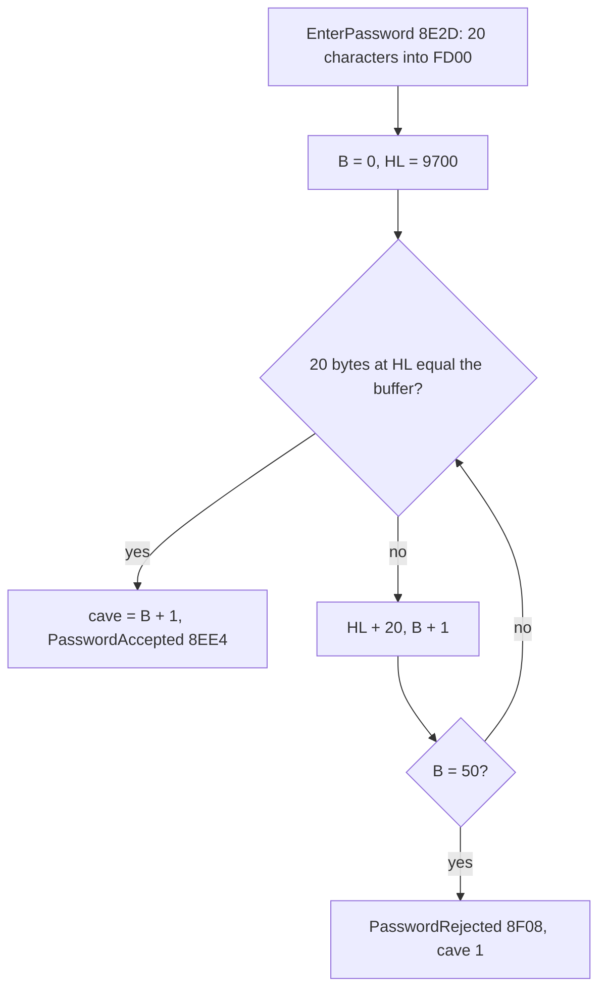

```text
Password():                              ; $8F29
    EnterPassword()                      ; PasswordBuffer $FD00, 20 characters
    for B in 0 .. 49:                    ; FindPassword $8E91
        if PasswordBuffer == bytes $9700 + 20 * B .. + 19: break
    if B == 50: PasswordRejected(); CaveNumber = 1
    else:       CaveNumber = B + 1; CaveDigits = B + 1 in decimal; PasswordAccepted()
```

```text
8E91  21 00 97    FindPassword:      LD HL,CaveNames
8E94  06 00                          LD B,$00
8E96  C5          FindPasswordLoop:  PUSH BC
8E97  06 14                          LD B,$14              ; 20 characters
8E99  E5                             PUSH HL
8E9A  11 00 FD                       LD DE,PasswordBuffer
8E9D  4E          FindPasswordLoop2: LD C,(HL)
8E9E  1A                             LD A,(DE)
8E9F  B9                             CP C
8EA0  20 07                          JR NZ,FindPasswordSkip
8EA2  23                             INC HL
8EA3  13                             INC DE
8EA4  10 F7                          DJNZ FindPasswordLoop2
8EA6  E1                             POP HL
8EA7  C1                             POP BC                ; B = the record matched
8EA8  C9                             RET
8EA9  E1          FindPasswordSkip:  POP HL
8EAA  11 14 00                       LD DE,$0014
8EAD  19                             ADD HL,DE
8EAE  C1                             POP BC
8EAF  04                             INC B
8EB0  78                             LD A,B
8EB1  FE 32                          CP $32                ; 50 records, not 32
8EB3  20 E1                          JR NZ,FindPasswordLoop
8EB5  C9                             RET                   ; B = 50: no match
```

Worked example: `c1` presses ENTER at the prompt (frames 12617-12705). The buffer holds no name, all 50 records
differ, B is 50, and the game starts at cave 1. Typing "WET HELL SOIL" (padded to 20) would match record 12 and start
cave 13.

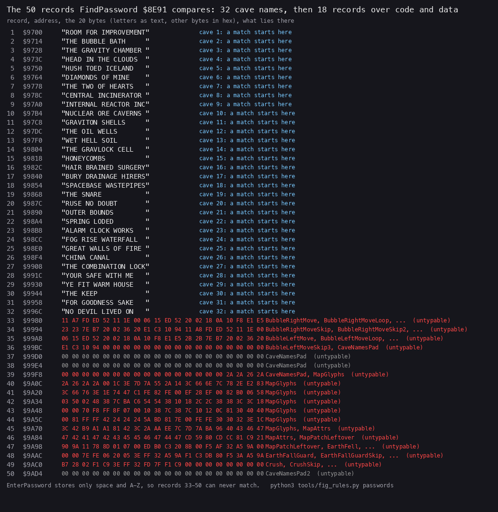

*The records from `$9700`: the 32 names, then the 18 records over code and data. From doc 10 (`tools/fig_rules.py`).*

Witness: the `c1` L1 has FindPassword and PasswordRejected at frames 12617-12705, and CaveNumber `$FD91` is 1 at
`memory_at` 12727. No recording types a valid name, so the accepted path is known only from the code.

The point: the password is the cave's name, and the comparison runs 18 records past the last name.

## 1.6 The key moments

A death by a boulder. In `death-crush` the player walks under a boulder in cave 1. The boulder falls into his cell,
DeathView shows the death graphics, DeathSound plays, and the cave starts again with one life fewer.

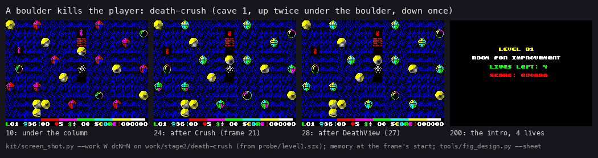

*Recording `death-crush` (stage 2, `work/stage2/death-crush`), frames 10, 24, 28 and 200: the boulder above, the fall,
the death graphics, the cave again. Command: `python3 ../../kit/screen_shot.py` on each frame, then `python3
tools/fig_design.py --sheet docs/img/design/death-crush.png ...`.*

The time running out. In `timer` nobody presses a key after the map. The bar empties at frame 6040: TimeOutSound plays
and a life is lost (5 to 4).

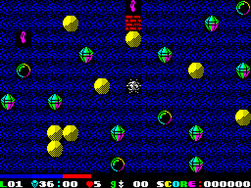

*Recording `timer`, frame 4000: about 63 % of the passes gone, a third of the bar left.*

The game over and a high score.

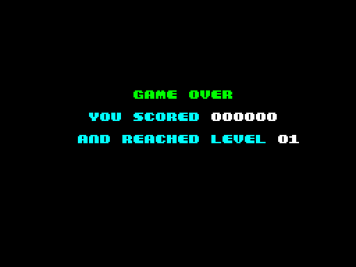

*Recording `lives`, frame 4000: after the fifth H.*

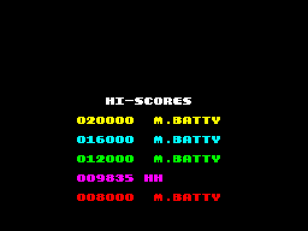

*Recording `hiscore`, frame 5500: 009835 with the name "HH" (the H presses after the last life went into the name).*

The win.

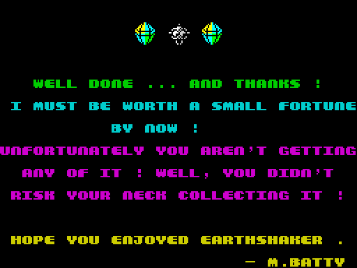

*Recording `rzx-earth32`, its last frame: "WELL DONE ... AND THANKS !" and Michael Batty's joke about the fortune.*

The point: every way a cave ends is in a recording, but a death by fire and the accepted password are not in a stage 1
recording of our own play ([1.9](#19-what-no-recording-reached)).

## 1.7 The 32 caves

The caves drawn whole from their data, each with the graphics and colours of its start:

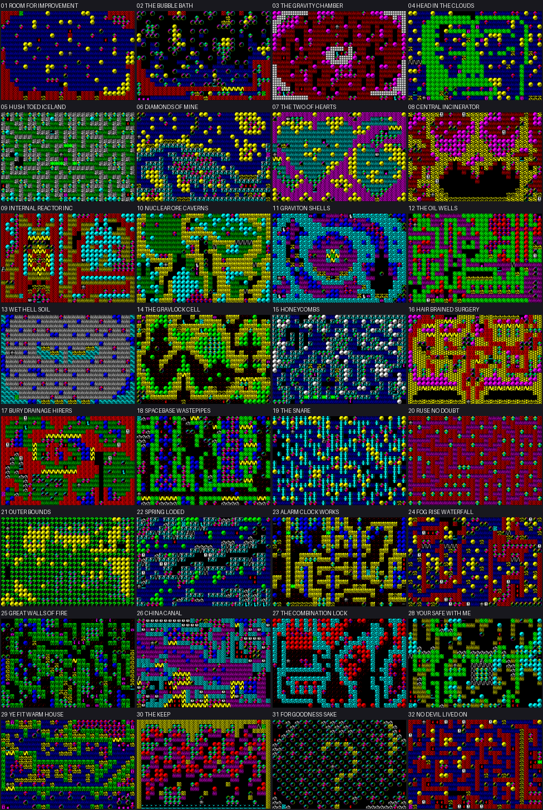

*The 32 caves from `src/res/caves/caves.txt`, 30 × 20 cells each, with their names. Command: `python3
tools/fig_caves.py --out docs/img` (stage 1).*

And as the player sees them, half way through each `rzx-earthNN` recording:

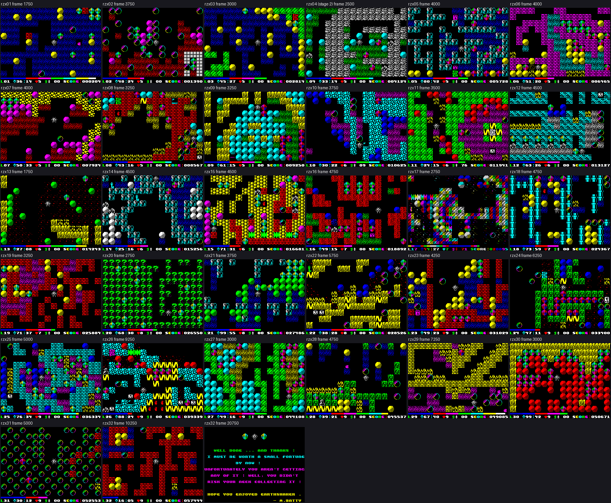

*Each cave at the middle frame of its `rzx-earthNN` recording; the win screen at the end of `rzx-earth32`. Command:
`python3 tools/fig_play.py --out docs/img/play --sheet caves.png REC:FRAME:NAME ...` (stage 1).*

The parameters of each cave. "Frames a pass" is the mean pass in the RZX's play
([doc 4.6](04-game-loop.md#46-the-cost-of-a-pass-in-every-cave)). "Time limit" is 1024 passes at that rate, with no jelly
bean. The specials count the objects 8-15 in the cave.

| Cave | Name (the password) | Gems needed / there | Points a gem | Start cell (row, column) | Earth | Wall | Specials | Frames a pass | Time limit | Pictures |
| --- | --- | --- | --- | --- | --- | --- | --- | --- | --- | --- |
| 1 | ROOM FOR IMPROVEMENT | 36 / 36 | 10 | 285 (9, 15) | GfxEarth | GfxWall1 | jelly bean 3, bubble 4, fire 5 | 5.94 | 122 s | [map](img/maps/cave-01.png), [play](img/play/cave-01.png) |
| 2 | THE BUBBLE BATH | 48 / 48 | 15 | 467 (15, 17) | GfxEarth | ExtraGraphic3 | jelly bean 3, force field 5, switch box 1, bubble 91, fire 5 | 5.80 | 119 s | [map](img/maps/cave-02.png), [play](img/play/cave-02.png) |
| 3 | THE GRAVITY CHAMBER | 45 / 45 | 10 | 104 (3, 14) | GfxEarth | GfxWall5 | jelly bean 3, anti-gravity 3 | 6.34 | 130 s | [map](img/maps/cave-03.png), [play](img/play/cave-03.png) |
| 4 | HEAD IN THE CLOUDS | 33 / 33 | 33 | 573 (19, 3) | GfxEarth | GfxExtraWall2 | force field 3, switch box 1, teleporter 8, bubble 2, fire 13 | 6.63 | 136 s | [map](img/maps/cave-04.png), [play](img/play/cave-04.png) |
| 5 | HUSH TOED ICELAND | 80 / 80 | 10 | 283 (9, 13) | GfxEarth | GfxWall2 | jelly bean 4, force field 6, switch box 1, teleporter 2 | 5.73 | 117 s | [map](img/maps/cave-05.png), [play](img/play/cave-05.png) |
| 6 | DIAMONDS OF MINE | 51 / 51 | 10 | 150 (5, 0) | GfxEarth | GfxWall1 | jelly bean 2, bubble 12, fire 20 | 6.52 | 134 s | [map](img/maps/cave-06.png), [play](img/play/cave-06.png) |
| 7 | THE TWO OF HEARTS | 50 / 50 | 10 | 270 (9, 0) | GfxEarth | GfxExtraWall4 | jelly bean 3, force field 5, switch box 1, teleporter 2, bubble 15, fire 2 | 6.80 | 139 s | [map](img/maps/cave-07.png), [play](img/play/cave-07.png) |
| 8 | CENTRAL INCINERATOR | 43 / 43 | 5 | 545 (18, 5) | GfxEarth | GfxWall1 | jelly bean 2, force field 2, switch box 1, teleporter 6, bubble 20, fire 22 | 6.76 | 138 s | [map](img/maps/cave-08.png), [play](img/play/cave-08.png) |
| 9 | INTERNAL REACTOR INC | 61 / 61 | 4 | 498 (16, 18) | GfxEarth | GfxWall4 | force field 19, switch box 1, potion 1, teleporter 2, bubble 12, fire 9 | 7.12 | 146 s | [map](img/maps/cave-09.png), [play](img/play/cave-09.png) |
| 10 | NUCLEAR ORE CAVERNS | 30 / 30 | 21 | 336 (11, 6) | GfxEarth | GfxExtraWall5 | jelly bean 2, force field 7, anti-gravity 1, switch box 1, bubble 8 | 6.62 | 136 s | [map](img/maps/cave-10.png), [play](img/play/cave-10.png) |
| 11 | GRAVITON SHELLS | 24 / 24 | 10 | 421 (14, 1) | GfxEarth | GfxWall5 | force field 4, anti-gravity 4, switch box 1, teleporter 6, bubble 15, fire 18 | 6.98 | 143 s | [map](img/maps/cave-11.png), [play](img/play/cave-11.png) |
| 12 | THE OIL WELLS | 63 / 63 | 5 | 61 (2, 1) | GfxEarth | GfxWall3 | jelly bean 3, force field 1, switch box 1, teleporter 2, bubble 8, fire 20 | 6.49 | 133 s | [map](img/maps/cave-12.png), [play](img/play/cave-12.png) |
| 13 | WET HELL SOIL | 27 / 27 | 25 | 242 (8, 2) | GfxFallingEarth | GfxWall4 | fire 17 | 9.43 | 193 s | [map](img/maps/cave-13.png), [play](img/play/cave-13.png) |
| 14 | THE GRAVLOCK CELL | 25 / 25 | 17 | 361 (12, 1) | GfxEarth | GfxWall2 | jelly bean 3, force field 4, anti-gravity 2, switch box 1, teleporter 4, bubble 14, fire 10 | 7.03 | 144 s | [map](img/maps/cave-14.png), [play](img/play/cave-14.png) |
| 15 | HONEYCOMBS | 71 / 71 | 3 | 178 (5, 28) | ExtraGraphic4 | GfxWall6 | jelly bean 3, force field 4, switch box 1, potion 1, bubble 8, fire 4 | 6.38 | 131 s | [map](img/maps/cave-15.png), [play](img/play/cave-15.png) |
| 16 | HAIR BRAINED SURGERY | 49 / 49 | 27 | 583 (19, 13) | GfxEarth | GfxExtraWall9 | jelly bean 4, force field 23, switch box 1, teleporter 4, bubble 23, fire 28 | 6.49 | 133 s | [map](img/maps/cave-16.png), [play](img/play/cave-16.png) |
| 17 | BURY DRAINAGE HIRERS | 44 / 44 | 10 | 467 (15, 17) | GfxFallingEarth | GfxWall5 | jelly bean 4, force field 23, anti-gravity 3, switch box 1, teleporter 6, bubble 20, fire 14 | 8.34 | 171 s | [map](img/maps/cave-17.png), [play](img/play/cave-17.png) |
| 18 | SPACEBASE WASTEPIPES | 73 / 73 | 30 | 510 (17, 0) | GfxEarth | GfxExtraWall3 | jelly bean 5, force field 27, switch box 1, teleporter 2, bubble 18, fire 25 | 6.72 | 138 s | [map](img/maps/cave-18.png), [play](img/play/cave-18.png) |
| 19 | THE SNARE | 71 / 71 | 10 | 94 (3, 4) | GfxEarth | GfxWall1 | potion 1, fire 1 | 6.39 | 131 s | [map](img/maps/cave-19.png), [play](img/play/cave-19.png) |
| 20 | RUSE NO DOUBT | 68 / 68 | 10 | 30 (1, 0) | ExtraGraphics | ExtraGraphics | none | 5.52 | 113 s | [map](img/maps/cave-20.png), [play](img/play/cave-20.png) |
| 21 | OUTER BOUNDS | 99 / 99 | 10 | 61 (2, 1) | GfxEarth | GfxWall2 | none | 7.19 | 147 s | [map](img/maps/cave-21.png), [play](img/play/cave-21.png) |
| 22 | SPRING LODED | 38 / 38 | 7 | 450 (15, 0) | GfxFallingEarth | GfxWall4 | jelly bean 6, force field 18, anti-gravity 4, switch box 1, potion 1, teleporter 6, bubble 15, fire 26 | 7.29 | 149 s | [map](img/maps/cave-22.png), [play](img/play/cave-22.png) |
| 23 | ALARM CLOCK WORKS | 49 / 49 | 20 | 556 (18, 16) | GfxEarth | GfxWall1 | jelly bean 3, force field 3, switch box 1, teleporter 4, bubble 5, fire 13 | 6.95 | 142 s | [map](img/maps/cave-23.png), [play](img/play/cave-23.png) |
| 24 | FOG RISE WATERFALL | 47 / 47 | 10 | 586 (19, 16) | GfxFallingEarth | ExtraGraphic2 | jelly bean 5, force field 8, switch box 1, teleporter 10, bubble 56, fire 31 | 7.54 | 154 s | [map](img/maps/cave-24.png), [play](img/play/cave-24.png) |
| 25 | GREAT WALLS OF FIRE | 76 / 76 | 10 | 35 (1, 5) | GfxEarth | GfxWall1 | jelly bean 10, force field 1, switch box 1, teleporter 8, bubble 15, fire 29 | 6.62 | 136 s | [map](img/maps/cave-25.png), [play](img/play/cave-25.png) |
| 26 | CHINA CANAL | 88 / 88 | 50 | 153 (5, 3) | GfxFallingEarth | GfxExtraWall5 | jelly bean 17, force field 42, switch box 3, potion 1, teleporter 36, bubble 10, fire 3 | 7.53 | 154 s | [map](img/maps/cave-26.png), [play](img/play/cave-26.png) |
| 27 | THE COMBINATION LOCK | 49 / 49 | 13 | 273 (9, 3) | GfxEarth | GfxWall5 | potion 1 | 6.99 | 143 s | [map](img/maps/cave-27.png), [play](img/play/cave-27.png) |
| 28 | YOUR SAFE WITH ME | 39 / 39 | 25 | 310 (10, 10) | GfxEarth | ExtraGraphic2 | jelly bean 15, force field 17, switch box 1, potion 1, teleporter 6, bubble 10, fire 23 | 6.57 | 135 s | [map](img/maps/cave-28.png), [play](img/play/cave-28.png) |
| 29 | YE FIT WARM HOUSE | 67 / 67 | 12 | 421 (14, 1) | GfxEarth | GfxWall1 | jelly bean 11, force field 7, switch box 1, teleporter 6, bubble 28, fire 103 | 6.58 | 135 s | [map](img/maps/cave-29.png), [play](img/play/cave-29.png) |
| 30 | THE KEEP | 99 / 100 | 10 | 554 (18, 14) | GfxBoulder | GfxWall4 | force field 1, switch box 28, bubble 4 | 6.39 | 131 s | [map](img/maps/cave-30.png), [play](img/play/cave-30.png) |
| 31 | FOR GOODNESS SAKE | 30 / 30 | 25 | 313 (10, 13) | GfxEarth | GfxWall1 | jelly bean 7, bubble 271, fire 43 | 5.91 | 121 s | [map](img/maps/cave-31.png), [play](img/play/cave-31.png) |
| 32 | NO DEVIL LIVED ON | 16 / 16 | 250 | 3 (0, 3) | GfxEarth | GfxWall1 | jelly bean 20, force field 1, switch box 1, teleporter 10, bubble 24, fire 26 | 5.99 | 123 s | [map](img/maps/cave-32.png), [play](img/play/cave-32.png) |

What the table shows:

- **The gems.** Gems needed equals the gems in the cave everywhere but cave 30 (99 of 100).
- **The points.** A gem is worth 3 (cave 15) to 50 (cave 26). Cave 32 pays 250 a gem, for 16 gems.
- **The graphics.** Cave 30's earth is drawn with the boulder graphic. In cave 20 earth and wall both use
  ExtraGraphics, so they look the same ("RUSE NO DOUBT").
- **Falling earth.** Caves 13, 17, 22, 24 and 26 use GfxFallingEarth, and SetEarthFalls `$FB81` makes that earth fall.
- **Difficulty.** No parameter sets a speed or a level of difficulty. The caves get harder by design: more fire, more
  bubbles, more teleporters. Cave 26 has 42 force fields and 36 teleporters; cave 31 has 271 bubbles.

The point: a cave is 600 cells and 14 bytes. Everything that makes one harder than another is in the cells.

## 1.8 The unused test cave

At `$F9A6`, inside a stretch no code reads, lies one more cave record of 314 bytes. No table points at it. Its top row
holds one of each object: `D.ZZAASS++TTOOFF+:::FF::***#X#`. It has no player cell.

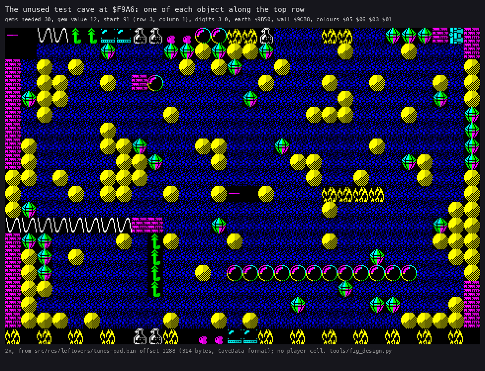

*The record at `$F9A6` (`src/res/leftovers/tunes-pad.bin`, offset 1288) drawn with its own parameters. Command:
`python3 tools/fig_design.py --out docs/img/design`.*

Its parameters: 30 gems needed, 12 points a gem, the start at cell 91 (row 3, column 1), GfxEarth and GfxWall1,
colours `$05 $06 $03 $01`. It holds 96 boulders, 367 earth cells and 32 gems. It looks like Michael Batty's test bed
for the objects: a row to try each one, then a cave to dig. The game could only reach it by a cave number of 33 or
more, which NextCave never sets.

The point: the image keeps the designer's workbench next to the 32 caves.

## 1.9 What no recording reached

- A typed password that matches: PasswordFlashText `$8EB6` and PasswordAccepted `$8EE4` run in no recording.
- The win tune to its end: `rzx-earth32` stops during it (PlayWinTuneEnd `$A61B`), and cave 1 after the win.
- Walking up into fire (UpSpecialCell `$9194` and its tail `$919A`). Walking into fire sideways is in stage 2's
  `death-fire`.
- The unused graphic slot GfxSpare, and the font codes `$68-$7F` but `$73` (the SYMBOL SHIFT name, [doc 8](08-hud-and-text.md)).
