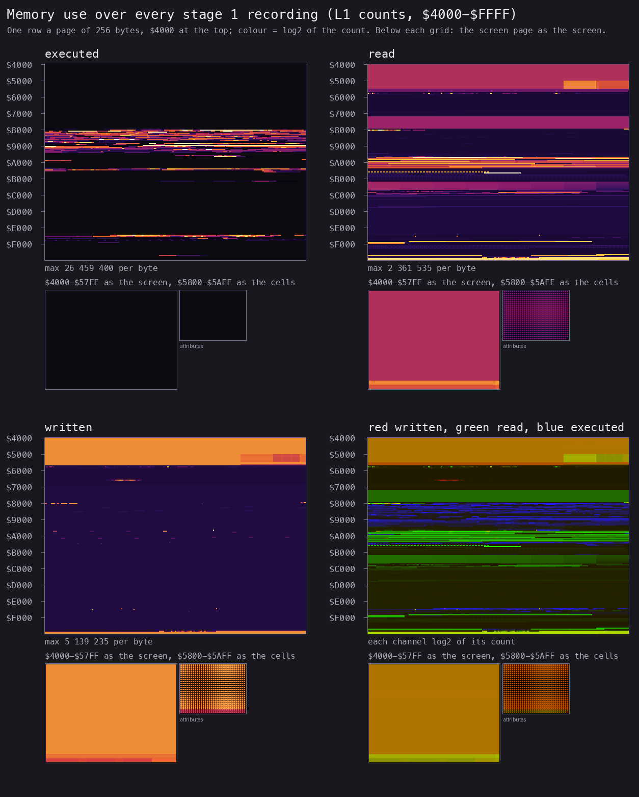
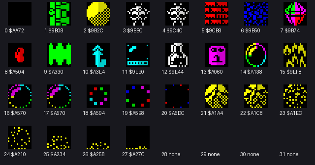

# 2. Architecture

What this covers: the machine budget, the memory map (a figure), stages from the medium to play, the frame, the main loop's call graph, the module map. The recordings it rests on: `c1` (power-on, ROM-speed load), `menu`, `lives` (from the menu after `c1`'s load), `rzx-earth01` and the other `rzx-earthNN` (the RZX archive's caves replayed frame by frame; [WALKTHROUGH 6.0](../WALKTHROUGH.md#60-the-recordings)).

<!-- Figures this document needs (GUIDE.md 4.2), remove each line when it is in: -->
<!-- - the stages from power-on to play (mermaid) -->

## 2.1 The memory map

A 48K game in one block: the ROM loads `$6D42-$FFFF` and the game runs where it is loaded, nothing moved or unpacked
but the current cave ([doc 3.1](03-build-and-load.md#31-the-tape-block-by-block)). The regions below come from the
loaded image and the L1 counts of the stage 1 recordings (`tools/l1regions.py`, `tools/l1map.py`: a byte counts as
read or written when the recordings read or wrote it more than the snapshot loads do); the names are first-look
names, refined in the later documents.

| Range | Bytes | What | Witness |
| --- | --- | --- | --- |
| `$4000-$5AFF` | 6912 | the screen: the play window, the panel line, the menu and the intro screens | written and read in every recording |
| `$5B00-$5CCA` | 459 | the ROM's system variables; FRAMES `$5C78` counted by the ROM's IM 1 handler | `c1`, `menu` |
| `$5CCB-$5D35` | 107 | the BASIC loader, left in place | `tools/image.py` |
| `$5D36-$6942` | 3085 | free below RAMTOP (BASIC's workspace while the loader runs) | no recording of the game uses it |
| `$6943-$6977` | 53 | the machine stack under RAMTOP `$6978` (`CLEAR 27000`); its low mark `$6943` | the lowest byte written below the game block over `c1` (`$6945` over the play recordings) |
| `$6D42-$6EF3` | 434 | the scroller text ("... EARTH SHAKER - FEATURING ANTI-GRAVITY ...") | the image; the scroller `$8AEB` |
| `$6EF4-$7F5F` | 4204 | data read a few times a recording (byte patterns of small values from `$7342`), not yet named | read counts 1-2 a byte in `menu`, `lives`, `rzx-earth01` |
| `$7F60-$7FF9` | 154 | code run once or rarely | `c1` L1 |
| `$8000-$803F` | 64 | the cell graphics table: 32 words, the graphic of cell value 0-31 (entries 28-31 zero); entries change per cave and as animations run | `$8D66` (`$8000 + 2 * V`), [doc 2.3](#23-the-cells-and-their-graphics) |
| `$8040-$9450` | about 5100 | the main code: the cave unpack `$82B6`, the control tests `$83C3-$8759`, the player's move `$8556`, the sound `$86AD-$872A`, the tune player `$88CE`, the menu `$8B20`, the scroller `$8AEB`, the map draw `$8D75`, the password check `$8E91`, the cell draw `$8F60` | executed in the recordings |
| `$9700-$997F` | 640 | the 32 cave names, 20 characters each (the passwords) | `$8E91` compares the typed password with them |
| `$9B08-$A5FF` | about 2800 | cell graphics, 36 bytes each (4 attributes, 32 pixel bytes) | the table at `$8000`; [the sheet](#23-the-cells-and-their-graphics) |
| `$A600-$BDFF` | about 6100 | not yet mapped in detail: texts (the redefine prompts `$A977`, "GAME OVER ..." `$AA4E`, the panel words `$BAFE`), the tunes (the title tune `$AD00`), the code of the hi-scores and the attract `$B26C-$B2FF`, fonts and pictures of the title | the image; `$A713-$A7D6` and `$B26C-$B2FF` executed |
| `$C000-$E73F` | 10 048 | the 32 caves, 314 bytes each at `$BEC6 + N * $13A` | `$82B6-$82E5` reads cave N from there |
| `$E740-$ED0B` | about 1500 | code: sound effects with interrupts off (`$E740`, `$E7A9`), the Kempston read (`$EAC8`) | executed |
| `$ED0C-$FD7D` | about 4200 | not yet named (read a little) | |
| `$FD7E-$FDA7` | 42 | the game's variables: the cave number `$FD91` (1-32) and its two decimal digits `$FD7E-$FD7F`, lives `$FD93` (one digit; the init `$82E6` sets 4, the first intro shows 5, cave 2 starts with 5 in `earth02`), the score as six decimal digits `$FD94-$FD99` (one a byte, the most significant first), the cave's 14 parameter bytes copied to `$FD9A-$FDA7` (byte 0 the gems needed in binary, bytes 4-5 the same as two digits, bytes 6-9 two cell-graphic addresses), `$FD9C-$FD9D` a cell index moved a row down at `$8535` | the init `$82E6`; the panel `$85AD-$85CE` and `$8342` print them with `$832A` (D digits from HL down, glyphs at `$BD80 + 8 * digit`); the RZX states |
| `$FDA8-$FFFF` | 600 | the current cave, 30 x 20 cells, one byte a cell, row by row | unpacked by `$82B6-$82E5` at each cave's start |

The heatmap is the L1 counts of every stage 1 recording (`tools/l1merge.py work/stage1/l1-all.json ...`,
`tools/fig_heatmap.py`), one row a 256-byte page: the code from `$8000` to `$9400` and around `$E740`, the cells
table at `$8000` and the graphics read from `$9B00` to `$A600`, the caves at `$C000-$E73F` read once a cave, the
variables and the cave at the top of memory written all the time, the screen, and the stack under `$6978`.

## 2.2 The frame and the pass

IM 1, the ROM's handler: FRAMES and the keyboard scan each frame while interrupts are on. The game has no HALT and
no wait on FRAMES: the cave runs as fast as its work allows: 5.5 to 7.5 frames a pass (median, idle, caves 1-32 sampled), 9.3
frames the heaviest pass measured (cave 24; [WALKTHROUGH 1](../WALKTHROUGH.md#1-one-recording-from-power-on)). Interrupts go off while a tune or a jingle
plays (the tune player `$88CE`, the BEEPER calls `$86AD-$8757`).

## 2.3 The cells and their graphics

A cave cell holds a value 0-31 (the packed caves use 0-15; the game's own states use the rest and bit 5, `$8545`
writes `$20`). `$8F60` draws a cell at its 2 x 2 character place: the word at `$8000 + 2 * V` points at 36 bytes,
four attributes (top left, top right, bottom right, bottom left), then 32 pixel bytes, two a line, left then right on
even lines and right then left on odd ones. Table entries 5 and 6 hold the cave's parameter bytes 8-9 and 6-7
at its start (cave 2: `$9CB8` and `$9B50`; cave 4: `$9D48` and `$9B50`; the RZX's start snapshots), so a wall looks
different from cave to cave; other entries (3, 4, 8-10, 12-15 at cave 4's start) point at other frames as
animations run. Parameter bytes 10-13 look like attributes (cave 2: `$44 $46 $42 $41`, bright green, yellow, red,
blue; cave 1's boulders are yellow in play and green in the loaded image), not yet traced.

The values as the graphics and cave 1's screen show them (a first look: the names come with doc 7): 0 empty, 1 a
brick door (exactly one in every cave: the exit), 2 a boulder, 3 and 4 the player (exactly one 3 or 4 in every cave:
the start), 5 a wall, 6 earth, 7 a gem, 8 to 15 the other
objects (9 a spring-like zigzag, 10 an arrow up, 11 a box, 12 a bottle, 13 a bar, 14 a bubble, 15 fire), 16-27 the
frames of animations (a bubble, a dot ring, a dissolving boulder).

The whole caves drawn from these data, 30 x 20 cells each with the table of the cave's start (`tools/fig_caves.py`;
one PNG a cave in `img/maps/`):

