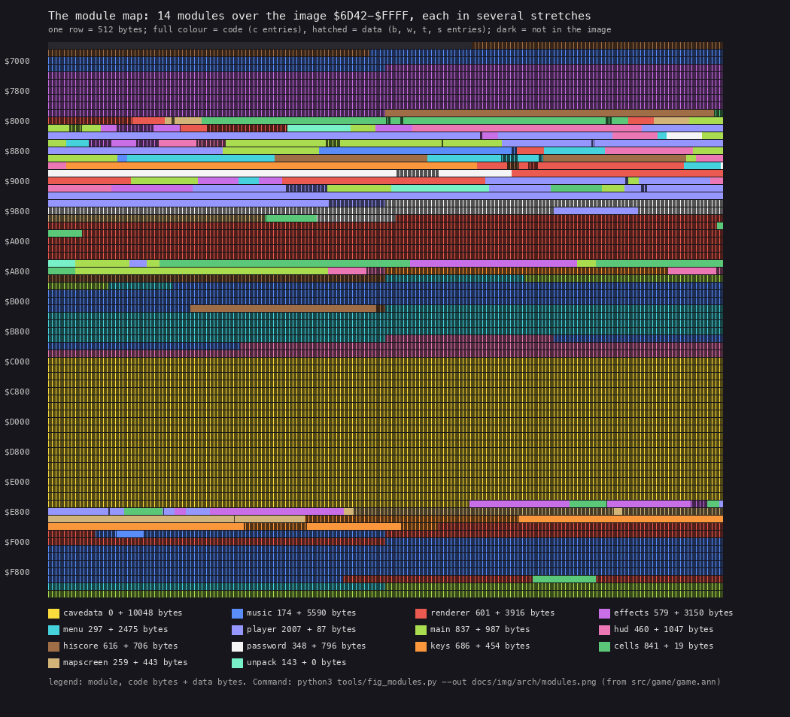
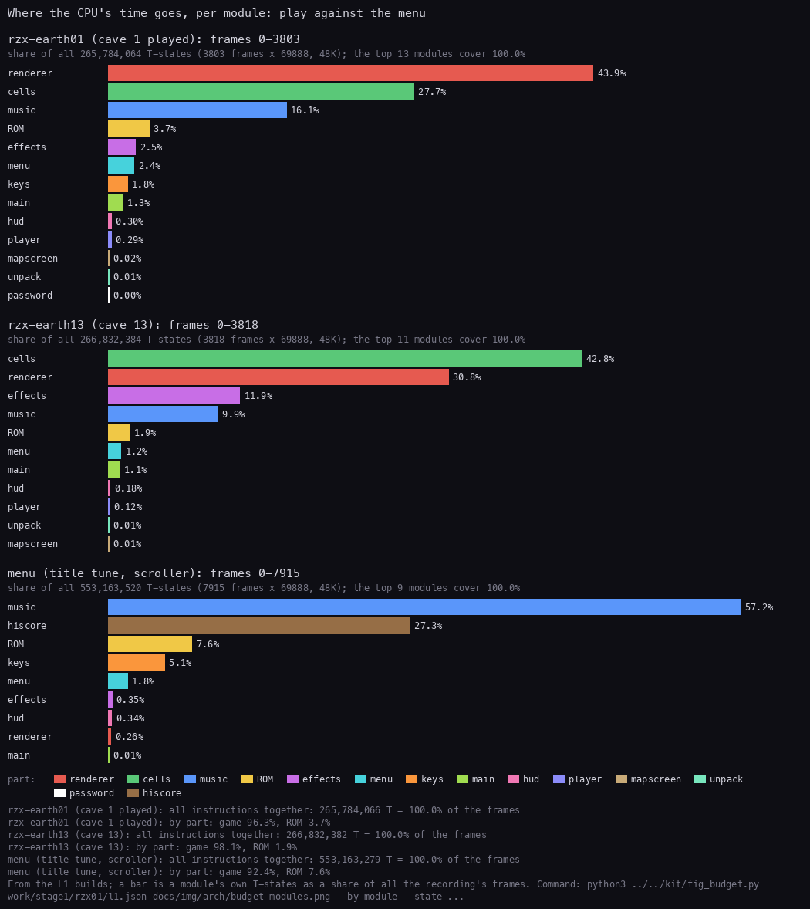
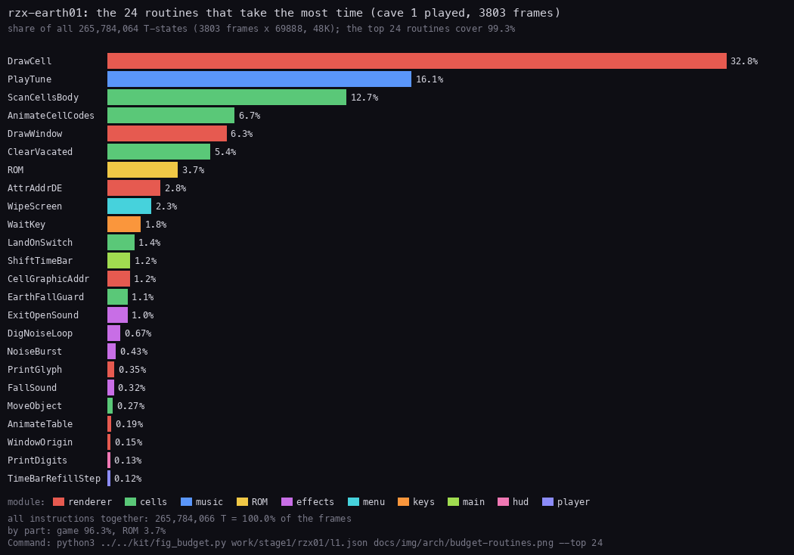
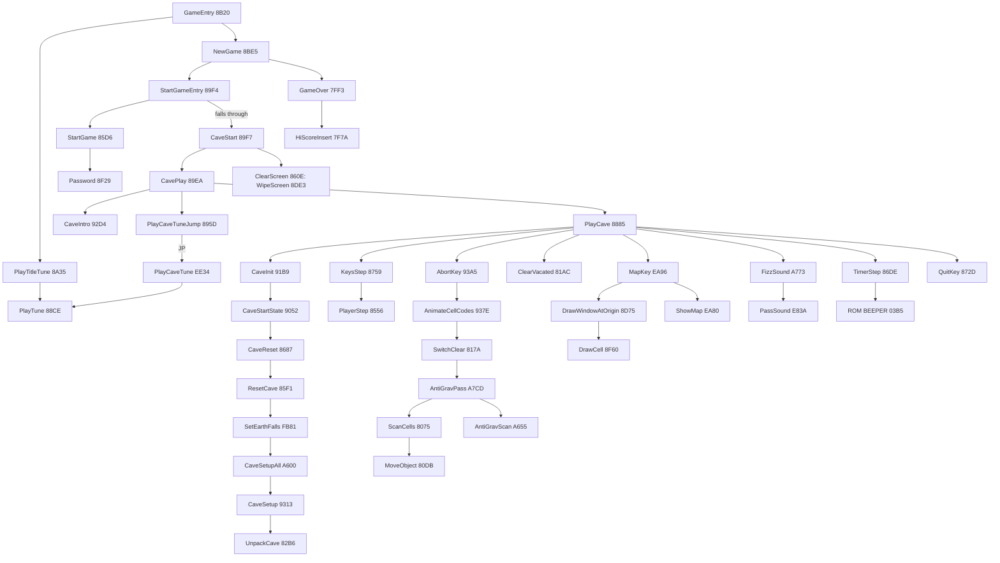
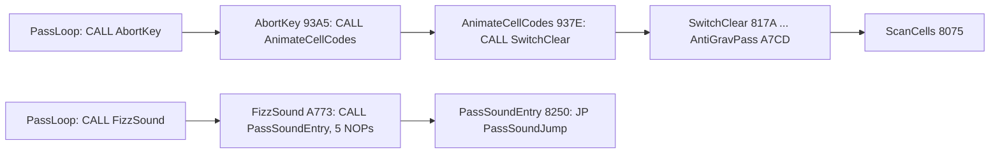

# 2. Architecture

What this covers: the machine budget; the stages from power-on to play; the memory map as the source cuts it; the cells
and their graphics; the fourteen modules; where the frame goes; the call graph; the stack; the leftovers and the 1990
patches.

The recordings it rests on: `c1` (power-on, ROM-speed load, cave 1), `menu` and `lives` (from the menu after `c1`'s
load), `rzx-earth01` to `rzx-earth32` (the RZX archive's caves replayed frame by frame;
[WALKTHROUGH 6.0](../WALKTHROUGH.md#60-the-recordings)). The access traces of `c1` and `rzx-earth13` give the stack
depth ([doc 4](04-game-loop.md)). The source is `src/game/game.ann`, cut into modules by `kit/mkgame.py`.

## 2.1 The machine budget

Earth Shaker is a 48K game. It uses no 128K memory, no AY and no paging. It runs on a 128K machine in 48K mode.

| Resource | Use |
| --- | --- |
| CPU | Z80 at 3.5 MHz, 69 888 T a frame; no frame sync ([doc 4.2](04-game-loop.md#42-the-interrupt)) |
| interrupts | IM 1, the ROM's handler: FRAMES and the keyboard scan; off inside every BEEPER call, the tunes, the game's own sound loops and the screen wipe ([doc 4.2](04-game-loop.md#42-the-interrupt)) |
| RAM | the image `$6D42-$FFFF` (37 566 bytes), the screen, the system variables, 63 bytes of stack under `$6978` |
| ROM | BEEPER `$03B5` for most effects; KEY-SCAN `$028E` in the handler and called by GameOverScreen `$8BDE`; the bytes from `$0140` as NoiseBurst's noise (`$E741`); `$0038` as PotionScore's return path; `JP $0000` for quit (`$8B6F`); LD-BYTES for the load. ClearVars' LDIR also writes into `$0000-$0004` (2.8) |
| screen | the 16 × 11-cell window in the top two thirds, the time bar and the panel line below |
| sound | the beeper only: the ROM's BEEPER for the clicks and beeps, the game's own `OUT ($FE)` loops with DI for PlayTune, NoiseBurst, FallSound and the teleport sweeps ([doc 9](09-sound.md)) |
| input | the keyboard through port `$FE` (five keys, redefinable, plus F, H, G); Kempston through port `$1F` |
| free | `$5D36-$6938` below the stack (3 075 bytes), never used by the game |

Every key test writes A to port `$FF` before it reads port `$FE` (`LD A,$FD`, `OUT ($FF),A`, `IN A,($FE)`). On the 48K
the write reaches no device. It is harmless. The IN takes its high byte from A.

The stages from power-on to the first pass ([doc 3.3](03-build-and-load.md#33-from-power-on-to-the-first-pass) has
the frames):


The point: the game takes the whole 48K above BASIC and leans on the ROM for sound and the keyboard.

## 2.2 The memory map

The game is loaded as one block and runs where it lands. Nothing is moved or unpacked but the current cave
([doc 4.3](04-game-loop.md#43-the-cave-start-and-the-unpacker)). The regions below come from `src/game/game.ann`,
checked against the L1 byte counts of every recording:

| Range | Bytes | What |
| --- | ---: | --- |
| `$4000-$5AFF` | 6 912 | the screen |
| `$5B00-$5CCA` | 459 | the ROM's system variables; FRAMES `$5C78` |
| `$5CCB-$5D35` | 107 | the BASIC loader, left in place |
| `$5D36-$6938` | 3 075 | free, never used |
| `$6939-$6977` | 63 | the deepest the stack goes ([2.7](#27-the-stack)) |
| `$6978-$6D41` | 970 | above RAMTOP, below the image: untouched |
| `$6D42-$6EF3` | 434 | ScrollerText |
| `$6EF4-$72FF` | 1 036 | WinTune and two pad bytes |
| `$7300-$7EFF` | 3 072 | TeleportFrames: four attribute screens of 768 bytes for the teleport effect |
| `$7F00-$7FF9` | 250 | EnterName, HiScoreCompare, HiScoreInsert, GameOver |
| `$7FFA-$7FFF` | 6 | the pass flags: FizzCount, SwitchHit, PlayerKilled, ObjectFell, BoulderFell |
| `$8000-$803F` | 64 | CellGraphicsTable: 32 words, the graphic of each cell code |
| `$8040-$96FF` | 5 824 | the main code: the scan, the unpack, the player, the timer, the loop, the menu, the window |
| `$9700-$997F` | 640 | CaveNames: 32 names of 20 characters, the passwords |
| `$9980-$9B07` | 392 | BubbleRightMove and BubbleLeftMove (code, to `$99BF`), zeros, MapGlyphs `$9A00` and MapAttrs `$9A80`, the map-patch leftover `$9A90`, EarthFell, EarthFallGuard and Crush (code, `$9AA5-$9ACB`), zeros, EnterPasswordText `$9AE8` |
| `$9B08-$A5FF` | 2 808 | CellGraphics: 36 bytes each (4 attributes, 32 pixel bytes) |
| `$A600-$AAFF` | 1 280 | cave set-up, anti-gravity, jingles, the win, the key table, texts |
| `$AB00-$AC5E` | 351 | MenuTexts, WinTexts, code |
| `$AC5F-$B26B` | 1 549 | LifeTune and TitleTune |
| `$B26C-$B2FF` | 148 | the high-score screen's code |
| `$B300-$BAFF` | 2 048 | LogoPixels |
| `$BB00-$BCFF` | 512 | the panel labels, CaveTune1, NotePeriods |
| `$BD00-$BFFF` | 768 | Font: 96 characters of 8 bytes |
| `$C000-$E73F` | 10 048 | CaveData: 32 records of 314 bytes |
| `$E740-$ED27` | 1 512 | the sound effects, the player's specials, the map screen, the Kempston read, ChooseControl |
| `$ED28-$F0FF` | 984 | ExtraGraphics, CaveTunes, pads |
| `$F100-$FADF` | 2 528 | the cave tunes, then 1 602 bytes of leftovers with the test cave at `$F9A6` |
| `$FAE0-$FCFF` | 544 | EmptyFrames, the falling-earth code, ExtraGraphic4, LogoAttrs |
| `$FD00-$FD6F` | 112 | PasswordBuffer, HiScoreTable, NameBuffer, a pad |
| `$FD70-$FDA7` | 56 | the variables: the window, the phases, the timer, the cave, the gems, the lives, the score, CaveParams |
| `$FDA8-$FFFF` | 600 | CaveGrid: the current cave, 30 × 20 cells, one byte each |

Stage 1 named `$6EF4-$7F5F` "data read a few times". It is WinTune (`$6EF4`) and TeleportFrames (`$7300`). Stage 1
put the low mark of the stack at `$6943`, the deepest the game's own code goes (BoulderLandCheck, 2.7); with an
interrupt on top the traces show `$6939`.


*The L1 counts of every stage 1 recording, one row a 256-byte page, reads and writes coloured. Command: `python3
tools/l1merge.py work/stage1/l1-all.json ...`, then `python3 tools/fig_heatmap.py` (stage 1).*

The heatmap shows the code from `$8000` to `$9400` and around `$E740`, the graphics read from `$9B00` to `$A600`,
CaveData read once a cave, the variables and the cave at the top of memory written all the time, and the screen.

The point: the image is packed from `$6D42` to `$FFFF`. Code, data and variables are mixed, and the cave sits in the
last 600 bytes.

## 2.3 The cells and their graphics

A cave cell holds a code 0-31. The caves use 0-15, the objects ([doc 1.4](01-game-design.md#14-the-objects)). The game's
own states use 16-27 (a bubble's burst, a boulder's dissolve) and `$20` (a cell vacated this pass). DrawCell `$8F60`
draws a cell at its 2 × 2 character place. The word at `$8000 + 2 * V` points at 36 bytes: four attributes (top left,
top right, bottom right, bottom left), then 32 pixel bytes, two a line, left then right on even lines and right then
left on odd ones ([doc 6](06-rendering.md)).

The table changes per cave. CaveSetup `$9313` writes the cave's earth graphic into entry 6 and its wall graphic into
entry 5 (parameter bytes 6-9), then colours the exit, the boulder, wall 1 and the earth from parameter bytes 10-13
(SetGraphicColour `$9305`). CaveSetupAll `$A600` calls it, then puts the boulder colour into the seven dissolve frames
from GfxDissolve `$A1A4`. SetEarthFalls `$FB81` calls CaveSetupAll and sets entry 0 to BlankGraphic `$AA72`. The animation phases (AnimPhase `$FD72`, ForceFieldPhase `$FD73`, TeleporterPhase `$FD74`) write other entries
as they run, and DeathView puts the death graphics into entries 3 and 4.


*The table of cave 1's start, each entry with its code and graphic address. Command: `python3 tools/fig_caves.py --out
docs/img` (stage 1).*

The whole caves drawn from these data are in [doc 1.7](01-game-design.md#17-the-32-caves).

The point: a cell is one byte and one table lookup. The table is how one cave looks different from another.

## 2.4 The modules

The source is cut into fourteen modules. An entry belongs to the module named last before it in the `.ann`. Each
module is spread over several stretches, because the 1990 version added code wherever there was room.



*Every byte of `$6C00-$FFFF` coloured by its module, code solid, data hatched, dark not in the image; one row 512
bytes. Command: `python3 tools/fig_modules.py --out docs/img/arch/modules.png --table work/docs/esA/modules.md`.*

| Module | What | Code bytes | Data bytes | Entries | Main stretches |
| --- | --- | ---: | ---: | ---: | --- |
| cavedata | the 32 caves | 0 | 10 048 | 1 | `$C000-$E73F` |
| music | PlayTune, the tunes | 174 | 5 590 | 24 | `$6EF4-$72FF`, `$AC5F-$B26B`, `$F100-$FADF` |
| renderer | DrawCell, the window, the graphics | 601 | 3 916 | 26 | `$8F60-$903E`, `$9B08-$A5FF` |
| effects | the sounds, the teleport frames | 579 | 3 150 | 28 | `$7300-$7EFF`, `$E740-$E7F4` |
| menu | the title, the logo, the menu keys | 297 | 2 475 | 17 | `$8B20-$8B77`, `$B300-$BAFF` |
| player | the controls, the moves, the specials | 2 007 | 87 | 64 | `$83C3-$85AC`, `$93B6-$96FF` |
| main | the states, the loop, the timer, the variables | 837 | 987 | 77 | `$8687-$8758`, `$8885-$88CD`, `$FD00-$FFFF` |
| hud | the panel, the digits, the font | 460 | 1 047 | 30 | `$8315-$83C2`, `$BC92-$BFFF` |
| hiscore | the table, the scroller, the game over | 616 | 706 | 22 | `$6D42-$6EF3`, `$7F00-$7FF9` |
| password | the prompt, the names, the check | 348 | 796 | 15 | `$8DFF-$8F5F`, `$9700-$997F` |
| keys | redefine, the key table, Kempston | 686 | 454 | 16 | `$8C0E-$8D45`, `$EAC3-$ED27` |
| cells | the scan, the animation codes, anti-gravity | 841 | 19 | 34 | `$8075-$81B8`, `$A655-$A712` |
| mapscreen | the map | 259 | 443 | 18 | `$9A00-$9AA4`, `$E8E1-$EAC2` |
| unpack | UnpackCave, the cave set-up | 143 | 0 | 5 | `$82B6-$82E5`, `$9305-$934E` |

The full list of stretches is in `work/docs/esA/modules.md`.

The point: 7 850 bytes of code run a game of 29 700 bytes of data, and a third of the data is the caves.

## 2.5 Where the frame goes

The game has no frame. It runs pass after pass, each as long as its work ([doc 4.4](04-game-loop.md#44-one-pass)). So
the budget is a share of all T-states, not of a frame. The L1 profile counts each routine's own T-states over a
recording.



*Recordings `rzx-earth01` (cave 1 played), `rzx-earth13` (cave 13) and `menu` (the title tune, the scroller), each
routine's own T-states summed by module. Command: `python3 ../../kit/fig_budget.py work/stage1/rzx01/l1.json
docs/img/arch/budget-modules.png --by module --label "rzx-earth01 (cave 1 played)" --state "rzx-earth13 (cave
13)=work/stage1/rzx13/l1.json" --state "menu (title tune, scroller)=work/stage1/menu/l1.json"`.*

| Recording | First | Second | Third |
| --- | --- | --- | --- |
| `rzx-earth01` | renderer 43.9 % | cells 27.7 % | music 16.1 % |
| `rzx-earth13` | cells 42.8 % | renderer 30.8 % | effects 11.9 % |
| `menu` | music 57.2 % | hiscore 27.3 % | |

In cave 1 the window costs most. In cave 13 the falling earth makes the scan cost more than the window. In the menu the
tune and the scroller take everything.



*Recording `rzx-earth01`, the 24 routines with the most own T-states. Command: as above with `--top 24`.*

In `rzx-earth01` DrawCell `$8F60` alone takes 32.8 %. The tune player's inner loop (`$8936`) takes 14.9 %, the scan's
body `$8079` 12.7 %, AnimateCellCodes 6.7 %, DrawWindowAtOrigin 6.3 %, ClearVacated 5.4 %. The ROM's BEEPER (`$03D4`)
takes 2.7 %.

Witness: the L1 builds `work/stage1/rzx01/l1.json`, `rzx13/l1.json`, `menu/l1.json`.

The point: drawing cells is a third of the game's time. The redraw of the full window every pass is the one big cost
the design could have avoided.

## 2.6 The call graph

The main loop's calls, from GameEntry to the per-cell routines. Each box is a routine; a plain arrow is a CALL, a
labelled one a jump or a fall-through.



The point: one CALL chain from the menu to DrawCell. The patch chain under AbortKey is the one place where the order of
calls is not what the names suggest.

## 2.7 The stack

The BASIC line's `CLEAR 27000` puts RAMTOP at `$6978`. The stack grows down from there, below the image. When the game
runs PassLoop, SP is `$6959` in every trace. The four return addresses above it are the call chain of
[doc 4.1](04-game-loop.md#41-the-states-of-the-game):

| Address | Word | Pushed by |
| --- | --- | --- |
| `$695F` | `$8B42` | MenuKeys' `CALL NewGame` |
| `$695D` | `$8BE8` | NewGame's `CALL StartGameEntry` |
| `$695B` | `$8A07` | CaveStart's `CALL CavePlay` |
| `$6959` | `$89F3` | CavePlay's `CALL PlayCave` |

Above `$6961` lie the ROM's own words from the BASIC line and USR. AbortKey, called from PassLoop, pushes its own
return `$889B` at `$6957`; its four POPs remove that and `$89F3` to `$8BE8`, and its RET takes `$8B42`
([doc 4.1](04-game-loop.md#41-the-states-of-the-game)).

The deepest chain of the game's own code is the scan's, a boulder falling (SP after each instruction):

| Instruction | SP |
| --- | --- |
| PassLoop `$8898 CALL AbortKey` | `$6957` |
| AbortKey `$93A5 CALL AnimateCellCodes` | `$6955` |
| AnimateCellCodes `$937E CALL SwitchClear` | `$6953` |
| SwitchClear `$81A3 CALL AntiGravPass` | `$6951` |
| AntiGravPass `$A7D3 CALL ScanCells` (`JP ClearFallFlags`, on to ScanCellsBody) | `$694F` |
| ScanRowLoop `$8084 PUSH BC` | `$694D` |
| `$80CE PUSH BC` | `$694B` |
| `$80CF CALL EarthFallGuard` (it ends `JP MoveObject`) | `$6949` |
| MoveObject `$80E7 CALL BoulderLandCheck` | `$6947` |
| BoulderLandCheck `$E78C PUSH HL`, `$E78D PUSH DE` | `$6943` |

The deepest point of the game's own code is the scan: a boulder that falls runs BoulderLandCheck `$E78C` at SP
`$6943`, stage 1's low mark (counted from the code above; UnpackCave runs at `$6949`, and the `c1` L1 has no game
write below `$6943`). The deepest point of all is `$6939`. It is the ROM's KEY-SCAN (`$028E`, `$0333`) inside an interrupt that fell during a pass (the `c1` trace
13120-13240). That is 63 bytes below RAMTOP. 3 075 free bytes lie below it.

Witness: the traces in `work/docs/esA/c1/traces/` and `work/docs/esA/r13/traces/`, SP of each instruction.

The point: the stack is shallow and far from anything. Two stack tricks are used: AbortKey's four POPs, and
PotionScore's `PUSH BC` at `$A8E3`, never popped, whose RET runs the ROM's IM 1 routine at `$0038`
([doc 10.8](10-gameplay-logic.md#108-the-special-cells)).

## 2.8 The leftovers and the 1990 patches

Earth Shaker was written in 1988 and published in 1990. Witness: the credit line at `$AC2E`, "ARTWORK AND MUSIC
(C) 1988 MICHAEL BATTY", never printed, against the menu's "(C) 1990 MICHAEL BATTY" (MenuCopyrightText `$AB49`). The 1990 version changed the code in place. It did not
reassemble it. A new routine was hooked in by putting a CALL or a JP where the old code started, and NOPs over what was
left. The patch chain of the pass is the clearest case:



```text
A773  CD 50 82    FizzSound:       CALL PassSoundEntry
A776  00                           NOP                    ; five NOPs over the old code
A777  00                           NOP
A778  00                           NOP
A779  00                           NOP
A77A  00                           NOP
A77B  3A FB 7F                     LD A,(FizzCount)       ; the 1988 fizz, still there
8250  C3 E5 E7    PassSoundEntry:  JP PassSoundJump
```

```text
Patch(old_routine, new_routine):
    old_routine[0..2] = CALL new_routine    ; or JP
    old_routine[3..n] = NOP                 ; the replaced code
    ; the rest of the old routine runs after the new one returns
```

The old code that the patches cut off is still in the image. So are pads, zeros and one whole unused cave. The build
keeps every such byte as a file in `src/res/leftovers/` (its README lists them):

| Leftover | Address | Bytes | What |
| --- | --- | ---: | --- |
| `win-pad.bin` | `$72FE-$72FF` | 2 | two `$FF` after WinTune |
| `names-pad.bin` | `$99C0-$99FF` | 64 | zeros after CaveNames; FindPassword compares them as records 33-50 |
| `map-patch.bin` | `$9A90-$9AA4` | 21 | code no path reaches: an installer of the map patch, ending `JP $8B20` |
| `names-pad2.bin` | `$9ACC-$9AE7` | 28 | zeros, the end of record 50 |
| `earth-anim-pad.bin` | `$9E1A-$9E1F` | 6 | bytes after EarthAnim |
| `life-pad.bin` | `$ACFD-$ACFF` | 3 | three `$FF` after LifeTune |
| `title-pad.bin` | `$B26A-$B26B` | 2 | two zeros after TitleTune |
| `map-attr-old.bin` | `$E9B4-$E9BF` | 12 | MapCellAttrOld: the 1988 map attribute write |
| `choose-pad.bin` | `$ED0C-$ED27` | 28 | a fragment of a graphic |
| `tune-pad.bin` | `$EE49-$EEFF` | 183 | zeros |
| `graphic-pad.bin` | `$EF24-$F0FF` | 476 | zeros, then pixel bytes of unused graphics |
| `tunes-pad.bin` | `$F49E-$FADF` | 1 602 | 1 288 bytes of old memory, then the test cave at `$F9A6` ([doc 1.8](01-game-design.md#18-the-unused-test-cave)) |

Other traces of the 1988 version, inside entries: PassSoundOld `$E7E8` (13 bytes), PasswordRejectedOld `$8F09` (the
old failure flash, 32 bytes), PlayCaveTunePad `$8960` (`CALL $88CE`, `RET`: the 1988 version played CaveTune1 in
every cave), and the menu's "3 ..... DEMO MODE" line under the control texts.

ClearVars `$821A` clears `$FD7A` onward with an LDIR of `$028A` bytes. That runs past `$FFFF` into `$0000-$0004`. The
writes hit the ROM and do nothing.

Worked example: `$A773` in the 1990 image is `CD 50 82 00 00 00 00 00`. PassSoundEntry jumps to PassSoundJump `$E7E5`,
which jumps on to the new PassSound `$E83A`. The 1988 choice right after the jump, PassSoundOld at `$E7E8`, is 13
bytes no path reaches.

Witness: the L1 counts never touch the leftovers as code; `tools/build.sh` rebuilds the image byte for byte with them
([doc 3.5](03-build-and-load.md#35-the-build)).

The point: the image is a 1988 program with a 1990 layer on top, and both layers are still there.

## 2.9 Known only from the code

- The map-patch installer `$9A90` and the old routines above: no path reaches them.
- GfxSpare, graphic slot 18, is never read. The font codes `$68-$7F` (FontUnused `$BF40`) are never printed but `$73`, the
  SYMBOL SHIFT key name ([doc 8](08-hud-and-text.md)).
- ClearVars' run into the ROM is harmless on any Spectrum, since the ROM ignores writes.
