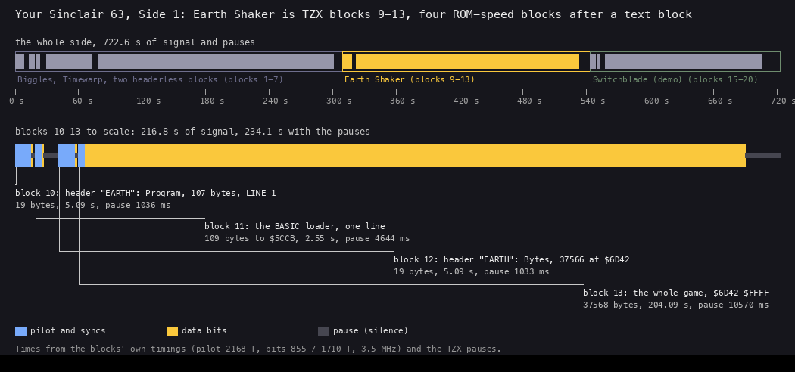
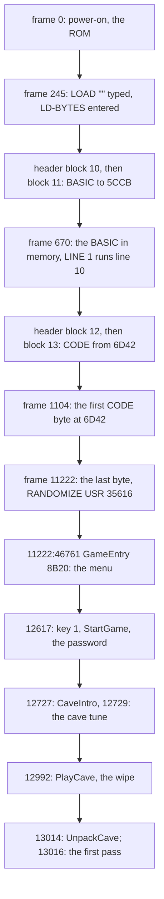
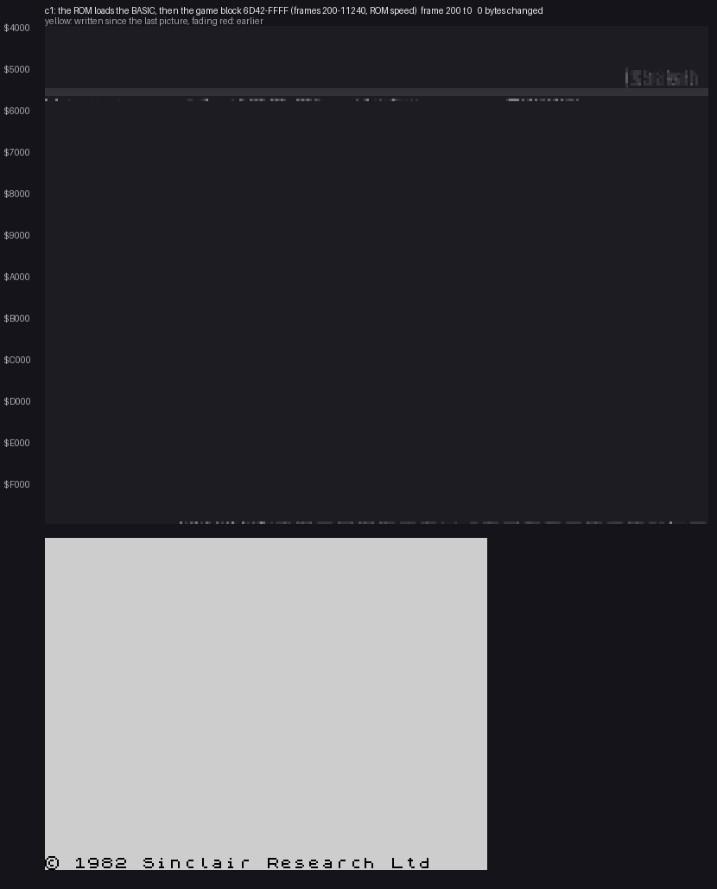
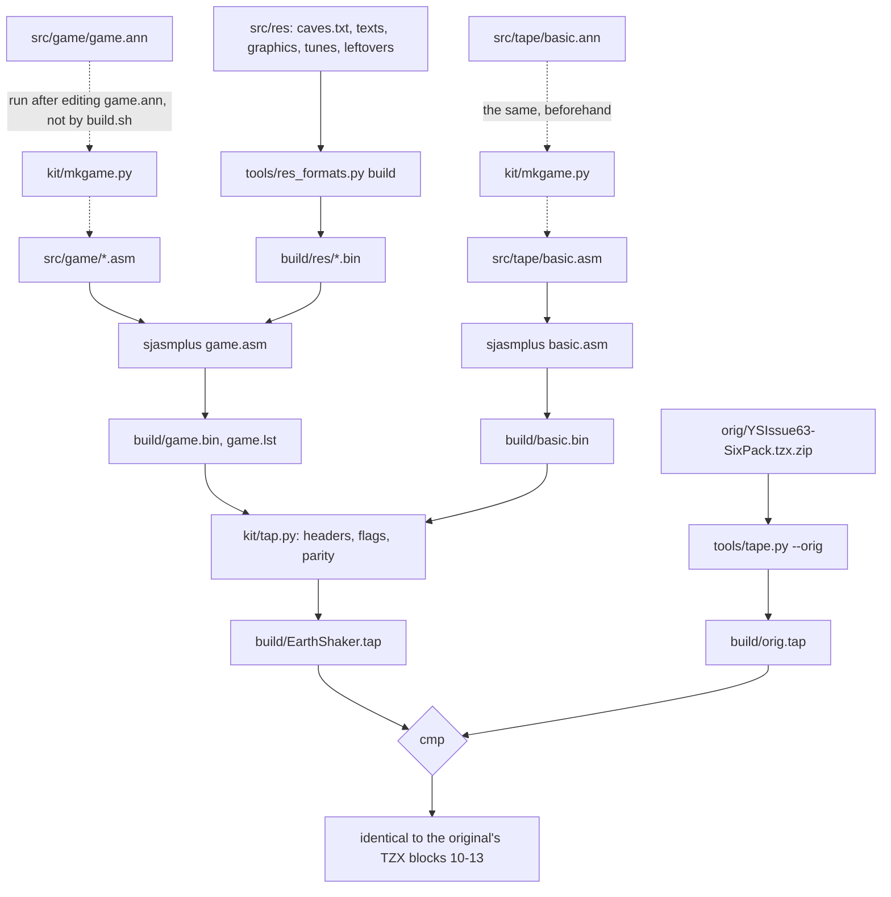

# 3. Build and load

What this covers: the covertape side and Earth Shaker's four blocks on it; the BASIC loader; the load from power-on to
the first pass, frame by frame; the copies, re-releases and conversions and how they differ; the build from source.

The recordings it rests on: `c1` (power-on, the covertape side wound to the game, loaded at ROM speed with the fast
LD-BYTES trap and turbo off; [WALKTHROUGH 1](../WALKTHROUGH.md#1-one-recording-from-power-on)). The tape's blocks come
from `orig/YSIssue63-SixPack.tzx.zip` (`tools/tzxblocks.py`, `tools/image.py --blocks`). A value read with
`memory_at` is the state at the start of that frame.

## 3.1 The tape block by block

The original is a magazine covertape. Side 1 of the Your Sinclair issue 63 tape holds Biggles, Timewarp, two
headerless blocks, Earth Shaker and the Switchblade demo, one after another (`Your Sinclair (Issue 63) - Side 1.tzx`).
Earth Shaker is TZX blocks 9-13: a text block and four standard ROM-speed blocks. A user winds the tape to the game and
types `LOAD ""`. unreal-ng's tape catalogue lists the data blocks only and numbers the same BASIC header as block 7;
`c1` is wound to it with `/tape/seek` ([WALKTHROUGH 0](../WALKTHROUGH.md#0-the-medium)).



*Top: the whole of Side 1 on a time axis, 722.6 s, the three programs boxed. Below: blocks 10-13 to scale, pilot, data
and pause. Times from the blocks' own timings at 3.5 MHz and the TZX pauses. Command: `python3 tools/fig_tape.py --out
docs/img/load/tape.png`.*

| TZX block | Kind | Bytes (with flag and parity) | Contents | Loads to | Time (pilot to last bit) | Pause after |
| --- | --- | --- | --- | --- | --- | --- |
| 9 | text (ID `$30`) | 28 | "Earth Shaker - Michael Batty" | | | |
| 10 | header, flag `$00` | 19 | Program "EARTH", length 107, LINE 1 | | 5.09 s | 1036 ms |
| 11 | data, flag `$FF` | 109 | the BASIC loader, one line (10) | PROG `$5CCB-$5D35` | 2.55 s | 4644 ms |
| 12 | header, flag `$00` | 19 | Bytes "EARTH", length 37 566, start 27 970 (`$6D42`), param2 32 768 | | 5.09 s | 1033 ms |
| 13 | data, flag `$FF` | 37 568 | the whole game | `$6D42-$FFFF` | 204.09 s | 10 570 ms |

Earth Shaker spans 309.3 s to 543.4 s of the side. The four blocks take 216.8 s of signal, 234.1 s with their pauses.
The times come from the blocks' own timings: pilot pulses of 2168 T, 8063 of them for a header and 3223 for data,
bits of 855 and 1710 T a pulse.

The other blocks are not Earth Shaker's: 1-7 are Biggles, Timewarp and two big headerless blocks (6 and 7: 7 162 and
40 998 bytes); 15-20 are the Switchblade demo. The build picks blocks 10-13 by the BASIC header named "EARTH"
(`tools/tape.py --orig`).

The point: the game is four plain ROM blocks on a shared tape. Nothing on the tape is custom.

## 3.2 The BASIC loader

The program "EARTH" is one line, as the ROM's LOAD leaves it at `$5CCB` (`src/tape/basic.ann`):

```basic
10 INK 7: PAPER 0: BORDER 0: CLEAR 27000: PRINT AT 0,0;"EARTH SHAKER by M.BATTY": LOAD "" CODE : RANDOMIZE USR 35616
```

| Address | Bytes | What |
| --- | --- | --- |
| `$5CCB` | `00 0A` | the line number 10, high byte first |
| `$5CCD` | `67 00` | the line's length, 103 |
| `$5CCF` | `D9 37 0E ...` | INK "7" and its hidden number (`$0E`, then five bytes) |
| `$5CD7` | `3A DA ...` | `:` PAPER 0 |
| `$5CE0` | `3A E7 ...` | `:` BORDER 0 |
| `$5CE9` | `3A FD ...` | `:` CLEAR "27000", the hidden number `$6978` |
| `$5CF6` | `3A F5 AC ...` | `:` PRINT AT 0,0 |
| `$5D08` | `3B 22 ...` | `;` and the string "EARTH SHAKER by M.BATTY" |
| `$5D22` | `3A EF 22 22 AF` | `:` LOAD "" CODE |
| `$5D27` | `3A F9 C0 ...` | `:` RANDOMIZE USR "35616", the hidden number `$8B20` |
| `$5D35` | `0D` | ENTER |

What each statement does:

- **INK 7, PAPER 0, BORDER 0**: white on black, the colours the menu keeps.
- **CLEAR 27000** puts RAMTOP at `$6978`, below the game block. The machine stack sits under the game
  ([doc 2.7](02-architecture.md#27-the-stack)).
- **PRINT AT 0,0** shows the title while the CODE block loads.
- **LOAD "" CODE** takes the next file, blocks 12 and 13, to the address its header names, `$6D42`.
- **RANDOMIZE USR 35616** calls `$8B20`, GameEntry, which never returns.

There is no loading screen, no second-stage loader, no packer, no turbo and no protection. The game is in memory as the
ROM loads it. `tools/image.py` builds the same image (`work/mkgame/original.bin`) from the two data blocks.

The point: one BASIC line is the whole loader.

## 3.3 From power-on to the first pass

The ROM loads both files with LD-BYTES `$0556`. It reads the pulses at the EAR bit of port `$FE`, eight bits a byte,
and stores each byte at IX.

```text
LD-BYTES(IX = start, DE = length, A = flag):     ; ROM $0556
    wait for a pilot tone, then the sync pulses
    read the flag byte; it must equal A
    while DE != 0:
        byte = 0
        repeat 8 times:                          ; LD-8-BITS $05CA
            measure two edges (LD-EDGE-2 $05E3)  ; a 0 bit is short, a 1 bit long
            byte = byte << 1 | (time > threshold)
        (IX) = byte; IX = IX + 1; DE = DE - 1
        parity = parity XOR byte
    read the parity byte; the total must be 0
```

```text
05C2  DD 23       LD-NEXT:    INC IX               ; the next address
05C4  1B          LD-DEC:     DEC DE               ; LD-FLAG's JR comes here
05C5  08                      EX AF,AF'
05C6  06 B2                   LD B,$B2             ; the timing constant
05C8  2E 01       LD-MARKER:  LD L,$01             ; the marker bit
05CA  CD E3 05    LD-8-BITS:  CALL LD-EDGE-2       ; two edges: one bit
05CD  D0                      RET NC               ; time out or BREAK
05CE  3E CB                   LD A,$CB
05D0  B8                      CP B                 ; long pulses give a 1
05D1  CB 15                   RL L
05D3  06 B0                   LD B,$B0
05D5  D2 CA 05                JP NC,LD-8-BITS      ; until the marker comes out
05D8  7C                      LD A,H
05D9  AD                      XOR L
05DA  67                      LD H,A               ; the running parity
05DB  7A                      LD A,D
05DC  B3                      OR E
05DD  20 CA                   JR NZ,LD-LOOP        ; the next byte
```

The stages in `c1`, power-on at frame 0:



| Frame in `c1` | What | How it was found |
| --- | --- | --- |
| 245 | LD-BYTES first entered (the BASIC header) | the L1 of `$0556` |
| 670 | the BASIC present at `$5CCB` | `memory_at` searched by halves (`work/docs/esA/memat.py`) |
| 1104 | the first CODE byte at `$6D42` | `memory_at` |
| 2293 | the load reaches `$8000` | `memory_at` |
| 6689 | the load reaches `$C000` | `memory_at` |
| 11223 | `$FFF0` loaded (written during 11222) | `memory_at` |
| 11222:46761 | GameEntry `$8B20` runs | the L1 arrival |
| 11357 | the title tune | the L1 of PlayTune |
| 11800 | the tape stopped by the script | `tests/inputs/c1.txt` |
| 12617-12705 | StartGame, the password prompt, ENTER | the L1 |
| 12727, 12729 | CaveIntro, the cave tune | the L1 |
| 12992-13014 | PlayCave, ClearScreenCave, the wipe | the L1 |
| 13014 | UnpackCave | the trace 13014:58300-13015:22000 |
| 13016 | FillTimeBar, the first KeysStep | the L1 |



*Recording `c1`, frames 200 to 11240, a picture every 240 frames: memory `$4000-$FFFF` at one cell a byte, with the
screen. The BASIC arrives at `$5CCB`, then the game fills `$6D42-$FFFF` from the bottom up at 186 bytes a second on average.
Command: `python3 ../../kit/memanim.py --work work/docs/esA/c1 --from 200 --to 11240 --step 16773120 --from-address
4000 --to-address FFFF --cell 3 --screen --width 1050`.*

The static timing and the recording agree. Block 13 lasts 204.09 s, 204.09 × 3 500 000 / 69 888 = 10 221 frames, of
which the data pilot is 3223 × 2168 T, about 100 frames. The bit sum of the 37 566 bytes is 707.3 million T, 10 120
frames. In `c1` the first byte lands at 1104 and the last during 11222: 10 118 frames. The static timing and the
recording agree within two frames.

Worked example: `$8000` arrives at frame 2293. It is byte `$8000 - $6D42` = 4 798 of the block. A 0 bit takes two
pulses of 855 T and a 1 bit two of 1710 T, so the time of a byte depends on its 1 bits. Summing the bits of the first
4 798 bytes of the image gives 83.07 million T, 1 188.6 frames: 1104 + 1188.6 = frame 2292.6. The same sum predicts
`$C000` at frame 6689.5 and `$FFF0` at 11220.9. The recording has 2293, 6689 and "present at 11223". The early bytes
load at 202 bytes a second, the whole block at 186: the bytes past `$8000` carry more 1 bits.

Witness: `c1`'s L1 (`work/stage1/c1/`) and the `memory_at` samples above; the bit sums are computed from
`work/mkgame/original.bin` (the command is in [esA-NOTES](../work/docs/esA-NOTES.md)).

The point: from power-on the player waits 224 s for the menu, and the ROM does all of the loading.

## 3.4 The copies, re-releases and conversions

Every copy in the local collection was compared block by block with the original's two data blocks
(`tools/media_compare.py`, `work/stage1/media-compare.tsv`; the full table is in the [README](../README.md)).

| Copy | What it is | What differs from the original |
| --- | --- | --- |
| other dumps of the covertape side, the cut-out TZX and TAP files | the same tape | nothing: the BASIC and the game block byte for byte |
| `EARTHSHA.TAP` (ZXDB, WoS, TOSEC, zxart) | a re-save | the game block byte for byte; the BASIC is "Earth1", 113 bytes, LINE 10, `LOAD "Earth2" CODE` |
| TOSEC `[different loading screen].tzx` | a re-release | a BASIC "EARTH S." of 132 bytes and a 6912-byte SCREEN at 24320 added; the game block byte for byte |
| zxart `(EN)[h].tap` | a hack | 23 bytes: `$86DE` `3A` to `C9` (TimerStep returns at once: no time limit) and `$AB4D-$AB62` "(C) 1990 MICHAEL BATTY" to "(C) MICHAEL BATTY" |
| `EARTHOLD.Z80` (ZXDB, = TOSEC `(different).z80`) | a snapshot of another version | 315 bytes in `$9B9C-$9CB7` (the player's graphics, cells 3 and 4 at `$9B98` and `$9C28`) and `$9DB8-$9DFB` (the death graphics `$9DB4` and `$9DD8`) |
| Pardubak `(48k).tap` | a re-save | a loading screen; the game as a 40 000-byte block at 24500 and a 1036-byte block at 64500 |
| TR-DOS files (TOSEC, zxart and others) | disk conversions | packed or relocated; the longest unchanged run is 28 927 bytes |
| TOSEC MDR files | Microdrive conversions | no 256-byte run of the game block |
| Earth Shaker Editor TRDs (WAR Group 2001) | an editor's disks | a 41 216-byte file with the game block whole |
| `earthshaker.zip` (archive.org) | 32 RZX recordings, one a cave | someone else's play; used for the caves in [doc 4.6](04-game-loop.md#46-the-cost-of-a-pass-in-every-cave) |

The hack in detail. TimerStep `$86DE` starts with `LD A,(TimerSub)` (`3A 7C FD`). The hack writes `C9`, RET, over the
`3A`. TimerStep then returns at once, the bar never shrinks, and no cave ever times out. The copyright line loses its
year.

`EARTHOLD.Z80` has other player and death graphics, all else equal. Its code is byte for byte the code of the tape,
with the patches of [doc 2.8](02-architecture.md#28-the-leftovers-and-the-1990-patches). Only the look of the player
changed.

The point: every tape copy carries the same game block (the conversions repack it); EARTHOLD changes graphics only,
and only the hack changes code, by one byte.

## 3.5 The build

`tools/build.sh` builds Earth Shaker's four blocks from source and compares them with the original's blocks 10-13 byte
for byte. It starts at the `.asm` files: `kit/mkgame.py` writes them from the `.ann` files beforehand, a separate step
run after editing an `.ann` (the dotted arrows).



```text
build.sh:
    res_formats.py build --out build/res          ; caves, texts, graphics, tunes, leftovers to binaries
    sjasmplus src/game/game.asm  -> game.bin      ; $6D42-$FFFF
    sjasmplus src/tape/basic.asm -> basic.bin     ; $5CCB-$5D35
    kit/tap.py EarthShaker.tap basic:EARTH:1:basic.bin code:EARTH:27970:game.bin
    tools/tape.py --orig orig.tap                 ; blocks 10-13 cut from the TZX
    cmp EarthShaker.tap orig.tap
```

| Input | What it holds |
| --- | --- |
| `src/game/game.ann` | every entry of the game with its name, kind, module and comment; `kit/mkgame.py` writes `src/game/*.asm` from it |
| `src/res/caves/caves.txt` | the 32 caves as text, one character a cell, and their parameters |
| `src/res/texts/*.txt` | the texts, one quoted string a line |
| `src/res/graphics`, tunes | the cell graphics, the font, the logo, the tunes |
| `src/res/leftovers/*.bin` | every byte no code reads, kept as it is ([doc 2.8](02-architecture.md#28-the-leftovers-and-the-1990-patches)) |
| `src/tape/basic.ann` | the BASIC line |

The TAP holds the data. The TZX's text block, timings and pauses are not data, so the build compares with the
original's four blocks as TAP.

Worked example: the last run printed `build: identical to the original's TZX blocks 10-13 (build/orig.tap)`. A change of
one cell in `caves.txt` changes one nibble of CaveData and the checksum of block 13, and `cmp` fails.

The point: the source and the resources rebuild the tape exactly, so every name in these documents is checked against
the original bytes.
