# 4. Game loop

What this covers: the game's states from the menu to the win; the interrupt and where the game turns it off; the cave
start with the unpacker `$82B6`; one pass of the cave loop, step by step and against the beam; what a pass costs in
every cave and why the speed varies; the time limit, counted in passes.

The recordings it rests on:

- `c1`: power-on, the tape at ROM speed, cave 1 played ([WALKTHROUGH 1](../WALKTHROUGH.md#1-one-recording-from-power-on)).
  Three access traces of it: the unpack (13014:58300-13015:22000), one pass with no event (13143:35781-13149:10971)
  and one pass where a boulder lands (13183:15803-13190:53826).
- `timer`: from cave 1 in play, F (the map), then no key until the time runs out.
- `rzx-earth01` to `rzx-earth32`: the RZX archive's play of caves 1-32, replayed frame by frame
  ([WALKTHROUGH 6.0](../WALKTHROUGH.md#60-the-recordings)); their L1 builds give the mean pass of each cave. One trace
  of `rzx-earth13`: a pass of the falling-earth cave (1533:24069-1543:67391).

A frame is 69 888 T (48K). A position is written `frame:T`. A value read with `memory_at` is the state at the start of
that frame. A trace puts an instruction in the frame where it ran. The traces and the scripts behind the figures are in
`work/docs/esA/`; the commands are in [esA-NOTES](../work/docs/esA-NOTES.md).

## 4.1 The states of the game

The game is a nest of CALLs, not a state variable. The menu calls a game. A game calls the caves one after another. A
cave calls its passes until the cave ends. Each level returns to the one above. The level above decides what comes
next from three flags: CaveOver `$FD7D`, PlayerKilled `$7FFD` and CaveDone `$FD84`.

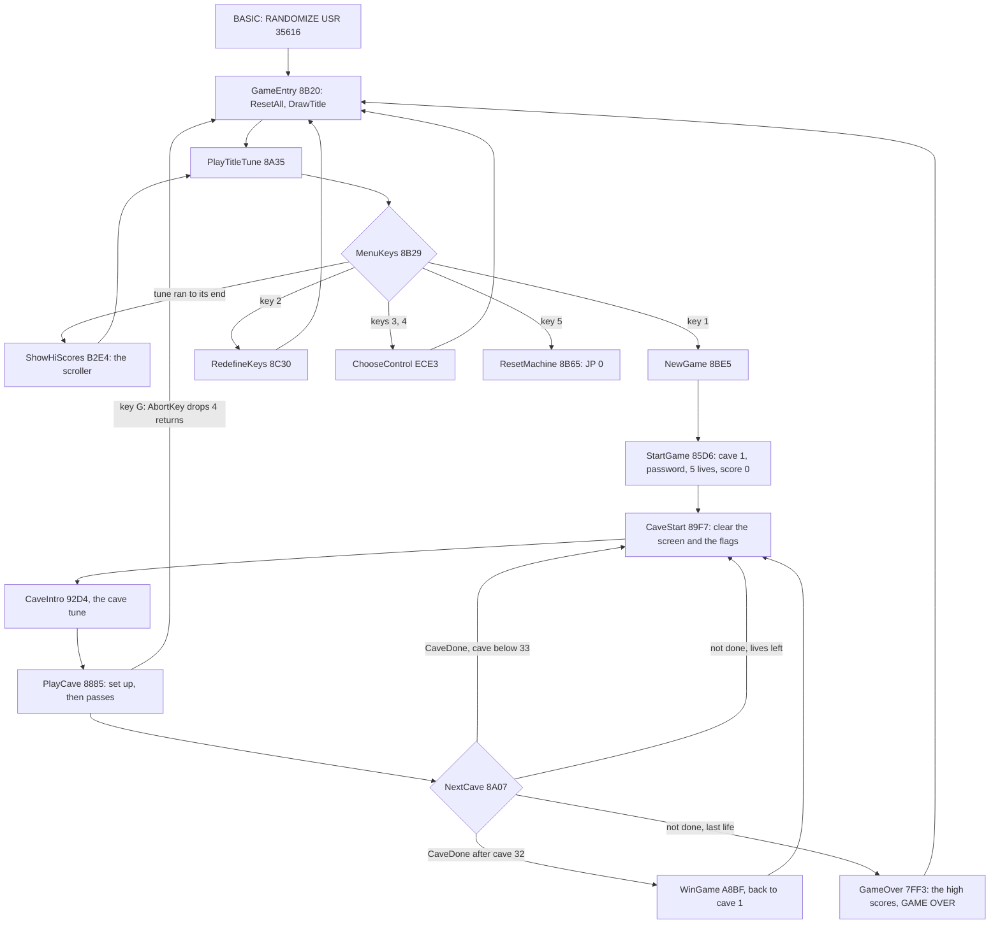

The program, as the code runs it:

```text
GameEntry:                               ; $8B20, entered by the BASIC loader
    ResetAll(); DrawTitle()
    loop:
        HL = PlayTitleTune()             ; HL = $B269 when the tune ran to its end
        if HL == $B269: ShowHiScores(); continue
        if key 1: NewGame(); goto GameEntry
        if key 2: RedefineKeys(); goto GameEntry
        if keys 3 or 4: ChooseControl()  ; jumps back to GameEntry itself
        if key 5: JP 0                   ; the ROM's copyright screen
NewGame:                                 ; $8BE5
    StartGame()                          ; cave 1, the password, lives 5, score 0
    repeat:                              ; CaveStart $89F7
        clear the screen; PlayerKilled = CaveOver = CaveDone = 0
        CaveIntro(); PlayCaveTune(); PlayCave()
        if CaveDone:                     ; NextCave $8A07
            cave = cave + 1
            if cave == 33: WinGame(); cave = 1
        else:
            Lives = Lives - 1
            if Lives == 0: break
    GameOver()                           ; the high-score check, the GAME OVER screen
```

The end of a cave, as assembled (`src/game/main.asm`):

```text
89F7  CD 0E 86    CaveStart:     CALL ClearScreen
89FA  AF                         XOR A
89FB  32 FD 7F                   LD (PlayerKilled),A
89FE  32 7D FD                   LD (CaveOver),A
8A01  32 84 FD                   LD (CaveDone),A
8A04  CD EA 89                   CALL CavePlay          ; CaveIntro, the cave tune, PlayCave
8A07  3A 84 FD    NextCave:      LD A,(CaveDone)
8A0A  B7                         OR A
8A0B  20 0B                      JR NZ,NextCaveSkip
8A0D  3A 93 FD                   LD A,(Lives)
8A10  3D                         DEC A
8A11  32 93 FD                   LD (Lives),A
8A14  B7                         OR A
8A15  C8                         RET Z                  ; the last life: back to NewGame, then GameOver
8A16  18 DF                      JR CaveStart           ; the same cave again
8A18  06 02       NextCaveSkip:  LD B,$02
8A1A  21 7F FD                   LD HL,CaveDigits+1
8A1D  CD 15 83                   CALL IncDigits         ; the cave's two decimal digits + 1
8A20  3A 91 FD                   LD A,(CaveNumber)
8A23  3C                         INC A
8A24  32 91 FD                   LD (CaveNumber),A
8A27  FE 21                      CP $21
8A29  20 08                      JR NZ,NextCaveSkip2
8A2B  CD BF A8                   CALL WinGame
8A2E  3E 01                      LD A,$01
8A30  32 91 FD                   LD (CaveNumber),A
8A33  18 C2       NextCaveSkip2: JR CaveStart
```

Three ways out of a cave lose a life: the time runs out (CaveOver), H is pressed (QuitKey sets CaveOver), the player
is killed (PlayerKilled). Only the open exit sets CaveDone. G is different: AbortKey `$93A5` pops four return
addresses and returns to the menu.

```text
93A5  CD 7E 93    AbortKey:      CALL AnimateCellCodes  ; the patch chain: the cell update runs from here (4.4)
93A8  3E FD                      LD A,$FD
93AA  D3 FF                      OUT ($FF),A
93AC  DB FE                      IN A,($FE)             ; half-row A S D F G
93AE  E6 10                      AND $10                ; G
93B0  C0                         RET NZ
93B1  E1                         POP HL                 ; $889B, the return into PassLoop
93B2  E1                         POP HL                 ; $89F3, the return into CavePlay
93B3  E1                         POP HL                 ; $8A07, the return into CaveStart
93B4  E1                         POP HL                 ; $8BE8, the return into NewGame
93B5  C9                         RET                    ; to $8B42: JP GameEntry
```

At a pass the stack holds, from the top, `$889B`, `$89F3`, `$8A07`, `$8BE8` and `$8B42`. Dropping four leaves
`$8B42`, the instruction after `CALL NewGame` in MenuKeys. So an abort skips GameOver: no high-score check and no GAME
OVER screen.

Worked example. The `lives` recording starts cave 1 and presses H again and again. Each H costs a life: the intro
shows 5, 4, 3, 2, 1 lives. After the fifth H, NextCave returns with Lives 0 and GameOver shows GAME OVER
([doc 1.6](01-game-design.md#16-the-key-moments)). The RZX's play takes the CaveDone branch 32 times. At the end of
`rzx-earth32` WinGame shows the win screen, and CaveNumber is 1 again.

Witness: the `c1` L1 has StartGame at frame 12617, CaveIntro at 12727, PlayCave at 12992 and the first KeysStep at
13016. `c1` ends with H, then G: the menu returns with no GAME OVER screen.

The point: the program's structure is the state machine. The flags only tell PlayCave's caller how the cave ended.

## 4.2 The interrupt

The game keeps IM 1 and the ROM's handler at `$0038`. It installs no handler of its own and has no HALT. The handler
counts FRAMES and scans the keyboard, then re-enables interrupts and returns. The game never reads FRAMES. So the
interrupt does nothing for the game but cost time.

```text
0038  F5          MASK-INT:  PUSH AF
0039  E5                     PUSH HL
003A  2A 78 5C               LD HL,(FRAMES)
003D  23                     INC HL
003E  22 78 5C               LD (FRAMES),HL
0041  7C                     LD A,H
0042  B5                     OR L
0043  20 03                  JR NZ,KEY-INT
0045  FD 34 40               INC (IY+$40)          ; the third byte of FRAMES
0048  C5          KEY-INT:   PUSH BC
0049  D5                     PUSH DE
004A  CD BF 02               CALL KEYBOARD         ; $02BF: KEY-SCAN and the repeat logic
004D  D1                     POP DE
004E  C1                     POP BC
004F  E1                     POP HL
0050  F1                     POP AF
0051  FB                     EI
0052  C9                     RET
```

The handler costs 882 T from the acknowledge to the end of the RET, in each of the six interrupts of the `c1` pass
trace. That is 1.3 % of a frame. A pass of cave 1 takes six of them: 5 292 T of 394 506.

The game turns interrupts off for every sound and for the screen wipe. Each routine below opens with DI and closes with
EI:

| Routine | DI | EI | What |
| --- | --- | --- | --- |
| PlayTune | `$88CE` | `$890E` (TuneEnds) | the title tune, the cave tunes, the map tune, the win tune |
| ExitOpenSound | `$9072` | `$908F` | the exit opens |
| Jingle | `$A713` | `$A749` | the gem jingle |
| NoiseBurst | `$E740` | `$E77A` | a burst of noise |
| FallSound | `$E7A9` | `$E7E3` | an object falls |
| TeleportOut, TeleportIn | `$E87B`, `$E8AE` | `$E8AC`, `$E8DF` | the teleport sweeps |
| TimeOutSound | `$86AD` | `$86D1` | the time ran out |
| TimeBonus | `$8702` | `$871A` | the bar counted into the score |
| QuitKey | `$8736` | `$8757` | H: the bar drains |
| WipeScreen | `$8DE3` | `$8DFD` | the wipe before a cave |
| KeyClick | `$8E1A` | `$8E29` | a key typed in the password |
| PasswordAccepted | `$8EE7` | `$8F06` | the password matched |

The ROM's BEEPER `$03B5` starts with DI and ends with EI at `$03F6`. So after each BEEPER call inside a sound the game
issues DI again: PlayTune `$88E2` and `$88F8`, JellyBean `$9207` and `$921A`, PotionTune `$91C7`, AntiGravPass `$A813`.
Without it an interrupt could fall between two notes. TimerStep's click at `$86F1` calls BEEPER with interrupts on, and
BEEPER leaves them on.

An INT that falls while interrupts are off is lost: the 48K holds INT for only 32 T at the start of the frame. The
pass with a thud shows it: 7.54 frames, five interrupts taken, two lost ([4.5](#45-where-a-pass-goes)). The lost
interrupts change nothing in the game. Only FRAMES and the ROM's keyboard state miss a tick, and the game reads
neither.

The point: there is no frame sync. The game's speed is its own work, and the interrupt is a 1.3 % tax.

## 4.3 The cave start and the unpacker

Before the first pass PlayCave sets the cave up. The chain is long because the 1990 version put a CALL in front of
routines already there ([doc 2.8](02-architecture.md#28-the-leftovers-and-the-1990-patches)).

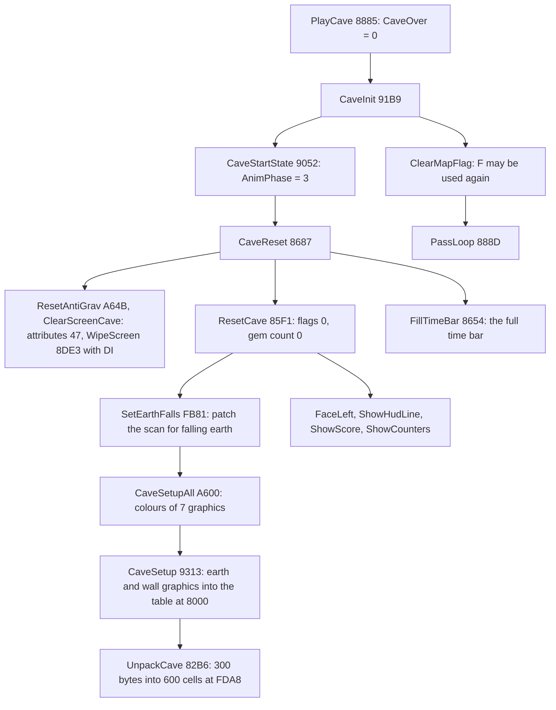

In `c1` the steps fall in these frames: the cave intro at 12727, the cave tune at 12729, PlayCave at 12992, the wipe
12992-13014, UnpackCave at 13014, FillTimeBar and the first KeysStep at 13016. The intro and the tune take 265 frames
(5.3 s). The wipe takes 22. It runs with interrupts off. It shifts every even screen byte right and every odd one left,
eight times, so each 16-pixel pair is squeezed into its middle seam. That is 8 × 192 × 16 × 55 T, about 1.35 million T
or 19.4 frames.

### The cave format

A cave is a record of 314 bytes in CaveData `$C000-$E73F`. The first 300 bytes hold the 600 cells, two a byte, the left
cell in the low nibble. The last 14 bytes are the parameters:

| Byte | Field | Cave 1 |
| --- | --- | --- |
| 0 | GemsNeeded, binary | `$24` = 36 |
| 1 | GemValue, the points a gem | `$0A` = 10 |
| 2-3 | the start, a cell index (row × 30 + column) | `$011D` = 285: row 9, column 15 |
| 4-5 | GemsNeeded as two digits | 3, 6 |
| 6-7 | the earth graphic | `$9B50` (GfxEarth) |
| 8-9 | the wall graphic | `$9CB8` (GfxWall1) |
| 10-13 | colours: door, boulder, wall 1, earth | `$44 $46 $42 $41` |

The cell codes 0-15 are the objects ([doc 1.4](01-game-design.md#14-the-objects)). The game's own states use 16-31 and
bit 5 ([doc 7](07-objects.md)).

### The unpacker

UnpackCave finds record N by adding 314 to `$BEC6` (CaveData minus 314) N times. It splits each byte in two and writes
the cells one after another into CaveGrid `$FDA8-$FFFF`, 30 a row, 20 rows. Last, an LDIR copies the 14 parameters to
CaveParams `$FD9A-$FDA7`.

```text
UnpackCave():                         ; $82B6
    HL = $BEC6
    repeat CaveNumber times: HL = HL + 314
    DE = $FDA8                        ; CaveGrid
    repeat 300 times:
        (DE) = (HL) & $0F; DE = DE + 1        ; the left cell
        (DE) = (HL) >> 4;  DE = DE + 1        ; the right cell
        HL = HL + 1
    copy 14 bytes from HL to $FD9A    ; CaveParams
```

The other direction, as `tools/res_formats.py` packs a cave from `src/res/caves/caves.txt`:

```text
Pack(cells[600], params[14]):
    for i in 0, 2, ..., 598: out += cells[i] | cells[i + 1] << 4
    out += params                     ; 314 bytes
```

```text
82B6  3A 91 FD    UnpackCave:       LD A,(CaveNumber)
82B9  47                            LD B,A
82BA  21 C6 BE                      LD HL,CaveData-314
82BD  11 3A 01                      LD DE,$013A           ; 314
82C0  19          UnpackCaveLoop:   ADD HL,DE
82C1  10 FD                         DJNZ UnpackCaveLoop
82C3  01 2C 01                      LD BC,$012C           ; 300 bytes
82C6  11 A8 FD                      LD DE,CaveGrid
82C9  7E          UnpackCaveLoop2:  LD A,(HL)             ;  7 T
82CA  E6 0F                         AND $0F               ;  7
82CC  12                            LD (DE),A             ;  7
82CD  13                            INC DE                ;  6
82CE  7E                            LD A,(HL)             ;  7
82CF  E6 F0                         AND $F0               ;  7
82D1  0F                            RRCA                  ;  4 x 4
82D2  0F                            RRCA
82D3  0F                            RRCA
82D4  0F                            RRCA
82D5  12                            LD (DE),A             ;  7
82D6  13                            INC DE                ;  6
82D7  23                            INC HL                ;  6
82D8  0B                            DEC BC                ;  6
82D9  78                            LD A,B                ;  4
82DA  B1                            OR C                  ;  4
82DB  20 EC                         JR NZ,UnpackCaveLoop2 ; 12: 102 T a byte
82DD  11 9A FD                      LD DE,CaveParams
82E0  01 0E 00                      LD BC,$000E
82E3  ED B0                         LDIR
82E5  C9                            RET
```

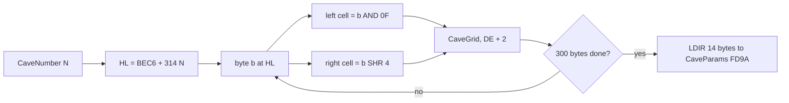

Worked example: cave 1. HL = `$BEC6` + 314 = `$C000`. The record starts `55 55 61 66 66 62`:

| Byte | Low nibble (left) | High nibble (right) | Cells |
| --- | --- | --- | --- |
| `$55` | 5 wall | 5 wall | `##` |
| `$55` | 5 wall | 5 wall | `##` |
| `$61` | 1 exit | 6 earth | `X:` |
| `$66` | 6 earth | 6 earth | `::` |
| `$66` | 6 earth | 6 earth | `::` |
| `$62` | 2 boulder | 6 earth | `0:` |

So row 0 of cave 1 begins `####X:::::0:`, as `caves.txt` has it. The parameters at `$C12C` are
`24 0A 1D 01 03 06 50 9B B8 9C 44 46 42 41`, the right column of the table above.

The loop costs 102 T a byte, 30 600 T for the cells. The LDIR adds 289 T and the set-up about 100: 30 990 T of its own.
The `c1` trace runs it from 13014:58356 to the RET at 13015:20373: 31 905 T with one interrupt inside, 0.46 frames. A
later cave adds 24 T for each extra turn of the address loop.

Witness: the `c1` trace 13014:58300-13015:22000 (`work/docs/esA/c1/traces/`). `memory_at` 13014 still holds the cave
of the last game in `$FDA8`; `memory_at` 13016 holds the fresh cave and its parameters at `$FD9A`.

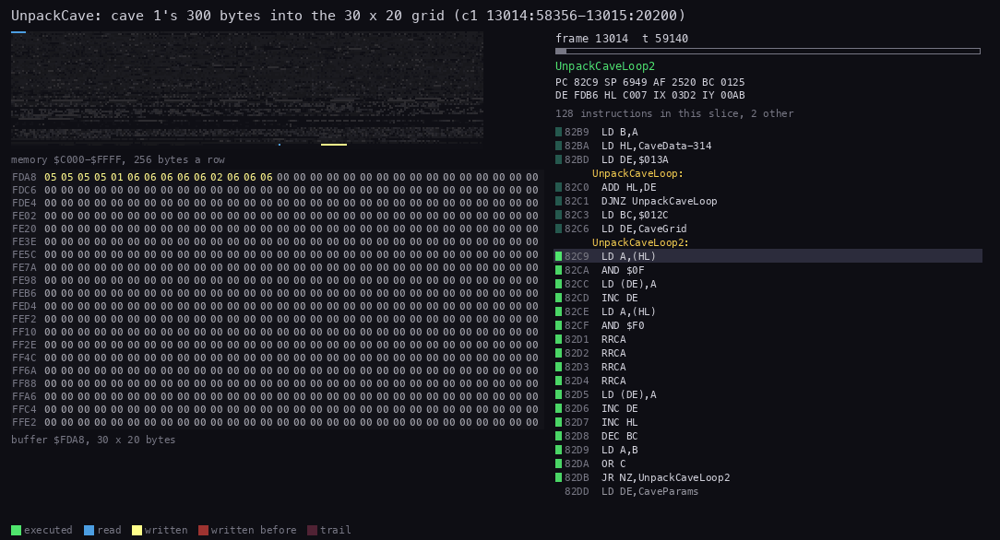

*UnpackCave on cave 1, recording `c1`, frames 13014:58300-13015:22000, 40 pictures. The panel is the buffer `$FDA8`
drawn as 30 × 20 hex cells; the code and the registers are on the right. Command: `python3 ../../kit/routine_anim.py
--work work/docs/esA/c1 --window 13014:58300-13015:22000 --listing build/game.lst --view buffer:FDA8:30x20:hex --range
C000-FFFF --pc 82B6-82E5 --pictures 40 --width 1050`.*

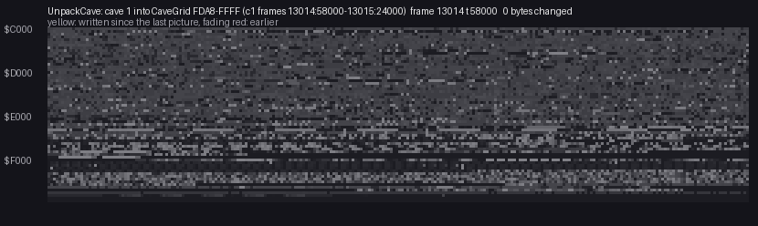

*The same unpack as memory `$C000-$FFFF`, a picture every 1000 T: reads at `$C000-$C139`, writes at `$FDA8-$FFFF`.
Recording `c1`, frames 13014:58000-13015:24000. Command: `python3 ../../kit/memanim.py --work work/docs/esA/c1 --from
13014:58000 --to 13015:24000 --step 1000 --from-address C000 --to-address FFFF --cell 3 --width 1050`.*

The same routine on cave 2, made in stage 2:

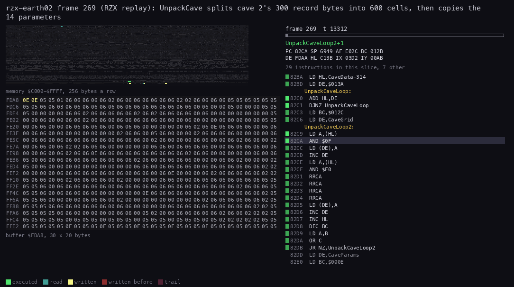

*Recording `rzx-earth02`, frame 269 (the RZX replay), 100 pictures; `kit/routine_anim.py`.*

The point: the caves are stored at half size. The unpack is the only reader of CaveData. It costs under half a frame,
hidden behind a 19-frame wipe.

## 4.4 One pass

A pass is one turn of PassLoop `$888D`. Every pass makes the same ten calls in the same order, then tests the three
flags.

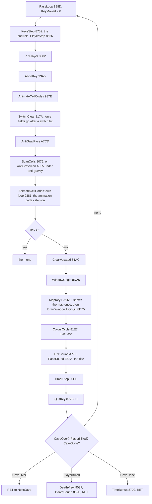

```text
PlayCave():                            ; $8885
    CaveOver = 0
    CaveInit()                         ; 4.3
    loop:                              ; PassLoop $888D
        KeyMoved = 0
        KeysStep()                     ; read the controls, move the player
        PutPlayer()                    ; the player's code into the cave
        AbortKey()                     ; the cell update, the animation codes, then G
        ClearVacated()                 ; empty the cells left this pass
        WindowOrigin()                 ; the 16 x 11 window follows the player
        MapKey()                       ; F: the map once a cave; then draw the window
        ColourCycle()                  ; the open exit flashes
        FizzSound()                    ; the pass's sound, the fizz
        TimerStep()                    ; the time bar
        QuitKey()                      ; H
        if CaveOver: return
        if PlayerKilled: DeathView(); DeathSound(); return
        if CaveDone: TimeBonus(); return
```

```text
8885  21 7D FD    PlayCave:      LD HL,CaveOver
8888  36 00                      LD (HL),$00
888A  CD B9 91                   CALL CaveInit
888D  21 80 FD    PassLoop:      LD HL,KeyMoved
8890  36 00                      LD (HL),$00
8892  CD 59 87                   CALL KeysStep
8895  CD 82 83                   CALL PutPlayer
8898  CD A5 93                   CALL AbortKey
889B  CD AC 81                   CALL ClearVacated
889E  CD A6 8D                   CALL WindowOrigin
88A1  CD 96 EA                   CALL MapKey
88A4  CD E7 81                   CALL ColourCycle
88A7  CD 73 A7                   CALL FizzSound
88AA  CD DE 86                   CALL TimerStep
88AD  CD 2D 87                   CALL QuitKey
88B0  3A 7D FD                   LD A,(CaveOver)
88B3  B7                         OR A
88B4  C0                         RET NZ
88B5  3A FD 7F                   LD A,(PlayerKilled)
88B8  B7                         OR A
88B9  28 07                      JR Z,CheckCaveDone
88BB  CD 3F 90                   CALL DeathView
88BE  CD 2E 86                   CALL DeathSound
88C1  C9                         RET
88C2  3A 84 FD    CheckCaveDone: LD A,(CaveDone)
88C5  B7                         OR A
88C6  28 04                      JR Z,NextPass
88C8  CD 02 87                   CALL TimeBonus
88CB  C9                         RET
88CC  18 BF       NextPass:      JR PassLoop
```

Some calls do more than their names say. The 1990 version added no call to PassLoop. It put a CALL as the first
instruction of a routine already there. So the cell update hangs off AbortKey:

```text
93A5  CD 7E 93    AbortKey:          CALL AnimateCellCodes
937E  CD 7A 81    AnimateCellCodes:  CALL SwitchClear      ; SwitchClear ends in AntiGravPass
A7CD  3A 8D FD    AntiGravPass:      LD A,(AntiGravSteps)
A7D0  B7                             OR A
A7D1  20 04                          JR NZ,AntiGravPassSkip
A7D3  CD 75 80                       CALL ScanCells        ; the cell update
A7D6  C9                             RET
```

MapKey is the same: its last instruction calls DrawWindowAtOrigin `$8D75`, which redraws the window. FizzSound starts
with `CALL PassSoundEntry` and five NOPs where the old code was cut out.

The window is redrawn whole every pass: 176 cells of 2 × 2 characters through DrawCell `$8F60`, changed or not
([doc 6](06-rendering.md)). That alone is 227 700 T, 3.26 frames.

Worked example: the `c1` pass with no event, 13143:35781 to 13149:10971. The player stands still and nothing falls.
The pass takes 394 506 T, 5.64 frames:

| Step | T | Share |
| --- | ---: | ---: |
| KeysStep, PutPlayer, AbortKey's own code | 933 | 0.2 % |
| ScanCells (the cell update) | 89 734 | 22.7 % |
| AnimateCellCodes' own loop | 35 776 | 9.1 % |
| ClearVacated | 28 248 | 7.2 % |
| WindowOrigin | 775 | 0.2 % |
| DrawWindow (from MapKey) | 227 686 | 57.7 % |
| ColourCycle, FizzSound and PassSound | 397 | 0.1 % |
| TimerStep (a wrap pass: ShiftTimeBar and the click) | 10 793 | 2.7 % |
| QuitKey and the end tests | 164 | 0.0 % |

The T-states include the interrupts that fell in each step, six in all.

Witness: the trace `work/docs/esA/c1/traces/13143_35781-13149_10971.uatr`. Every PassLoop in every trace runs at SP
`$6959`.

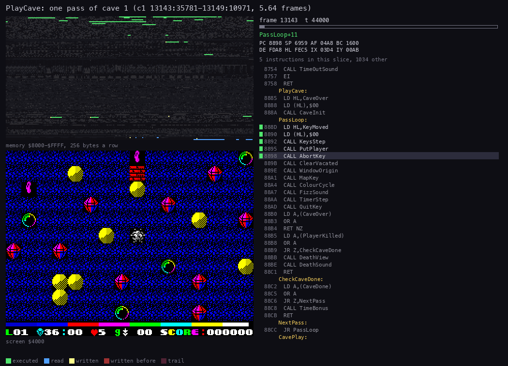

*One pass of cave 1 with no event, 5.64 frames: recording `c1`, frames 13143:35781-13149:10971, 48 pictures; memory
`$8000-$FFFF`, PlayCave's code `$8885-$88CD` on the right. Command: `python3 ../../kit/routine_anim.py --work
work/docs/esA/c1 --window 13143:35781-13149:10971 --listing build/game.lst --range 8000-FFFF --pc 8885-88CD
--pictures 48 --width 1050`.*

The point: more than half of a quiet pass is the redraw of a window that has not changed.

## 4.5 Where a pass goes

Three traced passes side by side show which steps grow. The thud pass in `c1` is a boulder that lands. The cave 13 pass
in `rzx-earth13` is the falling-earth cave with the player digging.

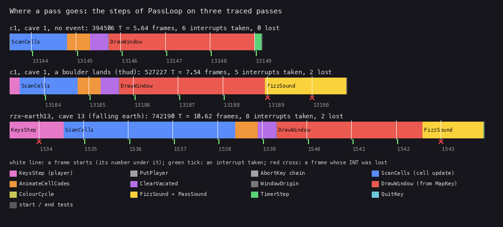

*One bar a pass, in T-states from PassLoop to the next PassLoop; white lines are frame starts, green ticks interrupts
taken, red crosses frames whose INT was lost. Recordings `c1` (13143:35781-13149:10971 and 13183:15803-13190:53826)
and `rzx-earth13` (1533:24069-1543:67391). Command: `python3 tools/fig_passsteps.py --out
docs/img/loop/pass-steps.png "LABEL=work/docs/esA/c1/traces/13143_35781-13149_10971.uatr" ...` with the three traces.*

| Pass | T | Frames | Interrupts taken / lost | What grew |
| --- | ---: | ---: | --- | --- |
| `c1`, no event | 394 506 | 5.64 | 6 / 0 | nothing: DrawWindow is 57.7 % |
| `c1`, a boulder lands | 527 227 | 7.54 | 5 / 2 | FizzSound and PassSound 126 828 T (the thud, with DI), KeysStep 15 919 |
| `rzx-earth13` | 742 190 | 10.62 | 8 / 2 | ScanCells 268 424 T (the earth falls), KeysStep 84 780, the sound 95 526 |

DrawWindow stays at 227 700 T in all three. The cell update triples in cave 13: SetEarthFalls patches the scan so earth
is tested as a falling object ([doc 10](10-gameplay-logic.md)). The sounds play inside the pass with interrupts off, so
a sound is time in which nothing moves.

The same passes against the raster: each frame is a band, the routine running at each T-state is on top, and the screen
writes are dots against the beam's line.

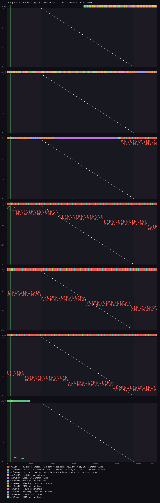

*Recording `c1`, frames 13143:35781-13149:10971, seven frames. Command: `python3 ../../kit/beam_timeline.py --work
work/docs/esA/c1 --window 13143:35781-13149:10971 --listing build/game.lst --machine 48k --width 1050 --frames 7`.*

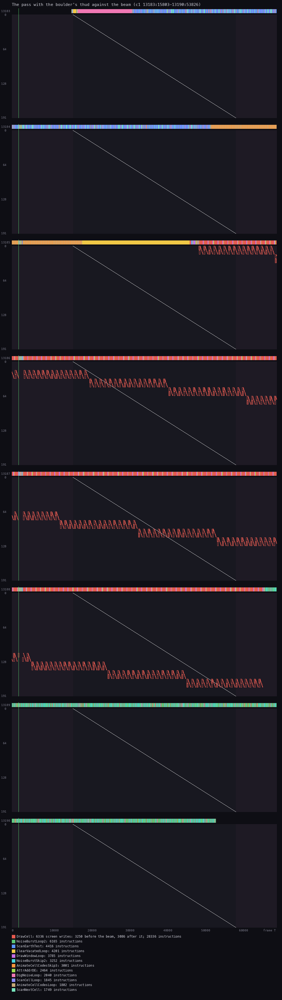

*Recording `c1`, frames 13183:15803-13190:53826, eight frames. Command: `python3 ../../kit/beam_timeline.py --work
work/docs/esA/c1 --window 13183:15803-13190:53826 --listing build/game.lst --machine 48k --width 1050 --frames 8`.*

The window is drawn across frame boundaries with no regard for the beam. Its writes cross the beam's line in every
frame, so a cell can show half old and half new for one frame. The game does nothing about it. An object moves one
cell a pass, every 5-10 frames, so the tear lasts one frame in five or more.

The point: a pass has a fixed part (the window, 3.26 frames) and a variable part (the cell update and the sounds).

## 4.6 The cost of a pass in every cave

The RZX archive plays every cave to its end. The L1 profile of each recording gives each routine's T-states over the
whole cave. Dividing by the runs of KeysStep, once a pass, gives the mean pass.

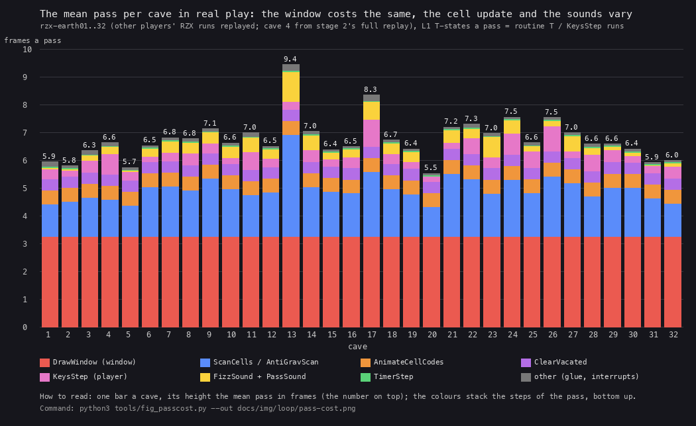

*One bar a cave, its height the mean pass in frames, the colours the steps of the pass. Recordings `rzx-earth01` to
`rzx-earth32` (cave 4 from stage 2's full replay, `work/stage2/rzx04/cap/l1.json`). Command: `python3
tools/fig_passcost.py --out docs/img/loop/pass-cost.png --tsv work/docs/esA/pass-cost.tsv`.*

| Cave | 1 | 2 | 3 | 4 | 5 | 6 | 7 | 8 | 9 | 10 | 11 | 12 | 13 | 14 | 15 | 16 |
| --- | --- | --- | --- | --- | --- | --- | --- | --- | --- | --- | --- | --- | --- | --- | --- | --- |
| Frames a pass | 5.94 | 5.80 | 6.34 | 6.63 | 5.73 | 6.52 | 6.80 | 6.76 | 7.12 | 6.62 | 6.98 | 6.49 | **9.43** | 7.03 | 6.38 | 6.49 |

| Cave | 17 | 18 | 19 | 20 | 21 | 22 | 23 | 24 | 25 | 26 | 27 | 28 | 29 | 30 | 31 | 32 |
| --- | --- | --- | --- | --- | --- | --- | --- | --- | --- | --- | --- | --- | --- | --- | --- | --- |
| Frames a pass | 8.34 | 6.72 | 6.39 | **5.52** | 7.19 | 7.29 | 6.95 | 7.54 | 6.62 | 7.53 | 6.99 | 6.57 | 6.58 | 6.39 | 5.91 | 5.99 |

The constant parts, in every cave: DrawWindow about 227 700 T, AnimateCellCodes' own loop about 34 870, ClearVacated
about 28 580, TimerStep about 2 690 on average. The cell update runs from 70 000 T to 255 000 T. The sounds run from
1 000 T to 76 000 T.

Why the speed varies:

- **Falling earth.** Caves 13 and 17 are the slowest, 9.43 and 8.34 frames. Their earth falls, so every earth cell goes
  through the falling-object code. Caves 22, 24 and 26 also have falling earth and run at 7.3-7.5.
- **Objects in motion.** The scan moves every falling boulder, gem, bubble and fire. Cave 24 has 56 bubbles and 31
  fires.
- **Sounds.** A thud or a fall sound plays inside the pass with interrupts off.
- **Empty caves are fast.** Cave 20 has no special objects and runs at 5.52 frames; cave 1 at 5.94.

So the game is about 1.7 times slower in cave 13 than in cave 20. The player moves one cell a pass: 9 cells a second in
cave 20, 5.3 in cave 13.

The idle passes (the player still) of the stage 1 sample give medians of 5.49-7.49 frames, the heaviest 9.3 frames in
cave 24 ([WALKTHROUGH 1](../WALKTHROUGH.md#1-one-recording-from-power-on)).

Witness: `work/docs/esA/pass-cost.tsv`, one row a cave with its passes and each part in T a pass. The passes per cave
run from 513 (cave 1) to 3408 (cave 32).

The point: the speed of the game is the work of the pass, and the cave's design sets that work.

## 4.7 The time limit is counted in passes

The time bar under the window is the cave's clock. It is four pixel lines of 32 bytes from `$52C0`, all set by
FillTimeBar: 256 pixels. TimerStep adds `$40` to TimerSub `$FD7C` every pass. On every fourth pass the sum wraps to 0.
Then ShiftTimeBar moves the bar one pixel left and BEEPER clicks. When the bar's first byte `$52C0` is empty, the time
is out.

```text
TimerStep():                           ; $86DE, once a pass
    TimerSub = TimerSub + $40
    if TimerSub != 0: return           ; three passes in four
    ShiftTimeBar()                     ; RL through 8 lines of 32 bytes from $50DF
    BEEPER(HL = 0, DE = 0)             ; one click
    if ($52C0) == 0:                   ; the bar's last pixel is gone
        TimeOutSound(); CaveOver = $FF
```

```text
86DE  3A 7C FD    TimerStep:   LD A,(TimerSub)
86E1  C6 40                    ADD A,$40
86E3  32 7C FD                 LD (TimerSub),A
86E6  B7                       OR A
86E7  C0                       RET NZ
86E8  CD 91 86                 CALL ShiftTimeBar
86EB  21 00 00                 LD HL,$0000
86EE  11 00 00                 LD DE,$0000
86F1  CD B5 03                 CALL RomBeeper         ; returns with EI
86F4  3A C0 52                 LD A,(Screen+4800)     ; $52C0
86F7  B7                       OR A
86F8  C0                       RET NZ
86F9  CD AD 86                 CALL TimeOutSound
86FC  3E FF                    LD A,$FF
86FE  32 7D FD                 LD (CaveOver),A
8701  C9                       RET
```

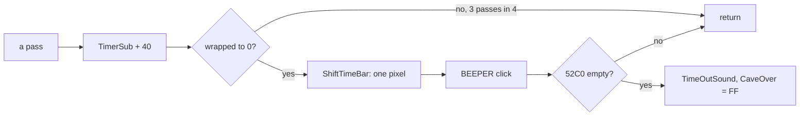

256 pixels × 4 passes = 1024 passes a cave. A jelly bean refills the bar ([doc 1.5](01-game-design.md#15-the-rules)).

Worked example: the `timer` recording. PlayCave starts at frame 2. F shows the map from frame 243 to 738; the pass
stays inside MapKey all that time, while the map tune plays. TimeOutSound runs at frame 6040 and the next intro at
6115. That is 6038 frames, less 495 for the map: 5543 frames of passes. 5543 / 1024 = 5.41 frames a pass, the idle
pass of cave 1.

Since the limit is in passes, the limit in seconds depends on the cave. At 5.5 frames a pass a cave lasts 113 s; at
9.4 frames (cave 13) it lasts 193 s.

Witness: `timer`, the L1 entries of TimeOutSound `$86AD` and CaveIntro `$92D4`. The screenshot of the bar running out
is in [doc 1.6](01-game-design.md#16-the-key-moments).

The point: a heavy cave runs slower and gives more seconds, so the player gets the same number of moves.

## 4.8 The waits outside a cave

Outside the passes the game waits by doing something. There is no delay loop on FRAMES.

| Wait | Where | Length in `c1` | How |
| --- | --- | --- | --- |
| the title tune | PlayTitleTune `$8A35` | from frame 11357, until a key or the tune's end | PlayTune with DI, a keyboard read at `$8901` |
| the cave intro | CaveIntro `$92D4` | 12727-12729 | DJNZ loops at `$92E3` and `$92EE` |
| the cave tune | PlayCaveTune `$EE34` | 12729-12992 | PlayTune with DI |
| the wipe | WipeScreen `$8DE3` | 12992-13014 | 1.35 million T with DI |
| the map | ShowMap `$EA80` | 495 frames in `timer` | the map drawn, then the map tune |
| the time bonus | TimeBonus `$8702` | one beep a bar pixel | BonusTick with DI |
| the game over | GameOverScreen `$8BD5` | until a key | RomKeyScan |

The point: every wait is a sound or a picture, and most run with interrupts off.

## 4.9 Known only from the code

- After cave 32, WinGame sets cave 1 again. `rzx-earth32` ends on the win screen; no recording plays on into cave 1.
- If PlayerKilled and CaveDone are both set in one pass, PassLoop tests PlayerKilled first, so the death wins. No
  recording has both.
- QuitKey drains the bar with DI, a click a pixel, then sets CaveOver ([doc 5](05-controls.md)). `c1` and `lives`
  press H, but no trace covers the drain.
