# 5. Controls

What this covers:

- the five play keys and where the game reads them: nine 9-byte key sites inside the code that uses them;
- the two copies of that code, keyboard and Kempston, swapped whole by menu keys 3 and 4, and the bugs of the swap;
- the key redefinition (menu key 2), WaitKey and the 40-key table;
- the menu keys 1-5 and the tunes that a key stops;
- the path from a key to the player's step: KeysStep, PlayerStep, the four Try routines, the push and the wall;
- fire: acting on the next cell without moving;
- the other keys: G (abort to the menu), H (give up the cave), F (the map);
- text entry (the password and the high-score name), which reuses WaitKey;
- when in the pass a key counts, and what a short tap does.

The recordings it rests on (WALKTHROUGH 6.0):

- `c1`: power-on, the tape at ROM speed, the menu, a game of cave 1 on the keyboard. Its frames count from power-on.
  The keys of `tests/inputs/c1.txt` used here (script frame 0 is c1 frame 11 800):
  - 4 at 11 900, 3 at 12 040, 2 at 12 180, then O, P, Q, A, M at 12 280, 12 323, 12 366, 12 409, 12 452;
  - 1 at 12 605 and ENTER at 12 705 (the password prompt);
  - O held 14 260-14 310, A 14 310-14 360, P 14 360-14 410, H at 14 430, G at 15 240.
- `menu`: from `work/stage1/probe/after-load.szx` (the menu after the load), 7915 frames: 4, 3, 2 with a key held
  60 frames, then O P Q A M, then 5.
- `rzx-earth01`: the RZX archive's `earth01.rzx` replayed (another player's run, not ours). Cave 1 on a Kempston
  stick. Its frames count from the RZX start.
- `timer`: from `probe/level1.szx` (cave 1 in play), F at the start, then no key.
- Experiments on a clone, made for this document: `python3 work/docs/esB/exp_controls.py` loads
  `work/stage1/probe/after-load.szx` into our own instance (port base 37160), runs 6600 frames to the menu, presses
  menu sequences and reads the nine key sites back. No recording is changed.

Frames and times:

- A memory sample "at frame N" is the state at the start of frame N (TTD `memory_at`, T 0). It shows what frame
  N - 1 left.
- An event "at N:t" is an instruction in an access trace that ran in frame N, t T-states into the 69 888 T frame of
  the 48K machine (`work/docs/esB/tr.py`, over `work/docs/esB/c1/traces/14255_0-14415_0.uatr` and the `rzx-earth01`
  trace of frames 2945-3030).
- Counts of runs are summed over the L1 builds (`l1.json`) of the stage-1 and stage-2 recordings
  (`work/docs/esB/l1q.py`).
- A [pass](README.md#terms) is one turn of PassLoop `$888D`. The game has no HALT, so a pass takes as long as its work:
  5.3 to 6.5 frames in cave 1 of `c1` (doc 04).

## 5.1 Five keys, read where they are used

The game has no input routine and no input variable.
Each place that needs a key reads the port itself, with a short fragment of code at its start.
There are nine such places, the key sites:

| Site | Address | Reads | Default key |
| --- | --- | --- | --- |
| TryLeft | `$83C3` | left, to walk | O (half row `$DF`, mask `$02`) |
| TryRight | `$8437` | right, to walk | P (`$DF`, `$01`) |
| TryUp | `$84AD` | up, to walk | Q (`$FB`, `$01`) |
| TryDown | `$84F9` | down, to walk | A (`$FD`, `$01`) |
| KeysStep | `$8759` | fire | M (`$7F`, `$04`) |
| FireLeft | `$876B` | left, with fire held | O |
| FireRight | `$87C3` | right, with fire held | P |
| FireUp | `$881D` | up, with fire held | Q |
| FireDown | `$8849` | down, with fire held | A |

Three more keys are fixed in the code and read every pass: G (AbortKey `$93A5`), F (MapKey `$EA96`) and H (QuitKey
`$872D`).
The menu reads the digits 1-5 on half row `$F7`.
WaitKey `$8C1D` reads all 40 keys, for the redefinition and for text.

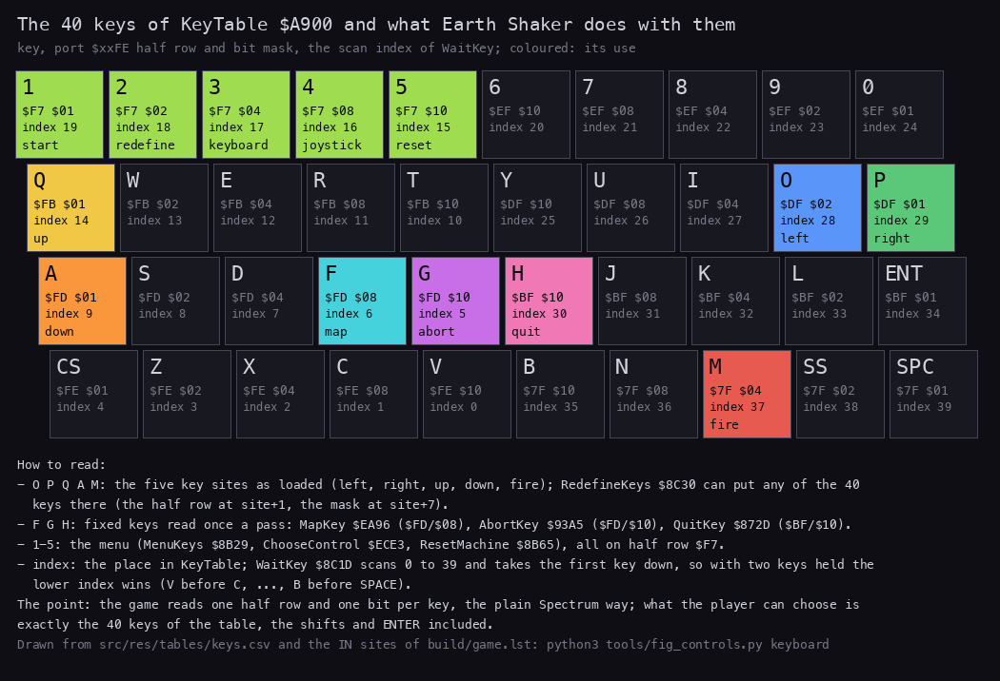

*Every key the game reads, by use. Drawn from the IN sites of `build/game.lst` and KeyTable `$A900`: `python3
tools/fig_controls.py keyboard --out docs/img/controls/keyboard.png`. How to read: one box per key, with its half row
and bit; the colour is the use (the five play keys as loaded, the fixed keys G, F, H, the menu digits). Grey keys are
read only by WaitKey.*

Where in a pass each key is read:

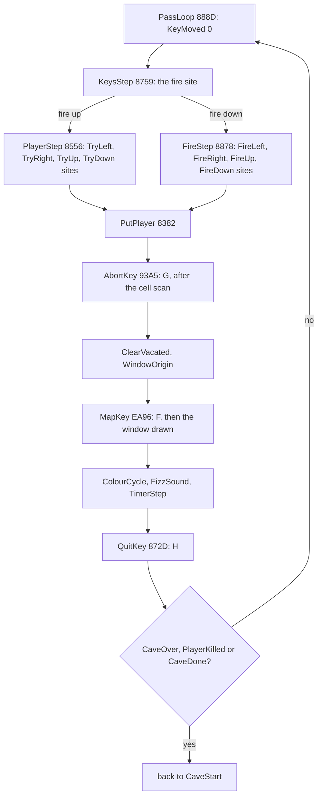

The point: there is no input layer to change, so changing a key means changing the code.
The redefinition and the joystick choice both work by rewriting the nine sites, as the next two sections show.

## 5.2 The key site: nine bytes

Each site is the same 9 bytes in the keyboard form:

```text
83C3  3E DF        LD A,$DF          ; TryLeft: the half row of O, P (byte +1)
83C5  D3 FF        OUT ($FF),A
83C7  DB FE        IN A,($FE)        ; A = $DF on the high address byte: the row Y U I O P
83C9  E6 02        AND $02           ; the key's bit (byte +7): O
83CB  C0           RET NZ            ; bit set = key up: nothing to do
```

The fire site at KeysStep `$8759` ends in `JR Z,KeysStepSkip` instead of `RET NZ`, so it chooses between two paths
instead of leaving.

On the 48K Spectrum a key down reads as 0 in its bit of port `$FE`.
`IN A,($FE)` puts A on the high byte of the address bus, and the half rows are selected by those address lines.
So the `LD A,row` before the IN is all the row selection needs.

The `OUT ($FF),A` does nothing for the read.
Port `$FF` is odd, and the ULA answers only even ports, so no device of a 48K machine takes the write.
The row reaches the keyboard through the IN instruction alone.
Stage 2's keys module header said the OUT "only sets A's row for the IN"; game.ann now says it has no effect.

```text
key site, keyboard form:
    a = row                      ; byte +1
    out($FF, a)                  ; no effect
    a = in(row * 256 + $FE)      ; the half row: bit = 0 when down
    if a AND mask != 0: return   ; byte +7; not down
    ...                          ; down: the routine's work
```

Worked example 1: O held in `c1`, the pass that starts at 14265:33994.

1. TryLeft runs at 14265:34228. `LD A,$DF` selects the half row Y U I O P.
2. O is bit 1 of that row. It is down, so the IN returns `$FD` (`1111 1101`).
3. `AND $02` gives 0. `RET NZ` does not leave.
4. The routine goes on: PlayerFacing `$FD86` = 4, KeyMoved `$FD80` = `$FF`, and at 14265:35214 MoveLeft `$8428`.
5. The sample at 14266 shows PlayerIndex `$FD9C` = 284; at 14265 it was 285.

The point: a key site is a complete test in 9 bytes, with the row and the bit as immediate operands.
Two bytes per site, +1 and +7, decide which key it is.

## 5.3 Two copies of the code: keyboard and Kempston

The game keeps two 81-byte copies of the nine sites:

- KeyboardCode `$EB15` (`src/res/tables/keyboard-code.csv`): the keyboard form, as loaded with O P Q A M;
- KempstonCode `$EAC4` (`src/res/tables/kempston-code.csv`): the Kempston form.

The Kempston form of a site:

```text
83C3  00 00 00 00  NOP; NOP; NOP; NOP
83C7  DB 1F        IN A,($1F)        ; the Kempston interface
83C9  E6 02        AND $02           ; left is bit 1 of the stick
83CB  C8           RET Z             ; bit clear = not pushed
```

The Kempston interface reads a direction as 1, the keyboard reads a key as 0.
So the last byte flips from `RET NZ` (`$C0`) to `RET Z` (`$C8`), and the fire site from `JR Z` (`$28`) to `JR NZ`
(`$20`).
The stick bits: right `$01`, left `$02`, down `$04`, up `$08`, fire `$10`.

Three routines move the copies with LDIR, 9 bytes at a time:

| Routine | Address | Copies | Run by |
| --- | --- | --- | --- |
| SaveKeyboardCode | `$EB66` | the nine sites into KeyboardCode | JoystickControl only |
| KeyboardControl | `$EBCA` | KeyboardCode into the sites | menu key 3 (ChooseControl `$ECE3`), and RedefineKeys first of all |
| JoystickControl | `$EC2E` | SaveKeyboardCode, then KempstonCode into the sites | menu key 4 (ChooseControl) |

```text
SaveKeyboardCode:  for each site s:  KeyboardCode[s] = code at s     ; 9 bytes
KeyboardControl:   for each site s:  code at s = KeyboardCode[s]
JoystickControl:   SaveKeyboardCode
                   for each site s:  code at s = KempstonCode[s]
```

This is self-modifying code, and the L1 build of `c1` sees it.
Its `arrivals` list records that execution reached KeysStep `$8759` (at 13016, from the `CALL KeysStep` at `$8892`)
after the bytes there were last written by `$EBFF`.
`$EBFF` is the LDIR of KeyboardControl that copies the fire site's 9 bytes from KeyboardCode + `$24` (`$EB39`) to
`$8759`; the L1 `copies` list has it twice in `c1` (key 3 and RedefineKeys).
The same list has the LDIR at `$EC66` once: JoystickControl copying KempstonCode + `$24` (`$EAE8`) to `$8759`.
The other eight sites are copied the same way by the neighbouring LDIRs.
So ChooseControl does patch KeysStep, and with it every other key site, through these two routines.

The save is meant to keep a redefinition alive while the joystick is chosen.
It has two faults, both in what is saved and when:

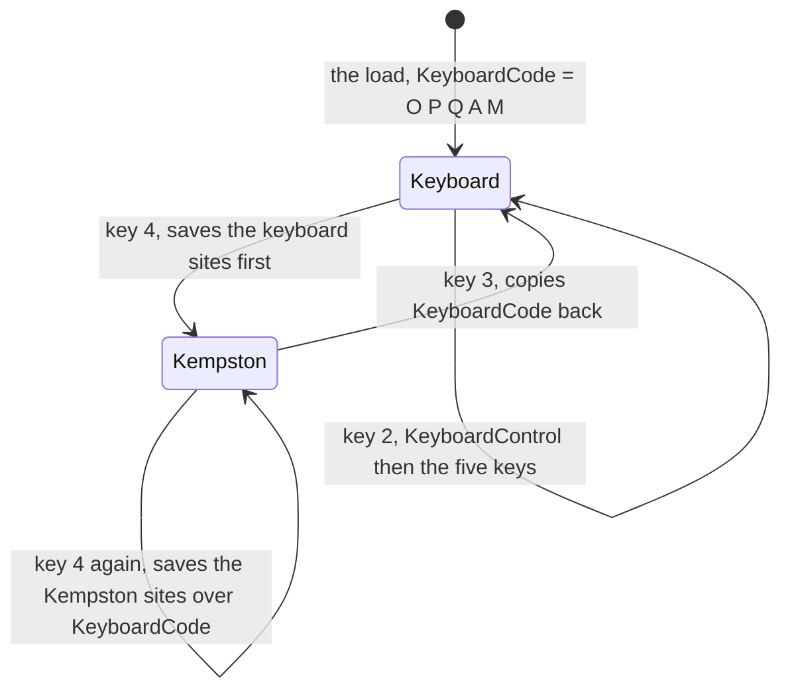

- Key 4 pressed twice saves the Kempston sites into KeyboardCode. Key 3 then "restores" the Kempston code, and the
  keyboard is gone until the game is loaded again.
- KeyboardCode changes only on key 4. A redefinition made after the last 4 lives only in the sites, and key 3 copies
  the old KeyboardCode over it.

The experiments on the clone (`work/docs/esB/exp_controls.py`) show both:

| Case | Menu keys | The sites after | Result |
| --- | --- | --- | --- |
| A | 4, 4, 3, then 2 with O P Q A M | `00 DF 00 00 DB 1F E6 02 C8` (TryLeft) | the hybrid below |
| B | 2 with Z X K L SPACE, then 3 | `3E DF D3 FF DB FE E6 02 C0` (TryLeft) | O P Q A M again: the redefinition lost |
| C | 2 with Z X K L SPACE, 4, then 3 | `3E FE D3 FF DB FE E6 02 C0` (TryLeft = Z) | the redefinition kept |

Case A leaves a hybrid.
RedefineKeys writes the row into byte +1 and the mask into byte +7, as if the site were the keyboard form.
In the Kempston form byte +1 is the second of the four NOPs, so the row becomes an opcode:

- `$DF` (O, P) is `RST $18`, the ROM's character fetch. It changes HL and A; the IN reloads A, and the Try routines
  reload HL.
- `$FB` (Q) is `EI`. Interrupts are already on in play.
- `$FD` (A) is an IY prefix on the next NOP.
- `$7F` (M) is `LD A,A`.

So the hybrid still reads `IN A,($1F)` with `RET Z`: the stick drives the player, with the masks of the new keys.
In the clone, P (keyboard) left PlayerIndex at 285, and the stick pushed right moved it from 285 to 294 in 200
frames (`work/docs/esB/expA-start.png`, `expA-end.png`).

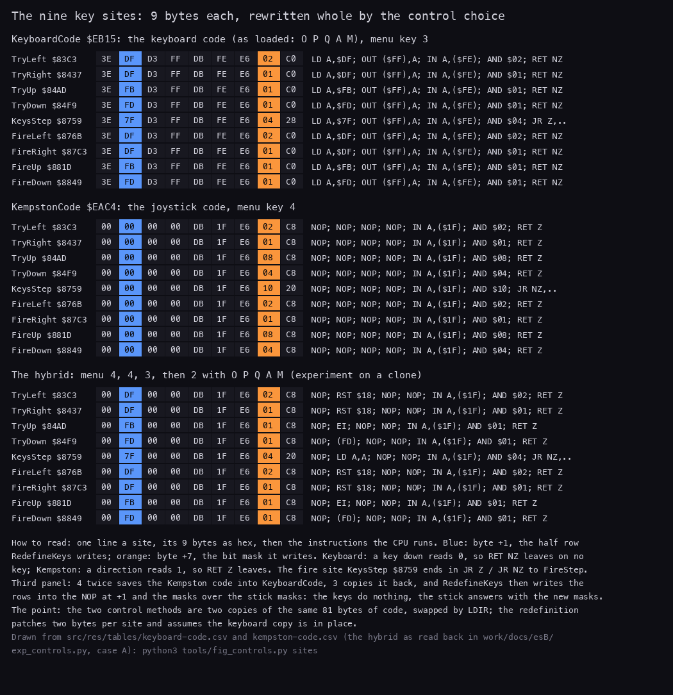

*The nine sites as KeyboardCode, as KempstonCode, and as case A left them. Drawn from
`src/res/tables/keyboard-code.csv` and `kempston-code.csv`, the hybrid as read back by
`work/docs/esB/exp_controls.py`: `python3 tools/fig_controls.py sites --out docs/img/controls/key-sites.png`. How to
read: one line a site, its 9 bytes and the instructions they make; blue is byte +1 (the row), orange byte +7 (the
mask).*

Worked example 2: `c1`, menu keys 4, 3, 2.

1. Key 4 at 11 900: JoystickControl runs at 11 924. SaveKeyboardCode stores the loaded keyboard code (O P Q A M).
   The sample at 11 950 shows the Kempston form in the sites.
2. Key 3 at 12 040: KeyboardControl runs at 12 072 and copies O P Q A M back.
3. Key 2 at 12 180: RedefineKeys starts at 12 207 with ClearAndKeyboard `$ECDC`, which runs KeyboardControl a second
   time (12 229). The five keys typed are O P Q A M again.
4. The sample at 12 500 shows the keyboard form with O P Q A M: the game in `c1` is played on the keyboard.

The `rzx-earth01` start snapshot already holds the Kempston form in the sites, and JoystickControl never runs in any
RZX replay: the original players chose the joystick before the snapshot was taken.

The point: the two control methods are two copies of the same code, swapped whole.
That costs nothing in play, but the save that should protect a redefinition runs at the wrong moment.

## 5.4 RedefineKeys and WaitKey

Menu key 2 runs RedefineKeys `$8C30`.
It clears the screen and puts the keyboard code into the sites (ClearAndKeyboard `$ECDC`).
It colours rows 6-14, then asks for the five keys in turn, with the prompts of KeyPrompts `$A978` ("PRESS KEY FOR
LEFT " and so on, 19 characters each, `src/res/texts/key-prompts.txt`).

WaitKey `$8C1D` scans KeyTable `$A900` (`src/res/tables/keys.csv`): 40 records of half row, bit mask and character.

```text
WaitKey:                                     ; $8C1D
    repeat:
        for each of the 40 records (row, mask, char):
            if in(row * 256 + $FE) AND mask == 0:
                return HL = the record's mask byte     ; char at HL + 1, row at HL - 1

RedefineKeys:                                ; $8C30
    ClearAndKeyboard                          ; ClearScreen, KeyboardControl
    colour rows 6-14 (FillAttrs)
    for (prompt, sites) in [(LEFT, TryLeft and FireLeft), (RIGHT, TryRight and FireRight),
                            (UP, TryUp and FireUp), (DOWN, TryDown and FireDown), (FIRE, KeysStep)]:
        print prompt at row 6, 8, 10, 12, 14, column 5
        HL = WaitKey
        print the character at column 25
        for each site: site[+7] = mask; site[+1] = row
        RaspSound                             ; about 8.4 frames
    ClearScreen
```

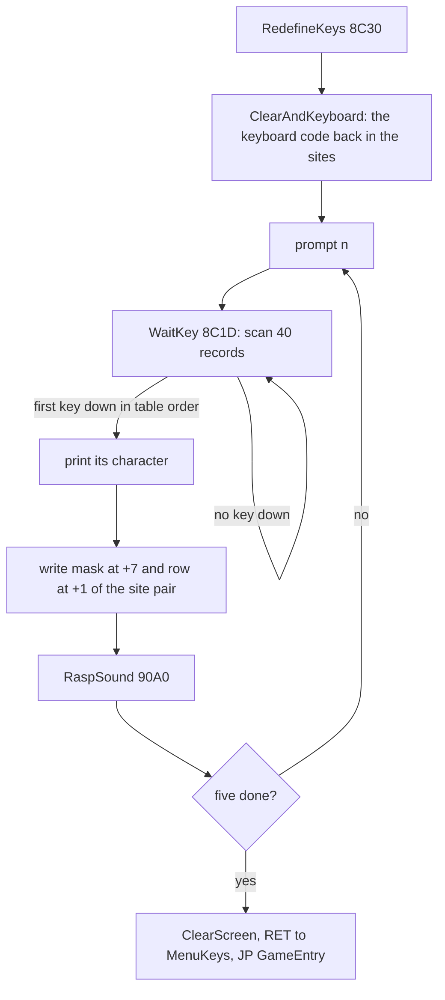

The asm of the first prompt; the other four differ only in the text, the row and the sites:

```text
8C4E  01 05 06     LD BC,$0605
8C51  16 13        LD D,$13
8C53  21 78 A9     LD HL,KeyPrompts       ; "PRESS KEY FOR LEFT "
8C56  CD 4F 83     CALL PrintText
8C59  CD 1D 8C     CALL WaitKey           ; HL = the record's mask byte
8C5C  23           INC HL                 ; the character
8C5D  01 19 06     LD BC,$0619
8C60  16 01        LD D,$01
8C62  E5           PUSH HL
8C63  CD 4F 83     CALL PrintText         ; one character at column 25
8C66  E1           POP HL
8C67  2B           DEC HL
8C68  7E           LD A,(HL)              ; the mask
8C69  32 CA 83     LD (TryLeft+$0007),A
8C6C  32 72 87     LD (FireLeft+$0007),A
8C6F  2B           DEC HL
8C70  7E           LD A,(HL)              ; the row
8C71  32 C4 83     LD (TryLeft+$0001),A
8C74  32 6C 87     LD (FireLeft+$0001),A
8C77  CD A0 90     CALL RaspSound
8C7A  00 ...       NOP x 6
```

The fire prompt writes KeysStep only (`$8D31` the mask into `$8760`, `$8D36` the row into `$875A`): the four Fire
sites read the direction keys, not the fire key.

WaitKey itself:

```text
8C1D  06 28        LD B,$28               ; WaitKey: 40 records
8C1F  21 00 A9     LD HL,KeyTable
8C22  7E           LD A,(HL)              ; WaitKeyLoop: the half row
8C23  D3 FF        OUT ($FF),A
8C25  DB FE        IN A,($FE)
8C27  23           INC HL
8C28  A6           AND (HL)               ; the mask
8C29  C8           RET Z                  ; down: HL = the mask byte
8C2A  23           INC HL
8C2B  23           INC HL
8C2C  10 F4        DJNZ WaitKeyLoop
8C2E  18 ED        JR WaitKey
```

The table runs from the outer end of each half row inwards: V C X Z CAPS SHIFT, G F D S A, T R E W Q, 5 4 3 2 1,
6 7 8 9 0, Y U I O P, H J K L ENTER, B N M SYMBOL SHIFT SPACE.
The characters for CAPS SHIFT, SYMBOL SHIFT and ENTER are `c`, `s` and `e`.
When two keys are down, the one earlier in the table wins.

Worked example 3: O for left in `c1` (frame 12 280).

1. WaitKey finds no key until O goes down at 12 280. O is record 28: half row `$DF`, mask `$02`, character `O`, at
   `$A954`.
2. WaitKey returns with HL = `$A955` (the mask byte).
3. `O` is printed at row 6, column 25.
4. `$02` goes to `$83CA` and `$8772`, `$DF` to `$83C4` and `$876C`.
5. RaspSound runs from 12280:5875 and returns at 12288:35778: 8.4 frames.
6. WaitKey starts again at 12289:9735 for the right key.

One scan of the 40 records takes about 2970 T, so WaitKey checks the keyboard about 23 times a frame.

WaitKey does not wait for the key to be released.
RaspSound is the only gap between two prompts, about 9 frames.
A key still down when the next WaitKey starts is taken for the next prompt too:

- In `menu`, key 2 was held 60 frames. The screenshot below shows `2` taken for left, right and up.
- In the clone (case D), O held 80 frames after key 2 put O in all five sites, fire included.
- `c1` presses each key for 3 frames, and every prompt got its own key.

A key such as `2` or ENTER can be chosen for play.
Nothing stops it: the digits are read by the menu only, and ENTER only by WaitKey.

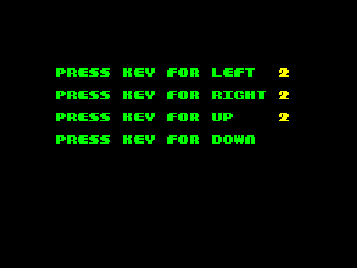

*Recording `menu`, frame 7000: key 2 was held 60 frames and WaitKey took it for left, right and up. Stage-1
screenshot.*

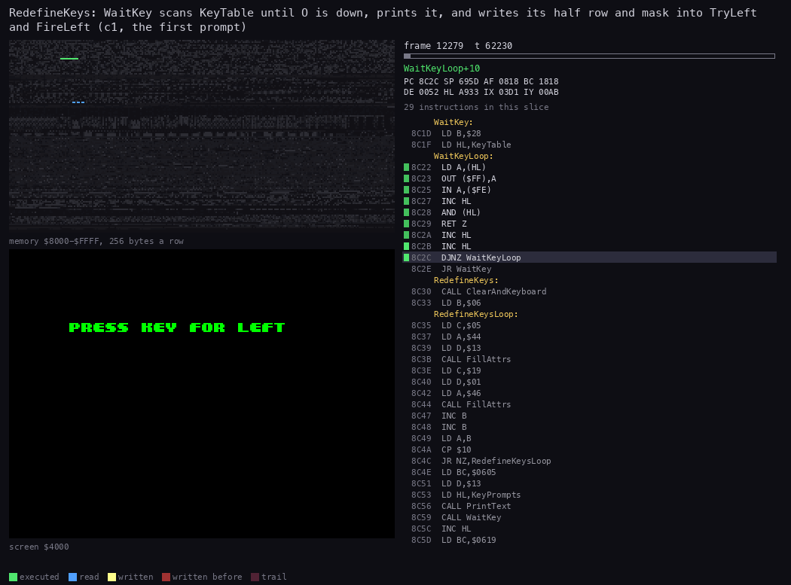

*RedefineKeys at work as O is taken for left: the routine, the bytes it writes and the screen. Recording `c1`, window
12279:62000-12280:5900. `python3 R/kit/routine_anim.py --work work/docs/esB/c1 --window 12279:62000-12280:5900
--listing build/game.lst --view screen --pc 8C1D-8D45,834F-8380 --range 8000-FFFF --pictures 60 --hold 3000 --title
...`.*

The point: the redefinition patches two bytes in each of nine places, and assumes the keyboard form is in them; that
is why it starts with KeyboardControl.
With no release wait, the player has about 9 frames to lift each key.

## 5.5 The menu keys

GameEntry `$8B20` (the BASIC's `RANDOMIZE USR 35616`) clears the variables, draws the title and plays the title tune.
PlayTune `$88CE` checks half row `$F7` (1 2 3 4 5) once per note and ends the tune when any of them is down.
MenuKeys `$8B29` then decides.

```text
MenuKeys:                                    ; $8B29, HL = where PlayTune stopped
    if HL == TitleTune end ($B269):          ; the tune ran out, no key
        ShowHiScores; goto GameEntryLoop     ; the table and the scroller, then the tune again
    if key 1: NewGame; goto GameEntry
    if key 2: RedefineKeys; goto GameEntry
    ChooseControl:                           ; $ECE3
        if key 3: SwitchSound; KeyboardControl; goto GameEntry
        if key 4: SwitchSound; JoystickControl; goto GameEntry
        ResetMachine:                        ; $8B65
            if key 5: JP $0000               ; the ROM starts again
            goto GameEntry
```

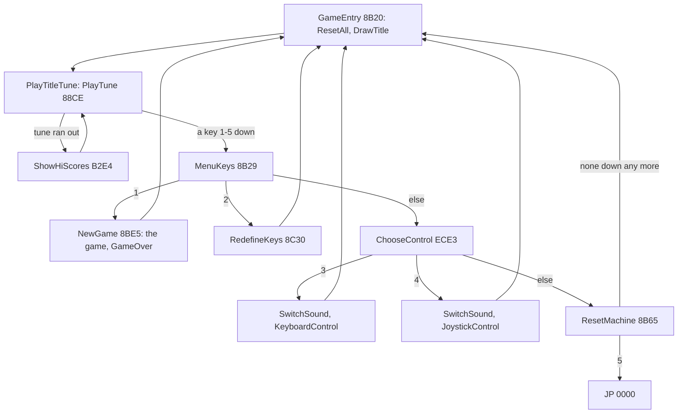

The asm of the decision:

```text
8B29  11 69 B2     LD DE,TitleTune+$0569  ; MenuKeys
8B2C  ED 52        SBC HL,DE
8B2E  20 05        JR NZ,MenuKeysSkip
8B30  CD E4 B2     CALL ShowHiScores
8B33  28 F1        JR Z,GameEntryLoop
8B35  3E F7        LD A,$F7               ; MenuKeysSkip
8B37  D3 FF        OUT ($FF),A
8B39  DB FE        IN A,($FE)
8B3B  E6 01        AND $01                ; 1
8B3D  20 06        JR NZ,MenuKeysSkip2
8B3F  CD E5 8B     CALL NewGame
8B42  C3 20 8B     JP GameEntry
8B45  3E F7        LD A,$F7               ; MenuKeysSkip2
8B47  D3 FF        OUT ($FF),A
8B49  DB FE        IN A,($FE)
8B4B  E6 02        AND $02                ; 2
8B4D  20 06        JR NZ,MenuKeysSkip3
8B4F  CD 30 8C     CALL RedefineKeys
8B52  C3 20 8B     JP GameEntry
8B55  C3 E3 EC     JP ChooseControl       ; MenuKeysSkip3
```

ChooseControl:

```text
ECE3  3E F7        LD A,$F7               ; ChooseControl
ECE5  D3 FF        OUT ($FF),A
ECE7  DB FE        IN A,($FE)
ECE9  E6 04        AND $04                ; 3
ECEB  20 09        JR NZ,ChooseControlSkip
ECED  CD 4B A7     CALL SwitchSound
ECF0  CD CA EB     CALL KeyboardControl
ECF3  C3 20 8B     JP GameEntry
ECF6  3E F7        LD A,$F7               ; ChooseControlSkip
ECF8  D3 FF        OUT ($FF),A
ECFA  DB FE        IN A,($FE)
ECFC  E6 08        AND $08                ; 4
ECFE  20 09        JR NZ,ChooseControlSkip2
ED00  CD 4B A7     CALL SwitchSound
ED03  CD 2E EC     CALL JoystickControl
ED06  C3 20 8B     JP GameEntry
ED09  C3 65 8B     JP ResetMachine        ; ChooseControlSkip2
```

Every menu choice ends in `JP GameEntry`, so the title is drawn again and the title tune restarts after each key.
The menu has no state of its own: the screen shows no mark of the control chosen.

The keys are read twice, once by PlayTune and once by MenuKeys.
A key released between the two falls through all the tests to `JP GameEntry`, and only the title is redrawn.

PlayTune plays every tune of the game, so a key 1-5 also cuts short the cave tune before a cave and the map tune
(doc 09).

Witnesses:

- `c1`: JoystickControl at 11 924 (key 4), KeyboardControl at 12 072 (key 3) and 12 229 (in RedefineKeys), NewGame
  after key 1 at 12 605.
- `menu`: JoystickControl at 6615, KeyboardControl at 6780 and 6954, ResetMachine at 7455 (key 5), then the ROM's
  copyright screen.

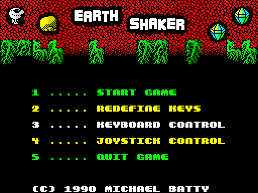

*The menu: recording `menu`, frame 250. Lines 3 and 4 are the control choice. Stage-1 screenshot.*

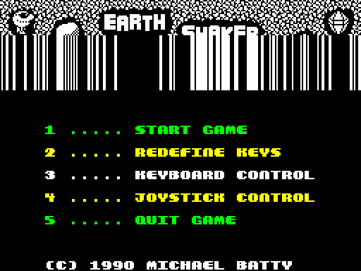

*Recording `c1`, frame 12 550, after the redefinition: GameEntry draws the title again, the logo still being wiped
in. Nothing on the screen shows the control choice. Stage-1 screenshot.*

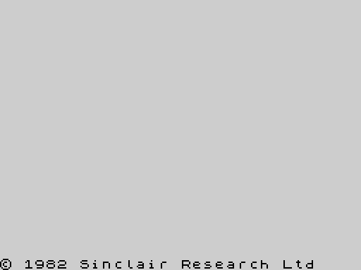

*Recording `menu`, frame 7750: key 5 jumped to `$0000`, and the ROM shows its copyright screen. Stage-1 screenshot.*

The point: the menu is five port tests after a tune, and every choice restarts the title.

## 5.6 From the key to the move

In play, PassLoop `$888D` clears KeyMoved `$FD80` and calls KeysStep `$8759` first of all.
KeysStep reads the fire site.
Fire up: PlayerStep `$8556` walks.
Fire down: FireStep `$8878` acts without moving (5.7).

```text
KeysStep:                                    ; $8759
    if fire down: FireStep else: PlayerStep

PlayerStep:                                  ; $8556
    DugEarth = KeyMoved = BoulderPushed = 0  ; ClearStepFlags $E858
    if PlayerIndex != 0: TryLeft             ; PlayerIndex 0 skips left only
    if KeyMoved == 0: TryRight
    if KeyMoved == 0: TryUp
    if KeyMoved == 0: TryDown
    if KeyMoved != 0: DigNoiseIfDug          ; the dig noise when DugEarth

TryLeft:                                     ; $83C3; TryRight is the mirror
    if left key up: return
    PlayerFacing = 4; KeyMoved = $FF         ; set before any test
    if PlayerIndex is a multiple of 30: return          ; column 0
    c = cell left of the player
    if c == 1 (exit): if ExitOpen: CaveDone = $FF; return
    if c == 2 (boulder):
        if c is in column 0: return
        PushBoulder(cell two to the left)    ; not empty: drop TryLeft's return
        goto MoveLeft
    BlockWall(c)                              ; wall: drop TryLeft's return; earth: DugEarth = $FF
    if c > 6: goto the special-cell handler   ; gem and codes 8-15
MoveLeft:                                    ; $8428
    PlayerIndex -= 1; old cell = 0
```

TryUp and TryDown have the same shape with three differences:

- the edge test is a single compare: `PlayerIndex - 30` borrows (row 0), or `PlayerIndex - 570` does not borrow
  (row 19);
- a boulder above or below blocks (`RET Z`), it is never pushed;
- MoveUp `$84E6` and MoveDown `$8535` leave `$20` in the old cell, not 0. Bit 5 marks the cell vacated for the cell
  scan that follows in the same pass (doc 10). ClearVacated `$81AC` clears the mark before the window is drawn.

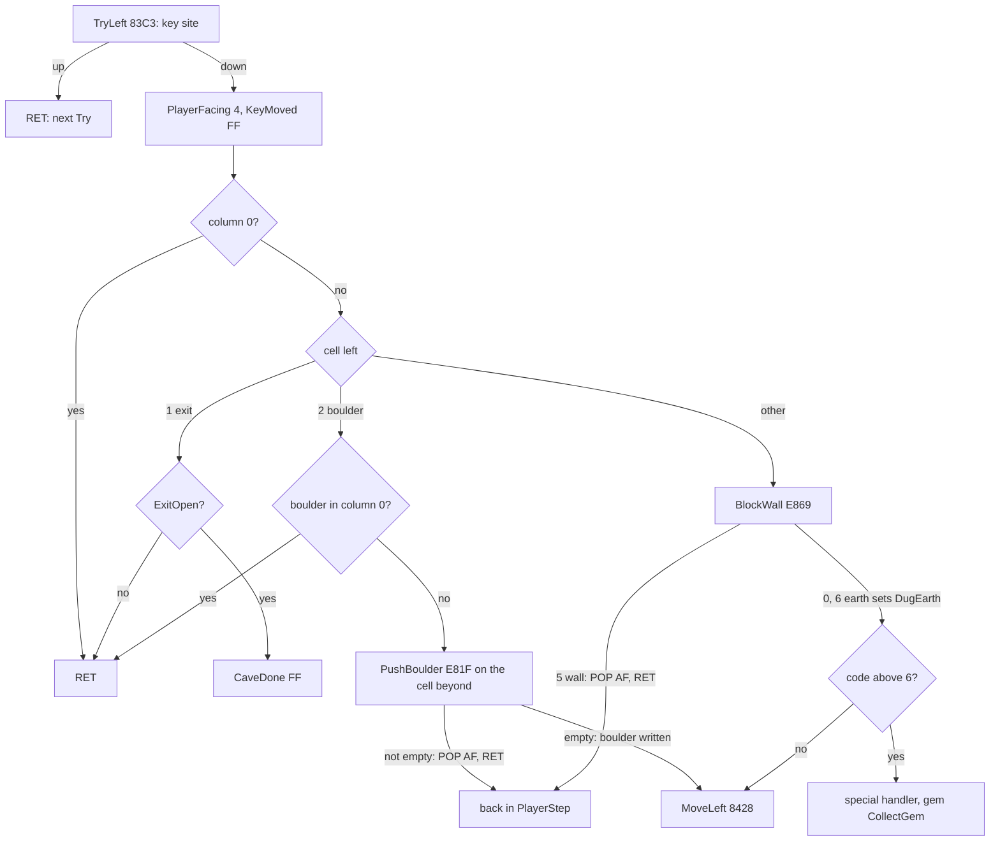

PushBoulder and BlockWall leave TryLeft early in an unusual way.
They are called, and on refusal they pop the return address and return:

```text
E81F  BE           CP (HL)                ; PushBoulder: A = 0, is the cell beyond empty?
E820  28 02        JR Z,PushBoulderSkip
E822  F1           POP AF                 ; no: drop the return into TryLeft
E823  C9           RET                    ; and return from TryLeft itself, to PlayerStep
E824  36 02        LD (HL),$02            ; PushBoulderSkip: the boulder moves in
E826  F5           PUSH AF
E827  3E FF        LD A,$FF
E829  32 2E E8     LD (BoulderPushed),A
E82C  F1           POP AF
E82D  C9           RET

E869  3E 05        LD A,$05               ; BlockWall
E86B  BE           CP (HL)
E86C  20 02        JR NZ,BlockWallSkip
E86E  F1           POP AF                 ; a wall: the same early exit
E86F  C9           RET
E870  3E 06        LD A,$06               ; BlockWallSkip
E872  BE           CP (HL)
E873  20 05        JR NZ,BlockWallDone
E875  3E FF        LD A,$FF
E877  32 57 E8     LD (DugEarth),A        ; earth: the dig noise later
E87A  C9           RET                    ; BlockWallDone
```

The left key's code in full, from the site to MoveLeft:

```text
83C3  3E DF        LD A,$DF               ; TryLeft
83C5  D3 FF        OUT ($FF),A
83C7  DB FE        IN A,($FE)
83C9  E6 02        AND $02
83CB  C0           RET NZ
83CC  21 86 FD     LD HL,PlayerFacing
83CF  36 04        LD (HL),$04
83D1  21 80 FD     LD HL,KeyMoved
83D4  36 FF        LD (HL),$FF
83D6  2A 9C FD     LD HL,(PlayerIndex)
83D9  06 14        LD B,$14               ; 20 tries
83DB  11 1E 00     LD DE,$001E
83DE  ED 52        SBC HL,DE              ; TryLeftLoop: subtract 30 until 0 or below
83E0  C8           RET Z                  ; a multiple of 30: column 0
83E1  10 FB        DJNZ TryLeftLoop
83E3  2A 9C FD     LD HL,(PlayerIndex)
83E6  2B           DEC HL
83E7  11 A8 FD     LD DE,CaveGrid
83EA  19           ADD HL,DE              ; the cell to the left
83EB  3E 01        LD A,$01
83ED  BE           CP (HL)
83EE  20 0B        JR NZ,TryLeftSkip
83F0  3A 85 FD     LD A,(ExitOpen)        ; the exit
83F3  B7           OR A
83F4  C8           RET Z
83F5  3E FF        LD A,$FF
83F7  32 84 FD     LD (CaveDone),A
83FA  C9           RET
83FB  3E 02        LD A,$02               ; TryLeftSkip
83FD  BE           CP (HL)
83FE  20 1E        JR NZ,TryLeftSkip2
8400  2A 9C FD     LD HL,(PlayerIndex)    ; a boulder: is it in column 0?
8403  2B           DEC HL
8404  06 14        LD B,$14
8406  11 1E 00     LD DE,$001E
8409  ED 52        SBC HL,DE              ; TryLeftLoop2
840B  C8           RET Z
840C  10 FB        DJNZ TryLeftLoop2
840E  2A 9C FD     LD HL,(PlayerIndex)
8411  2B           DEC HL
8412  2B           DEC HL
8413  11 A8 FD     LD DE,CaveGrid
8416  19           ADD HL,DE              ; the cell beyond the boulder
8417  AF           XOR A
8418  CD 1F E8     CALL PushBoulder
841B  00           NOP
841C  18 0A        JR MoveLeft
841E  CD 69 E8     CALL BlockWall         ; TryLeftSkip2
8421  00           NOP
8422  3E 06        LD A,$06
8424  BE           CP (HL)
8425  DA D6 94     JP C,LeftSpecial       ; codes 7-15
8428  2A 9C FD     LD HL,(PlayerIndex)    ; MoveLeft
842B  2B           DEC HL
842C  22 9C FD     LD (PlayerIndex),HL
842F  23           INC HL
8430  11 A8 FD     LD DE,CaveGrid
8433  19           ADD HL,DE
8434  36 00        LD (HL),$00
8436  C9           RET
```

TryLeft jumps to LeftSpecial `$94D6` (continuation MoveLeft), and TryRight to RightSpecial `$9494` (continuation
MoveRight). Stage 2 had the two labels the other way round; they were renamed after the listing (doc 10.8).

Three consequences follow from KeyMoved being set before the tests:

- The keys have a fixed priority: left, then right, then up, then down. Left and down held together walk left.
- A refused key still uses up the pass. Left against a wall with up held does not go up: TryLeft set KeyMoved, so
  PlayerStep skips TryUp.
- One cell per pass at most, whatever is held.

Worked example 4: O, A, P in `c1`, frames 14 255-14 415 (trace `14255_0-14415_0`).

1. O goes down at 14 260. The pass starting at 14259:66906 read the sites just before, so the first read of O is at
   14265:34228. MoveLeft runs at 14265:35214: PlayerIndex 285 becomes 284 (row 9, column 14).
2. O stays down. The next cell to the left is a boulder with no room behind it. In the seven passes from 14271 to
   14304 PushBoulder is called and refuses (its `JR Z` at `$E820` taken 0 times, not taken 7 times). The player
   stands still.
3. A goes down at 14 310. TryLeft and TryRight find their keys up, TryDown moves the player down in the passes at
   14310, 14316, 14322, 14328 and 14334: 284 becomes 434 (row 14).
4. In the pass of 14 321 the cell below holds a gem. DownSpecial `$93CE` runs CollectGem `$8595` at 14321:53093, and
   its sound delays MoveDown to 14322:64456.
5. P goes down at 14 360. MoveRight `$849E` runs in nine passes, from 14362:6776 to 14409, and the column goes from
   14 to 23.

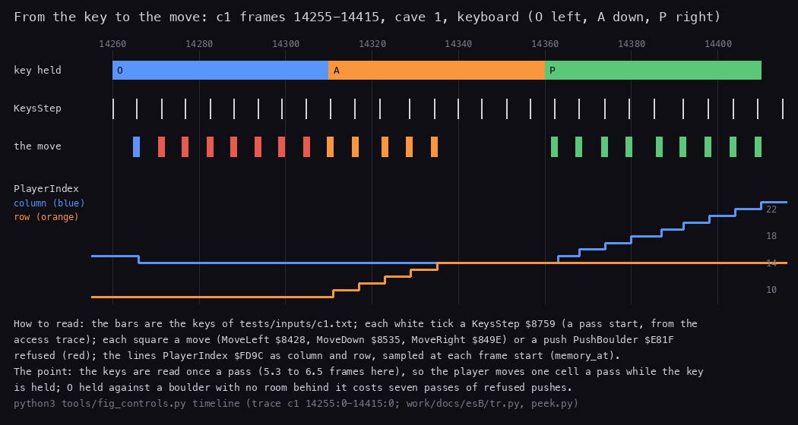

*The keys held, the passes and the moves, with PlayerIndex. Recording `c1`, frames 14 255-14 415, cave 1, keyboard.
`python3 tools/fig_controls.py timeline --keys work/docs/esB/keys-14255.txt --player work/docs/esB/player-14255.txt
--out docs/img/controls/input-timeline.png` (events from `work/docs/esB/tr.py` over the access trace, PlayerIndex
from `work/docs/esB/peek.py`). How to read: one white tick a KeysStep (a pass start), one square a move or a refused
push (red).*

Worked example 5: a walk and two pushes on the Kempston stick, `rzx-earth01` frames 2945-3030.

1. The sites hold the Kempston form: left is `IN A,($1F)`, `AND $02`, `RET Z`.
2. MoveLeft runs at 2952:2806, 2957:51024 and 2963:17493: PlayerIndex 432 becomes 429 (row 14, column 9).
3. The stick goes right. At 3015:16380 PushBoulder finds the cell beyond the boulder empty and writes `$02` there;
   MoveRight follows at 3015:16500.
4. The same again at 3022:26972 and 3022:27076. PlayerIndex 429 becomes 431, and the boulder has moved two cells
   right.

The animations of this walk, one as the cave buffer and one as the screen:

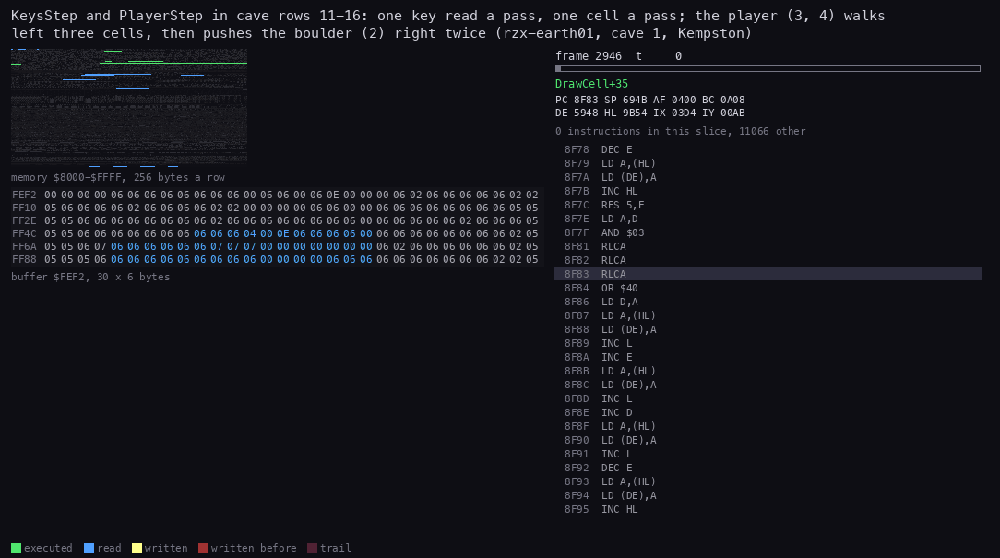

*KeysStep, PlayerStep and the Try routines writing the cave grid: PlayerIndex and the cells as hex. Recording
`rzx-earth01` (replayed RZX), window 2945:0-3030:0, cave rows 11-16 (`$FEF2`, 30 x 6). `python3 R/kit/routine_anim.py
--work work/docs/esB/rzx01 --window 2945:0-3030:0 --listing build/game.lst --view buffer:FEF2:30x6:hex --pc
83C3-8595,8759-8884,E81F-E86F --range 8000-FFFF --pictures 85 --hold 3000 --title ...`. The kit draws the hex view
1084 px wide.*

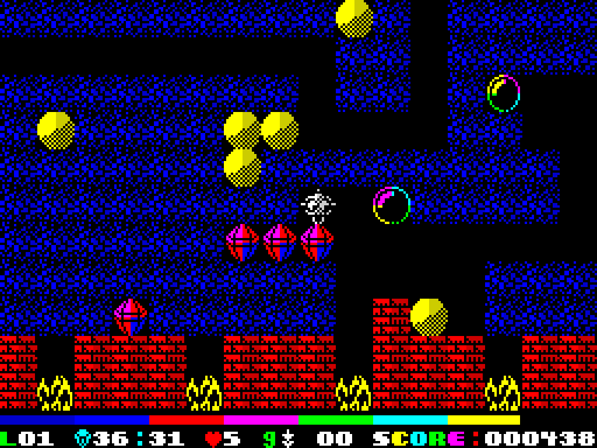

*The same frames on the screen: three steps left, then two pushes to the right. Recording `rzx-earth01` (replayed
RZX), frames 2945-3030. `python3 R/kit/screen_anim.py --work work/docs/esB/rzx01 --from 2945 --to 3030 --step 1
--scale 4 --delay 60 --hold 2000 docs/img/play/walk-push.gif`.*

Counts over all recordings: TryLeft runs 42 409 times, TryRight 36 640, TryUp 31 174, TryDown 26 576. The falling
numbers are the priority at work: each Try runs only while the ones before it found their key up.
MoveLeft runs 4334 times, MoveDown 4021, MoveUp 3768.
PushBoulder runs 432 times.

The point: one key read gives at most one step a pass, and the step is decided by the first key down in a fixed
order.
A refused move costs the whole pass, so holding a key against a boulder wastes passes until the key is let go.

## 5.7 Fire: acting without moving

With the fire key down, KeysStep calls FireStep `$8878`, which calls FireLeft, FireRight, FireUp and FireDown in turn.
Each reads its own site (the same keys as the walk), and acts on the next cell in its direction:

```text
FireLeft:                                    ; $876B; the others are the same in their direction
    if left key up: return
    if PlayerIndex is in column 0: return
    c = cell left of the player
    if c == 6 (earth):  cell = $20; DigInPlace           ; dug, the player stays
    elif c > 6:         CollectLeft                      ; a gem or a special
    elif c == 2:        FireLeftBoulder                  ; left and right only
    ; empty, exit and wall: nothing

FireLeftBoulder:                             ; $879F
    if the boulder is in column 0: return
    if the cell beyond != 0: return
    cell beyond = 2; boulder cell = $20; ThudSound
```

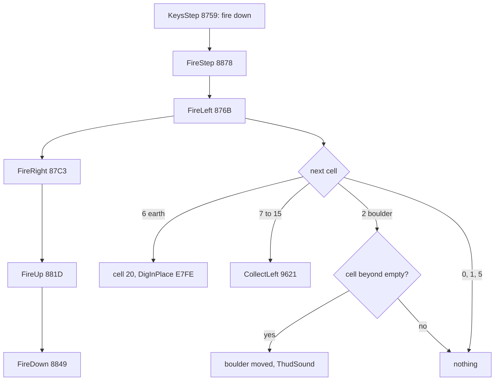

Unlike the walk, FireStep tries all four directions in every pass: there is no KeyMoved test between them.
Fire with left and up held digs both cells in one pass.
Fire with up or down on a boulder does nothing.

The fire left code from its earth test:

```text
8781  2A 9C FD     LD HL,(PlayerIndex)
8784  11 A7 FD     LD DE,CaveGrid-1
8787  19           ADD HL,DE              ; the cell to the left
8788  7E           LD A,(HL)
8789  FE 06        CP $06
878B  20 06        JR NZ,FireLeftSkip
878D  36 20        LD (HL),$20            ; earth: dug, marked vacated
878F  CD FE E7     CALL DigInPlace        ; four noise bursts
8792  C9           RET
8793  FE 06        CP $06                 ; FireLeftSkip
8795  38 08        JR C,FireLeftBoulder   ; 0-5
8797  E5           PUSH HL
8798  CD 21 96     CALL CollectLeft       ; 7-15
879B  E1           POP HL
879C  C9           RET
```

Worked example 6: fire and left, with the player at index 301 and earth (6) at 300.

1. KeysStep finds fire down and calls FireStep.
2. FireLeft finds left down. 301 is not a multiple of 30, so the player is not in column 0.
3. Cell 300 holds 6: it becomes `$20`, and DigInPlace plays its four noise bursts.
4. PlayerIndex stays 301. ClearVacated turns the `$20` into 0 later in the pass.
5. Had the player stood at 300, the column-0 test would have returned at once: 300 is a multiple of 30.

Witnesses: FireStep runs 1678 times in 23 of the 32 RZX replays (the most in `rzx-earth24`, 323), DigInPlace 167 times
(84 in `rzx-earth24`, cave 24's falling earth). FireLeftBoulder and FireRight's push never ran in any recording:
pushing from standing is known only from the code. No `c1` key press holds M in play.

The point: fire turns the four direction keys into four actions at once, and lets the player dig or collect a cell
without stepping into what may fall into it.

## 5.8 The other keys: G, H and F

Three keys are fixed in the code. They are read every pass, on the keyboard even when the joystick is chosen.

| Key | Half row, bit | Routine | Effect |
| --- | --- | --- | --- |
| G | `$FD`, `$10` | AbortKey `$93A5` | back to the menu at once, no game-over screen |
| F | `$FD`, `$08` | MapKey `$EA96` | the map, once per cave |
| H | `$BF`, `$10` | QuitKey `$872D` | the time bar drained: a life lost |

### G: four return addresses dropped

AbortKey is also the routine that starts the cell scan (its first instruction is `CALL AnimateCellCodes`).
After the scan it reads G:

```text
93A5  CD 7E 93     CALL AnimateCellCodes  ; AbortKey: the cell scan of the pass
93A8  3E FD        LD A,$FD
93AA  D3 FF        OUT ($FF),A
93AC  DB FE        IN A,($FE)
93AE  E6 10        AND $10                ; G
93B0  C0           RET NZ
93B1  E1           POP HL                 ; PlayCave's return
93B2  E1           POP HL                 ; CavePlay's return
93B3  E1           POP HL                 ; CaveStart's return (NextCave)
93B4  E1           POP HL                 ; NewGame's return (GameOver at $8BE8)
93B5  C9           RET                    ; to $8B42 in MenuKeys: JP GameEntry
```

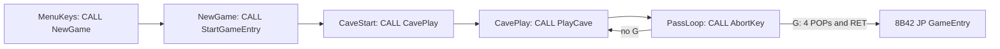

The four return addresses are those of PlayCave, CavePlay, CaveStart and NewGame.
The last one is `$8BE8`, the `CALL GameOver` after the game.
So G skips GameOver: no "game over" screen and no high-score check.

Witness: in `c1`, G goes down at 15 240; AbortKey runs for the last time at 15 244, and GameOver never runs in `c1`.

### H: the time bar drained

```text
872D  3E BF        LD A,$BF               ; QuitKey
872F  D3 FF        OUT ($FF),A
8731  DB FE        IN A,($FE)
8733  E6 10        AND $10                ; H
8735  C0           RET NZ
8736  F3           DI
8737  CD 91 86     CALL ShiftTimeBar      ; QuitKeyLoop: the bar one step shorter
873A  21 01 00     LD HL,$0001
873D  11 00 00     LD DE,$0000
8740  E5           PUSH HL
8741  CD B5 03     CALL RomBeeper         ; a click
8744  E1           POP HL
8745  00 ...       NOP x 4
8749  3A C0 52     LD A,(Screen+4800)     ; the bar's first byte, $52C0
874C  B7           OR A
874D  20 E8        JR NZ,QuitKeyLoop
874F  3E FF        LD A,$FF
8751  32 7D FD     LD (CaveOver),A
8754  CD AD 86     CALL TimeOutSound
8757  FB           EI
8758  C9           RET
```

H runs the time-out as if the time had run out, quickly and with a click per step: the bar empties, CaveOver ends the
pass loop, and NextCave takes a life (doc 08 for the bar, doc 10 for the life).
Witness: `c1`, H at 14 430; the next intro shows 3 lives, one fewer than after the boulder death at 13 208
(`c1/screens.png` has the intros with 5, 4 and 3 lives).

### F: the map, once per cave

```text
EA96  3E FD        LD A,$FD               ; MapKey
EA98  D3 FF        OUT ($FF),A
EA9A  DB FE        IN A,($FE)
EA9C  E6 08        AND $08                ; F
EA9E  20 0F        JR NZ,MapKeySkip
EAA0  3A 8D EA     LD A,(MapShown)
EAA3  FE FF        CP $FF
EAA5  28 08        JR Z,MapKeySkip
EAA7  3E FF        LD A,$FF
EAA9  32 8D EA     LD (MapShown),A
EAAC  CD 80 EA     CALL ShowMap
EAAF  CD 75 8D     CALL DrawWindowAtOrigin ; MapKeySkip: the window, every pass
EAB2  C9           RET
```

MapShown `$EA8D` is cleared at each cave start (ClearMapFlag `$EA8E`), so the map is shown once per cave, lives
included.
MapKey is also where every pass draws the window: the `CALL DrawWindowAtOrigin` after the test runs whether F is down
or not.
After the map, that same call puts the window back.
The map screen itself is in doc 06.

Witness: `timer`, F at the start: ShowMap runs once, from 243 to 251 (the map tune starts at 251:13631).
In `c1` the F press at 13 550 fell during the death and the next cave intro, and ShowMap never ran.

The point: the abort, the quit and the map cost one port test each per pass; the abort is done by unwinding the
stack, not by a flag.

## 5.9 Text entry

WaitKey also serves the two places where the player types text:

- EnterPassword `$8E2D` (doc 10), after menu key 1: up to 20 characters into PasswordBuffer `$FD00`;
- EnterName `$7F00` (doc 08), in the high-score table.

Both use the KeyTable characters: `0` deletes, `e` (ENTER) ends, a space and the letters A-Z are stored, every other
key is ignored.
KeyClick `$8E18` clicks each accepted key.

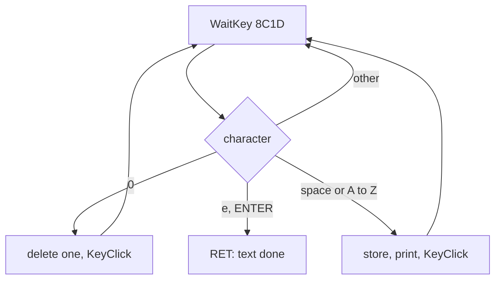

WaitKey has no release wait here either; the click between two keys is short (KeyClick), so a held key repeats
quickly.
Witness: `c1`, key 1 at 12 605, the prompt from 12 617, ENTER at 12 705 ends it with an empty password.

The point: one 40-record table serves the redefinition, the password and the name; the special keys get letters `c`,
`s` and `e` so that one compare tells them apart.

## 5.10 When a key counts

Each key is read at one instant of a pass:

| Read | When in the pass (c1, pass of 14 265) |
| --- | --- |
| fire, then the four walk keys | at the start: KeysStep at 14265:33994, TryLeft at 14265:34228 |
| G | after the cell scan, about 1.8 frames in |
| F | before the window is drawn |
| H | at the end, after TimerStep |

A pass lasts 5.3 to 6.5 frames in cave 1.
So a walk key pressed just after the read waits up to a whole pass: O pressed at 14 260 was first seen at 14 265,
5.5 frames later; A pressed at 14 310 was seen at once, 0.3 frames later.

Nothing latches a key.
A tap that goes down and up between two reads is lost.
On the keyboard a key must be held across the start of a pass, about a tenth of a second, to move the player once.

In the menu and in the redefinition, the keys are polled much faster: PlayTune once per note, WaitKey about 23 times
a frame.

The point: play input is sampled once per pass, and the pass time sets the feel of the controls, not the frame rate.

## 5.11 What is known only from the code

- Pushing from standing (FireLeftBoulder `$879F`, the push in FireRight) never ran in any recording.
- PlayerIndex 0 skips TryLeft only (PlayerStep `$8562`); no recording has the player in cell 0.
- The faults of the control save (cases A and B) are shown on a clone, not in a recording.
- What the Kempston form reads when no interface is fitted depends on the machine's bus; the game does not test for
  the interface. No recording covers it.
- The special dispatchers (TryLeft to LeftSpecial `$94D6`, TryRight to RightSpecial `$9494`) are read from the
  generated asm; the handlers' behaviour in each direction is doc 10's.
