# 6. Rendering

What this covers:

- the screen in play: a window of 16 x 11 cells of 16 x 16 pixels over the 30 x 20 cave, the time bar and the panel;
- the cell graphics table `$8000 + 2 x code` and the 36-byte cell graphic;
- DrawWindow and DrawCell, which redraw all 176 cells every pass, straight onto the screen;
- WindowOrigin and the scroll, a whole cell at a time;
- how the table's words change per cave (CaveSetup) and per pass (the animations);
- the graphics in `src/res/graphics` as sheets;
- the map screen (key F);
- the code against the screen on a real pass, and the beam.

The recordings it rests on (WALKTHROUGH 6.0):

- `c1`: power-on, the load, the menu, cave 1 on the keyboard. Its frames count from power-on. The pass studied here
  starts at 14293:35876; the scroll at 14 306-14 420 follows the player down and right (doc 05, 5.6).
- `timer`: from `probe/level1.szx` (cave 1 in play), F at the start: the map, frames 243-251.
- The 32 RZX replays (`rzx-earth01` ... `rzx-earth32`, other players' runs) for the counts and the screenshots of
  every cave.

Frames and times:

- A memory sample "at frame N" is the state at the start of frame N (TTD `memory_at`, T 0). It shows what frame
  N - 1 left.
- An event "at N:t" is an instruction in an access trace that ran in frame N, t T-states into the 69 888 T frame
  (`work/docs/esB/tr.py` over `work/docs/esB/c1/traces/` and `work/docs/esB/timer/traces/`).
- A [pass](README.md#terms) is one turn of PassLoop `$888D`. There is no HALT, so a pass is not tied to the frame.

## 6.1 The screen in play

The play screen uses the whole Spectrum screen:

| Character rows | Pixel lines | What | Drawn by |
| --- | --- | --- | --- |
| 0-21 | 0-175 | the window: 11 rows of 16 cells, each 2 x 2 characters | DrawWindow `$8D78`, every pass |
| 22 | 176-183 | the time bar, 4 pixel lines at `$52C0` | ShiftTimeBar (doc 08) |
| 23 | 184-191 | the panel: cave, gems, time, lives, score | doc 08 |

A cell is 16 x 16 pixels with its own four attributes.
The window starts at character column 0 and fills all 32 columns, so the 16 cells of a row cover the screen width
exactly.
11 rows of 2 characters make 22 character rows; rows 22 and 23 belong to the HUD, and the window code never writes
them.

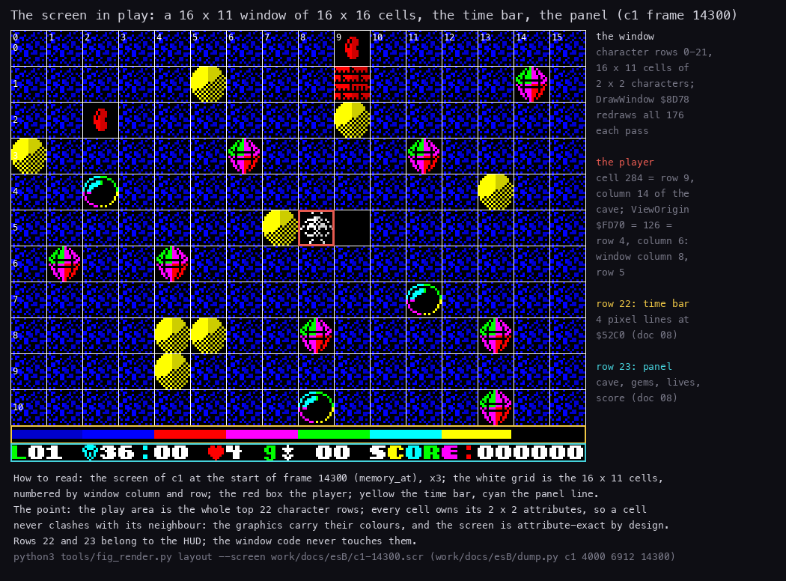

*The play screen of `c1` at the start of frame 14 300 (memory_at), with the window's cells numbered and the HUD rows
marked. `python3 tools/fig_render.py layout --screen work/docs/esB/c1-14300.scr --out docs/img/render/layout.png`
(the screen from `python3 work/docs/esB/dump.py c1 4000 6912 14300`).*

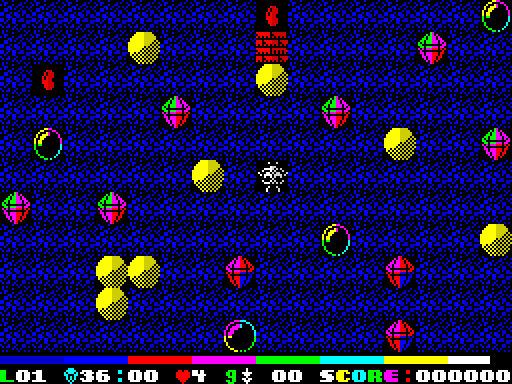

*Cave 1 in play. Stage-1 screenshot (recording `c1`).*

Every cell owns its 2 x 2 attributes, and a cell graphic carries its colours.
So two neighbouring cells never share an attribute, and the screen has no colour clash by design.

The point: the play area is a grid of cells on character boundaries, and every pixel of it is redrawn from the cave
grid each pass.

## 6.2 The cell graphics table

CellGraphicsTable `$8000` holds 32 words, one per cell code 0-31.
A word is the address of a 36-byte cell graphic.
DrawCell finds the graphic of a code with CellGraphicAddr `$8D66`:

```text
8D66  E6 1F        AND $1F                ; CellGraphicAddr: the low 5 bits of the cell
8D68  07           RLCA                   ; x 2
8D69  5F           LD E,A
8D6A  16 80        LD D,$80               ; DE = $8000 + 2 x code
8D6C  C9           RET
```

| Word | Code | Graphic as loaded | Changed by |
| --- | --- | --- | --- |
| 0 | 0 empty | BlankGraphic `$AA72` | SetEarthFalls, EarthAnimStep (falling-earth caves) |
| 1 | 1 exit | CellGraphics `$9B08` | colours: CaveSetup, ExitFlash |
| 2 | 2 boulder | GfxBoulder `$9B2C` | colours: CaveSetup |
| 3, 4 | 3, 4 player right, left | GfxPlayerRight `$9B98`, GfxPlayerLeft `$9C28` | AnimateCells (4 frames), DeathView |
| 5 | 5 wall | per cave | CaveSetup (WallGraphic `$FDA2`) |
| 6 | 6 earth | per cave | CaveSetup (EarthGraphic `$FDA0`), EarthAnim |
| 7 | 7 gem | GfxGem `$9B74` | colours: DrawPass, every pass |
| 8 | 8 jelly bean | GfxJellyBean `$A4E0` | AnimateTable (4 frames) |
| 9 | 9 force field | GfxForceField `$A2A0` | AnimateTable (8 frames) |
| 10 | `$0A` anti-gravity arrow | GfxAntiGrav `$A3C0` | AnimateTable (4 frames) |
| 11 | `$0B` switch box | GfxSwitch `$9EB0` | never |
| 12 | `$0C` potion | CellGraphics2 `$9E20` | AnimateTable (4 frames) |
| 13 | `$0D` teleporter | GfxTeleporter `$9F64` | AnimateTable (12 frames) |
| 14 | `$0E` bubble | GfxBubble `$A114` | AnimateTable (4 frames) |
| 15 | `$0F` fire | GfxFire `$9ED4` | AnimateTable (4 frames) |
| 16-20 | `$10-$14` the bubble burst | GfxBurst `$A570` ... `$A5DC` | never; word 16 is never read |
| 21-27 | `$15-$1B` the boulder dissolving in fire | GfxDissolve `$A1A4` ... `$A27C` | colours: CaveSetupAll |
| 28-31 | none | `$0000` | never read |

The cell codes `$10-$1B` are animation states that step on by one each pass (AnimateCellCodes `$937E`, doc 10).
Their table words are the animation frames, so the grid itself carries the animation.
Words 16 and 21 are never read: AnimateCellCodes steps codes `$10` and `$15` on before the window is drawn in the same
pass.
Bit 5 of a cell (`$20`, the vacated mark) is masked off by the `AND $1F`, and ClearVacated `$81AC` has cleared it
before the draw anyway.

The point: one table word per code makes every per-cave and per-pass change of look a single word or a few colour
bytes; the drawing code never knows which object it draws.

## 6.3 The cell graphic: 36 bytes in drawing order

A graphic is 4 attribute bytes, then 32 pixel bytes:

- the attributes in the order top left, top right, bottom right, bottom left;
- the pixel bytes line by line, even lines left then right, odd lines right then left.

That is the order in which DrawCell walks the screen, so DrawCell needs no address arithmetic per byte.

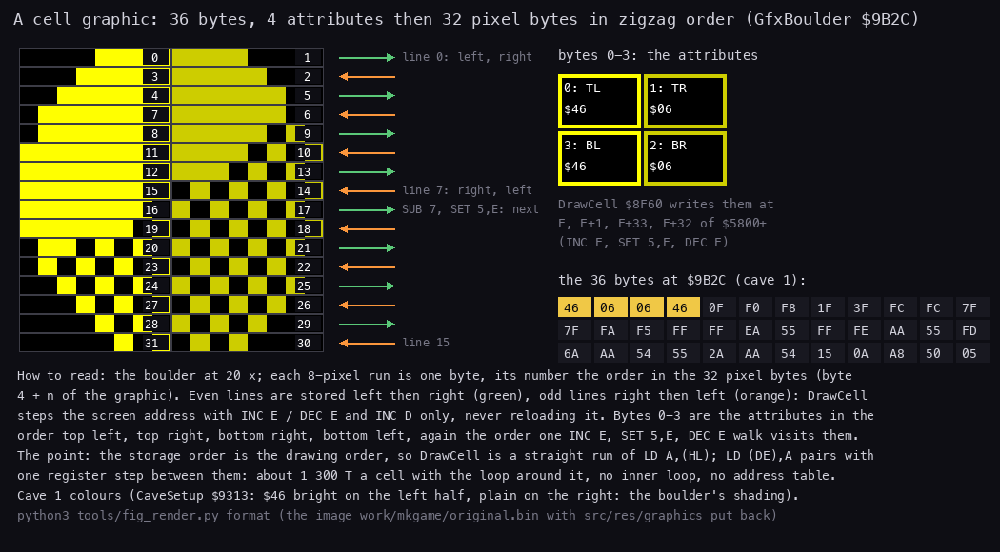

*GfxBoulder `$9B2C` as DrawCell reads it, with each byte's place in the 36. Drawn from the image with
`src/res/graphics` put back: `python3 tools/fig_render.py format --out docs/img/render/cell-format.png`. How to read:
the numbers are the order of the 32 pixel bytes; green arrows are left-to-right lines, orange right-to-left; the four
boxes are the attributes in their order.*

DrawCell `$8F60` draws cell code A at character row B, column C:

```text
DrawCell(code, row, col):                    ; $8F60
    g = CellGraphicsTable[code AND $1F]
    de = $5800 + 32 x row + col              ; AttrAddrDE $8265
    attr[de] = g[0]; de += 1                 ; top left, top right
    attr[de] = g[1]; de += 32                ; SET 5,E: bottom right
    attr[de] = g[2]; de -= 1                 ; bottom left
    attr[de] = g[3]; de -= 32                ; RES 5,E
    d = $40 OR (d AND 3) x 8                 ; the attribute address becomes the pixel address of line 0
    for half in (top, bottom):
        for line in 0..7:
            if line even: write g[k] at e, g[k + 1] at e + 1     ; INC E
            else:         write g[k] at e + 1, g[k + 1] at e     ; DEC E
            d += 1                                               ; INC D: the next pixel line
        d -= 8 (SUB 7 after the last INC D); e += 32 (SET 5,E)   ; the next character row
```

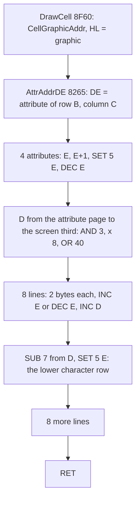

The start of DrawCell, to the first pixel line:

```text
8F60  CD 66 8D     CALL CellGraphicAddr   ; DrawCell
8F63  00           NOP
8F64  1A           LD A,(DE)
8F65  6F           LD L,A
8F66  13           INC DE
8F67  1A           LD A,(DE)
8F68  67           LD H,A                 ; HL = the graphic
8F69  CD 65 82     CALL AttrAddrDE        ; DE = $5800 + 32B + C
8F6C  7E           LD A,(HL)
8F6D  12           LD (DE),A              ; top left
8F6E  2C           INC L
8F6F  1C           INC E
8F70  7E           LD A,(HL)
8F71  12           LD (DE),A              ; top right
8F72  2C           INC L
8F73  CB EB        SET 5,E
8F75  7E           LD A,(HL)
8F76  12           LD (DE),A              ; bottom right
8F77  2C           INC L
8F78  1D           DEC E
8F79  7E           LD A,(HL)
8F7A  12           LD (DE),A              ; bottom left
8F7B  23           INC HL
8F7C  CB AB        RES 5,E
8F7E  7A           LD A,D
8F7F  E6 03        AND $03
8F81  07           RLCA
8F82  07           RLCA
8F83  07           RLCA
8F84  F6 40        OR $40
8F86  57           LD D,A                 ; DE = the pixel address of line 0
8F87  7E           LD A,(HL)
8F88  12           LD (DE),A              ; line 0, left
8F89  2C           INC L
8F8A  1C           INC E
8F8B  7E           LD A,(HL)
8F8C  12           LD (DE),A              ; line 0, right
8F8D  2C           INC L
8F8E  14           INC D
8F8F  7E           LD A,(HL)
8F90  12           LD (DE),A              ; line 1, right
8F91  2C           INC L
8F92  1D           DEC E
8F93  7E           LD A,(HL)
8F94  12           LD (DE),A              ; line 1, left
8F95  23           INC HL
...                                       ; 6 more lines, the same
8FC6  7A           LD A,D
8FC7  D6 07        SUB $07
8FC9  57           LD D,A
8FCA  CB EB        SET 5,E                ; the lower character row
...                                       ; 8 more lines
900A  C9           RET
```

Two tricks keep it short:

- The attribute address `$58xx + 32 x (row AND 7) + col` and the pixel address of the same character share their low
  byte. Only the high byte changes: `$58 + row / 8` becomes `$40 + 8 x (row / 8)`. Five instructions turn one into the
  other.
- The graphic pointer moves with `INC L` inside each group of four bytes and `INC HL` at its end. A group must not
  cross a 256-byte page. Every graphic starts on a multiple of 4 or, for BlankGraphic `$AA72`, far enough from a page
  end, so none does.

DrawCell is valid only on even character rows: the `SET 5,E` for the lower half assumes bit 5 of E is clear, which
holds for even rows (`32 x (row AND 7)` has bit 5 clear) and columns below 32.
The window uses rows 0, 2, ... 20.

Worked example 1: the boulder at window row 1, column 5, `c1` frame 14 300.

1. ViewOrigin is 126 (6.5), so the cell is cave index 126 + 30 + 5 = 161, at `$FE49`; it holds 2, a boulder.
2. DrawWindow calls DrawCell with B = 2, C = 10 (character row and column).
3. CellGraphicAddr: `2 AND $1F` = 2, x 2 = 4: DE = `$8004`, which holds `$9B2C`.
4. AttrAddrDE: D = `$58` + 2 / 8 = `$58`, E = 32 x 2 + 10 = `$4A`: DE = `$584A`.
5. The attributes `$46 $06 $06 $46` (cave 1's boulder colour) go to `$584A`, `$584B`, `$586B`, `$586A`. The sample at
   14 300 shows `$46 $06` at `$584A`.
6. D = `$58 AND 3` = 0, x 8 = 0, OR `$40`: DE = `$404A`, pixel line 0 of the cell.
7. Bytes 4 and 5 of the graphic go to `$404A` and `$404B`, bytes 6 and 7 to `$414B` and `$414A`, and so on down to
   line 7 at `$474A`.
8. SUB 7 from `$47` gives `$40`, SET 5 of E gives `$6A`: line 8 starts at `$406A`.

The point: storage order equals drawing order, so the 36 bytes go out as a straight run of `LD A,(HL)` / `LD (DE),A`
pairs, about 1300 T a cell with the loop around it.

## 6.4 DrawWindow: all 176 cells, every pass

DrawWindow `$8D78` draws 11 rows of 16 cells, starting at a cell index in HL:

```text
DrawWindow(hl = origin):                     ; $8D78
    p = CaveGrid + origin                    ; $FDA8 + origin
    for row in 0, 2, ... 20:                 ; character rows
        for col in 0, 2, ... 30:             ; character columns
            DrawCell(cave[p], row, col)
            p += 1
        p += 14                              ; 30 - 16: the next cave row
```

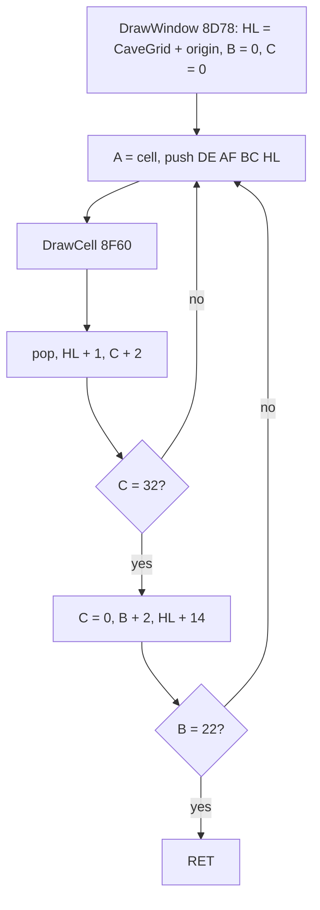

```text
8D78  11 A8 FD     LD DE,CaveGrid         ; DrawWindow
8D7B  19           ADD HL,DE
8D7C  01 00 00     LD BC,$0000
8D7F  7E           LD A,(HL)              ; DrawWindowLoop
8D80  D5           PUSH DE
8D81  F5           PUSH AF
8D82  C5           PUSH BC
8D83  E5           PUSH HL
8D84  CD 60 8F     CALL DrawCell
8D87  E1           POP HL
8D88  C1           POP BC
8D89  F1           POP AF
8D8A  D1           POP DE
8D8B  00 ...       NOP x 5
8D90  23           INC HL
8D91  0C           INC C
8D92  0C           INC C
8D93  79           LD A,C
8D94  FE 20        CP $20
8D96  20 E7        JR NZ,DrawWindowLoop
8D98  0E 00        LD C,$00
8D9A  04           INC B
8D9B  04           INC B
8D9C  11 0E 00     LD DE,$000E
8D9F  19           ADD HL,DE
8DA0  78           LD A,B
8DA1  FE 16        CP $16
8DA3  20 DA        JR NZ,DrawWindowLoop
8DA5  C9           RET
```

DrawWindow is reached once a pass, through MapKey `$EA96`: its last call, `CALL DrawWindowAtOrigin` `$8D75`, runs
whether F is down or not (doc 05, 5.8).
DrawWindowAtOrigin is DrawPass `$8D46` (the colour and the animations, 6.7), which leaves HL = ViewOrigin, and falls
into DrawWindow.

There is no back buffer and no dirty list.
All 176 cells are drawn straight onto the screen in every pass, changed or not.
Nothing is erased: each cell's 32 pixel bytes and 4 attributes overwrite the old ones completely.
There are no sprites and no masks: the player, the boulders and every effect are cells of the grid.

Worked example 2: the cost, `c1` pass of 14 293.

1. The pass runs from 14293:35876 to 14299:3935: 387 387 T, 5.5 frames.
2. DrawWindow runs from 14295:55115 to 14299:3260: 227 697 T, 3.3 frames, 59 % of the pass.
3. 227 697 T / 176 cells = 1294 T a cell, the DrawCell body plus the pushes and pops of the loop.
4. The rest of the pass is mostly the cell scan (14293:38172 to 14295:24404, about 125 000 T) and ClearVacated (about
   28 000 T).

Counts over all recordings: DrawCell runs 7 771 378 times, DrawWindow 44 156.

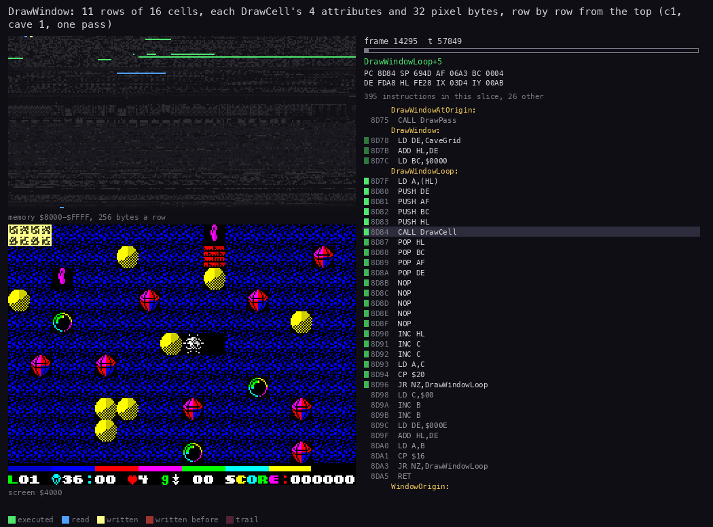

*DrawWindow at work over one pass: the routine and the screen bytes it writes. Recording `c1`, window
14295:55000-14299:3300. `python3 R/kit/routine_anim.py --work work/docs/esB/c1 --window 14295:55000-14299:3300
--listing build/game.lst --view screen --pc 8D75-8DA5,8F60-900A,8265-8274 --range 8000-FFFF --pictures 80 --title
...`.*

The point: a full redraw costs more than half of every pass, and is the main reason a pass takes 5 to 7 frames.
It buys a renderer with no state: whatever the grid holds is on the screen after the pass.

## 6.5 WindowOrigin: the scroll

WindowOrigin `$8DA6` computes ViewOrigin `$FD70`, the cave index of the window's top-left cell, from PlayerIndex.
It runs after the player has moved and the scan has run, just before MapKey draws the window.

```text
WindowOrigin:                                ; $8DA6
    row = PlayerIndex / 30; col = PlayerIndex mod 30     ; by repeated subtraction
    col = clamp(col, 8, 22)
    row = clamp(row, 5, 14)
    ViewOrigin = 30 x (row - 5) + (col - 8)
```

The window is 16 cells wide and 11 high.
The player sits at window column 8 and row 5 while the clamps let him, so he is just right of and at the middle.
The clamps keep the window inside the cave: the origin column runs 0-14 (30 - 16) and the origin row 0-9 (20 - 11).
So 15 x 10 = 150 origins cover the cave.

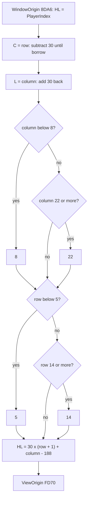

```text
8DA6  01 00 00     LD BC,$0000            ; WindowOrigin
8DA9  2A 9C FD     LD HL,(PlayerIndex)
8DAC  11 1E 00     LD DE,$001E
8DAF  0C           INC C                  ; WindowOriginLoop
8DB0  ED 52        SBC HL,DE
8DB2  30 FB        JR NC,WindowOriginLoop
8DB4  0D           DEC C                  ; C = the row
8DB5  19           ADD HL,DE              ; L = the column
8DB6  7D           LD A,L
8DB7  FE 08        CP $08
8DB9  30 02        JR NC,WindowOriginSkip
8DBB  2E 08        LD L,$08
8DBD  FE 16        CP $16                 ; WindowOriginSkip
8DBF  38 02        JR C,WindowOriginSkip2
8DC1  2E 16        LD L,$16
8DC3  79           LD A,C                 ; WindowOriginSkip2
8DC4  FE 05        CP $05
8DC6  30 02        JR NC,WindowOriginSkip3
8DC8  0E 05        LD C,$05
8DCA  FE 0E        CP $0E                 ; WindowOriginSkip3
8DCC  38 02        JR C,WindowOriginSkip4
8DCE  0E 0E        LD C,$0E
8DD0  11 1E 00     LD DE,$001E            ; WindowOriginSkip4
8DD3  41           LD B,C
8DD4  04           INC B
8DD5  26 00        LD H,$00
8DD7  19           ADD HL,DE              ; WindowOriginLoop2: + 30 x (row + 1)
8DD8  10 FD        DJNZ WindowOriginLoop2
8DDA  11 BC 00     LD DE,$00BC            ; 188 = 30 x 6 + 8
8DDD  ED 52        SBC HL,DE
8DDF  22 70 FD     LD (ViewOrigin),HL
8DE2  C9           RET
```

The formula in the code is `30 x (row + 1) + col - 188`, which is the same as `30 x (row - 5) + col - 8`.
The second clamp test compares A, which still holds the column before the first clamp; this is harmless, because a
column below 8 is never 22 or more.

Worked example 3: `c1` frame 14 300.

1. PlayerIndex = 284. 284 = 9 x 30 + 14: row 9, column 14.
2. Column 14 is inside 8-22, row 9 inside 5-14: no clamp.
3. ViewOrigin = 30 x (9 - 5) + (14 - 8) = 126: the window's top-left cell is row 4, column 6.
4. The player is drawn at window column 14 - 6 = 8 and row 9 - 4 = 5, as in the layout figure (6.1).

Worked example 4: the scroll in `c1`, frames 14 300-14 420 (ViewOrigin sampled with `work/docs/esB/peek.py`).

| Frame | ViewOrigin | Origin row, column | Why |
| --- | --- | --- | --- |
| 14 300 | 126 | 4, 6 | the player at row 9 |
| 14 320 | 186 | 6, 6 | moved down to row 11 |
| 14 330 | 216 | 7, 6 | row 12 |
| 14 340 | 276 | 9, 6 | row 14: the row clamp's top, the window at the cave's bottom |
| 14 380 | 279 | 9, 9 | moved right to column 17 |
| 14 400 | 282 | 9, 12 | column 20 |
| 14 420 | 284 | 9, 14 | column 22 and beyond: the column clamp, the window at the cave's right edge |

The window moves in the same pass as the player, by a whole cell: the scroll is a jump of 16 pixels, never a smooth
slide.
At the cave's edges the window stops and the player walks off the centre.

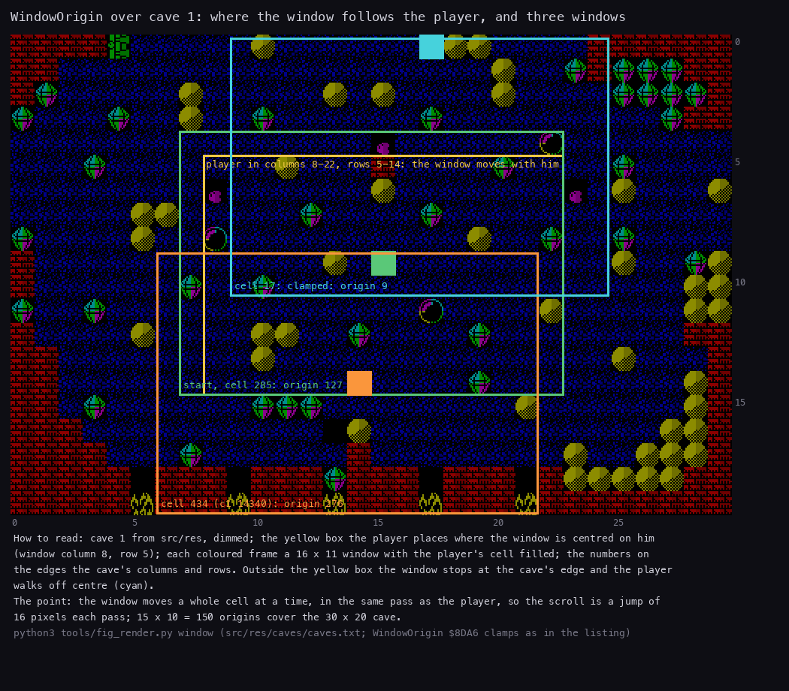

*Three windows over cave 1 and the box where the window follows the player. Drawn from `src/res/caves/caves.txt` with
WindowOrigin's clamps: `python3 tools/fig_render.py window --out docs/img/render/window-over-cave.png`. How to read:
the dimmed cave, the yellow box is where the player keeps window column 8, row 5; each coloured frame is a 16 x 11
window with its player cell filled. Cell 434 is the player's place at `c1` frame 14 340.*

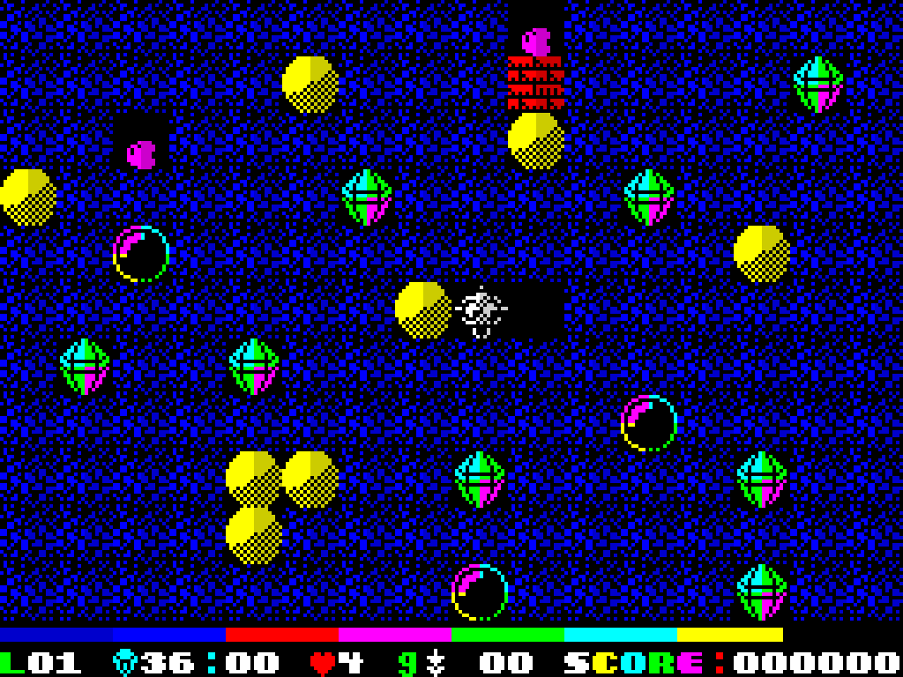

*The window following the player down and then right, a cell at a time, until it meets the cave's bottom and right
edges. Recording `c1`, frames 14 306-14 420. `python3 R/kit/screen_anim.py --work work/docs/esB/c1 --from 14306 --to
14420 --step 1 --scale 4 --delay 60 --hold 2000 docs/img/play/window-scroll.gif`.*

The point: because the whole window is redrawn every pass anyway, the scroll costs nothing extra: it is a different
start index for the same loop.

## 6.6 The slots per cave: CaveSetup

Most cells look the same in every cave.
Four change with the cave, from its parameters (doc 07): the wall and the earth graphics, and the colours of the exit,
the boulder, GfxWall1 and the earth.

```text
CaveSetup:                                   ; $9313
    UnpackCave
    CellGraphicsTable[6] = EarthGraphic      ; $FDA0
    CellGraphicsTable[5] = WallGraphic       ; $FDA2
    SetGraphicColour(exit graphic $9B08, DoorColour)
    SetGraphicColour(GfxBoulder $9B2C, BoulderColour)
    SetGraphicColour(GfxWall1 $9CB8, Wall1Colour)
    SetGraphicColour(GfxEarth $9B50, EarthColour)

SetGraphicColour(g, a):                      ; $9305
    g[0] = a OR $40; g[1] = a AND $3F; g[2] = a AND $3F; g[3] = a OR $40   ; bright, plain, plain, bright

CaveSetupAll:                                ; $A600
    CaveSetup
    SetGraphicColour on the 7 dissolve frames with the boulder's colour
SetEarthFalls:                               ; $FB81
    CaveSetupAll; word 0 = BlankGraphic; the scan's earth test set for this cave (doc 10)
```

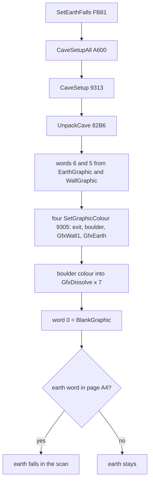

```text
9313  CD B6 82     CALL UnpackCave        ; CaveSetup
9316  2A A0 FD     LD HL,(EarthGraphic)
9319  22 0C 80     LD (CellEarthGfx),HL   ; word 6
931C  2A A2 FD     LD HL,(WallGraphic)
931F  22 0A 80     LD (CellWallGfx),HL    ; word 5
9322  11 A4 FD     LD DE,DoorColour
9325  1A           LD A,(DE)
9326  13           INC DE
9327  21 08 9B     LD HL,CellGraphics     ; the exit
932A  CD 05 93     CALL SetGraphicColour
932D  1A           LD A,(DE)
932E  13           INC DE
932F  21 2C 9B     LD HL,GfxBoulder
9332  CD 05 93     CALL SetGraphicColour
9335  1A           LD A,(DE)
9336  13           INC DE
9337  21 B8 9C     LD HL,GfxWall1
933A  CD 05 93     CALL SetGraphicColour
933D  1A           LD A,(DE)
933E  13           INC DE
933F  21 50 9B     LD HL,GfxEarth
9342  CD 05 93     CALL SetGraphicColour
9345  C9           RET
```

The colour pattern bright, plain, plain, bright makes the left half of a cell brighter than the right: the shading of
the boulder and the exit in every cave comes from it.
A wall graphic other than GfxWall1 keeps the colours stored in it, so Wall1Colour shows only in the 9 caves that use
GfxWall1.

The choices over the 32 caves:

- earth: GfxEarth in 24 caves, GfxFallingEarth `$A450` in 5, GfxBoulder in cave 30, ExtraGraphics `$ED28` in cave 20,
  ExtraGraphic4 `$FBA0` in cave 15;
- wall: GfxWall1 in 9 caves, GfxWall4 and GfxWall5 in 4 each, GfxWall2 in 3, the rest one or two caves each.

Two caves use this to deceive the eye:

- In cave 30 (THE KEEP) the earth is drawn with the boulder graphic: earth and boulders look the same.
- In cave 20 (RUSE NO DOUBT) wall and earth are both ExtraGraphics, a question mark.

The earth graphic also decides a rule.
SetEarthFalls tests the high byte of word 6: in page `$A4` (GfxFallingEarth) the cell scan lets earth fall (doc 10),
and EarthAnim animates both the earth and the empty cell.

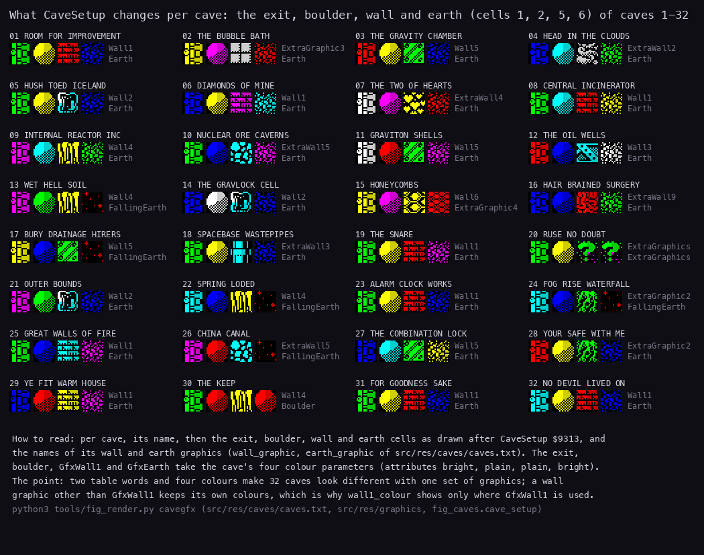

*The exit, boulder, wall and earth of each cave as CaveSetup leaves them. `python3 tools/fig_render.py cavegfx --out
docs/img/render/cave-graphics.png` (from `src/res/caves/caves.txt`, `src/res/graphics` and `tools/fig_caves.py`). How
to read: per cave its name, the four cells, and the names of its wall and earth graphics.*

Worked example 5: cave 1.

1. EarthGraphic = GfxEarth, WallGraphic = GfxWall1: words 6 and 5 point at `$9B50` and `$9CB8`.
2. DoorColour `$44`: the exit gets `$44 $04 $04 $44` (green, bright on the left).
3. BoulderColour `$46`: `$46 $06 $06 $46` (yellow), as in worked example 1.
4. Wall1Colour `$42`: red brick; EarthColour `$41`: blue earth.
5. The page test: `$9B` is not `$A4`, so earth stays put in cave 1.

| Cave | Name | Wall (cell 5) | Earth (cell 6) | Door, boulder, wall 1, earth colours | In play |
| --- | --- | --- | --- | --- | --- |
| 1 | ROOM FOR IMPROVEMENT | GfxWall1 | GfxEarth | `$44` `$46` `$42` `$41` | [cave-01](img/play/cave-01.png) |
| 2 | THE BUBBLE BATH | ExtraGraphic3 | GfxEarth | `$46` `$43` `$42` `$42` | [cave-02](img/play/cave-02.png) |
| 3 | THE GRAVITY CHAMBER | GfxWall5 | GfxEarth | `$42` `$46` `$42` `$41` | [cave-03](img/play/cave-03.png) |
| 4 | HEAD IN THE CLOUDS | GfxExtraWall2 | GfxEarth | `$41` `$45` `$42` `$44` | [cave-04](img/play/cave-04.png) |
| 5 | HUSH TOED ICELAND | GfxWall2 | GfxEarth | `$44` `$46` `$42` `$41` | [cave-05](img/play/cave-05.png) |
| 6 | DIAMONDS OF MINE | GfxWall1 | GfxEarth | `$01` `$06` `$03` `$05` | [cave-06](img/play/cave-06.png) |
| 7 | THE TWO OF HEARTS | GfxExtraWall4 | GfxEarth | `$07` `$03` `$06` `$02` | [cave-07](img/play/cave-07.png) |
| 8 | CENTRAL INCINERATOR | GfxWall1 | GfxEarth | `$04` `$05` `$02` `$06` | [cave-08](img/play/cave-08.png) |
| 9 | INTERNAL REACTOR INC | GfxWall4 | GfxEarth | `$03` `$05` `$01` `$04` | [cave-09](img/play/cave-09.png) |
| 10 | NUCLEAR ORE CAVERNS | GfxExtraWall5 | GfxEarth | `$44` `$41` `$4D` `$43` | [cave-10](img/play/cave-10.png) |
| 11 | GRAVITON SHELLS | GfxWall5 | GfxEarth | `$07` `$02` `$04` `$03` | [cave-11](img/play/cave-11.png) |
| 12 | THE OIL WELLS | GfxWall3 | GfxEarth | `$02` `$01` `$05` `$07` | [cave-12](img/play/cave-12.png) |
| 13 | WET HELL SOIL | GfxWall4 | GfxFallingEarth | `$03` `$04` `$06` `$02` | [cave-13](img/play/cave-13.png) |
| 14 | THE GRAVLOCK CELL | GfxWall2 | GfxEarth | `$01` `$07` `$04` `$01` | [cave-14](img/play/cave-14.png) |
| 15 | HONEYCOMBS | GfxWall6 | ExtraGraphic4 | `$06` `$03` `$03` `$01` | [cave-15](img/play/cave-15.png) |
| 16 | HAIR BRAINED SURGERY | GfxExtraWall9 | GfxEarth | `$01` `$01` `$06` `$04` | [cave-16](img/play/cave-16.png) |
| 17 | BURY DRAINAGE HIRERS | GfxWall5 | GfxFallingEarth | `$06` `$01` `$07` `$02` | [cave-17](img/play/cave-17.png) |
| 18 | SPACEBASE WASTEPIPES | GfxExtraWall3 | GfxEarth | `$44` `$46` `$42` `$41` | [cave-18](img/play/cave-18.png) |
| 19 | THE SNARE | GfxWall1 | GfxEarth | `$44` `$46` `$42` `$43` | [cave-19](img/play/cave-19.png) |
| 20 | RUSE NO DOUBT | ExtraGraphics | ExtraGraphics | `$44` `$46` `$42` `$41` | [cave-20](img/play/cave-20.png) |
| 21 | OUTER BOUNDS | GfxWall2 | GfxEarth | `$43` `$44` `$42` `$41` | [cave-21](img/play/cave-21.png) |
| 22 | SPRING LODED | GfxWall4 | GfxFallingEarth | `$45` `$41` `$42` `$41` | [cave-22](img/play/cave-22.png) |
| 23 | ALARM CLOCK WORKS | GfxWall1 | GfxEarth | `$44` `$46` `$42` `$41` | [cave-23](img/play/cave-23.png) |
| 24 | FOG RISE WATERFALL | ExtraGraphic2 | GfxFallingEarth | `$45` `$41` `$42` `$41` | [cave-24](img/play/cave-24.png) |
| 25 | GREAT WALLS OF FIRE | GfxWall1 | GfxEarth | `$44` `$41` `$45` `$43` | [cave-25](img/play/cave-25.png) |
| 26 | CHINA CANAL | GfxExtraWall5 | GfxFallingEarth | `$03` `$02` `$04` `$06` | [cave-26](img/play/cave-26.png) |
| 27 | THE COMBINATION LOCK | GfxWall5 | GfxEarth | `$41` `$45` `$42` `$46` | [cave-27](img/play/cave-27.png) |
| 28 | YOUR SAFE WITH ME | ExtraGraphic2 | GfxEarth | `$42` `$46` `$42` `$41` | [cave-28](img/play/cave-28.png) |
| 29 | YE FIT WARM HOUSE | GfxWall1 | GfxEarth | `$41` `$42` `$46` `$43` | [cave-29](img/play/cave-29.png) |
| 30 | THE KEEP | GfxWall4 | GfxBoulder | `$44` `$42` `$42` `$41` | [cave-30](img/play/cave-30.png) |
| 31 | FOR GOODNESS SAKE | GfxWall1 | GfxEarth | `$44` `$46` `$42` `$41` | [cave-31](img/play/cave-31.png) |
| 32 | NO DEVIL LIVED ON | GfxWall1 | GfxEarth | `$45` `$46` `$42` `$41` | [cave-32](img/play/cave-32.png) |

The screenshots are stage-1 captures of each cave in play, from the RZX replays; all 32 together:

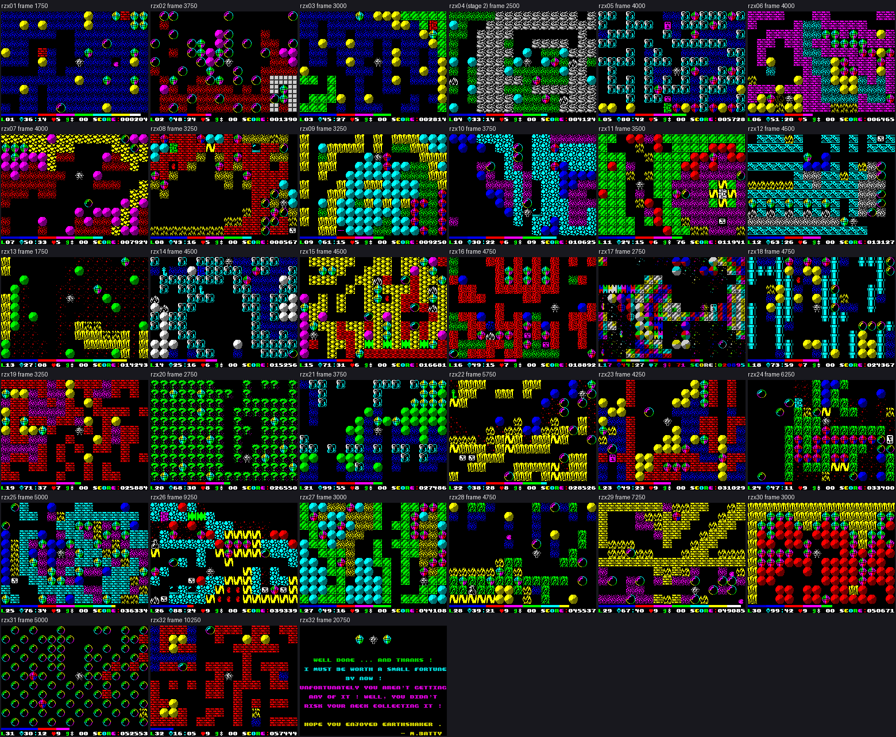

*The 32 caves in play and the win. Stage-1 contact sheet of the RZX replays (WALKTHROUGH 6.1).*

The point: two table words and four colours per cave make 32 caves look different with one set of graphics, at no
cost in the drawing code.

## 6.7 The animation: words and colours rewritten each pass

DrawPass `$8D46` runs just before every DrawWindow:

```text
DrawPass:                                    ; $8D46
    gem attributes = ink, ink - 1, ink - 2, ink - 1   ; ColourCycleInk $FD8F
    AnimateCells                              ; the player
    AnimateTable                              ; the specials and the falling earth

AnimateCells:                                ; $900B
    AnimPhase = (AnimPhase + 1) mod 4         ; $FD72
    word 3 = GfxPlayerRight + 36 x AnimPhase
    word 4 = GfxPlayerLeft + 36 x AnimPhase
    HL = ViewOrigin                           ; for DrawWindow

AnimateTable:                                ; $90B2
    EarthAnim                                 ; only when word 6 is in page $A4
    word 15 = GfxFire + 36 x AnimPhase
    word 12 = potion + 36 x AnimPhase
    word 14 = GfxBubble + 36 x AnimPhase
    ForceFieldPhase = (ForceFieldPhase + 1) AND 7;  word 9 = GfxForceField + 36 x ForceFieldPhase
    word 10 = GfxAntiGrav + 36 x AnimPhase
    TeleporterPhase = (TeleporterPhase + 1) mod 12; word 13 = GfxTeleporter + 36 x TeleporterPhase
    word 8 = GfxJellyBean + 36 x AnimPhase
```

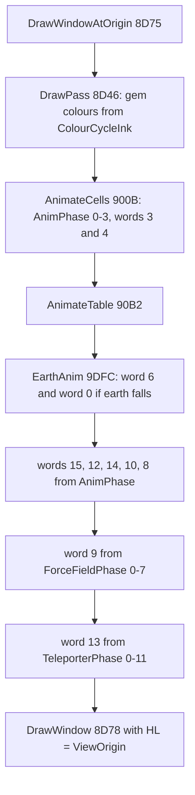

AnimateCells:

```text
900B  3A 72 FD     LD A,(AnimPhase)       ; AnimateCells
900E  3C           INC A
900F  FE 04        CP $04
9011  20 14        JR NZ,AnimateCellsSkip
9013  AF           XOR A                  ; back to frame 0
9014  32 72 FD     LD (AnimPhase),A
9017  21 98 9B     LD HL,GfxPlayerRight
901A  22 06 80     LD (CellPlayerRightGfx),HL
901D  21 28 9C     LD HL,GfxPlayerLeft
9020  22 08 80     LD (CellPlayerLeftGfx),HL
9023  2A 70 FD     LD HL,(ViewOrigin)
9026  C9           RET
9027  32 72 FD     LD (AnimPhase),A       ; AnimateCellsSkip
902A  2A 06 80     LD HL,(CellPlayerRightGfx)
902D  11 24 00     LD DE,$0024            ; the next frame, 36 bytes on
9030  19           ADD HL,DE
9031  22 06 80     LD (CellPlayerRightGfx),HL
9034  2A 08 80     LD HL,(CellPlayerLeftGfx)
9037  19           ADD HL,DE
9038  22 08 80     LD (CellPlayerLeftGfx),HL
903B  2A 70 FD     LD HL,(ViewOrigin)
903E  C9           RET
```

The animation runs once a pass, not once a frame: one frame of a 4-frame loop lasts 5 to 7 TV frames in cave 1.
The player animates whether he moves or not.
The cells' frames are 36 bytes apart, so a frame is the base address plus 36 times the phase.

The colours change too:

- The gem's four attributes take ColourCycleInk, which ColourCycle `$81E7` moves up and down between `$43` and `$46`
  once a pass (magenta, green, cyan, yellow, and back). So every gem on the screen glows through four colours together.
- ExitFlash `$905B`, called by ColourCycle, writes the same ink into the exit's attributes while ExitOpen `$FD85` is
  set: an open exit flashes with the gems.
- DeathView `$903F` puts GfxDeathRight `$9DB4` and GfxDeathLeft `$9DD8` into words 3 and 4 and draws the window once
  more when the player is killed.
- In the falling-earth caves EarthAnim `$9DFC` steps word 6 through the 4 frames of GfxFallingEarth, and
  EarthAnimStep `$FB70` steps word 0 through EmptyFrames `$FAE0`: the empty cells twinkle too.

ColourCycle runs after the window is drawn, so a pass draws the gems in the colour set by the previous pass.

Worked example 6: `c1`, the passes from 14 299 to 14 321.

1. AnimPhase `$FD72` steps once per DrawPass: the samples at 14 300, 14 303, 14 309, 14 315 and 14 321 show 3, 0, 1,
   2, 3. ForceFieldPhase goes 5, 6, 7, 0, 1 and TeleporterPhase 8, 9, 10, 11, 0 in the same samples.
2. At 14 312 (phase 1) word 3 (`$8006`) holds `$9BBC` = `$9B98` + 36, and word 15 (`$801E`) holds `$9EF8` = `$9ED4` +
   36.
3. ColourCycleInk reads `$45`, `$46`, `$45`, `$44`, `$43` at 14 300, 14 306, 14 312, 14 318 and 14 324: the gem
   colour bounces between `$43` and `$46`, one step a pass. The force field and the teleporter loop on their own
   lengths, 8 and 12.

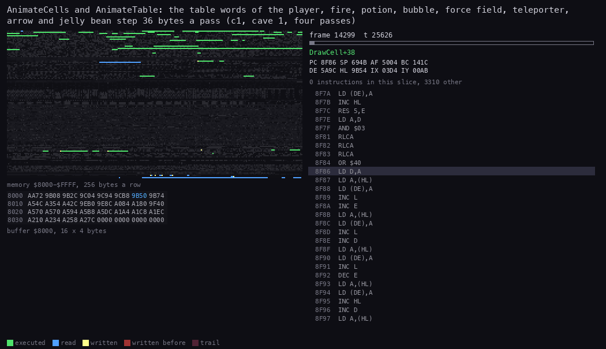

*DrawPass, AnimateCells and AnimateTable rewriting CellGraphicsTable: the 32 words of `$8000` as hex. Recording `c1`,
window 14299:0-14321:0. `python3 R/kit/routine_anim.py --work work/docs/esB/c1 --window 14299:0-14321:0 --listing
build/game.lst --view buffer:8000:16x4:words --pc 8D46-8D65,900B-903E,90B2-914B,9DFC-9E19,FB70-FB80 --range
8000-FFFF --pictures 60 --title ...`.*

The point: every animation of the game is a table word or a colour byte rewritten once a pass; the drawing loop then
picks it up for every cell of that code at once.

## 6.8 The graphics as sheets

`src/res/graphics` holds the graphics as PNG sheets that the build turns back into bytes (`src/res/graphics/README.md`):

- `cells-a.png`: slots 0-20 at `$9B08` (the exit, boulder, earth, gem, the player's 8 frames, the walls 1-6, the spare,
  the death frames);
- `cells-b.png`: slots 22-77 at `$9E20` (the potion, switch, fire, teleporter, bubble, dissolve, force field,
  anti-gravity, falling earth, jelly bean, burst);
- `extra-a.png` ... `extra-d.png`: the nine extra graphics the caves pick by parameter (`$ED28`, `$ED4C`, `$ED70`,
  `$ED94`, `$EDB8`, `$EE00`, `$EF00`, `$FBA0`, `$FBC4`);
- `empty-frames.png` (`$FAE0`) and `blank.png` (BlankGraphic `$AA72`);
- `map-glyphs.png` and `map-frame.png` for the map (6.9).

Slot 21 is not a graphic: it holds the code of EarthAnim `$9DFC` and padding.
GfxSpare `$9D90` is a 36-byte graphic that no table word and no routine ever points at.

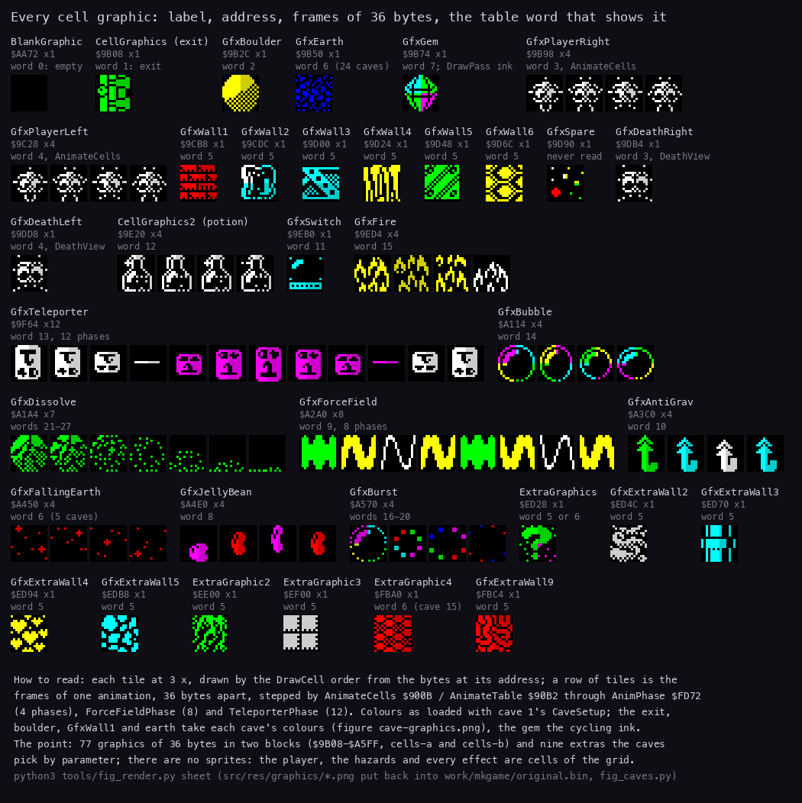

*Every cell graphic with its label, address, frames and table word. `python3 tools/fig_render.py sheet --out
docs/img/render/sheet.png` (from `src/res/graphics` put back into `work/mkgame/original.bin`, and
`tools/fig_caves.py`). How to read: each tile at 3 x, drawn in the DrawCell order; a row of tiles is the frames of one
animation, 36 bytes apart; colours as cave 1 sets them.*

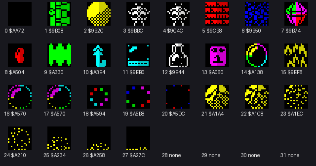

*The cells of cave 1 as they look in play. Stage-1 sheet.*

The point: 77 graphics in two blocks and nine extras, all in one 36-byte format; there are no sprites.

## 6.9 The map screen

F in play shows the whole cave once per cave (MapKey, doc 05 5.8).
ShowMap `$EA80` draws it over the window, without clearing the screen:

```text
ShowMap:                                     ; $EA80
    DrawMapFrame                              ; $EA00: the frame of 32 x 22 characters, attribute $43
    DrawMapCells                              ; $8059: 600 glyphs of 8 x 8, from the last cell back
    ColourMapCells                            ; $81CC: 600 attributes
    PlayMapTune                               ; $E8E1: the map tune; a key 1-5 cuts it short
; back in MapKey: DrawWindowAtOrigin puts the window back

DrawMapCells:                                ; $8059
    p = the grid's last cell ($FFFF)
    for row in 20 down to 1:
        for col in 30 down to 1:
            e = cave[p] rotated left 3 times  ; 8 x code for codes below $20
            if e < $80: PrintGlyph(row, col, MapGlyphs + e)   ; MapCellGlyph $E9AE: codes 0-15 only
            p -= 1

ColourMapCells:                              ; $81CC
    for each cell, from the last back:
        a = $80 + code                        ; the low byte of MapAttrs $9A80 + code
        attr = MapAttrs[code] if a < $90 else 0              ; MapCellAttr $EAB3
```

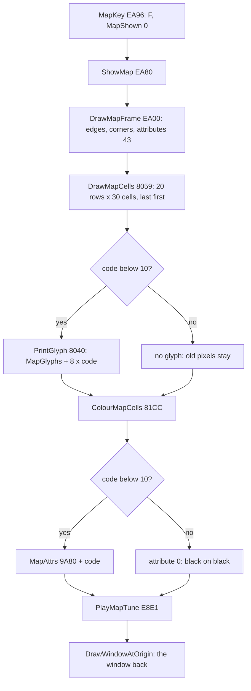

The map takes the same 22 character rows as the window: the frame on rows 0 and 21 and columns 0 and 31, the cells on
rows 1-20 and columns 1-30, one character a cell.
The time bar and the panel stay.

The animation codes `$10-$1F` get no glyph and attribute 0.
The window's pixels under them stay, but black ink on black paper hides them.

DrawMapCells holds code that is read two ways:

```text
8059  21 FF FF     LD HL,CaveGrid+$0257   ; DrawMapCells: the last cell
805C  06 14        LD B,$14               ; 20 rows
805E  0E 1E 16     DEFB $0E,$1E,$16       ; from $805E: LD C,$1E, then LD D,$9A (16 9A)
8061  9A           SBC A,D                ; from $805F: LD E,$16, then SBC A,D
8062  7E           LD A,(HL)
8063  07           RLCA
8064  07           RLCA
8065  07           RLCA
8066  5F           LD E,A                 ; DE = $9A00 + 8 x code
8067  E5           PUSH HL
8068  C5           PUSH BC
8069  CD AE E9     CALL MapCellGlyph
806C  C1           POP BC
806D  E1           POP HL
806E  2B           DEC HL
806F  0D           DEC C
8070  20 ED        JR NZ,$805F            ; the column loop enters in the middle of LD C,$1E
8072  10 EA        DJNZ $805E             ; the row loop sets C = 30 again
8074  C9           RET
```

From `$805E` the bytes are `LD C,$1E` and `LD D,$9A`: the column count and the glyph page.
The column loop jumps back to `$805F`, the operand of `LD C`, where the same bytes read `LD E,$16` and `SBC A,D`.
Both results are overwritten at once (`LD A,(HL)`, `LD E,A`), so the side entry only skips the reload of C.
mkgame keeps the three overlapped bytes as data.

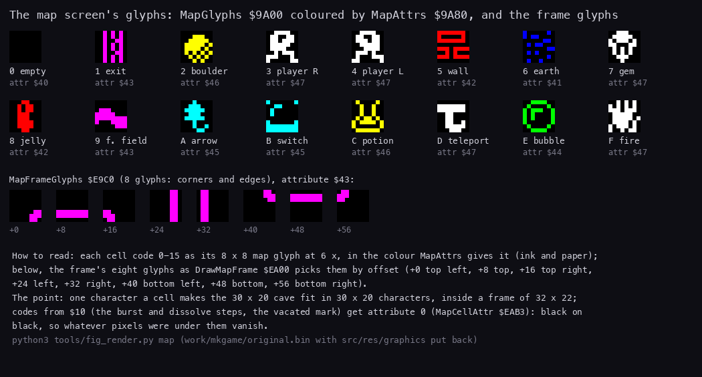

*The 16 map glyphs coloured by MapAttrs, and the 8 frame glyphs. `python3 tools/fig_render.py map --out
docs/img/render/map-glyphs.png` (from `work/mkgame/original.bin` with `src/res/graphics` put back). How to read: each
code's glyph at 6 x with its attribute; below, the frame glyphs by their offset in MapFrameGlyphs `$E9C0`.*

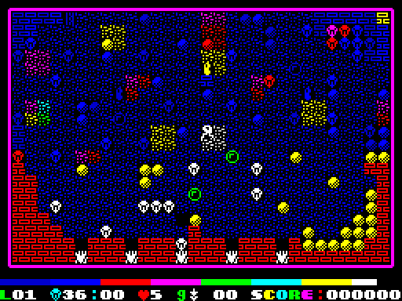

*The map of cave 1. Stage-1 screenshot (recording `timer`).*

Worked example 7: the map in `timer`.

1. F is down from the start. MapKey finds MapShown 0, sets it, and calls ShowMap.
2. DrawMapFrame runs from 243:9589 to 244:12523, about one frame.
3. DrawMapCells runs from 244:12523 to 249:6766, about 4.9 frames: 600 calls of MapCellGlyph.
4. ColourMapCells runs from 249:6766 to 251:13631.
5. PlayMapTune starts at 251:13631. When it ends, MapKey's `CALL DrawWindowAtOrigin` draws the window again.

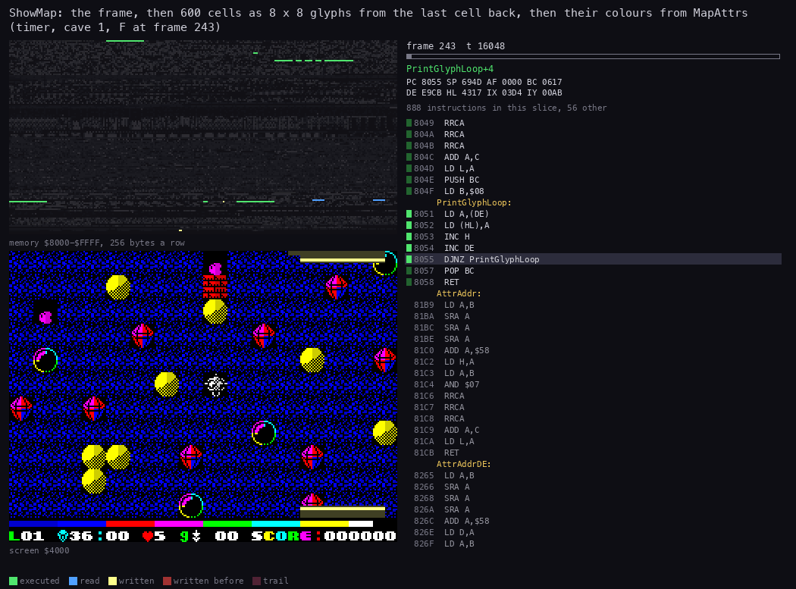

*ShowMap at work: the frame, the glyphs from the bottom right back, then the colours. Recording `timer`, window
243:9000-251:13700. `python3 R/kit/routine_anim.py --work work/docs/esB/timer --window 243:9000-251:13700 --listing
build/game.lst --view screen --pc EA00-EA95,8040-8075,81CC-81E6,E9AE-E9B3,EAB3-EAC2,81B9-81CA,8A6D-8A7C --range
8000-FFFF --pictures 80 --hold 3000 --title ...`.*

The point: one character a cell makes the 30 x 20 cave fit exactly inside the 32 x 22 play area; hiding cells with
attribute 0 saves clearing the screen first.

## 6.10 Code against the screen: one pass

The writers map of the `c1` pass at 14 293 shows which routine wrote which screen byte.

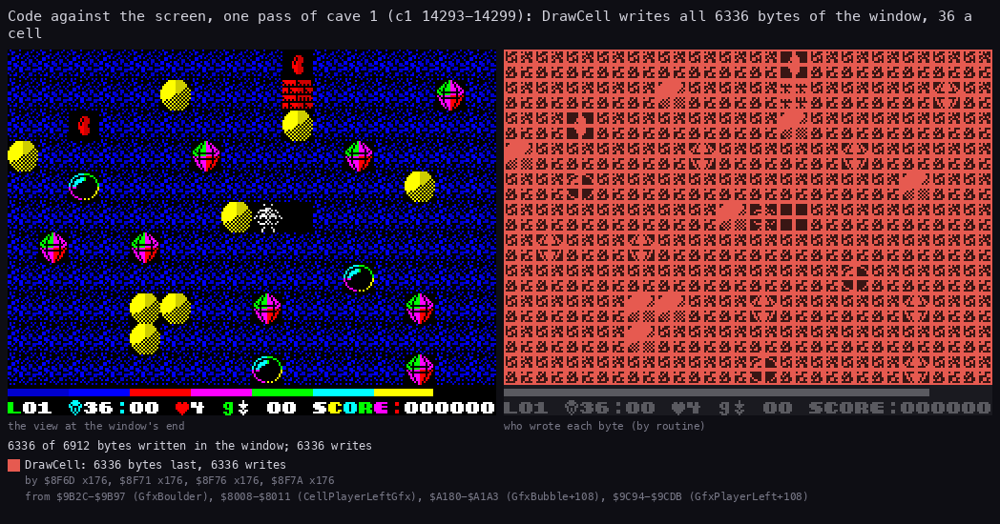

*Each screen byte coloured by the routine that wrote it last, over one pass. Recording `c1`, window
14293:35800-14299:3900. `python3 R/kit/writers_map.py --work work/docs/esB/c1 --window 14293:35800-14299:3900
--listing build/game.lst --view screen --sources --title ...`. How to read: the window area is all DrawCell; the
listing extract beside it names the writing instructions.*

In this pass DrawCell writes 6336 bytes: 176 cells x 36 bytes, every byte of the window, pixels and attributes.
Rows 22 and 23 get no write from the window code.

The beam timeline of the same pass shows where the TV beam is while DrawWindow writes.

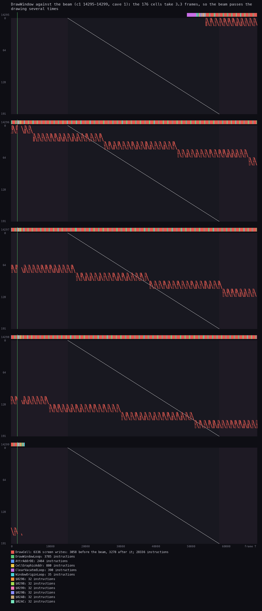

*The screen writes of the pass against the beam, frame by frame. Recording `c1`, window 14295:50000-14299:3900.
`python3 R/kit/beam_timeline.py --work work/docs/esB/c1 --window 14295:50000-14299:3900 --frames 5 --listing
build/game.lst --title ...`. How to read: one panel per frame; each write is placed at its screen line and its time;
the beam is the diagonal.*

DrawWindow takes 3.3 frames, so the beam crosses the drawing several times.
In this pass 3058 writes land on lines the beam has not reached yet in that frame, and 3278 on lines it has passed.
A frame shown during the draw can hold the top of the window from the new pass and the bottom from the old one.
The grid changes little between passes, so the tear is rarely visible: only cells that changed differ.

The point: the renderer ignores the beam; with no back buffer and a 3-frame draw, the full redraw is drawn while it is
shown, and stays clean because most cells redraw the same bytes.

## 6.11 What is known only from the code

- Words 16 and 21 of the table are never read, and words 28-31 hold `$0000`: no recording draws codes `$10`, `$15` or
  28-31 (6.2).
- GfxSpare `$9D90` is never pointed at.
- The `INC L` page limit of DrawCell holds for every graphic of the image; it is read from the addresses, not
  measured.
- The second clamp test of WindowOrigin reads the unclamped column; harmless for all inputs, from the code.
- DrawMapCells' rotation of codes `$20` and above (`$20` becomes `$01`, a glyph misaligned by one byte) never matters:
  ClearVacated removes `$20` before MapKey runs.
- The map of a falling-earth cave or of a cave with animation codes in flight was not recorded; the hiding of codes
  `$10-$1F` is read from MapCellAttr.
