# 7. Objects

What this covers: every thing in Earth Shaker that the game keeps state for. The game has no object records and no
slots. Every object is one byte of the cave grid `CaveGrid $FDA8`, its cell code. A boulder, a gem, the player and the
fire all live in the same 600 bytes, and moving an object means writing two cells. This document gives:

- every cell code and the states a cell passes through;
- the cave record byte by byte, both directions, with a worked decode and the unpacker at work;
- the 14 cave parameters `$FD9A-$FDA7` field by field, with all 32 caves;
- the game variables `$FD70-$FDA7` and the flags of a pass;
- each object kind as a state machine;
- the collision tests of a move and of a fall, their order and a worked example;
- the random-number generator, which the game does not have.

The rules that move the cells (the scan, gravity, rolling, pushing, crushing, the hazards, the specials, death, the
timer, the exit and the passwords) are [doc 10](10-gameplay-logic.md). How a cell is drawn is
[doc 06](06-rendering.md); the unpacker's place in the cave start is [doc 04](04-game-loop.md).

The recordings it rests on ([WALKTHROUGH 6.0](../WALKTHROUGH.md#60-the-recordings)):

- `death-crush` (stage 2): 265 frames from `work/stage1/probe/level1.szx` (cave 1 in play), the input
  `tests/inputs/death-crush.txt` (up, up, down). It was opened on an own instance after `source work/env.sh` with
  `python3 ../../kit/rs.py open --work work/docs/esC/dc --ttd work/stage2/death-crush/session.ttd --port-base 37170`.
  `work/docs/esC/sample.py` (TTD `memory_at`) took `$FD7A-$FFFF` at frames 0-40 (`work/docs/esC/dc-vars.jsonl`).
- `rzx-earth02`: 7 661 frames from the RZX archive's `earth02` start snapshot. This is another player's play,
  replayed by `tools/rzx_align.py`, not ours. It was opened the same way into `work/docs/esC/r02`, and `$FD7A-$FFFF`
  was sampled at frames 260-480, 1290-1400 and 2420-2500 (`work/docs/esC/r02-vars.jsonl`). It holds the unpack of
  cave 2 (frame 269), a switch hit (frames 380-408), a slide down a slope (frames 1312-1400) and a bubble burst
  (frames 2428-2487).
- The RZX state logs `work/stage1/rzx/earthNN.ins.state.bin`: `$FD7E-$FFFF` after every frame of each of the 32 RZX
  files, 642 bytes a frame, logged while SkoolKit played the RZX (`tools/rzx_inputs.py`).
- The L1 counts of the builds ("L1 n", from the `.ann` descriptions and `work/docs/esC/l1.txt`): `c1`, `menu`,
  `hiscore`, `lives`, `timer` and the 32 RZX caves, cave 4 from `stage2/rzx04/cap`; `death-crush` and `death-fire` are
  named apart.

A sample of frame N is the memory at the start of frame N. A trace, and so a routine animation, puts an instruction in
the frame where it ran. "Cell 225 holds the boulder in frame 22" means the sample of frame 22; the scan that moved it
ran in frame 21. A [pass](README.md#terms) is one turn of `PassLoop $888D` in `PlayCave $8885`. The mean pass of a
cave lasts 5.5 to 9.4 frames ([doc 04.6](04-game-loop.md#46-the-cost-of-a-pass-in-every-cave)); a pass with a long
sound (the switch, a burst, a jelly bean) lasts much longer. A cell moves at most once a pass.

## 7.1 The cave grid and the cell codes

The cave is 30 columns by 20 rows. Cell (row, column) is the byte `CaveGrid + 30 x row + column`, `$FDA8-$FFFF`, so
the grid ends at the top of memory. The player's place is a cell index, `PlayerIndex $FD9C` (0-599), not a pair of
coordinates. A cell holds a code from 0 to `$1F`, or `$20`, the vacated mark.

| Code | Cell | Letter in `caves.txt` | The gravity scan (`ScanCells $8075`) | The player moving into it |
| --- | --- | --- | --- | --- |
| `$00` | empty | `.` | skipped; an object falls or rolls into it | moves in |
| `$01` | exit | `X` | skipped | blocks; when the exit is open, ends the cave (`CaveDone $FD84`) |
| `$02` | boulder | `0` | falls and rolls; over fire it becomes `$15` | pushed left or right into an empty cell; blocks up and down |
| `$03` | player facing right | `R` | skipped; an object falling into the cell above kills | |
| `$04` | player facing left | `L` | skipped; an object falling into the cell above kills | |
| `$05` | wall | `#` | skipped | blocks (`BlockWall $E869`) |
| `$06` | earth | `:` | skipped, except in caves 13, 17, 22, 24 and 26, where it falls | dug: the player moves in, the dig noise |
| `$07` | gem | `*` | falls and rolls | taken: `GemValue` points and one to the gem count |
| `$08` | jelly bean | `T` | falls and rolls | taken: 32 pixels back on the time bar, 64 points |
| `$09` | force field | `Z` | skipped | blocks and costs 12 timer steps; cleared by the switch |
| `$0A` | anti-gravity arrow | `A` | falls and rolls | taken: 99 passes of upward gravity, 200 points |
| `$0B` | switch box | `S` | skipped; an object falling onto it hits the switch | blocks |
| `$0C` | potion | `+` | falls and rolls | taken: a life (up to 9), 20 points |
| `$0D` | teleporter | `D` | skipped | the player jumps to the first other teleporter |
| `$0E` | bubble | `O` | skipped | pushed into earth or an empty cell; into fire it bursts, 100 points |
| `$0F` | fire | `F` | falls and rolls, and kills like any falling object | kills (`WalkIntoFire $91AE`) |
| `$10` | burst, first code | | not skipped (the test is `CP $10`, `JR C`): it can fall or roll | blocks |
| `$11-$14` | burst | | skipped; steps once a pass, `$14` becomes `$20` | blocks |
| `$15-$1B` | dissolve (a boulder in fire) | | skipped; steps once a pass, `$1B` becomes `$20` | blocks |
| `$20` | vacated | | skipped; cleared to 0 by `ClearVacated $81AC` | blocks |

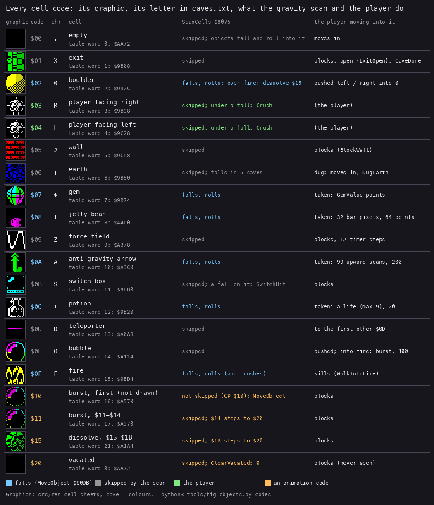

How to read the figure:

- One row a code. The graphic is the one the cell table `$8000` gives the code, with cave 1's colours. Then the code,
  its letter in `src/res/caves/caves.txt`, the name and table word, the scan's rule and the player's rule.
- The colour of the code says how the scan treats it: blue falls, grey is skipped, green is the player, orange is an
  animation code.
- `$10` and `$15` are drawn with the graphics of `$11` and `$16`. Table words 16 and 21 are never read: the code
  steps on in `AnimateCellCodes $937E` before the window is drawn in the same pass.
- Command: `python3 tools/fig_objects.py codes` (the graphics from `src/res`).

**The point**: one byte is the whole object. The code says what the object is and its index in the grid says where
it is. Six codes fall (`$02 $07 $08 $0A $0C $0F`); everything else is scenery that the falling codes act on.

### The states of a cell

A cell's code changes only along these paths. The player's step, `PutPlayer $8382`, `AnimateCellCodes $937E` and
the routines it calls (`SwitchClear` and the scan), and `ClearVacated $81AC` write the grid; nothing else writes it
during play.

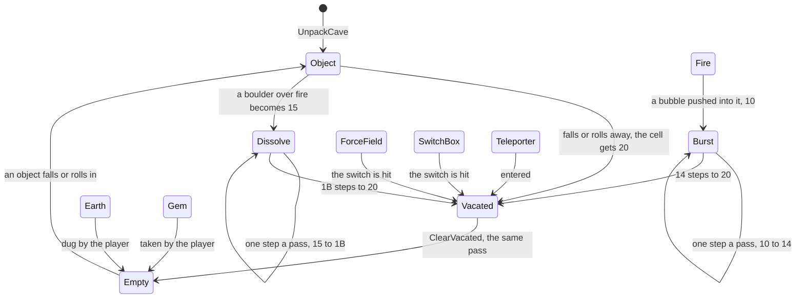

Witness, all from `rzx-earth02` (the RZX player's play, replayed), sampled as above:

| Frame (sample) | Cells that changed | What happened |
| ---: | --- | --- |
| 380 | 437: `$02` to `$20`; 466: `$06` to `$04`; 467: `$04` to `$02` | the player digs left from 467 to 466; the boulder above falls into the cell he left |
| 382 | 437: `$20` to 0 | the vacated mark is gone at the next sample |
| 388 | 497: `$0B` to `$20`; 529-533: `$09` to `$20` | the switch box and five force fields cleared |
| 404 | 497, 529-533: `$20` to 0 | the marks stay for 16 samples: `SwitchSound` (261 ms, [doc 09](09-sound.md)) runs inside `SwitchClear`, after the clear and before `ClearVacated` |
| 2448 | 50: `$0F` to `$10` | a bubble pushed into the fire at cell 50; the sample falls inside the long `RaspSound`, after the push and before the scan |
| 2458, 2465, 2472, 2479 | 50: `$11`, `$12`, `$13`, `$14` | one burst step a pass, seven frames apart |
| 2486 | 50: `$14` to `$20` | |
| 2487 | 50: `$20` to 0 | |

**The point**: the vacated mark `$20` lives only inside one pass. A move writes it and `ClearVacated $81AC` clears it
in the same pass, before the window is drawn, so the screen never shows it. A sample shows it only when a frame
boundary, or a long sound inside the pass, falls between the two, as in the frames above.

## 7.2 The cave record byte by byte

Each cave is a record of 314 bytes. Cave N (1-32) starts at `CaveData + 314 x (N - 1)`, the first at `$C000`, and the
32 records fill `$C000-$E73F`. The editable form is `src/res/caves/caves.txt`, which the build turns back into the
same bytes (`tools/res_formats.py`).

| Bytes | Field | Format |
| --- | --- | --- |
| 0-299 | the cells | two cells a byte, the left (lower index) cell in the low nibble; 15 bytes a row, 20 rows, row 0 first |
| 300-313 | the parameters | copied unchanged to `CaveParams $FD9A-$FDA7` (7.3) |

A nibble holds 0-`$0F`, so a cave can start with the 16 codes `$00-$0F` only. The animation codes and the vacated mark
exist only in play.

`UnpackCave $82B6` turns a record into the grid. It finds the record by adding 314 to `CaveData - 314` (`$BEC6`)
`CaveNumber` times. It splits each of the 300 bytes into two cells, then copies the last 14 bytes with one LDIR. The
nibble packing halves the 600 cells to 300 bytes. With 32 caves that saves 9 600 bytes of the 48K.

```text
record = CaveData - 314
repeat CaveNumber times: record += 314
for i in 0 .. 299:
    CaveGrid[2*i]     = record[i] AND 0x0F       # the left cell
    CaveGrid[2*i + 1] = record[i] >> 4           # the right cell
CaveParams[0 .. 13] = record[300 .. 313]
```

The other direction, as the build packs `caves.txt` (`tools/res_formats.py`):

```text
for i in 0 .. 299:
    record[i] = cell[2*i] OR (cell[2*i + 1] << 4)
record[300 .. 313] = the ten parameter fields, in the order of 7.3
```

```asm
UnpackCave:
82B6  LD A,(CaveNumber)
82B9  LD B,A
82BA  LD HL,CaveData-314    ; $BEC6
82BD  LD DE,$013A           ; 314
82C0  ADD HL,DE             ; UnpackCaveLoop: CaveNumber times
82C1  DJNZ UnpackCaveLoop
82C3  LD BC,$012C           ; 300 bytes
82C6  LD DE,CaveGrid
82C9  LD A,(HL)             ; UnpackCaveLoop2
82CA  AND $0F               ; the low nibble: the left cell
82CC  LD (DE),A
82CD  INC DE
82CE  LD A,(HL)
82CF  AND $F0               ; the high nibble
82D1  RRCA                  ; four rotates: shifted down 4
82D2  RRCA
82D3  RRCA
82D4  RRCA
82D5  LD (DE),A             ; the right cell
82D6  INC DE
82D7  INC HL
82D8  DEC BC
82D9  LD A,B
82DA  OR C
82DB  JR NZ,UnpackCaveLoop2
82DD  LD DE,CaveParams      ; $FD9A
82E0  LD BC,$000E           ; the 14 parameter bytes
82E3  LDIR
82E5  RET
```

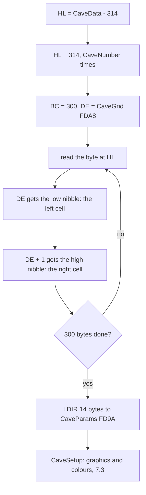

Worked example, cave 1 (`$C000`). The first 15 bytes are `55 55 61 66 66 62 66 66 66 22 66 66 55 55 55`:

- `$55` gives cells 0 and 1, codes 5 and 5: two walls. The second `$55` gives cells 2 and 3: walls.
- `$61` gives cell 4 = 1 (the exit) and cell 5 = 6 (earth). The low nibble comes first.
- `$62` gives cell 10 = 2 (a boulder) and cell 11 = 6.
- `$22` gives cells 18 and 19: two boulders.
- The row reads `####X:::::0:::::::00::::######`, the first line of cave 1 in `caves.txt`.

The parameter bytes 300-313 are `24 0A 1D 01 03 06 50 9B B8 9C 44 46 42 41`. They mean 36 gems needed, 10 points a
gem, the start cell `$011D` = 285 (row 9, column 15), the digits 3 and 6, the earth graphic `$9B50`, the wall graphic
`$9CB8` and the four colours.

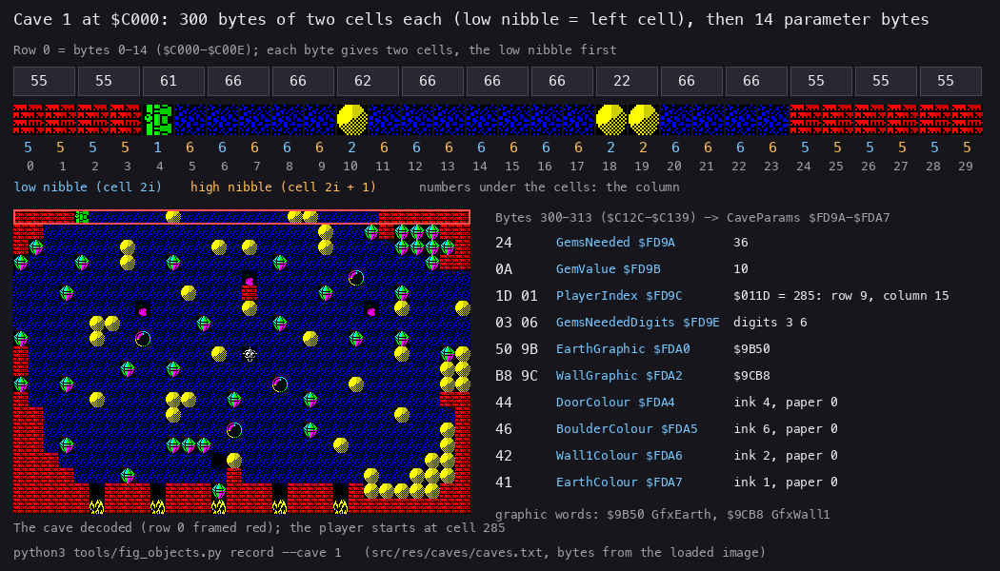

How to read the figure:

- Top: row 0's 15 bytes. Under them are the 30 cells they give, drawn with cave 1's graphics. Each cell is numbered
  with its nibble (blue for the low nibble, orange for the high) and its column.
- Left: the whole cave decoded from the record; row 0 is framed red. The player stands at cell 285.
- Right: the 14 parameter bytes, each with the variable it lands in and its meaning. A colour byte is named bit by
  bit (flash, bright, ink, paper), but its BRIGHT bit has no effect: `SetGraphicColour` (7.3) makes the left half of
  the cell bright and the right half plain in every cave, so caves 6-9, whose colours lack `$40`, look the same way.
- Command: `python3 tools/fig_objects.py record --cave 1` (`src/res/caves/caves.txt`; the bytes from the loaded image
  `work/mkgame/original.bin`).

The unpacker at work, on cave 2 in `rzx-earth02`:

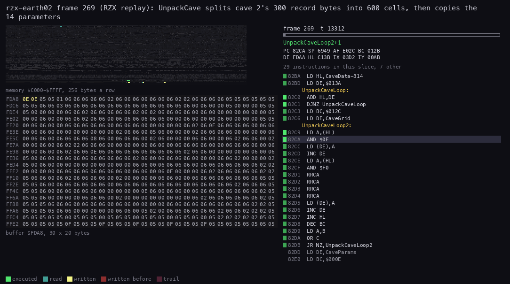

How to read the animation:

- Top left: memory `$C000-$FFFF`, 256 bytes a row; the record of cave 2 (`$C13A-$C273`) is read, the grid at the
  bottom is written.
- Below it: the grid `$FDA8-$FFFF` as 30 x 20 hex bytes, so each row of the picture is a row of the cave. Yellow bytes
  were written in this slice; they fade through red over the next few slices and then turn grey again (the hex view
  keeps no trail), so the last picture colours only the last row written, and the 570 cells before it are grey. Two
  bytes appear for each record byte read: a code in the low nibble and one in the high.
- Right: the listing with the instruction running; the loop at `$82C9-$82DB` runs 300 times, then the LDIR copies
  the parameters.
- Recording and frames: `rzx-earth02` (the RZX player's play, replayed), frame 269, T 13 000 to T 44 200 (the routine
  runs from 269:13109 to 269:44113, 31 004 T). Command: `python3 ../../kit/routine_anim.py --work work/docs/esC/r02
  --window 269:13000-269:44200 --pictures 100 --listing build/game.lst --view buffer:FDA8:30x20:hex --range
  C000-FFFF --pc 82B6-82E5 --out docs/img/routines/UnpackCave-nibbles.gif`.

The cave it builds, drawn whole from the record by `tools/fig_caves.py`, and the same cave on the screen half way
through the recording:

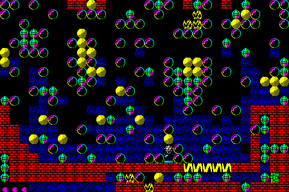

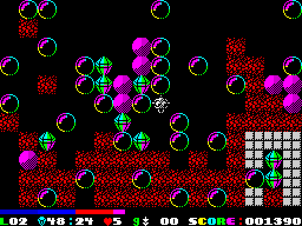

Witness: `UnpackCave` ran 47 times over the builds (L1). In `rzx-earth02` the grid of the frame 269 sample still holds
the previous cave: it differs from cave 2 of `caves.txt` in 431 of the 600 cells. The frame 270 sample equals cave 2
cell for cell, and `PlayerIndex` is 467, the cave's start.

**The point**: a cave is a plain nibble bitmap. There is no compression beyond two cells a byte and no list of objects
apart from their codes, so `caves.txt` shows the cave exactly as the game sees it.

## 7.3 The cave parameters `$FD9A-$FDA7`

`UnpackCave` copies the record's last 14 bytes to `CaveParams $FD9A`. The game reads them in place for the whole cave.

| Address | Field | Bytes | Read by | Meaning |
| --- | --- | ---: | --- | --- |
| `$FD9A` | `GemsNeeded` | 1 | `CountGem $8394` | the gem count that opens the exit (compared for equality) |
| `$FD9B` | `GemValue` | 1 | `AddGemValue $8376` | the points a gem gives, added one at a time |
| `$FD9C` | `PlayerIndex` | 2 | the moves, `PutPlayer $8382`, `WindowOrigin $8DA6` | the start cell; from then on the player's cell |
| `$FD9E` | `GemsNeededDigits` | 2 | `ShowCounters $85AD` | `GemsNeeded` as two decimal digits for the panel, tens first |
| `$FDA0` | `EarthGraphic` | 2 | `CaveSetup $9313` (copied to table word 6, which `SetEarthFalls $FB81` and `EarthAnim $9DFC` then test) | the graphic of code 6, put into table word 6 (`$800C`) |
| `$FDA2` | `WallGraphic` | 2 | `CaveSetup` | the graphic of code 5, put into table word 5 (`$800A`) |
| `$FDA4` | `DoorColour` | 1 | `CaveSetup` | the attribute of the exit graphic `CellGraphics $9B08` |
| `$FDA5` | `BoulderColour` | 1 | `CaveSetup`; `CaveSetupAll $A600` copies it on | the attribute of `GfxBoulder $9B2C`, then of the 7 dissolve frames |
| `$FDA6` | `Wall1Colour` | 1 | `CaveSetup` | the attribute of `GfxWall1 $9CB8` |
| `$FDA7` | `EarthColour` | 1 | `CaveSetup` | the attribute of `GfxEarth $9B50` |

`PlayerIndex` is the only parameter that changes in play: it is the player's position. Starting the same cave again
after a death unpacks the record again, so the start comes back.

`CaveSetup $9313` applies the graphic words and the colours. `SetGraphicColour $9305` writes one colour into a
graphic's four attributes as bright, plain, plain, bright. The attributes are stored in drawing order: top left, top
right, bottom right, bottom left (`DrawCell $8F6D`, `$8F71`, `$8F76` after `SET 5,E`, `$8F7A` after `DEC E`). So the
left half of the cell is bright and the right half plain: in `img/play/cave-30.png` below every boulder is bright on
its left half. FLASH (bit 7) survives only in the first byte, the top left quarter: the `AND $3F` at `$9308` clears it
for the other three. `SetEarthFalls $FB81` is the entry, at every cave start (`ResetCave $85FE`): it calls
`CaveSetupAll $A600` (which calls `CaveSetup`, which calls `UnpackCave`), then decides whether earth falls.

```text
CaveSetup:
    UnpackCave()
    CellGraphicsTable[6] = EarthGraphic
    CellGraphicsTable[5] = WallGraphic
    for (colour, graphic) in (DoorColour, CellGraphics), (BoulderColour, GfxBoulder),
                             (Wall1Colour, GfxWall1), (EarthColour, GfxEarth):     # CellGraphics 9B08: the exit
        # top left, top right, bottom right, bottom left
        graphic.attributes = [colour OR 0x40, colour AND 0x3F, colour AND 0x3F, (colour AND 0x3F) OR 0x40]
CaveSetupAll:
    CaveSetup()
    for each of the 7 dissolve frames: its attributes from GfxBoulder's first attribute
SetEarthFalls:
    CaveSetupAll()
    CellGraphicsTable[0] = BlankGraphic
    the earth tests of both scans = CP (HL)
    if the high byte of CellGraphicsTable[6] is 0xA4: the earth tests = NOP     # earth falls
```

```asm
CaveSetup:
9313  CALL UnpackCave
9316  LD HL,(EarthGraphic)  ; FDA0
9319  LD (CellEarthGfx),HL  ; table word 6, 800C
931C  LD HL,(WallGraphic)   ; FDA2
931F  LD (CellWallGfx),HL   ; table word 5, 800A
9322  LD DE,DoorColour      ; FDA4: the four colours in turn
9325  LD A,(DE)
9326  INC DE
9327  LD HL,CellGraphics    ; 9B08, the exit
932A  CALL SetGraphicColour
                            ; ... GfxBoulder 9B2C, GfxWall1 9CB8, GfxEarth 9B50
SetEarthFalls:
FB81  CALL CaveSetupAll
FB84  LD HL,BlankGraphic
FB87  LD (CellGraphicsTable),HL
FB8A  LD A,$BE              ; the opcode of CP (HL)
FB8C  LD (ScanEarthTest),A  ; 809A
FB8F  LD (AntiGravEarthTest),A
FB92  LD A,(CellEarthGfx+1)
FB95  CP $A4                ; GfxFallingEarth A450?
FB97  RET NZ
FB98  XOR A                 ; 00 = NOP: earth is no longer skipped
FB99  LD (ScanEarthTest),A
FB9C  LD (AntiGravEarthTest),A
FB9F  RET
```

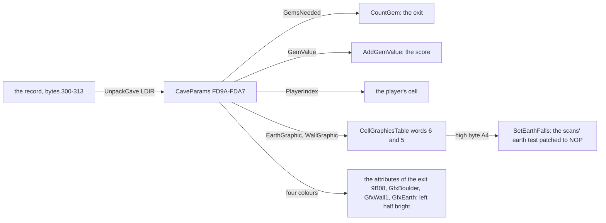

Worked example, cave 13 (WET HELL SOIL). Its `earth_graphic` is `GfxFallingEarth $A450`. `SetEarthFalls` first writes
`$BE` (CP (HL)) at `$809A`. It reads `$A4` from `$800D` and writes `$00` (NOP) over the `$BE`. The scan's `JR Z` after
it then tests flags left by earlier tests, since `LD A,$06` sets none. On the two paths through `JR NZ,ScanSkipTests`
the zero flag is clear, so the jump is not taken and earth is no longer skipped: it falls like a boulder. On the
dissolve path the flag is set by `CP $0F`, so the jump skips the cell, which now holds `$15` and would be skipped
anyway. In cave 1 (`GfxEarth $9B50`) the high byte is `$9B` and the `$BE` stays. Witness: `Crush $9ABC` ran 48
times over the builds (L1). 47 of them were falling earth in `rzx-earth13`, 17, 22, 24 and 26, with `EarthFell $9AA5`
set and no death; the other was the boulder that killed the player in `c1` frame 13208. `death-crush`, not in the sums,
adds the kill of 7.6.

Worked example, cave 30 (THE KEEP). Its `earth_graphic` is `GfxBoulder $9B2C`, the boulder's own graphic. Table word 6
then points at the boulder graphic, coloured with `BoulderColour`, so earth and boulders look the same. The high byte
is `$9B`, so the earth does not fall: the player has to tell the 88 real boulders from the earth by trying.

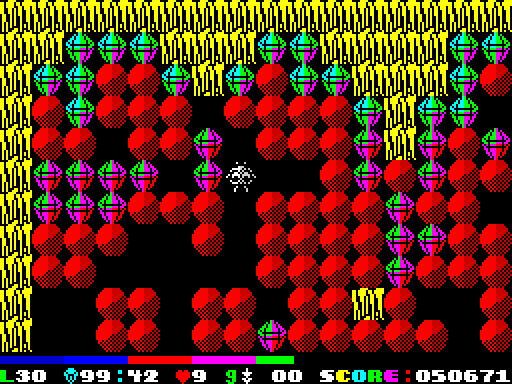

The figure is cave 30 half way through `rzx-earth30` (`tools/fig_play.py`, stage 1).

The 32 caves' parameters (`python3 tools/fig_objects.py table`; the gem and boulder counts are the cells of the
record):

| Cave | Name | Gems | Points a gem | Start (row, column) | Earth | Wall | Door, boulder, wall 1, earth | Gems in the cave | Boulders |
| ---: | --- | ---: | ---: | --- | --- | --- | --- | ---: | ---: |
| 1 | ROOM FOR IMPROVEMENT | 36 | 10 | 285 (9, 15) | GfxEarth | GfxWall1 | `$44` `$46` `$42` `$41` | 36 | 45 |
| 2 | THE BUBBLE BATH | 48 | 15 | 467 (15, 17) | GfxEarth | ExtraGraphic3 | `$46` `$43` `$42` `$42` | 48 | 28 |
| 3 | THE GRAVITY CHAMBER | 45 | 10 | 104 (3, 14) | GfxEarth | GfxWall5 | `$42` `$46` `$42` `$41` | 45 | 88 |
| 4 | HEAD IN THE CLOUDS | 33 | 33 | 573 (19, 3) | GfxEarth | GfxExtraWall2 | `$41` `$45` `$42` `$44` | 33 | 56 |
| 5 | HUSH TOED ICELAND | 80 | 10 | 283 (9, 13) | GfxEarth | GfxWall2 | `$44` `$46` `$42` `$41` | 80 | 17 |
| 6 | DIAMONDS OF MINE | 51 | 10 | 150 (5, 0) | GfxEarth | GfxWall1 | `$01` `$06` `$03` `$05` | 51 | 111 |
| 7 | THE TWO OF HEARTS | 50 | 10 | 270 (9, 0) | GfxEarth | GfxExtraWall4 | `$07` `$03` `$06` `$02` | 50 | 121 |
| 8 | CENTRAL INCINERATOR | 43 | 5 | 545 (18, 5) | GfxEarth | GfxWall1 | `$04` `$05` `$02` `$06` | 43 | 90 |
| 9 | INTERNAL REACTOR INC | 61 | 4 | 498 (16, 18) | GfxEarth | GfxWall4 | `$03` `$05` `$01` `$04` | 61 | 119 |
| 10 | NUCLEAR ORE CAVERNS | 30 | 21 | 336 (11, 6) | GfxEarth | GfxExtraWall5 | `$44` `$41` `$4D` `$43` | 30 | 119 |
| 11 | GRAVITON SHELLS | 24 | 10 | 421 (14, 1) | GfxEarth | GfxWall5 | `$07` `$02` `$04` `$03` | 24 | 102 |
| 12 | THE OIL WELLS | 63 | 5 | 61 (2, 1) | GfxEarth | GfxWall3 | `$02` `$01` `$05` `$07` | 63 | 60 |
| 13 | WET HELL SOIL | 27 | 25 | 242 (8, 2) | GfxFallingEarth | GfxWall4 | `$03` `$04` `$06` `$02` | 27 | 62 |
| 14 | THE GRAVLOCK CELL | 25 | 17 | 361 (12, 1) | GfxEarth | GfxWall2 | `$01` `$07` `$04` `$01` | 25 | 136 |
| 15 | HONEYCOMBS | 71 | 3 | 178 (5, 28) | ExtraGraphic4 | GfxWall6 | `$06` `$03` `$03` `$01` | 71 | 68 |
| 16 | HAIR BRAINED SURGERY | 49 | 27 | 583 (19, 13) | GfxEarth | GfxExtraWall9 | `$01` `$01` `$06` `$04` | 49 | 72 |
| 17 | BURY DRAINAGE HIRERS | 44 | 10 | 467 (15, 17) | GfxFallingEarth | GfxWall5 | `$06` `$01` `$07` `$02` | 44 | 42 |
| 18 | SPACEBASE WASTEPIPES | 73 | 30 | 510 (17, 0) | GfxEarth | GfxExtraWall3 | `$44` `$46` `$42` `$41` | 73 | 96 |
| 19 | THE SNARE | 71 | 10 | 94 (3, 4) | GfxEarth | GfxWall1 | `$44` `$46` `$42` `$43` | 71 | 71 |
| 20 | RUSE NO DOUBT | 68 | 10 | 30 (1, 0) | ExtraGraphics | ExtraGraphics | `$44` `$46` `$42` `$41` | 68 | 0 |
| 21 | OUTER BOUNDS | 99 | 10 | 61 (2, 1) | GfxEarth | GfxWall2 | `$43` `$44` `$42` `$41` | 99 | 141 |
| 22 | SPRING LODED | 38 | 7 | 450 (15, 0) | GfxFallingEarth | GfxWall4 | `$45` `$41` `$42` `$41` | 38 | 48 |
| 23 | ALARM CLOCK WORKS | 49 | 20 | 556 (18, 16) | GfxEarth | GfxWall1 | `$44` `$46` `$42` `$41` | 49 | 103 |
| 24 | FOG RISE WATERFALL | 47 | 10 | 586 (19, 16) | GfxFallingEarth | ExtraGraphic2 | `$45` `$41` `$42` `$41` | 47 | 54 |
| 25 | GREAT WALLS OF FIRE | 76 | 10 | 35 (1, 5) | GfxEarth | GfxWall1 | `$44` `$41` `$45` `$43` | 76 | 42 |
| 26 | CHINA CANAL | 88 | 50 | 153 (5, 3) | GfxFallingEarth | GfxExtraWall5 | `$03` `$02` `$04` `$06` | 88 | 49 |
| 27 | THE COMBINATION LOCK | 49 | 13 | 273 (9, 3) | GfxEarth | GfxWall5 | `$41` `$45` `$42` `$46` | 49 | 121 |
| 28 | YOUR SAFE WITH ME | 39 | 25 | 310 (10, 10) | GfxEarth | ExtraGraphic2 | `$42` `$46` `$42` `$41` | 39 | 59 |
| 29 | YE FIT WARM HOUSE | 67 | 12 | 421 (14, 1) | GfxEarth | GfxWall1 | `$41` `$42` `$46` `$43` | 67 | 0 |
| 30 | THE KEEP | 99 | 10 | 554 (18, 14) | GfxBoulder | GfxWall4 | `$44` `$42` `$42` `$41` | 100 | 88 |
| 31 | FOR GOODNESS SAKE | 30 | 25 | 313 (10, 13) | GfxEarth | GfxWall1 | `$44` `$46` `$42` `$41` | 30 | 0 |
| 32 | NO DEVIL LIVED ON | 16 | 250 | 3 (0, 3) | GfxEarth | GfxWall1 | `$45` `$46` `$42` `$41` | 16 | 24 |

**The point**: a cave changes only its layout, its two numbers (gems and their value), the start, two graphics and four
colours. Every rule is the same in every cave. The one rule that differs, falling earth, is not a parameter: it is
inferred from the address of the earth graphic. Every cave but cave 30 needs every gem it holds; cave 30 holds 100 and
needs 99. What else each cave holds (fire, bubbles, teleporters, force fields) is counted in
[doc 10.12](10-gameplay-logic.md#1012-the-caves-from-first-to-last).

## 7.4 The game variables

The variables lie just below the grid, at `$FD70-$FDA7`. `ClearVars $821A` zeroes `$FD7A-$FFFF` when the game starts.
Its LDIR of `$028A` bytes runs on past `$FFFF` into `$0000-$0004`, the ROM, which ignores the writes.
`ResetGame $82E6` then sets the first values: `ColourPhase` 1, `CaveNumber` 1, `Lives` 4 and `Unused99` 99.
`StartGame $85D6` sets 5 lives and the score 0 when a game begins.

| Address | Name | Format | Written by | Meaning |
| --- | --- | --- | --- | --- |
| `$FD70` | `ViewOrigin` | word | `WindowOrigin $8DA6` | the window's first cell |
| `$FD72` | `AnimPhase` | 0-3 | `AnimateCells $900B`, `CaveStartState $9052`, `TeleportFlashOut $9230`, `TeleportFlashIn $924F` | the animation phase of the player's frames (table words 3 and 4); the falling-earth caves also take their earth and empty frames from it (`EarthAnim $9DFC`, `EarthAnimStep $FB70`). The exit flashes by its attributes (`ExitFlash $905B`), not by a phase |
| `$FD73` | `ForceFieldPhase` | 0-7 | `AnimateTable $90B2` | the force field's frame |
| `$FD74` | `TeleporterPhase` | 0-11 | `AnimateTable` | the teleporter's frame |
| `$FD7C` | `TimerSub` | `+$40` a pass | `TimerStep $86DE` | the timer's sub-counter: every fourth pass wraps to 0 |
| `$FD7D` | `CaveOver` | flag | `TimerStep`, `QuitKey $872D`; cleared by `PlayCave $8888` and `CaveStart $89FE` | `$FF`: out of time, or H pressed |
| `$FD7E` | `CaveDigits` | 2 digits | `StartGame`, `NextCave $8A07`, `Password $8F29`, `WinGame $A8BF` (01) | the cave number for the panel |
| `$FD80` | `KeyMoved` | flag | the four `Try...` routines | `$FF` once a direction key acted this pass |
| `$FD82` | `GemDigits` | 2 digits | `CountGem $8394`; zeroed by `ResetCave $85F7` | the gems taken, for the panel |
| `$FD84` | `CaveDone` | flag | the four `Try...` routines; cleared by `ResetCave $85F4` (one word with `ExitOpen`) and `CaveStart $8A01` | `$FF`: the player entered the open exit |
| `$FD85` | `ExitOpen` | flag | `CountGem`; cleared by `ResetCave` | `$FF` when the gem count reached `GemsNeeded` |
| `$FD86` | `PlayerFacing` | 3 or 4 | `TryLeft`, `TryRight`, `FaceLeft $838E` | the player's cell code |
| `$FD87` | `Continuation` | word | the special dispatchers | where a special cell's handler goes on (`Continue $9410`) |
| `$FD89` | `SavedCell` | word | the fire-key routines | the cell the fire key acts on |
| `$FD8B` | `AntiGravDigits` | 2 digits | `AntiGravStartScan $A7A0`, `AntiGravPass $A7CD`, `ResetAntiGravState $A792` | the anti-gravity passes left, for the panel |
| `$FD8D` | `AntiGravSteps` | count | the same | anti-gravity passes left (99 down to 0) |
| `$FD8E` | `ColourPhase` | 1 or `$FF` | `ColourCycle $81E7`, `ResetGame` | the direction of the colour cycle: 1 up, `$FF` down |
| `$FD8F` | `ColourCycleInk` | `$43-$46` | `ColourCycle`, `ClearScreenCave $9346` | the cycling ink of the gems and of the open exit |
| `$FD90` | `Unused99` | 99 | `ResetGame` | set, never read |
| `$FD91` | `CaveNumber` | 1-32 | `ResetGame`, `Password`, `NextCave` | the cave |
| `$FD92` | `GemCount` | count | `CountGem`, `ResetCave` | the gems taken in this cave |
| `$FD93` | `Lives` | 0-9 | `ResetGame $82F0` (4), `StartGame` (5), `NextCave`, `TakePotion $91C9` | the lives |
| `$FD94` | `ScoreDigits` | 6 digits | `AddPoint $8321`; zeroed by `StartGame` (LDIR at `$85EE`) | the score, one decimal digit a byte, the highest first |
| `$FD9A` | `CaveParams` | 14 bytes | `UnpackCave` | 7.3 |

The flags of one pass lie elsewhere, next to the code that uses them: `FizzCount $7FFB`, `SwitchHit $7FFC`,
`PlayerKilled $7FFD`, `ObjectFell $7FFE`, `BoulderFell $7FFF`, `EarthFell $9AA5`, `BoulderLanded $E7A8`,
`BoulderPushed $E82E` and `DugEarth $E857`.

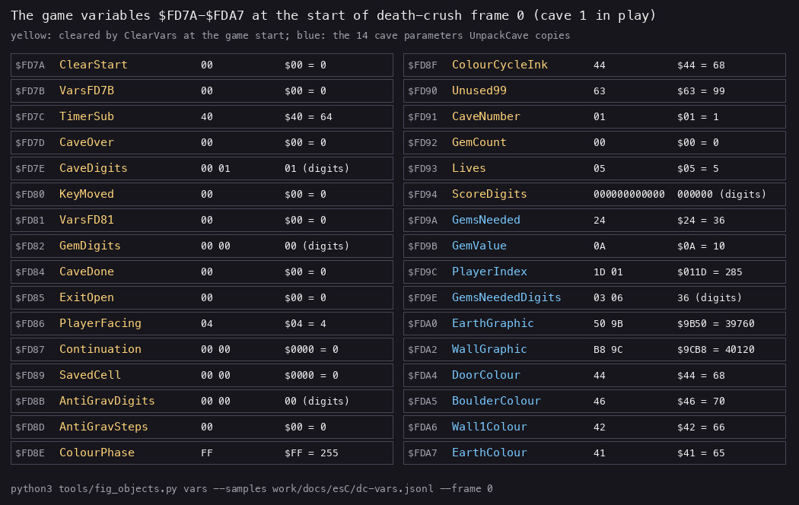

How to read the figure:

- One box a variable, as sampled at the start of `death-crush` frame 0 (cave 1 in play, from `probe/level1.szx`): the
  address, the name, the bytes and the value.
- Yellow names are cleared by `ClearVars` at the game's start; blue names are the cave parameters of 7.3.
- Digit strings are shown as their digits. `TimerSub` is `$40`: one pass of the four that make a timer step has run.
- Command: `python3 tools/fig_objects.py vars --samples work/docs/esC/dc-vars.jsonl --frame 0 --label "death-crush
  frame 0 (cave 1 in play)"`.

**The point**: the numbers the panel shows are kept twice: as a count for the logic (`GemCount`, `CaveNumber`,
`AntiGravSteps`) and as digit strings for the printer (`GemDigits`, `CaveDigits`, `AntiGravDigits`). The score is kept
only as digits; nothing compares it except the high-score table, digit by digit ([doc 08](08-hud-and-text.md)). The
lives are kept as a number that is also its own digit, which is why they stop at 9.

### `ColourPhase $FD8E`: the direction of the colour cycle

Stage 1 read `$FD8E = $FF` at the end of `rzx-earth04` as a death flag. It is not one. It is the direction of the colour
cycle that makes the gems and the open exit flash. `ColourCycle $81E7` runs once a pass. When the ink is `$46` it sets
`ColourPhase` to `$FF`; at `$43` it sets 1. Then it steps the ink up or down. `DrawPass $8D46` writes the ink into the
gem graphic's attributes, and `ExitFlash $905B` writes it into the exit's while the exit is open.

```text
ColourCycle:
    if ColourCycleInk == 0x46: ColourPhase = 0xFF      # at the top: go down
    if ColourCycleInk == 0x43: ColourPhase = 1         # at the bottom: go up
    if ColourPhase == 0xFF: ColourCycleInk -= 1
    else:                   ColourCycleInk += 1
    ExitFlash()
```

```asm
ColourCycle:
81E7  LD A,(ColourCycleInk)
81EA  CP $46
81EC  JR NZ,ColourCycleSkip
81EE  LD HL,ColourPhase
81F1  LD (HL),$FF           ; at the top: go down
81F3  CP $43                ; ColourCycleSkip
81F5  JR NZ,ColourCycleSkip2
81F7  LD HL,ColourPhase
81FA  LD (HL),$01           ; at the bottom: go up
81FC  LD HL,ColourCycleInk  ; ColourCycleSkip2
81FF  LD A,(ColourPhase)
8202  CP $FF
8204  JR Z,ColourCycleSkip3
8206  INC (HL)
8207  CALL ExitFlash
820A  RET
820B  DEC (HL)              ; ColourCycleSkip3
820C  CALL ExitFlash
820F  RET
```

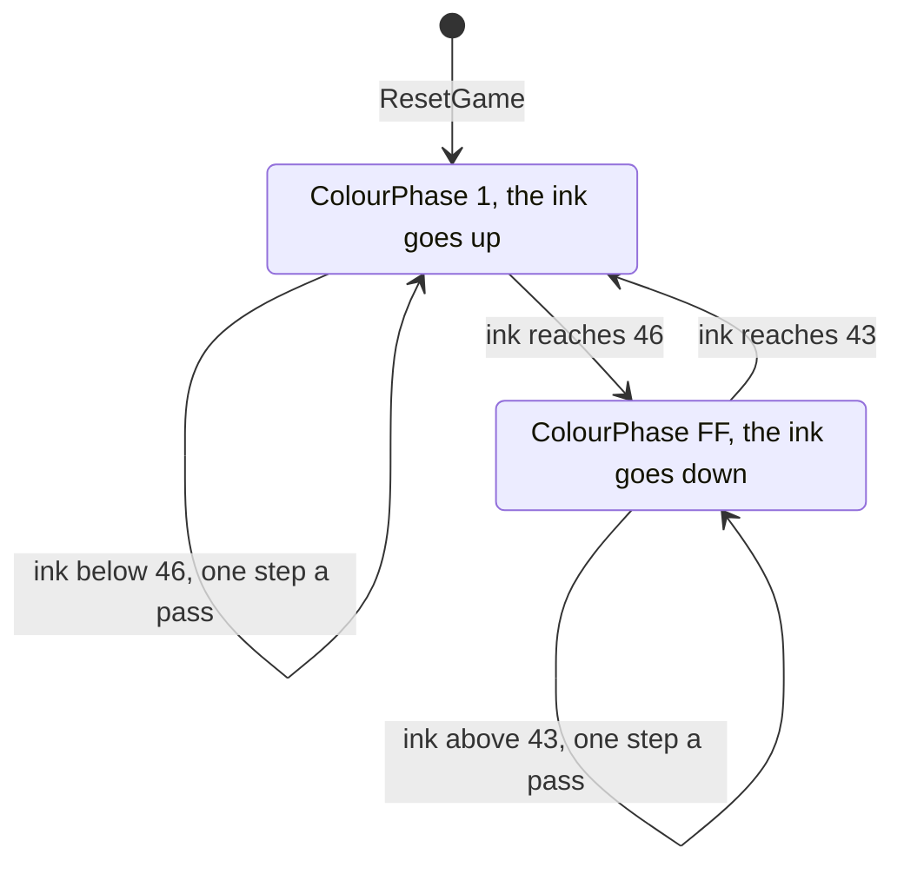

Worked example: the ink runs `$43 $44 $45 $46 $45 $44 $43 $44` and so on: bright magenta, green, cyan, yellow and back,
one step a pass, a full cycle in six passes. `ClearScreenCave $9346` sets the ink to `$45` at each cave start. Witness:
the `death-crush` sample of frame 0 holds the ink `$44` with `ColourPhase` `$FF`, going down (figure above).

**The point**: `$FD8E` is a display variable that the stage 1 reading took for game state. Its `$FF` only says the
colours were on their way down when the recording ended.

## 7.5 Each object kind as a state machine

Every object is a cell code, so an object's state is its code and the codes around it. The machines below give each
kind's codes and the events that change them. The rules behind each event are in doc 10, at the section named.

| Kind | Codes | Moves by | Ends by | Doc 10 |
| --- | --- | --- | --- | --- |
| falling objects: boulder, gem, jelly bean, arrow, potion, fire | 2, 7, 8, `$0A`, `$0C`, `$0F` | the scan, one cell a pass; the player pushes boulders | taken (all but boulder and fire); a boulder dissolves over fire | 10.3, 10.4, 10.6 |
| the player | 3, 4 | the keys, one cell a pass | crushed, fire, time, H | 10.5, 10.9 |
| earth | 6 | never, except in the falling-earth caves | dug | 10.8 |
| bubble | `$0E` | pushed by the player | bursts in fire | 10.5 |
| teleporter | `$0D` | never | entered, or the player arrives on it | 10.8 |
| switch box and force field | `$0B`, 9 | never | an object falls onto the switch box | 10.7 |
| exit | 1 | never | opens when the gem count is reached | 10.10 |
| burst and dissolve | `$10-$14`, `$15-$1B` | `$10` only, by the scan | step to `$20` | 10.6 |

A falling object (a boulder here; a gem, jelly bean, arrow, potion or fire behave the same but do not dissolve and,
except the fire, can be taken):

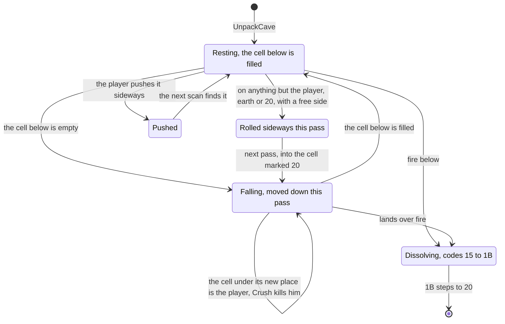

`Crush` only sets `PlayerKilled`: the object stays in its new cell, over the player. The scan moves the falling
objects; [doc 10.2](10-gameplay-logic.md#102-the-scan-and-why-its-order-matters) shows one whole scan at work
(`ScanCells.gif`: a boulder rolls right, other objects fall) and
[doc 10.3](10-gameplay-logic.md#103-falling-and-crushing) the fall that kills (`Crush.gif`). The player's push of a
bubble is animated in [doc 10.5](10-gameplay-logic.md#105-pushing-boulders-and-bubbles) (`BubbleRight.gif`).

The bubble and the teleporter:

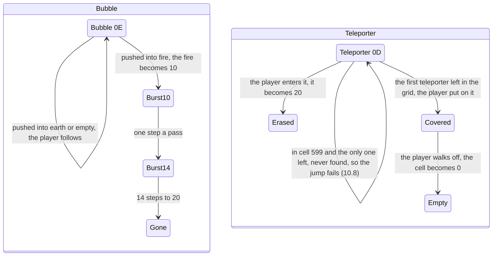

The burst and the dissolve are counters kept in the cell. `AnimateCellCodes $937E` walks the 600 cells once a pass,
after the scan, and steps every code from `$10` to `$1F`; `$14` and `$1B` step to `$20`. One pass of it at work, the
last step of the burst of `rzx-earth02`:

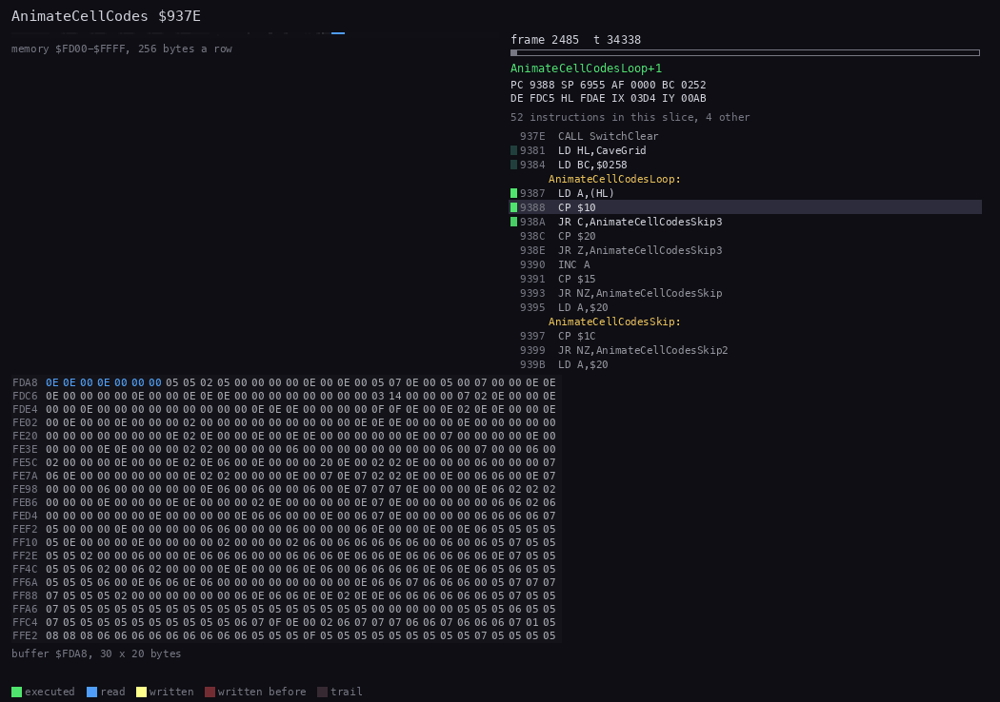

How to read the animation:

- Left: the grid `$FDA8-$FFFF` as 30 x 20 hex bytes. The loop reads every cell from the top left (blue); the one write
  (yellow) is cell 50, row 1, column 20, where `$14` becomes `$20`, early in the walk. The write fades after a few
  slices: the hex view keeps no trail.
- Right: the listing of `AnimateCellCodes`; the branch `$9395 LD A,$20` (the burst ends) runs once, `$939B` (the
  dissolve ends) not at all.
- Recording and frames: `rzx-earth02` (the RZX player's play, replayed), 2485:33900 to 2485:68900, 80 pictures; the
  samples show cell 50 as `$14` in frame 2479 and `$20` in frame 2486. Command: `python3 ../../kit/routine_anim.py
  --work work/docs/esC/r02 --window 2485:33900-2485:68900 --pictures 80 --listing build/game.lst --view
  buffer:FDA8:30x20:hex --range FD00-FFFF --pc 937E-93A4 --title ... --out
  docs/img/routines/AnimateCellCodes.gif`.

A dissolve on fire, pass by pass, is in [doc 10.6](10-gameplay-logic.md#106-fire-the-dissolve-and-the-burst)
(`dissolve.png`).

The switch and the force fields:

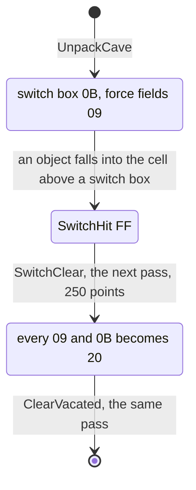

Witness: the switch in `rzx-earth02` (frames 380 and 388 above; `SwitchClear.gif` in
[doc 10.7](10-gameplay-logic.md#107-the-switch-a-chain-reaction) animates the clear), the bubble in `rzx-earth02`
(frames 2428-2487), the teleporter in the `earth04` RZX state log (frames 2184-2235 and 3356-3407,
[doc 10.8](10-gameplay-logic.md#108-the-special-cells)).

**The point**: no object has a state byte of its own. The machines are made of codes and of what lies next to them,
and the two codes that do count (the burst and the dissolve) are counters kept in the cell.

## 7.6 Collisions: what a move and a fall test

A grid game has no boxes: a collision is a test of the code in the next cell. There are two kinds of mover. The player
moves by one of the four `Try...` routines, at most one cell a pass. A falling object moves by the scan (doc 10). Both
test the target cell's code in a fixed order, and the order decides what happens.

The player's move left, `TryLeft $83C3`. The other three have the same shape with their own edge, and `TryUp` and
`TryDown` block on a boulder instead of pushing it:

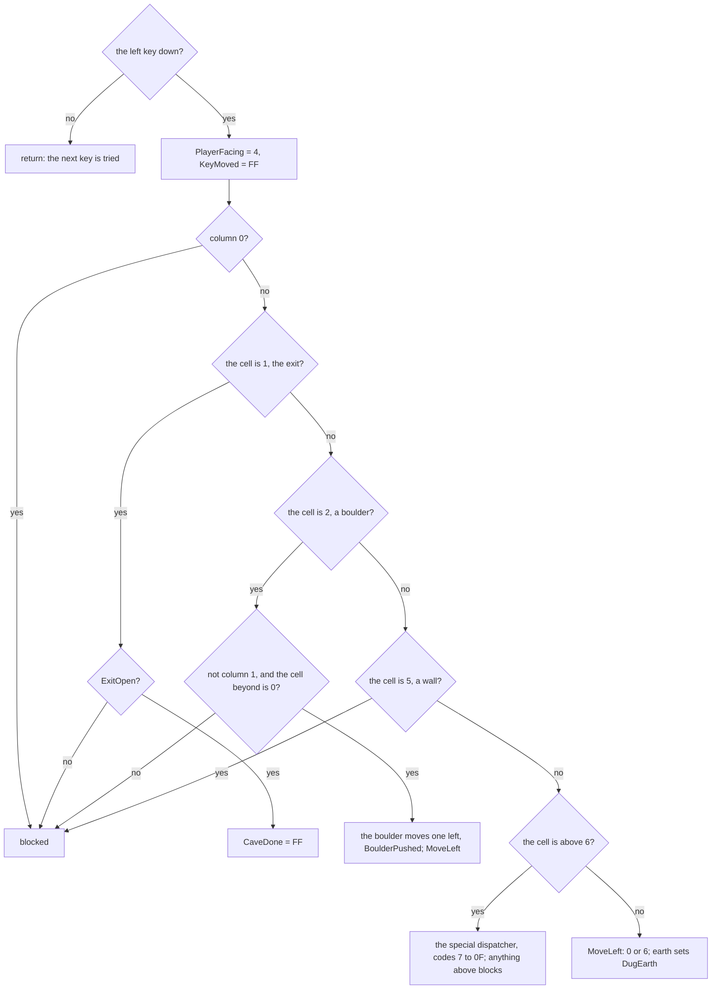

```asm
TryLeft:
83C3  LD A,$DF              ; the key site: half row and mask, written by RedefineKeys
83C5  OUT ($FF),A
83C7  IN A,($FE)
83C9  AND $02
83CB  RET NZ                ; not pressed
83CC  LD HL,PlayerFacing
83CF  LD (HL),$04
83D1  LD HL,KeyMoved
83D4  LD (HL),$FF           ; the pass's move is used, even if blocked
83D6  LD HL,(PlayerIndex)
83D9  LD B,$14
83DB  LD DE,$001E
83DE  SBC HL,DE             ; TryLeftLoop: a multiple of 30 is column 0
83E0  RET Z
83E1  DJNZ TryLeftLoop
83E3  LD HL,(PlayerIndex)
83E6  DEC HL
83E7  LD DE,CaveGrid
83EA  ADD HL,DE             ; HL = the cell to the left
83EB  LD A,$01
83ED  CP (HL)
83EE  JR NZ,TryLeftSkip
83F0  LD A,(ExitOpen)       ; the exit: open?
83F3  OR A
83F4  RET Z
83F5  LD A,$FF
83F7  LD (CaveDone),A
83FA  RET
83FB  LD A,$02              ; TryLeftSkip: a boulder?
83FD  CP (HL)
                            ; ... PushBoulder E81F, JR MoveLeft
841E  CALL BlockWall        ; TryLeftSkip2: 5 drops the return address; 6 sets DugEarth
8421  NOP
8422  LD A,$06
8424  CP (HL)
8425  JP C,LeftSpecial      ; a code above 6
8428  LD HL,(PlayerIndex)   ; MoveLeft
842B  DEC HL
842C  LD (PlayerIndex),HL
842F  INC HL
8430  LD DE,CaveGrid
8433  ADD HL,DE
8434  LD (HL),$00           ; the old cell: empty
8436  RET
```

Four details decide the play:

- `KeyMoved` is set before the tests. `PlayerStep $8556` tries left, right, up and down and stops at the first key
  that is down, so a blocked move still ends the player's step for the pass.
- `BlockWall $E869` blocks by dropping its caller's return address (`POP AF`, `RET`): the `RET` returns from `TryLeft`
  itself. `PushBoulder $E81F` does the same when the cell beyond the boulder is not empty.
- Every code above 6 goes to a special dispatcher. Codes `$10` and above match none of its tests and block. The exit
  is tested before the wall, so a closed exit blocks like a wall.
- `MoveLeft` and `MoveRight` leave 0 in the old cell; `MoveUp $84E6` and `MoveDown $8535` leave `$20`. An object above
  the old cell therefore falls in the same pass after a sideways step, and waits a pass after a step down. Doc 10.3
  shows why the second one kills.

The dispatcher that `TryLeft` jumps to is `LeftSpecial $94D6`, whose continuation is `MoveLeft`. `TryRight` jumps to
`RightSpecial $9494`, whose continuation is `MoveRight`. Stage 2 had the two names the other way round; they were
renamed to the moves they serve.

Worked example, `death-crush` (cave 1, up, up, down), sampled as above:

| Frame (sample) | `PlayerIndex` | Cells that changed | What ran |
| ---: | ---: | --- | --- |
| 4 | 255 | 255: 6 to 4; 285: 4 to `$20` | up into earth: `TryUp`, `MoveUp` leaves the vacated mark |
| 6 | 255 | 285: `$20` to 0 | |
| 9 | 225 | 225: 6 to 4; 255: 4 to `$20` | up again; the boulder at 195 now rests on the player's head |
| 15 | 255 | 225: 4 to `$20`; 255: 0 to 4 | down into the empty cell 255 |
| 17 | 255 | 225: `$20` to 0 | the boulder at 195 waited one pass behind the `$20` |
| 22 | 255 | 195: 2 to `$20`; 225: 0 to 2 | the scan: the boulder falls into 225 and the cell under it, 255, is the player |

The fall's tests are the scan's, in this order ([doc 10.2](10-gameplay-logic.md#102-the-scan-and-why-its-order-matters)
gives the routine):

1. A boulder with fire below becomes `$15` (the dissolve) and starts the fizz.
2. The codes 6 (unless earth falls), 0, 5, 9, `$0E`, `$0D`, 1, `$0B`, 3, 4 and every code above `$10` are skipped.
3. If the cell below is empty, the object moves down. If the cell under its new place is the player (3 or 4), `Crush`
   runs; if it is a switch box, `SwitchHit` is set.
4. If the cell below holds the player, earth or `$20`, the object stays.
5. Otherwise it rolls left when the left cell and the one below it are empty, else right in the same way.

**The point**: the order of the tests is the game's collision model. The player's move tests the exit before the wall
and the boulder before the specials. The fall tests the fire before the skip list, and tests the player under the new
place, not under the old one. That last choice is what lets an object rest on the player's head (doc 10.3).

## 7.7 Random numbers

There are none. No instruction reads the R register (no `LD A,R` in the listing), no routine reads the ROM's `FRAMES`
counter `$5C78`, and no table is indexed by a pass counter. The caves come from the records, the objects move by fixed
rules, and the only input is the keys. The same keys from the same state give the same game. The 32 RZX files replay
on our instance from their start snapshots with nothing patched, all 32 to the RZX's last frame
([WALKTHROUGH 6.0](../WALKTHROUGH.md#60-the-recordings)); cave 4 did so once the aligner's tie at frame 2344 was fixed
(stage 2 NOTES 3.10: an aligner fault, not a game difference).

**The point**: a solution is a fixed sequence of moves. A player can learn a cave like a puzzle, because nothing changes
from one try to the next.

## 7.8 Known only from the code

- A cave record cannot hold a code above `$0F`, because a nibble cannot.
- The burst's first code `$10` is not skipped by the scan (`LD A,$10`, `CP (HL)`, `JR C` skips only codes above
  `$10`). The bubble's fire cell gets `$10` in the player's step and `AnimateCellCodes` steps it to `$11` after the
  scan of the same pass, so for one scan `$10` is a falling object. A burst cell that fell or rolled was not looked
  for in the recordings.
- `Unused99 $FD90` is set to 99 by `ResetGame` and never read.
- `PlayerStep $8556` skips the left key when `PlayerIndex` is 0 (`OR (HL)`, `JR Z,PlayerStepSkip`, which lands on the
  `TryRight` call). No cave starts there and no recording has the player in cell 0.
