# 8. HUD and text

What this covers:

- the character grid and the glyph printer PrintGlyph (8.1);
- the font: 96 codes, the digits, the panel icons and the unused copies at `$68-$7F` (8.2);
- the text printer PrintText and why its cost grows with the code (8.3);
- the numbers: decimal digit strings, IncDigits, AddPoint, PrintDigits and the score (8.4);
- the panel line: cave, gems, lives, anti-gravity and score, who prints each field and when (8.5);
- the panel after a gem: CollectGem, the points one at a time, CountGem (8.6);
- the anti-gravity counter (8.7);
- the time bar, the timer, the jelly bean's refill and the time bonus (8.8);
- the cave intro and the centred cave name (8.9);
- the menu, the password, the key prompts, the game over and the win (8.10);
- the high-score table, the insertion and the name entry (8.11);
- the menu scroller (8.12);
- the data sheet of every text (8.13), what is known only from the code (8.14) and the point of it all (8.15).

The names are those of `src/game/game.ann` ([Terms](README.md#terms)). The recordings are those of
[WALKTHROUGH 6.0](../WALKTHROUGH.md#60-the-recordings), all on the 48K. Each was opened from its stage-1 TTD session
(`work/stage1/<name>/session.ttd`) on the writer's own instance (port base 37180, muted):

- `rzx-earth01` (`work/stage1/rzx01`): frames 0-3803, someone else's play of cave 1 replayed from the RZX archive's
  `earth01.rzx`. It holds the cave intro at frame 403 and the cave tune (405-691). The panel is printed at 691-692 and
  the first gem taken at 814. Two jelly beans come at 1524 and 2329, the exit opens at 3366, the time bonus runs
  3668-3713 and cave 2's intro starts at 3736. The panel figure is frame 2500.
- `menu`: frames 0-7915 from the menu after `c1`'s load. It holds the title tune to its end, the high-score table and
  the scroller (3278-5485), then the menu again.
- `hiscore`: frames 0-9688 from the `earth10` start snapshot (score 009 835). H is pressed until the lives are gone.
  The insertion comes at frame 4339 and the name is typed 4364-6685. The game-over screen follows (6685-9687).
- `timer`: frames 0-12000 from cave 1 in play. No key is pressed, so the time bar runs out at frame 6040.
- `c1`: the menu keys, the redefine screen (12207-12482) and the password prompt (12617-12705).
- `rzx-earth32`: the win screen at frame 20670.

Every printer call and every speaker write of a window was taken from access traces, 25 or 50 frames at a time
(`tools/sound_events.py`). The animations come from `R/kit/routine_anim.py` and `writers_map.py`, over traces of the
same instances. The static figures are drawn by `tools/fig_text.py` from `build/game.bin` (`$6D42-$FFFF`), the
resources in `build/res`, the screens the stage-1 captures saved and the stage-1 screenshots.

A frame is 69 888 T, one interrupt a frame, 20 ms. A moment is written "frame F T t". A trace puts an instruction in
the frame in which it ran. A screen picture of frame F is the screen at the frame's start. The game runs in IM 1 with
no HALT, so a pass takes as long as its work ([doc 4](04-game-loop.md)). So costs here are in T-states, not frames.

```bash
. work/env.sh
python3 ../../kit/rs.py open --work work/docs/esD/rzx01 --ttd work/stage1/rzx01/session.ttd --model 48K --port-base 37180
sh work/docs/esD/run_events.sh rzx01 400-700 812-818 3660-3740     # printer calls, speaker writes, interrupts
python3 ../../kit/rs.py stop --work work/docs/esD/rzx01
python3 tools/fig_text.py all                                         # the static figures of this document
```

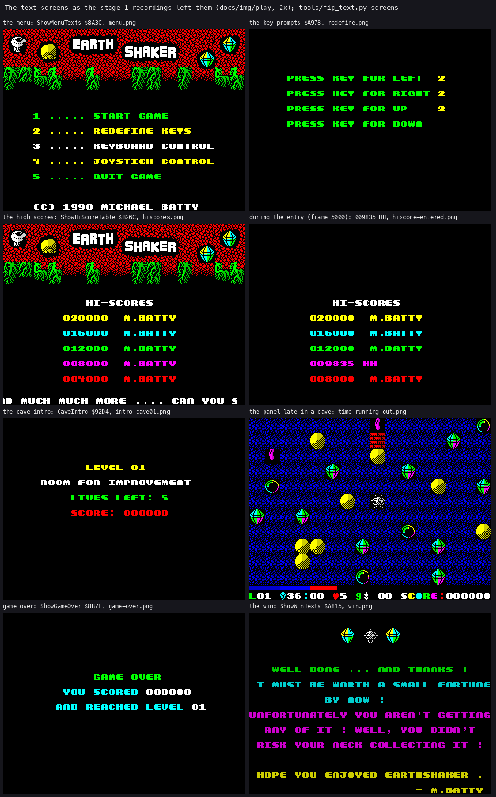

*The eight text screens of the game, from the stage-1 screenshots in `docs/img/play` (menu.png, redefine.png,
hiscores.png, hiscore-entered.png, intro-cave01.png, time-running-out.png, game-over.png, win.png), at 2 x. Command,
from the case folder after `. work/env.sh`: `python3 tools/fig_text.py screens`.*

How to read the figure:

- **Each panel** is one screenshot with the routine that prints it in its title. Each is the screen at the start of
  the frame it was taken in.
- **The order** is the order a player meets them: menu, keys, high scores, the entry, a cave's intro, play, game
  over, the win.
- **The point**: every one of these screens is plain 8 x 8 text in one font, coloured by attribute cells. Only the
  menu logo and the play window are graphics.

## 8.1 The character grid and PrintGlyph

Every piece of text in the game is an 8 x 8 glyph copied into one character cell of the screen. The screen has
32 x 24 cells. The game never uses the ROM's printer (`RST $10`). It has its own, PrintGlyph `$8040`. Its inputs are
the row in B (0-23), the column in C (0-31) and the glyph's 8 bytes at DE.

PrintGlyph does not touch the attributes. A text's colours come from a separate call that fills attribute cells
(FillAttrs `$8A74`, ColourLevelLivesScore `$8BEC` and their kind). Some colours are set once and never again, like
the panel's row 23 (8.5).

The screen address of a cell follows the Spectrum's split layout. The high byte is `$40 + (B AND $18)`, the third of
the screen. The low byte is `32 x (B AND 7) + C`. The 8 pixel lines of a cell are 256 bytes apart, so PrintGlyph
steps with `INC H`.

```text
PrintGlyph(row B, column C, glyph DE):
    H = $40 + (B AND $F8)                   ; B AND $F8 is the third x 8: $00, $08, $10
    L = ((B AND 7) rotated right 3) + C     ; 32 x (row in the third) + column
    repeat 8: (HL) = (DE); H += 1; DE += 1
```

```asm
PrintGlyph:              ; $8040
  LD A,B
  AND $F8
  ADD A,$40
  LD H,A                 ; H = $40 + the third x 8
  LD A,B
  AND $07
  RRCA
  RRCA
  RRCA                   ; 32 x (B AND 7)
  ADD A,C
  LD L,A
  PUSH BC
  LD B,$08
PrintGlyphLoop:
  LD A,(DE)
  LD (HL),A
  INC H                  ; the next pixel line, 256 bytes on
  INC DE
  DJNZ PrintGlyphLoop
  POP BC
  RET
```

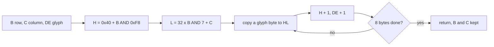

Worked example: the last score digit sits at row 23, column 31. B is `$17`, so `B AND $F8` is `$10` and H is `$50`.
`B AND 7` is 7; rotated right three times it is `$E0`. Adding C = `$1F` gives L = `$FF`. The glyph goes to `$50FF`,
`$51FF`, ... `$57FF`: the bottom right cell of the screen.

A glyph costs about 380 T: 71 T of set-up, 8 turns of 37 T (291 T, the last DJNZ falls through), `POP BC` and
the RET (20 T); the CALL adds 17 T. The screen bytes are in contended memory, so a
glyph written while the beam draws the screen costs a few T more.

Witness: PrintGlyph runs in every recording. In `rzx-earth01` frame 3736, CaveIntro prints 30 glyphs through it
between T 8484 and T 69 458 (the event file `work/docs/esD/ev-rzx01-3660-3740.json`).

The point: one 25-byte routine (`$8040-$8058`) is the whole output stage. Text, digits, icons and even the blank cells of the
high-score area go through it (ClearHiScoreArea `$B2C9` prints BlankGraphic `$AA72` glyphs, 8.11). Every screen in
this document is a list of PrintGlyph calls.

## 8.2 The font

Font `$BD00` holds 96 glyphs for the codes `$20-$7F`, 8 bytes each, `$BD00-$BFFF`. The resource is
`src/res/graphics/font.bin` (768 bytes). The listing splits it into six labels by use:

| Label | Address | Codes | What |
| --- | --- | --- | --- |
| Font | `$BD00` | `$20-$2F` | the space and the symbols `! " # $ % & ' ( ) * + , - . /` |
| DigitGlyphs | `$BD80` | `$30-$60` (392 bytes) | the digits `0-9` (PrintDigits' base), then `: ; < = > ? @`, the capitals, ``[ \ ] ^ _ ` `` |
| IconGlyphs | `$BF08` | `$61-$62` | `a` the gem, `b` the heart: the panel's icons |
| AntiGravIcon | `$BF18` | `$63` | `c` the anti-gravity arrow, lit |
| AntiGravIconOff | `$BF20` | `$64-$67` | `d` the arrow, dark; `e` a `g` shape, the gravity label; `f`, `g` |
| FontUnused | `$BF40` | `$68-$7F` | 24 glyphs: `$68-$7A` copy the capitals `H-Z`, `$7B-$7F` are their own `{ \| } ~ ©`; only `$73` (`s`, SYMBOL SHIFT) is printed |

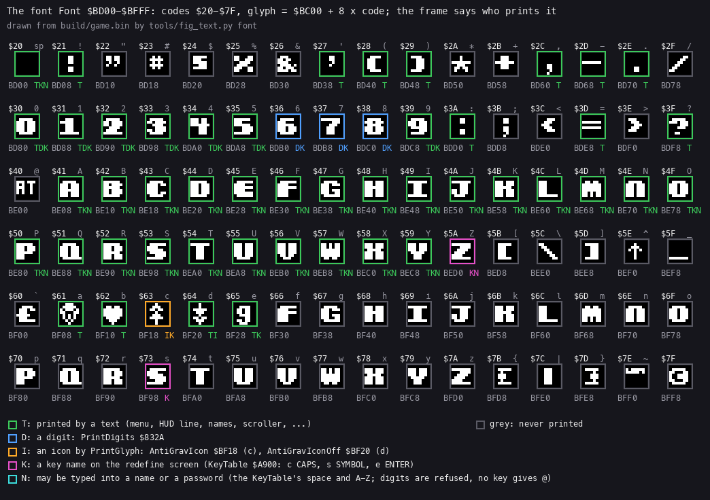

*The 96 glyphs of Font `$BD00`, drawn from `build/game.bin`. Command, from the case folder after `. work/env.sh`:
`python3 tools/fig_text.py font`.*

How to read the figure:

- **Each cell** is one glyph at 4 x, with its code and character above and its address below.
- **The letters under a cell** list every way the glyph is printed. T means a text of `src/res/texts` uses it, D the
  digit printer, I the anti-gravity icon, K a key name on the redefine screen, N a character a name or password may
  hold. The frame colour is the first of these.
- **Grey** frames are glyphs that no code path prints.
- **The point**: the font is a full printable ASCII set, but the texts use only the capitals, the digits and a few
  symbols. The small-letter slots `a-e` carry the panel's icons. `$68-$7A` are copies of `H-Z`, and of `$68-$7F` only `$73` is ever printed.

Two facts about the font are known only from the code:

1. PrintText does not check the code. The glyph of code k is at `$BC00 + 8k`, so the codes below `$20` would read the
   256 bytes before the font. Those are NotePeriods `$BC00` (doc 9), BarAttrs `$BC92` and HudLine `$BCE0`. No text
   holds such a code. Code 0 is a special case: it makes the DJNZ in PrintText run 256 times and reads `$C400`,
   inside CaveData. The scroller prints it once, as its last character (8.12).
2. The key names on the redefine screen are printed with PrintText from the key's character in KeyTable `$A900`
   ([doc 5](05-controls.md)). Three keys have a non-letter character. CAPS SHIFT is `c`, so it shows the anti-gravity
   arrow. ENTER is `e`, so it shows the `g` shape. SYMBOL SHIFT is `s` (`$73`), so it prints the glyph at `$BF98`,
   which is in FontUnused. Stage 2 said `$68-$7F` are never printed. `$73` is printed this way (game.ann's FontUnused
   now says so).

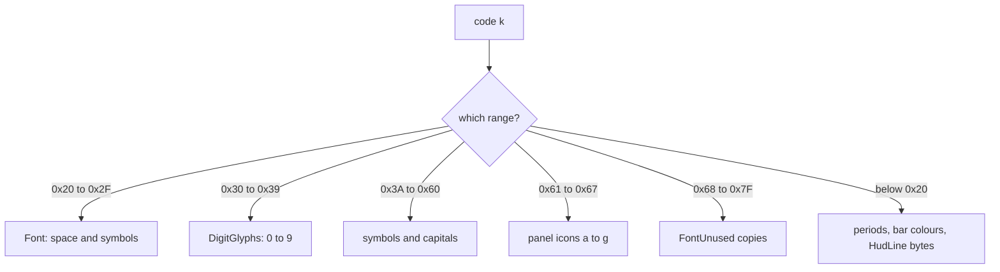

Witness: the font is read in every recording by PrintText and PrintDigits. The glyph read for each code shows in the
PrintText animation of 8.3 (`rzx-earth01` frames 403-405, the memory grid `$9700-$BFFF`).

The point: the font is the only text resource. Its layout makes the code-to-glyph step a multiply by 8. The cost of
how that multiply is done is the subject of the next section.

## 8.3 PrintText

PrintText `$834F` prints D characters from HL at row B, from column C. For each character it computes the glyph
address by adding 8 to `Font-256` (`$BC00`) k times, k being the code. The loop is `ADD HL,DE` and `DJNZ`, 24 T a
turn. So a character costs 531 T plus 24 T a code unit. A space (`$20`) takes 1299 T, `L` (`$4C`) 2355 T, `V`
(`$56`) 2595 T, measured in `rzx-earth01` frame 3736. A multiply by shifts would cost a constant 60 T or so.

```text
PrintText(row B, column C, length D, text HL):
    repeat D times:
        k = (HL)
        glyph = $BC00 + 8 x k            ; k additions of 8 (k = 0 gives 256 of them)
        PrintGlyph(B, C, glyph)
        C += 1; HL += 1
```

```asm
PrintText:               ; $834F
  PUSH DE
  PUSH HL
  PUSH BC
  LD B,(HL)              ; B = the code: the loop counter
  LD DE,$0008
  LD HL,Font-256         ; $BC00
PrintTextLoop:
  ADD HL,DE              ; 11 T
  DJNZ PrintTextLoop     ; 13 T, 8 T the last turn
  PUSH HL
  POP DE                 ; DE = the glyph
  POP BC
  CALL PrintGlyph
  POP HL
  POP DE
  INC C
  INC HL
  DEC D
  JR NZ,PrintText
  RET
```

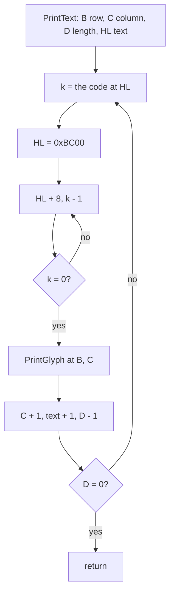

Worked example: the cave intro prints `LEVEL` at row 6, column 11 (ShowLevelLivesScore `$89A7`, 8.9). The first
code is `L`, `$4C` = 76. The loop adds 8 seventy-six times: `$BC00 + 608` = `$BE60`, the `L` glyph. That takes
75 x 24 + 19 = 1819 T. PrintGlyph then writes `$40CB`, `$41CB`, ... `$47CB` (row 6 is in the first third, and
`32 x 6 + 11` = `$CB`).

In `rzx-earth01` frame 3736 the five letters start at T 8484, 10 839, 13 026, 15 621 and 17 862. The gaps are 2355,
2187, 2595 and 2241 T. They fit 531 + 24k for `L`, `E`, `V` and `E`. The second `E` is 54 T slower: contention, as
the beam was drawing the screen.

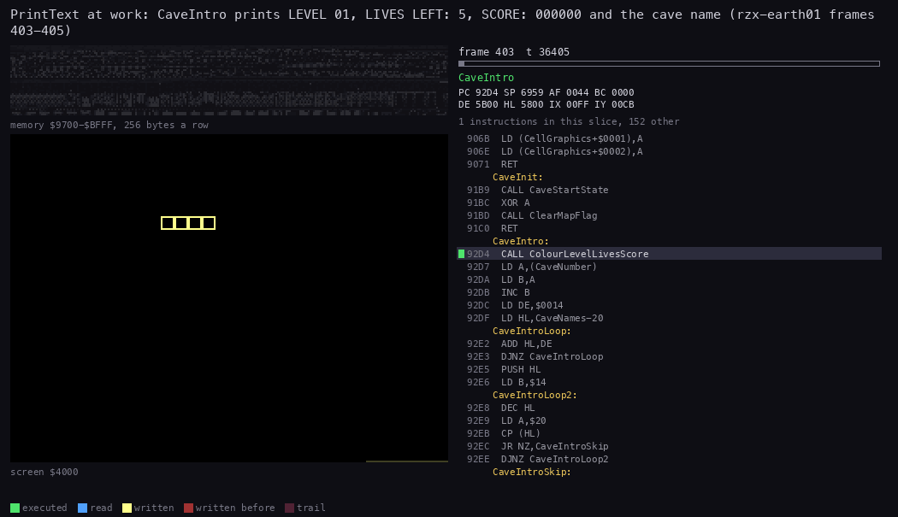

*PrintText at work: CaveIntro prints `LEVEL 01`, `LIVES LEFT: 5`, `SCORE: 000000` and the cave name, `rzx-earth01`
frames 403-405. Command, from the case folder after `. work/env.sh`: `python3 ../../kit/routine_anim.py --work
work/docs/esD/rzx01 --window 403:35000-405:7600 --listing build/game.lst --view screen --pc
834F-8369,8040-8058,92D4-9304,89A7-89E9,832A-8341 --range 9700-BFFF --pictures 80 --out
docs/img/routines/PrintText.gif`.*

How to read the animation:

- **Left**: the screen as the trace leaves it, picture by picture. The letters appear one at a time.
- **The memory grid** `$9700-$BFFF`: the reads of each slice in blue. The cave names (`$9700`), the labels (`$BB00`)
  and the font (`$BD00-$BFFF`) light up as each character is fetched.
- **Right**: the routine's code, with the instructions of the slice in green. Most slices sit in PrintTextLoop.
- **The point**: the time goes into the adding loop, not into the screen writes. A `Z` costs 25 x 24 = 600 T more
  than an `A`.

The cost matters only on screens that print a lot at once. The cave intro's 30 characters take about 61 000 T, most
of a frame. During play nothing calls PrintText. The panel's live fields are digits, printed by PrintDigits (8.4),
which has no such loop.

Witness: L1 counts 5918 runs of PrintText over the builds ([WALKTHROUGH 6.0](../WALKTHROUGH.md#60-the-recordings):
`c1`, `hiscore`, `lives`, `menu`, `timer`, every `rzx`). The cost per code is from `ev-rzx01-3660-3740.json` (the entries' T-states in frame 3736).

The point: PrintText is short and slow. The slowness never shows, because the texts are printed while nothing else
moves: the intro, the menu, the high-score screen.

## 8.4 Decimal digits: IncDigits, AddPoint, PrintDigits

Every number the game shows is a string of decimal digits, one byte (0-9) a digit, most significant first:

- the score: ScoreDigits `$FD94-$FD99`, six digits;
- the cave: CaveDigits `$FD7E-$FD7F`;
- the gems needed: GemsNeededDigits `$FD9E-$FD9F`;
- the gems taken: GemDigits `$FD82-$FD83`;
- the anti-gravity steps: AntiGravDigits `$FD8B-$FD8C`;
- the lives: Lives `$FD93`, one digit.

There is no binary-to-decimal conversion anywhere. Each counter is counted in decimal as it changes.

IncDigits `$8315` adds 1 to such a string. HL points at the last digit and B is the number of digits. The last digit
goes up by 1. If it reaches 10 it becomes 0 and the carry moves one digit left. AddPoint `$8321` is IncDigits on the
six score digits. AddPoints `$A8D5` calls AddPoint B times and then ShowScore. So N points cost N calls: the switch's
250 points are 250 increments ([doc 10](10-gameplay-logic.md)).

PrintDigits `$832A` prints D digits from right to left. HL is the last digit and C its column. The glyph of digit k
is `DigitGlyphs + 8k` (`$BD80 + 8k`), computed with three `RLCA` and an add. Its cost is constant, unlike
PrintText's. ShowScore `$8342` prints the score at row 23, columns 26-31.

```text
IncDigits(last digit HL, count B):
    loop:
        (HL) += 1
        if (HL) != 10: return
        (HL) = 0; HL -= 1; B -= 1
        if B == 0: return           ; the first digit wrapped: 999999 + 1 = 000000
PrintDigits(last digit HL, row B, column C, count D):
    repeat D times:
        PrintGlyph(B, C, $BD80 + 8 x (HL))
        C -= 1; HL -= 1
```

```asm
IncDigits:               ; $8315
  LD A,(HL)
  INC A
  LD (HL),A
  CP $0A
  RET NZ                 ; no carry: done
  LD (HL),$00
  DEC HL                 ; the carry goes left
  DJNZ IncDigits
  RET
AddPoint:                ; $8321
  LD HL,ScoreDigits+$0005
  LD B,$06
  CALL IncDigits
  RET
PrintDigits:             ; $832A
  PUSH DE
  LD A,(HL)
  RLCA
  RLCA
  RLCA                   ; 8 x the digit
  LD DE,DigitGlyphs
  ADD A,E                ; $80 + 8k never carries: k is 0-9
  LD E,A
  PUSH BC
  PUSH HL
  CALL PrintGlyph
  POP HL
  POP BC
  POP DE
  DEC C
  DEC HL
  DEC D
  JR NZ,PrintDigits
  RET
```

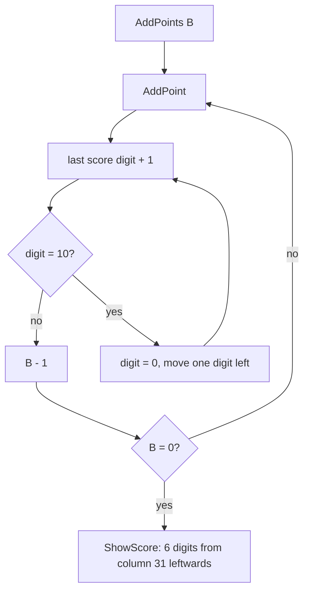

Worked example: the time bonus of `rzx-earth01` adds one point a bar pixel (8.8). At frame 3713 T 46 342 the score
ends in 9. AddPoint calls IncDigits at T 46 376, the digit wraps to 0, and IncDigits runs again at T 46 435 for the
tens (the second entry comes from `$831E`, the DJNZ). ShowScore follows at T 46 516. PrintDigits enters six times,
at 46 564, 47 150, 47 706, 48 286, 48 842 and 49 422: about 570 T a digit, 3600 T for the score.

Witness: L1 counts 70 724 IncDigits, 61 961 AddPoint and 82 595 PrintDigits runs over the builds (WALKTHROUGH 6.0). The moments
above are from `ev-rzx01-3660-3740.json`.

The point: decimal strings make printing cheap (no division) and adding dear (one call a point). The game adds at
most 250 points at once, so the trade is a good one on a Z80 with no divide. The score has no overflow check:
999 999 + 1 is 000 000.

## 8.5 The panel line

The panel is the bottom two rows of the screen. Row 22 is the time bar (8.8). Row 23 is a text line. ShowHudLine
`$836A` prints HudLine `$BCE0`, 32 characters, with PrintText at the start of each cave:

`L00 a00:00 b0 ed 00 SCORE:000000`

Then ShowScore and ShowCounters `$85AD` print the live values over the zeros. The colours of rows 22-23 are BarAttrs
`$BC92`, 64 attribute bytes copied by BarColours `$9224`. Row 1 of the table colours row 22, row 2 colours row 23.

| Columns | Text | Field | Variable | Written by |
| --- | --- | --- | --- | --- |
| 0 | `L` | the level label | | ShowHudLine `$836A` |
| 1-2 | `00` | the cave | CaveDigits `$FD7E` | ShowCounters `$85AD` |
| 4 | `a` | the gem icon | | ShowHudLine |
| 5-6 | `00` | the gems needed | GemsNeededDigits `$FD9E` | ShowCounters |
| 7 | `:` | | | ShowHudLine |
| 8-9 | `00` | the gems taken, counting up | GemDigits `$FD82` | CountGem `$8394` |
| 11 | `b` | the heart icon | | ShowHudLine |
| 12 | `0` | the lives | Lives `$FD93` | ShowCounters |
| 14 | `e` | the anti-gravity label (a `g` shape) | | ShowHudLine |
| 15 | `d` | the anti-gravity arrow, dark (`c` while it runs) | | AntiGravStartScan `$A7A0`, AntiGravPass `$A7CD` |
| 17-18 | `00` | the anti-gravity steps left | AntiGravDigits `$FD8B` | the same |
| 20-25 | `SCORE:` | | | ShowHudLine |
| 26-31 | `000000` | the score | ScoreDigits `$FD94` | ShowScore `$8342` |

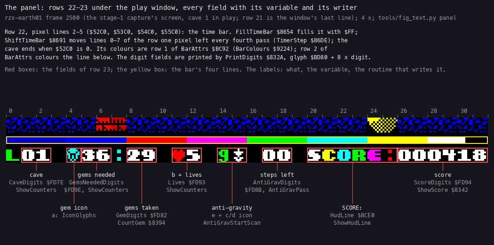

*Rows 21-23 of `rzx-earth01` frame 2500 (the screen saved by the stage-1 capture,
`work/stage1/rzx01/screens/002500.scr`), at 4 x. Command, from the case folder after `. work/env.sh`: `python3
tools/fig_text.py panel`.*

How to read the figure:

- **The top strip** is row 21, the play window's last line of cells, for scale. The column numbers are above it.
- **Row 22** is the time bar in its BarAttrs colours; the yellow box marks its four pixel lines.
- **Row 23** is the text line. Each red box is a field, labelled with what it is, its variable and the routine that
  prints it.
- **The point**: the gem field reads "needed : taken". At frame 2500 it shows `36:29`, 29 gems taken of 36 needed.
  The taken count goes up, not down.

The gem field corrects two earlier descriptions. Stage 2's NOTES (3.4) and the `.ann` of CountGem say the gem digits
count down. The code increments GemDigits (IncDigits, 8.6) and the screen shows the count rising. Both are
corrected (game.ann's CountGem, the stage 2 NOTES 3.4).

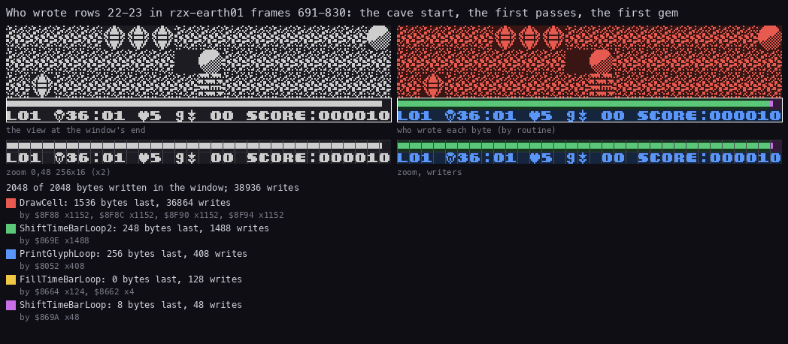

*Code against the screen. Each byte of rows 22-23 is coloured by the routine that wrote it last, over `rzx-earth01`
frames 691-830: the cave start, the first passes and the first gem. Command, from the case folder after `.
work/env.sh`: `python3 ../../kit/writers_map.py --work work/docs/esD/rzx01 --listing build/game.lst --window
691:0-830:0 --view buffer:5000:32x64:screen --zoom 0,48,256,16 --out docs/img/text/panel-writers.png`.*

How to read the figure:

- **Top left**: the bottom third of the screen at the window's end. **Top right**: the same bytes coloured by their
  last writer. **The second row** zooms on rows 22-23.
- **Blue** is PrintGlyphLoop: all 256 bytes of row 23, in 408 writes. That is 51 glyphs: the 32 of HudLine, 6 score
  digits, 5 counter digits, then 6 score digits and 2 gem digits after the gem at frame 814.
- **Green and magenta** are ShiftTimeBar: 6 calls, one every fourth pass, each rewriting all 256 bytes of row 22
  (magenta is column 31, the first `RL (HL)` of each line). FillTimeBar's 128 writes are all overwritten, so it owns no byte.
- **Red** is DrawCell, the play window above ([doc 6](06-rendering.md)).
- **The point**: in this window the two panel rows have exactly two writers each, and row 22's are the timer's. Over
  a whole cave the jelly bean's TimeBarRefillStep `$91DB` writes row 22 too (8.8); none falls in frames 691-830 (the
  first is at 1524).

The order at a cave start, from L1 of `rzx-earth01` (frames 691-692, when the cave tune has just ended):

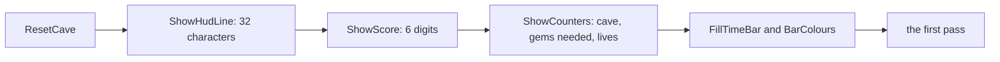

During play only five routines touch the line, each when its value changes:

- CountGem after a gem;
- ShowScore after points;
- AntiGravPass on each anti-gravity pass;
- AntiGravStartScan when the arrow is taken;
- ShowCounters at a cave start, after a life is lost and after a potion (TakePotion `$91C9`).

The lives digit shows 0-9, and the code keeps it there: TakePotion `$91C9` caps Lives at 9 (`CP $09` / `JR Z` skips
the `INC A`), and the only other writes to `$FD93` are the reset (`$82F0`) and the loss of a life (`$8A11`). So the
field never needs two digits; the RZX player sits at the cap from cave 22 on (`rzx-earth32`).

Witness: ShowHudLine and ShowCounters run once in `rzx-earth01`, at frames 691-692 (L1 `work/stage1/rzx01/l1.json`).
BarColours copies the colours in the same frame.

The point: the panel is a template string with holes. The game prints the template once and then only the changed
digits. So when nothing happens, the panel costs nothing in a pass.

## 8.6 The panel after a gem

When the player takes a gem ([doc 10](10-gameplay-logic.md)), CollectGem `$8595` runs four steps in a row:

1. AddGemValue `$8376` calls AddPoint GemValue `$FD9B` times (10 in cave 1).
2. ShowScore prints the six digits.
3. CountGem `$8394` adds 1 to GemCount `$FD92`. When it equals GemsNeeded (the cave's first parameter, CaveParams
   `$FD9A`), it sets ExitOpen `$FD85` to `$FF`. Then it adds 1 to the two-digit GemDigits, prints them at columns 8-9
   and calls GemSound (doc 9).
4. Back in CollectGem: if ExitOpen is `$FF`, ExitOpenSound plays (doc 9).

```text
CollectGem:
    repeat GemValue: AddPoint
    ShowScore
    GemCount += 1
    if GemCount == GemsNeeded: ExitOpen = $FF
    IncDigits(GemDigits, 2); PrintDigits(GemDigits, row 23, column 9, 2)
    GemSound
    if ExitOpen == $FF: ExitOpenSound          ; again on every later gem
```

```asm
CountGem:                ; $8394
  LD A,(GemCount)
  INC A
  LD (GemCount),A
  LD HL,CaveParams       ; GemsNeeded, the cave's first parameter
  CP (HL)
  JR NZ,CountGemSkip
  LD HL,ExitOpen
  LD (HL),$FF
CountGemSkip:
  NOP                    ; six NOPs: code blanked in place
  NOP
  NOP
  NOP
  NOP
  NOP
  LD HL,GemDigits+$0001
  LD B,$02
  CALL IncDigits         ; the gems taken + 1, in decimal
  LD HL,GemDigits+$0001
  LD BC,$1709            ; row 23, last column 9
  LD D,$02
  CALL PrintDigits
  CALL GemSound
  RET
```

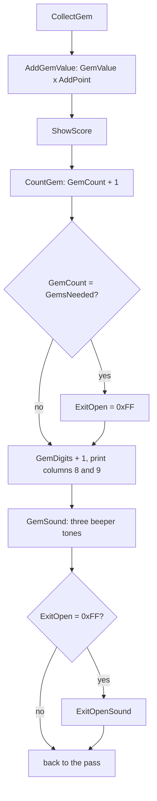

Worked example: `rzx-earth01`'s first gem, from `ev-rzx01-812-818.json`:

| Frame T | Routine | What |
| --- | --- | --- |
| 814 T 48 749 | PassLoop | the pass starts |
| 814 T 50 092 | CollectGem | the gem is taken |
| 814 T 50 109 | AddGemValue | 10 AddPoint calls, 1594 T |
| 814 T 51 703 | ShowScore | PrintDigits enters 6 times, T 51 751 to 54 616 |
| 814 T 55 244 | CountGem | IncDigits, then PrintDigits twice (T 55 460, 56 010) |
| 814 T 56 616 | GemSound | ROM BEEPER three times: 814 T 56 653, 815 T 10 918, 815 T 35 260 |

The panel part (points, score, count) takes 6524 T, a tenth of a frame. The sound takes 1.1 frames and runs with
interrupts off. Frame 815's interrupt is lost: the event file lists interrupts at frames 812, 813, 814, 816 and 817.

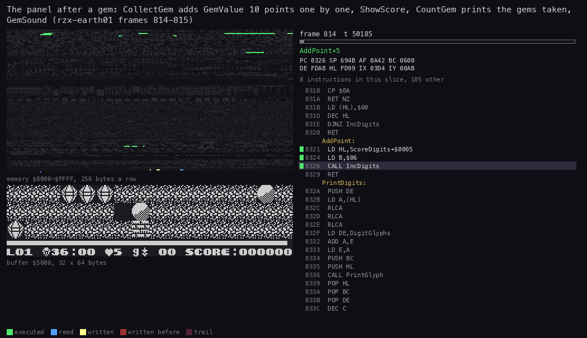

*CollectGem in `rzx-earth01` frames 814-815: the 10 points one at a time, ShowScore, CountGem, GemSound. Command, from
the case folder after `. work/env.sh`: `python3 ../../kit/routine_anim.py --work work/docs/esD/rzx01 --window
814:49000-815:62000 --listing build/game.lst --view buffer:5000:32x64:screen --pc
8595-85AC,8376-8381,8394-83C2,8315-834E,8040-8058,82F9-8314 --range 8000-FFFF --pictures 70 --out
docs/img/routines/CountGem.gif`.*

How to read the animation:

- **Left**: the screen's bottom third (`$5000-$57FF`, rows 16-23) as the trace leaves it. Watch the score at the
  right of row 23, then the gem digits at columns 8-9.
- **The memory grid** `$8000-$FFFF`: reads in blue, writes in yellow. The score digits `$FD94-$FD99` are written ten
  times, then the font at `$BD80` is read for each printed digit.
- **Right**: the code. The slices move from AddGemValue to PrintDigits to CountGem, and last into GemSound and the
  ROM.
- **The point**: the panel's update is a small part of the pass; the sound that follows is the dear part.

The six NOPs of CountGem, and the four after ExitOpenSound in CollectGem, are code blanked in place by an older edit.
Nothing after them moved. ExitOpenSound runs on every gem after the exit opened, because ExitOpen stays `$FF`.

Witness: L1 counts 1692 CollectGem and CountGem runs over `c1` and the 32 RZX replays. The table is from
`ev-rzx01-812-818.json`.

The point: a gem is three panel writes and a sound, all inside the pass that took it. With no frame lock, the pass
that takes a gem is simply about 1.2 frames longer.

## 8.7 The anti-gravity counter

Columns 14-18 of the panel show the anti-gravity state. The label `e` is part of HudLine. When the player takes the
arrow ([doc 10](10-gameplay-logic.md)), AntiGravStartScan `$A7A0` does five things:

- it calls AntiGravStart (the sound and 200 points);
- it sets AntiGravDigits to 9, 9;
- it sets AntiGravSteps `$FD8D` to `$63` (99);
- it prints `99` at columns 17-18;
- it prints the lit arrow `c` at column 15.

On each pass while it runs, AntiGravPass `$A7CD` counts the steps down. The digit string goes down by 1 in place (its
own loop, not IncDigits) and is printed, and a short beep plays (doc 9). When the steps reach 0, the arrow is
replaced by `d`, the dark arrow, and the digits stay at `00`.

```text
AntiGravPass:
    if AntiGravSteps == 0: ScanCells; return              ; normal gravity
    AntiGravSteps -= 1
    if AntiGravSteps == 0: PrintGlyph(23, 15, AntiGravIconOff)
    the 2-digit string AntiGravDigits - 1 (0 becomes 9 with a borrow)
    PrintDigits(AntiGravDigits, row 23, column 18, 2)
    AntiGravScan                                          ; the reversed gravity
    ROM BEEPER(HL = 2 x AntiGravSteps, DE = 10); DI
```

```asm
AntiGravPassSkip2:
  LD HL,AntiGravDigits+$0001
  LD B,$02
AntiGravPassLoop:
  LD A,(HL)
  DEC A
  LD (HL),A
  CP $FF                 ; below 0: borrow
  JR NZ,AntiGravPassSkip3
  LD (HL),$09
  DEC HL
  DJNZ AntiGravPassLoop
AntiGravPassSkip3:
  LD HL,AntiGravDigits+$0001
  LD BC,$1712            ; row 23, last column 18
  LD D,$02
  CALL PrintDigits
```

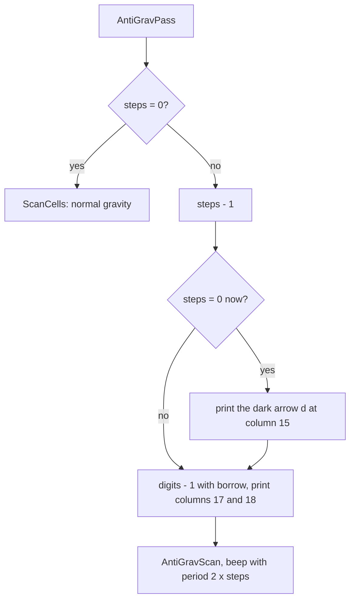

Worked example: the arrow is taken at `rzx-earth03` frame 543. After the next pass the digits read 98, and so on. 99
passes later they read 00 and the arrow goes dark. At 6-7 frames a pass ([doc 4](04-game-loop.md)), the reversal
lasts about 600-700 frames, 12-14 s. The counter counts passes, not time.

Witness: L1 of `rzx-earth03` has 3 AntiGravSound entries (frames 543 to 4043) and 963 AntiGravPass entries.
AntiGravPass runs on every pass, with steps at 0 too, so 963 is the cave's pass count.

The point: this counter counts down with six instructions of its own, because IncDigits only counts up. It is the one
falling number on the panel.

## 8.8 The time bar, the timer, the refill and the time bonus

The time is not a number. It is a bar of 256 pixels on row 22: lines 2-5 of the row, filled with `$FF` from `$52C0`.
FillTimeBar `$8654` draws it at each cave start and BarColours `$9224` colours it.

Every pass calls TimerStep `$86DE`, which adds `$40` to TimerSub `$FD7C`. On every fourth pass the byte wraps to 0.
Then ShiftTimeBar `$8691` shifts the eight pixel lines of row 22 one pixel left, each as one 256-bit number (`RL`
from column 31 down to column 0). A 0 enters at the right, so the bar shortens from its right end. Then comes a click:
ROM BEEPER with HL = 0, DE = 0 (one cycle, 118 T, doc 9).

When the byte at `$52C0` is 0, the time is out. That byte is column 0 of line 2, the bar's last eight pixels. Then
TimeOutSound plays and CaveOver `$FD7D` is set.

```text
TimerStep (each pass):
    TimerSub += $40
    if TimerSub != 0: return                    ; 3 passes of 4
    ShiftTimeBar                                ; 8 lines x 32 bytes, RL right to left
    ROM BEEPER(HL = 0, DE = 0)                  ; the click
    if ($52C0) == 0: TimeOutSound; CaveOver = $FF
```

```asm
TimerStep:               ; $86DE
  LD A,(TimerSub)
  ADD A,$40
  LD (TimerSub),A
  OR A                   ; also clears the carry ShiftTimeBar shifts in
  RET NZ
  CALL ShiftTimeBar
  LD HL,$0000
  LD DE,$0000
  CALL RomBeeper         ; a one-cycle click
  LD A,(Screen+4800)     ; $52C0: the bar's left end
  OR A
  RET NZ
  CALL TimeOutSound
  LD A,$FF
  LD (CaveOver),A
  RET
ShiftTimeBar:            ; $8691
  LD HL,Screen+4319      ; $50DF: row 22, line 0, column 31
  LD B,$08
ShiftTimeBarLoop:
  PUSH BC
  PUSH HL
  LD B,$1F
  RL (HL)                ; column 31: a 0 comes in at the right
  LD A,(HL)
  DEC HL
ShiftTimeBarLoop2:
  RL (HL)                ; each byte's top bit goes into the next byte to the left
  DEC HL
  DJNZ ShiftTimeBarLoop2
  DEC HL
  POP HL
  LD BC,$0100            ; the next pixel line
  ADD HL,BC              ; no overflow: the carry is 0 again
  POP BC
  DJNZ ShiftTimeBarLoop
  RET
```

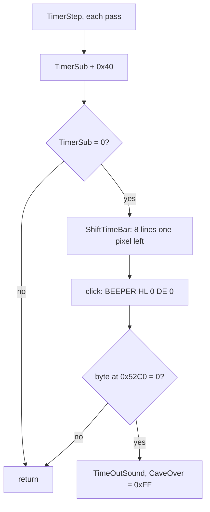

The jelly bean puts time back. JellyBean `$91F7` makes 32 pairs of beeps (64 BEEPER calls, 2688 writes) and calls
TimeRefill 32 times. Each TimeRefill gives 2 points and calls TimeBarRefillStep `$91DB`. That routine shifts lines 2-5 of the bar one pixel right, with a set
pixel coming in at the left (`SCF` then `RR (HL)` along the row). So a jelly bean adds 32 pixels, 128 passes of time.
A full bar stays full: the pixel pushed out at column 31 is lost.

Worked example: the bar has 256 pixels and each shift removes one. So a cave lasts at most 4 x 256 = 1024 passes,
the same in every cave: the caves have no time parameter. `rzx-earth01` adds up exactly (L1 counts):

| Step | Passes or calls | Pixels |
| --- | ---: | ---: |
| FillTimeBar at frame 692 | 1 | 256 |
| TimerStep from frame 697 to 3668 | 513 passes, 128 shifts | -128 |
| two jelly beans, frames 1524 and 2329 | 64 TimeBarRefillStep | +64 |
| left at the exit, turned into points by TimeBonus | 192 shifts | 192 |

513 passes took 2971 frames, 5.8 frames a pass. At that rate a full bar lasts about 5940 frames, two minutes.
A heavier cave takes longer in seconds for the same 1024 passes (doc 4 measures 5.5-9.4 frames a pass).

ShiftTimeBar costs about 10 400 T. In `rzx-earth01` frame 3713 it enters at T 35 980 and the next routine at
T 46 342. Most of that is the 256 `RL (HL)` on contended screen memory.

The time bonus. At the end of a cave, with the exit taken ([doc 10](10-gameplay-logic.md)), TimeBonus `$8702` turns
the rest of the bar into points. Each turn calls BonusTick (one ROM BEEPER cycle), ShiftTimeBar, AddPoint and
ShowScore, until `$52C0` is 0: one point a pixel. The tick's period is the low byte of a counter D that falls by 1 a
turn, so the ticks rise in pitch. Doc 9 decodes the sound and its two quirks: BonusTick's own three `DEC D` are lost
to a `POP DE`, and the `DI` at TimeBonus's start is undone by BEEPER's `EI`.

```asm
TimeBonus:               ; $8702
  DI
  LD D,$00
TimeBonusLoop:
  PUSH DE
  CALL BonusTick         ; BEEPER HL = D, DE = 1; its DEC D x 3 are popped away
  CALL ShiftTimeBar
  CALL AddPoint
  CALL ShowScore
  POP DE
  DEC D
  LD A,(Screen+4800)
  OR A
  JR NZ,TimeBonusLoop
  EI
  RET
```

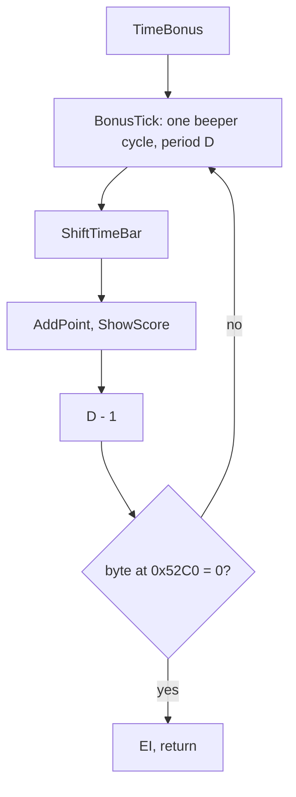

Worked example: `rzx-earth01` takes the exit with 192 pixels left. TimeBonus starts at frame 3668 T 47 685, and the
192nd BonusTick is at frame 3713 T 34 429. That is 192 points in 45 frames, about 16 400 T a pixel: ShiftTimeBar
10 400, ShowScore 3600, the tick and AddPoint the rest. The beeper's HL runs 0, 255, 254, ... 65 (the RomBeeper
entries of `ev-rzx01-3660-3740.json`). Of the 45 frame interrupts of the bonus (frames 3669-3713; the one of
frame 3668 comes before TimeBonus starts), 41 are taken and 4 are lost (frames 3681, 3687, 3695 and 3698): those fell
inside a beeper call's own `DI`.

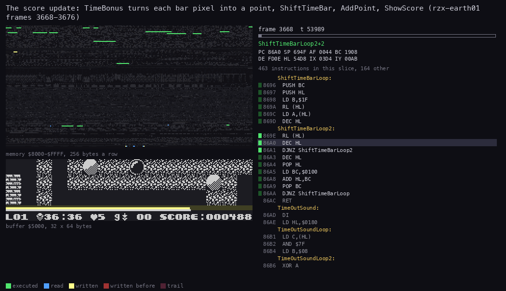

*TimeBonus in `rzx-earth01` frames 3668-3676. Command, from the case folder after `. work/env.sh`: `python3
../../kit/routine_anim.py --work work/docs/esD/rzx01 --window 3668:47000-3676:47000 --listing build/game.lst --view
buffer:5000:32x64:screen --pc 8702-872C,8691-86AC,8315-834E,8040-8058 --range 8000-FFFF --pictures 80 --out
docs/img/routines/TimeBonus.gif`.*

How to read the animation:

- **Left**: the bottom third of the screen. The bar on row 22 shrinks from the right while the score on row 23 counts
  up, one point a pixel.
- **The memory grid** `$8000-$FFFF`: the score digits `$FD94-$FD99` written on each turn, the font read for each
  digit.
- **Right**: the code. ShiftTimeBar's `RL (HL)` loop takes most slices.
- **The point**: the bar and the score move in step because one loop drives both.

Witness: TimerStep runs every pass in every recording (L1). TimeOutSound runs in `timer` at frames 6040-6092
([time-running-out.png](img/play/time-running-out.png) is the panel shortly before). TimeBonus runs once in every
finished cave of the RZX replays. The measurements are from the event files named.

The point: the timer is the screen. The game keeps no time variable. The bar's pixels are the count, and the time-out
test reads screen memory. So the time of a cave is a fixed number of passes, not of seconds.

## 8.9 The cave intro and the centred name

Before each cave, CaveIntro `$92D4` shows three lines and the cave's name on a cleared screen
([intro-cave01.png](img/play/intro-cave01.png)). ColourLevelLivesScore `$8BEC` colours the cells and calls
ShowLevelLivesScore `$89A7`, which prints:

| Row, column | Text | Colour | Then |
| --- | --- | --- | --- |
| 6, 11 | `LEVEL` (HudLabels `$BB00`) | `$46` bright yellow | CaveDigits at columns 17-18 |
| 10, 9 | `LIVES LEFT:` (LivesLeftText `$BB05`) | `$44` bright green | Lives at column 21 |
| 12, 9 | `SCORE:` (ScoreText `$BB10`) | `$42` bright red | ScoreDigits at columns 16-21 |

Then CaveIntro finds the cave's name in CaveNames `$9700` (20 characters a cave, space padded) and centres it on row
8. It walks back from the name's end over the trailing spaces to get the length n. The column is
`((21 - n) AND $FE) / 2 + 5`, and all 20 characters are printed from there, the padding too.

```text
CaveIntro:
    ColourLevelLivesScore                     ; colours, LEVEL / LIVES LEFT: / SCORE: and their values
    name = CaveNames + 20 x (CaveNumber - 1)
    n = 20 - (trailing spaces of name)
    C = ((21 - n) AND $FE) / 2 + 5
    PrintText(row 8, column C, 20 characters, name)
```

```asm
CaveIntro:               ; $92D4
  CALL ColourLevelLivesScore
  LD A,(CaveNumber)
  LD B,A
  INC B
  LD DE,$0014
  LD HL,CaveNames-20
CaveIntroLoop:
  ADD HL,DE              ; HL = the end of the cave's name
  DJNZ CaveIntroLoop
  PUSH HL
  LD B,$14
CaveIntroLoop2:
  DEC HL
  LD A,$20
  CP (HL)
  JR NZ,CaveIntroSkip    ; the last non-space: B = the length
  DJNZ CaveIntroLoop2
CaveIntroSkip:
  LD A,$15
  SUB B                  ; 21 - n
  AND $FE
  RRCA                   ; / 2
  ADD A,$05
  LD C,A
  LD B,$08               ; row 8
  POP HL
  SBC HL,DE              ; back to the name's start
  LD DE,$1400            ; D = 20 characters
  CALL PrintText
  RET
```

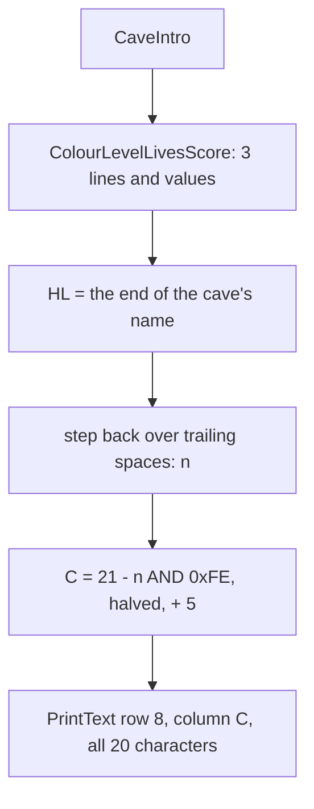

Worked example: cave 1 is `ROOM FOR IMPROVEMENT`, n = 20. `21 - 20` = 1, `AND $FE` gives 0, so C = 5 and the name
fills columns 5-24. Cave 30 is `THE KEEP`, n = 8: `21 - 8` = 13, `AND $FE` = 12, halved 6, C = 11. The name fills
columns 11-18, whose middle is column 14.5. A name of odd length is centred on column 15, an even one on 14.5. The
screen's middle is 15.5, so every name sits half a column to a column left of centre. The `+ 5` and the 21 would
centre a name in columns 5-25, not 0-31.

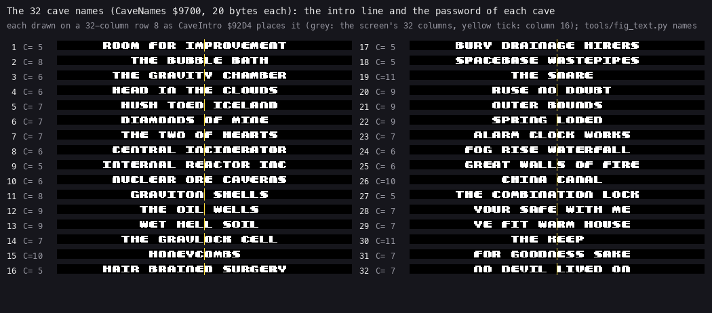

*The 32 names of CaveNames `$9700`, each on a 32-column row as CaveIntro prints it. Command, from the case folder after
`. work/env.sh`: `python3 tools/fig_text.py names`.*

How to read the figure:

- **Each row** is one cave: its number, the column C that CaveIntro computes, and the name drawn on a full 32-column
  line (grey cells are the screen's columns).
- **The yellow tick** marks column 16, the right half's first column.
- **The point**: every name leans left of the tick. The names are the passwords too (FindPassword `$8E91`,
  [doc 10](10-gameplay-logic.md)), so the intro shows the player the password of the cave being entered.

The intro's 30 characters take about 61 000 T (8.3), all in the frame after the screen is cleared. Then PlayCaveTune
plays the cave's tune with interrupts off (doc 9) while the intro stays on the screen.

Witness: CaveIntro runs at the start of every cave: L1 counts 46 entries over `c1`, `hiscore`, `lives`, `timer` and
31 of the RZX replays. `rzx-earth01` runs it at frame 403 (the PrintText animation of 8.3) and at frame 3736 for
cave 2 (`ev-rzx01-3660-3740.json`).

The point: the cave intro is a password screen in disguise. The centring is off by one column because its formula
works in a 21-column field that starts at column 5.

## 8.10 The menu, the password, the key prompts, the game over and the win

All the other text screens are lists of PrintText calls, each line followed or preceded by a FillAttrs for its
colour. The data sheet of 8.13 gives every string's address, length, place and printer. In short:

- **The menu** (DrawTitle `$8AC8` and ShowHiScores `$B2E4` call it): ShowMenuTexts `$8A3C` prints `1 ..... START GAME` (row 11),
  `2 ..... REDEFINE KEYS` (13), ShowControlTexts' `3 ..... KEYBOARD CONTROL` and `4 ..... JOYSTICK CONTROL`
  (15, 17), `5 ..... QUIT GAME` (19) and the copyright on row 23 ([menu.png](img/play/menu.png),
  [menu-joystick.png](img/play/menu-joystick.png)). The 1988 line `3 ..... DEMO MODE` (MenuDemoText `$AB27`) is still
  in the data; its print was replaced by `CALL ShowControlTexts` and eight NOPs, the same 11 bytes.
- **The password prompt**: ShowPasswordPrompt `$8DFF` clears the screen and prints
  `ENTER PASSWORD (ENTER=LEVEL ONE)` on row 0 in `$43` (bright magenta). EnterPassword `$8E2D` echoes the typed
  characters ([doc 5](05-controls.md)) and prints the sixth character of that same text, a space, over a deleted one.
- **The key prompts**: RedefineKeys `$8C30` colours the even rows 6-14 (6, 8, 10, 12, 14; `$44` for the prompts,
  `$46` for the key cell at column 25), then prints `PRESS KEY FOR LEFT`, `RIGHT`, `UP`, `DOWN`, `FIRE` on rows 6, 8, 10, 12, 14 one at a time, each
  followed by the key's character at column 25 and RaspSound ([redefine.png](img/play/redefine.png)).
- **The game over**: ShowGameOver `$8B7F` prints `GAME OVER` (row 8, `$44`), `YOU SCORED` with the six score digits
  (row 10, `$45`) and `AND REACHED LEVEL` with the cave digits (row 12, `$45`) ([game-over.png](img/play/game-over.png)).
- **The win**: ShowWinTexts `$A815` prints eight lines on rows 7-23, from `WELL DONE ... AND THANKS !` to `- M.BATTY`
  ([win.png](img/play/win.png)).
- **Never printed**: MenuDemoText (the 1988 demo mode) and Credits `$AC2E`, the 1988 credit line
  `ARTWORK AND MUSIC (C) 1988 MICHAEL BATTY`. No code reads either.

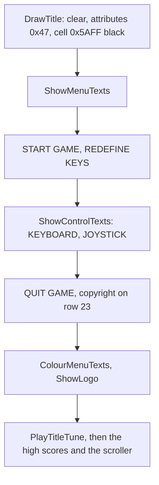

Worked example: the game-over screen of `hiscore` at frame 6707. ShowGameOver prints 9 + 10 + 17 characters with
PrintText and 6 + 2 digits with PrintDigits, then colours the three lines. The screen saved at frame 6750 reads
`GAME OVER`, `YOU SCORED 009835`, `AND REACHED LEVEL 10` (decoded from `work/stage1/hiscore/screens/006750.scr` by
matching each cell against the font).

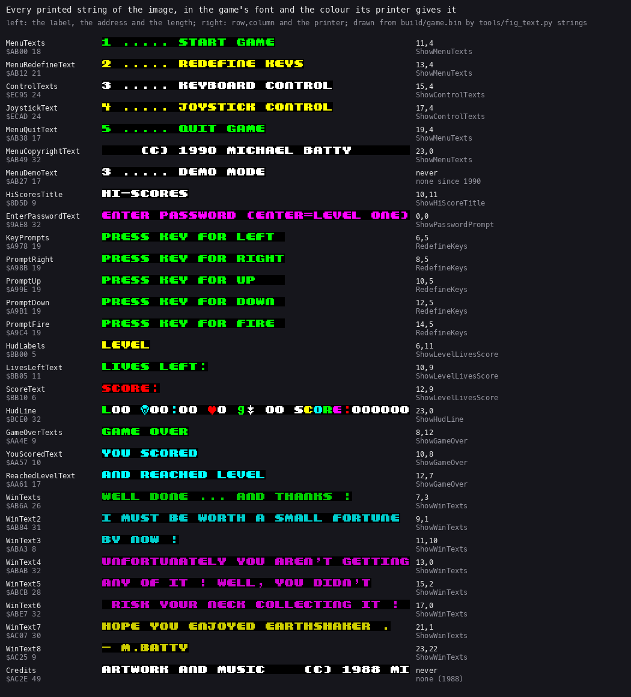

*Every string of the image in the game's font and the colour its printer gives it, with its label, address, length,
place and printer. Command, from the case folder after `. work/env.sh`: `python3 tools/fig_text.py strings`.*

How to read the figure:

- **Left**: the label, the address and the length in bytes.
- **Middle**: the string drawn from `build/game.bin` with PrintText's glyphs, in the ink of the FillAttrs that colours
  it (the HUD line in BarAttrs' row 2).
- **Right**: the row and column, and the routine that prints it. "never" marks the two leftovers.
- **The point**: 30 strings make up every word the game shows. Two of them are 1988 leftovers that the 1990 version
  no longer prints.

Witness: L1 of `c1` holds RedefineKeys (frames 12207-12482), ShowPasswordPrompt (12617-12641) and ShowControlTexts
(5 entries); `hiscore` holds ShowGameOver at 6707; `rzx-earth32` holds ShowWinTexts at 20670.

The point: the texts are data, not code. Each screen is a few lines of `LD HL / LD BC / LD D / CALL PrintText`, which
is why the 1990 edits could replace a line by a call and NOPs without moving anything.

## 8.11 The high-score table, the insertion and the name entry

HiScoreTable `$FD14` holds 5 records of 15 bytes: 6 score digits (a byte 0-9 each, as ScoreDigits) and 9 name
characters. The defaults are 020000, 016000, 012000, 008000 and 004000, each ` M.BATTY ` (`src/res/tables`).

After a game, GameOver `$7FF3` calls HiScoreInsert `$7F7A`. It compares the score with records 1 to 5 using
HiScoreCompare `$7F60`, which compares the six digits from the first and returns carry set when the score is below.
At the first record the score is not below:

1. ClearScreen (with WipeScreen, 22 frames with interrupts off);
2. the records below move down one with an LDIR each, from record 4 into 5 upwards, so the old fifth is lost;
3. the six score digits go into the record and its name becomes nine spaces;
4. ColourHiScores `$B2A3` colours rows 12-20 (`$46` for record 1 down to `$42` for record 5), and the title row;
5. EnterName `$7F00` reads the name.

```text
HiScoreInsert:
    for B = 1 to 5:
        if not HiScoreCompare(B): break        ; the score is not below record B (a tie counts as not below)
    else: return                               ; below all five
    ClearScreen
    for k = 4 down to B: record[k + 1] = record[k]
    record[B].digits = ScoreDigits; record[B].name = 9 spaces
    ColourHiScores; PrintText(row 2B + 10, column 15, 9, NameBuffer)
    EnterName(B)
EnterName(B):
    row = 2B + 10; C = 15; DE = record[B].name
    loop:
        key = WaitKey()                        ; KeyTable's character of the first key found down
        if key == '0':                         ; delete
            if C != 15: DE -= 1; C -= 1
            (DE) = ' '; print a space at C; KeyClick
        elif key == 'e': return                ; ENTER
        elif key == ' ' or '@' <= key <= 'Z':  ; the filter passes '@', but no KeyTable key gives it
            (DE) = key; print it at C; KeyClick; C += 1; DE += 1
            if C == 24: return                 ; 9 characters
```

```asm
HiScoreCompare:          ; $7F60
  LD HL,HiScoreTable-15
  LD DE,$000F
HiScoreCompareLoop:
  ADD HL,DE              ; HL = record B
  DJNZ HiScoreCompareLoop
  LD DE,ScoreDigits
  LD C,$06
HiScoreCompareLoop2:
  LD A,(DE)
  CP (HL)
  RET C                  ; this digit is lower: below
  JR Z,HiScoreCompareSkip
  RET                    ; higher: not below
HiScoreCompareSkip:
  INC HL
  INC DE
  DEC C
  JR NZ,HiScoreCompareLoop2
  RET                    ; all equal: carry clear, not below
EnterNameLoop2:
  PUSH BC
  PUSH DE
  CALL WaitKey           ; HL = the key's KeyTable entry
  POP DE
  POP BC
  INC HL
  LD A,(HL)              ; its character
  CP $30
  JR NZ,EnterNameSkip2   ; '0' deletes
  ...
EnterNameSkip2:
  CP $65                 ; 'e' is ENTER
  RET Z
  CP $20
  JR Z,EnterNameSkip3
  CP $40
  JR C,EnterNameLoop2    ; digits refused
  CP $5B
  JR NC,EnterNameLoop2   ; 'c', 's' refused
EnterNameSkip3:
  LD (DE),A
  ...
  CALL KeyClick
  INC C
  INC DE
  LD A,C
  CP $18                 ; column 24: nine characters typed
  JR NZ,EnterNameLoop2
  RET
```

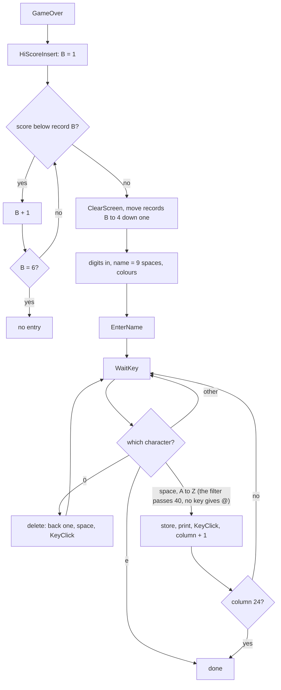

Worked example: the `hiscore` recording ends a game with 009835. HiScoreCompare against record 1 (020000) finds the
second digit lower (0 against 2): below. Records 2 (016000) and 3 (012000) are below in the second digit too. Record
4 is 008000: the first two digits are equal and the third is higher (9 against 8), so the score is not below and
B = 4. One LDIR moves record 4 into record 5, and 004000 is lost. 009835 and nine spaces go into record 4.

The name: the script holds H down for 10 frames from frame 4960. KeyClick takes 534 784 T by the code, 7.65 frames,
with interrupts off (doc 9): measured from its `DI` at frame 4960 T 6990 to its `EI` at frame 4967 T 52 897. WaitKey
does not wait for the key to be released. So when KeyClick returns, H is still down and is typed
again: `HH`. The later A, G, E, N, T are pressed for 3 frames each and typed once each; ENTER ends at frame 6685.
L1 counts 7 KeyClick and 8 WaitKey entries: 7 characters and ENTER. The screen at frame 6500 shows `HHA` in record 4.
The final record 4 is `009835 HHAGENT` (the screenshot [hiscore-entered.png](img/play/hiscore-entered.png) was taken
during the entry, when it read `HH`; [hiscores.png](img/play/hiscores.png) is the default table).

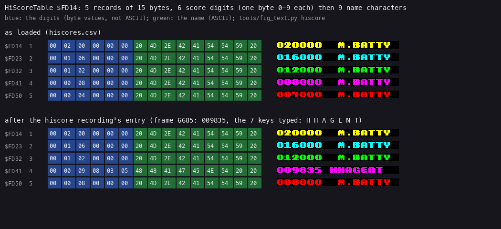

*The 75 bytes of HiScoreTable `$FD14` as loaded (from `src/res/tables`) and after the `hiscore` recording's entry
(the record built from the 7 typed keys and the screens). Command, from the case folder after `. work/env.sh`:
`python3 tools/fig_text.py hiscore --after <the 75 bytes in hex>`.*

How to read the figure:

- **Each row** is a record: its address and number, the six digit bytes (blue, values 0-9, not ASCII) and the nine
  name bytes (green, ASCII).
- **Right**: the record as ShowHiScoreTable prints it, in the colour ColourHiScores gives its row.
- **The point**: the digits are stored as values and printed through PrintDigits; the name is stored as text and
  printed through PrintText. One record holds both kinds.

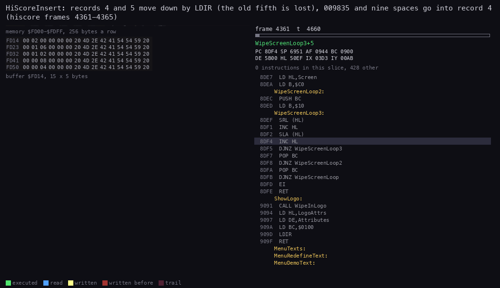

*HiScoreInsert in `hiscore` frames 4361-4365. Command, from the case folder after `. work/env.sh`: `python3
../../kit/routine_anim.py --work work/docs/esD/hiscore --window 4361:0-4365:0 --listing build/game.lst --view
buffer:FD14:15x5:hex --pc 7F7A-7FF2,7F60-7F79,834F-8369,8040-8058 --range FD00-FDFF --pictures 60 --out
docs/img/routines/HiScoreInsert.gif`.*

How to read the animation:

- **Left**: the 75 bytes of HiScoreTable as hex, 15 a row, one row a record; above it the page `$FD00-$FDFF` with
  reads in blue and writes in yellow.
- **Right**: the code of the slice.
- **The point**: record 5's 15 bytes are overwritten by record 4's in one LDIR, then record 4 gets `00 00 09 08 03 05`
  and nine `20`s.

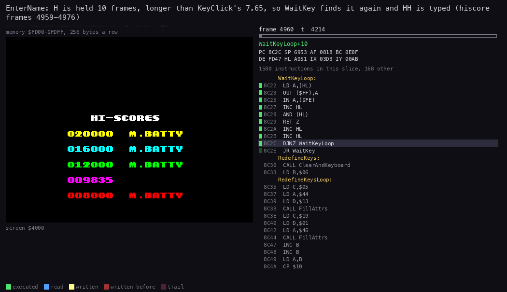

*EnterName in `hiscore` frames 4959-4976. Command, from the case folder after `. work/env.sh`: `python3
../../kit/routine_anim.py --work work/docs/esD/hiscore --window 4959:60000-4976:0 --listing build/game.lst --view
screen --pc 7F00-7F5F,8C1D-8C2F,8E18-8E2C,834F-8369,8040-8058 --range FD00-FDFF --pictures 80 --out
docs/img/routines/EnterName.gif`.*

How to read the animation:

- **Left**: the screen. The first `H` appears after record 4's digits (frame 4960), the click runs, and a second `H`
  follows at frame 4967. No interrupt is taken from frame 4961 to 4975: both clicks run with interrupts off.
- **Right**: the code. WaitKey's scan loop, then PrintText, then KeyClick's delay loop for most of the slices.
- **The point**: there is no key-release wait anywhere in the name entry. The click's length is the only debounce, and
  a key held longer than 7.65 frames repeats.

Witness: HiScoreInsert runs once in `hiscore` (frame 4339) and in `lives`; EnterName from frame 4364 to 6685; the
KeyClick at frame 4960 is in `ev-hiscore-4955-4980.json`. The screens `work/stage1/hiscore/screens/005000.scr` to
`006500.scr` show the name growing.

Two facts are known only from the code. A score equal to a record goes above it, because HiScoreCompare returns
carry clear when all six digits match. And the name cannot hold digits: `0` deletes, `1-9` are refused, so the
defaults' `.` (`$2E`) can never be typed either.

The point: the table is 75 bytes of plain data, compared digit by digit like a string. The name entry is the one
place where the missing key-release wait shows, and the `hiscore` recording caught it.

## 8.12 The menu scroller

When the title tune ends without a key, MenuKeys `$8B29` calls ShowHiScores `$B2E4`. It clears rows 9-21
(ClearHiScoreArea; C runs from 32 down to 0, so each row's 33rd glyph spills into column 0 of the next row: row 15's
into row 8, the top of the third, and row 21's into row 22; those two cells are blanked too), colours and prints the
table, and runs RunScroller `$8AEB`. ShowHiScores keeps RunScroller's flags across its clean-up (`PUSH AF` ... `POP
AF`): a key 1-5 that stops the scroller goes straight to the menu dispatch, and only a scroller that ran out plays
the title tune again ([doc 5](05-controls.md#55-the-menu-keys)). The scroller moves row 23, the copyright line, left one
pixel at a time and feeds in ScrollerText `$6D42`: 433 characters and a 0.

For each character RunScroller does three things. It reads keys 1-5 (port `$F7FE`) and returns if one is down. It
calls ScrollBottomLine `$8AAC` eight times, with a delay loop of 1280 turns after each. Then it prints the next
character at row 23, column 31 with PrintText. ScrollBottomLine is ShiftTimeBar's twin: the same `RL (HL)` chain on
the eight lines of row 23.

The new character is printed at the right edge and only then scrolled in. It does not show at once, because DrawTitle
sets attribute `$5AFF`, the bottom right cell, to 0: black ink on black paper. The character is invisible in column
31 and appears as its pixels move into column 30.

```text
RunScroller:
    HL = ScrollerText
    loop:
        if a key 1-5 is down: return (zero flag clear)
        repeat 8:
            ScrollBottomLine                      ; row 23 one pixel left
            delay 1280 turns of 26 T
        PrintText(row 23, column 31, 1 character, HL)
        HL += 1
        if HL == ScrollerText + 434: return       ; after printing the 0
```

```asm
RunScroller:             ; $8AEB
  LD HL,ScrollerText
RunScrollerLoop:
  LD A,$F7
  OUT ($FF),A            ; a leftover: port $F7FF is not decoded
  IN A,($FE)             ; A = $F7: keys 1-5
  AND $1F
  CP $1F
  RET NZ
  PUSH HL
  LD B,$08
RunScrollerLoop2:
  PUSH BC
  CALL ScrollBottomLine
  LD DE,$0500
RunScrollerLoop3:
  DEC DE                 ; 1280 x 26 T = 33 280 T
  LD A,D
  OR E
  JR NZ,RunScrollerLoop3
  POP BC
  DJNZ RunScrollerLoop2
  POP HL
  PUSH HL
  LD BC,$171F            ; row 23, column 31
  LD D,$01
  CALL PrintText
  POP HL
  INC HL
  LD DE,ScrollerText+434
  SBC HL,DE              ; the carry is clear here
  RET Z
  ADD HL,DE
  JR RunScrollerLoop
```

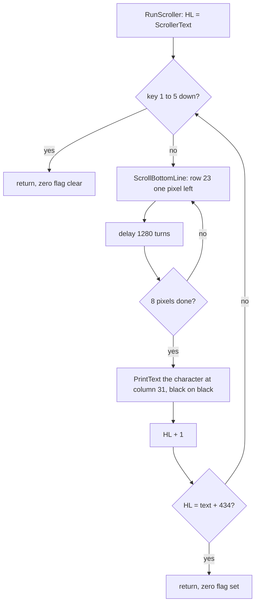

Worked example: one pixel costs ScrollBottomLine (about 8800 T) plus the delay (33 280 T), 42 000 T, 0.6 frames. A
character is 8 pixels and a PrintText: about 340 000 T, 4.9 frames. 434 characters make about 2120 frames. In `menu`
RunScroller runs from frame 3284 to 5478, 2194 frames, with 3472 ScrollBottomLine entries: 434 x 8 (L1). No key was
pressed, so the whole text ran, and the last character printed is the 0. PrintText's loop runs 256 times for it and
prints the 8 bytes at `$C400`, inside CaveData (8.2), in the black cell. The scroller ends before those pixels move.

The screens saved every 250 frames confirm the black cell. From `work/stage1/menu/screens/003500.scr` to `005000.scr`
the attribute at `$5AFF` is 0 while column 31 of row 23 has pixels set.

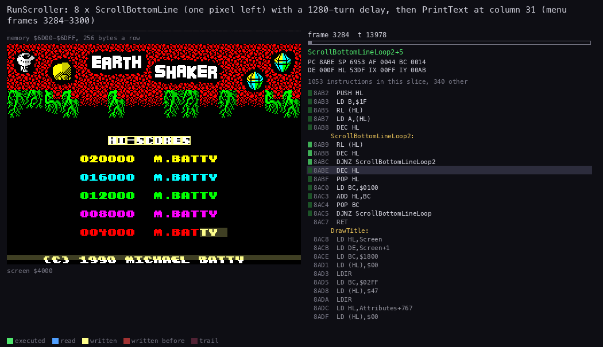

*RunScroller in `menu` frames 3284-3300: the copyright line moves left and the scroller's first characters come in.
Command, from the case folder after `. work/env.sh`: `python3 ../../kit/routine_anim.py --work work/docs/esD/menu
--window 3284:0-3300:0 --listing build/game.lst --view screen --pc 8AEB-8B20,8AAC-8AC6,834F-8369,8040-8058 --range
6D00-6DFF --pictures 80 --out docs/img/routines/RunScroller.gif`.*

How to read the animation:

- **Left**: the whole screen: the logo, the table and row 23. The copyright line slides left.
- **The memory grid** `$6D00-$6DFF`: the text's first bytes, read one at a time.
- **Right**: the code. Most slices are in the delay loop RunScrollerLoop3, not in the scroll.
- **The point**: four fifths of the scroller's time is an empty delay loop. The speed is set by `$0500`, not by the
  frame rate.

The text names the 1990 features (anti-gravity, the 4D teleport, the forcefields, the bubbles, the elixirs, the
jumping jelly beans), the keys G (abort), H (quit) and F (the map), and ends with `(C) 1990 MICHAEL BATTY`
(`src/res/texts/scroller.txt`).

Witness: L1 of `menu`: RunScroller 1 entry (frames 3284-5478), ScrollBottomLine 3472 entries, ShowHiScores frames
3278-5485. DrawTitle's `LD (HL),$00` at `Attributes+767` is in `src/game/hiscore.asm`.

The point: the scroller is timed by a delay loop and hides its seam with one black attribute. That one cell lets a
character be printed whole, instead of drawn a pixel column at a time.

## 8.13 The data sheet of the texts

| Text | Address | Bytes | Printer | Place | Colour |
| --- | --- | ---: | --- | --- | --- |
| ScrollerText | `$6D42` | 434 | RunScroller `$8AEB` | row 23, column 31, scrolled | `$47`, the new cell `$00` |
| CaveNames | `$9700` | 640 | CaveIntro `$92D4` | row 8, centred | the screen's |
| EnterPasswordText | `$9AE8` | 32 | ShowPasswordPrompt `$8DFF` | row 0 | `$43` |
| KeyPrompts | `$A978` | 5 x 19 | RedefineKeys `$8C30` | rows 6, 8, 10, 12, 14, column 5 | `$44` |
| GameOverTexts | `$AA4E` | 9 + 10 + 17 | ShowGameOver `$8B7F` | rows 8, 10, 12 | `$44`, `$45`, `$45` |
| MenuTexts | `$AB00` | 106 | ShowMenuTexts `$8A3C` | rows 11, 13, 19, 23 | ColourMenuTexts `$8A83` |
| MenuDemoText | `$AB27` | 17 | none since 1990 | | |
| WinTexts | `$AB6A` | 196 | ShowWinTexts `$A815` | rows 7-23 | 4, 5, 3, 6 by line |
| Credits | `$AC2E` | 49 | none (1988) | | |
| HudLabels | `$BB00` | 22 | ShowLevelLivesScore `$89A7` | rows 6, 10, 12 | `$46`, `$44`, `$42` |
| HudLine | `$BCE0` | 32 | ShowHudLine `$836A` | row 23 | BarAttrs row 2 |
| ControlTexts | `$EC95` | 48 | ShowControlTexts `$ECC5` | rows 15, 17 | ColourMenuTexts |
| HiScoresTitle | `$8D5D` | 9 | ShowHiScoreTitle `$B294` | row 10, column 11 | `$47` |
| HiScoreTable names | `$FD14` + 6 | 5 x 9 | ShowHiScoreTable `$B26C` | rows 12-20, column 15 | `$46` down to `$42` |

The resource files are in `src/res/texts` (one quoted string a line, `src/res/texts/README.md`). The table defaults
are `src/res/tables/hiscores`.

## 8.14 What is known only from the code

- PrintText's codes below `$20` would read NotePeriods, BarAttrs and HudLine; no text holds one. Code 0 is printed
  once, by the scroller, into a black cell (8.2, 8.12).
- The SYMBOL SHIFT key name prints `$73` from FontUnused; no recording redefines a key to SYMBOL SHIFT (8.2).
- A tie with a high score goes above the old record; digits and `.` cannot be typed in a name (8.11).
- 999 999 points wrap to 000 000 (8.4).
- MenuDemoText and Credits are never printed (8.10).

## 8.15 The point

Every text in Earth Shaker goes through one 25-byte glyph copier, with two front ends: PrintText for ASCII, with an
adding loop that makes a `Z` cost more than an `A`, and PrintDigits for the decimal strings the game counts in. There
is no number conversion anywhere, and no time variable: the score is counted in decimal one point at a time, and the
time is the bar's pixels on the screen. The panel is printed once as a template and patched where a value changes,
so it costs nothing when nothing happens. The 1990 edits show everywhere as NOPs and replaced calls, with the 1988
texts left in place.
