# 9. Sound

What this covers:

- the sound hardware as the game uses it: one bit, no interrupt-driven sound (9.1);
- the ROM's BEEPER as a T-state model, the engine of most effects (9.2);
- the music player PlayTune `$88CE`: the note format, the two voices on one bit, the drums (9.3);
- the note periods and the tuning (9.4);
- the 13 tunes, the tune of each cave, and what plays when (9.5);
- the interrupts: what the sound does to the frame (9.6);
- the effects, decoded and drawn: the noise loops (9.7), the BEEPER effects (9.8), the own square-wave loops (9.9);
- the table of every sound with its trigger, cost, interrupt state and witness (9.10);
- the WAV renders (9.11), what is known only from the code (9.12) and the point (9.13).

The names are those of `src/game/game.ann` ([Terms](README.md#terms)). The recordings are those of
[WALKTHROUGH 6.0](../WALKTHROUGH.md#60-the-recordings), all on the 48K. Each was opened from its TTD session on the
writer's own instance (port base 37180, muted; no sound was played):

- `rzx-earth01` (`work/stage1/rzx01`): someone else's play of cave 1, replayed from the RZX archive. The cave tune at
  frames 405-691, the timer click (803), the dig (775), the first gem (814), a jelly bean (1524), a fall (1578), a
  thud (1839), the exit opening (3366) and the time bonus (3668-3713).
- `rzx-earth02`: the switch (387) and a bubble burst (2447). `rzx-earth03`: the anti-gravity arrow (543) and its
  ticks. `rzx-earth04`: a teleport (1175 out, 1226 in).
- `death-crush` (stage 2, `work/stage2/death-crush`): a boulder kills the player, the death sound at frame 30.
- `timer`: the map tune (251-738) and the time running out (6040).
- `hiscore`: the key clicks of the name entry (4960, 4967) and the game-over tune (6708-6837).
- `menu`, `c1`, `rzx-earth09`, `rzx-earth32`: the title tune, the redefine rasp, the extra-life tune (6352) and the
  win tune (20677), from their L1 lists.

Every speaker write, every entry of a sound routine and every interrupt of a window were taken from access traces,
25 or 50 frames at a time (`tools/sound_events.py`, JSON in `work/docs/esD/ev-<recording>-<frames>.json`). The tunes
are also computed from their bytes by a T-state model of PlayTune and the ROM's BEEPER (`tools/tune_model.py`), which
was checked against the trace write by write (9.3). The figures and the WAVs are made by `tools/fig_sound.py`.

A frame is 69 888 T, 20 ms. A moment is written "frame F T t". A trace puts an instruction in the frame in which it
ran; an interrupt "lost" is a frame whose interrupt pulse came while interrupts were disabled.

```bash
. work/env.sh
python3 ../../kit/rs.py open --work work/docs/esD/rzx01 --ttd work/stage1/rzx01/session.ttd --model 48K --port-base 37180
sh work/docs/esD/run_events.sh rzx01 400-700 770-780 812-818 1524-1570 1575-1582 1836-1842 3366-3410 3660-3740
python3 ../../kit/rs.py stop --work work/docs/esD/rzx01
python3 tools/tune_model.py check work/docs/esD/ev-rzx01-400-700.json CaveTune1    # the model against the trace
python3 tools/tune_model.py table                                                  # every tune's length
python3 tools/fig_sound.py all                                                     # every figure and WAV
```

## 9.1 One bit, no interrupt sound

The 48K's sound is bit 4 of port `$FE`: the speaker is high or low. The game writes it in three ways:

- the ROM's BEEPER `$03B5` (HL the period, DE the cycles), for the drums, the gem, the death, the rasp and most
  effects (9.2, 9.8);
- its own loops of `OUT ($FE),A`, for the tunes (PlayTune, 9.3) and some effects (9.7, 9.9);
- noise loops that send ROM bytes `AND $18` to the port (9.7).

The values written are `$00`, `$08`, `$10` and `$18`. PlayTune writes `$10` and `$00` (bit 4 alone); BEEPER writes
`$18` and `$08` (the MIC bit 3 set throughout, bit 4 toggling); the game's own effect loops write `$18` and `$00`; the
noise loops write any of the four (ROM bytes `AND $18`). The border bits 0-2 are always 0: the border stays black
(all `OUT ($FE)` of the traces in `work/docs/es*/ev-*.json`). There is no sound on the interrupt: the ROM's IM 1 handler only counts frames and reads the keyboard. So a
sound is always a busy loop in the main program, and nothing else runs while it plays. Most of these loops disable
interrupts, so the frame interrupts that fall inside them are lost (9.6).

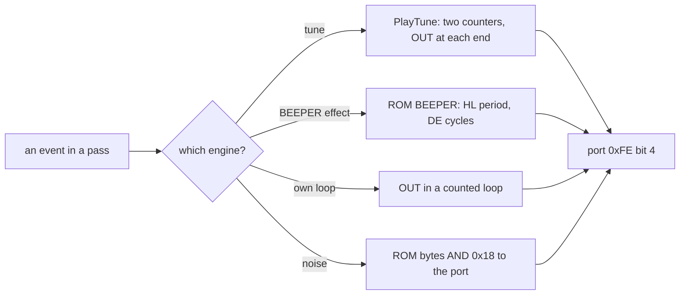

Witness: every speaker write in the event files comes from one of four places: PlayTune (`$893B`-`$894E`), the ROM
(`$03E1`, BEEPER's `OUT`), the game's effect loops and DigNoiseLoop `$854E`.

The point: the sound costs CPU time and nothing else. Every note is a stretch of a pass in which the game does
nothing but count.

## 9.2 The ROM's BEEPER as a T-state model

BEEPER `$03B5` makes DE + 1 cycles of a square wave. Each half period is a delay loop set by HL. It disables
interrupts at its start and enables them at its end (`EI` before the `RET`). The game calls it with the border black,
so it writes `$18` and `$08` alternately, starting high.

From the ROM's code (`tools/tune_model.py` `beeper()`), one half period in T-states is:

```text
half(H, L) = branch + 4 x (L AND 3) + 8 + (16 x c - 5) + 21 + 1024 x H + 18
    branch = 44 after a high write, 60 after a low write
    c      = (L >> 2) + 2 after a high write, (L >> 2) + 1 after a low write
writes = 2 x (DE + 1); the first write is high; then EI and RET
```

```asm
; ROM $03D1-$03F6, the part of BEEPER that loops (the ROM's listing)
BE_IX_3:  NOP                ; entered at IX + 0..3: the L AND 3 NOPs
          INC B
          INC C
BE_H_L_LP: DEC C             ; the inner loop: 16 T a turn
          JR NZ,BE_H_L_LP
          LD C,$3F
          DEC B              ; the outer loop: H + 1 turns
          JP NZ,BE_H_L_LP
          XOR $10            ; the speaker bit flips
          OUT ($FE),A
          LD B,H
          LD C,A
          BIT 4,A
          JR NZ,BE_AGAIN     ; after a high write
          LD A,D
          OR E
          JR Z,BE_END        ; DE = 0: done
          LD A,C
          LD C,L
          DEC DE
          JP (IX)
```

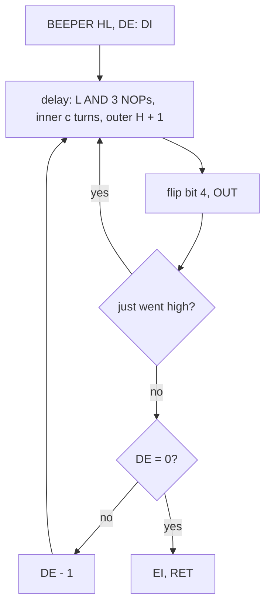

Worked example: drum 1 of PlayTune calls BEEPER with HL = `$020B`, DE = 3. L = `$0B`: three NOPs, c = 2 + 2 = 4 after
a high write. H = 2 adds 2048 T. The high half is 44 + 12 + 8 + 59 + 21 + 2048 + 18 = 2210 T, which the trace shows
between the ROM's writes at `$03E1`. That is 792 Hz, for 8 writes, about 18 000 T. The click of the timer, HL = 0,
DE = 0, is one cycle of 118 T: two writes and no audible tone.

Witness: the model's write intervals match the trace of `rzx-earth01`'s cave tune, drums included (9.3).

The point: BEEPER turns two numbers into a tone. The game uses it as a function from (pitch, length) to sound and
gets its effects by calling it in loops with changing arguments.

## 9.3 PlayTune: two voices on one bit

PlayTune `$88CE` plays a tune of 4-byte notes `DRUM N1 N2 LENGTH`. The end record is a DRUM byte and `N1` = `$FF`.

For each note, PlayTune:

1. plays a drum if DRUM is 1 (BEEPER HL = `$020B`, DE = 3) or 2 (HL = `$0106`, DE = 5);
2. reads keys 1-5 (port `$F7FE`) and returns if one is down, so a key stops a tune at the end of a note;
3. loads two periods from NotePeriods `$BC00`: P1 for N1 into DE and IX (minus 1), P2 for N2 into BC and IY;
4. runs ToneLoop LENGTH x 256 times. Each turn counts DE and BC down. When DE reaches 0, voice 1 writes 0 then `$10`
   (an 18 T dip, the speaker ends high) and DE reloads from IX. When BC reaches 0, voice 2 writes `$10` then 0 (a
   15 T spike, the speaker ends low) and BC reloads from IY.

So voice 1 sets the speaker high and voice 2 sets it low. The output is a square wave of variable duty: its edges are
the two voices' events, and the time it stays high is the phase between them.

```text
PlayTune(HL):
    DI
    loop:
        drum = (HL); HL += 1
        if drum == 1: BEEPER($020B, 3); DI
        if drum == 2: BEEPER($0106, 5); DI
        if a key 1-5 is down or (HL) == $FF: EI; return
        P1 = NotePeriods[N1]; P2 = NotePeriods[N2]
        DE = P1; IX = P1 - 1; BC = P2; IY = P2
        repeat LENGTH x 256 (0 means 65 536):
            DE -= 1; if DE == 0: OUT 0; OUT $10; DE = IX        ; voice 1: speaker high
            BC -= 1; if BC == 0: OUT $10; OUT 0; BC = IY        ; voice 2: speaker low
        HL += 3
```

```asm
ToneLoop:                ; 78 T a turn when neither voice fires
  DEC DE
  LD A,D
  OR E
  JR NZ,PlayTuneSkip5
  XOR A
  OUT ($FE),A            ; $893B: low ...
  LD A,$10
  OUT ($FE),A            ; ... then high: voice 1 leaves it high
  PUSH IX
  POP DE                 ; reload P1 - 1
PlayTuneSkip5:
  DEC BC
  LD A,B
  OR C
  JR NZ,PlayTuneSkip6
  LD A,$10
  OUT ($FE),A            ; $894B: high ...
  XOR A
  OUT ($FE),A            ; ... then low: voice 2 leaves it low
  PUSH IY
  POP BC                 ; reload P2
PlayTuneSkip6:
  DEC HL
  LD A,H
  OR L
  JR NZ,ToneLoop
```

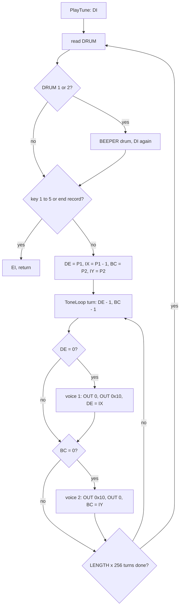

A turn costs 78 T, and a voice that fires adds 53 T. So a note lasts about LENGTH x 256 x 78 T, plus 53 T a voice
event, plus its drum.

Worked example: CaveTune1's first note is `1 24 29 30`. The drum is BEEPER `$020B`, 3: 8 writes, about 18 000 T.
Voice 1 plays note 24 (period 256, so every 255 turns: 176 Hz), voice 2 note 29 (period 192: 234 Hz). LENGTH 30 is
7680 turns: 599 040 T, plus 30 voice-1 and 40 voice-2 events at 53 T each. The trace measures the note at 603 425 T,
8.6 frames. The second note `0 24 29 30` has no drum (frame 413 T 68 499 on).

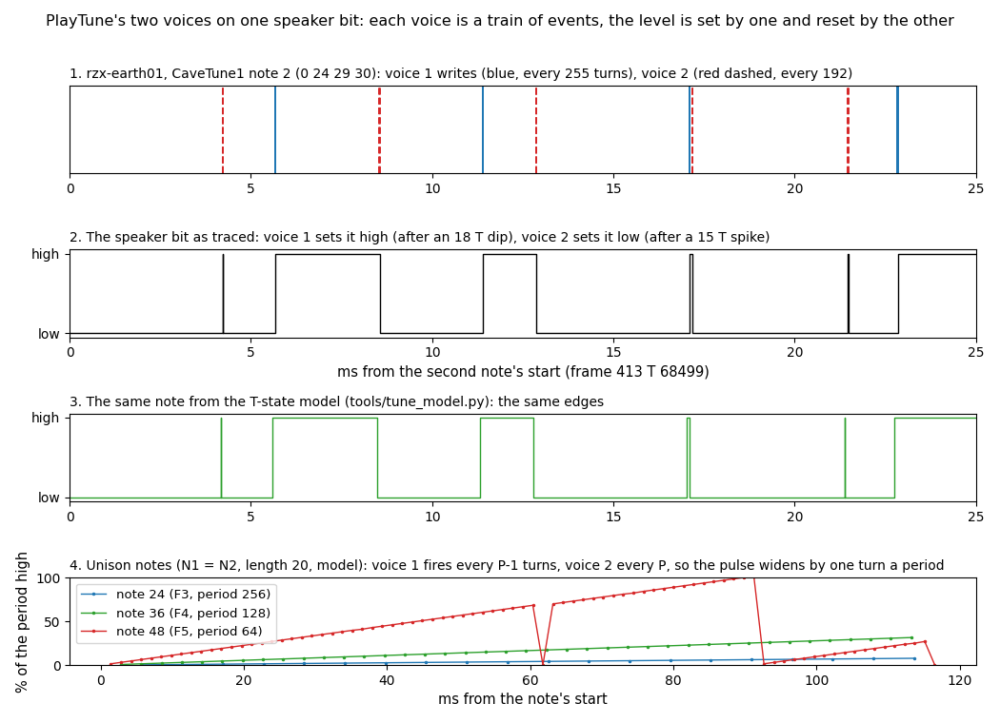

*`rzx-earth01` frame 413, CaveTune1's second note, traced and modelled, and three unison notes from the model.
Command, from the case folder after `. work/env.sh`: `python3 tools/fig_sound.py mix`.*

How to read the figure:

- **Panel 1**: the moments of the writes, voice 1 (blue) every 255 turns and voice 2 (red dashed) every 192 turns.
- **Panel 2**: the speaker bit as traced. Each blue event turns it high, each red event turns it low. The thin spikes
  are the 18 T and 15 T of each voice's two writes.
- **Panel 3**: the same note from the model, edge for edge.
- **Panel 4**: unison notes (N1 = N2). Voice 1 fires every P - 1 turns and voice 2 every P, so the gap between "high"
  and "low" grows by one turn each period. The pulse widens from almost nothing: 78 T a period.
- **The point**: two independent counters and one bit make a two-note sound. The detune of voice 1 (`DEC IX`) makes a
  unison note sweep its pulse width instead of staying a thin click train.

The unison case matters: 439 of the 969 notes of the 13 tunes have N1 = N2. A low unison note (period 256) widens by
only 78 T a period of 20 000 T, so it stays a thin, quiet buzz. A high one (period 64) sweeps through all widths in
about 64 periods, 60 ms, which sounds like a phaser. Without the `DEC IX`, both voices would fire in the same turn
forever, and the speaker would only blip for 30 T each period.

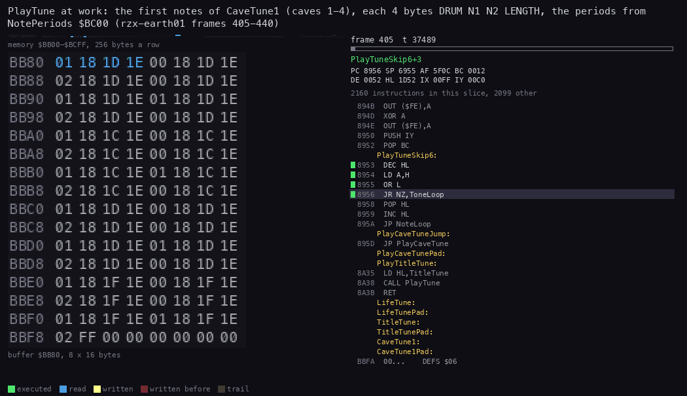

*PlayTune in `rzx-earth01` frames 405-440, the first notes of CaveTune1. Command, from the case folder after `.
work/env.sh`: `python3 ../../kit/routine_anim.py --work work/docs/esD/rzx01 --window 405:7000-440:0 --listing
build/game.lst --view buffer:BB80:8x16:hex --pc 88CE-895C,EE34-EE4E --range BB00-BCFF --pictures 80 --out
docs/img/routines/PlayTune.gif`.*

How to read the animation:

- **Left**: CaveTune1's bytes at `$BB80`, 8 a row, two notes a row. The note being read lights up (blue) as PlayTune
  steps through `DRUM N1 N2 LENGTH`; the page above shows NotePeriods `$BC00` read for each note.
- **Right**: the code and the registers. Almost every slice is ToneLoop's eight instructions; DE and BC count down.
- **The point**: the player reads 4 bytes and two periods per note, then spends 8 frames in a 17-byte loop.

The model against the trace (`python3 tools/tune_model.py check work/docs/esD/ev-rzx01-400-700.json CaveTune1`):
4392 speaker writes in both, the values equal in all 4392, 2953 intervals exact and the others at most 74 T longer in
the trace. The total is 14 754 T more over 18.4 million, 0.08 %. The difference is the ULA's I/O contention on
`OUT ($FE)` (a voice-2 pair measures 21 T against 15 T when the beam is in the screen area). So the model gives every
tune's length and waveform without an emulator.

Witness: PlayTune runs in every recording that reaches a cave, the menu or the end of a game (L1). The checked trace
is `ev-rzx01-400-700.json`.

The point: the music engine is 17 bytes of loop and two counters. Its whole character, the detuned unisons included,
comes from where it puts its two `OUT` pairs.

## 9.4 The note periods

NotePeriods `$BC00` holds 73 big-endian 16-bit periods, `src/res/music/periods.txt`. Period N is close to
`1024 x 2^(-N/12)`: semitones from 1024 (note 0) down to 16 (note 72). A ToneLoop turn is 78 T, so note N sounds at
`3 500 000 / (78 x period)` Hz:

| Note | Period | Hz | Name |
| ---: | ---: | ---: | --- |
| 0 | 1024 | 43.8 | F1 |
| 12 | 512 | 87.6 | F2 |
| 24 | 256 | 175.3 | F3 |
| 36 | 128 | 350.6 | F4 |
| 48 | 64 | 701.1 | F5 |
| 72 | 16 | 2804.5 | F7 |

The tunes use notes 12-49 only (36 different notes). The periods are integers, so the high notes are out of tune: up
to 30 cents at note 62. In the range the tunes use, the error stays within 14 cents. Voice 1's `P - 1` makes it a
little sharp: 3 cents at note 12, 27 cents at note 48.

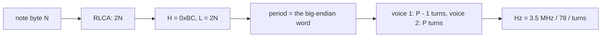

Worked example: note 29, CaveTune1's voice 2. `RLCA` gives `$3A`, so the period is the word at `$BC3A`: `$00C0` = 192.
3 500 000 / (78 x 192) = 233.7 Hz, an A#3 (equal temperament gives 233.1 Hz).

Witness: PlayNote reads `$BC30` and `$BC3A` for the note `24 29` (the PlayTune animation's memory grid, 9.3).

The point: the table is one octave per 12 entries by construction, so the tunes are written in plain semitone
numbers. The 78 T turn sets the scale's root at F.

## 9.5 The tunes and when they play

Thirteen tunes, all in `src/res/music` as text (one note a line), all played by PlayTune with interrupts off. The
lengths come from the model (`tools/tune_model.py table`) and match the traced durations where a recording plays the
whole tune.

| Tune | Address | Notes | Frames | Seconds | Played by | When | Witness |
| --- | --- | ---: | ---: | ---: | --- | --- | --- |
| TitleTune | `$AD00` | 346 | 3718 | 74.2 | PlayTitleTune `$8A35` | the menu, until a key or the end | `menu` 3278 |
| CaveTune1 | `$BB80` | 30 | 263 | 5.3 | PlayCaveTune `$EE34` | caves 1-4, under the intro | `rzx-earth01` 405 |
| CaveTune2 | `$F100` | 20 | 186 | 3.7 | the same | caves 5-8 | L1 of the RZX replays |
| CaveTune3 | `$F1D0` | 16 | 213 | 4.3 | the same | caves 9-12 | the same |
| CaveTune4 | `$F212` | 33 | 329 | 6.6 | the same | caves 13-16 | the same |
| CaveTune5 | `$F302` | 37 | 168 | 3.4 | the same | caves 17-20 | the same |
| CaveTune6 | `$F398` | 65 | 402 | 8.0 | the same | caves 21-24 | the same |
| CaveTune7 | `$F298` | 26 | 254 | 5.1 | the same | caves 25-28 | the same |
| CaveTune8 | `$F152` | 31 | 261 | 5.2 | the same | caves 29-32 | the same |
| MapTune | `$E8E8` | 49 | 487 | 9.7 | PlayMapTune `$E8E1` | the map screen (F) | `timer` 251-738 |
| LifeTune | `$AC5F` | 39 | 45 | 0.9 | PotionTune `$91C1` | a potion: an extra life | `rzx-earth09` 6352-6397 |
| GameOverTune | `$AA00` | 19 | 129 | 2.6 | PlayGameOverTune `$8B78` | the game-over screen | `hiscore` 6708-6837 |
| WinTune | `$6EF4` | 258 | 2247 | 44.9 | PlayWinTune `$A615` | after cave 32 | `rzx-earth32` 20677 (to its end, note 27) |

PlayCaveTune picks the tune from CaveTunes `$EE24`, a table of 8 words: `(CaveNumber - 1) AND $FC`, rotated right, is
the offset of word `(CaveNumber - 1) / 4`.

```asm
PlayCaveTune:            ; $EE34
  LD A,(CaveNumber)
  DEC A
  AND $FC
  RRCA                   ; 2 x ((CaveNumber - 1) / 4)
  ADD A,CaveTunes&255
  LD E,A
  LD D,CaveTunes/256
  LD A,(DE)
  LD L,A
  INC DE
  LD A,(DE)
  LD H,A
  CALL PlayTune
  RET
```

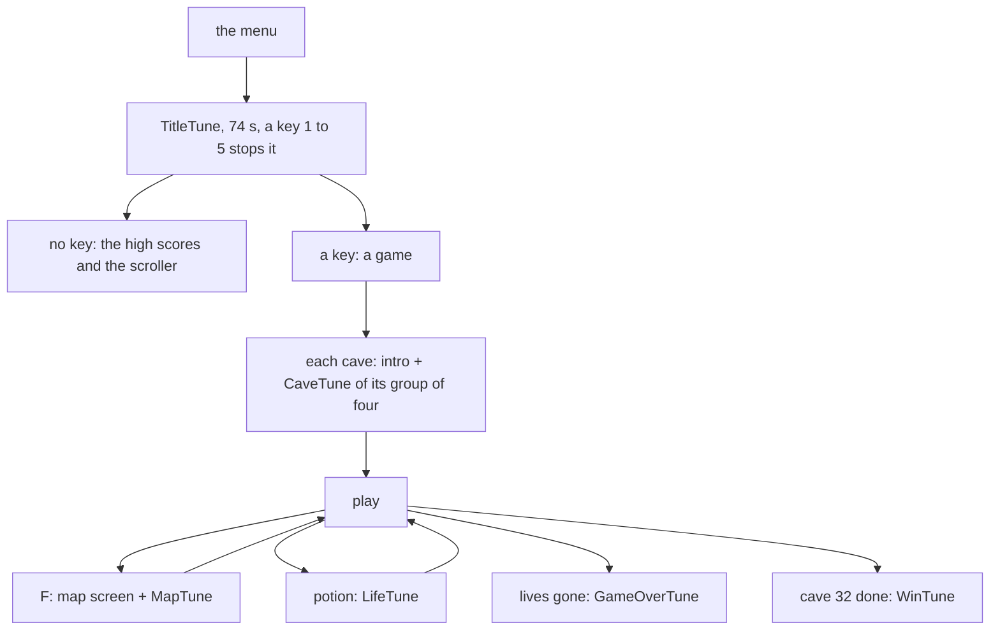

Worked example: cave 10. `10 - 1` = 9, `AND $FC` = 8, `RRCA` = 4: the third word of CaveTunes, CaveTune3. Its 16
notes take 213 frames, 4.3 s, during which the cave intro stays on the screen and nothing moves. The MenuKeys check
`TitleTune+$0569` (the `$FF` byte of the title tune's end record at `$B268`, where PlayTune leaves HL) tells "the
tune ended" from "a key stopped it" by the HL PlayTune returns ([doc 8](08-hud-and-text.md#812-the-menu-scroller)).

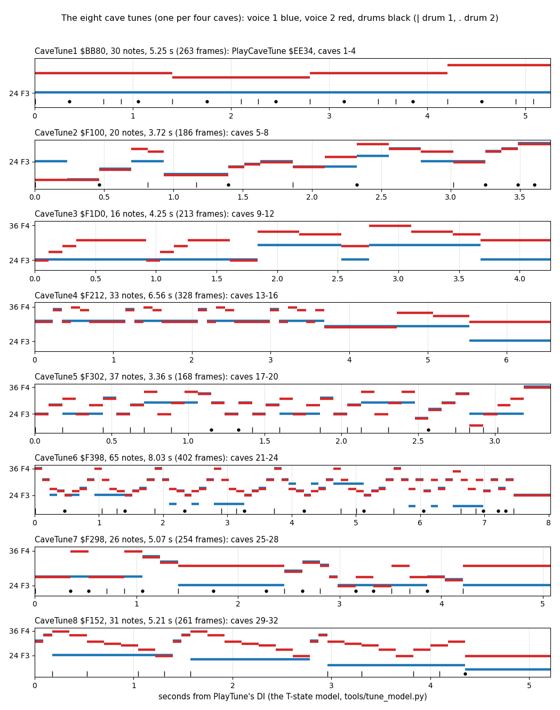

*The eight cave tunes from `src/res/music`, timed by the T-state model. Command, from the case folder after `.
work/env.sh`: `python3 tools/fig_sound.py tunes`.*

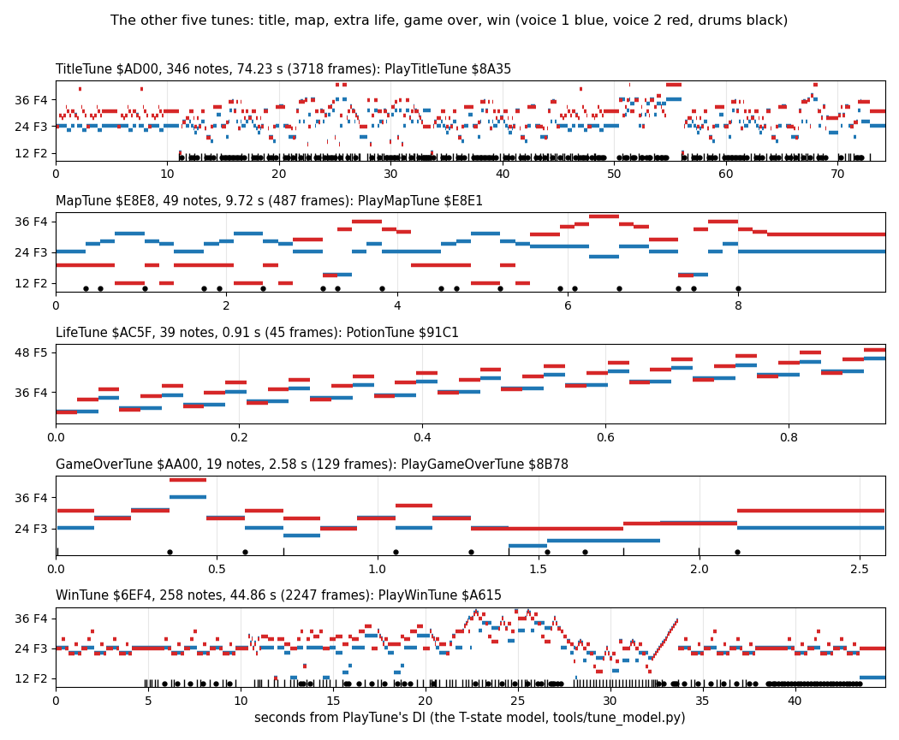

*TitleTune, MapTune, LifeTune, GameOverTune and WinTune, from the same command.*

How to read the figures:

- **Each strip** is a tune: time in seconds from PlayTune's `DI`, note numbers up (labelled with their names). The
  title gives the address, the notes and the length.
- **Blue** is voice 1, **red** voice 2, drawn a little apart so a unison shows as a double line. **Black marks** under
  the notes are drums: `|` drum 1, `.` drum 2.
- **The point**: the cave tunes are short phrases, 3-8 s, mostly a melody over a held or unison bass. CaveTune1 is a
  single pedal note in voice 1 with the melody in voice 2. The title and win tunes are long pieces with drums on most
  beats.

Witness: the durations measured in L1 match the model: the map tune 251-738 (487 frames, model 486.6), the game-over
tune 6708-6837 (129, model 129.1), the life tune 6352-6397 (45, model 45.3).

The point: every tune stops the game. The cave tune is a forced 3-8 s pause at each cave start; the title tune is the
menu's timer.

## 9.6 What the sound does to the interrupts

PlayTune runs with interrupts off from its `DI` to its `EI`. Each drum calls BEEPER, whose `EI` opens a window of 14 T
(the `RET`, then PlayTune's `DI`) before interrupts are off again. A frame interrupt is a 32 T pulse at the frame's
start. It is taken only if it overlaps that window. During `rzx-earth01`'s cave tune, none did.

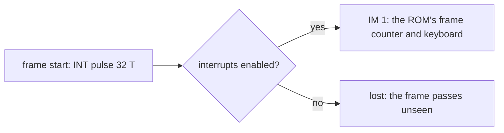

Worked example: `rzx-earth01` frames 400-700. The cave tune runs from 405 T 7680 (PlayTune's `DI`) into frame 691:
the 285 interrupts of frames 406-690 are all lost. Only 11 of the 300 frames take theirs (404 and 405 before the tune,
691-699 after); 400-403 take none either (the event file has a `DI` at 403 T 35 236; what keeps 400-402 off is not
traced). 285 + 4 + 11 = 300 (`ev-rzx01-400-700.json`, `irq` and `di`). Over its 3803 frames, `rzx-earth01` takes 2898
interrupts (WALKTHROUGH 1): the 905 lost are the tunes, the effects and the screen wipes.

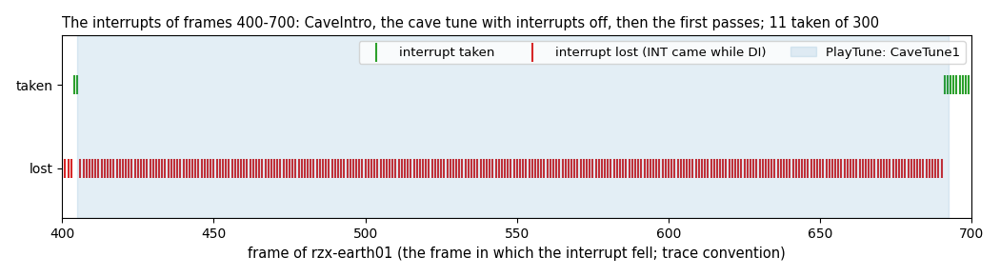

*`rzx-earth01` frames 400-700, from `ev-rzx01-400-700.json`. Command, from the case folder after `. work/env.sh`:
`python3 tools/fig_sound.py irq`.*

How to read the figure:

- **Green marks** (top row) are frames whose interrupt was taken, **red marks** (bottom row) frames whose interrupt
  was lost. The marks are in the frame in which the pulse fell.
- **The blue band** is PlayTune.
- **The point**: during a tune the machine has no frames. Anything that counts interrupts, like the ROM's FRAMES,
  stops.

The effects do the same for their length (9.10). The game never relies on interrupts for its timing, so nothing
breaks: a pass is as long as its work, the sound included ([doc 4](04-game-loop.md)).

Witness: `ev-rzx01-400-700.json` (the `irq` list); the per-effect counts of 9.10 come from the other event files.

The point: the sound is the clock. While a sound plays, the game, the frame counter and the keyboard scan all wait.

## 9.7 The noise loops: dig, fall, thud, dig in place

Four effects use bytes of the ROM as random numbers.

**The dig** (DigNoise `$8548`, from DigNoiseIfDug `$E860` when the player dug earth): the bytes `$00FF` down to
`$0001`, each `AND $18`, go straight to port `$FE`. 255 writes, 55-58 T apart: 4.1 ms of white noise. It does not
disable interrupts. DigNoise is the two bytes `$21 $FF` (`LD HL,$00FF`) whose `$00` second half is the loop's `NOP`
at `$854A`: the entry and the loop share a byte.

**The fall** (FallSound `$E7A9`) and **the thud** (NoiseThud `$E77C`, three NoiseBurst `$E740` calls) use one engine.
For each step (10 for the fall, 64 per burst), a ROM byte `AND $3F` (with 7 set when it is not below D) minus D gives
the low time E; the high time is D. The pair repeats inside a fixed budget of turns (BC). The thud's three bursts use
D = 6, 4, 2 (NoiseThud patches NoiseBurstPitch), so each burst is higher than the last. PassSound `$E83A` picks one of
the two each pass: the thud if a boulder landed or was pushed, else the fall if an object fell.

**The dig in place** (DigInPlace `$E7FE`, fire with a direction on earth, doc 05 5.7) is the same engine four times:
it patches NoiseBurstPitch with 1, 2, 4 and 10 and calls NoiseBurst after each patch. Each burst reads the same 64
ROM bytes `$0140` down to `$0101`, so the four differ only in D: D = 1 makes clicks 42 T high, D = 10 a slower,
wider pulse train. 469 writes in 170 538 T, 48.7 ms, 2.44 frames, the longest of the three NoiseBurst sounds.

```text
DigNoise:   for HL = $00FF down to 1: OUT ($FE), ROM[HL] AND $18                ; interrupts stay on
NoiseBurst(D):                                                                    ; DI ... EI
    HL = $0140; OUT 0
    for each step (L down to 0):
        BC = $1001                                       ; the step's budget of turns
        repeat until BC runs out:
            E = (ROM[HL] AND $3F, OR 7 if not below D) - D
            wait E turns (or until the budget ends); OUT $18
            wait D turns; OUT 0
NoiseThud: for D = 6, 4, 2: NoiseBurst(D)
DigInPlace: for D = 1, 2, 4, 10: NoiseBurst(D)                                    ; $E7FE
```

```asm
DigNoiseLoop:            ; $854A
  NOP
  LD A,(HL)              ; a ROM byte
  AND $18                ; bits 3 and 4: MIC and speaker
  OUT ($FE),A
  DEC HL
  LD A,H
  OR L
  JR NZ,DigNoiseLoop
  RET
```

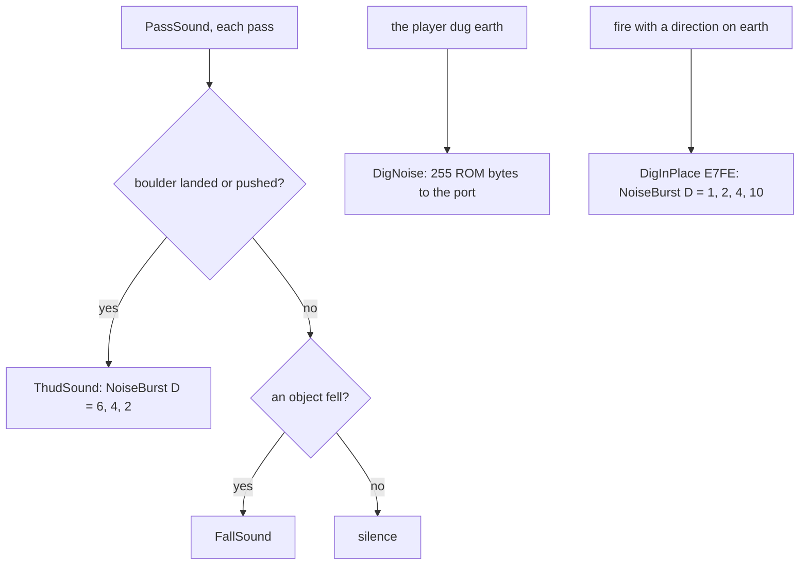

Worked example: the dig at `rzx-earth01` frame 775 T 20 092: 255 writes in 14 218 T. The intervals are 55, 56 or
58 T (the figure 9.10), the loop's 56 T plus contention. The values are the ROM's first 255 bytes reversed, so every
dig sounds exactly the same.

Worked example: the dig in place, D = 1, the first three steps (the model's writes).

1. The ROM byte at `$0140` is `$52`: `AND $3F` gives `$12`, not below D, so `OR 7` makes `$17` and E = 22. That is
   more than the step's budget of 16 DJNZ turns, so the step ends with no write.
2. The byte at `$013F` is `$45`: E = 6. The speaker goes high after 6 turns (T 815) and low after D = 1 turn (T 857),
   a pulse of 42 T. The same byte gives the same E again, so pulses follow 268 T apart (T 1083, 1351) until the 16
   turns are used: three pulses.
3. The byte at `$013E` is `$4D`: E = 14, one pulse before the budget ends.

Every high time of the D = 1 burst is 42 T; only the gaps vary with the ROM bytes, and a byte that gives E above 16
is a silent step. A larger D lengthens each pulse and leaves room for fewer: 161, 137, 125 and 46 writes for D = 1, 2,
4, 10.

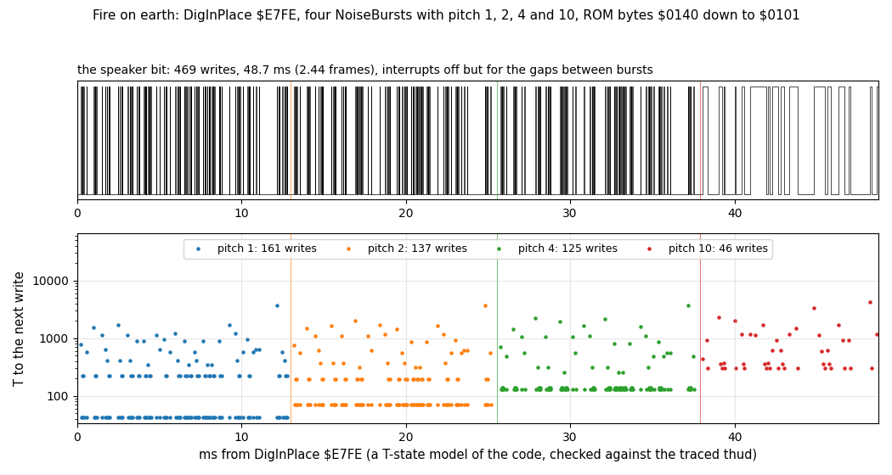

*DigInPlace from a T-state model of NoiseBurst (`tools/fig_sound.py` `noise_burst()`), checked against the traced
thud of `rzx-earth01` frame 1839: the same writes and values for D = 6, 4 and 2, and every interval exact or within
6 T of contention. Command, from the case folder after `. work/env.sh`: `python3 tools/fig_sound.py dig`. How to
read: top, the speaker bit over the 48.7 ms; bottom, the time to the next write, one colour a burst; the vertical
lines are the four calls. The point: one routine with one patched byte makes the thud and the dig in place.*

Witness: dig `rzx-earth01` 775 (and `c1` 13160); fall `rzx-earth01` 1578; thud `rzx-earth01` 1839 (stage 2 NOTES
3.9, traced here: `ev-rzx01-770-780.json`, `-1575-1582`, `-1836-1842`). DigInPlace runs 167 times in the RZX replays
(L1, 16 recordings), 84 of them in `rzx-earth24` (first at frame 434); its L1 cost is 171 088 T a call on average, the
model's 170 538 T plus contention. Its sound was not traced: the waveform and the WAV are the model's.

The point: the ROM is the noise table. Reading it costs nothing and gives the same "random" sound every time.

## 9.8 The BEEPER effects

Most effects are BEEPER called in a loop:

| Effect | Routine | The loop | Writes |
| --- | --- | --- | ---: |
| gem | GemSound `$82F9` | HL = `$0200`, DE = 5; `$0100`, 10; `$0080`, 20: three rising tones | 76 |
| jelly bean | JellyBean `$91F7` | 32 pairs: HL = `$80` + B and `$80` + 32 - B, DE = 20, then TimeRefill | 2688 |
| death | DeathSound `$862E` | L = 0, 255 ... 1: HL = ROM[L], DE = (L / 4) AND 15 | 4352 |
| rasp | RaspSound `$90A0` | L = 0, 255 ... 1: HL = ROM[L], DE = 1 | 1024 |
| anti-gravity | AntiGravSound `$8156` | C = `$A0` down by 8: L = C + `$3C` down to C + 1, DE = 2 | 7200 |
| anti-gravity tick | AntiGravPass `$A7CD` | each pass: HL = 2 x steps, DE = 10 | 22 |
| time bonus | BonusTick `$871C` | each pixel: HL = D (0, 255, 254 ...), DE = 1 | 4 a pixel |
| timer click | TimerStep `$86DE` | every fourth pass: HL = 0, DE = 0 | 2 |
| fizz | FizzSound `$A773` | each pass while FizzCount runs down from 7: HL = 16 x count, DE = 20 | 42 a pass |

```text
DeathSound:                           RaspSound:
    for L = 0, 255, ..., 1:               for L = 0, 255, ..., 1:
        BEEPER(ROM[L], (L / 4) AND 15)        BEEPER(ROM[L], 1)
AntiGravSound:
    for C = $A0 down to 8 step 8:
        for L = C + $3C down to C + 1: BEEPER(L, 2)          ; a falling sweep, 20 times, each higher
```

```asm
DeathLoop:               ; $8630, entered through the $00 of LD HL,$0000 at $862E
  NOP
  LD A,L
  RRCA
  RRCA
  AND $0F
  LD E,A
  LD D,$00               ; DE = (L / 4) AND 15
  PUSH HL
  LD L,(HL)              ; HL = the ROM byte at $00LL: the period
  CALL RomBeeper
  POP HL
  DEC L
  JR NZ,DeathLoop
  RET
```

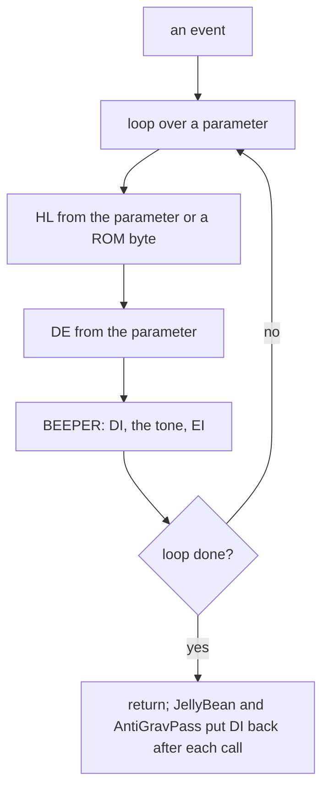

Worked example: the gem at `rzx-earth01` frame 814. BEEPER `$0200`, 5: a high half of 2166 T, 12 writes (808 Hz).
BEEPER `$0100`, 10: 22 writes at about 1500 Hz. BEEPER `$0080`, 20: L = `$80`, c = 34, a half of about 630 T, 42
writes at 2.8 kHz. 76 writes in 74 369 T, 21 ms: three rising blips. The figure shows the three steps at 2000, 1100
and 620 T.

The time bonus has a quirk: BonusTick ends with three `DEC D`, but TimeBonus pushed DE before the call and pops it
after, so they are lost. D falls by 1 per pixel (TimeBonus's own `DEC D`), and the tick's period runs 0, 255, 254, ...:
the traced HL values are exactly that. TimeBonus's `DI` at its start is undone by the first BEEPER's `EI`: 41 of the
45 interrupts during the bonus are taken ([doc 8](08-hud-and-text.md#88-the-time-bar-the-timer-the-refill-and-the-time-bonus)).

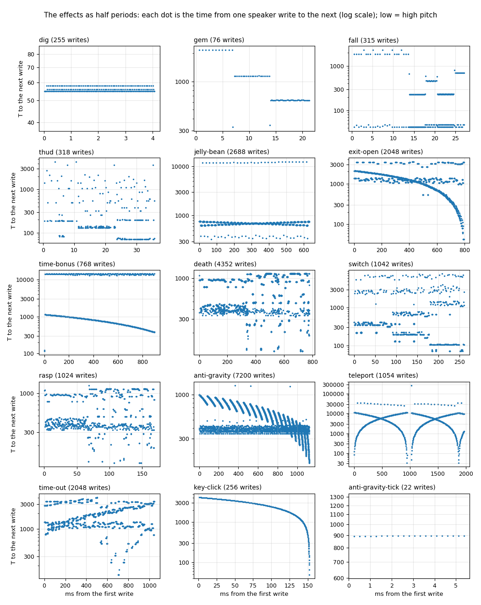

*The time between successive speaker writes of one call of each effect, traced. Command, from the case folder after
`. work/env.sh`: `python3 tools/fig_sound.py pitch`.*

How to read the figure:

- **Each panel** is one effect; each dot is one interval, at the moment of the write, on a log scale: low dots are
  high notes.
- **Steps** are BEEPER calls with fixed arguments (gem, tick); **curves** are swept arguments (time bonus, the
  anti-gravity's 20 sweeps, the key click); **clouds** are ROM bytes (death, rasp, dig).
- **Two lines** in one call are the two halves of an asymmetric wave (BEEPER's high and low halves differ by 16-20 T;
  the exit's random low half against its falling high half).
- **The point**: the shape of each sound is visible in its intervals: the sweeps rise or fall, the ROM-byte sounds
  scatter.

Witness: gem `rzx-earth01` 814; jelly bean 1524; time bonus 3668; timer click 803; death `death-crush` 30 (and `c1`
13218, `death-fire` 288); rasp `rzx-earth02` 2447 (a bubble) and `c1` 12280 (the redefine screen); anti-gravity
`rzx-earth03` 543, its tick 609. The fizz sounded: FizzSound's BEEPER call `$A78E` ran 2682 times in 20 RZX
replays (`work/stage2/execs.json`, the most in `rzx-earth23`, 374); no event file traces one, so its shape is the
model (9.12).

The point: one ROM routine and a few loops give a dozen distinct sounds. The argument patterns, not new code, make
each one.

## 9.9 The square-wave loops: exit, time-out, switch, teleport, key click, password

Six effects drive the port from their own counted loops, all with interrupts off:

- **ExitOpenSound** `$9072`: for L = `$80` down to 1, eight cycles of "low for C turns, high for L turns", C being the
  ROM byte at `$0100 + L`. The high half falls with L, the low half is random: a rising sweep with a rough edge.
  2048 writes, 0.8 s.
- **TimeOutSound** `$86AD`: the same frame, but the high half is `256 - (L AND $7F) - C` turns. The two halves add to
  `256 - L` turns: the period grows as L falls, a falling sweep with a random duty. 2048 writes, 1.04 s.
- **Jingle** `$A713` (the switch, via SwitchSound `$A74B`, and the menu's control choice): for each of 64 ROM bytes C,
  128 turns of a wave whose high and low halves are C shifted right by two patched counts (JingleHighShift,
  JingleLowShift). SwitchSound calls it three times with shifts 3/3, 4/2 and 5/1: the same pitches with the duty
  going from even to thin.
- **TeleportOutEffect** `$E87B` and **TeleportInEffect** `$E8AE`: two counters toggle the speaker, with reloads 255 and
  256 (out) or 242 and 241 (in), 16 steps of 4096 turns, an attribute frame of the flash between steps. The two
  toggles drift against each other, so the pulse width sweeps up and down: the V shapes of the figure.
- **KeyClick** `$8E18`: D = 0, 255, ..., 1, a write after each delay of D turns (256 for D = 0): a chirp that rises
  from about 424 Hz (the first half period is 4129 T, so a period of 8258 T) to tens of kHz, 534 784 T, 7.65 frames.
- **PasswordAccepted** `$8EE4`: D = 1 ... 255, 1024 turns a step, a toggle every D turns: a falling sweep, 2.2 s, with
  the password line's colours rotating (PasswordFlashStep). No recording types a valid password (9.12).

ExitOpenSound and TimeOutSound contain `LD C,(HL)` then `AND $7F`. The `AND` acts on A, not on C, so it does nothing:
C keeps the full ROM byte, and a 0 byte gives a 256-turn low half. Probably `LD A,(HL) / AND $7F / LD C,A` was meant.

```text
ExitOpenSound:                                  TimeOutSound:
    DI; HL = $0180                                  DI; HL = $0180
    for L = $80 down to 1:                          for L = $80 down to 1:
        C = ROM[HL]                                     C = ROM[HL]
        repeat 8:                                       repeat 8:
            OUT 0;   wait C turns                           OUT 0;   wait C turns
            OUT $18; wait L turns                           OUT $18; wait (0 - (L AND $7F) - C) AND $FF turns
    EI                                              EI
```

```asm
ExitOpenSound:           ; $9072
  DI
  LD HL,$0180
ExitOpenSoundLoop:
  LD C,(HL)              ; a ROM byte
  AND $7F                ; acts on A: no effect on C
  LD B,$08
ExitOpenSoundLoop2:
  XOR A
  OUT ($FE),A            ; low ...
  LD E,C
ExitOpenSoundLoop3:
  DEC E
  JR NZ,ExitOpenSoundLoop3
  LD A,$18
  OUT ($FE),A            ; ... high
  LD E,L
ExitOpenSoundLoop4:
  DEC E
  JR NZ,ExitOpenSoundLoop4
  DJNZ ExitOpenSoundLoop2
  DEC L
  JR NZ,ExitOpenSoundLoop
  EI
  RET
```

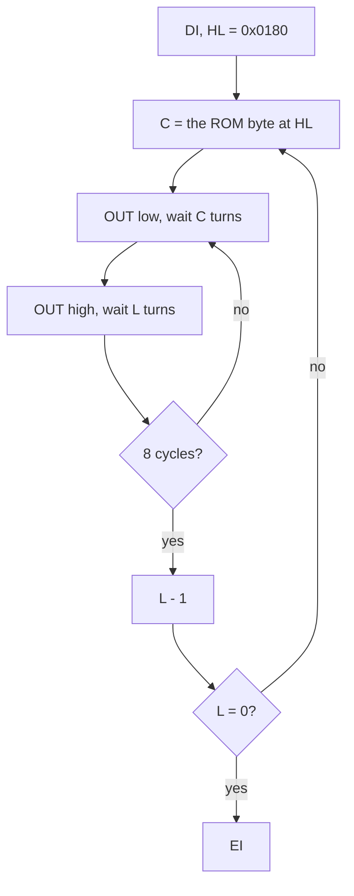

Worked example: the exit opens at `rzx-earth01` frame 3366 T 28 657, on the 36th gem. At L = `$80` the high half is
128 turns of 16 T, 2048 T, and the low half is the ROM byte at `$0180` turns. By L = 1 the high half is 16 T: the top
of the curve in 9.8's figure falls from 2000 T to 30 T while the second line (the ROM bytes) stays scattered. 2048
writes in 2 785 432 T: 40 frames, all 40 interrupts lost.

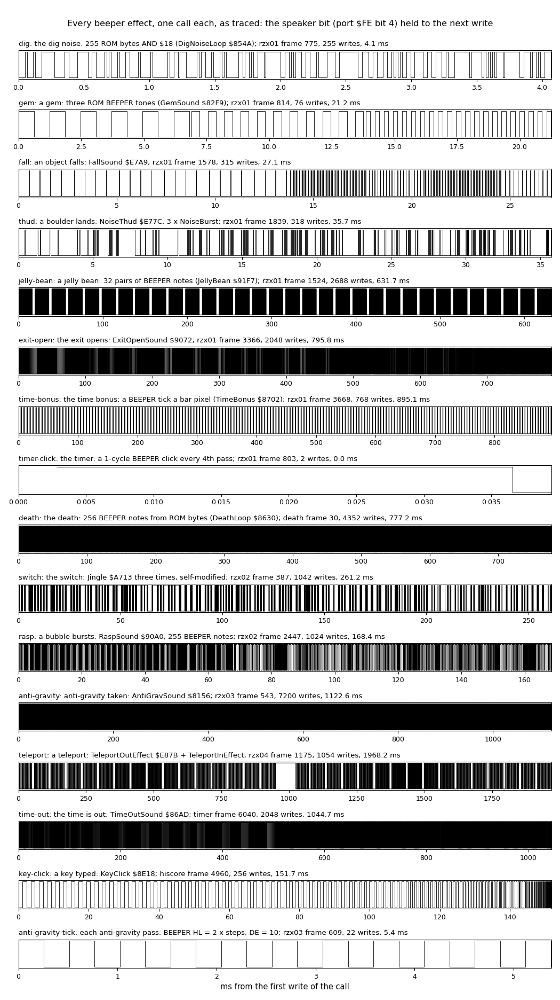

*One call of each effect, traced: the speaker bit held from each write to the next. Command, from the case folder
after `. work/env.sh`: `python3 tools/fig_sound.py shapes`.*

How to read the figure:

- **Each strip** is one call, time in ms from its first write, high up. The title names the routine, the recording,
  the frame and the number of writes.
- **Short effects** (dig, gem, fall, thud, the tick, the click) show their waves; **long ones** (death, anti-gravity,
  time-out) are dense blocks, and their shape is in 9.8's figure and in the spectrograms below.
- **The point**: the effects span four orders of magnitude, from the 118 T timer click to the 2-second teleport.

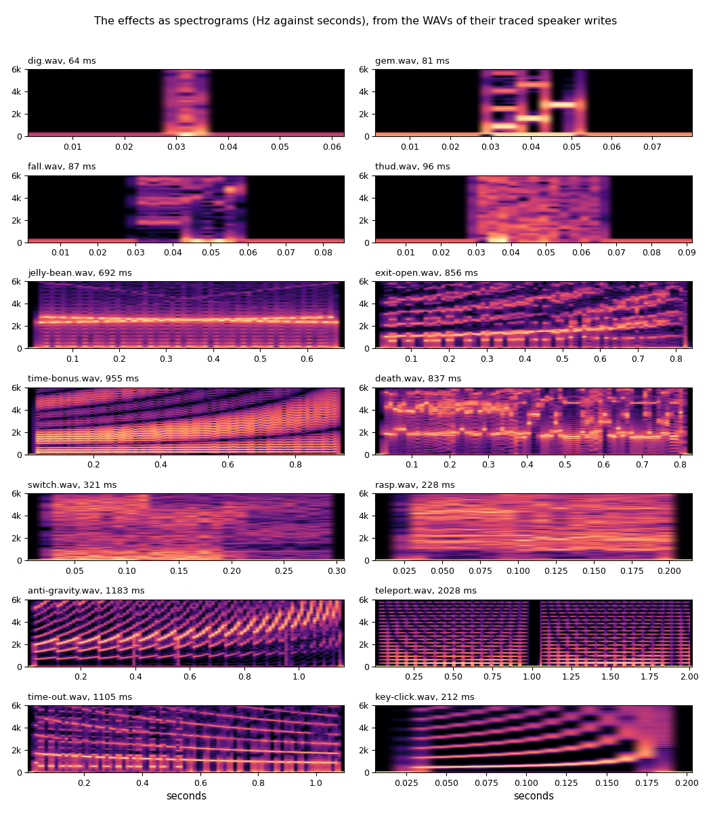

*The WAV of each traced effect (9.11) as a spectrogram, 0-6 kHz. Command, from the case folder after `. work/env.sh`:
`python3 tools/fig_sound.py spectro`.*

How to read the figure:

- **Each panel** is one WAV: time across, frequency up, brighter for more energy. The WAVs have 30 ms of silence at
  each end.
- **Rising lines** are rising sweeps (exit open, key click, the anti-gravity's 20 sweeps); **falling lines** are the
  time-out; **flat bands** are fixed tones (the jelly bean's two notes); **diffuse bands** are the ROM-byte sounds.
- **The point**: each event has a sound you can tell apart by its shape alone, made from the same one-bit port.

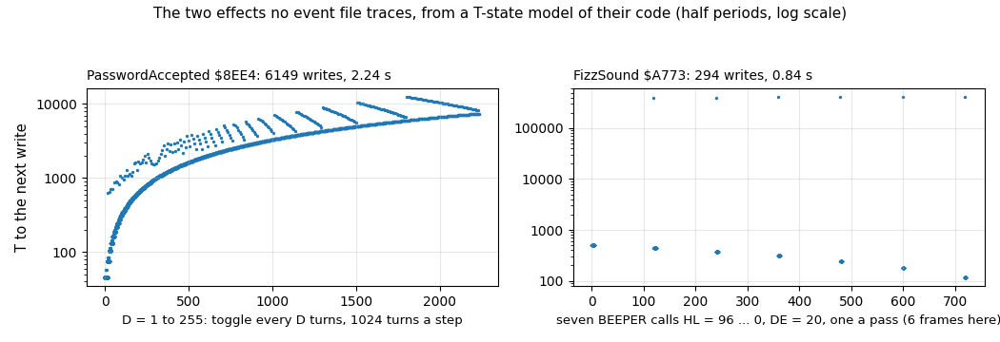

*PasswordAccepted (no recording reaches it) and the fizz (it ran, but no event file traces it) from a T-state model of
their code, not from a trace. Command, from the case folder
after `. work/env.sh`: `python3 tools/fig_sound.py models`.*

How to read the figure:

- **Left**: PasswordAccepted's half periods, D turns of about 29 T each for D = 1 to 255: a 2.2 s falling sweep.
- **Right**: the fizz's seven BEEPER calls, one a pass (spaced 6 frames here, a typical pass), HL from 96 down to 0.
- **The point**: these are the two sounds no event file traces; their shape is known from the code alone.

Witness: exit `rzx-earth01` 3366; time-out `timer` 6040; switch `rzx-earth02` 387 (and `c1` 11910 at the menu's
control choice); teleport `rzx-earth04` 1175 and 1226; key click `hiscore` 4960 and 4967. The KeyClick model matches
the trace interval by interval (192 of 255 exact, the rest within 6 T of contention).

The point: where BEEPER's fixed cycle is not enough (a sweep inside one call, two drifting counters, a random duty),
the game writes its own loop of the same shape: count, `OUT`, count, `OUT`.

## 9.10 Every sound: trigger, cost, interrupts, witness

The cost is the traced time from the first to the last speaker write of one call. "Lost" counts the frame interrupts
that fell in that span and were not taken (the first frame's interrupt counted if it fell inside).

| Sound | Trigger | Routine | Writes | Cost | Interrupts | Lost | Witness |
| --- | --- | --- | ---: | ---: | --- | ---: | --- |
| dig | the player digs earth | DigNoise `$8548` | 255 | 4.1 ms | on | 0 | `rzx-earth01` 775 |
| gem | a gem taken | GemSound `$82F9` | 76 | 21 ms | BEEPER's DI | 1 of 1 | `rzx-earth01` 814 |
| fall | an object fell this pass | FallSound `$E7A9` | 315 | 27 ms | DI | 1 of 1 | `rzx-earth01` 1578 |
| thud | a boulder landed or was pushed | ThudSound `$8228` | 318 | 36 ms | DI | 2 of 2 | `rzx-earth01` 1839 |
| dig in place | fire with a direction on earth | DigInPlace `$E7FE` | 469 | 49 ms | DI, on only between bursts | 2-3 of 2-3 | model; L1 167 calls in 16 RZX replays, first `rzx-earth24` 434 |
| jelly bean | a jelly bean taken | JellyBean `$91F7` | 2688 | 632 ms | DI after each call | 31 of 31 | `rzx-earth01` 1524 |
| exit open | the last needed gem, then every gem | ExitOpenSound `$9072` | 2048 | 796 ms | DI | 40 of 40 | `rzx-earth01` 3366 |
| time bonus | the exit taken | TimeBonus `$8702` | 4 a pixel | 895 ms for 192 | BEEPER's DI only | 4 of 45 | `rzx-earth01` 3668 |
| timer click | every fourth pass | TimerStep `$86DE` | 2 | 118 T | BEEPER's DI | 0 | `rzx-earth01` 803 |
| death | the player killed | DeathSound `$862E` | 4352 | 777 ms | BEEPER's DI | 39 of 39 | `death-crush` 30 |
| switch | the switch hit; menu 3 or 4 | SwitchSound `$A74B` | 1042 | 261 ms | DI | 13 of 13 | `rzx-earth02` 387 |
| rasp | a bubble burst; a key redefined | RaspSound `$90A0` | 1024 | 168 ms | BEEPER's DI | 8 of 9 | `rzx-earth02` 2447 |
| anti-gravity | the arrow taken | AntiGravSound `$8156` | 7200 | 1.12 s | BEEPER's DI | 53 of 56 | `rzx-earth03` 543 |
| anti-gravity tick | each anti-gravity pass | AntiGravPass `$A7CD` | 22 | 5.4 ms | DI after | 0 | `rzx-earth03` 609 |
| teleport | a teleporter used | TeleportOutEffect `$E87B`, TeleportInEffect `$E8AE` | 1054 | 1.97 s | DI | 96 of 99 | `rzx-earth04` 1175 |
| drain click | H pressed: each step of QuitKey's drain | QuitKey `$8741`: BEEPER HL = 1, DE = 0 | 2 a step | a 122 T pulse every 10 620 T (L1 of `lives`), up to 256 steps (39 frames, 0.78 s) | BEEPER's DI only | about 1 in 26 (404 T of each step) | `lives` L1 totals; `c1` 14 430 |
| time-out | the bar empty | TimeOutSound `$86AD` | 2048 | 1.04 s | DI | 52 of 52 | `timer` 6040 |
| key click | a character typed or deleted | KeyClick `$8E18` | 256 | 152 ms | DI | 7 of 7 | `hiscore` 4960 |
| fizz | a boulder dissolved in fire | FizzSound `$A773` | 42 a pass, 7 passes | 7 short beeps | BEEPER's DI | | model; L1 2682 beeps (`$A78E`) in 20 RZX replays |
| password | a valid password | PasswordAccepted `$8EE4` | 6149 | 2.24 s | DI | all | code only |
| the tunes | 9.5 | PlayTune `$88CE` | | 0.9-74 s | DI | all | 9.5 |

"BEEPER's DI" means interrupts are off inside each BEEPER call and on for the few instructions between calls: an
interrupt is taken only if its pulse falls in that gap. "DI after each call" means the game puts `DI` back right after
BEEPER's `EI`, leaving a 14 T window.

The events, by where they come from:

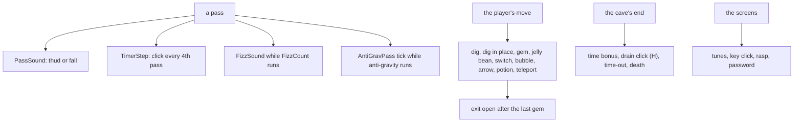

Worked example: a gem in `rzx-earth01` at frame 814 makes the pass 1.2 frames longer: 6524 T of panel work and
74 369 T of GemSound ([doc 8](08-hud-and-text.md#86-the-panel-after-a-gem)). The 36th gem at frame 3366 also opens
the exit: 40 more frames of ExitOpenSound in the same pass. The pass that takes the last gem is the longest of the
cave by far.

Witness: the event files `work/docs/esD/ev-*.json` named in each row; `python3 tools/fig_sound.py table` prints the
writes, spans and lost interrupts.

The point: a sound's cost is paid by the pass it happens in. Since the game has no frame lock, a noisy pass is a slow
pass, and the long effects (exit, death, teleport, time-out) freeze the cave for one or two seconds.

## 9.11 The WAV renders

`docs/audio/` holds a WAV of every sound, 22 050 Hz, 8 bit, mono, made by `python3 tools/fig_sound.py wav`. Each
sample is the average of the speaker bit over the sample's interval (the bit held from each write to the next), with
the mean removed. None of them was played while this case was made.

- The effects, from their traced speaker writes, one call each with 30 ms of silence around:
  [dig](audio/dig.wav), [gem](audio/gem.wav), [fall](audio/fall.wav), [thud](audio/thud.wav),
  [jelly-bean](audio/jelly-bean.wav), [exit-open](audio/exit-open.wav), [time-bonus](audio/time-bonus.wav),
  [timer-click](audio/timer-click.wav), [death](audio/death.wav), [switch](audio/switch.wav),
  [rasp](audio/rasp.wav), [anti-gravity](audio/anti-gravity.wav),
  [anti-gravity-tick](audio/anti-gravity-tick.wav), [teleport](audio/teleport.wav),
  [time-out](audio/time-out.wav), [key-click](audio/key-click.wav).
- The two untraced effects, from the models of 9.9: [password-accepted](audio/password-accepted.wav),
  [fizz](audio/fizz.wav).
- The dig in place, from the NoiseBurst model of 9.7: [dig-in-place](audio/dig-in-place.wav).
- The 13 tunes, from the T-state model of PlayTune (9.3), whole: [title](audio/tune-title.wav),
  [cave-1](audio/tune-cave-1.wav), [cave-2](audio/tune-cave-2.wav), [cave-3](audio/tune-cave-3.wav),
  [cave-4](audio/tune-cave-4.wav), [cave-5](audio/tune-cave-5.wav), [cave-6](audio/tune-cave-6.wav),
  [cave-7](audio/tune-cave-7.wav), [cave-8](audio/tune-cave-8.wav), [map](audio/tune-map.wav),
  [life](audio/tune-life.wav), [game-over](audio/tune-game-over.wav), [win](audio/tune-win.wav).

The model's tunes have no contention, so they run 0.08 % faster than the real machine (9.3).

## 9.12 What is known only from the code

- **PasswordAccepted** `$8EE4`: no recording enters a valid password; the sound and its 2.2 s are from the model.
- **The fizz**: it sounded, FizzSound's BEEPER call `$A78E` 2682 times in 20 RZX replays (`work/stage2/execs.json`,
  the most in `rzx-earth23`, 374), but no event file traces it; the seven beeps' shape is from the code and the BEEPER
  model, with the passes assumed 6 frames apart.
- **WinTune** beyond its first 254 frames: `rzx-earth32` ends at frame 20 931, at about note 27 of 258. The rest is the
  model.
- **The `AND $7F` no-op** in ExitOpenSound and TimeOutSound (9.9) and **BonusTick's lost `DEC D`** (9.8): the traces
  show their effect (a full ROM byte in C, HL falling by 1 a tick); the intent is a guess.
- **The dig in place**: DigInPlace runs in 16 RZX replays but no event file traces it; its sound is the NoiseBurst
  model, which reproduces the traced thud write for write.
- **QuitKey's drain click**: one BEEPER cycle (HL = 1, DE = 0) after each ShiftTimeBar; `c1` presses H at 14 430, but
  no event file traces the clicks. The 122 T pulse is BEEPER's model; the step, 10 620 T, is measured from the L1
  totals of `lives` (1206 pixels in 5 drains; `c1` 10 690 T, doc 04.9).
- **The rasp's full length**: one bubble's RaspSound is traced in full only in the retrace `ev-rzx02-2445-2465.json`;
  the redefine screen's five rasps are known from L1 entry counts.

## 9.13 The point

The game has one sound engine idea, used everywhere: count down, write the port, repeat. PlayTune does it with two
counters for two voices, and its one-turn detune turns unison notes into slow pulse-width sweeps. BEEPER does it for
the effects, called in loops whose arguments come from counters or from the ROM's bytes. A few effects write their own
loops of the same shape. Every sound runs in the main program with interrupts mostly off, so a sound is time taken out
of a pass: a tune stops the game for its whole length, and an effect makes the pass that caused it longer.
