# 10. Gameplay logic

What this covers: the rules of Earth Shaker as the code runs them. The game is a falling-object puzzle: boulders and
gems fall and roll through a grid of cells, the player digs, pushes and collects, and a cave is won by taking its gems
and reaching the exit before the time bar runs out. This document gives:

- the work of one pass and its order;
- the gravity scan, its order, and why the order shapes the play;
- each object's rule: falling, crushing, rolling, pushing, fire, the dissolve and the burst, the switch, and every
  special cell, with the chain reactions they make;
- the player's death (only fire and falling objects kill), the lives, the timer, the gems, the exit and the win;
- the passwords and the order of the caves;
- how the caves change from first to last;
- the notable features of the code, and what no recording reached.

The cells, the cave format and the variables are [doc 07](07-objects.md). The keys and the input path are
[doc 05](05-controls.md); the drawing of a pass is [doc 06](06-rendering.md); every sound named here is decoded in
[doc 09](09-sound.md).

The recordings it rests on ([WALKTHROUGH 6.0](../WALKTHROUGH.md#60-the-recordings)):

- `death-crush` (stage 2): cave 1 from `work/stage1/probe/level1.szx`, the input `tests/inputs/death-crush.txt` (up,
  up, down; 265 frames). Opened on an own instance after `source work/env.sh` with
  `python3 ../../kit/rs.py open --work work/docs/esC/dc --ttd work/stage2/death-crush/session.ttd --port-base 37170`;
  `$FD7A-$FFFF` sampled at
  frames 0-40 by `work/docs/esC/sample.py` (`work/docs/esC/dc-vars.jsonl`).
- `death-fire` (stage 2): cave 4 from the RZX's `earth04` start snapshot, one step left into fire (530 frames).
- `rzx-earth02`: cave 2 played by the RZX archive's player, replayed by `tools/rzx_align.py` (not our play). Opened
  into `work/docs/esC/r02`; `$FD7A-$FFFF` sampled at frames 260-480, 1290-1400 and 2420-2500
  (`work/docs/esC/r02-vars.jsonl`).
- `rzx-earth09`: cave 9, the same way, opened into `work/docs/esC/r09` for the potion (traced in frames 6352 and 6397).
- `timer`: cave 1 from `probe/level1.szx`, F (the map), then no key until the time runs out (12 000 frames).
- `c1` (power-on to cave 1; a boulder kill at frame 13208) and `lives` (H until the game is over), quoted from stage 2.
- The RZX state logs `work/stage1/rzx/earthNN.ins.state.bin`: `$FD7E-$FFFF` after every frame of each RZX file
  (642 bytes a frame), logged while SkoolKit played the RZX. They hold every cave's play to its end.
- The L1 counts of the builds ("L1 n") and the first frames of routines from each recording's `l1.json`
  (`work/docs/esC/firsts.py`), and the execution count of every address over the stage 2 recordings
  (`work/stage2/execs.json`: `c1`, `menu`, `lives`, `hiscore`, `timer` and the 32 RZX recordings).

A sample of frame N is the memory at the start of frame N; a trace, and so a routine animation, puts an instruction in
the frame where it ran. Event tables below give the sample frame, and the trace frame where one was taken. A frame is
1/50 s; a [pass](README.md#terms) is one turn of `PlayCave $8885`. A pass lasts as long as its work: the mean is 5.5
to 9.4 frames, by cave ([doc 04.6](04-game-loop.md#46-the-cost-of-a-pass-in-every-cave)); in the samples of `rzx-earth02` the cells move every seven frames.

## 10.1 A pass: the order of the work

`PlayCave $8885` repeats one pass until the cave is over. The cell rules all run inside it, in this order:

1. `KeysStep $8759`: the player's step. With the fire key held, `FireStep` acts on the next cell without moving.
2. `PutPlayer $8382`: the player's code written at `PlayerIndex`.
3. `AbortKey $93A5`, which first calls `AnimateCellCodes $937E`. That calls `SwitchClear $817A` (the switch of the
   last pass), which calls `AntiGravPass $A7CD`, the gravity scan of this pass (`ScanCells $8075`, or
   `AntiGravScan $A655` while anti-gravity runs). Back in `AnimateCellCodes`, every burst and dissolve code steps on.
   Then the G key is tested.
4. `ClearVacated $81AC`: every cell AND `$1F`, so the vacated marks `$20` become 0.
5. `WindowOrigin $8DA6`: the window placed and drawn.
6. `MapKey $EA96`, `ColourCycle $81E7`, `FizzSound $A773` (the pass sound and the fizz), `TimerStep $86DE`,
   `QuitKey $872D`.
7. The end tests: `CaveOver`, then `PlayerKilled` (the death view and sound), then `CaveDone` (the time bonus).

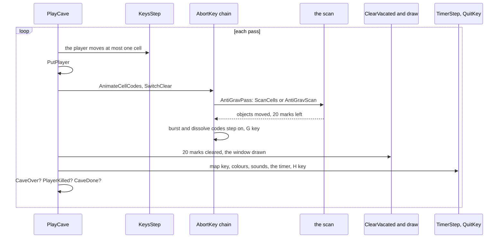

```asm
PlayCave:
8885  LD HL,CaveOver
8888  LD (HL),$00
888A  CALL CaveInit         ; unpack, graphics, time bar (doc 04)
888D  LD HL,KeyMoved        ; PassLoop
8890  LD (HL),$00
8892  CALL KeysStep
8895  CALL PutPlayer
8898  CALL AbortKey         ; AnimateCellCodes, SwitchClear, the scan
889B  CALL ClearVacated
889E  CALL WindowOrigin     ; the window drawn
88A1  CALL MapKey
88A4  CALL ColourCycle
88A7  CALL FizzSound
88AA  CALL TimerStep
88AD  CALL QuitKey
88B0  LD A,(CaveOver)
88B3  OR A
88B4  RET NZ                ; out of time or H
88B5  LD A,(PlayerKilled)
88B8  OR A
88B9  JR Z,CheckCaveDone
88BB  CALL DeathView
88BE  CALL DeathSound
88C1  RET
88C2  LD A,(CaveDone)       ; CheckCaveDone
88C5  OR A
88C6  JR Z,NextPass
88C8  CALL TimeBonus
88CB  RET
88CC  JR PassLoop           ; NextPass
```

Three consequences of the order:

- The player moves before the scan. A cell the player leaves sideways is 0 when the scan comes (`MoveLeft` and
  `MoveRight` write 0), so the object above it falls in the same pass. A cell he leaves up or down is `$20` (`MoveUp`
  and `MoveDown` write `$20`), so the object above it waits one pass. 10.3 shows why that kills.
- A switch hit in the scan is cleared at the start of the next pass, before that pass's scan (10.7).
- `ClearVacated` runs before the draw, so `$20` is never on the screen, and the end tests come after the draw, so the
  frame that shows the death is the one the death view redraws (10.9).

**The point**: one pass is one step of the world. The player acts first, then gravity, then the animations, and every
rule below happens at most once a pass.

## 10.2 The scan and why its order matters

`ScanCells $8075` visits the grid once a pass, from row 18, column 29 back to row 0, column 0: each row from right to
left, the rows upward. HL is the cell, DE the cell below it. Row 19 is only ever a cell below, never a source: nothing
falls out of the cave. Each visited cell is tested against the skip list; a falling object goes to
`EarthFallGuard $9AA6` and then `MoveObject $80DB` (10.3 and 10.4).

```text
ScanCells:
    BoulderLanded = BoulderFell = ObjectFell = 0
    for row in 18 down to 0:
        for column in 29 down to 0:
            cell = grid[row][column]; below = grid[row + 1][column]
            if cell == BOULDER and below == FIRE:
                cell = 0x15; FizzCount = 7                    # the dissolve, 10.6
            if cell in (EARTH unless earth falls, EMPTY, WALL, FORCE_FIELD, BUBBLE,
                        TELEPORTER, EXIT, SWITCH_BOX, PLAYER_R, PLAYER_L) or cell > 0x10:
                continue
            EarthFell = (cell == EARTH)
            MoveObject(row, column)                           # falls, or rolls
```

```asm
ScanCellsBody:
8079  LD (ObjectFell),A
807C  LD HL,CaveGrid+$0239  ; FFE1: row 18, column 29
807F  LD DE,CaveGrid+$0257  ; FFFF: the cell below
8082  LD B,$13              ; 19 rows
8084  PUSH BC               ; ScanRowLoop
8085  LD B,$1E              ; 30 cells
8087  LD A,$02              ; ScanCellLoop: a boulder ...
8089  CP (HL)
808A  JR NZ,ScanSkipTests
808C  LD A,(DE)             ; ... over fire?
808D  CP $0F
808F  JR NZ,ScanSkipTests
8091  LD (HL),$15           ; the dissolve
8093  LD A,$07
8095  LD (FizzCount),A
8098  LD A,$06              ; ScanSkipTests
809A  CP (HL)               ; ScanEarthTest: NOP when earth falls
809B  JR Z,ScanNextCell
                            ; ... the same for 0, 5, 9, 0E, 0D, 1, 0B, 3, 4
80C9  LD A,$10
80CB  CP (HL)
80CC  JR C,ScanNextCell     ; codes above 10 (not 10 itself)
80CE  PUSH BC
80CF  CALL EarthFallGuard   ; EarthFell, then MoveObject
80D2  POP BC
80D3  DEC HL                ; ScanNextCell
80D4  DEC DE
80D5  DJNZ ScanCellLoop
80D7  POP BC
80D8  DJNZ ScanRowLoop
80DA  RET
```

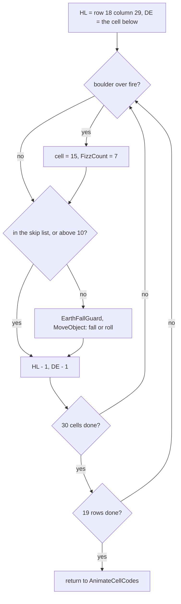

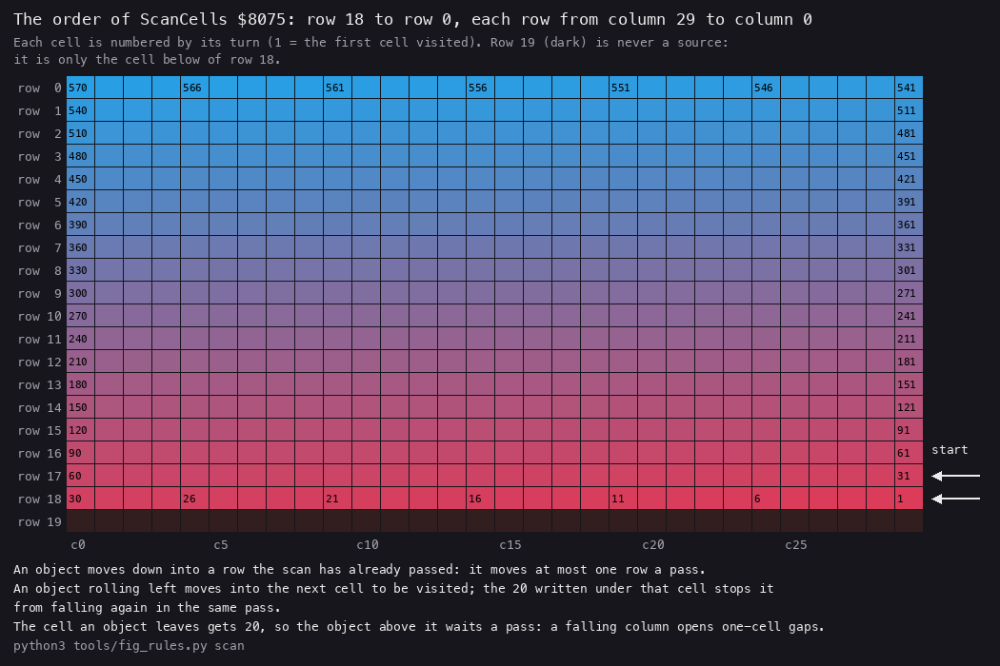

How to read the figure:

- Each cell of the 30 x 20 grid is numbered by its turn in the scan: 1 is row 18, column 29, and 570 is row 0,
  column 0. Row 19 (dark) is never a source. The arrows on the right show the direction of the first two rows.
- The colour runs from the first cell visited (red) to the last (blue).
- Command: `python3 tools/fig_rules.py scan`.

Why the order matters:

- **One row a pass.** An object moves down into a row the scan has already passed, so it is not visited again in the
  same pass. Every object falls at most one cell a pass.
- **Columns open gaps.** The cell an object leaves gets `$20`. The object above it, visited next row up, sees `$20`
  below, which is neither empty nor something to roll off (10.4), and stays. A falling column therefore does not fall
  as one: each object starts one pass after the one below it, and a one-cell gap opens between them. Over the 32 RZX
  state logs (`work/docs/esC/colstat.py`), 1930 times the object above a falling one stayed behind its `$20`. 48 times
  both moved between the same two samples; those were not examined one by one.
- **Rolls do not chain.** An object rolling left moves into the next cell to be visited. `RollObject` writes `$20` into
  the cell under that one, so when the scan reaches the rolled object it finds `$20` below and leaves it. An object
  rolling right moves into a cell already visited. Either way it moves once.

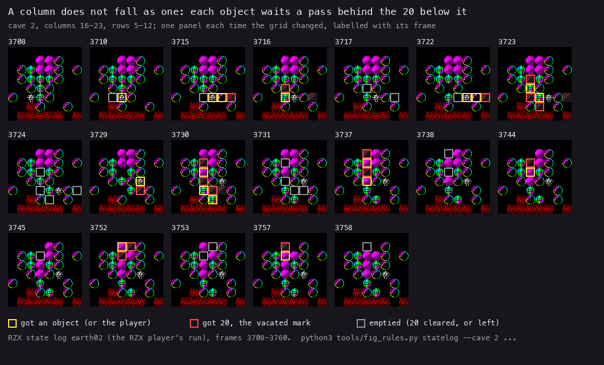

How to read the figure:

- Cave 2, columns 16-23 and rows 5-12, from the RZX state log of `earth02` (the RZX player's play, frames
  3708-3760). One panel each time the grid changed, labelled with its frame. A cell that got an object is framed
  yellow, one that got `$20` red and hatched, one that was emptied grey.
- Frame 3710: the player takes the gem at cell 319 (row 10). Frames 3715 and 3722: he pushes a bubble right along
  row 10.
- Above 319 stand a gem at 289, a gem at 259 and boulders at 229 and 199. Frame 3716: the gem at 289 falls into 319,
  the cell the player left sideways. Frame 3723: that gem rolls right to 320 (350 under it marked), and the gem at 259
  falls to 289.
- Frame 3730: the boulder at 229 falls to 259, the gem at 289 to 319. The column now reads `$20`, boulder, `$20`, gem
  from 229 down: a red mark between every pair. Frame 3737: the boulders at 199 and 259 fall, again with a mark between
  them.
- The frames are those of the log, which holds the memory after each frame.
- Command: `python3 tools/fig_rules.py statelog --cave 2 --frames 3708-3760 --cols 16-23 --rows 5-12 --per-row 7
  --out docs/img/rules/column-gaps.png`.

One whole scan at work, in `rzx-earth02`:

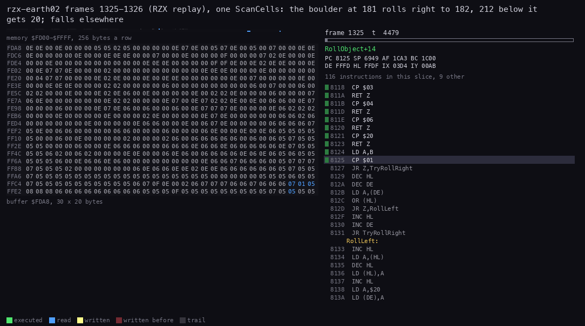

How to read the animation:

- Left: the grid `$FDA8-$FFFF` as 30 x 20 hex bytes, so each row of the picture is a row of the cave; the scan's reads
  are blue, its writes yellow. The visited cell walks from the bottom right to the top left.
- Right: the listing of `ScanCells`, `MoveObject`, `RollObject` and `BoulderLandCheck`, with the instruction running.
- The boulder at cell 181 rolls right to 182 and `$20` goes into 212 under it. The state log of `earth02` shows this
  roll after frame 1325, the only grid change of that frame.
- Recording and frames: `rzx-earth02` (the RZX player's play), 1325:3500 to 1326:31500. Command: `python3
  ../../kit/routine_anim.py --work work/docs/esC/r02 --window 1325:3500-1326:31500 --pictures 100 --listing
  build/game.lst --view buffer:FDA8:30x20:hex --range FD00-FFFF --pc 8075-8164,9AA5-9ACB,E78C-E7FD --out
  docs/img/routines/ScanCells.gif`.

**The point**: the bottom-up order makes the grid fall one row a pass. The vacated mark makes columns spread out and
stops a rolled object from moving twice. Stage 2's note that "a falling column moves as one" was wrong; the logs show
the gaps (the stage 2 NOTES 3.1 are corrected).

## 10.3 Falling and crushing

`MoveObject $80DB` gets the object at HL and the cell below at DE. If the cell below is empty the object moves into it
and its old cell gets `$20`. A boulder then calls `BoulderLandCheck $E78C`: if the cell under the new place is neither
0 nor `$20`, the boulder has landed and `BoulderLanded` asks for the thud. Any other object sets `ObjectFell`, the fall
noise. Then the cell under the new place is tested. The player (3 or 4) means `Crush $9ABC`; a switch box (`$0B`) means
`SwitchHit` (10.7). If the cell below was not empty, the object may roll (10.4).

`Crush` kills unless the falling object is earth: `EarthFallGuard $9AA6` sets `EarthFell` before every move, so
falling earth in caves 13, 17, 22, 24 and 26 lands on the player without harm.

```text
MoveObject(cell, below):
    if below != EMPTY: RollObject(cell, below); return
    below = cell's code; cell = 0x20
    if the code is BOULDER: BoulderFell = 1; BoulderLanded = (the cell under below is not 0 or 0x20)
    else: ObjectFell = 1
    under = the cell under below
    if under in (PLAYER_R, PLAYER_L): Crush()
    elif under == SWITCH_BOX: SwitchHit = 0xFF
Crush:
    if not EarthFell: PlayerKilled = 0xFF
```

```asm
MoveObject:
80DB  LD A,(DE)
80DC  OR A
80DD  JR NZ,RollObject      ; the cell below is filled
80DF  LD A,(HL)
80E0  LD (HL),$20           ; the old cell: vacated
80E2  LD (DE),A             ; the object one row down
80E3  CP $02
80E5  JR NZ,MarkObjectFell
80E7  CALL BoulderLandCheck
80EC  JR CheckUnderFallen
80EE  LD A,$FF              ; MarkObjectFell
80F0  LD (ObjectFell),A
80F3  PUSH HL               ; CheckUnderFallen
80F4  LD HL,$001E
80F7  ADD HL,DE             ; the cell under the new place
80F8  LD A,(HL)
80F9  POP HL
80FA  CP $03
80FC  JR NZ,MoveObjectLanded
80FE  JP Crush
8104  CP $04                ; MoveObjectLanded
8106  JR NZ,LandOnSwitch
8108  JP Crush
810E  CP $0B                ; LandOnSwitch
8110  RET NZ
8111  LD A,$FF
8113  LD (SwitchHit),A
8116  RET
Crush:
9ABC  PUSH AF
9ABD  LD A,(EarthFell)
9AC0  OR A
9AC1  JR Z,CrushSkip
9AC3  POP AF                ; falling earth: no harm
9AC4  RET
9AC5  LD A,$FF              ; CrushSkip
9AC7  LD (PlayerKilled),A
9ACA  POP AF
9ACB  RET
```

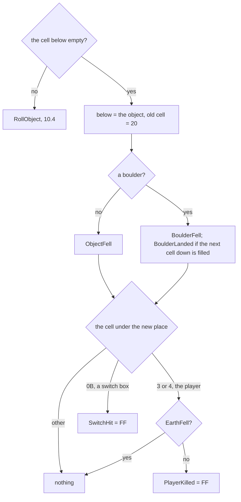

The test is on the cell under the *new* place, and only when the object has just moved. So an object resting on the
player's head never kills him: the cell below it is the player, not empty, and `RollObject` refuses to roll off the
player. Only an object that falls into the cell above the player kills, which means it had a free cell to fall through.

Worked example, `death-crush` (cave 1). The boulder at cell 195 (row 6, column 15) sits over earth; the player starts at
285, three rows below.

| Frame (sample) | Trace | `PlayerIndex` | Cells | What happened |
| ---: | --- | ---: | --- | --- |
| 4 | | 255 | 255: 6 to 4; 285: 4 to `$20` | up, digging |
| 9 | | 225 | 225: 6 to 4; 255: 4 to `$20` | up again: the boulder at 195 rests on the player's head and stays |
| 15 | | 255 | 225: 4 to `$20`; 255: 0 to 4 | down: `MoveDown` leaves `$20` in 225 |
| 17 | | 255 | 225: `$20` to 0 | the boulder waited this pass behind the `$20` |
| 22 | 20:11418 to 21:31484, `Crush` at 21:714 | 255 | 195: 2 to `$20`; 225: 0 to 2 | the next scan: the boulder falls into 225, and 255 under it is the player |
| 27 | `DeathView` | | | the player's graphics replaced by the death graphics, the window redrawn |
| 30 | `DeathSound` | | | 256 ROM BEEPER notes |

Had the player stepped sideways out from under the boulder, the old cell would have been 0 and the boulder would have
fallen into it in the same pass, with nobody under it. Stepping down from under a boulder is what kills: the `$20` of
`MoveDown` delays the boulder one pass, and in that pass the player has moved into the very cell under its landing
place.

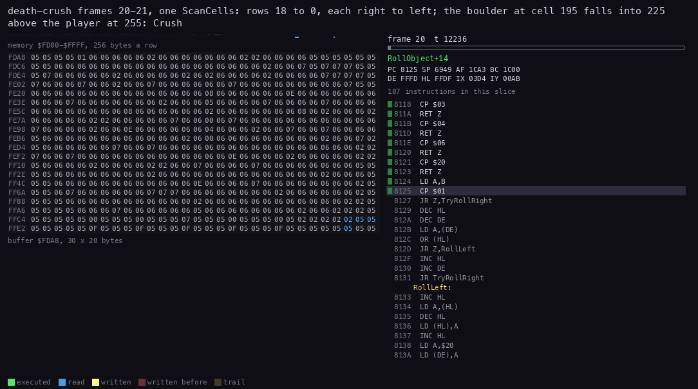

How to read the animation:

- Left: the grid as 30 x 20 hex bytes; the scan walks up from the bottom right. Cell 225 (row 7, column 15) gets the
  `02` and cell 195 above it the `20`; the `04` under them is the player.
- Right: the listing of the scan, `MoveObject`, `Crush` and `BoulderLandCheck`; `CrushSkip` runs at the end.
- Recording and frames: `death-crush`, 20:11418 to 21:31484, 110 pictures. Command: `python3 ../../kit/routine_anim.py
  --work work/docs/esC/dc --window 20:11418-21:31484 --pictures 110 --listing build/game.lst --view
  buffer:FDA8:30x20:hex --range FD00-FFFF --pc 8075-8164,9AA5-9ACB,E78C-E7FD --out docs/img/routines/Crush.gif`.

The same death on the screen:

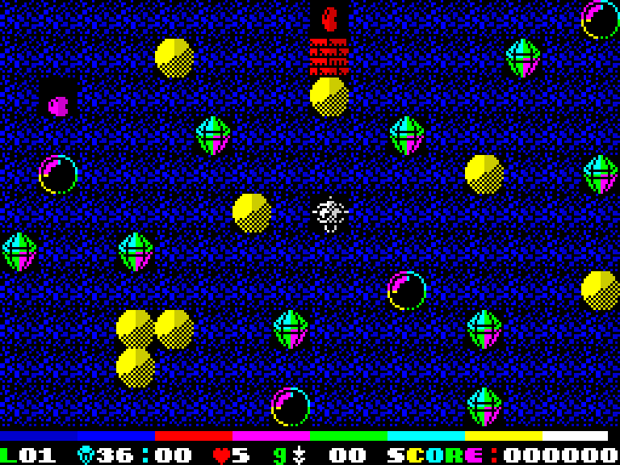

The animation is `death-crush` frames 0-44, one picture a frame, repeated pictures merged (`python3
../../kit/screen_anim.py --work work/docs/esC/dc --from 0 --to 44 --step 1 --scale 3 --delay 120 --hold 1500
docs/img/play/death-crush.gif`). The death graphics appear at frame 27.

Witness: `Crush` ran 48 times over the builds (L1): 47 times for falling earth in `rzx-earth13`, 17, 22, 24 and 26
with `EarthFell` set and no death, and once for the boulder that killed the player in `c1` at frame 13208. In
`death-crush` it kills at trace frame 21.

**The point**: only a moving object kills, and only by landing on the cell above the player. Standing under a boulder
is safe; leaving from under it downward is not.

## 10.4 Rolling off

When the cell below an object is filled, `RollObject $8117` decides whether it slides off. It never rolls off the
player (3, 4), earth (6) or a vacated cell (`$20`). It rolls off everything else: boulders, gems, walls, the exit, force
fields, bubbles, fire and teleporters. It tries left first: when the object is not in column 0 and both the left cell
and the cell under it are empty, the object moves left. Otherwise it tries right the same way. The object's old cell
and the cell under its new place both get `$20`.

```text
RollObject(cell, below):
    if below in (PLAYER_R, PLAYER_L, EARTH, 0x20): return
    if column > 0 and left == EMPTY and below_left == EMPTY:
        left = object; cell = 0x20; below_left = 0x20; return
    if column < 29 and right == EMPTY and below_right == EMPTY:
        right = object; cell = 0x20; below_right = 0x20
```

```asm
RollObject:
8117  LD A,(DE)
8118  CP $03
811A  RET Z                 ; on the player: stays
811B  CP $04
811D  RET Z
811E  CP $06
8120  RET Z                 ; on earth: stays
8121  CP $20
8123  RET Z                 ; on a vacated cell: stays
8124  LD A,B
8125  CP $01                ; column 0?
8127  JR Z,TryRollRight
8129  DEC HL
812A  DEC DE
812B  LD A,(DE)             ; the cell below-left ...
812C  OR (HL)               ; ... and the left cell both 0?
812D  JR Z,RollLeft
812F  INC HL
8130  INC DE
8131  JR TryRollRight
8133  INC HL                ; RollLeft
8134  LD A,(HL)
8135  DEC HL
8136  LD (HL),A             ; the object one left
8137  INC HL
8138  LD A,$20
813A  LD (DE),A             ; below-left: 20
813B  LD (HL),A             ; the old cell: 20
813C  INC DE
813D  RET
813E  LD A,B                ; TryRollRight
813F  CP $1E                ; column 29?
8141  RET Z
                            ; ... the same to the right: RollRight 814B
```

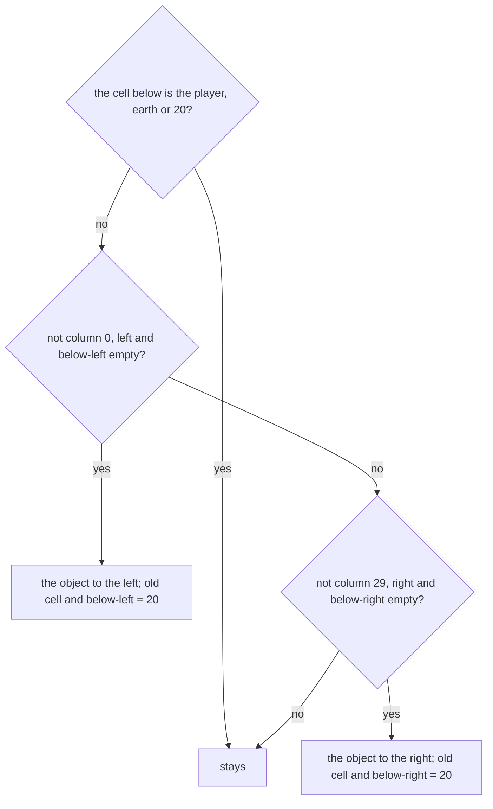

The `$20` under the new place has two jobs. It stops the scan from moving the object again in this pass (10.2), and it
reserves the cell: the next pass the mark is gone and the object falls into it.

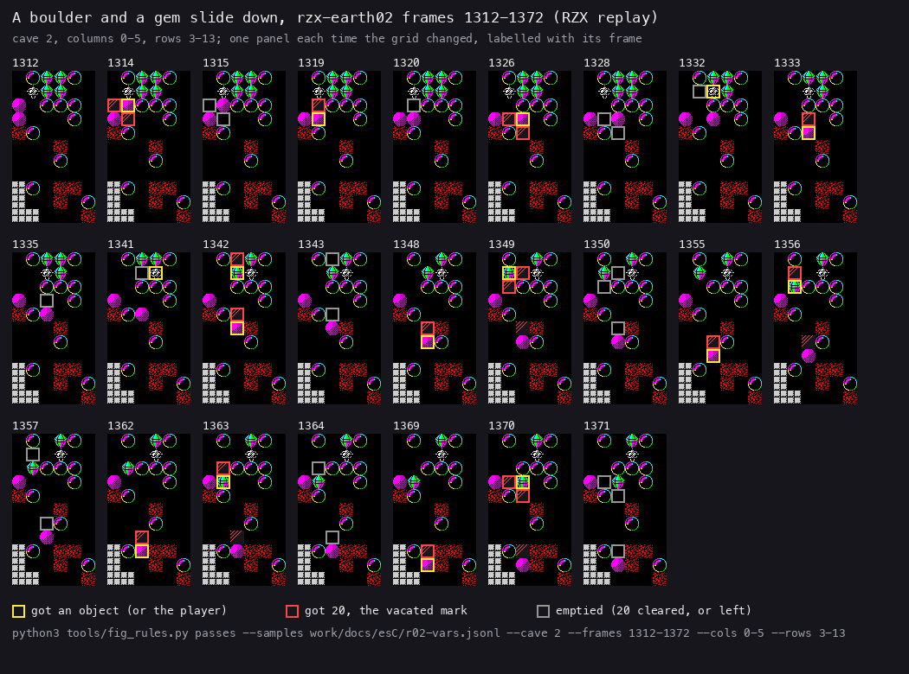

How to read the figure:

- Cave 2, columns 0-5 and rows 3-13, from the `rzx-earth02` samples (the RZX player's play). One panel each time the
  grid changed, with its frame; framing as in the column figure (yellow got an object, red got `$20`, grey emptied).
- The boulder at 150 rolls right to 151, falls to 181, rolls right to 182 (marking 212 under it), then falls one cell
  a pass.
- The gem at 92 falls to 122, rolls left to 121 (frame 1349), falls to 151 and 181, rolls right to 182 (frame 1370),
  then falls to 212, 242, 272 and 302.
- Command: `python3 tools/fig_rules.py passes --samples work/docs/esC/r02-vars.jsonl --cave 2 --frames 1312-1372
  --cols 0-5 --rows 3-13 --per-row 9 --out docs/img/rules/slide.png`.

Witness: the frames above; the routine animation of 10.2 shows the boulder's roll from 181 to 182 inside one scan.
Over the stage 2 recordings `RollLeft $8133` ran 1748 times and `RollRight $814B` 1557 times.

**The point**: objects roll off walls as well as off other objects, so piles slump and a wall's edge sheds whatever
lands on it. Left is always tried first, which makes a symmetric heap fall to the left.

## 10.5 Pushing: boulders and bubbles

The player pushes two kinds of object, boulders and bubbles, and only one cell at a time.

A boulder moves left or right when the cell beyond it is empty and inside the cave. `PushBoulder $E81F` writes the
boulder there and sets `BoulderPushed` (the thud); the player then moves into the boulder's old cell. Up and down a
boulder blocks (`TryUp` and `TryDown` return on code 2). There is no delay: every push succeeds at once.

A bubble moves in all four directions, into earth or an empty cell. Pushed into fire it bursts (10.6): the fire cell
becomes `$10`, `BubbleScore $93B6` gives 100 points with `RaspSound`, and the player moves into the bubble's cell. The
bubble's own old cell is simply covered by the player. Pushed right or left, `BubbleRightMove $9980` and
`BubbleLeftMove $99A0` also mark the cell beyond the bubble's new place with `$20` when it is empty. That keeps an
object from rolling into the bubble's path in this pass.

```text
push left (the player at p, the object at p - 1):
    if the object is BOULDER:
        if p - 1 is in column 0 or grid[p - 2] != EMPTY: blocked
        grid[p - 2] = BOULDER; BoulderPushed = 1; MoveLeft()
    if the object is BUBBLE:
        beyond = grid[p - 2]  (blocked in column 0)
        if beyond in (EMPTY, EARTH): grid[p - 2] = BUBBLE; if grid[p - 3] == EMPTY: grid[p - 3] = 0x20; MoveLeft()
        elif beyond == FIRE:      grid[p - 2] = 0x10; 100 points; MoveLeft()
        else: blocked
```

```asm
PushBoulder:                ; A = 0, HL = the cell beyond the boulder
E81F  CP (HL)
E820  JR Z,PushBoulderSkip
E822  POP AF                ; not empty: drop the caller's return, blocked
E823  RET
E824  LD (HL),$02           ; PushBoulderSkip: the boulder moves
E826  PUSH AF
E827  LD A,$FF
E829  LD (BoulderPushed),A
E82C  POP AF
E82D  RET
BubbleRight:                ; HL = the bubble
95B9  INC HL                ; the cell beyond
95BA  LD A,(HL)
95BB  CP $06
95BD  JR Z,BubbleRightSkip3 ; earth: the bubble moves
95BF  OR A
95C0  JR Z,BubbleRightSkip3 ; empty: the bubble moves
95C2  CP $0F
95C4  JR Z,BubbleRightSkip2 ; fire: the burst
95C6  POP HL
95C7  RET                   ; anything else: blocked
95C8  CALL BubbleBurst      ; BubbleRightSkip2: the cell = 10, 100 points
95CB  POP HL
95CC  JP Continue           ; MoveRight
95CF  LD (HL),$0E           ; BubbleRightSkip3
95D2  JP BubbleRightMove    ; the cell after it = 20 if empty, then MoveRight
```

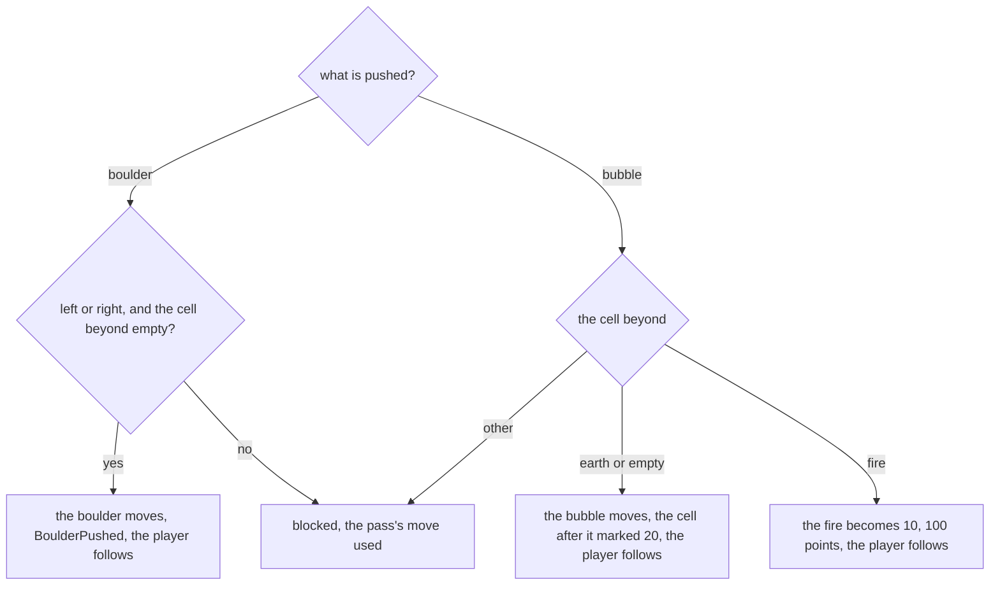

Worked example, `rzx-earth02` (the RZX player's play), the player pushing a bubble right along row 1:

| Frame (sample) | `PlayerIndex` | Cells | What happened |
| ---: | ---: | --- | --- |
| 2428 | 46 | 45: 4 to 0; 46: `$0E` to 3; 47: 0 to `$0E`; 48: 0 to `$20` | the push: the bubble to 47, 48 marked |
| 2434 | 47 | 46: 3 to 0; 47: `$0E` to 3; 48: 0 to `$0E`; 49: 0 to `$20` | the next push |
| 2436 | 47 | 16: 7 to 0; 46: 0 to 7 | a gem from above falls into the cell the player left sideways |
| 2441 | 48 | 48: `$0E` to 3; 49: 0 to `$0E` | 50 beyond is fire: no mark |
| 2448 | 48 | 50: `$0F` to `$10` | the push into fire: `BubbleBurst` ran in frame 2447, then `RaspSound` |
| 2457 | 49 | 48: 3 to 0; 49: `$0E` to 3 | the same pass ends: the player moves in after the sound |

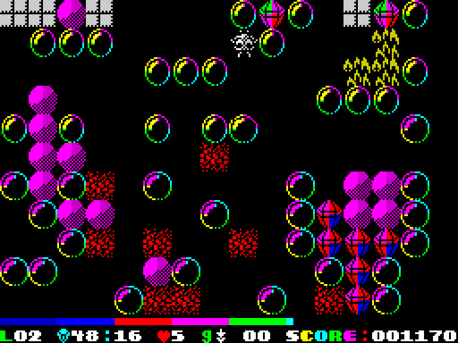

The animation is `rzx-earth02` frames 2426-2490 (the RZX player's play), one picture a frame, repeated pictures
merged (`python3 ../../kit/screen_anim.py --work work/docs/esC/r02 --from 2426 --to 2490 --step 1 --scale 3 --delay
100 --hold 1500 docs/img/play/bubble-burst.gif`).

The fire key pushes too, without moving the player: `FireLeftBoulder $879F` moves the boulder beside the player one
cell on, when that cell is empty, and leaves `$20` in its old cell; doc 05 covers the fire key's other uses.

Witness: `PushBoulder` L1 439 (31 recordings); `BubbleRight` L1 499 (19) and `BubbleLeft` L1 380 (20); `BubbleBurst`
L1 136 (21).

**The point**: pushing is immediate and costs only the pass, so the puzzle is in where things end up, not in timing.
Bubbles are the one object that can be pushed up and down, and the only way to put out fire.

## 10.6 Fire, the dissolve and the burst

Fire (`$0F`) is a hazard and an object at once. It falls and rolls like a boulder, so a falling fire kills like a
falling boulder. The player walking into it dies (`WalkIntoFire $91AE`, 10.9). Two things destroy fire or what touches
it:

- **The dissolve.** The scan turns a boulder with fire directly below into `$15` and sets `FizzCount` to 7. The fire
  stays; the boulder burns away. `AnimateCellCodes` steps the code once a pass to `$1B`, and `$1B` becomes `$20`.
  `FizzSound` beeps one note a pass while `FizzCount` runs down. Only a boulder dissolves; a gem or any other object
  over fire rolls off it or rests on it.
- **The burst.** A bubble pushed into fire makes the fire cell `$10` (10.5). The code steps once a pass to `$14`, and
  `$14` becomes `$20`: the fire is gone.

```text
AnimateCellCodes (once a pass, after the scan):
    SwitchClear()                          # which runs the scan
    for each of the 600 cells:
        if 0x10 <= code < 0x20:
            code += 1
            if code == 0x15: code = 0x20   # the burst ends
            if code == 0x1C: code = 0x20   # the dissolve ends
```

```asm
AnimateCellCodes:
937E  CALL SwitchClear      ; then the scan
9381  LD HL,CaveGrid
9384  LD BC,$0258           ; 600 cells
9387  LD A,(HL)             ; AnimateCellCodesLoop
9388  CP $10
938A  JR C,AnimateCellCodesSkip3
938C  CP $20
938E  JR Z,AnimateCellCodesSkip3
9390  INC A
9391  CP $15
9393  JR NZ,AnimateCellCodesSkip
9395  LD A,$20              ; 14 + 1: the burst ends
9397  CP $1C                ; AnimateCellCodesSkip
9399  JR NZ,AnimateCellCodesSkip2
939B  LD A,$20              ; 1B + 1: the dissolve ends
939D  LD (HL),A             ; AnimateCellCodesSkip2
939E  INC HL                ; AnimateCellCodesSkip3
939F  DEC BC
93A0  LD A,B
93A1  OR C
93A2  JR NZ,AnimateCellCodesLoop
93A4  RET
```

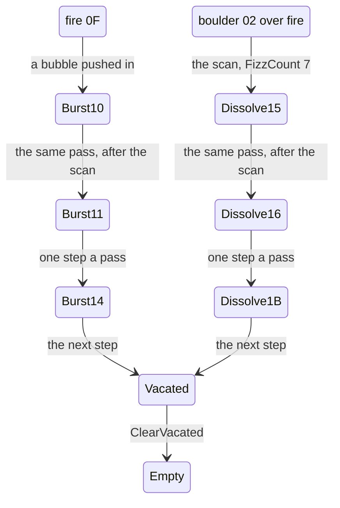

The first codes `$10` and `$15` step on in the same pass, after the scan and before the draw, so the screen shows the
burst from `$11` and the dissolve from `$16`. A burst lasts five passes and a dissolve seven.

Witness: the burst of 10.5 in `rzx-earth02`: cell 50 is `$10` in the sample of frame 2448, `$11` to `$14` in the
samples of frames 2458, 2465, 2472 and 2479, `$20` in frame 2486 and 0 in frame 2487. The 2448 sample shows `$10`
because the frame boundary fell inside the long `RaspSound`, between the burst and the scan. Over the stage 2
recordings a dissolve starts 486 times in `ScanCells` (`$8091`) and 35 times in `AntiGravScan` (`$A671`), and ends
518 times (`$939B`), in 20 RZX recordings; a burst ends 135 times (`$9395`) against 136 bursts. The few that did not
end were cut off by the end of their cave.

**The point**: fire is permanent unless a bubble is spent on it. Boulders cannot be used to bridge fire; they burn.
Cave 29 holds 103 fire cells and cave 31 holds 271 bubbles (10.12), so these two rules carry whole caves.

## 10.7 The switch: a chain reaction

A switch box (`$0B`) does nothing until an object falls into the cell above it. `MoveObject` then sets `SwitchHit`.
At the start of the next pass, before that pass's scan, `SwitchClear $817A` turns every force field (9) and every
switch box in the cave into `$20` and calls `SwitchScore` (250 points and `SwitchSound`). `ClearVacated` empties them
the same pass, and the next scans let everything that rested on them fall: one falling object can open the whole cave.

```text
SwitchClear (start of every pass):
    if SwitchHit:
        for each of the 600 cells: if code in (FORCE_FIELD, SWITCH_BOX): code = 0x20
        SwitchScore()                       # 250 points, the sound
        SwitchHit = 0
    AntiGravPass()                          # the scan of this pass
```

```asm
SwitchClear:
817A  LD A,(SwitchHit)
817D  OR A
817E  JR Z,SwitchClearSkip3
8180  LD HL,CaveGrid
8183  LD B,$14              ; 20 rows
8185  PUSH BC               ; SwitchClearLoop
8186  LD B,$1E              ; 30 cells
8188  LD A,(HL)             ; SwitchClearLoop2
8189  CP $09                ; a force field
818B  JR NZ,SwitchClearSkip
818D  LD (HL),$20
818F  LD A,(HL)             ; SwitchClearSkip
8190  CP $0B                ; a switch box
8192  JR NZ,SwitchClearSkip2
8194  LD (HL),$20
8196  INC HL                ; SwitchClearSkip2
8197  DJNZ SwitchClearLoop2
8199  POP BC
819A  DJNZ SwitchClearLoop
819C  CALL SwitchScore      ; 250 points
819F  XOR A
81A0  LD (SwitchHit),A
81A3  CALL AntiGravPass     ; SwitchClearSkip3: the scan
81A6  RET
```

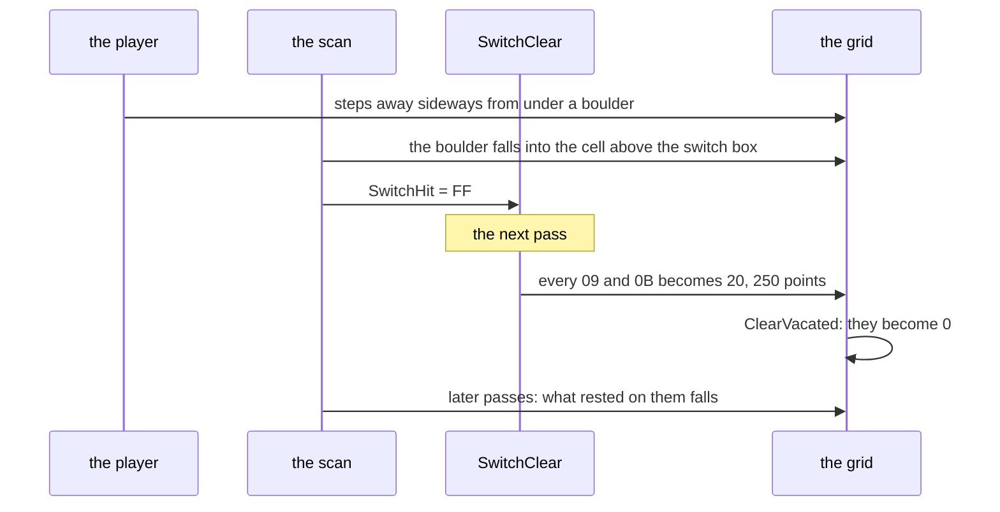

Worked example, `rzx-earth02` (the RZX player's play). The player stands at 467 under a boulder at 437; the switch box
is at 497 under him, five force fields at 529-533.

| Frame (sample) | Trace | Cells | What happened |
| ---: | --- | --- | --- |
| 380 | | 466: 6 to 4; 467: 4 to 2; 437: 2 to `$20` | the player digs left; `MoveLeft` leaves 0 and the boulder falls into 467 in the same pass: 497 under it is the switch box |
| 388 | `SwitchClear` and `SwitchScore` in frames 386-387 | 497: `$0B` to `$20`; 529-533: 9 to `$20` | the next pass clears the switch box and the force fields |
| 404 | | 497, 529-533: `$20` to 0 | |
| 408 | | 467: 2 to `$20`; 497: 0 to 2 | the boulder falls on into the switch box's cell |

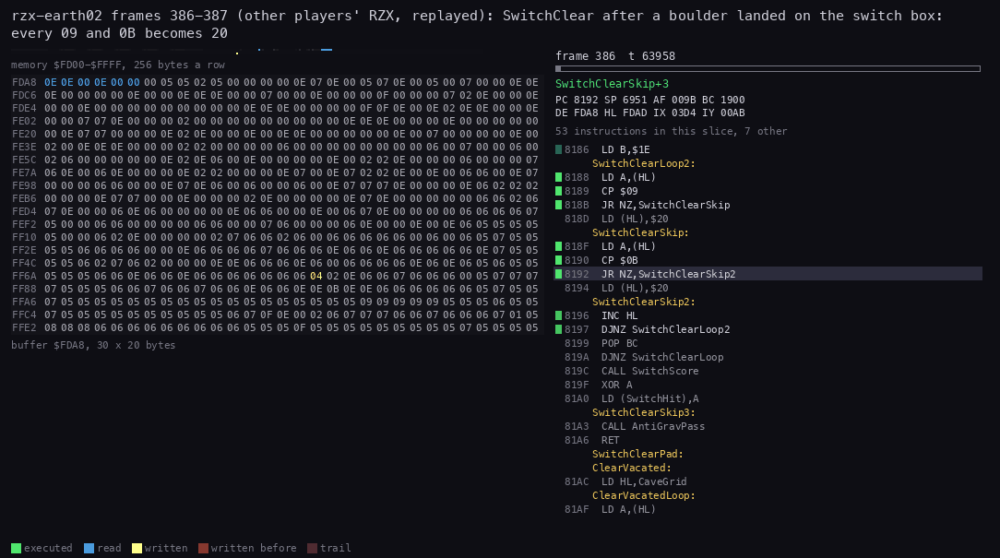

How to read the animation:

- Left: the grid as 30 x 20 hex bytes; the loop walks the 600 cells from the top left and writes `20` over the `0B` at
  497 and the five `09` at 529-533 (rows 16 and 17).
- Right: the listing of `SwitchClear`; `SwitchScore` is called at the end.
- Recording and frames: `rzx-earth02` (the RZX player's play), 386:63400 to 387:38100, 80 pictures. Command: `python3
  ../../kit/routine_anim.py --work work/docs/esC/r02 --window 386:63400-387:38100 --pictures 80 --listing
  build/game.lst --view buffer:FDA8:30x20:hex --range FD00-FFFF --pc 817A-81AB --out
  docs/img/routines/SwitchClear.gif`.

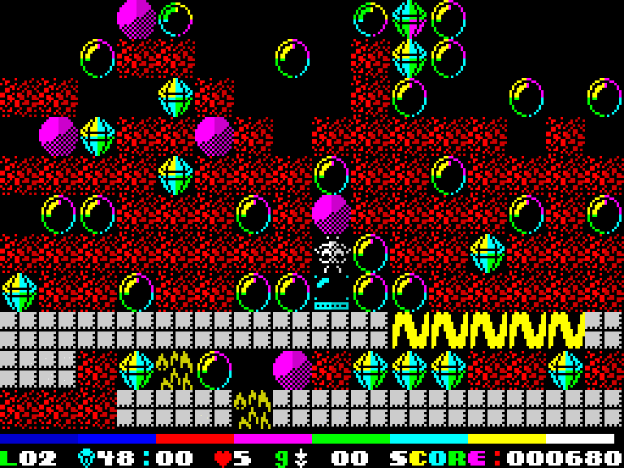

The screen animation is `rzx-earth02` frames 376-412, one picture a frame, repeated pictures merged (`python3
../../kit/screen_anim.py --work work/docs/esC/r02 --from 376 --to 412 --step 1 --scale 3 --delay 120 --hold 1500
docs/img/play/switch-chain.gif`). The force fields are the yellow zigzags right of the player; the switch box is the
cyan box under him.

Witness: `SwitchScore` L1 24 (24 recordings); the frames above.

**The point**: the switch is the game's long-range chain reaction. It acts on every switch box and force field of the
cave at once, wherever they are, and a cave with several switch boxes (cave 26 has three, cave 30 has 28) is opened by
whichever one is hit first.

## 10.8 The special cells

A move into a code above 6 goes to one of four dispatchers, one per direction. Each stores where the move goes on
(`Continuation`, used by `Continue $9410`) and tests the codes 7 to `$0F` in turn. A code it does not handle, and any
code above `$0F`, blocks.

| Code | Left, right, down | Up (`UpSpecialCell $915F`) |
| --- | --- | --- |
| 7 gem | `CollectGem`, then the move | the same |
| 8 jelly bean | `JellyBean $91F7`, then `Continue` | the same |
| 9 force field | `ForceField $914C`: 12 timer steps, blocks | the same |
| `$0A` arrow | `AntiGravTake $A7C7`, then `Continue` | the same |
| `$0B` switch box | blocks | blocks |
| `$0C` potion | `PotionDown $9465`: `TakePotion`, then `Continue` | `CALL Z,TakePotion`, then the tests go on (below) |
| `$0D` teleporter | `TeleportLeft`, `TeleportRight`, `TeleportDown` | `TeleportUp $926E` |
| `$0E` bubble | `BubbleLeft`, `BubbleRight`, `BubbleDown` | `BubbleUp $934F` |
| `$0F` fire | `WalkIntoFire $91AE` | the same |

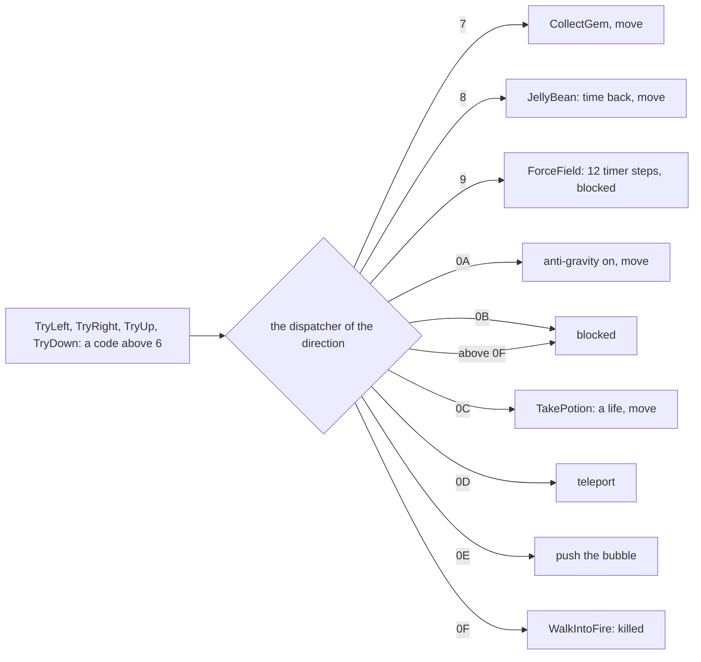

The dispatcher that `TryLeft` uses is `LeftSpecial $94D6` and goes on with `MoveLeft`; `TryRight` uses
`RightSpecial $9494`, which goes on with `MoveRight`. Stage 2 had the two names the other way round; they were
renamed to the moves they serve.

### The jelly bean and the force field

The jelly bean gives time back. `JellyBean $91F7` runs 32 steps of `TimeRefill $A9D7`, each one beep pair, one pixel
shifted back into the time bar from the left (`TimeBarRefillStep $91DB`) and 2 points. A jelly bean is therefore worth
32 pixels, 128 passes of time (10.10), and 64 points. The force field takes time: `ForceField $914C` calls `TimerStep`
12 times, three pixels of the bar, and blocks. Walking into a force field again and again drains the bar.

```asm
JellyBean:
91F7  LD B,$20              ; 32 steps
91F9  PUSH BC               ; JellyBeanLoop
                            ; ... two ROM BEEPER notes, DI
921B  CALL TimeRefill       ; one pixel back, 2 points
921E  POP BC
921F  DJNZ JellyBeanLoop
9221  JP Continue           ; the move
ForceField:
914C  LD B,$0C              ; 12 timer steps
914E  PUSH BC               ; ForceFieldLoop
914F  CALL TimerStep
9152  LD A,(CaveOver)
9155  CP $FF
9157  JR NZ,ForceFieldSkip
9159  POP BC                ; the time ran out
915A  RET
915B  POP BC                ; ForceFieldSkip
915C  DJNZ ForceFieldLoop
915E  RET                   ; blocked
```

Witness: `JellyBean` L1 132 (23 RZX recordings), `TimeRefill` L1 4224 (32 per bean); `ForceField` L1 11 (5 RZX
recordings).

### The potion

`TakePotion $91C9` adds a life unless there are 9, prints the counters, and calls `PotionScore $A8E0`, which plays the
life tune and gives 20 points. `PotionScore` pushes BC once more than it pops: its `RET` takes the pushed BC as the
return address. After `PotionTune` BC holds `$0038`, so the `RET` jumps into the ROM's interrupt routine at `$0038`.
That routine scans the keyboard, counts `FRAMES` and ends with its own `RET`, which pops the real return address. The
potion works because the stray BC happens to point at a routine that returns.

```asm
PotionScore:
A8E0  CALL PotionTune       ; PlayTune LifeTune, DI; BC = 0038 after it
A8E3  PUSH BC               ; pushed, never popped
A8E4  LD B,$14              ; 20 points
A8E6  PUSH HL
A8E7  PUSH BC
A8E8  PUSH DE
A8E9  PUSH AF
A8EA  CALL AddPoints
A8ED  POP AF
A8EE  POP DE
A8EF  POP BC
A8F0  POP HL
A8F1  RET                   ; to 0038, the ROM's IM 1 routine, whose RET goes to TakePotion
```

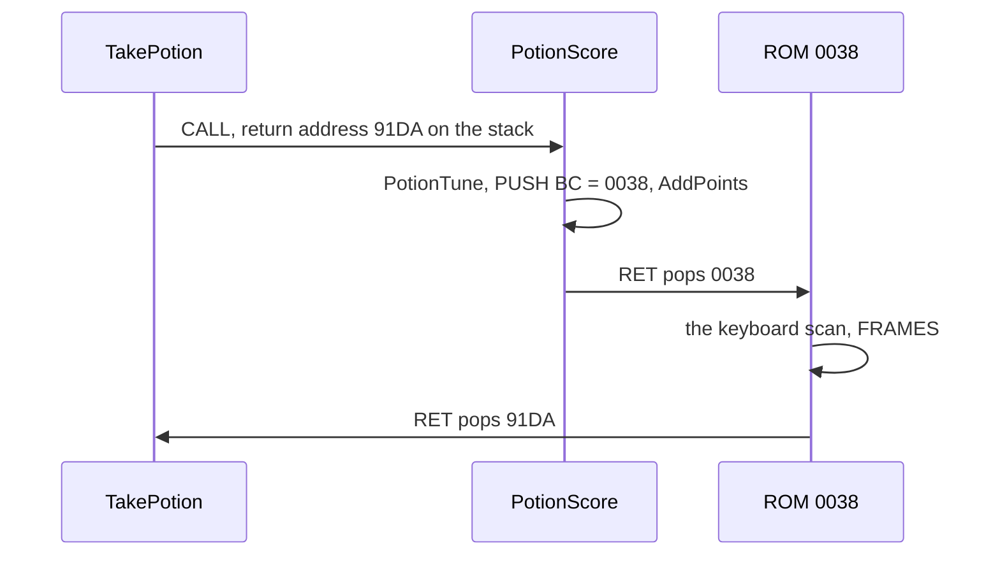

Witness, `rzx-earth09` (the RZX player's play, cave 9), traced in frames 6352 and 6397: `TakePotion` at
6352:28588 and `PotionScore` at 6352:31724; the tune plays for 45 frames; `A8F1` at 6397:67102 is followed by `$0038`
at 6397:67112 and the ROM's keyboard scan, then `$91DA` at 6397:67994, `Continue` at 6397:68014 and `MoveLeft` at
6397:68034. The state log of `earth09` shows the player at 361 beside the potion at 360, the lives going from 5 to 6
after frame 6352, and the player in 360 after frame 6397. Lives rise the same way in caves 15 (6 to 7), 19 (7 to 8)
and 22 (8 to 9); in caves 27 and 28 the RZX player already had 9 and `TakePotion` kept 9.

The up direction has a second oddity. `UpSpecialCell` tests the potion with `CALL Z,TakePotion` instead of a jump, and
then goes on testing the cell at HL. After the tune HL points at the `$FF` that ended `LifeTune`, so none of the
remaining tests match. The last one, `CP $0F` against `$FF`, leaves carry set. The tail at `$919A` then computes
`PlayerIndex + 1 - 30 - carry`, which is `PlayerIndex - 30`, and marks the old cell `$20`: the player moves up into
the potion's cell, by luck of the carry.

```asm
UpSpecialCell:
9182  LD A,$0C
9184  CP (HL)
9185  CALL Z,TakePotion     ; returns with HL at the end of LifeTune
9188  LD A,$0D
918A  CP (HL)               ; FF: no
918B  JP Z,TeleportUp
918E  LD A,$0E
9190  CP (HL)
9191  JP Z,BubbleUp
9194  LD A,$0F
9196  CP (HL)               ; 0F - FF: carry set
9197  JP Z,WalkIntoFire
919A  LD HL,(PlayerIndex)   ; the tail
919D  INC HL
919E  LD DE,$001E
91A1  SBC HL,DE             ; PlayerIndex + 1 - 30 - 1
91A3  LD (PlayerIndex),HL
91A6  ADD HL,DE
91A7  LD DE,CaveGrid
91AA  ADD HL,DE
91AB  LD (HL),$20           ; the old cell
91AD  RET
```

Witness: not executed in any recording. The execution counts of stage 2 (`work/stage2/execs.json`) give `$9185` 221
and `$918E` 205, and none for `$9194` and `$919A`, over `c1`, `menu`, `hiscore`, `lives`, `timer` and the 32 RZX
recordings: no player walked up into a potion. Known only from the code.

### Anti-gravity

The arrow (`$0A`) gives 200 points with a sound (`AntiGravStart $A9EF`) and sets `AntiGravSteps` to 99.
While it is not 0, `AntiGravPass $A7CD` counts it down by one a pass, prints it, and runs `AntiGravScan $A655` instead
of `ScanCells`. That scan starts at row 1, column 0 and walks right and down, with DE the cell above: objects rise one
cell a pass and roll off sideways upward, with the same skip list and the same `$20` marks. It has no crush test and no
switch test. A boulder with fire *above* dissolves. Each anti-gravity pass also beeps once.

```text
AntiGravPass:
    if AntiGravSteps == 0: ScanCells(); return
    AntiGravSteps -= 1; print the digits
    AntiGravScan()            # rows 1 to 19, left to right, objects move up
    beep
```

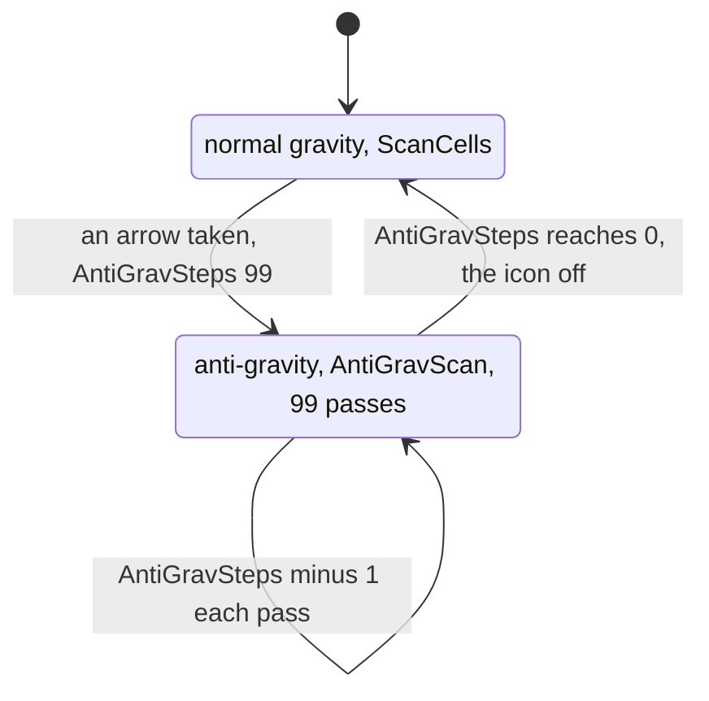

Witness: `AntiGravScan` L1 1397 (6 RZX recordings); `AntiGravTake` L1 15. Because objects never land on the player
while rising, anti-gravity is 99 passes in which nothing can crush him.

### Teleporters

Entering a teleporter erases it (`$20`) and moves the player onto the first teleporter left in the grid, found by
`CPIR` from cell 0. `PutPlayer` then writes the player over that teleporter, so it is gone too when he walks off. Each
jump uses two teleporters: the cave's teleporters are a stock that runs out, and the destination is always the
remaining one nearest the top-left.

```text
TeleportRight (the teleporter at p + 1):
    MoveRight(); grid[p + 1] = 0x20
    t = the first cell from 0 holding TELEPORTER (CPIR over 600 cells)
    if none: return                    # the player stays one cell right, on the erased teleporter
    PlayerIndex = t; draw the window; the flash effects
```

```asm
TeleportRight:
9518  CALL TeleportOutEffect
9524  CALL MoveRight
9527  INC HL
9528  LD (HL),$20           ; the teleporter entered: erased
952F  LD BC,$0258
9532  LD HL,CaveGrid
9535  LD A,$0D
9537  CPIR                  ; the first teleporter from cell 0
9539  LD A,B
953A  OR C
953B  RET Z                 ; none left
953C  DEC HL
953D  LD DE,CaveGrid
9540  SBC HL,DE
9542  LD (PlayerIndex),HL   ; the player there; PutPlayer covers it
9545  CALL WindowOrigin
```

Witness: the `earth04` RZX state log. Cave 4 starts with 8 teleporters and the RZX player makes four jumps, after
frames 1223, 2184, 2839 and 3356. Each time the count drops by one when the player enters (`PlayerIndex` 573 to 105
at the first) and by one more about 51 frames later, after the teleport effects, when `PutPlayer` covers the
destination. After the last jump none is left. `TeleportRight` L1 20, `TeleportLeft` L1 13, `TeleportUp` L1 17,
`TeleportDown` L1 11.

### Falling earth

In caves 13, 17, 22, 24 and 26 the earth graphic is `GfxFallingEarth $A450`, and `SetEarthFalls` patches the earth test
of both scans to NOP ([doc 07.3](07-objects.md#73-the-cave-parameters-fd9a-fda7)). Earth then falls and rolls like any
object, digging under it brings it down, and it never kills (`EarthFell`, 10.3). Witness: the 47 harmless `Crush`
calls of those five RZX recordings.

**The point**: each special is a few lines that reuse the move, the timer or the scan. The two oddities, the potion's
return through the ROM and the up-potion tail, work only because of what a register happens to hold.

## 10.9 Death and lives

Two things set `PlayerKilled $7FFD`: `CrushSkip` (an object landing above the player, 10.3) and `WalkIntoFire $91AE`
(the player moving into fire, from any direction). Nothing else kills: there are no enemies. Running out of time and
pressing H also end the cave, through `CaveOver`, without `PlayerKilled`. All three cost a life in `NextCave $8A07`.

```text
end of a pass:
    if CaveOver: return to NextCave                  # time out or H
    if PlayerKilled: DeathView(); DeathSound(); return to NextCave
    if CaveDone: TimeBonus(); return to NextCave
NextCave:
    if CaveDone: the next cave (10.10)
    else:
        Lives -= 1
        if Lives == 0: return (game over, the high-score check)
        play the same cave again from its record
```

```asm
WalkIntoFire:
91AE  LD A,$FF
91B0  LD (PlayerKilled),A
91B3  JP Continue           ; the move goes on: the player stands in the fire
NextCave:
8A07  LD A,(CaveDone)
8A0A  OR A
8A0B  JR NZ,NextCaveSkip
8A0D  LD A,(Lives)
8A10  DEC A
8A11  LD (Lives),A
8A14  OR A
8A15  RET Z                 ; the last life: game over
8A16  JR CaveStart          ; the same cave again
```

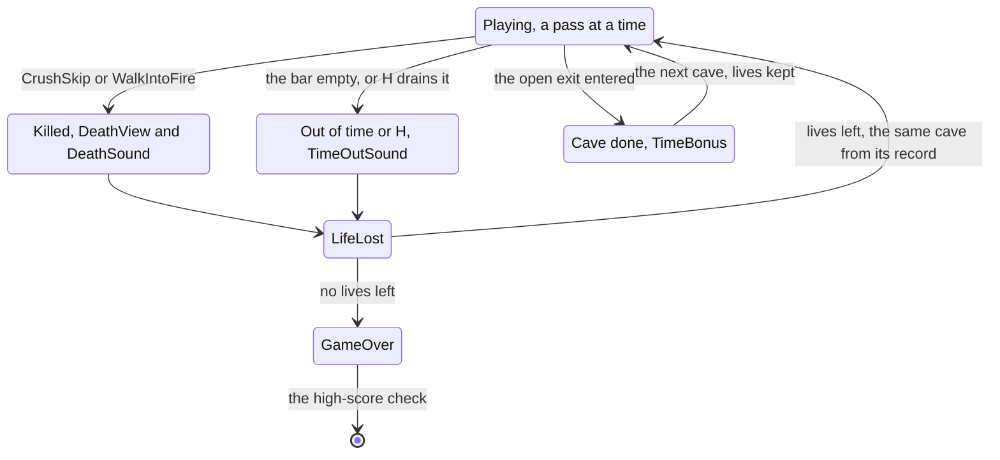

The death view replaces the two player graphics in the cell table with the death graphics and redraws the window;
`DeathSound` then plays 256 ROM BEEPER notes whose periods are bytes of the ROM itself ([doc 09](09-sound.md)).

| Recording | Cause | First frames (trace) |
| --- | --- | --- |
| `death-crush` | a boulder, cave 1 | `Crush` 21, `DeathView` 27, `DeathSound` 30 |
| `death-fire` | fire, cave 4: one step left from cell 573 into 572 | `UnpackCave` 272, `WalkIntoFire` 279, `DeathView` 285, `DeathSound` 288 |
| `c1` | a boulder, cave 1 | `Crush` 13208, `DeathSound` 13218 |
| `lives`, `c1` | H, five times in `lives` | `QuitKey` drains the bar, `TimeOutSound`; the game over at the last life |
| `timer` | out of time, cave 1 | `TimeOutSound` 6040; lives 5 to 4 |

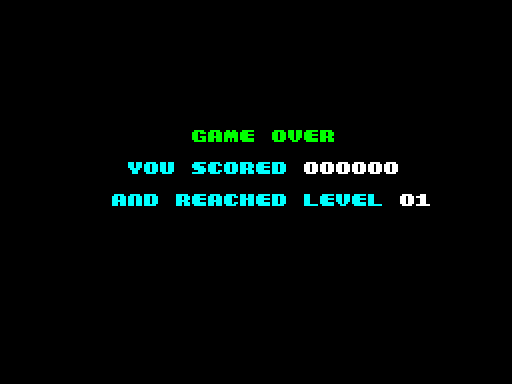

The figure is the `lives` recording at frame 4000, after the fifth H (a stage 1 screenshot, `python3
../../kit/screen_shot.py`).

**The point**: the player has exactly two killers, both made of cells: fire and a falling object. Everything else that
ends a cave is the clock. Losing a life restarts the cave from its record, so every earlier change to the cave is
undone, while the score is kept.

## 10.10 The timer, the gems, the exit and the win

**The timer.** The time bar is 256 pixels: four pixel lines of 32 bytes from `$52C0` (row 22), filled by
`FillTimeBar $8654` at the cave start. `TimerStep $86DE` adds `$40` to `TimerSub` every pass. On the wrap to 0,
every fourth pass, `ShiftTimeBar $8691` shifts the bar one pixel left (RL from the right end of each line) and the ROM BEEPER clicks. The
pixels leave from the left and zeros come in from the right, so the bar shrinks toward the left edge and its first
byte `$52C0` empties last. When it is 0, `TimeOutSound` plays and `CaveOver` is set. A full bar lasts 256 x 4 = 1024
passes, whatever the cave.

```asm
TimerStep:
86DE  LD A,(TimerSub)
86E1  ADD A,$40
86E3  LD (TimerSub),A
86E6  OR A
86E7  RET NZ                ; three passes in four
86E8  CALL ShiftTimeBar     ; one pixel off the bar
86EB  LD HL,$0000
86EE  LD DE,$0000
86F1  CALL RomBeeper        ; the click
86F4  LD A,(Screen+4800)    ; 52C0, the bar's first byte
86F7  OR A
86F8  RET NZ
86F9  CALL TimeOutSound
86FC  LD A,$FF
86FE  LD (CaveOver),A
8701  RET
```

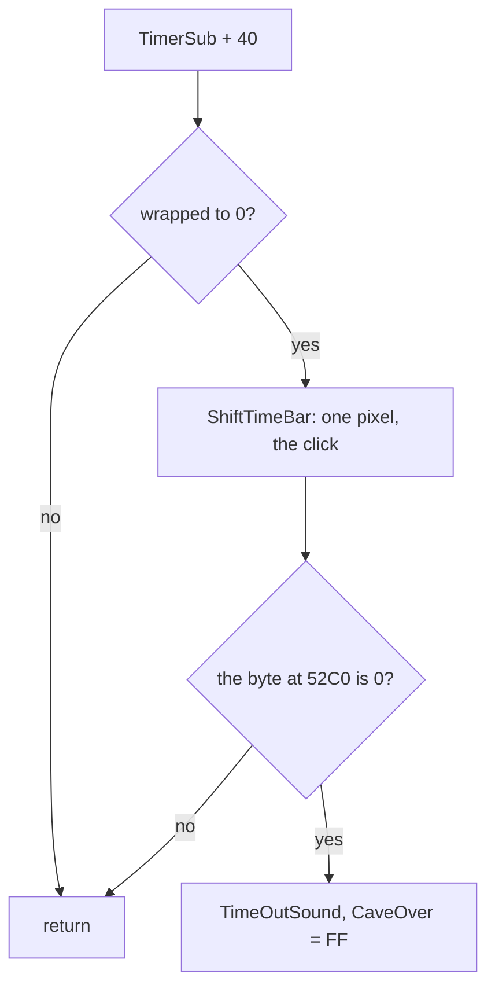

Witness: in `timer`, `PlayCave` starts at frame 2 and `TimeOutSound` at frame 6040, 6038 frames for the 1024 passes
(about 5.9 frames a pass; the window includes the map shown at frame 251). The time a cave gives is a number of passes,
so a heavy cave, whose passes are longer, gives more seconds
([doc 04.7](04-game-loop.md#47-the-time-limit-is-counted-in-passes)).

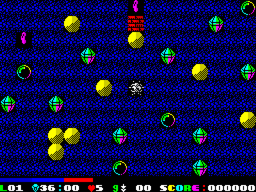

The figure is the `timer` recording at frame 4000, about 63 % of the passes gone (a stage 1 screenshot, `python3
../../kit/screen_shot.py`).

**The gems and the exit.** Taking a gem (`CollectGem $8595`) adds `GemValue` points one at a time, then `CountGem $8394`
adds one to `GemCount` and to the panel digits `GemDigits`. When `GemCount` equals `GemsNeeded`, `ExitOpen` is set and
`ExitOpenSound` plays. From then on `ExitFlash` gives the exit the cycling colour, and a move into the exit sets
`CaveDone`. The test is for equality, made once per gem; every cave but 30 needs all its gems
([doc 07.3](07-objects.md#73-the-cave-parameters-fd9a-fda7)).

```asm
CountGem:
8394  LD A,(GemCount)
8397  INC A
8398  LD (GemCount),A
839B  LD HL,CaveParams      ; GemsNeeded
839E  CP (HL)
839F  JR NZ,CountGemSkip
83A1  LD HL,ExitOpen
83A4  LD (HL),$FF           ; the exit opens
                            ; CountGemSkip: GemDigits + 1, printed, GemSound
```

**The cave done.** `TimeBonus $8702` turns every remaining pixel of the bar into one point, with interrupts off and a
beep per pixel, each higher than the last (`BonusTick $871C`), until `$52C0` is empty. `NextCave` then counts the cave digits up and `CaveNumber` up. After cave
32 (`CaveNumber` `$21`), `WinGame $A8BF` shows the win screen, plays the win tune and sets the cave digits to 01, and
`CaveNumber` becomes 1: the game goes on from cave 1 with the score and lives kept.

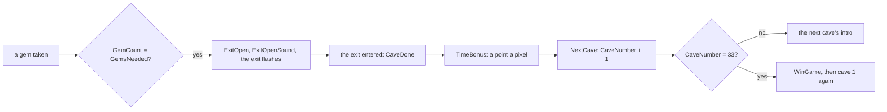

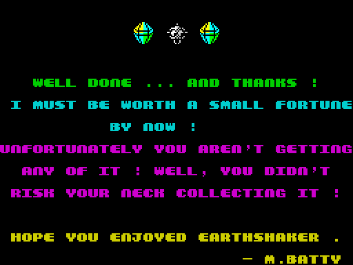

The figure is the last frame of `rzx-earth32` (the RZX player's play; a stage 1 screenshot, `python3
../../kit/screen_shot.py`). Witness: `TimeBonus` L1 32 (32 recordings); `WinGame` L1 1 (`rzx-earth32`).

**The point**: time is counted in passes, not seconds, and what is left of it becomes score. The game has no end
state: after the win it starts over at cave 1 with the score.

## 10.11 The passwords and the order of the caves

The caves are played in order, 1 to 32. A password chooses where to start. At every new game `StartGame $85D6` calls
`Password $8F29`. `EnterPassword $8E2D` fills the 20-byte buffer `$FD00` with spaces and stores the keys typed: space
and the letters, at most 20, `0` to delete, ENTER to end. `FindPassword $8E91` compares the buffer with 50 records of
20 bytes from `CaveNames $9700` and returns the record number B, or 50 when none matched. A match starts the game at
cave B + 1 (`PasswordAccepted $8EE4` colours the line and plays a rising buzz); no match starts at cave 1.

The 32 records the game needs are the cave names, shown on each cave's intro screen. So the password of a cave is its
own name, and seeing a cave once is enough to return to it.

```text
Password:
    EnterPassword()                     # the buffer: spaces, then the typed letters
    B = FindPassword()
    if B == 50: CaveNumber = 1          # no match
    else: CaveNumber = B + 1; CaveDigits = B + 1; PasswordAccepted()
FindPassword:
    for B in 0 .. 49:
        if the 20 bytes at CaveNames + 20 * B equal the buffer: return B
    return 50
```

```asm
FindPassword:
8E91  LD HL,CaveNames       ; 9700
8E94  LD B,$00
8E96  PUSH BC               ; FindPasswordLoop
8E97  LD B,$14              ; 20 bytes
8E99  PUSH HL
8E9A  LD DE,PasswordBuffer  ; FD00
8E9D  LD C,(HL)             ; FindPasswordLoop2
8E9E  LD A,(DE)
8E9F  CP C
8EA0  JR NZ,FindPasswordSkip
8EA2  INC HL
8EA3  INC DE
8EA4  DJNZ FindPasswordLoop2
8EA6  POP HL
8EA7  POP BC
8EA8  RET                   ; B = the record
8EA9  POP HL                ; FindPasswordSkip
8EAA  LD DE,$0014
8EAD  ADD HL,DE
8EAE  POP BC
8EAF  INC B
8EB0  LD A,B
8EB1  CP $32                ; 50 records
8EB3  JR NZ,FindPasswordLoop
8EB5  RET
```

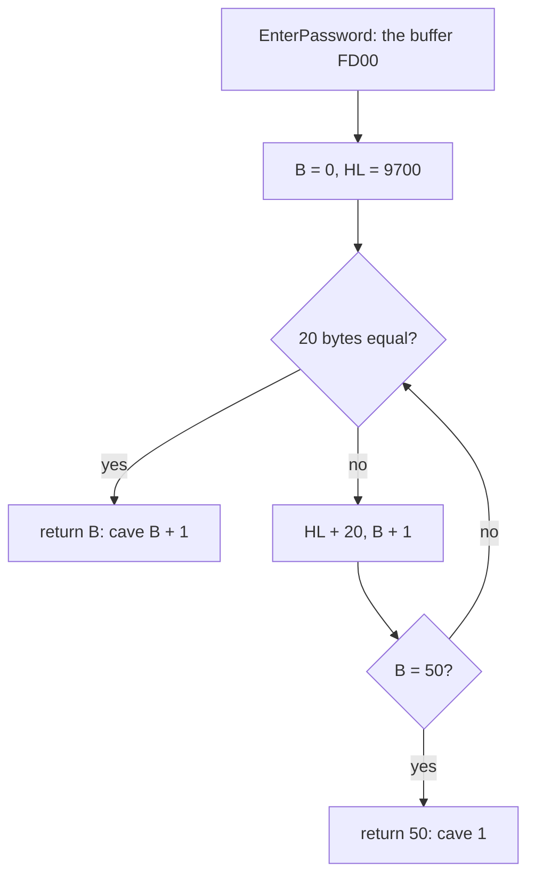

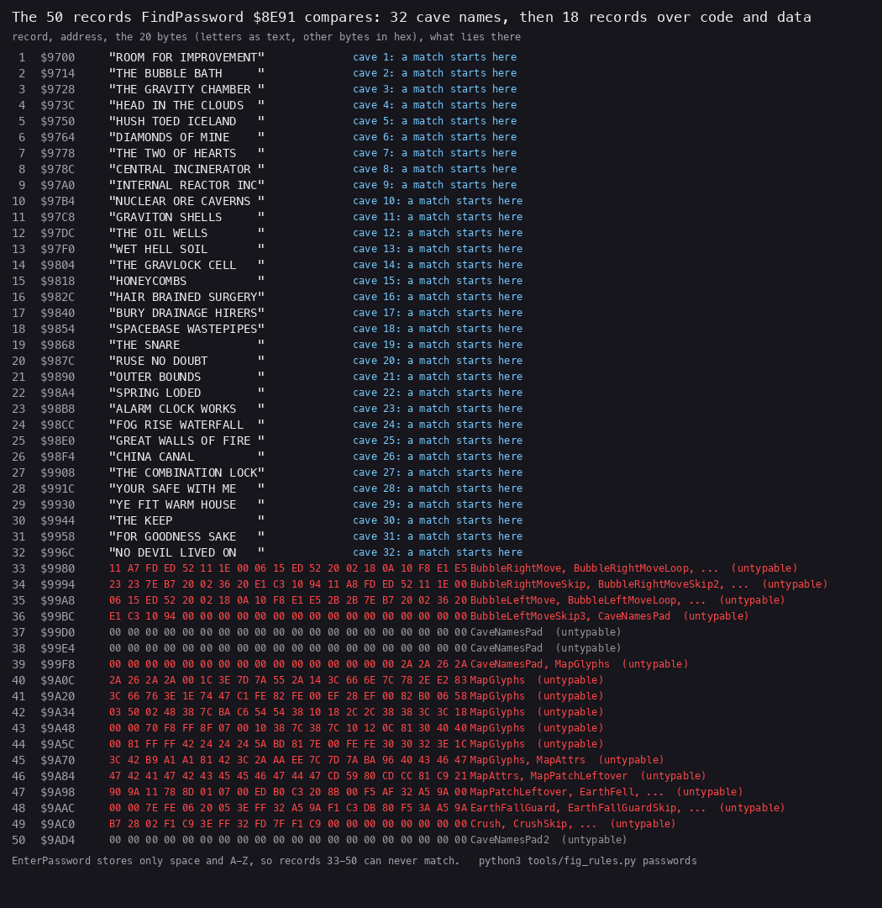

How to read the figure:

- One line a record: its number, its address, its 20 bytes (as text for the names, as hex beyond), and what lies there.
- Records 33-50 (`$9980-$9AE7`) run over the bubble routines, padding, the map's glyphs and `Crush`. Each holds at
  least one byte that no key types (red), or only zeros (grey), so none can ever match.
- Command: `python3 tools/fig_rules.py passwords` (the bytes from `work/mkgame/original.bin`; the keys from the key
  table `$A900`, whose 40 characters give space and A-Z as the only storable ones).

The names hide a pattern. Seven pairs of neighbouring caves are anagrams of each other: 4-5 (HEAD IN THE CLOUDS, HUSH
TOED ICELAND), 8-9 (CENTRAL INCINERATOR, INTERNAL REACTOR INC), 12-13 (THE OIL WELLS, WET HELL SOIL), 16-17 (HAIR
BRAINED SURGERY, BURY DRAINAGE HIRERS), 20-21 (RUSE NO DOUBT, OUTER BOUNDS), 24-25 (FOG RISE WATERFALL, GREAT WALLS OF
FIRE) and 28-29 (YOUR SAFE WITH ME, YE FIT WARM HOUSE). The layouts of a pair are not mirrors or flips of each other
(`work/docs/esC/probe.py`). The last name, NO DEVIL LIVED ON, is a palindrome.

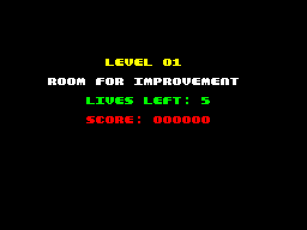

The figure is the intro of cave 1 in `c1` at frame 12800 (a stage 1 screenshot, `python3 ../../kit/screen_shot.py`).

Witness: `EnterPassword` and `FindPassword` L1 3 (`c1`, `lives`, `rzx-earth01`), each time without a match (ENTER
alone). A match and `PasswordAccepted` are known only from the code: no recording types a cave name.

**The point**: a cave's password is printed on its own intro screen, so the passwords are a convenience, not a secret.
The loop over 50 records, 18 of them over code, is a leftover of a longer table; it cannot match by accident.

## 10.12 The caves from first to last

Nothing in the code changes with the cave number: no speed, no timer, no rule. The difficulty is all in the records:
the layout, the gems needed and what objects each cave holds.

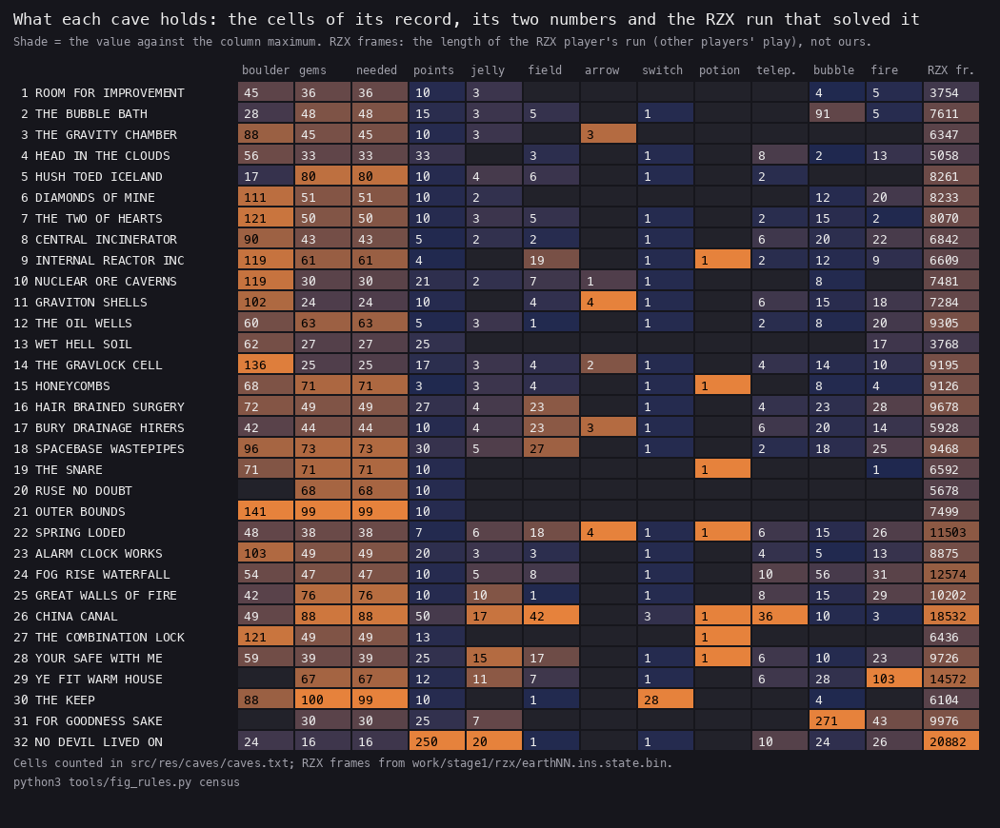

How to read the figure:

- One row a cave, with its name. The columns count the cells of each kind in the record (boulders, gems, jelly beans,
  force fields, arrows, switch boxes, potions, teleporters, bubbles, fire), then the gems needed and the points a gem.
- The last column is the length in frames of the cave's RZX state log, the RZX player's run of that cave (other
  players' play, not ours).
- The shade is the value against the column's maximum.
- Command: `python3 tools/fig_rules.py census` (`src/res/caves/caves.txt`; `work/stage1/rzx/earthNN.ins.state.bin`).

What the counts show:

- The first caves bring one idea each. Cave 1 has boulders, gems, three jelly beans, five fire cells and four
  bubbles. Cave 2, THE BUBBLE BATH, has 91 bubbles, a switch box and five force fields. Cave 3, THE GRAVITY CHAMBER,
  adds three arrows (and three jelly beans). Cave 4 brings eight teleporters and 13 fire cells.
- Some caves are pure exercises: cave 20 is 68 gems in earth and walls with no other object, cave 29 has no boulder
  but 103 fire cells, and cave 21 is 141 boulders and 99 gems and nothing else.
- The specials grow toward the end. Cave 26, CHINA CANAL, holds 36 teleporters, 42 force fields, 17 jelly beans and
  three switch boxes, and gives 50 points a gem; its RZX run is 18 532 frames. Cave 32 needs only 16 gems but gives
  250 points each, and its run is the longest, 20 882 frames.
- Potions are rare: seven in the whole game (caves 9, 15, 19, 22, 26, 27, 28).
- The RZX player lost no life in any cave: the lives at the end of each RZX state log never fall below those at its
  start.

**The point**: Earth Shaker's difficulty curve is hand-made, cave by cave, out of the same rules. A later cave is harder
because it holds more of the objects that cost time or block the way, not because anything runs faster.

## 10.13 Notable features

- **The potion returns through the ROM.** `PotionScore $A8E0` pushes BC once too often; its `RET` lands on `$0038`,
  the ROM's interrupt routine, whose own `RET` takes the real return address. It works because BC holds `$0038` after
  the life tune (10.8; witness `rzx-earth09` frame 6397).
- **The up-potion tail works by the carry.** In `UpSpecialCell` the potion is a `CALL`, not a jump; the tests go on
  with HL pointing into the tune, and the tail at `$919A` moves the player up only because `CP $0F` against `$FF`
  left carry set (10.8; known only from the code).
- **Falling earth is chosen by a graphic's address.** No cave parameter says "earth falls". `SetEarthFalls $FB81`
  looks at the high byte of the earth graphic and NOPs the scan's `CP (HL)` when it is `$A4` (doc 07.3).
- **Cave 30 hides its earth as boulders.** Its earth graphic is the boulder graphic itself (doc 07.3).
- **The switch box is a global trigger.** One object landing on any switch box clears every force field and switch box
  in the cave (10.7).
- **Step down, die; step aside, live.** `MoveUp` and `MoveDown` leave `$20`, `MoveLeft` and `MoveRight` leave 0. A
  boulder over the player falls into a sideways exit at once and waits a pass over a downward exit, which is exactly
  the time for it to land above the player (10.3).
- **Columns spread.** The vacated mark makes a falling column open one-cell gaps (10.2; 1930 cases in the RZX logs).
- **The burst code `$10` is not skipped.** The scan's `CP $10`, `JR C` skips only codes above `$10` (doc 07.8).
- **One dispatcher per direction, the same tests.** `TryLeft` jumps to `LeftSpecial`, `TryRight` to `RightSpecial`;
  they differ only in the continuation and the teleport (10.8). Stage 2 had their names swapped.
- **Teleporting down moves the player up first.** `TeleportDown $941F` calls `MoveUp`, not `MoveDown`, then erases the
  teleporter below. With another teleporter left the player is moved there anyway, so it does not show. With none
  left, the player stays one cell above where he stood and `PutPlayer` writes him over whatever was there. Known only
  from the code: the `earth04` jumps all had a destination.
- **The passwords are the cave names**, with seven anagram pairs and a palindrome among them, and the search runs over
  18 records of code that can never match (10.11).
- **No random numbers.** No `LD A,R`, no `FRAMES`: every cave plays the same for the same keys (doc 07.7).

## 10.14 What no recording reached

Known only from the code, with the recordings checked (`c1`, `menu`, `lives`, `hiscore`, `timer`, the 32 RZX
recordings, `death-crush`, `death-fire`):

- a password that matches, and `PasswordAccepted $8EE4`;
- walking up into a potion (`$9194`, `$919A`);
- a teleport with no teleporter left;
- the burst code `$10` falling or rolling in the one scan it is visible to;
- `PlayerStep $8556` with `PlayerIndex` 0, which skips `TryLeft` (the `JR Z` goes to `TryRight`);
- a life gained at 9 lives (`TakePotion` keeps 9);
- an anti-gravity scan moving an object into the cell above a switch box (it has no switch test, so nothing would
  happen).
