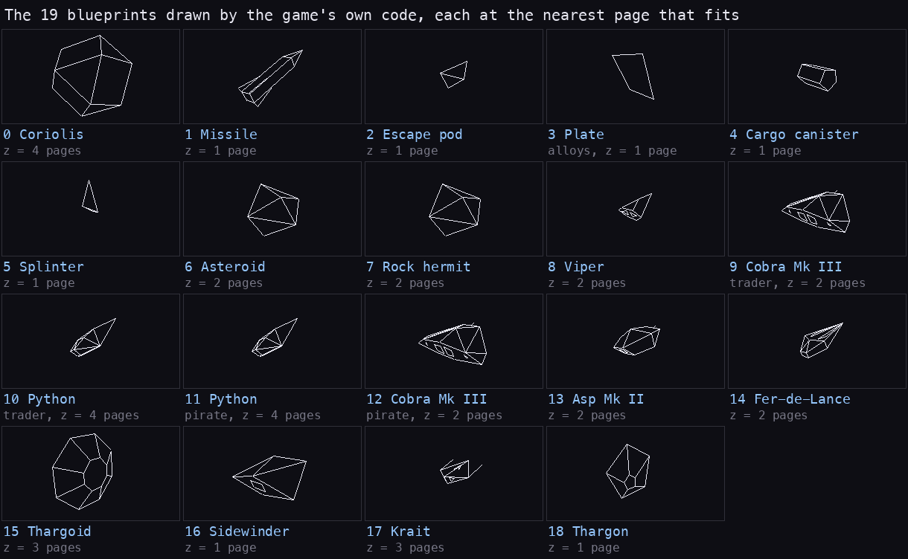

# Elite (Firebird, 1985)

The ZX Spectrum 48K conversion of Elite, reversed in full: every routine and table named and explained, both tape
sides rebuilt byte for byte from the source, and the game taken apart in documents with real screens, renders of
its own code and measurements from the emulator.

State: complete, 2026-11-07.



| | |
| --- | --- |
| Machine | 48K |
| Authors | Ian Bell and David Braben (the original, Acornsoft 1984); the conversion by Torus Ltd., (c) British Telecommunications plc, published by Firebird |
| Sound | beeper, effects only |
| Protection | Softlock on the tape ([03](docs/03-build-and-load.md)), the Lenslok on the screen ([lenslok.md](docs/lenslok.md)) |
| Tapes | `orig/Elite.tzx.zip`: Side A (with the Krait) and Side B (with the Adder), both rebuilt byte for byte; hashes and the other dumps under [The tapes](#the-tapes) |

## Where to start

| If you want | Read |
| --- | --- |
| the game as a player meets it, in pictures | [1. Game design](docs/01-game-design.md) |
| every ship turning, with its numbers | [The ships](docs/ships.md) |
| how to get rich trading: five schemes run on the market's own code, stonks included | [The trading course](docs/trading-guide.md) |
| how the lens protection works, and every code it can ask | [The Lenslok](docs/lenslok.md), [all its codes](docs/lenslok-codes.md) |
| how 2048 planets come out of six bytes | [The galaxy generator](docs/galaxy.md) |
| how a wireframe ship gets onto the screen | [The 3D engine](docs/3d-engine.md), [6. Rendering](docs/06-rendering.md) |
| where the CPU time goes, frame by frame | [The runtime analysis](docs/runtime-analysis.md) |
| what the Spectrum version changed from the BBC original | [Against BBC Elite](docs/bbc-comparison.md) |
| trading, docking, combat, missions as recorded | [The scenes](docs/scenes.md) |
| the tape, Softlock and how the source is built | [3. Build and load](docs/03-build-and-load.md) |
| every document, the terms and the recordings | [docs/README.md](docs/README.md) |
| how the reverse was done, step by step | [WALKTHROUGH.md](WALKTHROUGH.md) |

## Things found on the way

- **A price depends only on the system's economy and one random byte**, so the map matters only for the fuel. Run on
  the game's own market code, the best scheme turns 100 Cr into about 123 500 Cr in 120 jumps; contraband brings no
  police, only about half as many pirates again ([the trading course](docs/trading-guide.md)).
- **The Lenslok has no list of codes.** Each code is made from the Z80's R register when ENTER is pressed; the
  game's own code, run over every state, gives 475 possible codes, 96 of them on a first attempt. A bug in the
  original makes "g" and "q" look the same through the lens in 10 of them ([lenslok.md](docs/lenslok.md) 4.4, 5).
- **14 of the 19 ship shapes are the BBC's byte for byte**; the rest differ in a few edges, normals and distances
  ([bbc-comparison.md](docs/bbc-comparison.md)).
- **A laser shot stops the game for 2.8 frames**: its sound is a sweep played inside the interrupt, so the main loop
  and the next interrupt wait ([9](docs/09-sound.md)).
- **Game Over runs two sound players at once**, because SoundGameOver starts one without a `DI` ([9](docs/09-sound.md)).
- **Lave's opening market is patched in by NewGame**, not made by the market generator ([10](docs/10-gameplay-logic.md)).
- **The commander menu hides on SYMBOL SHIFT** when docked: load and save a commander ([1](docs/01-game-design.md)).

## The tapes

- **The reference:** `orig/Elite.tzx.zip` (md5 `9698e5532b62b0614dff92957d707e59`, SHA-1 `68d6ceb9d20ab2cfb37717a44baaf47dbb755c97`): `Elite - 48k - Side A.tzx` (md5 `6b0ee146cf206d997c901c0e67460c82`, SHA-1 `f56bb775dc9514109437529161778d51d68fd465`), the reference the build must reproduce, and `Elite - 48k - Side B.tzx` (the Adder in place of the Krait; md5 `9dd57ef1bb0c42315951208593719960`).
- **Also kept:** `orig/Elite_2.tzx.zip` (md5 `4112bdb775c2fe89581c47717d514dbe`, SHA-1 `59e2cd39cda0b32195aad9e67b3d68623445f752`): another 48K dump (Side B's data) and the 128K version; `orig/Elite48.tap.zip` (md5 `a82772d1e6e05130070afc3ab2d80c37`, SHA-1 `c7baec968b68064f1621eb85c496e1aca08f2e7b`): the crack `ELITE48.TAP`, no Softlock, the Lenslok patched ([lenslok.md](docs/lenslok.md) 7); `orig/Elite.txt` (md5 `36f1c2fdc06157a24dd96d2261262c46`): the instructions ([texts](docs/texts/README.md)).

## Build

```bash
tools/build.sh [SJASMPLUS]     # build/Elite-SideA.tzx and Elite-SideB.tzx, each compared byte for byte with orig/
```

It prints `build: Elite-SideA.tzx identical to orig/Elite.tzx.zip's Side A` and the same for Side B. Needs
sjasmplus and Python 3 with Pillow.

The game source is `src/game/*.asm` (26 modules), written by `kit/mkgame.py --install` from `src/game/game.ann`
(SkoolKit in a venv); the Lenslok check is its own part (`src/lenslok/`); the tape parts are `src/tape/` (the BASIC
and the stub, Softlock, the block list); the resources are `src/res/` (`src/res/README.md`). How the parts fit:
[03](docs/03-build-and-load.md) 3.10.

## The Lenslok without the lens

`python3 tools/lenslok_answer.py SEED` prints the code the game asks for, from the seed word at `$C784` (two
`LD A,R`), computed the way the game computes it; [lenslok-codes.md](docs/lenslok-codes.md) lists all 475 codes.
The case never patches the game to get past it.

## Credits and provenance

The reverse is made from the tape and the emulator's recordings. These works were read to cross-check it, never as
a source of bytes or names ([WALKTHROUGH](WALKTHROUGH.md) 7):

- [elite-skoolkit](https://github.com/Rasmus-M/elite-skoolkit) by Rasmus M: a SkoolKit disassembly of the cracked
  `ELITE48.TAP` (the same file as `orig/Elite48.tap.zip`'s);
- [zx-elite](https://github.com/ataribaby42/zx-elite) by ataribaby42: notes on the Spectrum game's data structures
  and routines;
- [EliteNext](https://github.com/TinfoilAsteroid/EliteNext) by TinfoilAsteroid: Elite for the ZX Spectrum Next;
- [bbcelite.com](https://www.bbcelite.com) by Mark Moxon: the BBC Micro original, fully documented.

The tape files come from the World of Spectrum archive; the Lenslok instructions, the keyboard overlay and the
inlay scans from ZXDB (spectrumcomputing.co.uk).
