# 1. Game design

What this covers: Elite as a player meets it, shown with the game's own screens and with renders of its own code.

- the game and this version, the box and the title (1.1);
- the screens, every part of the flight screen named, the scenes in motion (1.2);
- the controls in short (1.3);
- the ship, its equipment, the missiles, the E.C.M., the docking computer (1.4);
- space: the 19 ships drawn by the game's code, the galaxies, the charts, the station (1.5);
- the rules of a career: trading, jumping, the law, docking, scooping, the missions (1.6);
- the score: the rating ladder (1.7);
- options and modes (1.8), difficulty (1.9), the Lenslok (1.10);
- what the recordings reached (1.11), the commodities (1.12), where each part is taken apart (1.13).

The names are those of `src/game/game.ann` ([Terms](README.md#terms)). The recordings are all 48K, Side A, each
from the title snapshot that `work/snaps` keeps after the Lenslok was answered. [scenes](scenes.md) tells each one:

| Recording | What it plays |
| --- | --- |
| `d1`, `f1`, `w1` | the docked screens; flight and the jump to Diso; witch space and the death ([10](10-gameplay-logic.md) 10.9) |
| `t1` | trading at Lave, a commander saved |
| `dk` | a commander loaded, docking by hand and by the computer |
| `k2` | a missile, the E.C.M., the energy bomb, kills and a new rating |
| `gx` | the galactic hyperdrive |
| `m1`, `m2` | the nova and the Thargoid missions |
| `cs` | a cargo scoop |
| `j1` | the Kempston joystick and the options |

## 1.1 The game and this version

Elite is a space trading and combat game. The player flies a Cobra Mk III between the systems of eight generated
galaxies, buys cheap and sells dear, fights pirates, police and Thargoids, and climbs a combat rating from Harmless
to Elite. The original is by Ian Bell and David Braben (Acornsoft, BBC Micro, 1984). The 48K Spectrum conversion is
by Torus, published by Firebird in 1985 ("Conversion by Torus Ltd. (c) British Telecommunications plc", the manual's
title page, [texts/manual.md](texts/manual.md)).

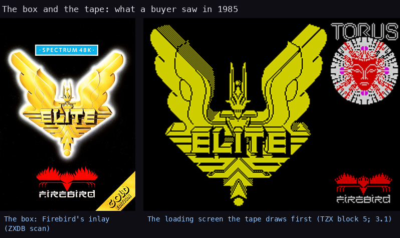

How to read it: left, the front of the box (ZXDB's scan); right, the loading screen as the emulator shows it while
the Softlock loader runs ([3](03-build-and-load.md) 3.1). Drawn by `python3 tools/fig_design.py cover`.

The title turns the ship of the box, the Cobra, with the dashboard already drawn below:

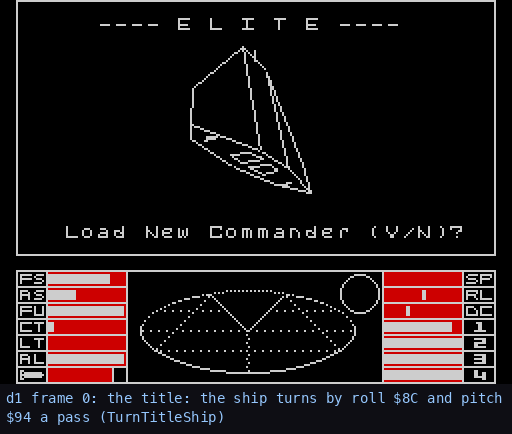

How to read it: `d1`'s screens 0-450, one in ten frames. The ship turns by pitch `$8C` and roll `$94` a pass
(TurnTitleShip). [6](06-rendering.md) 6.5 redraws the same pictures with the game's own code in a Z80 simulator,
0 pixels apart. `python3 tools/fig_design.py title`.

The conversion keeps the BBC game's rules: the galaxy, the names, the planet descriptions, the market and the
ratings come from the same seeds and the same kind of arithmetic ([bbc-comparison](bbc-comparison.md) checks them
table by table). What it changes is the machine side:

- a 256 x 128 wireframe view drawn in a back buffer and copied to the screen ([6](06-rendering.md));
- a red and white dashboard in the bottom third ([8](08-hud-and-text.md));
- the beeper for sound ([9](09-sound.md));
- its own maths routines, its own missions, its own combat score;
- the Lenslok against copying (1.10).

The case rebuilds Side A of the TZX byte for byte ([3](03-build-and-load.md)).

## 1.2 The screens

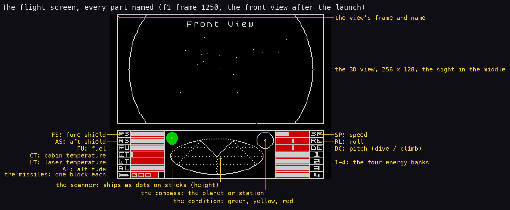

How to read it: `f1` frame 1250, just after the launch, at 3x. The top two thirds are the 3D view, framed and
named. The bottom third is the dashboard:

- left: six bar gauges, then the missile blocks;
- middle: the condition light; the scanner, an ellipse on which a ship is a dot on a stick whose length is its
  height; the compass, a dot on a circle showing where the planet or the station lies;
- right: the speed, the roll and pitch markers, and the four energy banks.

[8](08-hud-and-text.md) 8.7 gives each element's writer and scale. `python3 tools/fig_design.py dashboard`.

The screens in a game's order:

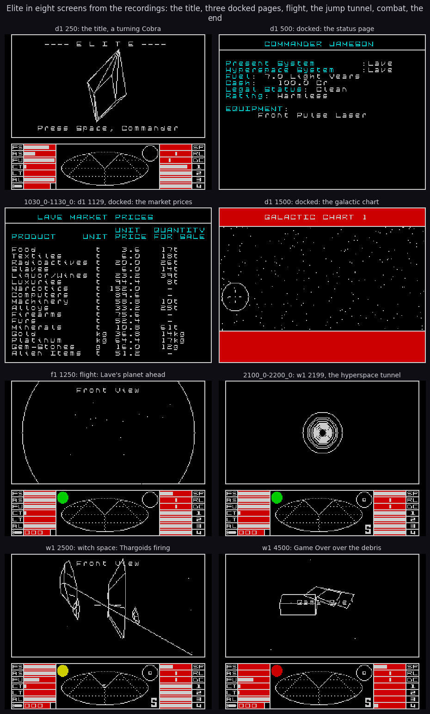

How to read it: each picture is a recorded screen at 2x, named by its recording and frame (a trace name means the
screen at the trace's last instruction). The docked screens are text pages in cyan and white:

| Key | Screen | Key | Screen |
| --- | --- | --- | --- |
| L | the status | P | the data on a system |
| K | the market prices | ENTER | the inventory |
| I | the galactic chart | 2, 3, 4 | buy, sell, equip |
| O | the short range chart | SYMBOL SHIFT | the access menu |

The command: `python3 tools/fig_pages.py docs/img/design/game-sheet.png --title "Elite in eight screens from the
recordings: the title, three docked pages, flight, the jump tunnel, combat, the end" "d1:250:the title, a turning
Cobra" "d1:500:docked: the status page" "work/d1/traces/1030_0-1130_0.uatr:end:d1 1129, docked: the market prices"
"d1:1500:docked: the galactic chart" "f1:1250:flight: Lave's planet ahead" "work/w1/traces/2100_0-2200_0.uatr:end:w1
2199, the hyperspace tunnel" "w1:2500:witch space: Thargoids firing" "w1:4500:Game Over over the debris"`.

The same moments in motion. Every picture is a recorded screen; `tools/grab.py` reads them once from the recordings
and `python3 tools/fig_design.py scenes` makes the GIFs:

| The launch (`f1` 948-1148) | Flight to the planet (`f1` 1252-1500) |
| --- | --- |
| 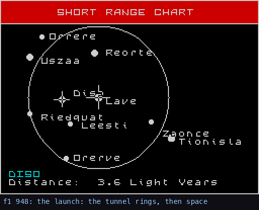 | 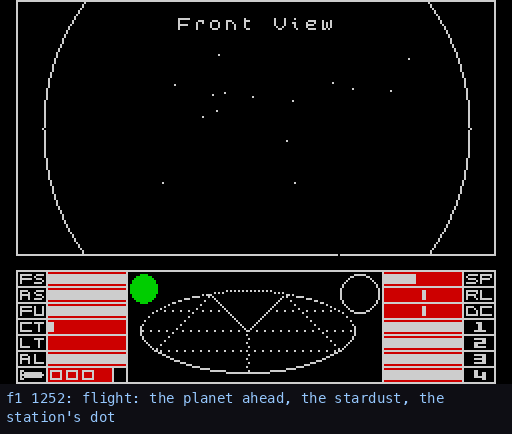 |
| **A fight in witch space (`k2` 2484-3460)** | **The end (`w1` 4200-4560)** |
| 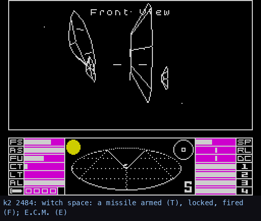 | 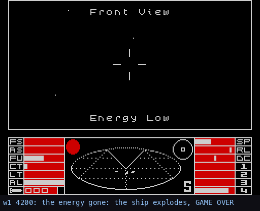 |

How to read them: a line under each picture names the recording, the frame and the step of the scene.

- The launch draws the station's tunnel as rings growing from the centre ([6](06-rendering.md) 6.6).
- In flight the stardust streams out from the centre, faster as the speed rises.
- In the fight the scanner's dots swing round as the Thargoids circle, the missile leaves the centre as a small
  wireframe, and the energy bomb flashes the view.
- In the end the ship's own debris (a canister, two plates) drifts while GAME OVER is printed.

The hyperspace tunnel, one frame of it as [6](06-rendering.md) 6.6 takes it apart:

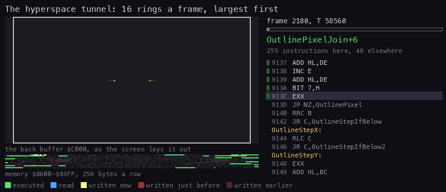

**How to read it.** One tunnel frame of `w1` (2180-2182) drawn routine by routine; each new circle appears as it is
drawn (`tools/fig_routine_anim.py`, the command in [6](06-rendering.md) 6.6).

## 1.3 The controls in short

All keys are read by the frame interrupt into six key bytes ([5](05-controls.md) 5.2-5.3). A Kempston, Cursor or
Sinclair joystick can replace the four steering keys and fire.

| What | Keys |
| --- | --- |
| steer | N, M roll; X, S climb and dive |
| speed | SPACE faster, SYMBOL SHIFT slower |
| views (in flight) | 1 front, 2 rear, 3 left, 4 right |
| fire | A (the laser of the view), T target a missile, F fire it, U unarm, E E.C.M., W energy bomb, Q escape pod |
| travel | H hyperspace, G with H galactic, J the in-system jump, C the docking computer |
| screens | L status, K market, P data, O short range chart, I galactic chart, ENTER inventory |
| charts | N, M, X, S the cursor; B home; D the distance; R find a planet by name |
| docked | 1 launch, 2 buy, 3 sell, 4 equip, SYMBOL SHIFT the access menu (load or save a commander) |
| pause | CAPS SHIFT; then SPACE resume, 1 the title, B D F K Q R S Y options (1.8) |

The table agrees with the box's keyboard overlay ([5](05-controls.md) 5.3 sets it beside the key map read from the
code), the Quick Key Control Guide ([texts/instructions.md](texts/instructions.md)) and the manual. The roll
reaches its full rate in 16 frames, the pitch in 40 ([5](05-controls.md) 5.5).

## 1.4 The ship

The player's ship is a Cobra Mk III:

- four laser mounts (front, rear, left, right) and up to four missiles;
- a hold of 20 tonnes, two shield banks (fore and aft) and four energy banks;
- a 7.0 light year fuel tank.

A new commander, JAMESON, starts docked at Lave with 100.0 Cr, a full tank, a front pulse laser and three missiles
(DefaultCommander `$D232`, [10](10-gameplay-logic.md) 10.8). The record in the `d1` snapshot of frame 500, 40
frames after NewGame:

| Field | Address | Value | Meaning |
| --- | --- | --- | --- |
| cash | `$D067` | `00 E8 03 00` | 1000 tenths: 100.0 Cr |
| free space | `$D07C` | 20 | an empty 20 t hold |
| lasers | `$D07D` | 1, 0, 0, 0 | a pulse laser in front, no others |
| fuel | `$D082` | 70 | 7.0 ly |
| missiles | `$D083` | 3 | three of four |

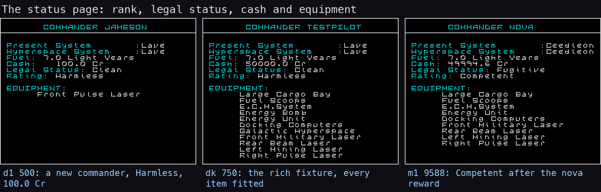

How to read it: three status pages (L).

- Left, `d1` 500: JAMESON as the game creates him.
- Middle, `dk` 750: TESTPILOT, loaded from the commander tape `work/tapes/rich.tap` by the game's own loader, every
  piece of equipment fitted. The action recordings start from this fixture ([scenes](scenes.md) 0 says how it was
  made from `t1`'s save).
- Right, `m1` 9588: after the nova mission's reward, Competent and a fugitive.

`python3 tools/fig_design.py status`.

The stations sell more the higher their tech level: the system's tech level plus 3 items, all fourteen from tech
level 9 on. The items are fuel, missiles, the large cargo bay, the E.C.M., the pulse, beam, military and mining
lasers, fuel scoops, the escape pod, the energy bomb, an extra energy unit, the docking computers and the galactic
hyperdrive, with their prices in [10](10-gameplay-logic.md) 10.4. Lave (tech level 5) offers eight: the third
picture of the market figure in 1.6.

The lasers differ in rate and power:

| Laser | Fires when held | Power | Heat a shot |
| --- | --- | --- | --- |
| pulse | every other pass | `$0F` | 8 |
| beam | every pass | `$0F` | `$0A` |
| military | every pass | `$17` | `$0A` |
| mining | every 8th pass | `$32` | 8 |

([7](07-objects.md) 7.8.) A laser fires only while its heat is below `$90`; the heat falls by 2 a pass.

What the rest of the equipment did in the recordings (the fight GIF of 1.2 shows `k2`):

- **The missile.** T armed one and it locked on the nearest Thargoid (MissileState 2 at `k2` 2519). F fired it at
  2542: a new ship in slot 7, one block fewer on the dashboard. At 2612 it was gone, destroyed by a Thargoid's
  E.C.M. (the E.C.M. counter at 8, the missile's 224 points added to the score).
- **The E.C.M.** E at 2613; the counter ran down from 8 ([scenes](scenes.md) 3).
- **The energy bomb.** W at 3301 flashed the view 24 times from 3304. The bomb destroys every ship but the station and the
  Thargoid motherships (UpdateSlot skips a blueprint whose `+$06` byte is `$27`), so `k2`'s four Thargoids flew on.
- **The docking computer.** C in the station's safe zone, and the ship docks by itself:

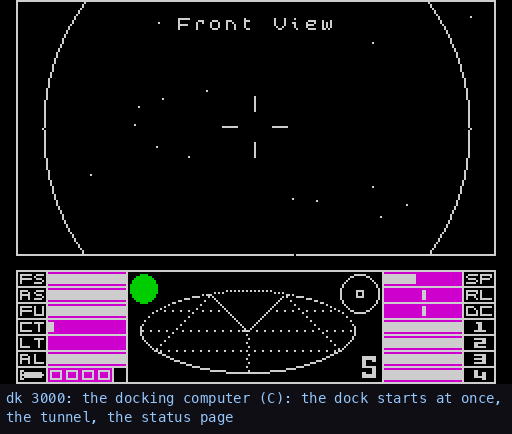

How to read it: `dk` 3000-3420, one in eight frames, just after the second launch from Lave. C was pressed at 3002 and
the dock began at once: no approach is flown. From 3020 the docking tunnel's rings play under DOCKING COMPUTERS ON, the
status page follows at about 3300, and Condition is 0 (docked) at 3408 (`python3 tools/fig_design.py scenes`)

## 1.5 Space

Every ship, the player's included, lives in one of eight slots ([7](07-objects.md) 7.1). The game has 19 blueprints.
Here each is drawn by the game's own code: the title loop's ClearView and TurnTitleShip run in a Z80 simulator on
`d1`'s title memory, with the blueprint swapped in:

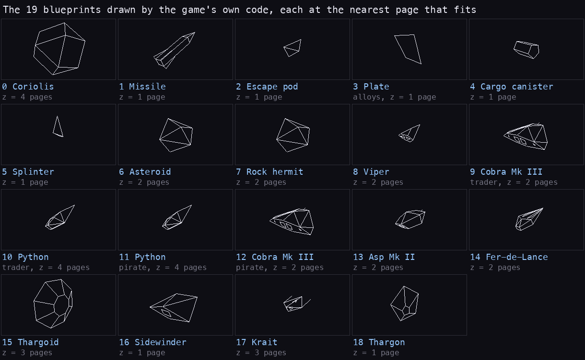

How to read it: one panel a blueprint, by number. Each sits at the nearest whole page of distance (z in units of
256) at which it stays inside the view, and turns by the title's roll and pitch. All of it is the game's own work:

- the faces that turn away are hidden;
- far ships lose detail;
- the lines come from the game's line drawer.

The emulator's title pictures of all eight title ships and the simulator's differ by 0 pixels ([3d-engine](3d-engine.md)
before 1); the short lines off the Krait and the Cobra are their prongs and gun, edges of the blueprints. `python3 tools/fig_ships_anim.py gallery` (`tools/shipsim.py`). Each ship alone, its numbers and where it is met: [the ships](ships.md).

| Kind | Blueprints |
| --- | --- |
| the station and the missile | 0 Coriolis, 1 Missile |
| debris and scoopables | 2 Escape pod, 3 Plate (alloys), 4 Canister (cargo), 5 Splinter, 6 Asteroid |
| traders and others | 7 Rock hermit, 8 Viper (the police), 9 Cobra and 10 Python traders |
| pirates and Thargoids | 11 Python and 12 Cobra pirates, 13 Asp, 14 Fer-de-Lance, 15 Thargoid |
| small fighters | 16 Sidewinder, 17 Krait, 18 Thargon |

The box had a ship identification chart. The game's ships beside it:

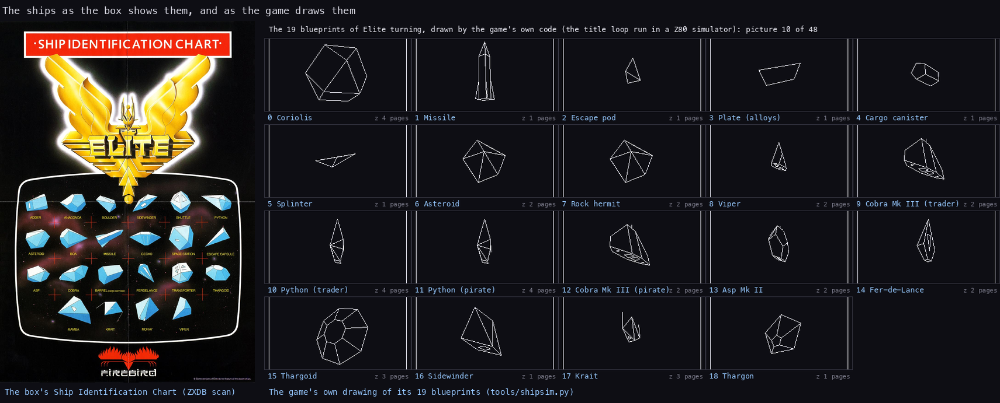

How to read it: left, the chart from the box (ZXDB's scan); right, one still of the gallery above. The chart was
printed for every version ("Some versions of Elite do not feature all the above ships", its small print), so it
shows eight ships Side A never draws: the Anaconda, Boa, Gecko, Mamba, Moray, Shuttle, Transporter and Adder (Side B
has the Adder instead of the Krait, [3](03-build-and-load.md) 3.12). `python3 tools/fig_design.py shipchart`.

A ship far away is a dot. Nearer, it is a wireframe that gains its far edges as it closes:

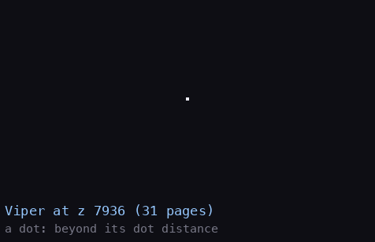

How to read it: the Viper from z 31 pages to 2. The line under each picture says what DrawShip chose: the
four-pixel dot beyond the blueprint's dot distance (header byte `+$0B`), then the wireframe.
[6](06-rendering.md) 6.5 has the detail rule. `python3 tools/fig_ships_anim.py approach`.

Ships appear as encounters while the player flies. Every 256 passes outside the safe zone, with fewer than four
ships about, SpawnShip `$BBBA` rolls against a danger made of the contraband in the hold. It picks by the government
(anarchies always spawn) a lone pirate, a trader, a rock hermit or a group of Sidewinders and Kraits
([7](07-objects.md) 7.8). In witch space the Thargoids come instead. Their tactics (turning to the player, firing,
launching missiles or Thargons, fleeing) are [7](07-objects.md) 7.7.

A system has a sun, a planet and a Coriolis station near the planet. The safe zone around the station is where the
docking computer works and the police watch. The station turns slowly about its axis:

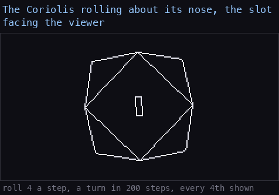

How to read it: blueprint 0 at z 4 pages, nose at the viewer, turned by TurnOwn at roll 4 (TurnRates `$84`), one
picture in four of a 200-step turn. The rectangle is the docking slot. `python3 tools/fig_ships_anim.py station`.

The universe is eight galaxies of 256 systems each, all generated from three seed words. A system's position,
economy, government, tech level, population, productivity, name and description come from its seeds; the next
galaxy comes from rotating them. [galaxy.md](galaxy.md) takes the generator apart step by step.

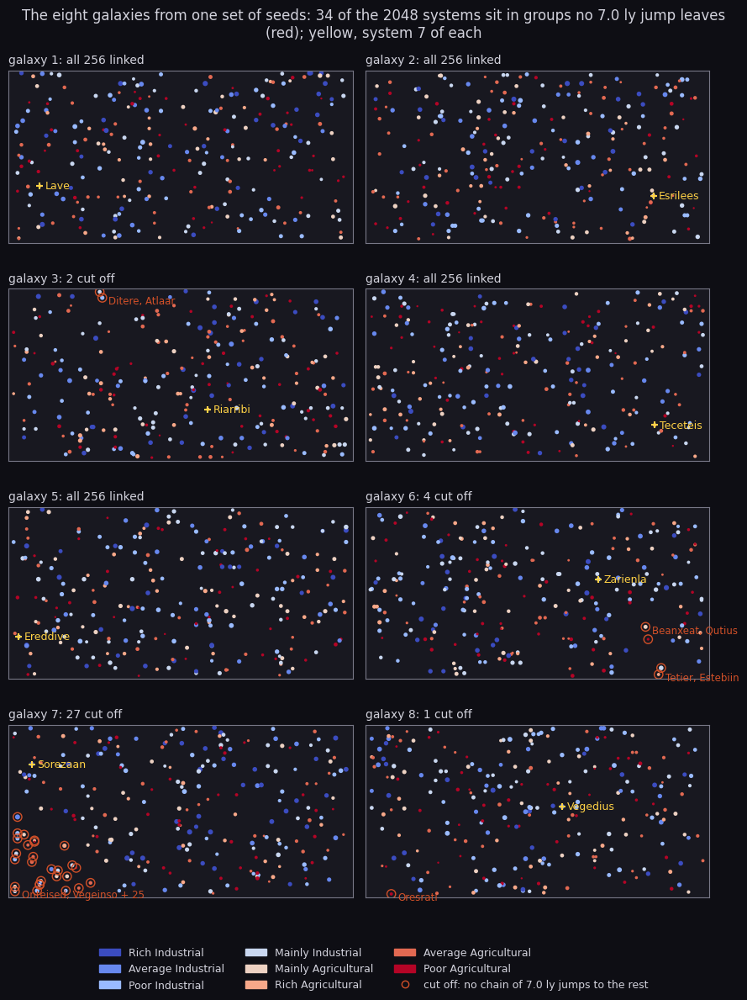

How to read it: each panel is one galaxy as the galactic chart lays it out, a dot per system, coloured by economy
and sized by tech level. The yellow cross is system 7 (Lave in galaxy 1). Ringed in red are the systems that no
chain of jumps of 7.0 ly or less links to the rest of their galaxy: only the galactic hyperdrive reaches or leaves
them. Galaxy 7 holds a group of 27, galaxy 8 the lone Oresrati. `python3 tools/fig_galaxies.py galaxies`.

On board, the two charts and the data page:

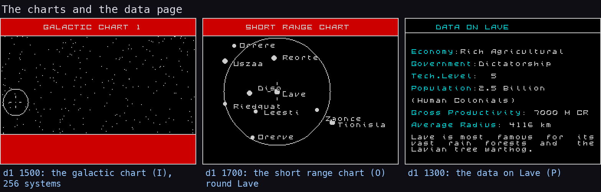

How to read it: `d1` 1500, 1700 and 1300.

- The galactic chart (I) halves y (256 x 128 dots), with the cursor's circle over Lave.
- The short range chart (O) is centred on the present system.
- The data page (P) is generated from Lave's seeds, the description included ("Lave is most famous for its vast
  rain forests and the Lavian tree warthog", [galaxy.md](galaxy.md)).

`python3 tools/fig_design.py charts`.

## 1.6 The rules of a career

**Trading.** Each station has 17 commodities. Their prices and stocks are set by the system's economy and by a
fluctuation byte rolled at each arrival: food is cheap at agricultural worlds, computers at industrial ones
([10](10-gameplay-logic.md) 10.3). Slaves, narcotics and firearms are illegal: buying or scooping them makes the
player an offender.

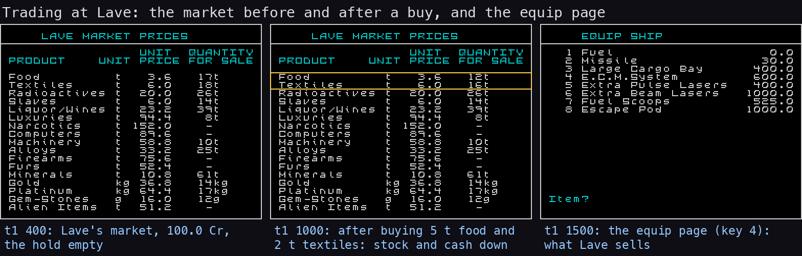

How to read it: `t1`, docked at Lave with 100.0 Cr.

- Left (400): the market as it starts.
- Middle (1000): after buying 5 t of food and 2 t of textiles. The framed rows' stocks fell from 17 to 12 and from
  18 to 16, and the cash to 70.0 (5 x 3.6 + 2 x 6.0 = 30.0). The prices did not move: a station's prices are fixed
  until the next arrival.
- Right (1500): the equip page, eight items at tech level 5.

`t1` then sold 2 t of food back at the same 3.6 (77.2 Cr) and bought a missile (47.2 Cr).
`python3 tools/fig_design.py market`.

Where to trade is a matter of the map:

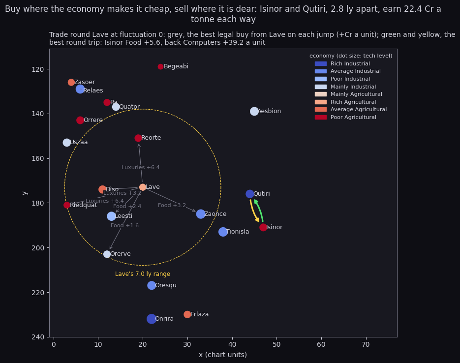

How to read it: Lave's part of galaxy 1, coloured by economy, with Lave's 7.0 ly range dashed.

- A grey arrow is a jump from Lave, labelled with the legal commodity that earns most a unit there. The prices are
  at fluctuation 0, the market's middle; an arrival's fluctuation moves each price by up to its mask.
- The green and yellow pair is the best round trip in the window: food from poor agricultural Isinor to rich
  industrial Qutiri (+5.6 Cr a tonne), computers back (+39.2 Cr a unit), 2.8 ly apart.

The prices come from `tools/galaxy.py`, the game's MakeMarket step for step. `python3 tools/fig_galaxies.py route`
draws it and prints the next best loops.

**Jumping.** H jumps to the selected system if it is within 7.0 ly and the fuel; the jump takes 10 counted seconds,
then the tunnel ([10](10-gameplay-logic.md) 10.5). One jump in 256 misjumps into witch space between the stars,
among Thargoids. G with H, with a galactic hyperdrive, jumps to the next galaxy: `gx` arrived in galaxy 2.

**The law.** The legal status is clean, offender or fugitive. Contraband and attacks on the police raise it. It
halves with every jump, and is cleared by a galactic jump or an escape pod ([10](10-gameplay-logic.md) 10.6).

**Docking.** The player docks by flying into the station ahead, upright, while it is not hostile (Collide `$B4D8`),
or with the docking computer (1.4). A wrong approach costs the front shield. A station held by pirates (one chance
in 256 at a corporate state, four at an anarchy) ends the game at the dock: SHIP BOARDED BY PIRATES.

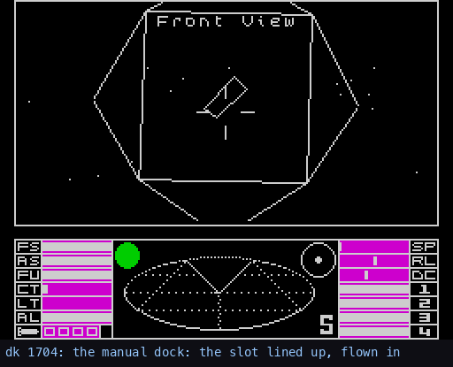

How to read it: `dk` 1704-2200, one in four frames. The pilot had stopped, turned back and lined the ship up on the
station's axis. It flies in at low speed: the station fills the view, the tunnel rings, and the ship is docked at 2190.
The slot's rotation is not checked ([bbc-comparison](bbc-comparison.md) 5) (`python3 tools/fig_design.py scenes`)

**Scooping.** With fuel scoops a ship takes a canister, a plate of alloys or an escape pod that passes just below
the nose:

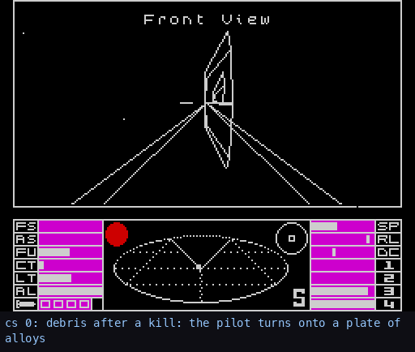

How to read it: `cs`, from a snapshot after a Thargoid's death, two plates ahead. In 0-400 the pilot turns and flies at
a plate. At 910 it passes under the nose: the hold gains one tonne of alloys (free space 35 to 34) and the message line
says Alloys. The scoop takes only what is below the centre: Collide `$B4D8` wants y negative and every coordinate under
180. `python3 tools/fig_design.py scenes`.

**Death.** When the energy banks are empty the ship explodes: GAME OVER, and the title (the end GIF in 1.2). A saved
commander can be loaded again from tape: `t1` saved JAMESON, and the fixtures were made from that save.

**Missions.** Outside galaxy 1, after 32, 128 and 254 jumps: a sun going nova with refugees to save, a ship with a
cloaking device, and a Thargoid base to destroy ([10](10-gameplay-logic.md) 10.7). None of them is in any BBC
version.

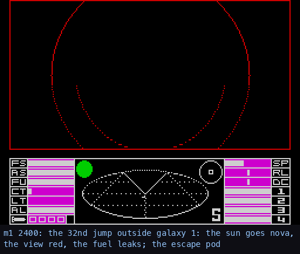

How to read it: `m1` 2400-2800, one in eight frames. The arrival in the doomed system tints the view red and takes
all the fuel (FUEL LEAK). The escape pod (Q) is launched, and the Cobra recedes as a wireframe while the pod is
carried to the station. Docked, the buy key asks THE SUN IS GOING NOVA, WILL YOU SAVE US; Y fills the hold with
refugees. `m1` then carried them to galaxy 3, where the sell key paid 100 g of gem-stones and 65536 combat points.
`m2` played the Thargoid mission up to the base ([scenes](scenes.md) 6).

## 1.7 The score

There is no points score on the screen. The player's progress is the cash and the combat rating on the status page.
The rating comes from a three-byte combat score `$D060`, which each kill raises by half the blueprint's `+$15` word:

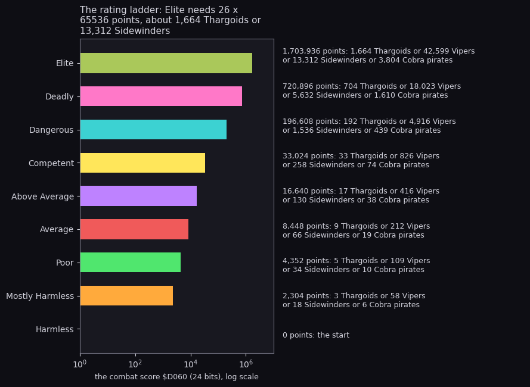

How to read it: one bar a rank, its length the score where the rank starts (log scale). The text beside each bar
gives the score and the kills of one kind that reach it alone. Elite needs 26 x 65536 points: 1664 Thargoids (1024
each) or 13312 Sidewinders (128 each). A score equal to a threshold still counts as the rank below
([bbc-comparison](bbc-comparison.md) 6). `python3 tools/fig_design.py ladder`.

A ship's bounty is paid when it explodes: 50.0 Cr for a Thargoid, 20.0 for a Python or an Asp pirate, 0.5 for an
asteroid ([7](07-objects.md) 7.3). `k2` measured it: a Thargoid's kill added 1024 points and 50.0 Cr. `k2` started
80 points below Dangerous and crossed it, and its status page then said DANGEROUS. RIGHT ON COMMANDER on the message
line marks a new rating.

## 1.8 Options and modes

The pause menu (CAPS SHIFT) holds the options, each a bit of Options `$FC0E` ([4](04-game-loop.md) 4.7). `j1`
toggled each one with the Kempston chosen and read the bit and its effect on the roll and pitch rates:

| Key | Option | Bit | What `j1` read |
| --- | --- | ---: | --- |
| K | the keyboard instead of the joystick chosen on the title | 0 | the joystick ignored, N rolls -15 |
| R | recentring (a tap of the other key stops the turn) | 2 | the bit toggled |
| D | keyboard damping (the roll and the pitch fall back by themselves) | 3 | the bit toggled |
| B | the joystick reversed | 4 | left rolls +15 instead of -15, up pitches -9 instead of +11 |
| Y | the vertical axis reversed | 5 | with B on, up back to +9 |
| Q, S | sound off, on | 7 | cleared, set |
| F | the next jump misjumps into witch space (not in the manual) | - | `w1`, `k2` and `cs` used it |

There is one mode of play, one player, and no difficulty setting. The joystick is chosen on the title: the
Kempston is taken only in the title's second loop, after a first key. The access menu (docked, or Y on the title)
loads and saves a commander on tape ([10](10-gameplay-logic.md) 10.8, the tape format in [scenes](scenes.md) 4).

## 1.9 Difficulty

Nothing in the code gets harder with time or rank. What the player meets depends on where they fly and what they
carry:

- anarchies always roll for an encounter;
- contraband raises the danger the roll is made against ([7](07-objects.md) 7.8);
- a protected kill makes the player a fugitive;
- witch space brings Thargoids, and the missions add their own enemies;
- a legal-sensitive ship turns hostile once the combat score's low byte is `$28` or more ([7](07-objects.md) 7.7).

The rating itself changes nothing else.

The machine adds its own difficulty. A space pass takes 5.0 frames with no ships and 6.5 with four Thargoids
([4](04-game-loop.md) 4.5, [runtime-analysis](runtime-analysis.md)), so the game updates 8 to 10 times a second and
slows a little in a fight.

## 1.10 The protection a player meets first

Two protections stand between the tape and the title ([3](03-build-and-load.md), [lenslok.md](lenslok.md)):

1. **Softlock.** The player sees only the loading screen and the stripes ([3](03-build-and-load.md) 3.2-3.6).
   Behind them are a BASIC line that lies about what it loads, a stub that decrypts itself with a sum over the
   loading screen, a patched copy of the ROM loader reading a turbo stream of chunks, and a decryptor keyed on the
   ROM and the screen.
2. **The Lenslok.** The game draws two characters cut into vertical slices and shuffled. Through the plastic lens
   from the box they read as letters, and the player types them.

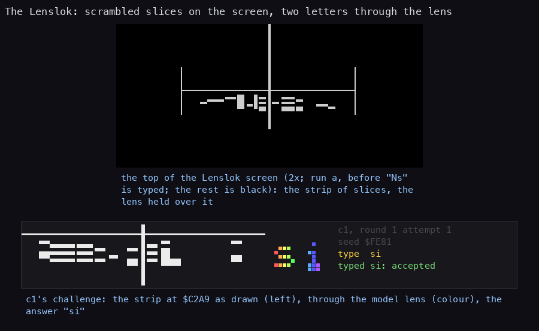

How to read it: left, a Lenslok challenge as the emulator shows it: two scrambled characters either side of the
centre line. Right, `c1`'s own challenge from the atlas of [lenslok.md](lenslok.md) 5.4: the strip at `$C2A9`, the
same strip through our model of the lens (the slices put back in order, coloured by slice), and the answer `si`
that the game accepted. `python3 tools/fig_design.py lenslok`.

Before the code there is a size screen: keys 5 and 8 move two lines until they match the holder, and "OK" shows
through the lens. A wrong answer brings two new characters. After three wrong answers the size screen comes back
for three more, then a reset ([lenslok.md](lenslok.md) 1 and 4.1).

The case answers the Lenslok by computing it, never by patching the game:

- `tools/lenslok_answer.py SEED` gives the two characters from the seed word the game stores at `$C784`;
- `tools/lenslok_live.py` drives branches of `c1` in the emulator, stops at `$C2A0` for the seed, computes the code
  with the game's own code in a Z80 simulator and types it.

All 475 codes the game can ask are in [lenslok-codes.md](lenslok-codes.md).

## 1.11 What the recordings reached

| Scene | Recording |
| --- | --- |
| flight, the jump, witch space and the death | `f1`, `w1` |
| trading: buying, selling, equipping | `t1` |
| saving and loading a commander | `t1`, `dk` |
| docking by hand and by the computer | `dk` |
| a missile, the E.C.M., the energy bomb, kills, the bounty and a new rating | `k2` |
| scooping cargo | `cs` |
| the galactic hyperdrive | `gx` |
| the nova and the Thargoid missions | `m1`, `m2` |
| the joystick and the options | `j1` |

Each is told in [scenes](scenes.md). Still known from the code only:

- the cloak ship mission (the 128th jump);
- the fuel scoop's sun skimming;
- a pirate station's SHIP BOARDED BY PIRATES;
- the police turning on an offender.

## 1.12 The commodities

The market's 17 rows, in the order of the market page and of the hold (CargoHold `$D06B`), with the three that make
the player an offender ([10](10-gameplay-logic.md) 10.3-10.4 has the prices, the stocks and the legal cost):

| # | Commodity | # | Commodity | # | Commodity |
| ---: | --- | ---: | --- | ---: | --- |
| 1 | Food | 7 | Narcotics (illegal) | 13 | Minerals |
| 2 | Textiles | 8 | Computers | 14 | Gold (kg) |
| 3 | Radioactives | 9 | Machinery | 15 | Platinum (kg) |
| 4 | Slaves (illegal) | 10 | Alloys | 16 | Gem-Stones (g) |
| 5 | Liquor/Wines | 11 | Firearms (illegal) | 17 | Alien Items |
| 6 | Luxuries | 12 | Furs | | |

Gold and platinum are sold by the kilogram and gem-stones by the gram, so they take no tonnes of the hold. The alien
items are never in stock at a station (MakeMarket forces their stock to 0). The market figure of 1.6 shows Lave's
prices at fluctuation 0. `python3 tools/galaxy.py --market Lave --fluctuation 0` prints the same page from the
model, and `--market Diso --fluctuation 0xA6` prints Diso's as `f1` found it on arrival.

## 1.13 Where each part is taken apart

| The player sees | The document |
| --- | --- |
| the tape, the stripes, the Lenslok | [3](03-build-and-load.md), [lenslok.md](lenslok.md) |
| the screens and their order, the pause | [4](04-game-loop.md) |
| the keys and the joysticks | [5](05-controls.md) |
| the wireframe view, the planet, the stardust, the tunnel | [6](06-rendering.md), [3d-engine.md](3d-engine.md) |
| the ships, their tactics, the laser, the missiles | [7](07-objects.md) |
| the text, the dashboard, the scanner | [8](08-hud-and-text.md) |
| the beeper | [9](09-sound.md) |
| the galaxy, the market, the jump, the rating, the missions | [10](10-gameplay-logic.md), [galaxy.md](galaxy.md) |
| every recorded scene | [scenes](scenes.md) |
| the Spectrum against the BBC | [bbc-comparison](bbc-comparison.md) |
| what each frame costs | [runtime-analysis.md](runtime-analysis.md) |
