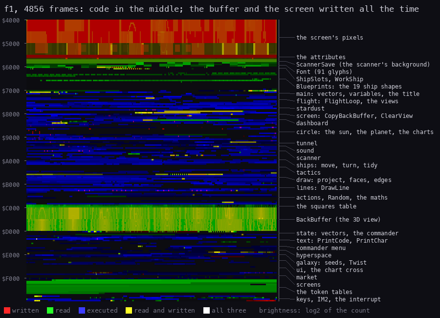
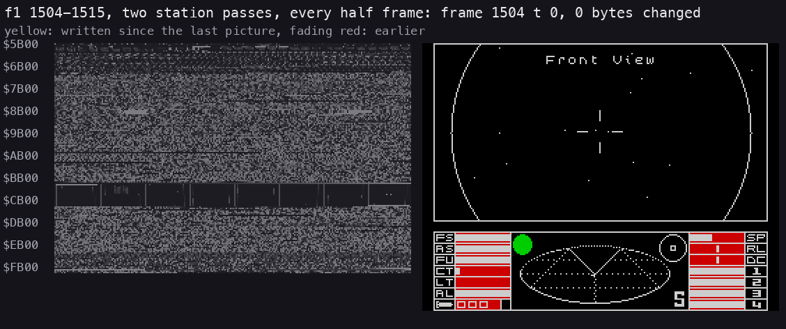
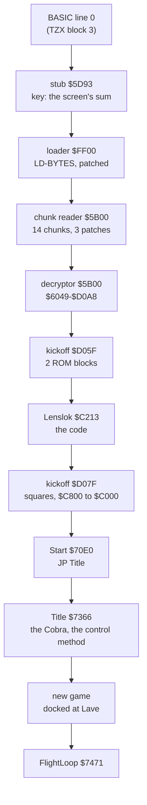
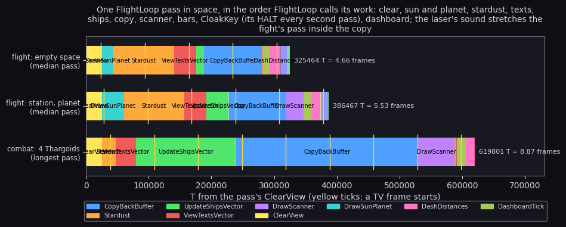
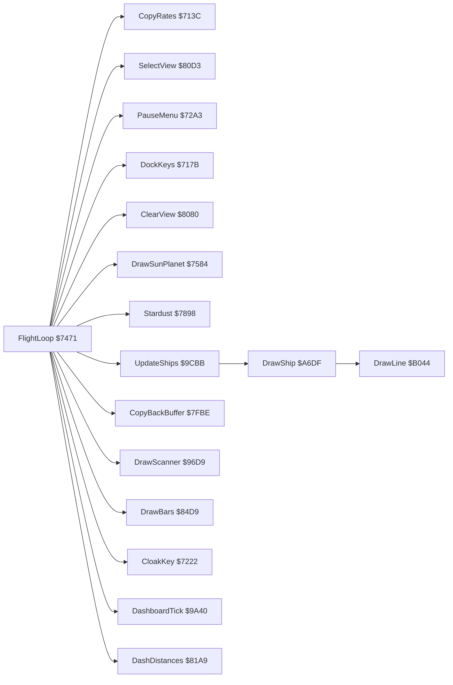
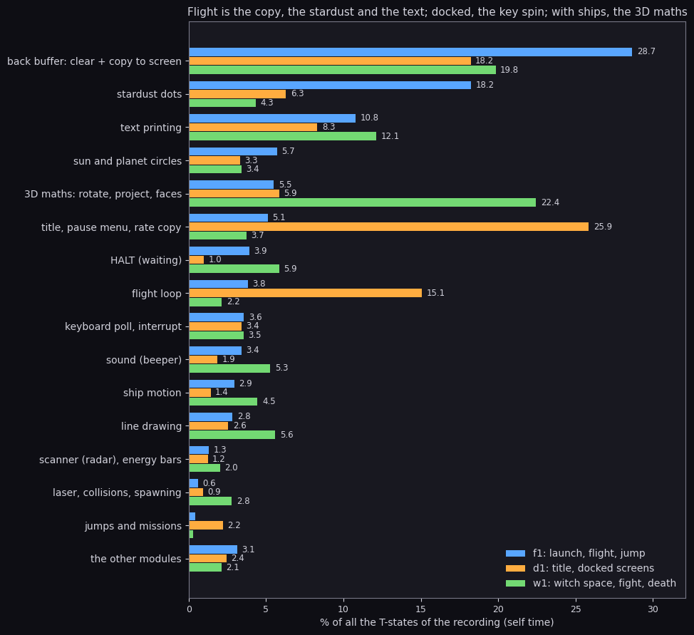

# 2. Architecture

What this covers:

- the machine Elite runs on and what it takes of it;
- the memory map of the game, module by module, and the memory heatmap of a flight;
- the stages from the tape to the flight loop;
- the frame and the interrupt;
- the main loop's call graph and the module map;
- where the CPU time goes over whole recordings.

The measured profile per scene is a document of its own: [runtime-analysis.md](runtime-analysis.md).

The recordings it rests on ([Terms](README.md#terms)). All are 48K, Side A, with the fast LD-BYTES trap off, so the
ROM loads at signal speed ([3](03-build-and-load.md) 3.9). The play recordings start from a snapshot of the title
taken after the Lenslok:

- `f1`: the launch from Lave, the flight past the station, a hyperspace jump to Diso, the laser (4856 frames);
- `w1`: a jump that misjumps into witch space, a fight with four Thargoids, the death (6691 frames);
- `d1`: the title, then docked at Lave: the status, market, data and chart screens, and a launch (2710 frames);
- `c1`: the load itself, from power-on to the title (the frame numbers of [3](03-build-and-load.md)).

## 2.1 The machine budget

| Resource | What Elite uses |
| --- | --- |
| CPU | Z80 at 3.5 MHz, 69 888 T a frame (48K). There is no fixed frame rate: a flight pass takes 5 to 6.5 frames ([4](04-game-loop.md)) |
| Memory | `$5B00-$FFA7` is the game's (42 152 bytes); the screen is `$4000-$5AFF` |
| Screen | the top two thirds (128 lines) are the 3D view, drawn in a back buffer `$C000-$CFFF` and copied; the bottom third is the dashboard, drawn on the screen itself |
| Font | its own, 91 glyphs at `$5D70` ([8](08-hud-and-text.md)) |
| Interrupt | IM 2 with I = `$FD`: the bus byte `$FF` picks the vector at `$FDFF`, which is `$FEFE`, a `JR` to IM2Handler `$FF25`; the handler has its own stack below `$FFBF` |
| Stack | the main program's stack is at the top of memory (`$FFB1-$FFFF` in `f1`); the docked screens run on a stack at `$D000`, the top of the back buffer (CallScreen) |
| Sound | the beeper only ([9](09-sound.md)) |
| Input | the keyboard, or a Kempston, Cursor or Sinclair joystick chosen on the title ([5](05-controls.md)) |
| Tape | the commander is saved and loaded as one headerless block of 102 bytes ([10](10-gameplay-logic.md)) |

The 48K ROM stays paged in, and the game uses it in four places:

- LD-BYTES and SA-BYTES for the commander, entered past their prologues;
- BEEPER for the missile's lock tone;
- the byte reads of SoundPulses and SoundNoise, which take their waveforms from the ROM's bytes;
- the load's decryptor, which used the ROM as part of its key ([3](03-build-and-load.md) 3.6).

## 2.2 The memory map

The game's bytes as the kickoff leaves them at `$70E0` ([3](03-build-and-load.md) 3.7), module by module. A module
is an `@module` of [`src/game/game.ann`](../src/game/game.ann). The modules are laid out in address order, and each
becomes one source file `src/game/<module>.asm`.

| Range | Bytes | Module | What |
| --- | ---: | --- | --- |
| `$5B00-$5D6F` | 624 | lowdata | ScannerSave: the scanner's background, 13 bytes × 48 lines |
| `$5D70-$6047` | 728 | lowdata | Font: 91 glyphs for the codes `$20-$7A` |
| `$6048-$617F` | 312 | lowdata | ShipSlots (8 × 39 bytes; slot 7 at `$6159` is labelled Slot7) |
| `$6180-$6FF1` | 3698 | lowdata | Blueprints: the table and the 19 ship shapes ([7](07-objects.md)) |
| `$6FF2-$7470` | 1151 | startup | vectors, the flight variables, the pause menu, the title |
| `$7471-$7897` | 1063 | flightloop | FlightLoop, the sun and the planet, Divide24 |
| `$7898-$7FBD` | 1830 | stardust | the 16 dust dots, StarRandom, the in-system jump |
| `$7FBE-$81A2` | 485 | backbuffer | CopyBackBuffer, ClearView, the dashboard save and restore |
| `$81A3-$8618` | 1142 | dashboard | the distances, the compass, the bars |
| `$8619-$928B` | 3187 | circles | the circle engine: the sun, the planet, the chart circles, the hit flash |
| `$928C-$9508` | 637 | tunnel | the launch, dock and hyperspace tunnels |
| `$9509-$96D5` | 461 | sound | the sound requests and the three generators |
| `$96D6-$9C1B` | 1350 | scanner | the scanner, the condition, the energy, the missile |
| `$9C1C-$A28A` | 1647 | shipmotion | moving, turning and tidying the slots |
| `$A28B-$A6DE` | 1108 | tactics | the ships' behaviour |
| `$A6DF-$B03F` | 2401 | drawships | a ship's depth, projection, faces and edges; the products |
| `$B040-$B4D5` | 1174 | linedraw | DrawLine and its clipping |
| `$B4D6-$BDFF` | 2346 | combat | the ship actions, the collisions, the laser, Random |
| `$BE00-$BFFF` | 512 | squaretable | the squares (built by the kickoff) |
| `$C000-$CFFF` | 4096 | squaretable | BackBuffer, the 3D view |
| `$D000-$D2DB` | 732 | gamestate | the vectors of the top part, the commander record, the default commander |
| `$D2DC-$D901` | 1574 | textprint | PrintCode, PrintOther, PrintChar, the token interpreters |
| `$D902-$DBA1` | 672 | commander | the access menu: the commander's tape load and save |
| `$DBA2-$DEB8` | 791 | hyperspace | the jump keys, the countdown, the arrival, the missions |
| `$DEB9-$E1E7` | 815 | galaxy | the seeds, Twist, the system's data, the market |
| `$E1E8-$E46E` | 647 | menuhelpers | the text layout helpers, ReadLine |
| `$E46F-$E6AD` | 575 | chartcursor | the chart cursor's XOR cross |
| `$E6AE-$EB7B` | 1230 | market | buying, selling, equipping |
| `$EB7C-$F116` | 1435 | dockedscreens | the status, data, market, inventory and chart pages |
| `$F117-$FBFF` | 2793 | keyboard | the token tables (149 standard and 263 other strings, [8](08-hud-and-text.md)) |
| `$FC00-$FFA7` | 936 | keyboard | the key bytes, the IM 2 vector, the interrupt, the keyboard scan |

Doc [11](11-data-reference.md) lists every data entry and [12](12-routine-reference.md) every routine.

### The memory heatmap

Each byte of 16K-64K over all of `f1` (4856 frames), 256 bytes a row: red how often it was written, green read,
blue executed (log2 of the count; yellow is read and written). The regions on the right are
[`tools/heatmap-regions.txt`](../tools/heatmap-regions.txt).



How to read it:

- The code is the band from `$6FF2` to `$BDFF`, and again from `$D000` up. The hottest rows are the flight loop,
  the stardust, the ships and the text.
- Two blocks are written all the time. One is the screen's pixels (the copy, the dashboard). The other is
  BackBuffer `$C000-$CFFF`: ClearView empties it, then the lines, the circles and the stardust fill it. The copy
  reads it just as often.
- The blueprints `$6180-$6FF1` and the token tables `$F117-$FBFF` are only read. The slots `$6048-$617F` are read
  and written.
- The squares at `$BE00` are read by every product.
- The attributes are written rarely: the condition light, the cloak and the nova tints. The paper's colour never
  changes in flight.

```bash
python3 tools/fig_heatmap.py work/f1/l1.json docs/img/arch/heatmap.png \
    --title "f1, 4856 frames: code in the middle; the buffer and the screen written all the time"
```

### The memory over two passes

The heatmap sums a whole recording. The same map taken every half frame over two passes of the station flight shows
the order of the writes:



How to read it: left, `$5B00-$FFFF`, one row of 256 bytes per line (the labels every 16 rows), each byte's grey its
value. A byte written since the last picture is yellow and fades through red over the next ones. Right, the screen at
the same moment. The dark band is BackBuffer `$C000-$CFFF`, laid out like the screen's thirds. ClearView empties it
each pass, and the planet's arc and the dust dots are drawn into it again: the arc's bytes stand as short vertical
strokes: in the screen's layout a row of 256 bytes is one pixel line of eight character rows, so the lines below
it come in the next rows of the map. The yellow run in row `$7E` is the dust's 16 dots,
StarDots `$7E8D`, moved every pass; the bottom rows are the stack and the key bytes (`$FC08-$FC0F`) that the
interrupt writes every frame. In the code only single bytes flash: the flight variables, the slots, and the
bytes the code patches into itself (LineSetup's loops, [6](06-rendering.md) 6.4). Drawn by
`bash tools/memanim_f1.sh` (`tools/memanim.py`, the kit's tool with larger text, the memory read from `f1`'s TTD session with `memory_at`).

## 2.3 The stages from the tape to play



| Stage | Entry | `c1` frame |
| --- | --- | ---: |
| stub, sum and decrypt | `$5D93` | 774 |
| Softlock loader | `$FF00` | 780 |
| chunk reader | `$5B00` | 2453 (the first chunk) |
| decryptor | `$5B00` | 11 642 |
| two ROM blocks | `$D05F` | 11 707 |
| Lenslok | `$C213` | 15 683 |
| squares table, IM 2 | `$D07F` | 16 075 |
| the game | `$70E0` | 16 075 |

The first eight stages are the load ([3](03-build-and-load.md) 3.8); the Lenslok is in [lenslok.md](lenslok.md).
From `Start` on, the game never leaves FlightLoop except through the title. The title is entered:

- at power-up;
- from the pause menu (key 1);
- after a death;
- after the two game overs at the dock (PirateStation and ArrivalScreens).

Each time the game goes back through the stack pointer saved in TitleSP `$7578`.

## 2.4 The frame and the interrupt

The interrupt comes every frame. IM2Handler `$FF25` switches to its own stack and saves the registers, then runs:

1. ScanKeyboard: the eight half-rows into the key bytes `$FC08-$FC0F`, then the joystick;
2. ReadControls: the roll, pitch and speed accumulators `$FF08-$FF0D`;
3. SoundTick: one slice of the current sound effect.

In flight with no sound this is 2750 T, 3.9 % of a frame. The main loop never synchronises with the interrupt: it
reads what the interrupt left (CopyRates) whenever a pass begins. The details are in [4](04-game-loop.md) and
[5](05-controls.md). One pass against the frames, as a strip:



How to read it: one row per scene, time to the right, each block a call of FlightLoop coloured by routine; the yellow
ticks are the frame starts, where the interrupt comes. A pass spans 4.7 to 8.9 frames. The ticks fall anywhere in
it: the stardust, the copy or a ship, never a fixed point. [4](04-game-loop.md) 4.4 names the blocks
(`python3 tools/fig_rt_pass.py`).

Two things stop the interrupt:

- the scene sounds, played with DI (the launch's whistle, the tunnels, the death);
- the laser's sweep, played inside the handler for longer than a frame.

The `w1` fight lost 17 of its 150 interrupts that way ([runtime-analysis.md](runtime-analysis.md) 8).

## 2.5 The main loop's call graph

FlightLoop `$7471` is the only main loop. A pass in a space view (ViewIndex 0-3):



Docked (Condition 0), the pass reads only the chart cursor and the menu key. On a screen (ViewIndex 4 and up) it
runs UpdateShips, SunGrowth, ViewTexts and 8 HALTs. The order inside the pass and its timing are in
[4](04-game-loop.md). The weighted graph, with the T of each edge, is in [runtime-analysis.md](runtime-analysis.md)
9.

The top part of memory is reached through vectors, not direct calls:

- the table `$D000-$D0F5` holds the docked screens' ScreenTable (CallScreen patches its CALL to `$D000` + 3 × the
  screen), then the printer, the jump keys and the commander menu;
- the bottom part has its own vectors at `$6FF2-$6FFA` and `$7119-$712F`.

Each half calls the other only through a JP table, as if the two had been assembled apart (*inference*).

## 2.6 The state

The variables the modules share, each in one place:

| Variable | Address | Meaning |
| --- | --- | --- |
| ViewIndex | `$70E3` | 0-3 the space views, 4 and up the screens (7 and 8 the charts) |
| RollRate, PitchRate, SpeedRate | `$70E4-$70E6` | this pass's controls |
| BarDrawn | `$70E7` | 13 bars: the length drawn and the value |
| WitchSpace | `$7103` | non-zero after a misjump |
| Condition | `$7104` | 0 docked, 4 green, 6 yellow, 2 red, `$63` flashing |
| StarSeed | `$7105` | the stardust's generator |
| SunPosition, PlanetPosition | `$7107`, `$7110` | 3 × 3 bytes each |
| SoundRequests | `$7128` | one bit for each sound effect |
| ShipSlots | `$6048` | 8 slots of 39 bytes ([7](07-objects.md)) |
| the commander | `$D054-$D0B9` | 102 bytes: the name, the cash, the fuel, the equipment, the hold, the seeds, the score |
| SystemSeeds | `$DEC0` | the system the galaxy code works on ([10](10-gameplay-logic.md)) |
| the key bytes | `$FC08-$FC0F` | the interrupt's keyboard scan |
| Options | `$FC0E` | the pause menu's options |

The `d1` timeline (`tools/timeline.py`, every 10 frames: the view, the speed, witch space, the condition and the
slots) shows these values change as the screens change. ViewIndex is 0 on the title, 11 on the status page at
frame 470, 10 on the market at 1020, 9 on the data page at 1240, 7 on the galactic chart at 1460 and 8 on the short
range chart at 1680. Condition goes from 0 to 4 at the launch, at about frame 1900.

## 2.7 Where the time goes

Over whole recordings, by module (the L1 builds summed per module as kit `fig_budget.py` does, self time; the
command is below):



| What (module) | `f1` (flight) | `d1` (title, docked) | `w1` (witch space, fight) |
| --- | ---: | ---: | ---: |
| back buffer: clear + copy to screen: `backbuffer` | 28.7 % | 18.2 % | 19.8 % |
| stardust dots: `stardust` | 18.3 % | 6.3 % | 4.3 % |
| text printing: `textprint` | 10.8 % | 8.3 % | 12.1 % |
| sun and planet circles: `circles` | 5.7 % | 3.3 % | 3.4 % |
| 3D maths: rotate, project, faces: `drawships` | 5.5 % | 5.9 % | 22.5 % |
| title, pause menu, rate copy: `startup` | 5.1 % | 25.9 % | 3.8 % |
| flight loop: `flightloop` | 3.8 % | 15.1 % | 2.2 % |
| sound (beeper): `sound` | 3.4 % | 1.9 % | 5.3 % |
| HALT | 3.9 % | 1.0 % | 5.9 % |

How to read it: a row a module, the bars blue for `f1`, orange `d1`, green `w1`; the table gives the same numbers.

- In flight, a third of the time is the back buffer (`backbuffer`: the copy to the screen and the clear) and a fifth the stardust.
- Docked, `startup` (CopyRates) and `flightloop` (FlightLoop's own code) lead, because the loop spins on the keys about 91
  times a frame.
- In `w1` the `drawships` module leads. That is the 3D maths: the four Thargoids moved and projected in witch space, and
  the debris after the death.

The idle time is never more than 6 % of a recording. The same split per scene, routine by routine, is in
[runtime-analysis.md](runtime-analysis.md).

```bash
python3 tools/fig_budget3.py      # kit/fig_budget.py's sums, the three recordings in one chart
```

## 2.8 How the reverse is organised

- **The source.** `src/game/*.asm` is 27 files written by `kit/mkgame.py` from `src/game/game.ann`, which is put
  together from `work/ann/parts/*.ann`. It assembles to the image byte for byte. `tools/build.sh` then makes Side
  A's TZX from it, identical to the original ([3](03-build-and-load.md) 3.10).
- **The resources** are in `src/res/`: the font, the ships (`ships/ships.txt`), the token texts, the loading screen
  and the tape's master memory. `tools/res_formats.py check` converts each one both ways and compares.
- **The Lenslok** is a part of its own, `src/lenslok/`.
- **Docs 11 and 12** are generated from the annotation by `kit/refdocs.py`.
