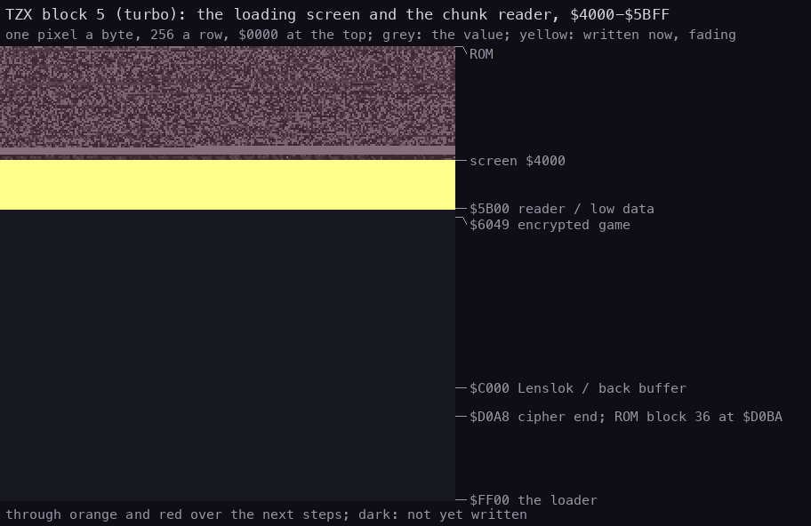
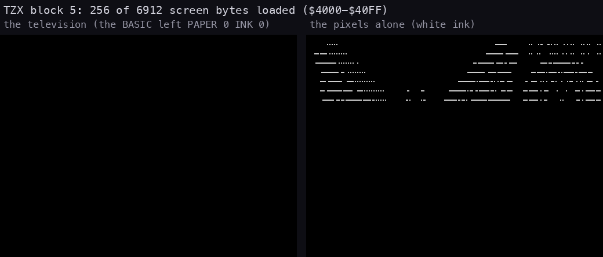
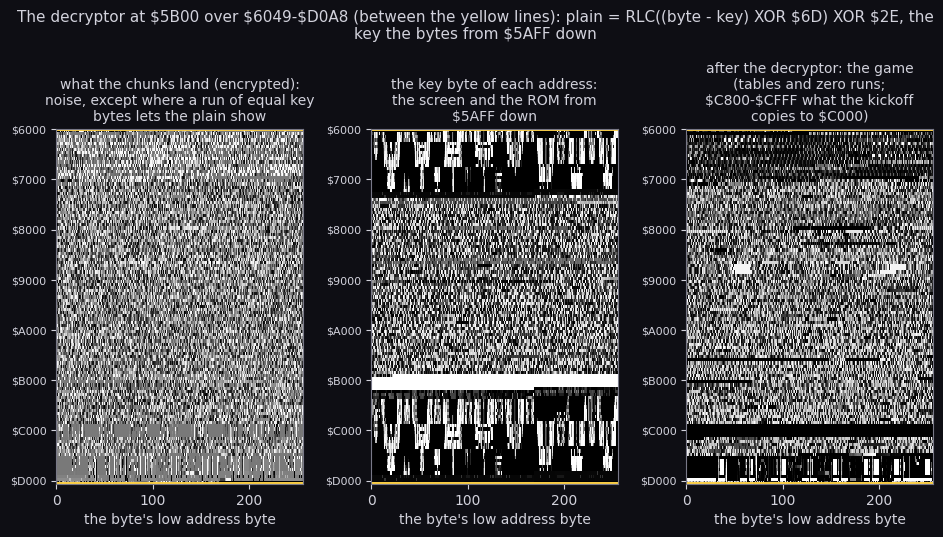
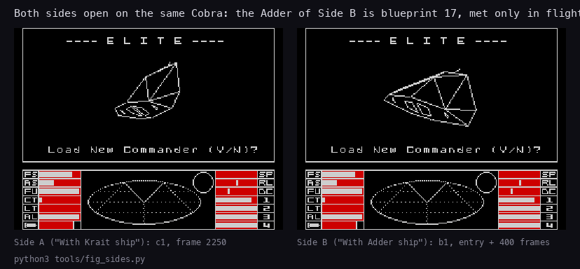

# 3. Build and load

What this covers: the tape block by block, the Softlock protection (a BASIC line that lies, a self-decrypting
stub keyed on the screen, a patched copy of the ROM loader that reads a turbo stream of chunks, a chunk reader that
patches itself between chunks, an in-place decryptor keyed on the ROM and the loading screen), the two ROM blocks
after it, and the hand-off to the Lenslok check ([lenslok.md](lenslok.md)) and the game.

The recordings it rests on ([Terms](README.md#terms)):

- `c0`: power-on with `orig/Elite.tzx.zip`'s `Elite - 48k - Side A.tzx`, 48K, the fast LD-BYTES trap on (the
  default), 1500 frames with no input (`work/c0`): it reaches the Lenslok screen, but no key reaches the game (3.9);
- `c1`: the same tape with the trap off (`tools/capture_real_rom.py`), the ROM reading every standard block at
  signal speed, then `tests/inputs/c1-lenslok.txt`: ENTER on the Lenslok size screen, the code `si`, the title
  (`work/c1`). Frame numbers are `c1` frames unless they say `c0`;
- `b1`: Side B the same way, past the Lenslok live (3.12);
- the static decode of the blocks (`tools/tzxblocks.py`, `tools/basic_list.py`, `tools/softlock.py`), checked
  against the recordings' memory in 3.5.

## 3.1 The tapes

| File in `orig/` | Inside | What it is |
| --- | --- | --- |
| `Elite.tzx.zip` | `Elite - 48k - Side A.tzx`, `Elite - 48k - Side B.tzx` | the reference: both sides of the Firebird release, "perfect TZX" made with Ramsoft MakeTZX; Side A says "With Krait ship", Side B carries the Adder |
| `Elite_2.tzx.zip` | `Elite - 48k.tzx`, `Elite - 128k.tzx` | another dump; the 48K file's data blocks are Side B's byte for byte (only the text block differs); the 128K version is a different program, not reversed here |
| `Elite48.tap.zip` | `ELITE48.TAP` | the cracked tape: plain ROM blocks, no Softlock, no Lenslok (the same file as `elite-skoolkit`'s `tape/elite.tap`) |
| `Elite.txt` | | the instructions, as text ([texts/instructions.md](texts/instructions.md)) |

The hashes are in the [README](../README.md). The two sides differ in four data blocks (TZX blocks 7, 9, 29, 37):
blueprint 17 (Krait on A, Adder on B; [07-objects.md](07-objects.md)), the bytes that depend on it and the
mastering leftovers (3.12). Everything else is the same signal.

`python3 tools/tzxblocks.py list "work/media/Elite - 48k - Side A.tzx"` (the pure-data blocks 6-34 folded):

| TZX block | Kind | Bytes | Loads at | Read by | Plays for |
| --- | --- | ---: | --- | --- | ---: |
| 0, 1 | `$30` text | | | | |
| 2 | `$10` header | Program `E L I T E`, LINE 0, 387 bytes | | ROM | 5.08 s |
| 3 | `$10` BASIC | 387 | PROG `$5CCB` | ROM | 4.10 s |
| 4 | `$21` group | "Softlock Group" | | | |
| 5 | `$11` turbo | 7168 + flag + check | `$4000-$5BFF`: the loading screen and the chunk reader | Softlock (`$FF00`) | 33.40 s |
| 6-34 | `$14` pure data, no pilot | 47 988 in 14 chunks | 3.5 | Softlock | 172.4 s |
| 35 | `$22` group end | | | | |
| 36 | `$10` data, headerless | 12 014 | `$D0BA-$FFA7` | ROM LD-BLOCK from `$D069` | 69.79 s |
| 37 | `$10` data, headerless | 1352 | `$5B00-$6047` | ROM LD-BLOCK from `$D076` | 8.62 s |

- The turbo timings: pilot 2165 T, both syncs 714 T, bits 673 / 1346 T (the ROM's are 2168, 667 / 735, 855 /
  1710): bits 21 % shorter than a ROM block's. Blocks 6-34 have no pilot and no sync; the signal runs on from
  block 5 without a break, so the TZX split into header and data blocks is MakeTZX's, not the tape's.
- The signal, pauses included, takes 327.0 s, 16 351 frames at 50 Hz; `c1` enters the game at frame 16 075
  (the stages' frames: 3.8).

**How to read it.** The loading screen, decoded from the turbo block without an emulator (Side B carries the same
screen; `python3 tools/fig_loading.py --out docs/img/loading-screen.png`):


## 3.2 The BASIC (TZX block 3): a listing that lies

`python3 tools/basic_list.py work/images/basic-raw.bin` (the block's 387 bytes without the flag and the checksum;
the numbers in braces are the five-byte values the interpreter really uses, hidden behind the digits `LIST` shows):

```text
    0 BORDER 0: INK 0: PAPER 7{=0}: CLS : PRINT AT 12{=21},11;"*LOADING*": POKE 23613{=20107},0{=255}:
      RANDOMIZE USR ( PEEK 23627+256* PEEK 23628)
    1 SAVE "E L I T E" LINE 0
    2  REM *** SOFTLOCKtm 1984 ***
```

- Line 0 starts with colour codes (`PAPER`, `INVERSE`, `INK 7` as control characters), so `LIST` prints it in other
  colours than the rest. Line 1 is the line that saved the program; the header's LINE 0 starts line 0.
- Three numbers lie. `PAPER 7` is `PAPER 0`; `PRINT AT 12,11` is `PRINT AT 21,11`; `POKE 23613,0` (which would
  clear ERR_SP, a classic) is `POKE 20107,255`: one byte of pixels at `$4E8B`. The `*LOADING*` text carries INK /
  PAPER control codes.
- `RANDOMIZE USR (PEEK 23627+256*PEEK 23628)` calls the address in VARS. The header's second parameter puts the
  variables at offset 200 of the block, so VARS = `$5D93`: the "variables" are the machine code of 3.3, the last 187
  bytes of the block.

What the lies buy: the screen the BASIC leaves (black paper, the message on row 21 in its colours, the one poked
byte) is the key of the next stage (3.3). A cracker who "cleans up" the BASIC changes the screen and so the key.
The source build (3.10) reassembles the program byte for byte from the lines above.

## 3.3 The stub at `$5D93`: a sum over the screen, then a self-decrypt

The stub first adds up the screen `$4000-$5BFF` (pixels, attributes and the printer buffer) as 3584 big-endian
16-bit words: everything the BASIC's CLS, PRINT and POKE left. The sum is the key of a running decryption of the
stub's own tail from `$5DD0`: each byte is XORed with the low or the high byte of the key, which counts up by one
per byte, and the byte decrypted before it is added in (the chain starts at `$32`). The loop has no count; it stops
on the first decrypted pair whose second byte is `$48`.

```asm
Stub:         ld iyl,a              ; IY is set again before any use
              dec sp
              dec sp
              pop bc                ; BC = Stub: the address USR left below SP
              ld hl,$0000
              push hl
              pop ix
              ld a,$2E
              ld ixh,high Screen    ; IX = $4000
              sla a                 ; A = $5C, the end page
StubSum:      ld d,(ix+0)
              ld e,(ix+1)
              inc ix
              inc ix
              add hl,de
              cp ixh
              jr nz,StubSum
              ex de,hl              ; DE = the key
              ld hl,StubTail-Stub   ; $003D
              add hl,bc             ; HL = StubTail, $5DD0
              ld ixh,b
              ld ixl,c
              ld c,$32              ; the chain
StubDecrypt:  ld a,(hl)
              xor e
              add a,c
              ld (hl),a
              ld c,a
              inc hl
              inc de
              ld a,(hl)
              xor d
              add a,c
              ld (hl),a
              ld c,a
              inc hl
              inc de
              cp $48
              ld a,a
              jr nz,StubDecrypt     ; $5DD0: encrypted on the tape
```

```text
key = 0
for addr in 0x4000, 0x4002 .. 0x5BFE:
    key = (key + mem[addr] * 256 + mem[addr + 1]) mod 65536
chain = 0x32
ptr = 0x5DD0
repeat:
    for half in (low, high):
        mem[ptr] = ((mem[ptr] XOR half(key)) + chain) mod 256
        chain = mem[ptr]
        ptr += 1
        key += 1
until chain == 0x48
```

The loop's own closing `JR NZ` at `$5DD0` is the first pair it decrypts: on the tape those two bytes are `$A0 $07`
(`AND B / RLCA`), so the stub does not even run without the right key. The worked example is `c1`: the screen at
frame 774 sums to `$CA4E`, and the first bytes come out as the memory shows them at frame 781:

| Address | On the tape | Key byte | Chain | Decrypted | Meaning |
| --- | --- | --- | --- | --- | --- |
| `$5DD0` | `$A0` | `$4E` | `$32` | `$20` | `JR NZ,StubDecrypt` |
| `$5DD1` | `$07` | `$CA` | `$20` | `$ED` | |
| `$5DD2` | `$14` | `$50` | `$ED` | `$31` | `LD SP,$0000` |
| `$5DD3` | `$05` | `$CA` | `$31` | `$00` | |
| `$5DD4` | `$52` | `$52` | `$00` | `$00` | |
| `$5DD5` | `$27` | `$CA` | `$00` | `$ED` | `LD ($5C3D),SP` |

The decrypted tail rebuilds the loader from the ROM. It sets ERR_SP to 0 (an error or BREAK now jumps to address 0,
a reset), copies the ROM's LD-BYTES (`$0556`) to `$FF00` (BC = `$0556` bytes: the copy runs past `$FFFF` into the
ROM, where the writes do nothing), changes five bytes of the copy to v - v/4 and pokes 23 (offset, value) pairs
into it, both from tables after the code. Then it enters the copy as the ROM's LOAD would be entered: flag `$FF`,
`$1C00` bytes to `$4000`, carry set (`StubTail` to `StubPoke` in [`src/tape/basic.asm`](../src/tape/basic.asm)).
So the Softlock loader is the ROM's own LD-BYTES with 28 bytes changed, rebuilt in memory from the ROM each time:
nothing on the tape is the loader in clear.

## 3.4 The loader at `$FF00`: LD-BYTES, patched

`$FF00-$FFAE` after the patches (`c0` frame 1000), against the ROM routine it was copied from:

| What | ROM LD-BYTES `$0556` | Softlock `$FF00` |
| --- | --- | --- |
| entry | `INC D / EX AF,AF' / DEC D / DI` | the same |
| border | `LD A,$0F / OUT ($FE),A` | the same |
| return | `LD HL,$053F` (SA/LD-RET, which ends with `EI`) | `LD HL,$5B00`: every block "returns" into the chunk reader, interrupts off |
| edge delay | `LD A,$16` | `LD A,$11` (`$FF91`): shorter, for the faster bits |
| bit threshold | `LD A,$CB / CP B` | `LD A,$99 / CP B` (`$FF78`) |
| bit order | `RL L`: the first bit is bit 7 | `RR L` (`$FF7B`): the first bit is bit 0, the bytes go to tape bit-reversed |
| one byte | inside LD-8-BITS | `$FF70` (B = `$86`), called by the chunk reader for single bytes |

`$FF91` is the edge reader (821 631 calls over `c0`'s load, the hottest routine of the tape), `$FF70` reads one
byte into L, `$FF53-$FF8C` is the store loop, XOR-summing every byte into H; a chunk ends with `CP $01` on H.

## 3.5 The chunk stream and the chunk reader at `$5B00`

The turbo block loads `$4000-$5BFF`: the loading screen and, in the printer buffer, the chunk reader. LD-BYTES
"returns" to `$5B00` after the block's last byte, and the reader puts that return address back on the stack each
time, so every chunk ends by entering the reader again. A chunk is a 4-byte header (the length word, then the
address word, each byte read by `$FF70`), the data and one check byte; the XOR of all of them is 0.

```asm
ChunkReader:  dec sp
              dec sp                ; the return to ChunkReader back on the stack
              call SoftBytes
              ld a,l
              ld ixl,a
              call SoftBytes
              ld a,l
              ld ixh,a
              push ix               ; the length
              call SoftBytes
              ld a,l
              ld ixl,a
              call SoftBytes
              ld a,l
              ld ixh,a              ; IX = the address
ChunkEnd:     ld a,ixl              ; $5B1C: patched by the stream
              or ixh
              ret z
              pop de                ; DE = the length
              jp SoftBytes           ; the byte loop: the data, the check byte, RET
```

```text
loop:
    length = byte() + 256 * byte()
    address = byte() + 256 * byte()
    if address == 0: return             (never taken: the stream patches this test away)
    load length bytes at address, then the check byte; the XOR of the chunk must be 0
```

All 14 chunks of both sides pass the check (`tools/softlock.py`). The stream, with where each chunk really lands:

| TZX blocks | Header address | Bytes | Lands at | What |
| --- | --- | ---: | --- | --- |
| 5 | (turbo block) | 7168 | `$4000-$5BFF` | the loading screen; the chunk reader at `$5B00` |
| 6+7 | `$DC00` | 6232 | `$DC00-$F457` | data (later covered by TZX block 36) |
| 8+9 | `$EE48` | 2000 | `$EE48-$F617` | data, over the end of the previous chunk |
| 10+11 | `$FD84` | 400 | `$FD84-$FF13` | over the loader's own first bytes `$FF00-$FF13` (already run) |
| 12+13 | `$5B00` | 100 | `$5B00-$5B63` | the chunk reader again, the same bytes, loaded while it runs |
| 14+15 | `$FFAF` | 48 | `$FFAF-$FFDE` | over the copied ROM code after LD-BYTES: `DI / XOR A / LD DE,$FFFF / JP $11CB` (the ROM's NEW, a reset) and ROM jumps |
| 16+17 | `$5B1C` | 2 | `$5B1C` | **patch**: `LD A,IXl` becomes `INC IXh`: every later address lands 256 bytes higher |
| 18+19 | `$9B00` | 16384 | `$9C00-$DBFF` | the game, encrypted (3.6) |
| 20+21 | `$5A1C` | 5 | `$5B1C` (+256) | **patch**: `LD IY,$2E6D / NOP` in place of the end test: the decryption key into IY |
| 22+23 | `$5B00` | 256 | `$5B00-$5BFF` | the reader's page again, with the original `$5B1C` |
| 24+25 | `$F618` | 800 | `$F618-$F937` | data |
| 26+27 | `$FA00` | 1000 | `$FA00-$FDE7` | data |
| 28+29 | `$5C00` | 16384 | `$5C00-$9BFF` | the game, encrypted, over the system variables and the BASIC |
| 30+31 | `$5B1C` | 2 | `$5B1C` | **patch**: `DEC IXh`: every later address lands 256 bytes lower |
| 32+33 | `$5C00` | 92 | `$5B00-$5B5B` (-256) | the decryptor, over the reader that loads it; the reader's RET enters it |

Three headers name addresses the bytes never go to. A copier that loads the chunks by their headers puts the key
patch into the attributes, the first 16 KB of the game 256 bytes too low and the decryptor over the system
variables. The recording shows the truth: in `c0`'s memory at frame 11110 the 16 KB chunk of blocks 18+19 is at
`$9C00` (16384 of 16384 bytes equal; at `$9B00` 4103), and at frame 5000 `ChunkEnd` holds `INC IXh`, `OR IXh`, `RET Z`.

**How to read it.** The whole load in 30 steps, one picture each: the 64 KB as a square of one pixel a byte (256 bytes a
row, `$0000` at the top), a byte's grey its value, the bytes the step writes in yellow fading through orange and red
over the next steps. Watch for the three patched chunks: the 16 KB chunk of step 7 lands as a band starting one row (256
bytes) below its header's `$9B00`; the 5-byte key patch of step 8 appears at `$5B1C`, not in the attributes at `$5A1C`;
the decryptor of step 14 lands on the reader's page, one row above its header's `$5C00`. Then the decryptor's pass runs
as a front moving up from `$D0A8` (eight steps), the two ROM blocks fill `$D0BA-$FFA7` and `$5B00-$6047`, and the
kickoff rewrites `$BE00-$C7FF`. The script asserts that its last picture equals `tools/image.py`'s image byte for byte.



**How to read it.** The turbo block, 256 bytes a picture: the pixels come first, third by third in the screen's
interleaved order, but the BASIC's `CLS` left `PAPER 0`, `INK 0` (3.2), so the television stays black until the
attribute rows arrive in the last 768 bytes and the picture appears in three bands. The right half: the pixels alone.



```bash
python3 tools/fig_load.py     # -> docs/img/load/memory.gif, screen.gif, decrypt.png (from the tape, no emulator)
```


## 3.6 The decryptor at `$5B00`: keyed on the ROM and the screen

The last chunk lands over the reader at `$5B00`, and the reader's RET enters it. It decrypts `$6049-$D0A8` in
place, from the top down: from each byte it subtracts a key byte, XORs `$6D`, rotates left, XORs `$2E` (the two
constants are IY, set by the patch of 3.5). The key bytes are memory read downwards from `$5AFF`: the attributes and
pixels of the loading screen, then the whole 16 KB ROM down to `$0001`, then from `$5A00` down again. A machine with
another ROM, or a loading screen touched on the way (a copier's own message), decrypts garbage.

**How to read it.** The three bitmaps below are `$6000-$D0FF` at 256 bytes a row: what the chunks land, the key byte
each address is decrypted with, and the result. The encrypted bytes are noise except where the key holds still: the
black and the yellow of the loading screen's attributes and the zero runs of the pixels give long runs of one key byte,
and there the plain's own structure shows through the cipher (the band at `$C000-$D000`, whose keys are the screen's
pixels). The key panel is the loading screen read backwards (the top and bottom bands: `$5AFF` down to `$4000` keys
`$D0A8` down to `$B5A9`, then again after the wrap) with the ROM between. The plain panel has the game's texture:
tables, zero runs, the copy `$C800-$CFFF` the kickoff moves to `$C000` (`python3 tools/fig_load.py`).



```asm
Decrypt:      xor a
              out ($FE),a
              ld hl,$D0A8
              ld de,$D0A8
              ld bc,$7060
              ld ix,$5AFF
              ld a,$FF
              ld r,a                ; bit 7 of R stays 1 from here on
DecryptLoop:  ld a,(hl)
              sub (ix+0)
              xor iyl
              rlca
              xor iyh
              ld (de),a
              dec hl
              dec de
              dec bc
              dec ix
              ld a,ixh
              or ixl
              jr nz,DecryptNext
              ld ixh,$5A
DecryptNext:  ld a,b
              or c
              jr nz,DecryptLoop
              ld hl,Kickoff         ; $D05F
              ld de,Decrypt+1       ; $5B01
              ld bc,$00FF
              ld sp,$FFFF
              ld iy,ERR_NR
              push hl
              ld hl,Decrypt         ; $5B00
              ld a,$C9
              ld (hl),a
              ldir                  ; $5B47: overwrites itself
```

```text
key_ptr = 0x5AFF
for ptr in 0xD0A8 down to 0x6049:
    x = (mem[ptr] - mem[key_ptr]) mod 256
    mem[ptr] = rotate_left(x XOR 0x6D) XOR 0x2E
    key_ptr -= 1
    if key_ptr == 0: key_ptr = 0x5A00
fill 0x5B00 .. 0x5BFF with RET; return to Kickoff
```

The first bytes of the range and the moment the key pointer wraps (`tools/image.py`, which does the same without
an emulator; the three bytes at `$D0A4` come out as the kickoff's `JP $70E0`):

| Address | Encrypted | Key address | Key byte | minus key | XOR `$6D` | rotated | XOR `$2E` |
| --- | --- | --- | --- | --- | --- | --- | --- |
| `$D0A6` | `$49` | `$5AFD` (attributes) | `$07` | `$42` | `$2F` | `$5E` | `$70` |
| `$D0A5` | `$11` | `$5AFC` | `$07` | `$0A` | `$67` | `$CE` | `$E0` |
| `$D0A4` | `$A2` | `$5AFB` | `$07` | `$9B` | `$F6` | `$ED` | `$C3` |
| `$75AA` | `$12` | `$0001` (ROM) | `$AF` | `$63` | `$0E` | `$1C` | `$32` |
| `$75A9` | `$00` | `$5A00` (wrapped) | `$06` | `$FA` | `$97` | `$2F` | `$01` |

- `LD R,A` looks like a key, but the decryptor never reads R. What it does is set bit 7 of R, which the refresh
  counter never changes: the Lenslok seeds its generator from `LD A,R` ([lenslok.md](lenslok.md)), so the
  generator always starts from `$80-$FF` (`c1`: `$81`) and only half of the possible codes ever appear.
  `ELITE48.TAP`'s loader keeps this with `LD A,R`, `OR $80`, `LD R,A` (3.11). Whether Torus meant it is not known.
- The last LDIR fills the page with `$C9` (RET) and overwrites itself: when DE reaches `$5B47`, the LDIR's own `ED`
  becomes `$C9`, the repeat fetches a RET and pops `Kickoff` (`c1` frame 11707; `c0` frame 11186 t=27559, HL =
  `$5B47`).

## 3.7 The kickoff at `$D05F`: two ROM blocks, the Lenslok, the game

The kickoff loads the last two blocks through the ROM's LD-BLOCK (`$0802`, which raises "R Tape loading error" on a bad
block; ERR_SP is 0 by now, so the error resets the machine): `$2EEE` bytes to `$D0BA` and `$0548` to `$5B00`. Then the
Lenslok check ([lenslok.md](lenslok.md)), which returns only on success. Then it copies the game's code over the Lenslok
code (`$C800-$CFFF` to `$C000`), builds a table of squares (n² for n = 0..255, low bytes at `$BE00`, high bytes at
`$BF00`; it adds 2n + 1 each step), switches to IM 2 with I = `$FD` and enters the game. Its bytes, disassembled below,
are the commander record's at load time (DEFB in `src/game/gamestate.asm`).

```asm
Kickoff:      ld ix,$D0BA
              ld de,$2EEE
              ld a,$FF
              scf
              call $0802            ; LD-BLOCK: TZX block 36
              ld ix,$5B00
              ld de,$0548
              ld a,$FF
              scf
              call $0802            ; TZX block 37
              nop
              nop
              nop
              call Lenslok          ; $C213
              ld hl,$C800
              ld de,$C000
              ld bc,$0800
              ldir
              ld de,$BE00
              ld b,$00
              ld c,b
              ld h,b
              ld l,b
Squares:      ld a,l
              ld (de),a
              inc d
              ld a,h
              ld (de),a
              dec d
              inc e
              add hl,bc
              inc c
              add hl,bc
              jr nz,Squares
              ld a,$FD
              ld i,a
              im 2
              jp $70E0
```

- In `c1` the squares table reads back as n² for every n at frame 18018.
- The two ROM blocks carry the top of the game (`$D0BA-$FFA7`, over the chunk data of 3.5) and the page
  `$5B00-$6047`.

## 3.8 The stages

Where `c1` enters each stage (`re_session.py stages --work work/c1`, then `time_travel reverse_continue` with the
entry PC from the end of the recording; ROM speed for every block):

| Stage | Entry | `c1` frame | Left by |
| --- | --- | ---: | --- |
| the BASIC | line 0 | (ROM load, LOAD "" typed from frame 0) | `RANDOMIZE USR` |
| stub, sum and decrypt | `$5D93` | 774 | falls into `$5DD0` |
| the decrypted stub | `$5DD0` / `$5DD2` | 780 | `JP (HL)` |
| Softlock loader | `$FF00` | 780 | the turbo block's last byte, RET |
| chunk reader | `$5B00` | 2453 (first) | the last chunk loads the decryptor over it |
| decryptor | `$5B00` | 11642 | loop `$5B14` until frame 11707, the self-overwriting LDIR |
| two ROM blocks | `$D05F` | 11707 | `$D06C` at 15202, `$D079` at 15683 |
| Lenslok | `$C213` | 15683 | the code accepted (`$C664` at 16075) |
| squares table, IM 2 | `$D07F` | 16075 | `JP $70E0` |
| the game | `$70E0` | 16075 | |

## 3.9 The fast-load trap and the interrupts (an unreal-ng gap)

With the emulator's fast LD-BYTES trap on (the default, `c0`) the two ROM blocks of 3.7 load in a few thousand
T-states, the trap returning straight to `$D06C` / `$D079` (`reverse_continue` to `$054F`: no hit). The ROM routine
ends in SA/LD-RET, whose `EI` at `$054F` runs whatever the caller's state; the trap skips it and leaves IFF1 as it
was (`core/src/emulator/io/tape/tapefastload.cpp`). Softlock runs with the interrupts off from `$FF03`, so in `c0`
the Lenslok check starts with IFF1 = 0 (`inspect_state` at `$C213`): its key reader polls FLAGS bit 5, which only
the ROM's interrupt scan sets, and the prompt waits with HALT, so neither returns. With the trap off (`c1`) the
ROM's EI switches them on and the keys work. The repro is in the
[WALKTHROUGH](../WALKTHROUGH.md#5-tool-gaps-found-and-fixed-in-unreal-ng).

## 3.10 The source build

`tools/build.sh` makes Side A from the sources and compares it with `orig/Elite.tzx.zip`'s Side A byte for byte
(65 157 bytes, all 38 blocks). The pieces:

| Source | Becomes | Not assembly |
| --- | --- | --- |
| `src/tape/basic.asm` | TZX blocks 2 and 3: the program of 3.2 and the stub of 3.3 in clear | `tools/mktape.py` encrypts the stub's tail from `$5DD0` with the screen key `$CA4E`, the inverse of `StubDecrypt` |
| `src/res/screens/loading.scr`, `src/tape/softlock.asm` | block 5: the loading screen and the reader's page | every byte bit-reversed |
| `src/tape/softlock.asm` | the reader again, its three patches, the decryptor, the plain loader in the filler chunks | |
| `src/game/game.asm` ([12](12-routine-reference.md)), `src/lenslok/lenslok.asm` | the two 16 KB chunks, blocks 36 and 37 | `tools/mktape.py` encrypts `$6049-$D0A8` with the loading screen and the 48K ROM, the inverse of `Decrypt` |
| `src/res/tape/master-memory.bin` | `$5C00-$6047` inside the chunk of blocks 28+29 | |
| `src/tape/elite-tzx.txt` | the block list: kinds, timings, pauses, chunk addresses, the two text blocks | |

The game's bytes in the chunks are not the bytes the game runs with. The plain memory `tools/mktape.py` encrypts is
`game.bin` with four differences, each undone at load time: `$C000-$C7FF` holds the Lenslok
([lenslok.md](lenslok.md)), which the kickoff overwrites with `$C800-$CFFF`; `$BE00-$BFFF` holds zeros, where the
kickoff builds the squares; `$5C00-$6047` holds 1096 bytes of the machine Softlock was mastered on, which TZX block
37 covers before anything reads them (below); past `$D0B9` the second chunk carries zeros, where block 36 lands.

What the source build turned up:

- **The plain loader.** The filler chunks of blocks 7 and 9 are zeros except 43 bytes, the same at `$F300` in both:
  a ROM loader that loads a screen, waits 32 frames, loads `$6048-$D0B9` and enters `$D05F`. `$6048` + `$7072` is
  exactly `$D0BA`, where block 36 begins, so it looks like the game's tape before Softlock: a screen, one block up
  to `$D0B9`, then the kickoff loading the rest (*inference*: nothing on the tape runs it). `PlainLoader` in
  `src/tape/softlock.asm`.
- **The mastering machine.** The 1096 bytes at `$5C00-$6047` are system variables and an editor line, not game
  data: RAMTOP `$6047`, CHARS `$3C00`, UDG `$FF58`, and an edit line that reads `*"m";1;"EL-` and `64000`, a
  Microdrive command (*inference*: the files were put together from Microdrive).
- **The reader's page.** Behind the 38 bytes of the chunk reader, `$5B26-$5B47` hold RETs and `$5B48` holds `$B0`:
  exactly what the decryptor leaves when it fills the page with RETs up to its own LDIR (3.6). The page was saved
  from memory after a run of the decryptor.

## 3.11 The cracked tape `ELITE48.TAP`

The crack loads the whole memory from `$4000` to `$FFA8` in one ROM block, at signal speed. The block equals the
protected Side A's memory after its second ROM block, byte for byte. A 37-byte loader at `$FFA9` patches the Lenslok
check and resumes the kickoff at `$D079`. The listing is in [lenslok.md](lenslok.md) 7, together with the one-byte
length trick, the R bit 7 copy and the `k1` recording that runs it. At ROM speed the crack reaches the Lenslok in
13 790 frames (`k1`), Softlock in 15 683 (`c1`).

## 3.12 Side B, the Adder

`tools/build.sh` builds Side B too, identical to the original byte for byte. Its game image differs from Side A's
in 3600 bytes, in three places (`tools/sideb.py`): the blueprints `$6180-$6FF1` (blueprint 17 is an Adder, 18
vertices, 29 edges, 15 faces, where Side A has the Krait; the others are Side A's, moved up), slot 0's blueprint
word at `$606B` (it follows the Coriolis) and the mastering machine's system variables `$5C02-$5D61`. On the tape
the filler chunks of blocks 7 and 9 are zeros (no plain loader), blocks 28+29 carry a third copy of
`$5C00-$6047`, and six pauses and two pilot lengths differ. The code, the text, the Lenslok and the loader are
Side A's, so `src/sideb/sideb.asm` lays these parts (the blueprints from `src/sideb/ships-b.txt`) over Side A's
`game.bin`, and `src/sideb/elite-tzx-b.txt` lists the blocks.

`b1` loaded the original Side B in the emulator at signal speed; `tools/b1_live.py` then pressed ENTER on the size
screen, ran the game's own code from `$C2A0` on the memory in the simulator (seed `$E9EC`, code `1Q`), typed it,
and the game reached `$70E0`. The 64 KB there against `build/sideb/game.bin`: 18 bytes differ, all ROM system
variables in `$5C04-$5C8B` (keyboard state, LAST_K, FRAMES); against Side A's `game.bin`, 3615.



**How to read it.** Side A's title as `c1` left it, and Side B's 400 frames after `b1`'s entry: the Cobra Mk III
on both. The Adder takes the Krait's place as blueprint 17, launched where the code asks for "a Sidewinder or a
Krait" ([7](07-objects.md)); no recording flew Side B far enough to meet one. `python3 tools/fig_sides.py`.
