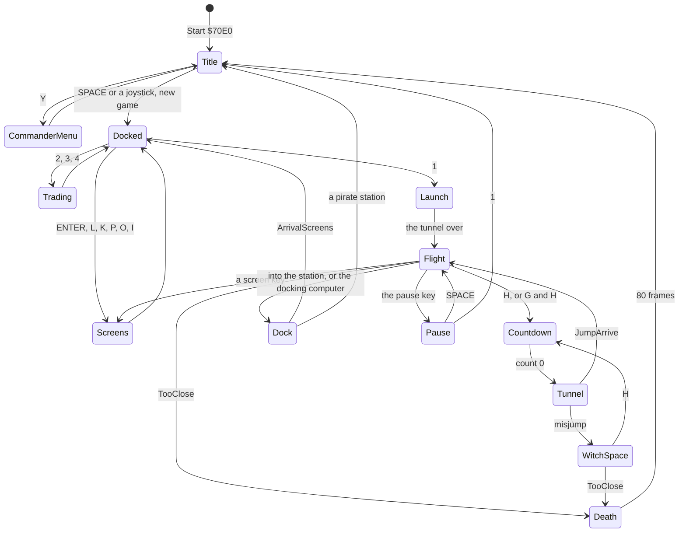
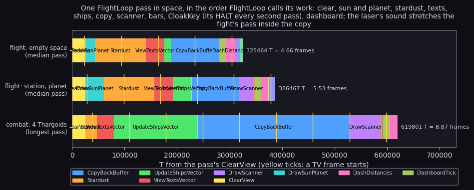
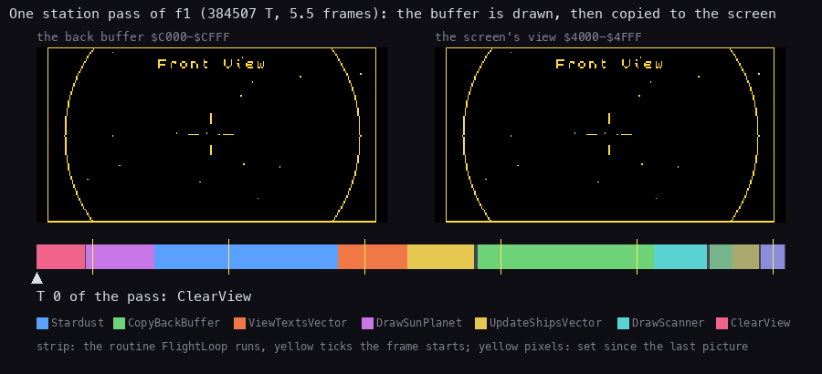
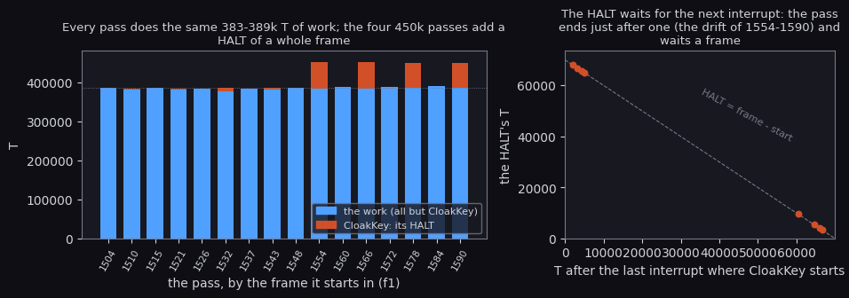
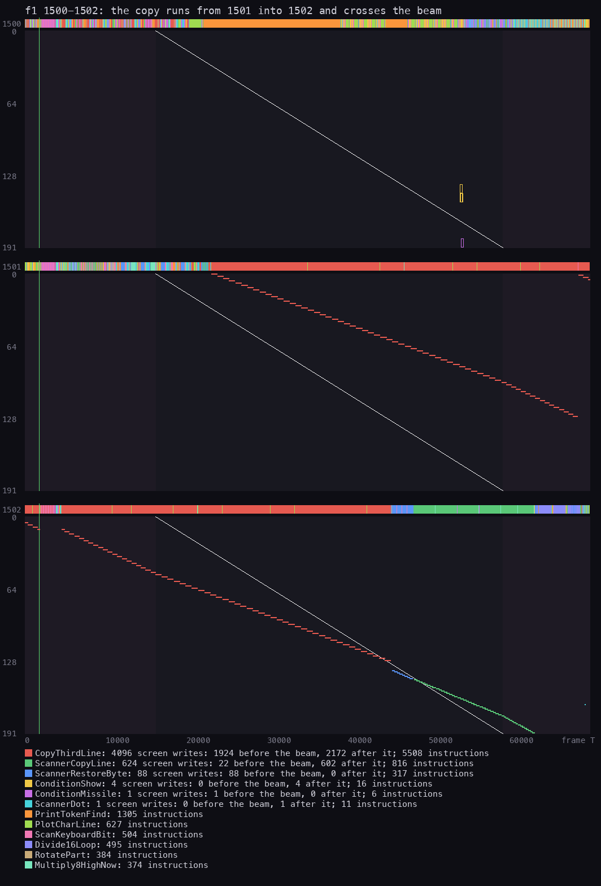

# 4. Game loop

What this covers:

- the state machine from the title to the death, as a diagram;
- the one main loop, FlightLoop, and what a pass does in each state;
- the frame schedule: the interrupt against the pass;
- the order of work inside a flight pass, measured step by step;
- the timing: how long a pass takes per scene and why, the one wait, the beam;
- the scenes that leave the loop for a while: the tunnels and the death.

The recordings it rests on ([Terms](README.md#terms)). All are 48K, Side A, from the title snapshot taken after the
Lenslok, with the ROM loads at signal speed:

- `f1`: a launch, the flight past the station, a jump to Diso, empty space (4856 frames);
- `w1`: a misjump into witch space, the fight, the death (6691 frames);
- `d1`: the title, the docked screens, a launch (2710 frames).

The access traces of the scene windows ([runtime-analysis.md](runtime-analysis.md)) give the per-routine timings.

## 4.1 The state machine

There is no state variable. The state is a set of flags the loop tests on each pass:

| Flag | Address | Meaning |
| --- | --- | --- |
| ViewIndex | `$70E3` | 0-3 a space view, 4 and up a screen |
| Condition | `$7104` | 0 docked, else in flight (4, 6, 2, `$63`) |
| TunnelOn, TunnelLoop | `$D03F` | a tunnel is running |
| WitchSpace | `$7103` | in witch space: no sun, no planet, no station |
| TooClose | `$711F` | the ship has hit the sun or the planet, or the energy is gone: the end |
| the jump countdown | JumpTick `$DC29` | a hyperspace is counting down |



What the recordings went through:

| Transition | Witness |
| --- | --- |
| Title to docked, new game | `d1` (the title until 470), `f1`, `w1` |
| docked screens | `d1`: status 470, market 1020, data 1240, galactic chart 1460, short range chart 1680 |
| launch | `d1` about 1900, `f1`, `w1` (3 runs of SceneLaunch) |
| countdown and tunnel | `f1` (Diso), `w1` (2 runs of TunnelStart) |
| misjump into witch space | `w1` frame 2100 (the pause menu's F option forced it) |
| death | `w1` frame 4310 (Condition 99 from TooClose) |
| dock | `dk` by hand at 2190 and by the computer at 3408; `gx` 2322, `m1`, `m2` ([scenes](scenes.md) 1) |
| the dock's checks | ArrivalScreens and PirateStation at every dock (`dk` 2 runs each); the stations were not pirate-held |
| the mission pages | `m1` the nova's plea at 3433, `m2` the briefing at 3230 (MissionQuestion); the award is known from the code only |
| the commander menu | `t1` saved at 1964, `gx` at 2778; `dk`, `k2`, `m1`, `m2` loaded on the title ([scenes](scenes.md) 0) |
| the galactic hyperdrive | `gx` 1214-1868 (G, H), `m1` at 5769 (leaving the nova's system) |
| the escape pod | `m1` at 2534 (Q) |

A key that belongs to the screen already up does nothing (SelectView). In `d1` the L pressed at frame 790 had no
effect because the status page was already shown.

## 4.2 FlightLoop: one loop for everything

FlightLoop `$7471` runs from the title's new game until the death. Every pass begins the same way:

```text
FlightLoop:
    if not HoldRates: CopyRates          ; the interrupt's accumulators -> this pass's rates
    SelectView                           ; a view or screen key
    PauseMenu                            ; the pause key: wait, options, 1 back to the title
    JumpKeys (through $D042)             ; H, G+H; docked: DOCKED and the status page
    if Condition == 0:                   ; docked
        ChartCursorKeys                  ; on the charts: the cursor
        KeySteer bit 5 -> CommanderMenu
        loop
    DockKeys; the in-system jump key; MoveSunPlanet; StationRunIn
    if ViewIndex < 4: the space pass (4.4)
    else: UpdateShips; SunGrowth; ViewTexts; 8 x HALT
    if TooClose: GameOver
    loop
```

The three branches cost very different amounts:

| State | What a pass does | Pass length |
| --- | --- | --- |
| docked, on a screen | the keys only: no drawing (the screen was drawn once by CallScreen) | about 770 T: 91 passes a frame (`d1` 600-700: 9118 passes in 100 frames) |
| a screen in flight | the ships move on (they keep flying while the player reads the market), 8 HALTs | at least 8 frames |
| a space view | the full pass of 4.4 | 5 to 9 frames |

The docked spin never halts. CopyRates is half its time and FlightLoop's own code most of the rest
([runtime-analysis.md](runtime-analysis.md) 1). In flight a screen still moves the ships, so a fight goes on while
the market is up, eight frames at a time.

## 4.3 The frame schedule

The interrupt and the pass are not tied together. Every frame IM2Handler `$FF25`:

1. scans the keyboard into the key bytes (ScanKeyboard, 1619 T);
2. adds the held keys to the roll, pitch and speed accumulators (ReadControls `$FE01`, about 400 T);
3. plays one slice of the sound (SoundTick through SoundTickVector `$7125`; 88 T with nothing playing).

A pass reads the accumulators once, at its start (CopyRates). So a key pressed in the middle of a 6-frame pass
counts from the next pass, so the controls answer at the pass rate (ReadControls in [5](05-controls.md)).

Two clocks of the game run at the pass rate, not the frame rate:

- the message line's timers (MessageTick, 14 passes a message) are in passes, not frames;
- the countdown of a jump is in MessageTick calls (JumpTick `$DC29`), so it too runs at the pass rate. The
  countdowns took 42 counting calls over the two jumps of `f1` and `w1`.

## 4.4 The order of work inside a space pass

The space pass, as FlightLoop calls it (the routine names from [12](12-routine-reference.md)):

| Step | Routine | What |
| --- | --- | --- |
| 1 | DashboardRestore | the dashboard back if a screen covered it |
| 2 | ClearView `$8080` | the back buffer `$C000-$CFFF` zeroed |
| 3 | DrawSunPlanet `$7584` | the sun (filled) and the planet (outline): not in witch space |
| 4 | Stardust `$7898` | the 16 dots moved and plotted (nothing to erase: ClearView emptied the buffer) |
| 5 | ViewTextsVector | the view's name, the message line, the countdown |
| 6 | UpdateShipsVector | each slot: tactics, move, turn, tidy, collide, draw ([7](07-objects.md)) |
| 7 | TunnelStart | the jump's tunnel when one is due (4.6) |
| 8 | HitFlash | the hit flash on the real screen |
| 9 | CopyBackBuffer `$7FBE` | the back buffer to `$4000-$4FFF` |
| 10 | DrawScanner `$96D9` | the scanner on the dashboard |
| 11 | DrawBars `$84D9` | the 13 bars that changed |
| 12 | CloakKey `$7222` | every second pass: the Y key, and a HALT |
| 13 | DashboardTick `$9A40` | the indicators, the missile keys, the damage, the recharge |
| 14 | DashDistances `$81A9` | the sun's and the planet's distances, the compass, TooClose |

The whole 3D view is built in the buffer (steps 2 to 8) and shown in one copy (step 9). The dashboard (steps 10
to 14) is drawn straight on the screen after it. The pass, step by step against the TV frames, for three scenes
(`tools/fig_rt_pass.py`):



Read each row from the left; the yellow ticks are the frame starts. In empty space (the top row, 325 464 T,
4.66 frames) the stardust and the copy are the two big blocks. Flying past the station (386 467 T) the sun and the
planet's circle are added. In the fight's longest pass (619 801 T, 8.87 frames) the copy is stretched by the
interrupt playing the laser's sweep inside it.

```bash
python3 tools/fig_rt_pass.py      # -> docs/img/loop/pass.png; prints every pass's length
```

The station pass again, as pictures: what the buffer and the screen hold at each moment of it.



How to read it: one picture every 6000 T of the pass `f1` 1504-1510 (65 pictures). Left the back buffer, right the
screen's top two thirds, both drawn as the screen lays them out; a pixel set since the last picture is yellow. Under
them the pass's strip, coloured by the routine FlightLoop runs, the yellow ticks the frame starts, and the arrow the
moment shown. ClearView empties the buffer, DrawSunPlanet draws the planet's arc, Stardust adds the dots and
ViewTextsVector "Front View". Then CopyBackBuffer carries the buffer onto the screen, a third at a time. The screen
keeps the previous picture until then, and the scanner and the bars follow on the dashboard. Drawn by
`python3 tools/fig_phases.py` from the trace `work/f1/traces/1500_0-1600_0.uatr`.

## 4.5 Timing

The pass lengths of the scene windows (`tools/fig_rt_pass.py`; from one ClearView call to the next):

| Scene | Passes | Shortest | Longest | Why |
| --- | ---: | ---: | ---: | --- |
| empty space (`f1` 2400-2500) | 19 | 319 982 | 376 807 | two groups: 320-325k without CloakKey's HALT, 373-377k with it |
| the station (`f1` 1500-1600) | 16 | 383 214 | 452 181 | the same work every pass; four passes add a HALT of nearly a frame (below) |
| the fight (`w1` 3470-3620) | 22 | 375 648 | 619 801 | six passes over 600k: the laser's sweep in the interrupt |

The frames a 3D update, over every scene ([runtime-analysis.md](runtime-analysis.md) 1):

| Scene | Frames an update |
| --- | ---: |
| empty space, the tunnel | 5.00 |
| the launch | 5.26 |
| the station | 5.88 |
| the countdown | 6.25 |
| the fight, 4 Thargoids | 6.52 |
| the title (one close Python) | 7.69 |
| the death | 16.67 |

### The one wait

CloakKey `$7222` is called once a pass. It counts CloakKeyCount `$7221` down and, every second call, looks at the
cloak key and runs a HALT. That HALT is the only time the game waits in flight: 8.9 % of empty space, 4.7 % of the
station, 3.8 % of the fight. It waits for the next interrupt, wherever in the frame the pass is, so the HALT's
length is anything from 0 to a frame. That is why empty space has two pass lengths 50k T apart, not one. The HALT
does not lock the pass to the frame: the next pass starts wherever the interrupt left it.

### The station's two pass lengths

The station flight's passes come in two lengths, 383-389k T and about 450k T. Taken apart
(`tools/fig_rt_station.py`, from the trace `f1` 1500-1600 through eprof), the work is the same in all 16:



How to read it: left, one bar per pass (by the frame it starts in): blue is everything but CloakKey, red is CloakKey's
T, which is its HALT. Right, each HALT's length against where CloakKey started, in T after the last interrupt. The
points lie on the line HALT = frame - start: the HALT always ends at the interrupt (T 4610 of the trace's frame
numbering). Drawn by `python3 tools/fig_rt_station.py`.

| Pass | Length | Work | CloakKey (HALT) | CloakKey starts after the interrupt |
| ---: | ---: | ---: | ---: | ---: |
| 1504 | 384 507 | 384 440 | 67 (no HALT) | 32 702 |
| 1532 | 385 554 | 376 038 | 9 516 | 60 372 |
| 1548 | 386 467 | 386 364 | 103 (no HALT) | 34 646 |
| 1554 | 452 181 | 384 247 | 67 934 | 1 954 |
| 1566 | 450 847 | 384 226 | 66 621 | 3 267 |
| 1590 | 449 507 | 384 703 | 64 804 | 5 084 |

What the work is, for each pass: CopyThird (the back buffer to the screen, 21.4 % of the scene), the stardust's
16 dots (93.6k T a pass, 22.8 %), DrawSunPlanet (35.1k, the planet's circle, 8.5 %), ClearView (6.2 %) and the
texts (PrintCode 5.6 %), with the station a dot ([runtime-analysis.md](runtime-analysis.md) 1, 3). A pass is about
5.5 frames, so CloakKey's HALT (every second pass) starts at a phase of the frame that moves from pass to pass. From
1510 to 1543 it starts 60-67k T after an interrupt and waits 3-10k T. From 1554 the phase has wrapped past the
interrupt (1954, 3267, 4414, 5084 T after it), and the HALT waits 65-68k T for the next. The 450k passes are a HALT of a frame, not more work. Run `python3
tools/fig_rt_station.py` for the figure and the full table of the 16 passes.

### The beam

Nothing waits for the beam. One pass of the station flight against the raster (kit `beam_timeline.py`): each band
is a frame (its top strip: the routine running, by colour), the white diagonal the beam, each mark a screen write
by the routine of its colour; frame T runs left to right, the screen line top to bottom.



**How to read it.** The text and the stardust run in frame 1500 (the top bar's colours). CopyThird's writes (red) start
at T 21 000 of frame 1501 and end at T 44 000 of frame 1502. The beam crosses them twice, so the frame shown in between
is half new and half old ([runtime-analysis.md](runtime-analysis.md) 7 rebuilds such a frame: the even lines new, the
odd ones old). ScannerRestore (blue) and ScannerCopy (green) follow, and the scanner copy runs just behind the beam down
the dashboard: 602 of its 624 writes land after the beam has passed.

```bash
python3 tools/fig_beam.py --trace work/f1/traces/1500_0-1503_0.uatr --listing build/game.lst \
    --machine 48k --frames 3 --out docs/img/loop/beam-pass.png \
    --title "f1 1500-1502: the copy runs from 1501 into 1502 and crosses the beam"
```

## 4.6 The scenes outside the pass

Three scenes run their own loops inside a call from the pass. The flight loop stands still until they return.

**The tunnels.** SceneLaunch `$93ED` runs the launch: Condition green, the views reset, the dashboard drawn
(ResetFlight `$9946`), the planet ahead, slot 0 (the station) just behind the ship, then the 8 launch rings. The
hyperspace tunnel is TunnelStart `$9296`: the controls and the ships reset, the jump sound, then 16 rings over
`$42` frames in one call (TunnelLoop set). The rings come out of the centre: each ring's radius is 256 / its
distance (TunnelDivide `$93AC`), one step nearer each frame, drawn only from radius 4. The launch's sound is played
with DI (SoundLaunch, twice: at the tunnel's start and end), so the launch window is 38 % SoundPulses and takes no
interrupts while the whistle plays.

**The jump.** H starts the countdown (JumpKeys `$DBA2`): the distance must be above 0, below 25.6 light years and
within the fuel (at most 7.0). At 0, JumpTick takes the fuel, and JumpArrive `$DCE9` makes the selected system the current one:
its sun, planet and station come from its seeds, and a new market is built ([10](10-gameplay-logic.md)). A misjump
(one chance in 256 from StarSeed, or the pause menu's F option, which `w1` used) goes to JumpWitch `$DCC0` instead.

**The death.** When TooClose is set (the ship hit the sun or the planet, or the last energy bank emptied: `w1`
frame 4310), the loop runs the game over:

1. ShipsWreck `$B618` (through ResetShipsVector): the explosion's sound, the front view, every slot freed, then a
   canister and two plates thrown out near the origin (actions `$16` and `$15`); in `w1` the four Thargoids' slots
   hold the canister and the plates from frame 4304 ([7](07-objects.md) 7.6);
2. 30 frames of "GAME OVER" (other token 9) over the stardust and the debris;
3. a 50-frame pause;
4. the title (`$739E`).

The death window's frames an update is 16.67, because GameOver calls SoundGameOver (a pulse train with the
interrupts on, ShipsWreck's explosion joining it from the interrupt) and SoundLaunch (interrupts off): 58 % of the
window is SoundPulses ([9](09-sound.md) 9.5).

## 4.7 The pause

The pause key (KeyViews `$FC0A` bit 7, set by the keyboard scan) stops the loop in PauseMenu `$72A3`. It waits for
the key to be released, then reads keys until SPACE (resume) or 1 (back to the title):

| Key | Option bit of Options `$FC0E` |
| --- | --- |
| B | bit 4: the joystick reversed |
| D | bit 3: keyboard damping |
| F | bit 6 (in this version it forces the next jump to misjump, the way `w1` reached witch space) |
| K | between the keyboard and the control method chosen on the title |
| Q | bit 7 off: sound off |
| R | bit 2: recentring |
| S | bit 7 on: sound on, the requests cleared |
| Y | bit 5: the Y axis reversed |

An unknown key beeps (ErrorBeep `$7344`: 6 frames of 4 rising tones). While paused nothing moves; the interrupt
still scans the keys.
