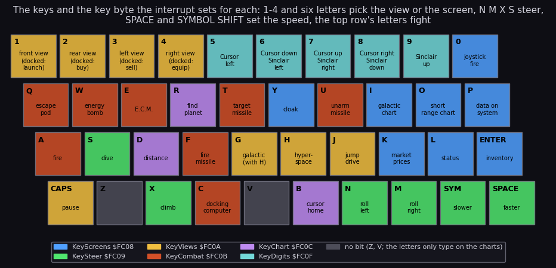
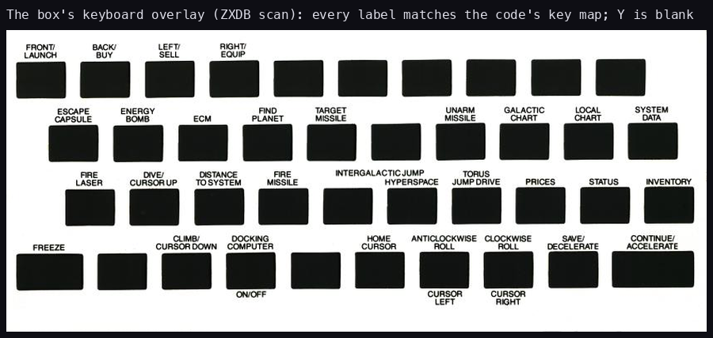
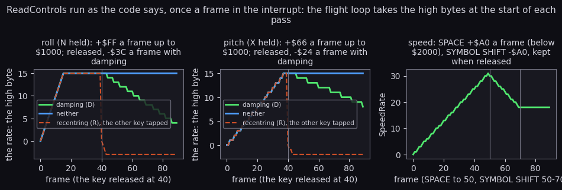
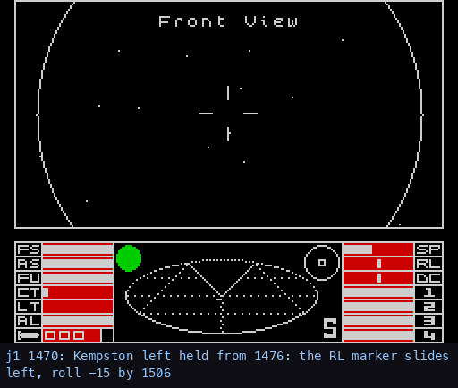

# 5. Controls

What this covers:

- the input devices and the ports Elite reads;
- the keyboard scan in the interrupt and the six key bytes it fills;
- every key and what it does, in flight and docked, as a map;
- the joysticks;
- the steering accumulators, which turn a held key into a roll, a pitch and a speed;
- the views and the screens the keys select;
- the menus: the title, the pause menu, the trading screens, the line editor;
- the keys a matrix can ghost, and the one hidden behaviour (the misjump option).

The recordings it rests on ([Terms](README.md#terms)). All are 48K, Side A, from the title snapshot taken after the
Lenslok, with the ROM loads at signal speed. Each is driven by a script in `tests/inputs/` (a key and its frame):

- `f1` (`f1-hyperspace.txt`): N (no new commander), SPACE, O, N on the chart, D, 1, SPACE, H, SPACE, then A, N, A, X;
- `w1` (`w1-witchspace.txt`): the same start, then CAPS SHIFT (the pause), F, SPACE, H, and the fight: A held 80
  frames at a time, M and S between;
- `d1` (`d1-docked.txt`): N, SPACE, then L, K, P, I, O and 1, 200 frames apart.

All three steered with the keyboard, with Options = `$8C` (sound, recentring, damping). The joysticks are known from
the code only.

## 5.1 Devices and ports

| Device | Port | Read by | Chosen |
| --- | --- | --- | --- |
| keyboard | `$FE`, the eight half-rows `$FEFE`-`$7FFE` | ScanKeyboard `$FD69` | always scanned |
| Kempston | `$1F` | ScanJoystick `$FC10` | on the title: the joystick held left (port `$1F` bit 1 with bit 5 clear) |
| Cursor | keys 5-8 (and 0) | the same, through KeyDigits | on the title: 5 held |
| Sinclair (interface 2, port 1) | keys 6-9 (and 0) | the same | on the title: 6 held |

The title (Title `$7366`) waits on "PRESS SPACE, COMMANDER". SPACE picks the keyboard. A joystick held its own way
picks that joystick and stores it in ControlMethod `$72A2`. The pause menu's K switches between the keyboard and that
method later.

There is no other input. The commander's tape load and save use the ROM's LD-BYTES and SA-BYTES; the Lenslok's
keys are read through the ROM's own keyboard scan before the game starts ([lenslok.md](lenslok.md)).

## 5.2 The keyboard scan

Every frame, IM2Handler `$FF25` calls ScanKeyboard `$FD69`. It reads the eight half-rows from `$FEFE` to `$7FFE`,
and for each key down calls KeyPressed `$FCBA`:

```asm
KeyPressed:   push bc
              push af
              ld a,$05
              sub e                 ; E: the bit of the key in its half-row
              sla a
              sla a
              sla a
              add a,d               ; D: the row
              dec a                 ; A = the index: bit * 8 + row - 1
              ld b,a
              sla b                 ; B = 2 * index
              ld hl,KeyCodes
              add a,l
              jr nc,KeyPressedCode
              inc h
KeyPressedCode:
              ld l,a
              ld a,(hl)
              ld (KeyCode),a        ; the key's character
              ld hl,KeyTable
              ld a,l
              add a,b
              ld l,a
              ld a,(hl)             ; the offset from $FC08
              inc hl
              ld b,(hl)             ; the mask (0 for Z and V)
              ld hl,KeyScreens
              add a,l
              ld l,a
              ld a,(hl)
              or b
              ld (hl),a             ; the key byte's bit set
              pop af
              pop bc
              ret
```

```text
for row in 8 half-rows:
    for each key down in the row:
        index = bit * 8 + row - 1
        KeyCode = KeyCodes[index]
        key byte at $FC08 + KeyTable[index].offset |= KeyTable[index].mask
```

The scan only sets bits. The game clears a key byte when it acts on it. SelectView clears the view keys after use,
DashboardTick clears T, F, U, W and Q (KeyCombat AND `$91`, which keeps A, E and C), and JumpKeys clears H and G.
So a key held for one frame is seen even if the pass takes six, and a key is acted on once per press.

The scan costs 1619 T a frame of its own, 1949 T with the joystick step, 2.8 % of a frame. In the fight, while the
laser's sound runs in the interrupt, the next interrupts are lost and the keys are not scanned
([runtime-analysis.md](runtime-analysis.md) 8). `ScanKeyboard` ran 13 398 times over the recordings, once each
interrupt, and saw a key down 1203 times.

## 5.3 The key map



Each key carries what it does and is coloured by the byte it sets. The box's own keyboard overlay, to hold against
that map:



How to read it: the overlay that came in the box (the ZXDB scan), laid over the keyboard; the keys are where they
are in the key map above, so the two read key for key. Every label of the overlay names what the code does with that key: FIND PLANET is
R (the chart's PLANET NAME? prompt), HOME CURSOR is B, DISTANCE TO SYSTEM is D, FREEZE is CAPS SHIFT. The key the
overlay leaves blank between T and U is Y, the cloaking device, which the player only learns of from the mission.
The top row's 5-0 are blank on the overlay too: the cursor and Sinclair joysticks. Drawn by
`python3 tools/fig_design.py keyboard`.

The bytes, bit by bit (from KeyTable `$FF58` and the code that reads each bit):

| Byte | Bit 0 | Bit 1 | Bit 2 | Bit 3 | Bit 4 | Bit 5 | Bit 6 | Bit 7 |
| --- | --- | --- | --- | --- | --- | --- | --- | --- |
| KeyScreens `$FC08` | ENTER inventory | L status | K market | P data | O short range chart | I galactic chart | 0 fire (joystick) | Y cloak |
| KeySteer `$FC09` | N roll left | M roll right | X climb | S dive | SPACE faster | SYMBOL SHIFT slower | | |
| KeyViews `$FC0A` | 1 front | 2 rear | 3 left | 4 right | H hyperspace | G galactic | J jump drive | CAPS SHIFT pause |
| KeyCombat `$FC0B` | A fire | T target missile | F fire missile | U unarm | E E.C.M. | W energy bomb | Q escape pod | C docking computer |
| KeyChart `$FC0C` | | | | | B cursor home | D distance | R find a planet | |
| KeyDigits `$FC0F` | 9 | 5 | 8 | 6 | 7 | | | |

Z and V set no bit: their mask in KeyTable is 0. CAPS SHIFT with 0 is DELETE: KeyCode `$FE`, for the line editor.

Two keys mean different things in different places:

- 1-4: in flight the four views; docked, 1 launches and 2-4 open the buy, sell and equip screens;
- N, M, X, S on the charts move the cursor (ChartCursorKeys `$71F3` reads the steering bits), not the ship.
  `f1` moved the cursor one step left onto Diso with N.

This table agrees with the box's Quick Key Control Guide ([texts/instructions.md](texts/instructions.md)).

## 5.4 The joysticks

ScanJoystick `$FC10` runs after the last half-row. With a joystick chosen, its four directions replace KeySteer's
bits 0-3, so the joystick steers exactly as N, M, X and S do:

| Joystick | Left | Right | Down | Up | Fire |
| --- | --- | --- | --- | --- | --- |
| Kempston (port `$1F`) | bit 1 | bit 0 | bit 2 | bit 3 | bit 4 → KeyCombat bit 0 (A) |
| Cursor | 5 | 8 | 6 | 7 | 0 |
| Sinclair | 6 | 7 | 8 | 9 | 0 |

Option bit 4 swaps left with right and down with up; bit 5 swaps down with up only. For the Kempston the reversal
options are inverted (the code flips them before use).

With the keyboard, a held steering key clears CAPS SHIFT, F and C. On a rubber keyboard N, M, X and S held together
can ghost other keys of their half-rows. The code does not say why it clears these three; ghosting is an
*inference*.

## 5.5 The steering accumulators

ReadControls `$FE01` runs in the interrupt in a space view. It turns the steering bits into three 16-bit
accumulators:

| Accumulator | Keys | Held | Released |
| --- | --- | --- | --- |
| RollControl `$FF08` | N, M | ±`$FF` a frame, the magnitude below `$1000` | −`$3C` a frame with damping (option D); kept without |
| PitchControl `$FF0A` | X, S | ±`$66` a frame, below `$1000` | −`$24` a frame with damping; kept without |
| SpeedControl `$FF0C` | SPACE, SYMBOL SHIFT | +`$A0` a frame below `$2000`; −`$A0` to 0 | kept |

The roll and the pitch are sign and magnitude words (bit 15 the sign). A key against the current direction takes
the same step off; with recentring (option R) it goes straight to 0. The flight loop takes the high bytes once a
pass (CopyRates `$713C`): RollRate, PitchRate and SpeedRate, 0-15 for the roll and pitch and 0-31 for the speed.



The figure runs the code's arithmetic frame by frame (`tools/fig_keys.py`, a model of ReadControls, not a
recording):

- The roll reaches its full rate of 15 in 16 frames; the pitch needs 40, so climbing is slower to start than rolling.
- Released with damping, the rate falls back to 0 in about 64 frames for the roll. Without damping it stays: the ship
  keeps rolling until the other key is pressed.
- With recentring, one tap of the other key stops the roll at once.
- The speed has no damping: it stays where SPACE and SYMBOL SHIFT leave it.

The recording agrees. `j1` held the Kempston left from 1476 to 1506 and right from 1546 to 1576 (option D on):



How to read it: the recorded screen every second frame, with the frame and the step in the caption. Watch RL, the
roll marker in the right column of the dashboard, and the stardust turning. The marker moves only when a pass
updates the dashboard (every 5-6 frames). It leaves the middle at 1490 and is at the left end by 1502. After the
release it creeps back, 5 of its 15 pixels in 32 frames: the damping's step is `$3C` a frame against the push's `$FF` (the table above). The push the
other way at 1546 carries it through the middle at 1554 to the right end at 1574. Drawn by
`python3 tools/fig_design.py reaction` from frames grabbed with `tools/grab.py`.

The rates also drive the dashboard's indicators: CopyRates puts the roll and the pitch markers at `$15` ± the rate,
and the speed bar at 5 × speed + 5 ([8](08-hud-and-text.md)).

```bash
python3 tools/fig_keys.py     # -> docs/img/controls/keymap.png, steering.png
```

## 5.6 Views and screens

SelectView `$80D3` turns the view keys into ViewIndex `$70E3`:

| Key | In flight | Docked |
| --- | --- | --- |
| 1 | view 0: front | the launch (SceneLaunch `$93ED`) |
| 2 | view 1: rear | screen 4: buy cargo |
| 3 | view 2: left | screen 5: sell cargo |
| 4 | view 3: right | screen 6: equip ship |
| I | screen 7: galactic chart | the same |
| O | screen 8: short range chart | the same |
| P | screen 9: data on the selected system | the same |
| K | screen 10: market prices | the same |
| L | screen 11: status | the same |
| ENTER | screen 12: inventory | the same |

A screen is drawn by CallScreen: the CALL at `$8153` is patched to `$D000` + 3 × the screen, an entry of the
ScreenTable vectors ([8](08-hud-and-text.md)). Nothing is selected while a tunnel runs (TunnelLoop `$D040`), and a
screen's key while that screen is up does nothing. The `d1` timeline shows the screens in turn: ViewIndex 11 at
frame 470, 10 at 1020, 9 at 1240, 7 at 1460, 8 at 1680.

## 5.7 Menus and text entry

| Menu | Routine | Keys |
| --- | --- | --- |
| the title | Title `$7366` | Y: load a commander (the access menu); SPACE or a joystick: play |
| the access menu | CommanderMenu `$D90A` | 1 load, 2 save, 3 exit; docked, SYMBOL SHIFT (KeySteer bit 5) opens it |
| the pause | PauseMenu `$72A3` | CAPS SHIFT pauses; SPACE resumes, 1 the title; B, D, F, K, Q, R, S, Y options ([4](04-game-loop.md) 4.7) |
| the trading screens | QuantityKeys `$E776` | one or two digits a row, ENTER skips the row, any other key leaves |
| the line editor | ReadLine | digits and capitals, DELETE (CAPS SHIFT + 0), ENTER: the commander's name, a planet's name for R |
| the charts | ChartCursorKeys `$71F3` | N, M, X, S move the cursor; B home; D the distance; R find a planet by name |
| the mission questions | the nova page | Y or N |

QuantityKeys runs the screen's check after each digit (BuyCheck, SellCheck, EquipAccept), so a quantity the hold, the
cash or the stock cannot take is refused before ENTER ([10](10-gameplay-logic.md)).

## 5.8 Hidden keys and options

- **F in the pause menu** sets option bit 6, and with it the next hyperspace misjumps into witch space (JumpWitch
  `$DCC0`). The manual does not list it. `w1` reached the Thargoids this way. Without it, a misjump comes at one
  chance in 256 from StarSeed.
- **J** is the in-system jump (InSystemJump `$7EDE`). It moves the sun, the planet and the station `$2000` closer,
  and makes the next stardust frame draw two passes ([6](06-rendering.md)).
- **Y** switches the cloaking device, but only once the mission has given it (MissionFlags bit 6). CloakKey reads it
  every second pass.
- **The pause menu's Q and S** turn the sound off and on (option bit 7). S also clears the pending sound requests.

## 5.9 What the recordings pressed, and what they did not

The first three scripts pressed 16 keys of the game, in the table below, read straight from `tests/inputs/`. The
scenes of [scenes](scenes.md) pressed most of the rest; they come after the table.

| Key | Pressed in | What it did there |
| --- | --- | --- |
| N | all three, `f1`, `w1` | "no" to the title's load question; one step left on the short range chart (onto Diso); a roll left in `f1` |
| SPACE | all three, `f1`, `w1` | play from the title; faster after the launch; resume from the pause (`w1`) |
| O, D | `f1`, `w1`, `d1` (O) | the short range chart; pick the system under the cursor |
| 1 | all three | the launch (docked) |
| H | `f1`, `w1` | the hyperspace countdown |
| A | `f1`, `w1` | the front laser, held 60-80 frames a time |
| X, M, S | `f1` (X), `w1` (M, S) | climb, roll right, dive |
| CAPS SHIFT, F | `w1` | the pause, then option bit 6 (the misjump) |
| L, K, P, I | `d1` | the status, the market, the data on Lave, the galactic chart |

The scenes' keys (`work/<rec>/inputs.txt`), with what the game did; letters typed into a name (LEMAED, AUSIS) are
left out:

| Key | Pressed in | What it did there |
| --- | --- | --- |
| 2, 3, 4 (docked) | `t1`, `m1`, `m2` | buy, sell, equip; in `m1` the nova's plea and the reward |
| ENTER (docked) | `t1` | the inventory (InventoryScreen, 3 runs) |
| SYMBOL SHIFT | `t1`, `gx` docked; `dk`, `cs` in flight | the access menu and the save; the ship stopped |
| T, F | `k2`, `fs` | the missile armed and locked, then fired (`k2` 2485, 2519; launched at 2542) |
| E | `k2` 2613 | the E.C.M. (SoundArmECM) |
| W | `k2` 3301, `m1`, `m2`, `fs` | the energy bomb (FlashScreen 24 runs each) |
| Q (flight) | `m1` 2534, `m2` | the escape pod |
| C | `dk` 3002, `gx`, `m1` | the docking computer |
| G with H | `gx` 1214 | the galactic hyperdrive |
| J | `gx`, `m1`, `m2`, `fs` | the in-system jump (refused near the planet in `fs`) |
| R (chart) | `m1`, `m2` | PLANET NAME? (PlanetNamePrompt, FindSystem) |
| Y (title) | `dk`, `k2`, `gx`, `m1`, `m2` | the access menu, to load a commander |
| the pause's B, D, K, Q, R, S, Y | `j1` | each flipped its option bit ([scenes](scenes.md) 8) |
| the Kempston | `j1` | the rates of 5.4 measured: roll -15 and +15, pitch +11 and -9 |

Still never pressed, so known from the code only:

- the views 2-4 in flight (the bot flew the front view);
- the cloak Y in flight (no recording earned the device);
- U (the missile disarmed) and the chart key B;
- the Sinclair and the cursor joysticks.

So the key table of 5.3 rests on KeyTable `$FF58` and the code that reads each bit, checked against the box's guide;
the pressed keys above are the ones a recording confirms.
