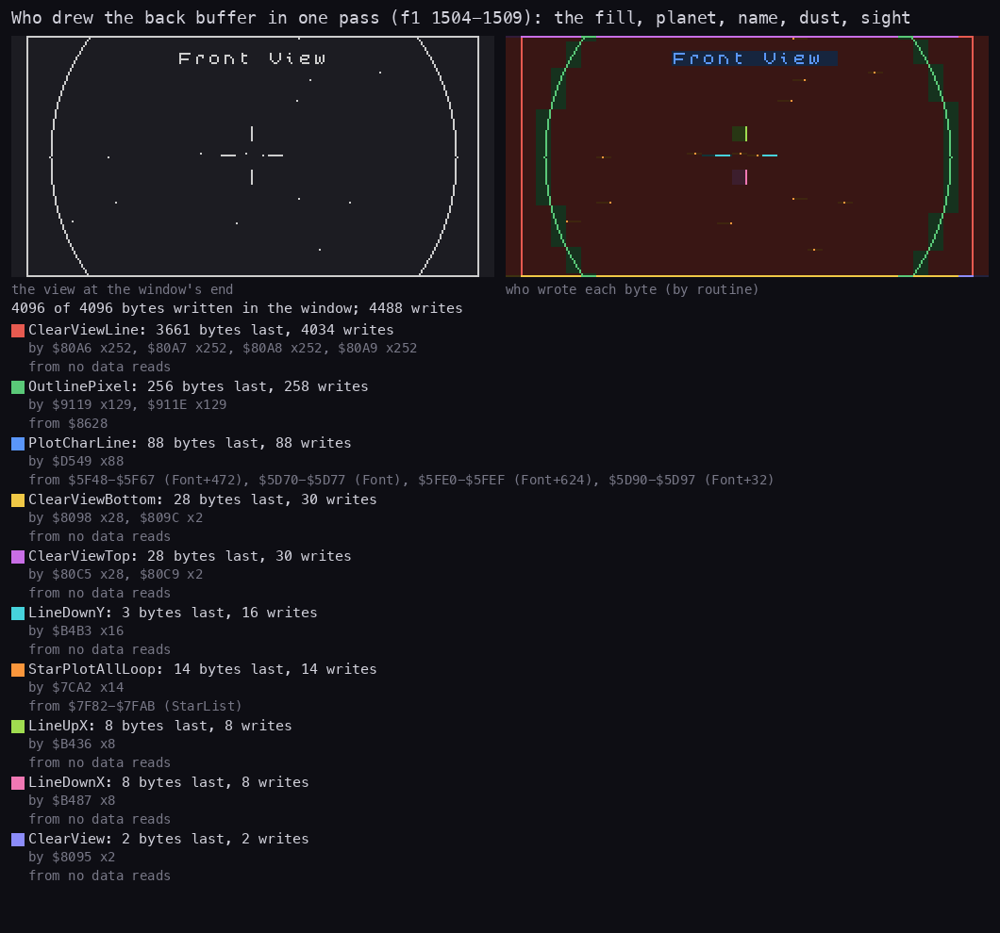
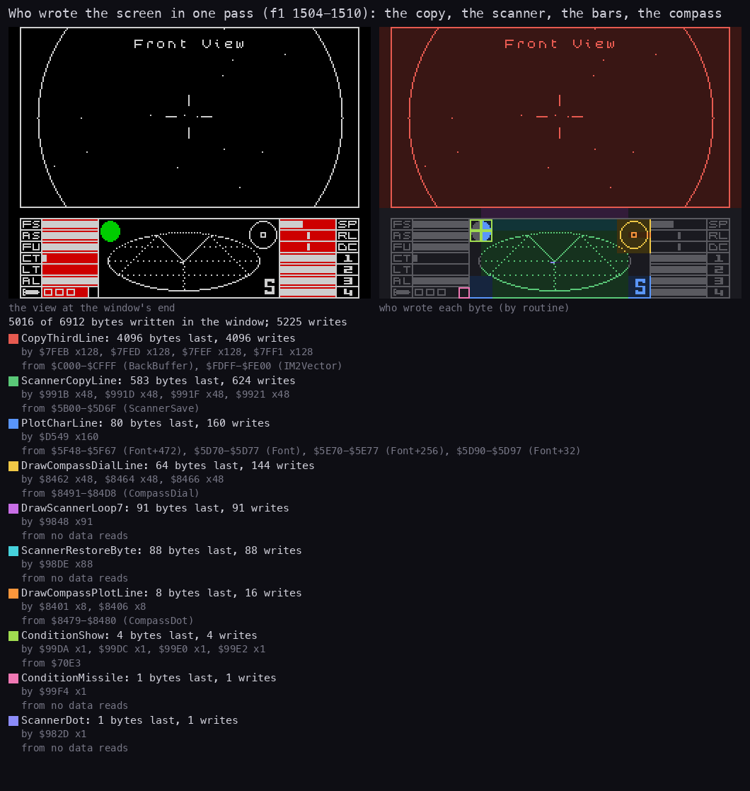
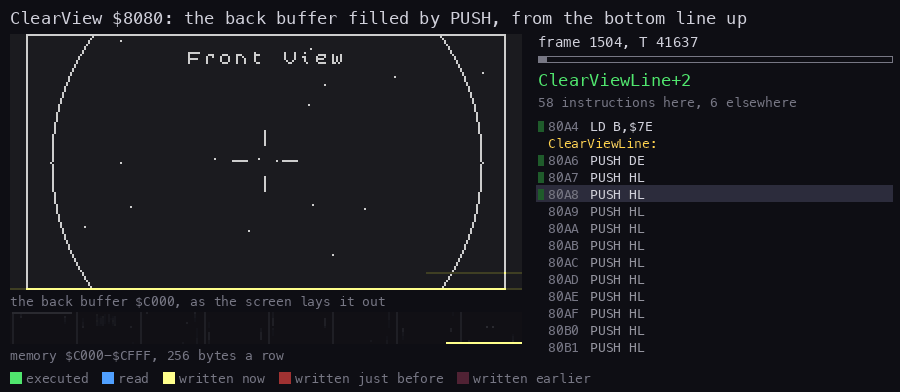
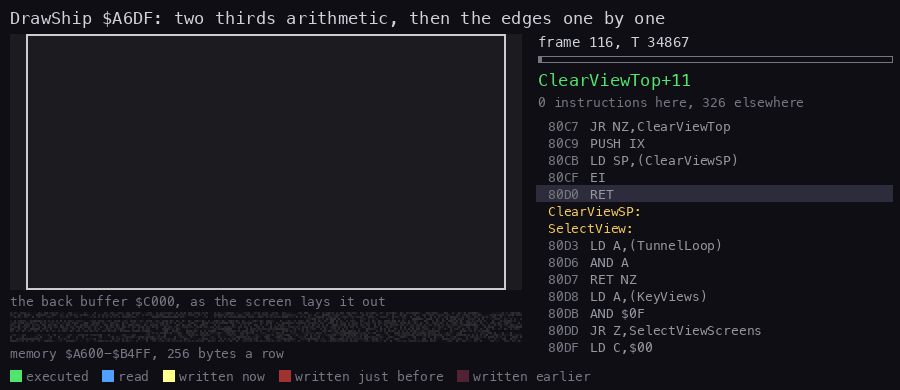
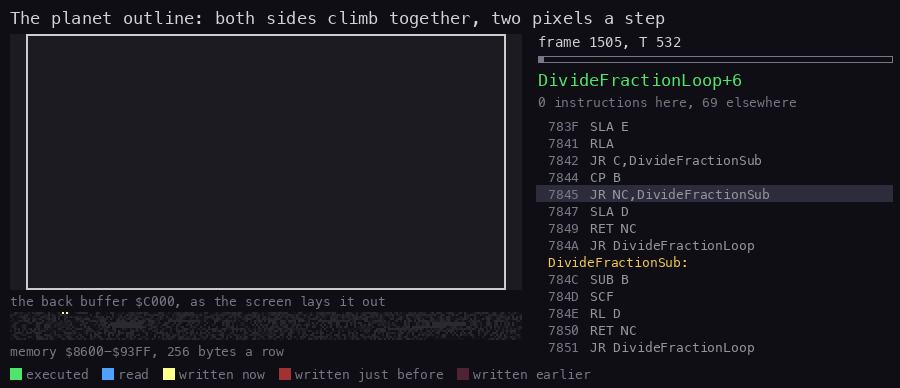
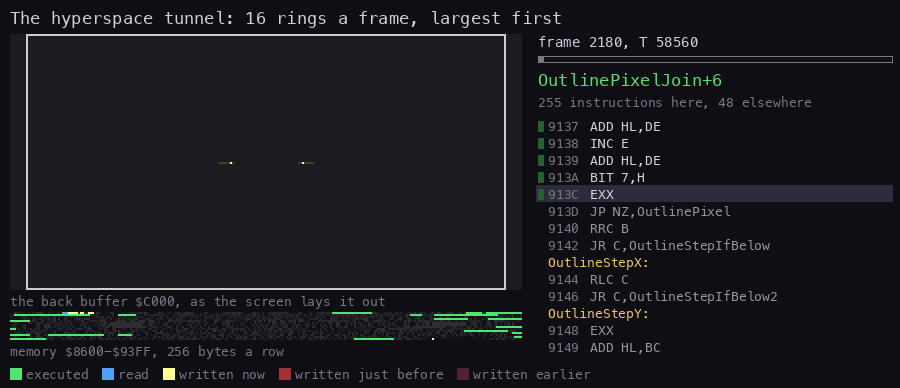
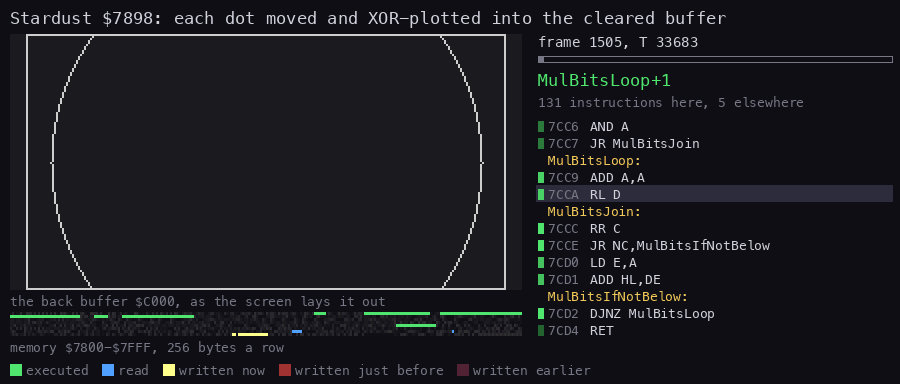
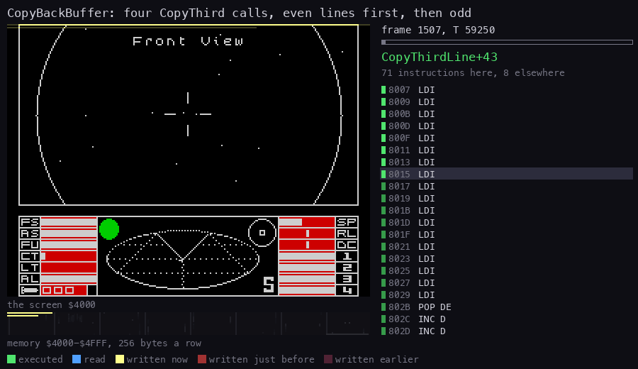
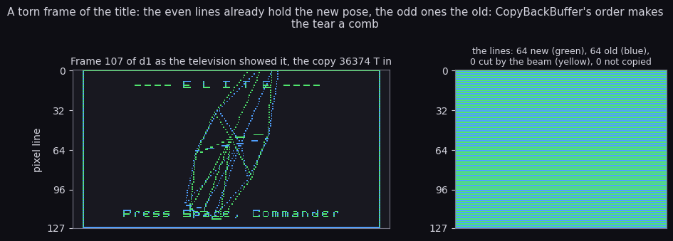

# 6. Rendering

What this covers:

- the screen and its parts: the 3D view, the dashboard, the full pages (6.1);
- the order of drawing in one pass of the flight loop, and who wrote each byte (6.2);
- ClearView, which empties the back buffer with the stack (6.3);
- the lines: clipping, the octant and the four patched Bresenham loops (6.4);
- the ships: the far dot, the wireframe, the quarter-square multiply (6.5);
- the circles: the planet's outline, the sun's fill, the tunnel's rings, the chart circle and the hit flashes (6.6);
- the stardust, listed and then XORed in (6.7);
- the copy to the screen, and what the beam sees of it (6.8);
- the cost of drawing per scene (6.9).

The 3D engine in depth (the numbers, the turn and the tidy, the face test, the projection, the arithmetic's errors,
the line drawer's octants, the optimisations measured and the BBC's engine) is [3d-engine](3d-engine.md).

The recordings it rests on ([Terms](README.md#terms)), all 48K from the title snapshot:

- `f1` 1500-1600, the station scene: the planet, the station's dot, the stardust; one pass cut out at 1504-1510;
- `f1` 2400-2500, empty space;
- `d1` 100-200, the title: the turning Python, the second title ship (one pass at 116-122);
- `w1` 2100-2200, the hyperspace tunnel (one frame at 2180-2182), and `w1` 3470-3620, the fight with four Thargoids.

The windows were cut out of the recorded traces with `tools/trace_cut.py` (`python3 tools/trace_cut.py TRACE F:T-F:T OUT`,
the cut traces named by their window), so no emulator ran for this document.
The explosions' red discs (HitFlash) were recorded later in `k2` ([3d-engine](3d-engine.md) 5). The sun's fill code
ran in `dk`, `m1`, `m2` and `fs` (DrawSunPlanet calling DrawCircleDI in their L1), but no screen grabbed around
those runs shows a sun's disc in the view. The disc and the XOR lines over it are known from the code only.

## 6.1 The screen

| Area | Lines | Drawn by | Drawn into |
| --- | --- | --- | --- |
| the 3D view | 0-127 (the top two thirds) | ClearView, DrawSunPlanet, Stardust, ViewTexts, UpdateShips, Gunsight | the back buffer `$C000-$CFFF`, then copied (CopyBackBuffer `$7FBE`) |
| the dashboard | 128-191 (the bottom third) | DrawScanner, DrawBars, the compass, ConditionLight | the screen, directly |
| the attributes | 24 rows | FillAttrsVector (a whole area at once), ConditionLight (two cells) | the screen |
| a full page (charts, market, status, inventory) | 0-191 | the `dockedscreens` module through CallScreen | the screen, directly |

The back buffer is laid out like the screen's top two thirds: the address of a byte is the screen's address with
bit 15 set. So any routine that can draw on the screen can draw into the buffer by setting one bit, and the game
does exactly that:

- PlotPixel `$A83C` asks the ROM's PIXEL-ADD (`$22B1`) for a screen address, then sets bit 7 of H;
- ViewTexts `$DA7A` sets bit 7 of the page byte of PlotChar's `LD HL,$4000` (at `$D50A`), so "Front View" goes into
  the buffer;
- the laser beam is drawn by DrawLine with bit 7 of LineAddress's page byte (`$B348`) set;
- HitFlash patches the circle engine's base the other way, onto the real screen (6.6).

The view has a frame: a solid line at the top and the bottom and one pixel at each side. ClearView draws it while it
clears (6.3), so the frame costs nothing extra.

A full page wipes the dashboard. DashboardSave `$817E` keeps the bottom third's pixels in DashSave `$C000` and its
attributes at `$5B00` before a page; DashboardRestore `$8042` puts them back when the top-left byte of the screen
reads `$FF` (the frame of a page). It is the first call of every drawing pass.

## 6.2 One pass

The flight loop draws a space view in this order (FlightLoopDraw, `src/game/flightloop.asm`):

```asm
FlightLoopDraw:
  CALL DashboardRestore   ; the dashboard back if a page wiped it
  CALL ClearView          ; the buffer cleared, with the view's frame
  LD A,(WitchSpace)
  AND A
  CALL Z,DrawSunPlanet    ; the sun and the planet, unless in witch space
  CALL Stardust           ; the 16 dots
  CALL ViewTextsVector    ; the view's name, into the buffer
  CALL UpdateShipsVector  ; each ship moved and drawn, then the gunsight
  CALL TunnelStart        ; the jump's tunnel, when it starts
  CALL HitFlash           ; the hit flashes, on the screen
  CALL CopyBackBuffer     ; the buffer to the screen
  CALL DrawScanner        ; from here on, the dashboard
  CALL DrawBars
  CALL CloakKey
  CALL DashboardTick
```

Everything before CopyBackBuffer draws into the buffer, everything after it onto the dashboard. There is one copy
a pass, not one a frame: a pass of the station scene takes about six frames (17 passes in `f1` 1500-1600), and the
view changes only when the copy runs.

The trace of one pass agrees: ClearView at `f1` 1504 T 41 104-66 400, the planet from 1505 T 1298, the stardust from
1505 T 31 970 to 1506, the texts at 1506-1507, the gunsight's lines at 1507 T 46 272, the copy from 1507 T 58 008.



**How to read it.** The left panel is the buffer at the end of the pass, the right one colours each byte by the routine
that wrote it last; the list gives each writer's count and where its data came from. Red is ClearView: it writes every
byte, 4096 of them. Green is the planet's outline (OutlinePixel, 256 bytes, which reads the run's direction from
RunRight `$8628`). Blue is the view's name (PlotCharLine, from the font at `$5D70`). The small dots are the stars,
written by StarPlotAllLoop (6.7), and the cross at the centre is three line loops (LineDownY, LineUpX, LineDownX): the
Gunsight's four lines.



**How to read it.** On the screen the picture is simple: CopyThirdLine wrote all 4096 bytes of the top two thirds, once
each. The dashboard's writers are ScannerCopyLine (624 writes, the scanner's background put back from ScannerSave
`$5B00`), the scanner's dots and stalks (DrawScannerLoop7), the compass (DrawCompassDialLine) and the condition light.

```bash
python3 tools/trace_cut.py work/f1/traces/1500_0-1600_0.uatr 1504:0-1509:0 work/f1/traces/1504_0-1509_0.uatr
python3 tools/trace_cut.py work/f1/traces/1500_0-1600_0.uatr 1504:0-1510:0 work/f1/traces/1504_0-1510_0.uatr
python3 tools/writers_map.py --trace work/f1/traces/1504_0-1509_0.uatr --listing build/game.lst \
    --view buffer:C000:32x128:screen --sources --out docs/img/render/writers-buffer.png \
    --title "Who drew the back buffer in one pass (f1 1504-1509): the fill, planet, name, dust, sight"
python3 tools/writers_map.py --trace work/f1/traces/1504_0-1510_0.uatr --listing build/game.lst \
    --sources --out docs/img/render/writers-screen.png \
    --title "Who wrote the screen in one pass (f1 1504-1510): the copy, the scanner, the bars, the compass"
```

## 6.3 ClearView: the stack as a fill

ClearView `$8080` runs first in every pass. It points SP at the buffer's end and PUSHes the whole 4 KB downwards:

```asm
ClearView:
  DI
  LD (ClearViewSP),SP
  LD SP,BackBuffer+$1000
  LD HL,$0000
  LD DE,$00FF
  LD IX,$FF*$100
  LD BC,$FFFF
  PUSH DE
  LD A,$0E
ClearViewBottom:
  PUSH BC
  DEC A
  JR NZ,ClearViewBottom
  PUSH IX
  LD E,$01
  LD IX,$8000
  LD B,$7E
ClearViewLine:
  PUSH DE
  PUSH HL
  ; ... 14 PUSH HL in all
  PUSH IX
  DJNZ ClearViewLine
```

```text
SP = $D000 (the buffer's end); interrupts off
the bottom line: 16 words, all $FF
126 lines: the word $0001 (the right side's pixel), 14 words $0000, the word $8000 (the left side's pixel)
the top line: 16 words, all $FF
SP back; interrupts on
```

Each line is 16 PUSHes of 11 T and one DJNZ: 25 296 T for the whole buffer (430 032 T over 17 passes in `f1`
1500-1600). An LDIR from a blank line would take 86k T for the same bytes. The interrupts are off because an
interrupt would push its return address into the buffer.



**How to read it.** The animation shows the buffer filling from the bottom line up; each picture is 637 T of the trace
of `f1` 1504, the newest bytes bright.

```bash
python3 tools/fig_routine_anim.py --listing build/game.lst --trace work/f1/traces/1504_41000-1504_66500.uatr --range C000-CFFF --pc 8080-80D0 --pictures 40 \
    --title 'ClearView $8080: the back buffer filled by PUSH, from the bottom line up' --out docs/img/render/clearview.gif
```

## 6.4 Lines

Every straight line in the view goes through DrawLine `$B044`: the ship edges, the gunsight, the laser beams. The
ends come as offsets from the view's centre with quadrant bits in C (bit 2 below the centre and bit 3 left of it
for the first end, D E; bits 0 and 1 the same for the second, H L), 0-`$7F` across and 0-`$3F` down. The line is
drawn from the first end towards the second ([3d-engine](3d-engine.md) 7 tested every direction in the simulator).
`$FF` in both coordinates of an end marks a hidden vertex and draws nothing.

| Step | Routine | Does |
| --- | --- | --- |
| 1 | DrawLine `$B044` | an outcode per end: bit 0 past x `$80`, bit 1 past y `$40`; both out on the same side: nothing |
| 2 | ClipLine `$B18A` | one or both ends out: the crossing with the window's edge from the slope (10 runs over all recordings) |
| 3 | LineOctant `$B3A7` | the differences, the octant (B's bits 4-7), the slope as an 8-bit fraction (LineFraction `$B2FE`) |
| 4 | LineAddress `$B308` | the start's buffer address, its pixel mask, the lines left to the next character row |
| 5 | LineSetup `$B0E0` | patches the step direction (RLC C / RRC C, INC L / DEC L) and the fraction into one of four loops |
| 6 | LineUpX, LineDownX (y major); LineUpY, LineDownY (x major) | a pixel a step; the fraction added to E steps the minor axis on the carry |

The y-major loop going down (a row a step, x moving on the carry), with the slope patched into the `ADD A,$00`:

```asm
LineDownX:
  LD A,(HL)
  OR C
  LD (HL),A
  DEC D
  RET Z
  LD A,E
  ADD A,$00
  LD E,A
  JR NC,LineDownXNext
  RRC C
  JR C,LineDownXByte
LineDownXNext:
  DJNZ LineDownXRow
  LD B,$08
  LD A,H
  SUB $07
  LD H,A
  LD A,L
  ADD A,$20
  LD L,A
  JP NC,LineDownX
```

```text
D = the pixels to draw, C = the pixel mask, E = the running fraction, B = the lines left in this character row
loop:
    plot (OR)
    if --D == 0: return
    E += slope; on the carry the mask moves one pixel (a new byte when it wraps)
    the next line; every 8 lines a character row down (H - 7, L + 32, a new third on the carry)
```

The loops OR the pixel. UpdateShips patches the four `OR C` into `XOR C` (at `$B435`, `$B465`, `$B486`, `$B4B2`)
while the sun is large (SunLarge `$7120`), so a line across the filled sun shows dark instead of vanishing. The
recordings never brought a large sun into the view (`fs` tried for 42 658 frames, [scenes](scenes.md) 9), so the
patch is known from the code only.

The cost of a line, fitted over the recordings' lines, is 1848 T plus 87.1 T a pixel
([runtime-analysis.md](runtime-analysis.md) 3). The setup is the price of the octant and the patching: a line of 20
pixels spends half its time before its first pixel. The gunsight is four such lines every pass of a view with a
laser: 72 lines over the 17 passes of the station scene, 2472 T a line on average.

## 6.5 Ships

DrawShip `$A6DF` runs once a pass for each ship, from UpdateShips, only in the four space views. The view picks the
depth axis (z for the front and rear views, x for the sides) and the sign that is "ahead". A ship behind the view,
or 256 or more away in depth, is not drawn. Its screen point is the perspective division (DividePoint `$AC69`: x /
depth and y / depth as 8-bit fractions) and must lie within 128 × 64 of the centre.

A ship beyond its blueprint's dot distance (+`$0B`) is four pixels, XORed with PlotPixel:

```asm
PlotPixel:
  LD A,B
  CALL $22B1            ; the ROM's PIXEL-ADD: HL = the screen address of (C, B), A = the pixel
  LD D,A
  INC D
  LD A,$01
PlotPixelBit:
  RRCA
  DEC D
  JR NZ,PlotPixelBit
  SET 7,H               ; the back buffer
  XOR (HL)
  LD (HL),A
  RET
```

Nearer, the wireframe (DrawWireframe `$A84D`):

1. ViewMatrixSetup `$AECC`: the side axis as the cross product of the roof and the nose, and the three axes put in
   the view's order (ViewMatrix `$A994`);
2. the distance's high byte doubled (at most 31), less 2, is the detail level (`$A9B8`);
3. FaceVisibility `$BCD4`: one byte a face in FaceVisible `$A984`;
4. ProjectVertices `$A9C9`: each vertex whose visibility distance passes and one of whose two faces is visible is
   rotated (three products for each row of the matrix) and divided by its depth; the screen points go to
   ProjectedPoints `$A8FA`, 3 bytes each, `$FF` for hidden;
5. DrawEdges `$AE01`: each edge with a visible face whose distance passes is a DrawLine between its two points;
6. a ship that is firing (+`$20` bit 3) adds its laser: a line from its gun vertex to a random point at the edge.



**How to read it.** The title's turning ship, one pass (8 frames, `d1` 116-122). The first two thirds of the animation
draw nothing: that is the matrix, the face test and the projection (DividePointLoop is the instruction most often on the
right panel). Then the edges come one at a time, each after the setup pause of 6.4. The command is at the end of this
section.

The multiplications are quarter squares from the table of n² the kickoff builds at `$BE00` (low bytes) and `$BF00`
(high bytes): b × c = ((b + c) / 2)² − ((b − c) / 2)², two table reads and a subtraction (Multiply8 `$AB34`, listed
in [3d-engine](3d-engine.md) 6). When b and c differ in parity the product is exactly the smaller factor short (the
simulator ran all 65 536 inputs); the vertex arithmetic keeps only the high byte, where that is below one unit.
Multiply8 ran 578 times in the station scene's 17 passes and 1586 times in the fight's 23. A whole Python update
costs 257k T, 3.7 frames. The cost of every blueprint, measured in the simulator, is in [3d-engine](3d-engine.md) 8;
which edges cost most is in [runtime-analysis.md](runtime-analysis.md) 3.

```bash
python3 tools/fig_routine_anim.py --listing build/game.lst --trace work/d1/traces/116_30000-122_48700.uatr --range A600-B4FF --pc A6DF-B4D5 --pictures 90 \
    --title 'DrawShip $A6DF: two thirds arithmetic, then the edges one by one' --out docs/img/render/wireframe.gif
```

## 6.6 Circles

One engine draws every circle. The caller sets the centre (CircleX `$861B`, CircleY `$861A`, offsets from the view's
centre with their signs in CircleQuadrant `$861C`) and the radius (CircleRadius `$861D`); CircleMode `$8629` is 1 for
an outline and 0 for a fill. A radius below 9 is not drawn.

| Use | Caller | Mode | Witness |
| --- | --- | --- | --- |
| the planet | DrawSunPlanet `$7584` → DrawCircle `$86DE` | outline | `f1`, `d1`: 899 calls |
| the sun | DrawSunPlanet → DrawCircleDI `$86D0` | fill, interrupts off | ran in `dk`, `m1`, `m2`, `fs`; no disc seen |
| the tunnel's rings | TunnelFrame `$92D6` | outline | `w1`, `f1` (the jumps), `d1` (the launch) |
| the chart's range circle | DrawChartCircle `$8E29` | outline, patched for the screen | `d1`: 4 runs |
| the explosions | HitFlash `$8F0D` | fill, on the screen | `k2` 2572: 45 circles for 3 explosions ([3d-engine](3d-engine.md) 5) |

DrawCircleShape `$86EE` places the centre (128 ± CircleX, 64 ± CircleY) and sorts the circle by the edges it meets:
3028 of its 3201 calls were wholly inside the view, four quarter arcs (CircleArcs `$87C8`); the rest went to the
clipped fillers. A row's half width is HalfChord `$8ACD`, the square root of radius² − row², found by bisection over
the squares table. The outline then steps like a Bresenham circle, its terms in the alternate registers:

```asm
OutlinePixel:
  LD A,(HL)
  OR C
  LD (HL),A             ; the left pixel
  LD D,L
  LD L,E
  LD A,(HL)
  OR B
  LD (HL),A             ; the mirrored right pixel, the same line
  LD L,D
  LD A,(RunRight)
  AND A
  JR NZ,OutlinePixelIfNotZero
  LD A,H
  DEC H                 ; a line up
  AND $07
  CALL Z,CircleRowUp
  JR OutlinePixelJoin
OutlinePixelIfNotZero:
  INC H                 ; a line down
  LD A,H
  AND $07
  CALL Z,CircleRowDown
OutlinePixelJoin:
  EXX
  ADD HL,DE
  INC E
  ADD HL,DE             ; the error term
  BIT 7,H
  EXX
  JP NZ,OutlinePixel
```

OutlinePixel is the hottest loop of the game: 1 787 849 instructions over the recordings. It plots the two mirrored
pixels of a line at once, so a circle costs half its pixels in loop passes.



**How to read it.** The planet of the station scene (`f1` 1505), cut by the view's top and bottom: both sides climb
together, two pixels a step. DrawSunPlanet costs 35 065 T a pass here. The commands are below.

The fill (the sun) writes whole bytes with the stack: AF holds `$FFFF` (FillWord `$8FB6`), SP the row's right end,
and a JR patched with 16 minus the number of words enters one of six chains of 16 PUSH AF (FillPushes1-6). The
explosions of `k2` ran it on the screen (5 in [3d-engine](3d-engine.md)); a sun's fill was never seen in a grabbed
frame.

The tunnel is the same outline engine at the view's centre: TunnelFrame steps each ring one closer and draws it at
radius 256 / distance (TunnelDivide `$93AC`); a ring under radius 4 is skipped.



**How to read it.** Each ring appears as it is drawn (the command below). 16 rings a frame at 6855 T each, 110k T: one
tunnel frame is 1.6 frames of the machine. The rings come largest first. The tunnel's timing and its patched loop are in
[4](04-game-loop.md) 4.6.

DrawChartCircle draws on the screen, not in the buffer: it writes the chart's values into the 32 code bytes listed
in CirclePatchSites `$8ECD` (from ChartPatch `$8E8D`), draws, and writes the view's values back (ViewPatch `$8EAD`).
HitFlash moves the base the same way (CircleBase `$8F88`) and draws 15 filled circles growing by 2 at the screen
point of each ship just hit, between two attribute fills.

```bash
python3 tools/fig_routine_anim.py --listing build/game.lst --trace work/f1/traces/1505_0-1505_31900.uatr --range 8600-93FF --pc 8619-928B --pictures 60 \
    --title 'The planet outline: both sides climb together, two pixels a step' --out docs/img/render/planet.gif
python3 tools/fig_routine_anim.py --listing build/game.lst --trace work/w1/traces/2180_56400-2182_46200.uatr --range 8600-93FF --pc 8619-93FF --pictures 60 \
    --title 'The hyperspace tunnel: 16 rings a frame, largest first' --out docs/img/render/tunnel.gif
```

## 6.7 The stardust

Stardust `$7898` moves 16 dots (StarDots `$7E8D`, 5 bytes each: X and Y with the sign in bit 7, the depth, the two
fractions) once a pass. The front view moves a dot away from the centre by speed / depth, the rear view towards
it; then the roll turns X into Y and the pitch moves Y (StarRollPitch `$7ABC`). A dot that leaves the window is made
again at random (StarRespawn `$7D55`). In witch space there are only 4 dots (StarCount `$7F7C`).

The dots are not plotted as they are moved. StarPlot `$7B5D` only works out a dot's buffer address and mask
(StarAddress `$7D0F`) and appends them to StarList `$7F82`. StardustPass starts the list empty (StarListCount
`$7F80` = 0), and StardustNext jumps to StarPlotAll after the last dot, which XORs the whole list in:

```asm
StarPlotAll:
  LD HL,StarList
  LD A,(StarListCount)
  AND A
  RET Z
  LD B,A
StarPlotAllLoop:
  LD E,(HL)
  INC HL
  LD D,(HL)             ; the address
  INC HL
  LD C,(HL)             ; the mask
  LD A,(DE)
  XOR C
  LD (DE),A
  INC HL
  DJNZ StarPlotAllLoop
  RET
```

Nothing is erased: ClearView has blanked the buffer before. Because the plot is an XOR after the planet, a dot
that falls on the planet's outline clears that pixel, and two dots on one pixel cancel. The first reading of this
code took the list for the last frame's dots and the routine for an erase; the trace says otherwise (StarPlot
writes no buffer byte, and the list is reset at the start of every pass).



**How to read it.** The buffer of `f1` 1505 as the dots go in, one picture every few instructions (the command below).
The cost: 93 560 T a pass at the station, 92 685 T in empty space, about 5800 T a dot, of which MulBits (the shift-
and-add multiply) and DivideShifted take half. That is as much as the copy to the screen. In the fight's witch space,
with 4 dots, 21 900 T. After a J jump the first Stardust runs two passes, at speed `$1E` then `$10` (StarWarp).

```bash
python3 tools/fig_routine_anim.py --listing build/game.lst --trace work/f1/traces/1505_31900-1506_69000.uatr --range 7800-7FFF --pc 7898-7FBD --pictures 60 \
    --title 'Stardust $7898: each dot moved and XOR-plotted into the cleared buffer' --out docs/img/render/stardust.gif
```

## 6.8 The copy and the beam

CopyBackBuffer `$7FBE` copies the 4 KB with four CopyThird calls, each 8 character rows of 4 lines of 32 LDI:

```asm
CopyBackBuffer:
  LD DE,$4000
  LD HL,BackBuffer
  CALL CopyThird        ; the even lines of the top third
  LD DE,$4800
  LD HL,BackBuffer+$0800
  CALL CopyThird        ; the even lines of the middle third
  LD DE,$4100
  LD HL,BackBuffer+$0100
  CALL CopyThird        ; the odd lines of the top third
  LD DE,$4900
  LD HL,BackBuffer+$0900
  CALL CopyThird        ; the odd lines of the middle third
  RET
```



**How to read it.** The screen of `f1` 1507-1508 as the copy writes it (the command below), then the torn frame: the
beam drew the even lines after the copy had passed them, the odd lines before. Unrolled LDI is 16 T a byte against
LDIR's 21, but every write lands in contended memory: a copy took 89 368-92 212 T in the title's recording, more than a
frame of 69 888 T. It never waits for the beam, so every copy is seen half done. The order makes a torn frame a comb,
the even lines new and the odd lines old, not a picture cut in two:



The beam arithmetic and the per-routine figures are in [runtime-analysis.md](runtime-analysis.md) 7 (`python3
tools/fig_rt_beam.py` draws the torn frame); the copy against one pass's frames is in [4](04-game-loop.md) 4.5. There is
no flicker: the buffer is cleared out of sight, and only the charts' XOR cursor is drawn and erased on the screen itself
([8](08-hud-and-text.md)).

```bash
python3 tools/fig_routine_anim.py --listing build/game.lst --trace work/f1/traces/1507_57900-1508_69000.uatr --view screen --range 4000-4FFF --pc 7FBE-8041 --pictures 60 \
    --title 'CopyBackBuffer: four CopyThird calls, even lines first, then odd' --out docs/img/render/copy.gif
```

## 6.9 The cost of drawing

From the profiles of the scenes (`work/prof/*.json`, `tools/eprof.py`), T a pass:

| Routine | station (`f1` 1500) | empty space (`f1` 2400) | tunnel (`w1` 2100) | fight (`w1` 3470) |
| --- | ---: | ---: | ---: | ---: |
| ClearView | 25 296 | 25 296 | 25 296 | 25 296 |
| DrawSunPlanet | 35 065 | 17 535 | - | - (witch space) |
| Stardust | 93 560 | 92 685 | - | 21 900 |
| DrawCircle (the rings) | - | - | 110 360 | - |
| PlotChar (the texts) | 16 417 | 15 935 | - | 15 873 |
| CopyBackBuffer | about 87 000 | about 91 500 | about 91 000 | about 145 700 |
| DrawScanner (after the copy) | 28 350 | 70 | - | 51 970 |

The fight's copy is longer because the laser's sound runs inside the interrupts that fall during it
([runtime-analysis.md](runtime-analysis.md) 8); the profile counts that time against the routine it interrupts. The
station's average is a little low because the window cuts its last copy short.

In the station pass of about 410k T (5.9 frames), ClearView is 6 %, the planet 9 %, the stardust 23 %, the copy
21 % and the scanner 7 %; the remaining third is the station, the logic, the texts and the interrupt.

The drawing has a fixed price per pass: about 210k T (3 frames) for the clear, the stardust and the copy, whatever
is in view. A ship near enough for its wireframe adds 160-260k T. That is why the game runs at 5-6 frames a pass in
open flight and slows further with ships in view ([4](04-game-loop.md) 4.5).
