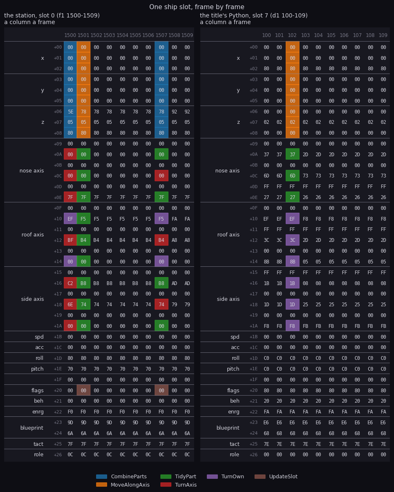
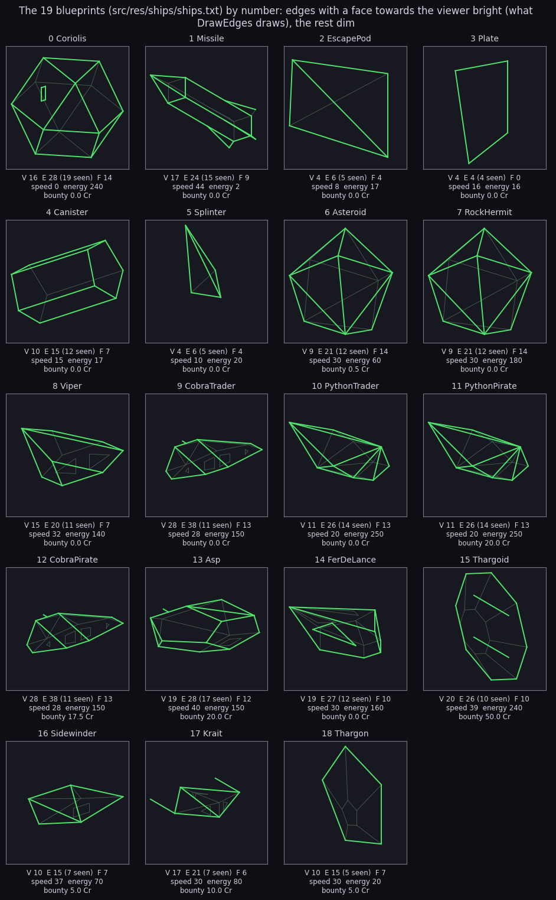
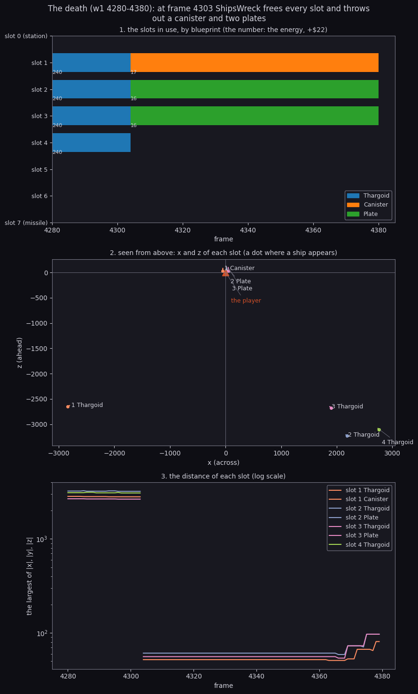
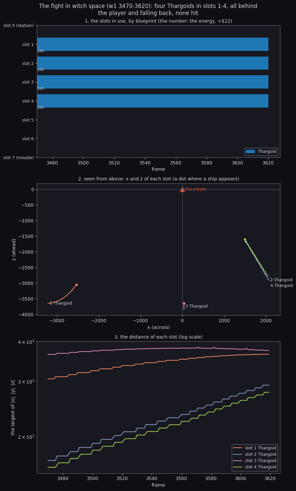
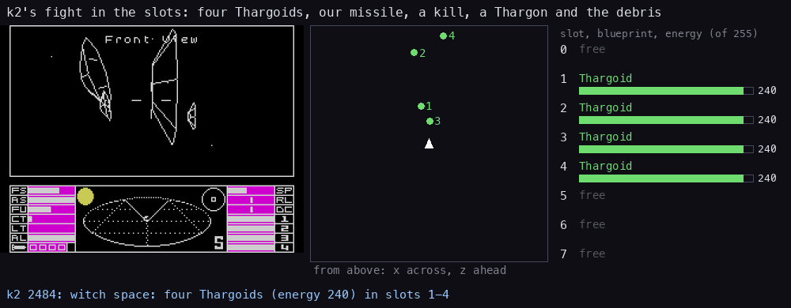

# 7. Objects

What this covers: the eight ship slots and what the recordings found in them (7.1); the 39-byte ship record, field
by field, and which routine rewrites which byte each frame (7.2); the 19 blueprints, their table, header and shapes
(7.3; each ship alone in [the ships](ships.md)); how a ship comes into being (7.4); how ships move when the player
never does (7.5); the player's death and its debris (7.6); tactics, measured on the fight (7.7); spawning,
collisions, the laser and the missiles (7.8).

The recordings it rests on ([Terms](README.md#terms)). All are 48K, Side A, from the title snapshot:

- `d1` 0-200: the title, the first ship (the Cobra) and, after N at frame 30, the second (the Python);
- `f1` 700-1060: docked and launching; 1500-1920: the flight past the Coriolis station; 2400-2500: empty space;
- `w1` 2100-2200: the misjump's tunnel with four Thargoids made; 3470-3620: the fight; 4280-4380: the death.

The slot contents come from the access traces of those windows, read at the first instruction of every frame
(`tools/fig_objects.py`). The writers of each byte come from the same traces (`tools/fig_slot.py`). Those three
recordings destroyed, scooped and docked with nothing. The later ones did ([scenes](scenes.md)): `k2` destroyed its
own missile, a Thargoid and a Thargon (its slots read every 4 frames, 7.7), `cs` scooped a plate, `dk` docked.

## 7.1 The slots

There are no lists, no linked objects and no heap. The whole population of space is eight fixed records of 39
bytes from ShipSlots `$6048`.

| Slot | Address | Holds |
| --- | --- | --- |
| 0 | `$6048` | the station (the Coriolis); in witch space, empty |
| 1-6 | `$606F`-`$6132` | the other ships: traders, pirates, Thargoids, debris, escape pods (FreeSlot `$B936` searches these) |
| 7 | `$6159` (Slot7) | the player's missile in flight; on the title, the turning ship |

A slot is free when its energy (`+$22`) is 0, and nothing else marks it. Freeing a ship is one `LD (IX+$22),A` with A
at 0 (UpdateSlotFree, UpdateShipRemove, ShipsWreck). FreeSlot takes the first free slot of 1-6, so a new ship always
fills the lowest gap.

The code names slot 7 directly (TurnTitleShip, ActionTitleShip, the hostility test of UpdateSlot), so it has its own
label, Slot7. It is a slot like the others, not a work copy: every ship routine works on its slot in place
(the writers in 7.2).

What the recordings had in the slots, at the first and the last frame of each traced window:

| Window | Slot 0 | Slots 1-6 | Slot 7 |
| --- | --- | --- | --- |
| `d1` 0 | Coriolis, z 860717 (docked) | - | Cobra trader, energy 150, z 512 |
| `d1` 99-1800 | the same | - | Python trader, energy 250, z 512 |
| `f1` 700-960 (docked) | the same | - | Python trader (left from the title) |
| `f1` 1059 (launched) | Coriolis, z -240 (behind) | - | - |
| `f1` 1500-1920 | Coriolis, z -1374 to -4586 | - | - |
| `f1` 2400-2500 (after the jump) | - | - | - |
| `w1` 2100-2200 (the tunnel) | - | 4 Thargoids, z 1024-3840 ahead | - |
| `w1` 3470-3620 (the fight) | - | 4 Thargoids, z -1599 to -3752 behind | - |
| `w1` 4304-4380 (dead) | - | canister, plate, plate, z 25 | - |

Docked, the station sits at z 860717 (`$0D222D`), far out of the screens' way, and the title's ship stays in slot 7
until the launch clears it. Slot 0 is the station only while there is one: in witch space the Thargoids took slots
1-4 and slot 0 stayed empty, because ActionThargoids creates through FreeSlot, which starts at 1.

```bash
python3 tools/fig_objects.py work/w1/traces/3470_0-3620_0.uatr x --dump | head    # one line a frame
```

## 7.2 The ship record



**How to read it.** The figure is the record as a data sheet: a column a frame, a row a byte (its offset and field at
the left), each cell the byte's value at the frame's start in hex, coloured by the routine that wrote it during that
frame (dark: nobody did). The left panel is the station in `f1` 1500-1509, the right one the title's Python in `d1`
100-109.

```bash
python3 tools/fig_slot.py docs/img/objects/slot-sheet.png \
    "work/f1/traces/1500_0-1600_0.uatr:0:10:the station, slot 0 (f1 1500-1509)" \
    "work/d1/traces/100_0-200_0.uatr:7:10:the title's Python, slot 7 (d1 100-109)"
```

| Offset | Size | Field | Read by | Notes |
| --- | --- | --- | --- | --- |
| `+$00` | 3 | x | MovePosition, MoveShip, DrawShip | low, high, top; bit 7 of the top byte the sign |
| `+$03` | 3 | y | the same | |
| `+$06` | 3 | z | the same | positive ahead of the player |
| `+$09` | 6 | the nose axis | TurnAxis, TurnOwn, MoveShip, TidyAxis | three words; the high byte is sign and magnitude, `$7FFF` is one |
| `+$0F` | 6 | the roof axis | the same | |
| `+$15` | 6 | the side axis | the same | |
| `+$1B` | 1 | speed | MoveShip | half the blueprint's top speed when made |
| `+$1C` | 1 | acceleration | MoveShip | set by TacticsAim, -2 to 2 |
| `+$1D` | 1 | roll counter | UpdateShip | bits 0-3 steps, bit 6 the direction, bit 7 for ever |
| `+$1E` | 1 | pitch counter | UpdateShip | the same |
| `+$1F` | 1 | - | nothing | 0 in every recorded frame |
| `+$20` | 1 | flags | Tactics, DrawShip, UpdateSlot | bits 0-2 launches left, 3 fired, 4-5 exploding, 6 tactics on, 7 an escape pod |
| `+$21` | 1 | behaviour | TacticsSteer, Collide | bit 1 legal-sensitive, 2 hostile, 5-6 protected |
| `+$22` | 1 | energy | nearly every ship routine | 0 a free slot |
| `+$23` | 2 | the blueprint header's address | every routine that needs the shape | loaded into IY |
| `+$25` | 1 | tactics state | Tactics, MissileHoming | `$7E` when made; bit 7 fleeing; a missile's target |
| `+$26` | 1 | role | UpdateShip, Collide, DrawShip | bit 0 missile, 1 scoopable, 2 station, 3 passive, 6 the cloak ship |

How to read the sheet against the table:

- **The station moves every pass.** Its column 1500 has every position byte blue: CombineParts, inside MovePosition,
  turns the position about the origin by the player's roll and pitch. The axes are red (TurnAxis: the same rotation
  for its orientation), purple (TurnOwn: its own spin, from the roll `$80` and pitch `$70` counters) and green
  (TidyAxis's TidyPart).
- **A pass is about six frames.** Columns 1502-1506 are dark: the station scene's pass takes that long (17 passes in 100
  frames, [04-game-loop.md](04-game-loop.md) 4.5), so a ship moves once a pass, not once a frame.
- **The station falls behind 26 a pass.** z goes `$80 $05 $5E` (column 1500), `$80 $05 $78` (1501), `$80 $05 $92` (1508):
  -1374, -1400, -1426.
- **The title's Python moves only by itself.** MoveAlongAxis writes its position (its speed is 0, so the bytes stay
  the same), TurnOwn and TidyPart its axes. There is no MovePosition, because on the title the player is not flying.
- **The rest is quiet in quiet flight.** Speed, counters, flags, behaviour, energy, blueprint, state and role never
  change there. They are written when the ship is made, and by tactics, collisions and the laser.

The layout matches zx-elite's DATA-STRUCTURES document. Each field here was checked against this code's accesses
above, not taken from it.

## 7.3 The blueprints



**How to read it.** The sheet draws every blueprint of `src/res/ships/ships.txt` from the same three-quarter view. An
edge is bright when one of its two faces turns towards the viewer (the test DrawEdges makes), dim otherwise. Under each
ship are the counts (V; E with the edges seen; F) and three header values. `python3 tools/fig_ships.py` writes this
sheet and `docs/img/runtime/ship-cost.png`; `--list` prints the table below.

The table Blueprints `$6180` has 19 entries of four bytes: `$C3`, the header's address, and a class byte. The `$C3` is
a JP opcode that nothing jumps to; CreateShip reads the word after it. The class is what the spawn code picks by: 0 the
station and the missile, 1 debris, 2 traders, 3 pirates and Thargoids, 4 the small fighters.

| # | Blueprint | Header | V | E | F | Speed | Energy | Bounty | Class |
| ---: | --- | --- | ---: | ---: | ---: | ---: | ---: | ---: | ---: |
| 0 | Coriolis | `$6A9D` | 16 | 28 | 14 | 0 | 240 | 0 | 0 |
| 1 | Missile | `$67A6` | 17 | 24 | 9 | 44 | 2 | 0 | 0 |
| 2 | EscapePod | `$6632` | 4 | 6 | 4 | 8 | 17 | 0 | 1 |
| 3 | Plate | `$68A7` | 4 | 4 | 0 | 16 | 16 | 0 | 1 |
| 4 | Canister | `$63E5` | 10 | 15 | 7 | 15 | 17 | 0 | 1 |
| 5 | Splinter | `$6BBC` | 4 | 6 | 4 | 10 | 20 | 0 | 1 |
| 6 | Asteroid | `$630C` | 9 | 21 | 14 | 30 | 60 | 0.5 | 1 |
| 7 | RockHermit | `$62F5` | 9 | 21 | 14 | 30 | 180 | 0 | 2 |
| 8 | Viper | `$6E1B` | 15 | 20 | 7 | 32 | 140 | 0 | 2 |
| 9 | CobraTrader | `$6490` | 28 | 38 | 13 | 28 | 150 | 0 | 2 |
| 10 | PythonTrader | `$68E6` | 11 | 26 | 13 | 20 | 250 | 0 | 2 |
| 11 | PythonPirate | `$68FD` | 11 | 26 | 13 | 20 | 250 | 20.0 | 3 |
| 12 | CobraPirate | `$64A7` | 28 | 38 | 13 | 28 | 150 | 17.5 | 3 |
| 13 | Asp | `$61CC` | 19 | 28 | 12 | 40 | 150 | 20.0 | 3 |
| 14 | FerDeLance | `$6689` | 19 | 27 | 10 | 30 | 160 | 0 | 3 |
| 15 | Thargoid | `$6C13` | 20 | 26 | 10 | 39 | 240 | 50.0 | 3 |
| 16 | Sidewinder | `$69F2` | 10 | 15 | 7 | 37 | 70 | 5.0 | 4 |
| 17 | Krait | `$6D32` | 17 | 21 | 6 | 30 | 80 | 10.0 | 4 |
| 18 | Thargon | `$6EF8` | 10 | 15 | 7 | 30 | 20 | 5.0 | 4 |

Fourteen shapes serve nineteen blueprints: the trader and pirate Cobra share one shape (two headers pointing at one set
of vertices, edges and faces), as do the two Pythons, and the asteroid and the rock hermit.

The Cobra is the biggest model (28 vertices, 38 edges). The plate is the smallest, and the only one with no faces, so
it is drawn whole from every side.

The header is 23 bytes. The fields, each with the routine that reads it:

| Offset | Field | Read by |
| --- | --- | --- |
| `+$00` | high nibble: the cargo a scooped canister gives | Collide |
| `+$01` | size: the collision box | Collide, NearBox |
| `+$02` | laser power: the chance to fire | TacticsAim |
| `+$03`-`+$05` | the counts of vertices, edges, faces | ProjectVertices, DrawEdges, FaceVisibility |
| `+$06` | top speed | CreateShip (half of it), TacticsAim |
| `+$07` | maximum energy | CreateShip, Tactics |
| `+$08`-`+$09` | bounty, in tenths of a credit | UpdateSlotFree (AddCash) |
| `+$0A` | bits 0-2 launches, high nibble the kind launched | CreateShip, Tactics |
| `+$0B` | the distance (high byte) beyond which the ship is a dot | DrawShip (DrawShipFar) |
| `+$0C`-`+$11` | the offsets of the vertices, edges and faces from the header | ProjectVertices, DrawEdges, FaceVisibility |
| `+$12` | behaviour (AND `$6F` into `+$21`); bit 4 into the flags' bit 7 (a pod) | CreateShip |
| `+$13` | the face normals' scale | NormalPart |
| `+$14` | the vertex the laser fires from | DrawShip |
| `+$15`-`+$16` | the combat score for a kill (halved) | UpdateSlotFree |

The Asp's header at `$61CC` as a worked example: `00 3C FA 13 1C 0C 28 96 C8 00 01 18 17 00 89 00 F9 00 8C 01 08 40
03`. Cargo 0, size 60, laser power 250 of 255 (an Asp fires almost every time it lines up), 19 vertices, 28 edges, 12
faces, top speed 40, energy 150, a bounty of 200 tenths (20.0 credits), one launch of kind 0 (a missile), a dot
beyond `$18xx`. The vertices, edges and faces sit at `$61CC` plus `$17`, `$89` and `$F9`. Then behaviour `$8C` (`$0C` once ANDed with `$6F`),
normal scale 1, the laser from vertex 8, and a combat score of `$0340`.

## 7.4 Creation

Every ship is made by ShipAction `$B867`. A carries two numbers: the low nibble is the action, the high nibble its
argument C.

```asm
ShipAction:
  LD C,A
  SRL C
  SRL C
  SRL C
  SRL C
  AND $0F
  JP Z,SpawnShip
  DEC A
  JP Z,ActionThargoids
  DEC A
  JP Z,ActionMissile
  DEC A
  RET Z
  DEC A
  JP Z,ActionLaunch
  ...
```

| Action | Routine | What it makes | Called from | Seen |
| ---: | --- | --- | --- | --- |
| 0 | SpawnShip `$BBBA` | maybe a new ship in the system (7.8) | UpdateShips, every 256 passes | no |
| 1 | ActionThargoids `$B96B` | three or four Thargoids with ECM, ahead | the misjump | `w1` 2100 |
| 2 | ActionMissile `$B99F` | a missile: C 0 at the player, else the player's at target C | Tactics, the M key | no |
| 3 | - | nothing | - | - |
| 4 | ActionLaunch `$B9E7` | a ship from IX: C 1 a Viper, 2 a trader, 3 a Thargon, 4 a Thargoid, 5 a Sidewinder or a Krait | Tactics | no |
| 5 | ActionPlates `$BA94` | two alloy plates, near (C bit 0) or from IX | ShipsWreck, the laser | `w1` 4303 |
| 6 | ActionCanister `$BAF2` | a cargo canister, near or from IX | ShipsWreck, the laser | `w1` 4303 |
| 7 | ActionPod `$BAFA` | an escape pod; C 1 the player's Cobra flying off | EscapePod, Tactics | no |
| 8 | ActionSplinters `$BB4D` | two splinters from IX | the laser | no |
| 9 | ActionTitleShip `$BB75` | blueprint C + 2 in slot 7 | the title | `d1` 0, 30 |

CreateShip `$B898` fills a record from the template and the blueprint (after HL = Blueprints + 4 A):

```asm
CreateShipBlueprint:
  INC HL
  LD E,(HL)
  INC HL
  LD D,(HL)
  PUSH DE
  POP IY
  LD (IX+$24),D
  LD (IX+$23),E
  PUSH IX
  POP DE
  LD BC,$001F
  LD HL,ShipTemplate
  LDIR
  ...
```

In pseudocode, for blueprint A into slot IX:

```text
header = word at Blueprints + 4 (A and 63) + 1
slot[0..30] = ShipTemplate                 ; the position and unit axes, zero speed and counters
slot.energy = header[+$07]
slot.behaviour = header[+$12] and $6F
slot.flags = header[+$0A] and 7, with bit 7 from header[+$12] bit 4, then bit 6 set (tactics on)
slot.speed = header[+$06] / 2
slot.state = $7E ; slot.role = 0
if not hostile: x high, y high = random 0-7
x low, y low = random; the top bytes' sign bits from a random byte
```

The witnesses: the four Thargoids of `w1` have energy 240 (the header's `+$07`), speed 19 (39 / 2) and flags `$46`
(6 launches, tactics on); the title's Python has energy 250, and the Cobra 150.

**The title's ships.** The first title runs `LD A,$79 / CALL ShipActionVector`: action 9 with C 7, so blueprint 9,
the Cobra trader. Each entry to TitleNext (a key on the first title, then each return to the title: a game over or
the pause's 1) picks the next ship from TitleShipCount `$7470`, which starts at 6:

```asm
  LD HL,TitleShipCount
  INC (HL)
  LD A,(HL)
  AND $07
  INC A
  CP $06
  JR NC,TitleIfNotBelow
  ADD A,$0A
TitleIfNotBelow:
  ADD A,A
  ADD A,A
  ADD A,A
  ADD A,A
  ADD A,$09
  CALL ShipActionVector
```

| TitleNext entries | count | C | Blueprint |
| ---: | ---: | ---: | --- |
| (none) | 6 | 7 | 9 CobraTrader |
| 1 | 7 | 8 | 10 PythonTrader |
| 2 | 8 | 11 | 13 Asp |
| 3 | 9 | 12 | 14 FerDeLance |
| 4 | 10 | 13 | 15 Thargoid |
| 5 | 11 | 14 | 16 Sidewinder |
| 6 | 12 | 15 | 17 Krait |
| 7 | 13 | 6 | 8 Viper |
| 8 | 14 | 7 | 9 CobraTrader again |

`d1` and `f1` pressed N once (no new commander), so both show the Python from then on. `d1` frame 0 has the Cobra
trader in slot 7, frame 99 the Python trader. `tools/title_proof.py` went round all eight on a live instance (a new
game and the pause's 1 between them) and drew each with the simulator: 0 pixels differ ([3d-engine](3d-engine.md) 3).

ActionTitleShip then puts the ship at z 512 (`+$07` = 2, the rest of the position 0) with speed 0, both counters
`$C0` (turning for ever) and tactics off, and copies its axes from TitleShipAxes `$B85D`.

## 7.5 Moving

The player never moves. Every pass, each ship is carried round the origin by the player's roll and pitch and moved
along z by the player's speed; then it is turned and moved by its own controls. UpdateShips `$9CBB` walks the
slots from 0 to 7 (ShipLoopCount 8 down to 1), and for each slot in use UpdateSlot `$9D38` runs:

```text
for each slot in use:
    flags, the energy bomb, the explosion's states          ; a destroyed ship skips the move
    every fourth pass per slot (a missile every pass): Tactics (7.7)
    UpdateShip:
        MovePosition                     ; rotate x, y, z by the player's roll and pitch, z -= player speed
        too far (a top byte past 0, or z's high byte past $60 for a non-station): free it, RemoveShip
        TurnAxis on the three axes       ; the same rotation for its orientation
        the roll and pitch counters -> TurnOwn (roll steps of angle $0C, pitch 8), count down unless bit 7
        MoveShip: x, y, z += speed x the nose axis; speed += acceleration
    TidyAxis on the three axes           ; back to unit length
    Collide, then DrawShip
```

UpdateShip itself is short; the work is in what it calls:

```asm
UpdateShip:
  CALL MovePosition
  BIT 2,(IX+$26)
  JR NZ,UpdateShipFar
  LD A,L
  CP $60
  JR NC,UpdateShipRemove
UpdateShipFar:
  LD A,H
  AND $7F
  JR Z,UpdateShipTurn
UpdateShipRemove:
  XOR A
  LD (IX+$22),A
  JP RemoveShip
```

The rotations are of the small-angle kind. TurnAxis `$A0AB` does four multiply-adds per vector (y-z, x-y, y-x, z-y),
each one part plus another part times the angle: RotatePart `$A0FD` in sign and magnitude for the axes, CombineParts
`$A1EA` with 24-bit parts for the position. They do not keep length, so the axes drift a little each pass. TidyAxis `$9F41` scales each axis by
1 - (x² + y² + z² - 1) / 2, read from the squares table: the first-order correction. TidyAxis ran 4650 times over the
recordings, three runs for each ship moved.

## 7.6 The player's death

When the player's energy runs out, GameOver calls ResetShipsVector, which is ShipsWreck `$B618`:

```asm
ShipsWreck:
  LD HL,SoundRequests
  SET 2,(HL)
  XOR A
  LD (ViewIndex),A
  LD IX,ShipSlots-$27
  LD DE,$0027
  LD B,$08
ShipsWreckLoop:
  ADD IX,DE
  LD (IX+$22),A
  DJNZ ShipsWreckLoop
  LD A,$16
  CALL ShipAction
  LD A,$15
  CALL ShipAction
  RET
```

It requests the explosion sound, sets the front view, frees every slot, then makes a canister (action 6, C 1) and
two plates (action 5, C 1) near the origin. The player is not in a slot, so what flies apart is not the player's ship: it is a canister and two plates thrown out
in front of the camera.



How to read it: the left panel has a bar per slot while it is in use, coloured by blueprint, with the energy written
where a ship appears; the middle panel is the view from above (x across, z ahead, the player the triangle at the
origin, a dot where each ship appears); the right panel is each ship's distance, on a log scale.

What it shows:

- Up to frame 4303, slots 1-4 hold the four Thargoids, energy 240, 2600-3200 behind.
- From frame 4304, slot 1 is a canister (energy 17) and slots 2 and 3 are plates (16 each), all at z 25. DebrisNear
  places them `$19` ahead and `$10`-`$4F` across. Slot 4 is free.
- The debris drifts out: its distance rises from about 55 to 97 by frame 4380, while the death screen runs
  ([04-game-loop.md](04-game-loop.md) 4.6).

```bash
python3 tools/fig_objects.py work/w1/traces/4280_0-4380_0.uatr docs/img/objects/death-slots.png \
    --title "The death (w1 4280-4380): at frame 4303 ShipsWreck frees every slot and throws out a canister and two plates"
```

## 7.7 Tactics

Tactics `$A2C0` runs for a ship with flag bit 6 set: once every fourth pass per slot (UpdateSlotAlive), and every pass
for a missile. In order:

1. **Energy:** one more a pass (four more when the blueprint's maximum is `$F0` or more), up to the maximum.
2. **Cloak:** while the player is cloaked (CloakOn `$D041`), nothing else runs.
3. **Weak ships:** a ship with energy x 2 below the maximum, launches left and a random byte below `$80` launches its
   payload: action 4 of the kind in the header's `+$0A`, or a missile at the player when the kind is 0. Otherwise it
   bails out with its pod (action 7) or drops cargo (action 6).
4. **Station traffic:** the station launches ships at random while fewer than four are active (a Viper when it is
   angry).
5. **Steering:** TacticsSteer `$A42F` picks a direction: towards the player when hostile and not fleeing, away when
   near (within `$200`) or fleeing.
6. **Aiming and firing:** TacticsAim `$A587` makes the direction a unit vector and takes its dot products with the
   ship's three axes. The side's product gives the roll, the roof's the pitch, the nose's whether the target is ahead
   (accelerate) or behind (brake). A hostile ship facing the player fires when a random byte is below its laser power
   and the product is above `$0C`; the player's front or aft shield takes the hit.



**How to read it.** The fight of `w1` 3470-3620 is the traced combat; the panels are read as in 7.6. All four Thargoids
keep energy 240, flags `$46` and speed 19 for the whole window, and their distance grows: slots 2 and 4 from about 1600
to 2900, slots 1 and 3 from 3000-3600 to 3700. They were made ahead at the misjump (z 1024-3840 at `w1` 2100) and are
now 1600-3800 behind: the player flew through them holding A.

What the trace of the window counted (`work/w1/traces/3470_0-3620_0.uatr`, the PCs of the entry points):

| Step | Runs |
| --- | ---: |
| UpdateShip (four ships, about 22 passes) | 90 |
| Tactics, TacticsSteer, TacticsAim | 22 each |
| the fire test (TacticsAimFire) | 14 |
| a hit on the player (TacticsAimHit) | 0 |
| braking: the player behind the nose (TacticsAimBehind) | 8 |
| launches (TacticsLaunch) | 0 |
| the player's laser shots (LaserShot) | 6 |
| the player's laser hits (LaserHit) | 0 |

So 90 ship moves over 22 passes and 22 tactics runs: one ship in four each pass, as the every-fourth-pass rule says.
Fourteen times a Thargoid reached the fire test and fourteen times it failed the facing condition or the random draw.
At full energy the Thargoids never launched Thargons, which needs their energy below half. The figure:

```bash
python3 tools/fig_objects.py work/w1/traces/3470_0-3620_0.uatr docs/img/objects/combat-slots.png --title "The fight in witch space (w1 3470-3620): four Thargoids in slots 1-4, all behind the player and falling back, none hit"
```

`k2` ([scenes](scenes.md) 3) fought on, and its slots, read every 4 frames, show every branch `w1` missed:



How to read it: left the recorded screen, middle the ships from above (the player the white arrow, x across, z
ahead, 4000 to each edge, a trail of 60 frames, a red ring while exploding), right the eight slots with their energy.
The missile takes slot 7 at 2544; the E.C.M. sets its flags' bit 4 at 2572, then 4-5 (HitFlash's disc), then 5, and
the slot is free at 2616. Thargoid 3, below half energy (87 at 3284), launches a Thargon into slot 5 at 3412 (step 3
above). The laser kills Thargoid 3 at 3624 (a plate in slot 6) and the Thargon at 3776: each runs the same three
explosion states over about 32 frames. Drawn by `bash tools/fig_k2slots.sh` (`tools/fig_slots_anim.py` over
`work/k2/slots`, read by `tools/grab_slots.py`).

## 7.8 Spawning, collisions, the laser, the missiles

**Spawning.** JumpEncounter `$9C93` counts down each pass. At 0 (every 256 passes), outside the station's safe zone,
with no jump running and fewer than four ships about, UpdateShips calls SpawnShip `$BBBA` (action 0):

```text
danger = 2 x (slaves + narcotics) + firearms           ; the hold, $D06E, $D071, $D075
if random < $1E and the mission's conditions: the mission's Asp
r = random - danger                                     ; SUB C, the borrow kept
random below danger, or r below 80: mission state 4 -> a Thargoid; state 1 -> a Python
      else by the government (anarchies always): a lone pirate ($0B-$0F, rarer the stronger, 1 in 5 with ECM),
      a trader or a rock hermit, or a group of two or three Sidewinders and Kraits
r 80-89: an asteroid; r 90 and up: nothing
```

So each point of contraband adds one value in 256 to the encounters ([the ships](ships.md) takes them ship by ship). No spawned ship appears in the traced windows: in `f1` 2400-2500,
in empty space, every slot is free.

**Collisions.** Collide `$B4D8` runs for every ship each pass (89 runs in the fight). The box is the blueprint's size
(`+$01`) on each axis, with z counted ahead only. A ship inside the box:

- a scoopable ship below the player, with the fuel scoop fitted: it is freed, and the hold gains a ton of the header's
  cargo;
- the station, ahead, upright and not hostile: the player docks; otherwise the crash costs the front shield;
- anything else: it is destroyed, and its size comes off the front or aft shield.

**The laser.** LaserCooling `$B63C` fires the view's laser when the fire key is pressed and the heat is below `$90`.
LaserMounts `$D07D` holds the kind per view (1-4, set by EquipLaser from the items 5, 6, 13 and 14). A press fires at
once; with the key held, the rate depends on the kind:

| Laser | Held: fires | Power | Heat a shot |
| --- | --- | --- | --- |
| pulse | every other pass | `$0F` | `$08` |
| beam | every pass | `$0F` | `$0A` |
| military | every pass | `$17` | `$0A` |
| mining | every eighth pass | `$32` | `$08` |

The rate test is `LD A,(JumpEncounter) / AND D / RET NZ`, with D 1 for the pulse laser, 7 for the mining laser and 0
otherwise. The heat falls by 2 a pass and is capped at `$A0`. zx-elite's ROUTINE-CHECKS states the same rates.
A hit on SightTarget `$9C97` makes the ship hostile and takes the power off its energy. At 0 the ship is destroyed and
leaves debris: plates, a canister, or splinters from an asteroid. `w1` fired on 30 frames and hit nothing; `k2`'s
military laser killed a Thargoid and a Thargon (above, and the [explosion](img/design/explosion.gif) on the screen).
`cs` scooped a plate left by a kill of its own ([the scoop](img/design/scoop.gif), [scenes](scenes.md) 7).

**The missiles.** The player's missile lives in slot 7 (ActionMissile, with C the target slot); a ship's missile goes
into a free slot. MissileHoming `$A4B5` steers it every pass at its target (`+$25`: 0 the player, else 8 minus the
slot) and explodes it within `$40`; an ECM destroys it. RemoveShip `$B5DF` makes every missile aimed at a removed ship
explode. In `k2` the player's missile (fired at 2542) ran MissileHoming once, at 2571, before a Thargoid's E.C.M.
destroyed it at 2572; in `m2` and `fs` the pirates' missiles ran it 37 and 1926 times. A missile reaching its target
is known from the code only.

The routine-by-routine detail is in [12-routine-reference.md](12-routine-reference.md) under the modules shipmotion,
tactics and combat. The record and the blueprint bytes are in [11-data-reference.md](11-data-reference.md).
