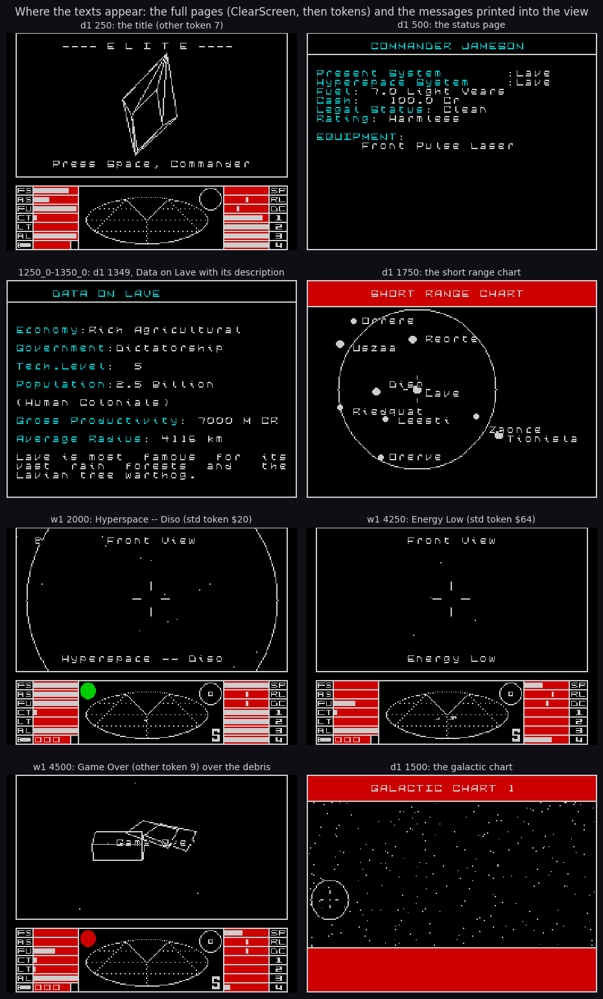
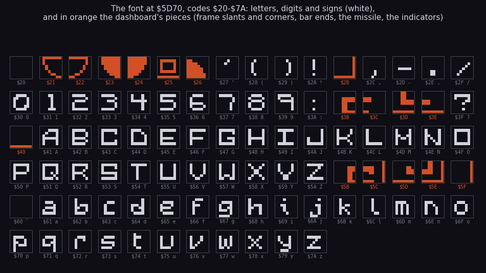
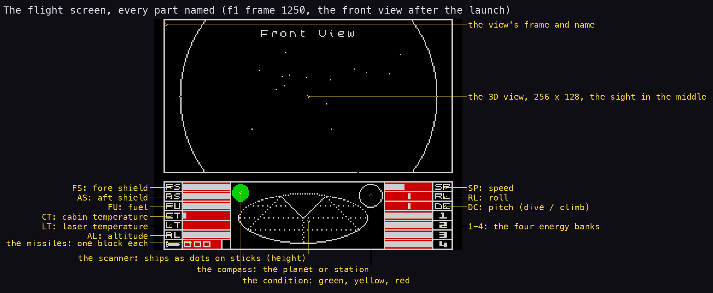
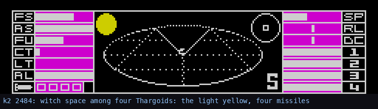
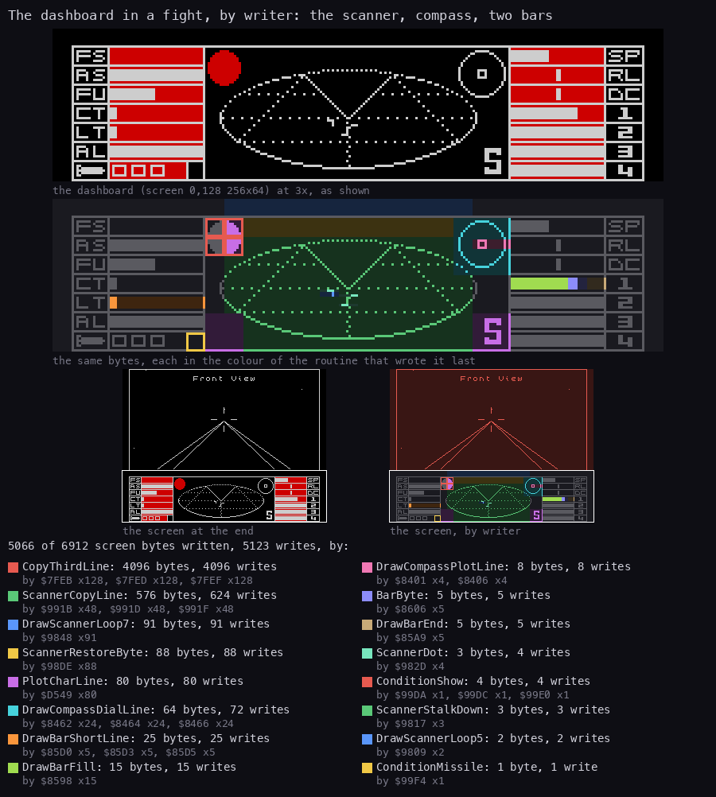

# 8. HUD and text

What this covers:

- where text and readouts go on the screen, and the pages (8.1);
- the font: 91 glyphs, letters and the dashboard's own pieces (8.2);
- the printer: the standard token set, PrintCode, the case rules, PlotChar (8.3);
- the other set: random synonyms, generated names, the planet descriptions, the justified text (8.4);
- control codes, numbers and cash (8.5);
- the messages over the space view (8.6);
- the dashboard: bars, compass, scanner, condition light, indicators, missiles, and who writes each byte (8.7).

The recordings it rests on ([Terms](README.md#terms)). All are 48K, Side A, from the title snapshot:

- `d1`: the title, the status page, Data on Lave with its description, both charts, the launch;
- `w1`: the misjump's countdown, the fight in witch space, ENERGY LOW, the death;
- `f1`: the station scene, for the dashboard in quiet flight.

The pages come from the recordings' screen captures (one every 250 frames) and from the trace `d1` 1250-1350; the
dashboard's writers from the trace of `w1` 3490-3500. The token strings themselves are listed by `tools/tokens.py` and
kept in [`src/res/text/tokens.txt`](../src/res/text/tokens.txt). The game's paper texts (the manual, the
instructions, the Lenslok sheet) are in [texts/](texts/README.md).

## 8.1 Where text goes



**How to read it.** The sheet shows each place a text appears, with the recording and the frame. Read it by panel:

- **the title** (`d1` 250): "---- E L I T E ----" and "Press Space, Commander" (other token 7) are printed into
  the back buffer over the turning ship, every pass;
- **the full pages** (status, Data on Lave, both charts): ClearScreen `$D61D` wipes the screen with PUSHes and draws
  the frame, the heading is printed in capitals and coloured cyan, then the body;
- **the messages** (`w1` 2000, 4250, 4500): one line in the space view (HYPERSPACE -- DISO, ENERGY LOW, GAME OVER),
  printed by MessageTick (8.6);
- **the dashboard**: no letters except its labels (FS, AS, FU, CT, LT, AL; SP, RL, DC, 1-4) and the E and S
  indicators, all printed by the same PlotChar from the same font.

```bash
python3 tools/fig_pages.py docs/img/hud/pages.png \
    --title "Where the texts appear: the full pages (ClearScreen, then tokens) and the messages printed into the view" \
    "d1:250:the title (other token 7)" "d1:500:the status page" \
    "work/d1/traces/1250_0-1350_0.uatr:end:d1 1349, Data on Lave with its description" \
    "d1:1750:the short range chart" "w1:2000:Hyperspace -- Diso (std token \$20)" \
    "w1:4250:Energy Low (std token \$64)" "w1:4500:Game Over (other token 9) over the debris" \
    "d1:1500:the galactic chart"
```

## 8.2 The font



**How to read it.** Font `$5D70` holds 91 glyphs of 8 x 8, one for each code `$20`-`$7A`, top line first. The sheet
draws them 16 a row, each labelled with its code. White are the letters, digits and signs; orange are the codes whose
ASCII meaning the game never prints and whose glyphs are pieces of the dashboard:

| Codes | Used by |
| --- | --- |
| `$21`-`$24`, `$26`, `$2B`, `$3B`-`$3E` | the frame's slants and corners, the bar labels' ends (IndicatorCodes `$9B62`: `$26 $24`, `$3B $3C`, `$3D $3E`) |
| `$25` | a missile cell with a missile in it (DrawMissiles `$9B74`) |
| `$40` | an empty cell: a bar along the bottom (DrawMissiles; the indicators when off) |
| `$5B`-`$5F` | the E and S indicators' four quarters when on (IndicatorCodes) |

`$2A`, an asterisk in ASCII, is drawn as an exclamation mark, so the token strings write "*" where the screen shows "!"
("MAYDAY* CORIOLIS IN DANGER*", "RIGHT ON COMMANDER*"). The small letters `$61`-`$7A` have their own glyphs: the case
is the printer's choice (8.3), not the string's. The font is stored in
[`src/res/fonts/font.png`](../src/res/fonts/font.png).

```bash
python3 tools/fig_font.py        # -> docs/img/hud/font.png
```

## 8.3 The printer

Every text in the game goes through PrintCode `$D425` (228436 runs over the three recordings). A code is one byte, and
its range decides what it is:

| Code | Means | Handled by |
| --- | --- | --- |
| `$00`-`$0D` | a control code (8.5) | TokenControl `$D7B5` |
| `$0E`-`$1F` | standard token `$80`-`$91` (code + `$72`) | PrintToken |
| `$20`-`$5F` | a character | PrintChar `$D499` |
| `$60`-`$7F` | standard token `$60`-`$7F` | PrintToken |
| `$80`-`$9F` | a two-letter pair of StdPairs `$FDB3` | PrintStdPair `$D59C` |
| `$A0`-`$FF` | standard token `$00`-`$5F` (code - `$A0`) | PrintToken |

```asm
PrintCode:
  CP $0E
  JP C,TokenControl
  CP $20
  JP C,PrintCodeLowToken
  CP $60
  JP C,PrintChar
  CP $80
  JR C,PrintToken
  CP $A0
  JP C,PrintStdPair
  SUB $A0
  JR PrintToken
PrintCodeLowToken:
  ADD A,$72
PrintToken:
  LD HL,(TokenTable)
  LD D,A
  INC D
PrintTokenFind:
  DEC D
  JP Z,PrintTokenLoop
  LD BC,$FFFF
  XOR A
  CPIR
  JR PrintTokenFind
PrintTokenLoop:
  LD A,(HL)
  AND A
  RET Z
  PUSH HL
  CALL PrintCode
  POP HL
  INC HL
  JR PrintTokenLoop
```

There is no index: token n is found by skipping n zero-ended strings from TokenTable `$F11A` (which points at
`$F11E`), with CPIR. A token's bytes are codes again, so tokens nest; PrintCode calls itself. The 256 standard tokens
hold the words of the screens: the commodities, the equipment, the governments, the economies, the view names.

A worked example, standard token 3, the heading of the data page:

```text
bytes      $06 'DATA ON ' $03 $08 $00
codes      {6} capitals, "DATA ON ", {3} the selected system's name, {8} back to word case
screen     DATA ON LAVE                       (d1 1349)
```

**The case rules.** The strings are in capitals; PrintChar decides each letter's case from PrintCase `$D0D1`:

```text
letter:
    case 1 (capitals)                -> as stored
    CapitalNext set                  -> capital, and clear it
    the last character a non-letter  -> capital in case 0 (each word), small in case 2 (a sentence)
    otherwise                        -> small (+$20)
non-letter: remember it, so the next letter starts a word
```

So "Economy:Rich Agricultural" on the data page is case 0, every word capitalised; the description under it is case 2,
a capital only where control 19 or a name asks for one.

**PlotChar** `$D4E1` puts a glyph at (TextColumn `$D045`, TextRow `$D046`):

```asm
PlotChar:
  PUSH AF
  LD HL,TextColumn
  INC (HL)
  LD A,(HL)
  CP $20
  JR C,PlotCharGlyph
  LD A,$01
  LD (HL),A
  CALL NewLineRow
PlotCharGlyph:
  POP AF
  LD HL,Font
  SUB $20
  ...
  LD HL,$4000
  LD A,(TextRow)
  ...
PlotCharLine:
  LD A,(DE)
  LD C,(HL)
  XOR C
  LD (HL),A
  INC H
  INC DE
  DJNZ PlotCharLine
  RET
```

Three things in it are patched at run time:

- the `$40` of `LD HL,$4000` (`$D50A`): ViewTexts sets its bit 7, so the view names and the title text go into the
  back buffer at `$C000` and reach the screen with the frame copy ([06-rendering.md](06-rendering.md) 6.2);
- the `XOR C` (`$D548`): mixing, so text printed twice disappears; on the pages it is made a NOP while MessageTick runs,
  so a message is written over;
- the column wraps at 32 to column 1 of the next row.

A glyph costs 758 T in PlotChar: `f1` 1500-1600 plotted 368 glyphs in 279093 T, about 20 a pass (the view name into
the buffer and DrawIndicators' ten on the dashboard), 16k T a pass ([runtime-analysis.md](runtime-analysis.md)).

## 8.4 The other set and the planet descriptions

A second interpreter, PrintOther `$D45F`, reads a second table (OtherTable `$F11C`, pointing at `$F4F5`). Its codes:

| Code | Means |
| --- | --- |
| `$00`-`$1F` | an other control code (32 of them, 8.5) |
| `$20`-`$5A` | a character |
| `$5B`-`$80` | one of five tokens picked at random: the row `code - $5B` of Synonyms `$D5F5` |
| `$81`-`$D6` | other token n (the n-th string, counted from 1) |
| `$D7`-`$FF` | a pair of OtherPairs `$FD99` |

While other control 6 is in force (OtherSetOn `$D420` 0) the bytes go to the standard printer instead, so a string
can switch sets midway. The other set holds the long texts: the cassette menu, the security number, the title line,
the mission briefings, GAME OVER, and the planet descriptions.

**The random picks.** RandomToken `$D5B4` takes one byte from the text generator and picks the row's first to fifth
token by where it falls: below `$33`, `$66`, `$99`, `$CC`, or above. The generator, TextRandom `$D5E1`, is a 32-bit
shift-and-add over TextSeeds `$DECC`:

```asm
TextRandom:
  LD HL,(TextSeeds)
  SLA L
  EX DE,HL
  LD HL,(TextSeeds+$0002)
  ADC HL,DE
  LD A,H
  LD (TextSeeds),HL
  EX DE,HL
  LD (TextSeeds+$0002),HL
  RET
```

The data page seeds it from the system's own seeds (DataScreenDescription `$EE8C`: TextSeeds = s1, s2) and prints
other token 5. So each planet's description is fixed by its seeds: random-looking, the same on every visit. Other
token 5 is one sentence with nested choices:

```text
{3} IS {VERY|MILDLY|MOST|REASONABLY|} {FABLED|NOTABLE|WELL KNOWN|FAMOUS|NOTED} FOR {ITS ... FORESTS| ...}
    AND {...} | {BESET|PLAGUED|RAVAGED|CURSED|SCOURGED} BY {...} | A{N UNREMARKABLE| BORING| DULL| TEDIOUS| REVOLTING}
    {PLANET|WORLD|PLACE|LITTLE PLANET|DUMP}.
```

`python3 tools/tokens.py --set other 5` prints the whole tree; it nests six deep. Control 17 prints the system's people
(the name with "IAN", a final vowel dropped: Lave gives Lavian) and control 18 a random name of one to four pairs.

`tools/galaxy.py --describe` runs the same interpreter with the same generator and the case rules:

```text
$ python3 tools/galaxy.py --describe Lave
Lave is most famous for its vast rain forests and the Lavian tree warthog.
$ python3 tools/galaxy.py --describe Diso
This planet is mildly noted for its ancient Ma Corn plantations but beset by frequent solar activity.
$ python3 tools/galaxy.py --describe Leesti
The planet Leesti is reasonably fabled for Zero-G Cricket and Leestian Evil Juice.
```

The witness is `d1` frame 1349 (the third panel of the figure in 8.1): the data page shows "Lave is most famous for its
vast rain forests and the Lavian tree warthog.", word for word what the model gives. The Spectrum's synonym rows differ
from the BBC Micro's in places: "warthog" stands where the BBC text has "grub".

**The justified text.** Other controls 14 and 15 turn buffering on and off: JustifyChar `$D6B9` collects a line of
words and, when the next word does not fit, spreads the line to 30 columns by adding spaces between words
(JustifyAddSpace), then prints it. That is why the description on the data page has uneven gaps. The description of
Lave took 1025 JustifyChar runs in `d1`.

## 8.5 Control codes, numbers and cash

The standard set's 14 controls (TokenControls `$D7C3`) and the other set's 32 (OtherControls `$D7DF`) are jump tables
read by JumpTable `$D7B8`. The ones the texts use most:

| Standard | Other | Effect |
| --- | --- | --- |
| 6 | 1 | capitals |
| 8 | 2 | each word capitalised (case 0) |
| - | 13 | a sentence (case 2) |
| - | 19 | the next letter a capital |
| 3 | 3 | the selected system's name |
| 2, 11 | 16 | the current system's / the galaxy's first system's name |
| 4 | 4 | the commander's name |
| 5 | - | "FUEL:" the fuel and " LIGHT YEARS" |
| 7 | - | "CASH:" the cash and " CR" |
| 9 | 12 | a new line |
| 10 | 5 | the other set on |
| - | 9, 11 | a cleared page, the heading's rule |
| - | 22, 24, 25 | waits (the mission texts appear line by line) |

**Numbers.** PrintNumber `$D2E5` prints HL in decimal by repeated subtraction from 10000 down (PrintDigit), leaving
out the leading zeros, padded to the width at `$D0CE`, with carry set the last digit after a point (1512 runs: the
status, the market and the charts). The cash is two numbers, thousands (`$D066`) and tenths of a credit (`$D068`), so
"100.0 Cr" on the status page is 0 thousands and 1000 tenths; AddCredits and TakeCredits carry between them.

## 8.6 Messages over the view

MessageTick `$DAB4` runs every pass after the view name. Ten slots at `$D0BD` hold a column and a code each; bit 7 of
the column marks a request (FullMessage and the market set them). On an even pass the first
request is taken, clicked, and shown for 14 passes. It is plotted once a pass from its fourth pass on, and only in the
space views. Since PlotChar XORs, plotting it twice would erase it; the frame copy overwrites the screen each pass, so
one plot a pass shows it steadily.

MessagePeriodic `$DB2E` raises the standing messages, the first that applies:

1. ENERGY LOW (standard code `$64`) at once on each odd pass while the fourth bank is below `$9F`; it also turns the
   cloak off.
2. FUEL SCOOPS ON (code `$A0`) when the sun is near and a scoop is fitted; each time adds 0.1 light years.
3. DOCKING COMPUTERS ON (code `$7B`) while the docking computer flies.
4. Otherwise a timer counts 70 odd passes, then a mission's MAYDAY.

`w1` 4250 shows ENERGY LOW over the empty view during the fight's last frames; `w1` 2000 shows the jump's countdown
"HYPERSPACE -- DISO" (standard token `$20`: "HYPERSPACE -- {3}").

## 8.7 The dashboard

The dashboard is the bottom third of the screen, drawn into the screen directly. It is laid out once (the image from
the tape) and patched each pass. Every part is named on the flight screen of [1](01-game-design.md) 1.2:



How to read it: `f1` frame 1250 at three times the size, each part labelled where it sits; the table below
gives the address and the routine of each (`python3 tools/fig_design.py dashboard`).

| Part | Where | Drawn by | Per pass |
| --- | --- | --- | --- |
| 6 left bars: FS, AS, FU, CT, LT, AL | `$5123`-`$51C3` | DrawBars `$84D9` | only a changed bar |
| SP and the 4 energy banks | `$5138`, `$5198`-`$51F8` | DrawBars | only a changed bar |
| RL and DC markers | `$5158`, `$5178` | DrawBars (DrawMarker) | only when changed |
| the compass | `$5035` | DashDistances `$81A9`, DrawCompass `$8390` | every pass |
| the scanner | 13 x 48 bytes from `$5049` | DrawScanner `$96D9` | background restored, then dots |
| the condition light | attributes `$5A28`, `$5A48` | ConditionLight `$99A4` | every pass |
| E and S indicators | text rows `$11`-`$16` | DrawIndicators `$9B01` | every pass |
| missiles | row `$17`, column 2 | DrawMissiles `$9B74` | when the count changes |

**The bars.** Thirteen value pairs from BarForeShield `$70E8` hold the length last drawn and the value (0-`$A0`).
DrawBars compares the two and redraws only a bar whose value changed, at a quarter of the value in pixels: a bar is 5
bytes wide and 3 lines high (DrawBar `$854F`). The figures from the three recordings: 1079 DrawBars runs drew 500
bars, so most passes redraw none or one. The shields and the banks start full (`$A0`, ResetFlight); the speed is
SpeedRate x 5 + 5; the roll and pitch markers are `$15` plus or minus the rate.

**The compass.** DashDistances measures the planet's distance (VectorLength `$8322`, on the top bytes) and points the
compass at it, or at the station inside the safe zone: x and y divided by the distance, times 8. A solid dot means in
front, a ring behind (CompassDotFront and CompassDotBehind, from
[`src/res/dashboard/compass.png`](../src/res/dashboard/compass.png)).

**The scanner.** The ellipse's background is kept in ScannerSave `$5B00` and copied back each pass (ScannerCopy
`$990C`, patched to copy one way or the other). A ship within range is a dot at (x x 3/16, z x 5/64) from the centre
`$558F` with a stalk of y x 5/64 lines; 553 of 1076 DrawScanner calls drew something in `d1`, `f1` and `w1`.

The parts at work in `k2`'s fight, the dashboard alone at three times the size:



How to read it: the bottom third of the recorded screen, every fourth frame (every eighth in the long laser
stretch), the step named under it. The missile cell (bottom left, after the glyphs) is green at 2520 (armed) and red
at 2540 (locked); at 2548 one glyph has gone. The E indicator shows from 2612 while an E.C.M. runs. At 2700 the FS
bar is empty, and the condition light turns from yellow to red, as the rule below says. Drawn by
`python3 tools/fig_design.py hud` from frames grabbed with `tools/grab.py`.

**The condition light.** Condition `$7104` is worked out again every pass: green by default, yellow while a ship
other than the station is about, red with a shield down, flashing (`$63`) with the fourth bank not full.
ConditionLight writes it to the light's two cells and resets green for the next pass.



The figure is the code against the screen over ten frames of the fight (`w1` 3490-3500). At the top the dashboard at
3x as shown, under it the same bytes coloured by the routine that wrote each one last (grey: nobody wrote it); then
the whole screen both ways at 1x, the white box the zoomed area. The list gives each writer's bytes and writes. Read
it as:

- **CopyThirdLine** (4096 bytes) is the frame copy of the 3D view, not the dashboard;
- **ScannerCopyLine** (576 bytes, 624 writes) puts the scanner's background back, the green field;
- **DrawScannerLoop7** and **ScannerRestoreByte** clear the rows above and in the middle where stalks ran;
- **DrawCompassDialLine** and **DrawCompassPlotLine** redraw the compass (cyan) every pass;
- **DrawBarShortLine**, **DrawBarFill**, **BarByte** and **DrawBarEnd** touched only the laser temperature and the
  bank 1 bars (orange and green): the only values that changed;
- **ConditionShow** is the condition light (red, at the scanner's top left), **ConditionMissile** the missile
  light's attribute at `$5AE7` (yellow, bottom left);
- **PlotCharLine** (80 bytes) is DrawIndicators' ten glyphs (the E and S indicators and two bar labels), printed again
  every pass; the S is the purple one.

```bash
python3 tools/fig_writers_dash.py --trace work/w1/traces/3490_0-3500_0.uatr --listing build/game.lst \
    --out docs/img/hud/writers-dashboard.png \
    --title "The dashboard in a fight, by writer: the scanner, compass, two bars"   # kit/writers_map.py, 900 px
```

**Missiles and indicators.** DrawMissiles prints a missile glyph (`$25`) for each missile left and an empty cell
(`$40`) for the rest. MissileKeys `$9BA7` handles T (arm), U (disarm) and F (fire), with the lock beeping through the
ROM's BEEPER; `k2` armed one at 2485 and fired it at 2542, the dashboard losing a glyph ([scenes](scenes.md) 3). The E indicator shows while an ECM is on, the S indicator inside the safe zone.

The routine-by-routine detail is in [12-routine-reference.md](12-routine-reference.md) under the modules textprint,
dashboard and scanner.
