# 9. Sound

What this covers:

- what Elite has for sound: the beeper only, eleven effects and no music (9.1);
- the request bits and SoundTick, the slice played by the frame interrupt (9.2);
- the three generators: the pulse trains read from the ROM (9.3), the sweep (9.4), the noise (9.5);
- the scene sounds played with the interrupts off, and Game Over's sound (9.6);
- the click, which is the ROM's BEEPER (9.7); every effect as recorded, in figures and GIFs (9.8, 9.3-9.6);
- what the sound costs: the frames it takes, the interrupts it loses (9.9); the bytes patched into it (9.10).

The recordings it rests on ([Terms](README.md#terms)). All are 48K, Side A, from the title snapshot:

- `f1` (4856 frames: docked, the launch, the flight, the jump to Diso, laser shots in empty space);
- `w1` (6691 frames: the launch, the misjump into witch space, the fight with four Thargoids, the death);
- `d1` (2710 frames: the docked screens, then the launch).

The run counts below are the L1 entries of those recordings (`work/<rec>/l1.json`). The edges, pitches and costs
come from the access traces `w1` 2100-2200 (the jump), 3470-3620 (the fight), 4280-4380 (the death) and `f1`
1820-1920 (a click): every `OUT` to port `$FE` is in them with its T, so the speaker bit can be played back exactly.
The four effects those three never sounded (the energy bomb, the missile, a ship hit, the ECM) come from the
combat scene `k2` ([scenes](scenes.md) 3), traced at 2540-2600, 3185-3200 and 3302-3335 (`tools/trace_k2snd.sh`).
The arrival sounded outside every trace, so its timing is known from the code only.

## 9.1 One beeper, eleven effects, no music

Elite 48K drives the speaker bit (bit 4 of port `$FE`) and nothing else: there is no AY code, no tune and no
music player. The whole sound system is `sound.asm`, about 420 bytes from `$9522` to `$96C4`, plus the ROM's
BEEPER for the click. Every effect is one of three generators with different numbers patched in:

| Effect | Asked for by | Generator | Parameters (from the code) | Heard in |
| --- | --- | --- | --- | --- |
| energy bomb | EnergyBomb `$7089`, bit 0 | pulses | 64 levels, pitch `$40`, step `$FE`, 8 passes | `k2` 3305 |
| missile launch | MissileGone, bit 1 | pulses | 64 levels, pitch `$40`, step `$E4`, 8 passes | `k2` 2542 |
| explosion | ShipsWreck, UpdateSlotExplode, CollideShipSound, bit 2 | pulses, two phases | 64 levels, pitch `$40`, step 2, 8 passes; then 160 levels, 2 passes | `w1` 4309 |
| ship hit | LaserHit, bit 3 | noise | ROM `$031A`, pulse = byte / 4, 1 pass | `k2` 15 hits from 3187 |
| laser | LaserShot, bit 4 | sweep | step `$FD`, 2 passes | `f1` 12 shots, `w1` 18 |
| ECM | GunsightECMOn, bit 5 | sweep | step `$D3`, 8 passes | `k2` 2573 (a Thargoid's) |
| player hit | TacticsAimHit, CollideStationCrash, bit 6 | noise | ROM `$1A1A`, pulse = (byte + 16) / 2, 1 pass | `w1` 48 hits |
| launch whistle | SoundLaunch `$9527` (the launch, the dock, Game Over) | pulses, DI | 80 levels, pitch `$40`, step 2, 32 passes | `f1`, `d1` once, `w1` twice |
| jump | SoundJump `$953D` (TunnelStart) | pulses, DI | 192 levels, pitch `$10`, step `$10`, 10 passes | `f1`, `w1` |
| arrival | SoundArrive `$9532` (TunnelDone) | pulses, DI | 192 levels, pitch `$C0`, step `$F0`, 12 passes | `f1`, `w1` (no trace) |
| Game Over | SoundGameOver `$9548` | pulses | 160 levels, pitch `$40`, 2 passes | `w1` 4303 |

Plus the click (ROM BEEPER, 9.7) of the menus and messages. The first seven are background effects: the game asks
for them with a bit and the frame interrupt plays them in slices (9.2). The last four are scene sounds: the code that
wants them plays them to the end before it goes on (9.6).

Options bit 7 (`$FC0E`) is the sound switch. Every entry point starts with the same three instructions
(`LD A,(Options) / BIT 7,A / RET Z`) and returns at once when the bit is clear. The pause menu's S key
(OptionSoundOn) sets the bit and clears SoundRequests, so effects asked for while the sound was off are not played
late; Q (OptionSoundOff) clears it ([5](05-controls.md)).

## 9.2 Requests and SoundTick

SoundRequests `$7128` holds one bit per background effect. Game code sets a bit and moves on, for instance
LaserShot `$B68D`:

```
  LD HL,SoundRequests
  SET 4,(HL)
```

IM2Handler `$FF25` calls SoundTick `$9579` (through the vector `JP SoundTick` at `$7125`) after the keyboard scan
and ReadControls, every frame: 13 398 runs over the three recordings, one per interrupt taken.

```
SoundTick:
  LD A,(Options)
  BIT 7,A
  RET Z
  LD A,(SoundMode)
  AND A
  JR NZ,SoundTickMode
  LD A,(SoundRequests)
  AND A
  RET Z
  LD B,$FF
SoundTickBit:
  INC B
  RRA
  JR NC,SoundTickBit
  LD A,B
  LD (SoundBit),A
  ADD A,A
  ADD A,B
  LD HL,SoundBomb
  ADD A,L
  LD L,A
  JR NC,SoundTickJump
  INC H
SoundTickJump:
  JP (HL)
SoundTickMode:
  DEC A
  JP Z,SoundSweep
  DEC A
  JR Z,SoundNoise
```

and falls into SoundPulses for mode 3 (or `$83`). As pseudocode:

```
SoundTick:
    if sound off: return
    if SoundMode != 0: play one pass of the generator SoundMode names; return
    if SoundRequests == 0: return                       # the usual case: 78 T a frame
    b = lowest set bit of SoundRequests                 # bit 0 wins, bit 6 waits
    SoundBit = b
    jump SoundTable[b]                                  # $9561 + 3 b: eight JP
```

The jump into SoundTable is computed, so the static walk does not see SoundTable's targets, and eprof counts no
CALLs to them (the L1 entries of SoundLaser, SoundHit and SoundExplode are 0 though they ran). Each table entry
jumps to an Arm routine that patches its numbers into the generator, sets SoundMode and plays the first pass at
once. Each later frame plays the next pass; after the last pass SoundEnd clears SoundMode and the bit:

```
SoundEnd:
    SoundMode = 0
    SoundRequests ^= 1 << SoundBit
```

SoundEnd uses `SoundBit` with an XOR, not a clear, which goes wrong at Game Over (9.6). The priority is the bit
order: the energy bomb first, the player hit last, and an effect never cuts another one. A request made while its
bit is already set is lost (the bit is set once), and a request made while another effect plays waits until that one
ends. In the death (figure in 9.9) the explosion asked for at frame 4303 waited six frames for Game Over's pulse
train, and the laser shot of frame 4296 waited for the hit noise of 4292 to end.

## 9.3 The pulse trains: the ROM played as a waveform

SoundPulses `$95A6` is the generator of seven effects. It does not make a tone. It sends the ROM's bytes to the
port, one after the other, each held for a delay:

```
SoundPulses:
  LD HL,(SoundSource)
  LD DE,(SoundPitch)
SoundPulsesNow:
  LD C,$40
SoundPulsesLoop:
  LD A,(HL)
  AND $18
  OUT ($FE),A
  LD B,D
SoundPulsesDelay:
  DJNZ SoundPulsesDelay
  INC HL
  DEC C
  JR NZ,SoundPulsesLoop
SoundPulsesPass:
  LD A,D
  ADD A,$00
  LD D,A
  DEC E
  LD (SoundPitch),DE
  LD (SoundSource),HL
  RET NZ
```

`AND $18` keeps bits 3 and 4 of the ROM byte: the MIC and EAR bits, with the border bits 0-2 zero (the border
stays black). The speaker follows bit 4, so the "waveform" is bit 4 of consecutive ROM bytes. Two bytes are
patched by the Arm routines: the level count at `$95AE` (the `$40` of `LD C`) and the pitch step at `$95BD` (the
`$00` of `ADD A`). SoundArmPulse and SoundSecond set the source to `$0127`; within an effect HL runs on through the
ROM from pass to pass (SoundSource keeps it between the interrupt's slices).

`$0127` is in the ROM's keyword table. The first 64 bytes, as text and as their bit 4:

```
text:  TMOVEERASEOPEN #CLOSE #MERGEVERIFYBEEPCIRCLEINKPAPERFLASHBRIGHTI
bit 4: 1001001010010000000100000100101001000100100000010101000100100010
```

Capital letters `$40-$4F` give 0, `$50-$5A` give 1, so the "noise" of the scene sounds is the spelling of the
BASIC keywords; a jump plays 1920 bytes, from the keyword table through the key tables into the code to `$08A6`.

**The timing.** One level costs `LD A,(HL)` 7 + `AND` 7 + `OUT` 11 + `LD B,D` 4 + the delay 13 D - 5 + `INC HL` 6 +
`DEC C` 4 + `JR` 12, that is **46 + 13 D T** (D = 0 counts as 256). A level that differs from the one before makes
an edge, so the effect is pulses whose widths are multiples of one level: the highest pitch it can make is
3 500 000 / (2 (46 + 13 D)). Each pass adds the step to D, so the pitch slides. The scene sounds, worked:

| Effect | Levels a pass | D, pass by pass | Top pitch, first to last | T from the formula | T measured (L1) |
| --- | ---: | --- | --- | ---: | ---: |
| jump | 192 | 16, 32, ... 160 (step `$10`) | 6 890 Hz falling to 820 Hz | 2 284 800 (653 ms) | 2 288 346 |
| launch whistle | 80 | 64, 66, ... 126 (step 2) | 1 990 Hz falling to 1 040 Hz | 3 279 360 (937 ms) | 3 287 030 |
| arrival | 192 | 192, 176, ... 16 (step `$F0` = -16) | 690 Hz rising to 6 890 Hz | 3 220 992 (920 ms) | known from the code only |

The arrival's JP to SoundPlay is a tail call, so L1 gives it no inclusive T. The small excess of the measured T is
the per-pass bookkeeping (about 80 T a pass) and the calls.

**The two-phase explosion.** SoundArmTwoPhase sets SoundMode `$83`: bit 7 asks for a second phase. When E reaches 0
SoundPulses does not end but goes on into SoundSecond `$95CF`, which sets mode 3, 160 levels (`$A0` into `$95AE`),
the source back to `$0127` and DE `$4002` (pitch `$40`, 2 passes), nine instructions of loads and stores.
SoundSecond does not patch the step, so the second phase slides by the step left by the last Arm routine (2 after an
explosion, `$F0` after an arrival). The whole explosion is 8 passes of 64 levels (D 64 to 78: 496 128 T) and two of
160 (D 64 and 66: 285 120 T): 781 248 T, 11.2 frames, played a pass a frame inside the interrupt (9.9).

**The bomb and the missile** are 8 passes of 64 levels from pitch `$40` with steps `$FE` (D 64, 62, ... 50: a slow
rise of the pitch) and `$E4` (D 64, 36, 8, 236, 208, ...: the pitch climbs for three passes, D wraps past 0, the
pitch drops to its lowest and climbs again). `k2` measured both (9.8): the bomb's top pitch 1993, 2054, ... 2514 Hz
a pass, the missile's 1993, 3405, 11 667, then 562 rising to 1055 Hz, each the formula's to 1 Hz.

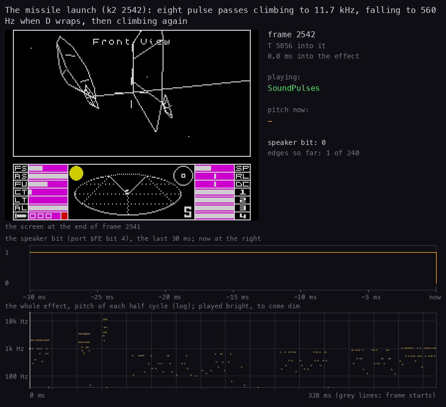

How to read it: as the animations in 9.4. The three short bands at the top left are the passes at D 64, 36 and 8;
after the wrap D is large, so the pulses are long and the strip shows a slow square wave.

## 9.4 The sweep: the laser and the ECM

SoundSweep `$9624` is a square wave of 15 cycles a pass. Its half period is E, recomputed each pass as 2 E + step:

```
SoundSweep:
  LD DE,(SoundPitch)
SoundSweepNow:
  LD A,E
  ADD A,A
  ADD A,$05
  LD E,A
  LD C,$0F
SoundSweepLoop:
  LD A,$30
  LD B,E
  OUT ($FE),A
SoundSweepHigh:
  DJNZ SoundSweepHigh
  XOR A
  LD B,E
  OUT ($FE),A
SoundSweepLow:
  DJNZ SoundSweepLow
  DEC C
  JR NZ,SoundSweepLoop
  JR SoundPassEnd
```

The step is patched into `$962B` (the `$05` of `ADD A`). The high half costs 13 E + 17 T, the low half 13 E + 30
(it carries the loop's `DEC C` and `JR`), so one cycle is **26 E + 47 T** and a pass 15 times that. Both effects start
from E = 0 (their DE is `$0200` and `$0800`: D the passes, E 0):

| Effect | Step | E, pass by pass | Pitch, pass by pass | T a pass |
| --- | --- | --- | --- | ---: |
| laser | `$FD` (-3) | 253, 247 | 528 Hz, 541 Hz | 99 375, 97 035 |
| ECM | `$D3` | 211, 121, 197, 93, 141, 237, 173, 45 | 633, 1096, 677, 1420, 943, 564, 770, 2876 Hz | 18 255 to 93 135 |

So the laser is no sweep at all on the Spectrum: two near-equal bursts of about 530 Hz, 57 ms of tone in all
(measured: 59 edges over 66 ms, the gap being the frame between the two passes). The ECM (`k2` 2573: 635, 1103,
680, 1431, 947, 565, 773 and 2922 Hz, within 2 % of the table) is the one effect whose doubling-and-wrapping E
makes a warble: eight bursts jumping between 560 Hz and 2.9 kHz.
`$30` sets bit 4 (the speaker) and bit 5 (unused); the border bits are 0 here too.

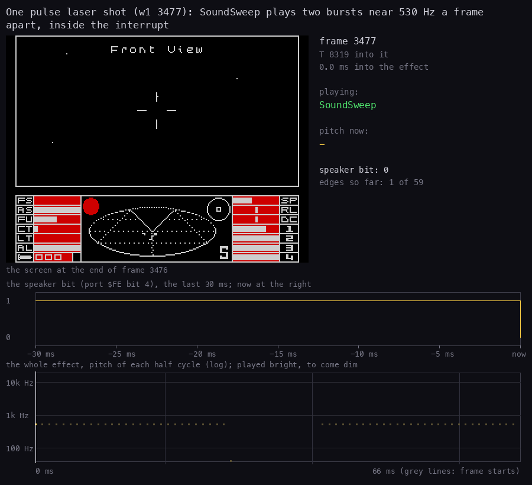

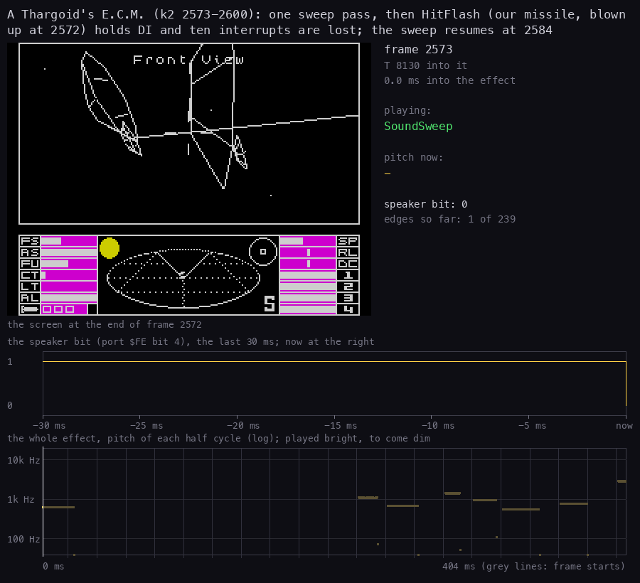

How to read the sound animations (also in 9.3 and 9.6): a picture is a moment of the effect, drawn from its trace,
never played. Left, the screen at the end of the last whole frame (2x); right, the frame and T, the routine whose `OUT`
made the last edge ("silent" after 10 ms without one), the pitch of the last half cycle and the speaker bit. Under
them, the speaker bit over the last 30 ms, scrolling in from the right; at the bottom, the whole effect as in 9.8, a
dot a half cycle at its pitch, bright up to the cursor, grey lines at the frame starts. The laser shows two square
waves of one width; the E.C.M. its gap of 2574-2583 (the red flash), then the warble. Drawn by
`bash tools/fig_sound_all.sh` (`tools/fig_sound_anim.py`, a call per animation with its frames and title).

## 9.5 The noise: the player hit and a ship hit

SoundNoise `$95E7` makes 100 pulses a pass, each pulse's high and low halves as long as a ROM byte scaled:

```
SoundNoiseLoop:
  LD A,(HL)
  INC L
  SRL A
  SRL A
  LD E,A
  LD B,A
  LD A,$30
  OUT ($FE),A
SoundNoiseHigh:
  DJNZ SoundNoiseHigh
  LD B,E
  XOR A
  OUT ($FE),A
SoundNoiseLow:
  DJNZ SoundNoiseLow
  DEC C
  JR NZ,SoundNoiseLoop
```

The first `SRL A` at `$95F2` is patched by SoundArmNoise from HL: SoundArmShipHit writes `$CB $3F` (`SRL A`, so the
count is byte / 4) and SoundArmHit writes `$C6 $10` (`ADD A,$10`, so the count is (byte + 16) / 2: longer pulses and
a lower noise). The source is a ROM page, A × 256 + `$1A`: `$1A1A` for the player hit, `$031A` for a ship hit (the
keyboard routines). `INC L` keeps it in that page. A count of 0 is 256 loops: bytes 0-3 for a ship hit, `$F0` and
`$F1` for the player hit (the `ADD` wraps) give a long gap. One pass of each:

| Effect | Bytes from | Count | Recorded |
| --- | --- | --- | --- |
| player hit | `$1A1A`: `16 D5 E5 AF CB 78 20 20 ...` | (byte + 16) / 2: 19, 114, 122, 95, 109, 68, 24, 24, ... | 199 edges over 44 ms (`w1` 4286), 156 k T |
| ship hit | `$031A`: `23 7E 18 EA 42 16 00 7B ...` | byte / 4: 8, 31, 6, 58, 16, 5, 256, 30, ... | 199 edges over 43 ms (`k2` 3187) |

Both have D = 1 (`LD DE,$0100`): one pass, then SoundPassEnd ends them. `w1`'s 48 player hits (frames 2469-4293)
were the Thargoids' lasers (TacticsAimHit `$A669`).

## 9.6 The scene sounds and Game Over

The launch, the dock, the jump and the arrival call their sound directly, and wait for it:

```
SoundLaunch:
  LD A,(Options)
  BIT 7,A
  RET Z
  CALL SoundArmLaunch
  JR SoundPlay
...
SoundPlay:
  LD A,(SoundMode)
  AND A
  JR Z,SoundPlayDone
  CALL SoundPulses
  JR SoundPlay
SoundPlayDone:
  LD (SoundRequests),A
  EI
  RET
```

SoundArmLaunch, SoundArmJump and SoundArmArrive (through SoundArmScene) execute `DI` before they arm mode 3, so
SoundPlay runs every pass from the main code with no interrupt: no keys, no SoundTick, and the interrupts of those
frames are lost (60 taken in the 100 frames of `w1` 2100-2200). At the end SoundPlay clears every request (A is 0
there), so a laser shot asked for just before a jump is never heard, and enables the interrupts again. TunnelStart
calls SoundJump before its first ring and TunnelDone tail-calls SoundArrive after the last; SceneLaunchNow calls
SoundLaunch as the launch tunnel starts, SceneDock after its 47 frames of docking ([6](06-rendering.md)). The
arrival's constant `$C00C` (D pitch `$C0`, E 12 passes) was written by the disassembler as `BackBuffer+$000C`; the
source spells it out (`@isub $96AC`).

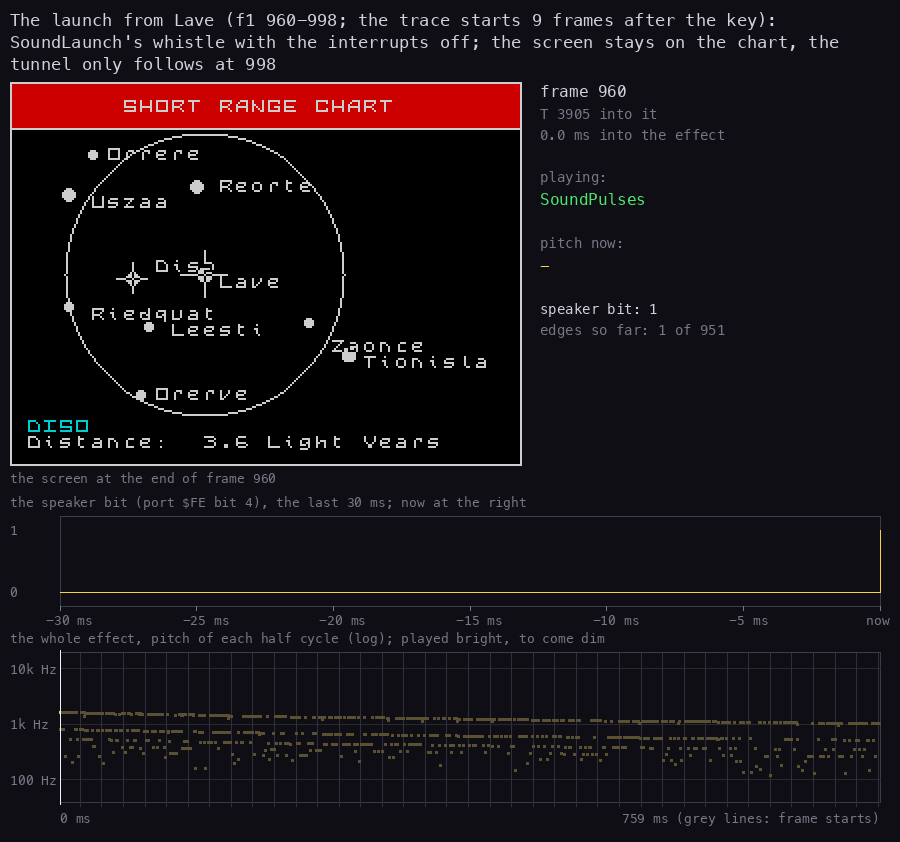

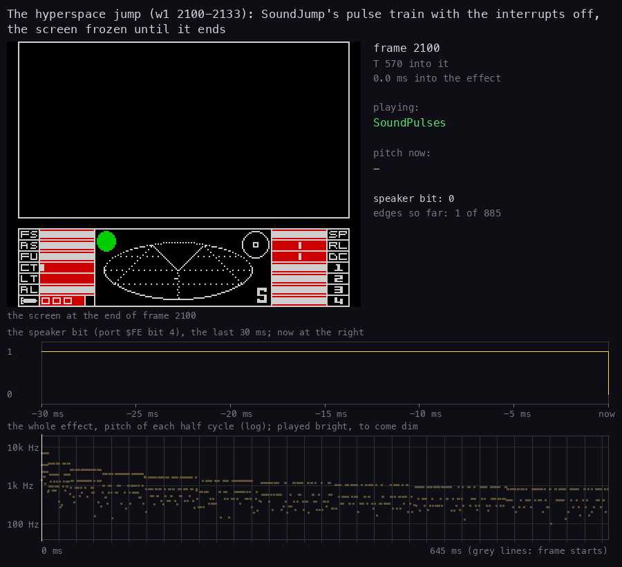

How to read them: as the animations in 9.4. Both play from the main code with `DI`, so the screen stays as it was:
the chart in `f1` (the tunnel follows at 998) and the empty view in `w1`. Both traces miss the first frames.

**Game Over.** GameOver `$7519` (the end of FlightLoop) calls ResetShipsVector (ShipsWreck, which asks for an
explosion), then SoundGameOver `$9548` and SoundLaunch:

```
SoundGameOver:
  LD A,(Options)
  BIT 7,A
  RET Z
  CALL SoundSecond
                         ; falls into SoundPlay
```

SoundGameOver arms SoundSecond's 160-level phase and falls into SoundPlay, but without a `DI`. So two players
play the same generator: SoundPlay from the main code, and SoundTick from the interrupt, each frame, one pass each.
The trace of `w1` 4280-4380 shows it (figure in 9.9), frame by frame:

| Frames | What plays |
| --- | --- |
| 4303 | ShipsWreck sets request bit 2; SoundGameOver sets mode 3 (`$95D1`) |
| 4304-4308 | passes from both players; SoundTick's SoundEnd ends the phase at 4308 |
| 4308 | SoundEnd XORs SoundBit, still 4 from the laser shot of 4296: SoundRequests becomes `$14` (the laser bit set again) |
| 4309 | SoundTick arms the lowest bit, 2: the explosion (mode `$83`) |
| 4311 | the explosion's second phase (SoundSecond again) |
| 4314 | SoundEnd clears bit 2; SoundPlay sees mode 0 and clears all requests (the laser's bit with them); SoundLaunch starts |
| 4314-4361 | the launch whistle, DI, 47 frames |

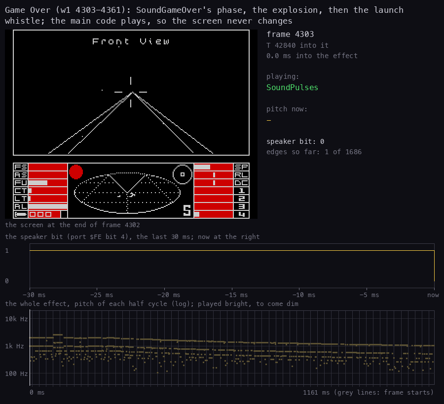

How to read it: as the animations in 9.4, over the table's frames: the two players' passes (the 2.6 kHz band is D
48), the explosion, then from 4314 the whistle. The main code is in SoundPlay throughout, so the view never changes;
"playing" says SoundPulses all along, the generator under all three.

The stale SoundBit is a real slip: an effect armed outside SoundTick ends with the XOR of the bit of the effect
before. Here it is harmless, because SoundPlay clears every request a few frames later; in flight no effect is
armed outside SoundTick, so it cannot happen there. The explosion itself is cut short: SoundPlay's passes and
SoundTick's share its 10 passes, so it lasts 5 frames instead of 11.

## 9.7 The click

Click `$E1E8` is the ROM's BEEPER:

```
Click:
  LD A,(Options)
  BIT 7,A
  RET Z
  LD HL,$0080
  LD DE,$0060
  JP $03B5
```

BEEPER plays DE cycles with a delay of HL: its pitch is 437 500 / (HL + 30.125) = **2 767 Hz** and its length
DE / f = **34.7 ms**. The trace of `f1` 1821 measured 193 edges over 34.6 ms at 2 752-2 778 Hz: 96 cycles. BEEPER
runs with the interrupts off (it starts with DI and ends with EI). FullMessage, TapeMessage, MessageTick, the jump
keys, the planet name prompt, ShowSelected and ClickWait call it, and the other set's control 7 clicks in the middle
of a string ([8](08-hud-and-text.md) 8.5). `f1` and `w1` clicked 3 times each: 122 083 T for three, 0.6 frame a click.

## 9.8 Every effect as recorded

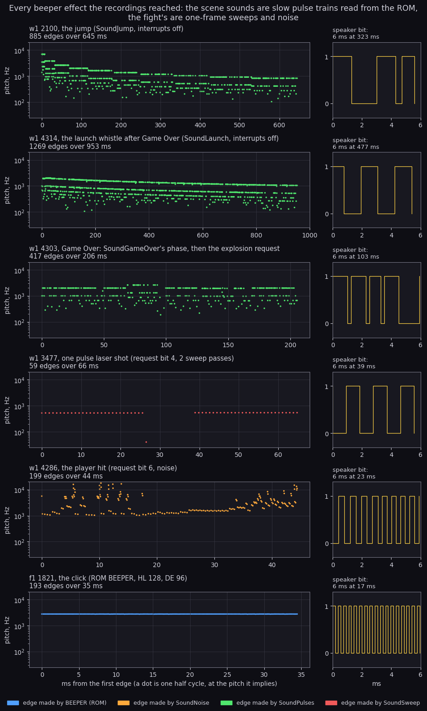

How to read it: one row per effect. On the left each dot is one half cycle of the speaker, placed at its time from the
effect's first edge and at the pitch it implies (3.5 MHz / two half cycles), on a log scale. A pure tone is one line
(the click, the laser); a pulse train is a band of lines, the top one being one ROM byte per half cycle and the ones
below two, three or more equal bytes in a row. On the right, 6 ms from the middle of the effect: the speaker bit itself.
The colours are the writers: SoundPulses green, SoundSweep red, SoundNoise orange, the ROM's BEEPER blue.

What it shows: the jump's ten falling steps (its panel misses SoundJump's first frame, 2099), the whistle's smooth
fall, Game Over's 2.6 kHz band at 60-90 ms (a pass at D 48: the step left is the arrival's `$F0`) before the
explosion, the laser's two bursts, the player hit's noise scattered from 1 to 20 kHz, the click's line at 2.77 kHz:

```
bash tools/fig_sound_all.sh     # this figure, the four below and the six GIFs: a call each, its frames and title
```

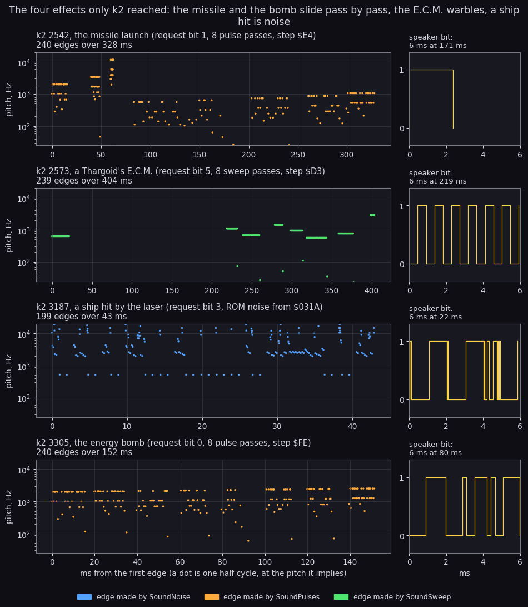

How to read it: as the figure above, with the pitches of 9.3 and 9.4. The E.C.M.'s first pass stands alone (9.9);
the ship hit is another noise than the player hit, from its own ROM page. Drawn by `bash tools/fig_sound_all.sh` (`tools/fig_sound.py`, four panels from the `k2` traces; `--dump` prints
each panel's edges, span, pitch range and writers instead).

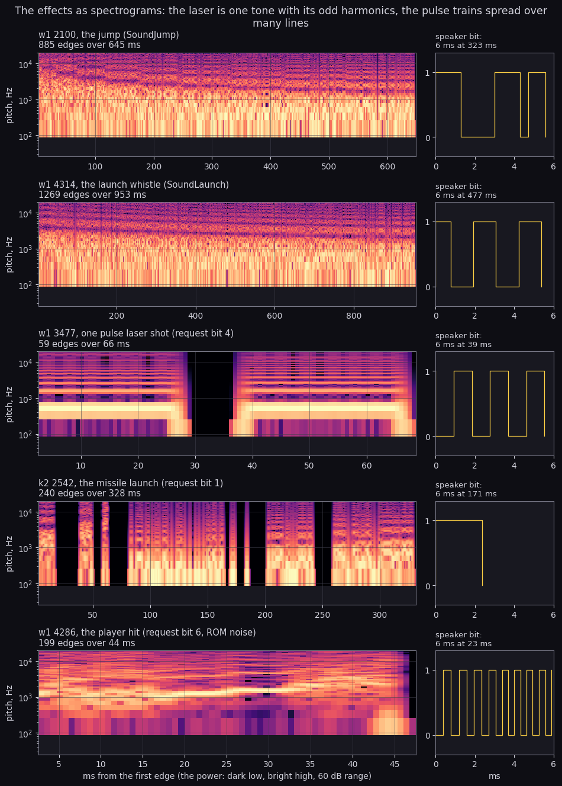

How to read it: the same speaker bit as a spectrogram, time across and frequency up (log), brighter for more
power. The laser is the clean case: a band at 516 Hz, then 559 Hz after a frame's gap, with its odd harmonics
above. The jump, the whistle and the missile are pulse trains, so their power is spread over many lines and the
pitch dots above read them better. The player hit, scattered dots above, carries a tone under the scatter that
rises from 1.1 to 1.6 kHz over its 44 ms (the strongest bin of each 23 ms window). Drawn by
`bash tools/fig_sound_all.sh` (`tools/fig_sound.py --spectrogram`: 5.8 ms windows, each window's mean removed).

## 9.9 What the sound costs

Every generator is a busy loop: the CPU does nothing else while a pass plays. A pass of the background effects
is about a frame long, and it runs inside the interrupt with the interrupts off.

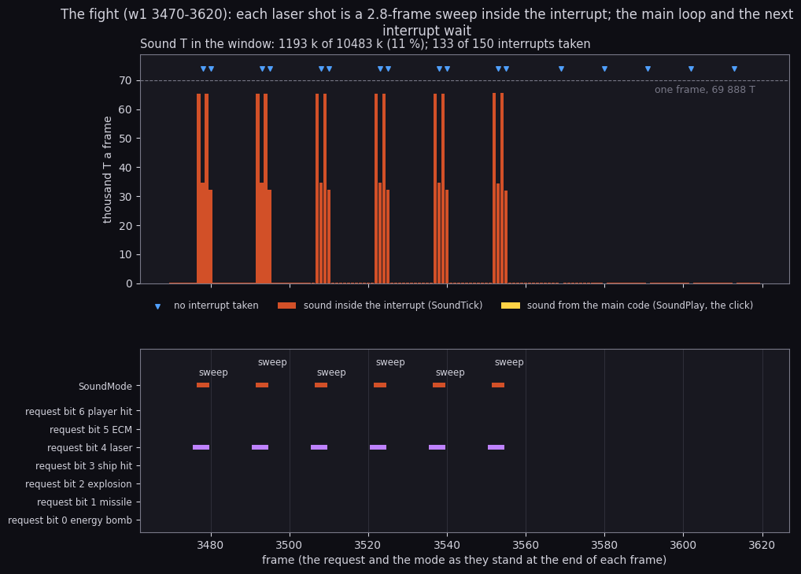

How to read the two timelines: the top panel is the T each frame spends in the sound code (`$9522`-`$96C4` and the
ROM's BEEPER), red when the interrupt runs it and yellow when the main code does; the dashed line is a whole frame
(69 888 T); a blue triangle marks a frame whose interrupt was not taken. The bottom panel shows, at the end of each
frame, which request bits are set and which generator SoundMode names.

In the fight the six laser shots are the only sound. Each is a request in one frame, armed by the next interrupt,
and then 196 k T of SoundSweep in two passes (65 k + 35 k, 65 k + 32 k: each pass straddles a frame boundary):
2.8 frames in which the main loop does not run, the keyboard is not read and the following interrupt is lost (12
of the 17 lost interrupts). The other five lost interrupts (frames 3569, 3580, 3591, 3602, 3613, 11 frames apart)
have nothing to do with sound: the INT fell inside ClearView's `DI` section (`$8080`, the stack-pointer fill of the
view, [6](06-rendering.md)), which recurs at the same phase because the passes there are 11 frames long. In all the
fight spent 1.19 M T of its 10.48 M on sound, 11 %. With the pulse laser held, a shot every 15 frames here, 2.8 of
those 15 frames are the shot's sound. The reverse also happens: in `k2` a Thargoid's E.C.M. blew up our missile at
2572, and HitFlash filled its circles with `DI` (FillPushes1, HalfChord): the interrupts of 2574-2583 were lost and
the E.C.M.'s sweep stopped after one pass, resuming at 2584.

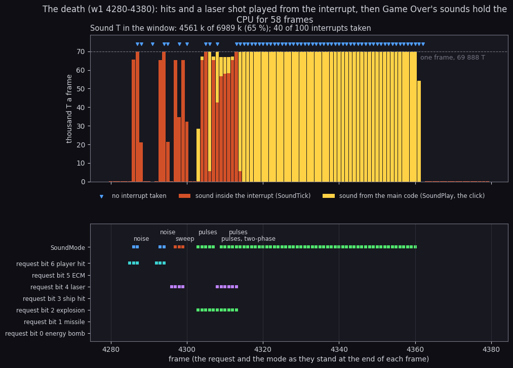

**How to read it.** As the fight's timeline above: a bar a frame. The death window (`w1` 4280-4380) spends 65 % of its T
on sound. The two hits at 4286 and 4293 are 156 k T each (2.2 frames), the laser shot at 4297 196 k. From 4303 the
yellow and red bars share the frames: SoundPlay in the main code and SoundTick in the interrupt play Game Over's train
together (9.6). From 4314 the launch whistle holds every frame to 4361 with DI: 60 of the window's 100 interrupts are
lost, 47 of them there. Both timelines are calls of `bash tools/fig_sound_all.sh` (`tools/fig_sound.py
--timeline` over `w1` 3470-3619 and 4280-4379).

The costs of each effect, from the formulas above and the traces:

| Effect | T | Frames | Played from | Interrupts lost |
| --- | ---: | ---: | --- | ---: |
| idle SoundTick (no effect, no request) | 78 | 0.001 | the interrupt | 0 |
| click | 40 700 | 0.6 | main code (BEEPER, DI) | 0 or 1 |
| laser shot | 196 410 | 2.8 | the interrupt | 2 |
| player hit | 156 437 | 2.2 | the interrupt | 2 |
| explosion | 781 248 | 11.2 | the interrupt, a pass a frame | about 1 in 2 |
| jump | 2 284 800 | 32.7 | main code, DI | all (32) |
| arrival | 3 220 992 | 46.1 | main code, DI | all (46) |
| launch whistle | 3 279 360 | 46.9 | main code, DI | all (47) |

The runtime analysis gives the same split as shares of each scene ([runtime-analysis](runtime-analysis.md) 8):
SoundPulses is 38 % of the launch, 32 % of the tunnel and 58 % of the death.

## 9.10 The patched bytes

The generators are shared by being rewritten. Every patch, its writer and its values:

| Byte | Instruction | Written by | Values |
| --- | --- | --- | --- |
| `$95AE` | `LD C,n` of SoundPulses: levels a pass | SoundArmPulse, SoundSecond | `$40` (bomb, missile, explosion), `$50` (launch), `$C0` (jump, arrival), `$A0` (second phase) |
| `$95BD` | `ADD A,n` of SoundPulses: the step of D | SoundArmPulse | `$FE`, `$E4`, 2, `$10`, `$F0` |
| `$95F2`-`$95F3` | first `SRL A` of SoundNoise | SoundArmNoise | `SRL A` (ship hit), `ADD A,$10` (player hit) |
| `$962B` | `ADD A,n` of SoundSweep: the step of E | SoundArmSweep | `$FD` (laser), `$D3` (ECM) |

The image on the tape holds `$40`, `$00`, `SRL A` and `$05` there, the values the source shows; each Arm routine
writes what its effect needs before the first pass, so the saved values never sound.

The state between passes lives in four variables: SoundMode `$9522`, SoundPitch `$9523` (E the passes left or
the sweep's half period, D the pitch or the passes), SoundSource `$9525` and SoundBit `$96BF` (followed by five
spare bytes). The helpers ShiftBC4-ShiftBC1 `$96C5` that follow are not sound code: they scale the scanner's
debris ([8](08-hud-and-text.md) 8.7).
