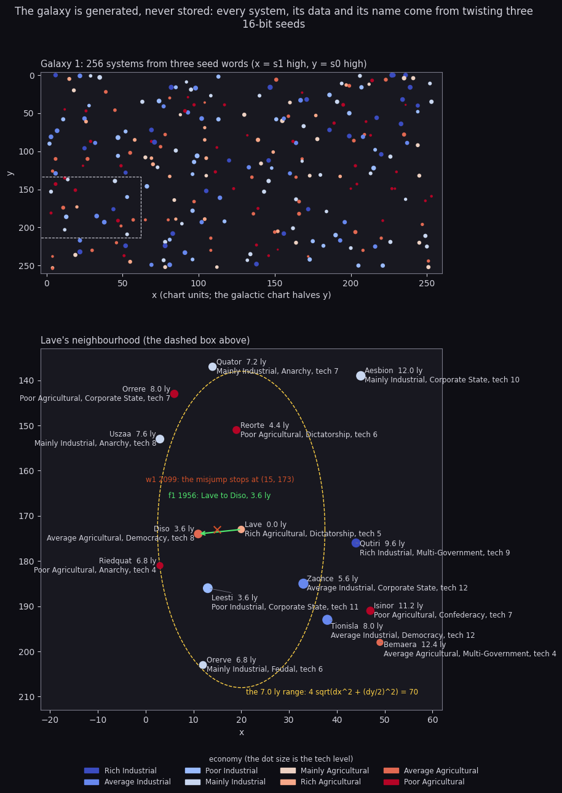
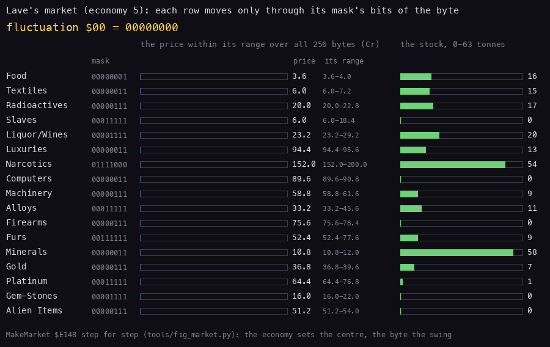
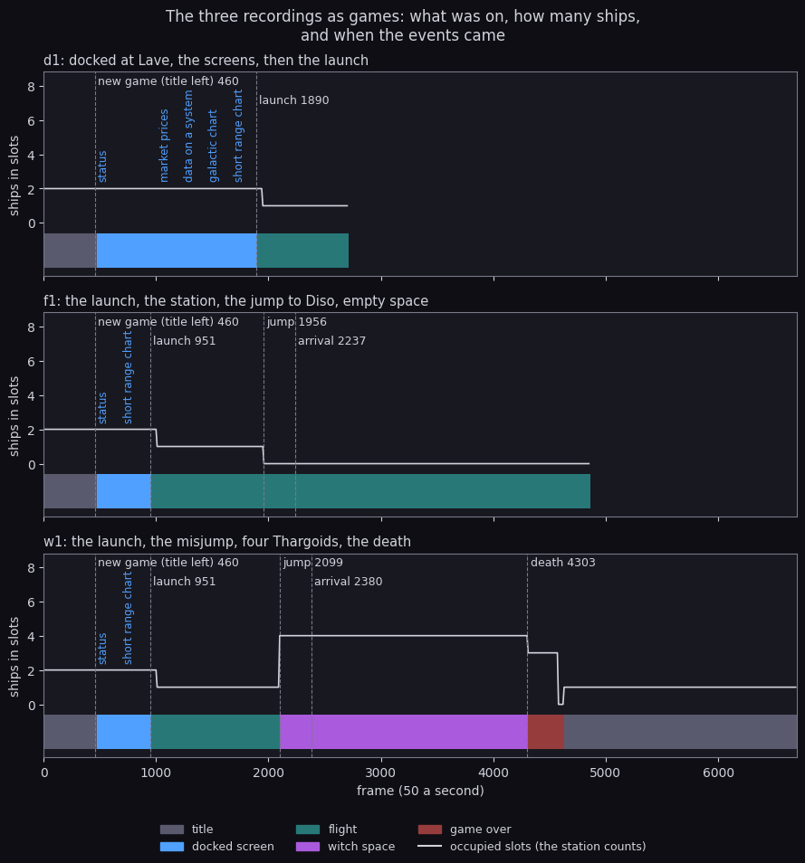

# 10. Gameplay logic

What this covers:

- the galaxy: 256 systems generated from three seed words, their data and names (10.1);
- distances and the jump range (10.2);
- the market: prices and stock from the economy and a fluctuation byte (10.3);
- trading and equipping, recorded in `t1` (10.4);
- the hyperspace jump, the misjump and the galactic jump (10.5);
- the score: bounties, the combat rating and the legal status (10.6);
- the three missions and the pirate stations (10.7);
- the commander record, a new game, saving and loading (10.8);
- the course of the first three recordings as games (10.9).

How the ships fight (tactics, lasers, missiles) is in [7](07-objects.md) 7.7-7.8; this document is the rules around
them. The recordings it rests on ([Terms](README.md#terms)). All are 48K, Side A, from the title snapshot:

- `d1` (2710 frames): a new game, the status page, the market prices, the data on Lave, both charts, the launch;
- `f1` (4856 frames): the launch, the station, the jump from Lave to Diso, empty space with laser shots;
- `w1` (6691 frames): the launch, a misjump forced with the pause menu's F, four Thargoids, the death;
- the scenes of [scenes](scenes.md), played later for what these three never reached: `t1` (trading, a save), `dk`
  (docking), `k2` (kills, a missile, the E.C.M., the bomb), `gx` (the galactic hyperdrive), `m1` (the nova), `m2`
  (the Thargoid mission), `cs` (a cargo scoop) and `j1` (the joystick).

The commander values come from the recordings' memory snapshots (one every 250 frames, `work/<rec>/snapshots`), the
run counts from their L1 (`work/<rec>/l1.json`), the state over time from `tools/timeline.py`; the scenes' values
are their own notes and L1 (`python3 tools/l1runs.py Name...` prints a routine's runs in every recording). What none
of them reached is known from the code only, and the text says so: the cloak ship's kill, the Thargoid base's
destruction and its award, a pirate-held station, the sun skimmed.

## 10.1 The galaxy

The galaxy is never stored. A system is three 16-bit words, the seeds s0, s1 and s2; Twist `$E063` makes
`s0, s1, s2 = s1, s2, s0 + s1 + s2` (16 bits, the carry dropped), and NextSystem `$DFC4` runs it four times for the
next system. The galaxy's first system has the galaxy's own seeds (in the commander record at `$D090`). Everything
about a system comes from its seeds (SystemData `$E08C`, SystemName `$E01C`):

| Field | From the seeds | Lave (system 7) |
| --- | --- | --- |
| chart x, y | s1 high byte, s0 high byte | 20, 173 |
| government (0 anarchy ... 7 corporate state) | s1 low byte, bits 3-5 | 3, Dictatorship |
| economy (0 rich industrial ... 7 poor agricultural) | s0 high byte, bits 0-2; bit 1 set for governments 0 and 1 | 5, Rich Agricultural |
| tech level (stored one less) | (7 - economy) + (s1 high AND 3) + government / 2 rounded up | 4, shown as 5 |
| population (100 millions) | 4 tech + economy + government + 1 | 25: 2.5 billion |
| productivity (M CR) | ((7 - economy) + 3) x (government + 4) x population x 8 | 7000 |
| name | three or four letter pairs of StdPairs `$FDB3`, by s2's high byte AND `$1F`; four when s0 bit 6 | LA VE |

The whole generator is in [galaxy](galaxy.md): the bit layout, the twist's algebra and period, the walk to Lave, the
names pair by pair, the description grammar, the galactic hyperdrive, the eight galaxies and the BBC line by line.
`tools/galaxy.py` follows the code step for step from the game image; `--check` asserts what the recordings and the
manual show (Lave is system 7 of galaxy 1, a rich agricultural dictatorship of tech level 5, its neighbours Diso,
Leesti, Zaonce, Reorte and Riedquat) and every number of [galaxy](galaxy.md). Its names, data and descriptions match
every screen the recordings drew ([8](08-hud-and-text.md) 8.4).



How to read it: the top panel is the whole galaxy, each dot a system at its chart position (the y axis is drawn
half as tall, as the game's galactic chart draws it), its colour the economy (blue industrial, red agricultural)
and its size the tech level. The bottom panel zooms on the dashed box: each system with its distance from Lave,
economy, government and tech level, the yellow ellipse the range of a full tank, the green arrow `f1`'s jump and the
red cross where `w1`'s misjump stopped. Drawn by `python3 tools/fig_galaxy.py` (`docs/img/logic/galaxy.png`).

The next galaxy is not a new table either. GalaxyJump `$DC4E` rotates each of the six seed bytes left one bit
(TwistSeed `$DC83`), so eight galactic jumps come back to galaxy 1. `gx` made one ([scenes](scenes.md) 4,
[galaxy](galaxy.md) 4).

## 10.2 Distances and the range

FindNearest `$DF60` walks the 256 systems for the one nearest the chart cursor; FindNearestNow keeps the smallest
SquaredDistance `$DFCE`:

```
SquaredDistance:
  PUSH AF
  LD A,(ChartCursorX)
  CALL AbsDifference
  LD D,A
  CALL MultiplyDA
  POP BC
  PUSH HL
  LD A,(ChartCursorY)
  CALL AbsDifference
  SRL A
  LD D,A
  CALL MultiplyDA
  POP DE
  ADD HL,DE
  RET
```

and JumpDistance `$DFF2` turns the best into light years: 4 x the integer root of dx^2 + (dy / 2)^2, in tenths. The
y difference is halved because the charts are drawn half as tall as wide; a full tank of 7.0 ly is therefore an
ellipse 17.5 units wide and 35 tall around the current system. The systems within reach of Lave, by
`tools/galaxy.py`:

| System | x, y | dx, dy / 2 | Distance | Economy, government, tech |
| --- | --- | --- | ---: | --- |
| Diso | 11, 174 | 9, 0 | 3.6 ly | Average Agricultural, Democracy, 8 |
| Leesti | 13, 186 | 7, 6 | 3.6 ly | Poor Industrial, Corporate State, 11 |
| Reorte | 19, 151 | 1, 11 | 4.4 ly | Poor Agricultural, Dictatorship, 6 |
| Zaonce | 33, 185 | 13, 6 | 5.6 ly | Average Industrial, Corporate State, 12 |
| Riedquat | 3, 181 | 17, 4 | 6.8 ly | Poor Agricultural, Anarchy, 4 |
| Orerve | 12, 203 | 8, 15 | 6.8 ly | Mainly Industrial, Feudal, 6 |

Diso is worked: dx = 9, dy = |174 - 173| / 2 = 0, the root of 81 is 9, and 4 x 9 = 36: 3.6 ly. `f1` and `w1` both
had the cursor on Diso before their jumps (the snapshots at 1750 and 2000 hold SelectedName DISO and JumpRange 36),
and both arrived with 34 tenths of fuel: 70 - 36.

## 10.3 The market

A station's market is 17 prices and 17 stocks, made by MakeMarket `$E148` from the Commodities table `$701B` (four
bytes a commodity: base price, factor, base quantity, mask), the system's economy and a fluctuation byte (`$D06A`,
from StarSeed at each arrival: NewMarket `$E142`). For each commodity:

```
product = economy x (factor AND $1F)
f       = fluctuation AND mask
stock   = base quantity + f - product - 1      factor positive (INC A / NEG)
          base quantity + f + product          factor negative (bit 7)
stock   = 0 if negative, then AND $3F
price   = (base price + f + product) x 4       factor positive, in tenths of a credit
          (base price + f - product) x 4       factor negative
alien items: stock 0
```

The positive factor's stock is one less than "less the product": `INC A / NEG` makes -(product + 1). `python3
tools/galaxy.py --market Diso --fluctuation 0xA6` reproduces all 17 prices and stocks of Diso's market that `f1`
built at its arrival (fluctuation `$A6`, snapshot at 2500) exactly, and the 17 prices of Lave in `d1`:

| Commodity | Lave, fluctuation 0: price | stock (the record's) | Diso, `$A6`: price | stock |
| --- | ---: | ---: | ---: | ---: |
| Food | 3.6 | 17 | 2.8 | 18 |
| Textiles | 6.0 | 18 | 6.4 | 18 |
| Radioactives | 20.0 | 26 | 21.2 | 26 |
| Slaves | 6.0 | 14 | 6.4 | 6 |
| Liquor/Wines | 23.2 | 39 | 23.6 | 31 |
| Luxuries | 94.4 | 8 | 98.4 | 7 |
| Narcotics | 152.0 | 0 | 176.4 | 57 |
| Computers | 89.6 | 0 | 96.0 | 0 |
| Machinery | 58.8 | 10 | 63.6 | 9 |
| Alloys | 33.2 | 25 | 36.0 | 16 |
| Firearms | 75.6 | 0 | 83.2 | 0 |
| Furs | 52.4 | 0 | 64.0 | 56 |
| Minerals | 10.8 | 61 | 11.2 | 61 |
| Gold | 36.8 | 14 | 38.8 | 14 |
| Platinum | 64.4 | 17 | 66.0 | 9 |
| Gem-Stones | 16.0 | 12 | 18.0 | 6 |
| Alien Items | 51.2 | 0 | 59.6 | 0 |

The same rule run for every fluctuation byte, Lave's economy kept:



How to read it: the fluctuation byte at the top, in hex and binary, steps by 5 from 0 to 255. Each row's blue bar is
its price within its own range over all 256 bytes (the range written after the price), and the green bar its stock.
A row moves only when a bit of its mask (the second column) changes. Food (mask 1) barely moves, Computers and
Luxuries (mask 3) by 1.2 Cr. Narcotics (mask `$78`) swings 48 Cr and Furs (`$3F`) 25 Cr. The low bits change at
every step, so the mask-3 and mask-7 rows flicker, while Narcotics changes only with bits 3-6. Drawn by
`python3 tools/fig_market.py`, which runs galaxy.market (checked against `f1` and `d1` above).

Lave's stock is not made by MakeMarket. NewGame `$D298` patches the stock's store (`LD (HL),A` at `$E1AE`) to a
`NOP` for its call and back afterwards:

```
  LD HL,MakeMarketPrice+$0012
  LD (HL),$00
  PUSH HL
  CALL MakeMarket
  POP HL
  LD (HL),$77
```

so the first market keeps the stock of the commander record (`$D09E` is part of the record, copied from
DefaultCommander), and a loaded commander finds the stock as it was saved. The model would have given Lave 16
food, 0 slaves and 54 narcotics; the record has 17, 14 and 0. Prices are rebuilt at every arrival with a new
fluctuation; the stock changes only by buying (BuyCheck takes from it; SellCheck does not give back: `t1` sold 2 t
of food back and the stock stayed 12) and arrivals. The arrival's byte is never `$F9`: JumpHyperspace sends that
StarSeed to witch space before NewMarket reads it (10.5). What the formula means for a trader, worked through
every route and simulated from Lave: [the trading course](trading-guide.md).

## 10.4 Trading and equipping

The three docked trading pages (keys 2, 3, 4) were each used once in `t1` ([scenes](scenes.md) 2): BuyCargo `$E6AE`
at frame 498, SellCargo `$E8AE` at 1110 and EquipShip `$E973` at 1474. Each walks
its rows with a quantity editor (QuantityKeys `$E776`): one or two digits, ENTER for the next row, any other key
leaves. After every digit the page's check runs on a saved copy (SaveTrade `$E83C`) and a refusal puts the copy
back (RestoreTrade):

| Check | Refusal | Rule |
| --- | --- | --- |
| BuyCheck `$E7DB` | QUANTITY? / CASH? / CARGO? | no more than the stock; the price times the quantity from the cash; tonnes need free space |
| SellCheck `$E935` | QUANTITY? | no more than the hold; the free space back for tonnes; the price paid |
| EquipAccept `$EB2D` | never | the item's own code refuses (ALL PRESENT, `<item>` PRESENT, CASH?) |

Buying slaves or narcotics costs 4 on the legal status a unit, firearms 2, as scooping them does (AddCargo
`$D190`). The cost is added once per check with the whole quantity (AddCargoContraband `$D1AD`), and the second
digit's RestoreTrade does not undo the first digit's: typing 20 narcotics adds 8 + 80. EQUIP SHIP lists tech level + 3 items (all 14 from tech level 9 on) from EquipPrices `$705F`:

| Item | Price | Item | Price |
| --- | ---: | --- | ---: |
| 1 fuel | 70 - fuel + 2 economy (tenths) | 8 escape pod | 1000 |
| 2 missile (at most 4) | 30 | 9 energy bomb | 900 |
| 3 large cargo bay (+15 t) | 400 | 10 energy unit | 1500 |
| 4 E.C.M. | 600 | 11 docking computers | 1500 |
| 5 pulse laser | 400 | 12 galactic hyperdrive | 5000 |
| 6 beam laser | 1000 | 13 military laser | 6000 |
| 7 fuel scoops | 525 | 14 mining laser | 800 |

A laser asks for its view (0-3) and pays back the one it replaces at its full price. The fuel's price is written by
every jump (10.5): after `f1`'s jump to Diso `$7060` held `$30`, 4.8 Cr for 3.6 ly (70 - 34 + 2 x 6). A galactic
jump writes the number of the galaxy left instead (`gx`: `$01`, the fuel still 70), buying the fuel writes 0, and
scooping (SetFuel from MessageScooping) leaves the price alone. Which goods and routes pay, scheme by scheme:
[the trading course](trading-guide.md).

## 10.5 The jump

H in flight starts a hyperspace jump, H with G a galactic one. JumpKeys `$DBA2` runs every pass (197 283 runs, 4
with a key):

```
JumpHyper:
  CALL FindNearest
  LD HL,(JumpRange)
  LD A,H
  AND A
  JR NZ,JumpOutOfRange
  LD A,L
  AND A
  RET Z
  LD B,A
  LD A,(Fuel)
  SUB B
  JR C,JumpOutOfRange
JumpStart:
  LD A,$01
  LD (TunnelOn),A
  LD BC,$C005
JumpCount:
  LD A,$15
  LD (JumpCountdown),A
```

The jump needs a distance above 0, below 25.6 ly (the high byte 0) and within the fuel; otherwise HYPERSPACE RANGE ?.
A galactic jump needs only the hyperdrive. Docked, H prints DOCKED and shows the status page. The countdown starts at
21 and JumpTick `$DC29` takes one each MessageTick, printing it halved at the top left: 10 down to 0. At 0, JumpNow:

```
JumpNow:
    clear the messages
    if galactic (TunnelOn 2) or NovaMission: GalaxyJump        # leaving the nova system always changes galaxy
    fuel -= JumpRange; the fuel's price = 70 - fuel + 2 x economy
    LegalStatus >>= 1                                           # each jump halves it
    if Options bit 6 (pause menu F) or StarSeed == $F9: JumpWitch
    else JumpArrive
```

**The arrival** (JumpArrive `$DCE9`, `f1` frame 2237): the selected system becomes the current one, the market is
rebuilt with a new fluctuation, and the sun, the planet and the station are placed from the seeds: the sun within 3
pages of the axis behind the ship, the planet ahead, the station about a page off the planet along z or x, as
detailed in the routine reference ([12](12-routine-reference.md)). MissionTriggers then runs (10.7). The tunnel and
its sounds are in [6](06-rendering.md) and [9](09-sound.md).

**The misjump** (JumpWitch `$DCC0`, `w1` frame 2099, forced by F): WitchSpace on, the current system's coordinates
and the cursor become the midpoint (15, 173 between Lave and Diso), the names' first bytes zeroed (the snapshot at
2250 holds `\0ISO`), no sun, no planet, no station, four Thargoids made, and the stardust thinned to 4 dots
([6](06-rendering.md)). The fuel is spent as for a jump. One misjump in 256 comes by chance.

**The galactic jump** (GalaxyJump `$DC4E`, `gx` frames 1214-1868, [scenes](scenes.md) 4): the Thargoid mission and
the nova are forgotten, the hyperdrive is used up, the galaxy number goes one on (8 wraps to 1), the six seed bytes
rotate, the legal status becomes clean, and the system nearest the cursor is the arrival. In `gx` the hyperdrive's
flag went to 0, the legal status stayed 0, and the arrival was Inoran (21, 184), the galaxy 2 system nearest the
cursor left on Lave's place (20, 173). `m1` jumped galaxy a second way: leaving the nova's system at 5769 took it
from galaxy 2 to 3 whatever system was picked.

## 10.6 Bounties, the rating and the legal status

A ship's end pays when its explosion is over (UpdateSlotFree in UpdateSlot), whoever made it explode:

```
UpdateSlotFree:
  XOR A
  LD (IX+$22),A
  CALL RemoveShip
  LD D,(IY+$09)
  LD E,(IY+$08)
  CALL AddCashVector
  LD D,(IY+$16)
  LD E,(IY+$15)
  SRL D
  RR E
  CALL AddCombatVector
  LD A,(IX+$21)
  AND $60
  JR Z,UpdateSlotNext
  LD A,(LegalStatus)
  OR $40
  LD (LegalStatus),A
```

The bounty is the blueprint's `+$08` word (in tenths, with the bounty message), the combat score gains half its
`+$15` word, and a ship whose `+$21` bits 5-6 are set (the police and the protected) makes the player a fugitive
at once (bit 6 of LegalStatus, 64 and more). A missile that reaches the Thargoid base's station in the mission
(MissionState 4) adds `$FFFF` to the score and sets the state to `$0C` (the missile's branch of Tactics, before
MissileHit; known from the code only). The first three recordings killed nothing: cash, score and legal status stayed
100.0 Cr, 0 and clean. `k2` killed three ships ([scenes](scenes.md) 3):

| Kill | Score | Cash |
| --- | ---: | ---: |
| (before, witch space at 2485) | 196 560 | 50 000.0 |
| our own missile, by a Thargoid's E.C.M. (2572, paid at 2612) | + 224 | + 0 |
| a Thargoid, by the military laser | + 1024 | + 50.0 |
| a Thargon | + 50 | + 5.0 |
| (the end, 4249) | 197 858 | 50 055.0 |

Each line is half the blueprint's `+$15` word and its `+$08` bounty: UpdateSlot `$9D38` pays them for every ship
that explodes, the player's missile included. The missile's 224 took the score from `$02FFD0` to `$0300B0`, and
the status page said DANGEROUS from then on (the top byte 3 in the table below).

The rating (StatusScreen `$EF87`) reads the three-byte combat score `$D060`:

| Score's top byte | Middle byte | Rating |
| --- | --- | --- |
| 0 | 0-8 | Harmless |
| 0 | 9-16 | Mostly Harmless |
| 0 | 17-32 | Poor |
| 0 | 33-64 | Average |
| 0 | 65-128 | Above Average |
| 0 | 129 and up | Competent |
| 1-2 | any | Competent |
| 3-10 | any | Dangerous |
| 11-25 | any | Deadly |
| 26 and up | any | Elite |

The loop stops at the first threshold (RatingScores `$F0AE`: 8, 16, 32, 64, 128; RatingHigh `$F0B4`: 2, 10, 25)
that is at or above the byte (`CP (HL) / JR NC`), so each threshold still belongs to the rank below it:

```
StatusRatingLoop:
  LD A,(DE)
  CP (HL)
  JR NC,StatusRating
  INC B
  INC DE
  JR StatusRatingLoop
```

A carry into the top byte flags RIGHT ON COMMANDER on the message line. The legal status `$D05F`: 0 clean, 1-49
offender, 50 and more fugitive. It grows with contraband (10.4) and protected kills, halves with each jump, and is
cleared by a galactic jump or an escape pod (EscapePod `$9C1C`, not in witch space). A legal-sensitive ship turns
hostile when the combat score's low byte is `$28` or more ([7](07-objects.md) 7.7).

## 10.7 Missions and pirate stations

MissionTriggers `$DDFD` runs at every arrival, and only outside galaxy 1, so none of it ran in the first three
recordings (the jump count `$D063` stayed 0 in `f1` and `w1`, being counted only there). The scenes reached two of
the three triggers from edited saves of `gx` ([scenes](scenes.md) 5-6): `m1` with 31 jumps, `m2` with 253:

| Jumps | Trigger | What follows |
| ---: | --- | --- |
| 32 | MissionNova `$DE67`: flag bit 0, NovaMission 1 | the view tinted red, all the fuel lost (FUEL LEAK); docking asks THE SUN IS GOING NOVA, WILL YOU SAVE US (Y/N)? Y fills the hold with refugees and fits a large bay; docking elsewhere with them pays 100 units of gem-stones and a score byte; leaving the system jumps galaxy |
| 128 | MissionCloak `$DE7E`: flag bit 1 | the cloak ship may come; its canister gives the cloaking device (AddCargoSpecial `$D183`) |
| 254 | MissionThargoids `$DE88`: flag bit 2, MissionState 1 | the MAYDAY; at the next dock WANTED BY GALCOP ... ARE YOU INTERESTED (Y/N)?; Y: state 3 and the ECM jammer; the galaxy's first system becomes a Thargoid base (state 4); destroying its station (state `$0C`) is rewarded at the next dock (MissionDone `$D14D`: IN APPRECIATION OF YOUR EXCEPTIONAL COURAGE) |

MissionState walks 1 (heard) to 2 (unanswered at the next arrival), 3 (accepted), 4 (at the base), back to 3 when
the player leaves the base, and 5 once rewarded. With no trigger at an arrival, PirateChance `$DE39` makes the
station pirate-held when StarSeed is at most (7 - government) / 2: one chance in 256 at a corporate state, four
at an anarchy. Docking with a pirate-held station is a game over: SHIP BOARDED BY PIRATES, THEY SHOW NO MERCY
(PirateStation `$728D`), and a Thargoid base gives SHIP BOARDED BY THARGONS (ArrivalScreens `$7278`).

What the two runs showed:

| Recording | Frame | Event |
| --- | ---: | --- |
| `m1` | 2534 | the 32nd jump: NovaMission 1, FUEL LEAK, the fuel 0.0, the view red; the escape pod (Q) |
| `m1` | 3433-3589 | docked: THE SUN IS GOING NOVA, WILL YOU SAVE US; Y: the refugees aboard, the hold full (flags `$21`) |
| `m1` | 5769 | the jump out: galaxy 3, NovaMission 0 |
| `m1` | 9387 | docked at Ceedleon, 3 (sell): 100 g of gem-stones and 65 536 combat points (128 to 65 664: Competent) |
| `m2` | 2482 | the 254th jump: the MAYDAY, MissionState 1, flags `$07` |
| `m2` | 3230-3386 | docked: the briefing (MissionQuestion), Y: MissionState 3, the ECM jammer (flags `$87`) |
| `m2` | 5183-5594 | the jump to Ausis, galaxy 2's first system (IsFirstSystem from MissionTriggers): MissionState 4 |
| `m2` | 7922 | the cloak ship's Asp spawned (SpawnMissionDone `$BBF2`, flag bit 1 set and bit 6 clear) |

Neither run got further: the base's station, the award (MissionDone `$D14D`), the cloak ship's kill and its
canister, and the pirate-held station stay known from the code only. `dk`, `gx`, `m1` and `m2` ran PirateStation at
each of their docks and none was pirate-held.

## 10.8 The commander

The commander record `$D054`-`$D0B9` is the game's whole state between dockings, 102 bytes: the name, the legal
status, the combat score, the jumps, the galaxy, the cash, the fluctuation, the hold (17 commodities), the free
space, the four lasers, the nova flag, the fuel, the missiles, ten equipment flags, the galaxy's and the system's
seeds, the station's stock and the missions ([11](11-data-reference.md)). The values in the recordings, read from
the snapshots:

| Recording, frame | Fuel | Cash | Legal | Score | Missiles | Current system |
| --- | ---: | ---: | --- | ---: | ---: | --- |
| all three, 250 (the title) | the load-time bytes (the kickoff code, [3](03-build-and-load.md)) | | | | | |
| all three, 500 | 70 | 100.0 | clean | 0 | 3 | Lave |
| `f1` 2000 on | 34 | 100.0 | clean | 0 | 3 | Diso |
| `w1` 2250 on | 34 | 100.0 | clean | 0 | 3 | none (witch space) |

NewGame `$D298` (frame 460 in all three: the key on the title) copies DefaultCommander `$D232` over the record:
JAMESON, 100.0 Cr, 7.0 ly of fuel, a pulse laser, 3 missiles, galaxy 1 at Lave. The ACCESS MENU (SYMBOL SHIFT docked or Y on the title,
CommanderMenu `$D90A`) saves and loads the record as one headerless tape block through the ROM's SA-BYTES and
LD-BYTES, and copies it to DefaultCommander, so the next death restarts from the last save or load. `t1` saved
JAMESON at 1964 and `gx` saved GALAXY2 at 2778; the later scenes loaded edited copies on the title. The tape format
and the values of each save are in [scenes](scenes.md) 0, 2 and 4. After the death (`w1` 4303) the title returns at about 4630 with the record left as it was, and the next
new game copies DefaultCommander in again.

## 10.9 The course of the recordings



How to read it: one row per recording, frames along the x axis. The band at the bottom is the state, sampled every
10 frames (`tools/timeline.py`): grey the title, blue a docked screen (its name written above where it starts), teal
flight, violet witch space, dark red the game over. The white line is the number of occupied ship slots (the
station and the title's ship count). The dashed lines are the first frames of NewGame, SceneLaunch, SoundJump,
SoundArrive and ShipsWreck in each recording's L1. The condition light is left out: Condition `$7104` is worked out again
during each pass, starting from green, so a sample taken at a frame's start often reads green while the screen
shows yellow or red (`w1` 3000: green in the sample, red on the screen). Drawn by `python3 tools/fig_course.py` (`docs/img/logic/course.png`).

What it shows:

- `d1` is a docked tour: the status page at 469, the market prices, the data on Lave, the galactic and the short
  range chart, then the launch at 1890; two slots are taken while docked (the station in slot 0 and slot 7), one
  after the launch (the station);
- `f1` launches at 951, flies past the station, jumps at 1956 (the countdown ran from about 1820), and arrives at
  Diso at 2237 into empty space: the slots are empty from the jump on, and no ship spawned in the 2600 frames that
  follow (the spawning rules are in [7](07-objects.md) 7.8);
- `w1` follows `f1` to the jump, misjumps at 2099 (F of the pause menu), meets four Thargoids at once, and spends
  2200 frames with them (the energy runs low from about 4240, ENERGY LOW at 4250); the death at 4303 leaves the canister and two plates, then the title's ship.

No game rule needs a timer: the encounters, the missions and the misjump all come from StarSeed rolls and counters
of passes and jumps, so the course of a game is decided by how long the player flies and where, not by the clock.
