# The 3D engine

What this covers: how Elite turns 39 bytes of a ship's slot into a wireframe on the screen, step by step on the
game's own code.

- the numbers: positions, axes, blueprints and screen points, byte by byte (1);
- the universe turning round the player, and the drift the tidy repairs (2);
- a ship's own turn and speed (3);
- the pipeline from the blueprint to the screen: the depth, the dot, the matrix, the face test, the projection,
  the detail level, the edges (4);
- the explosion (5);
- the arithmetic: the quarter squares, the divisions, the root, with their errors over every input (6);
- the line drawer: its octants, its four patched loops, OR and XOR (7);
- what the optimisations buy, measured (8);
- the BBC's engine against this one (9).

[6](06-rendering.md) is the short version of the drawing, [7](07-objects.md) 7.2 and 7.5 the slot and the motion,
[runtime-analysis](runtime-analysis.md) 3 and 6 the costs over the recordings. The routines are in
`src/game/drawships.asm`, `src/game/shipmotion.asm` and `src/game/linedraw.asm`.

The measurements rest on two sources:

- **The recordings.** `d1` holds the title's Python, traced in `work/d1/traces`. `f1` is the station, `k2` the fight
  and its explosions ([scenes](scenes.md) 3), and each run count comes from the recording's L1.
- **The simulator.** `tools/shipsim.py` runs the game's own instructions in skoolkit's Z80 simulator, on the memory of
  `d1` frame 250. It places any blueprint in slot 7 the way the title does and runs TurnTitleShip. Its picture of
  the title's pass matches the emulator's to the pixel:

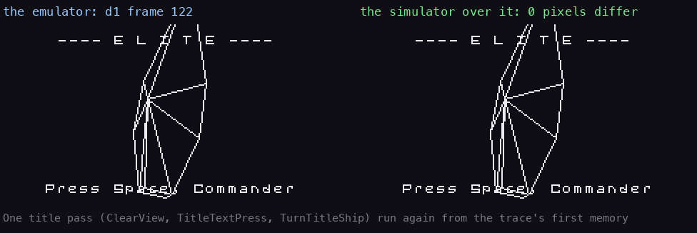

How to read it: left, the back buffer the emulator drew in `d1` (trace `116_30000-122_48700`); right, the one the
simulator draws from the trace's first memory laid over it: white where both set a pixel, red or green where only
one does (none). `python3 tools/fig_ships_anim.py proof`. The same holds for all eight title ships, taken from a live
instance by `tools/title_proof.py` (a new game and the pause's 1 bring the title back with the next ship):

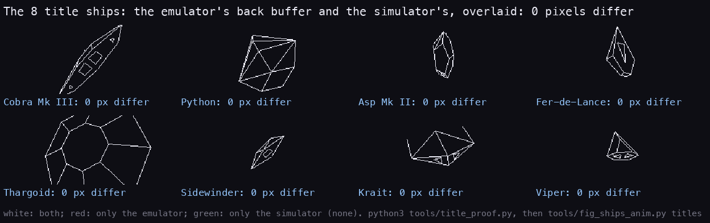

How to read it: one panel a title ship, the emulator's back buffer and the simulator's overlaid as above. `python3
tools/title_proof.py` (live, port 18320, muted), then `python3 tools/fig_ships_anim.py titles`. Every figure of this document after 1 is drawn by `python3 tools/fig_3d.py`, which drives the simulator
instruction by instruction and counts the T of each call.

## 1. The numbers

Every signed number in the engine is sign and magnitude, not two's complement: bit 7 of the top byte is the sign,
the rest the size. A negation is one `XOR $80`, and a product's sign is the XOR of two bits.

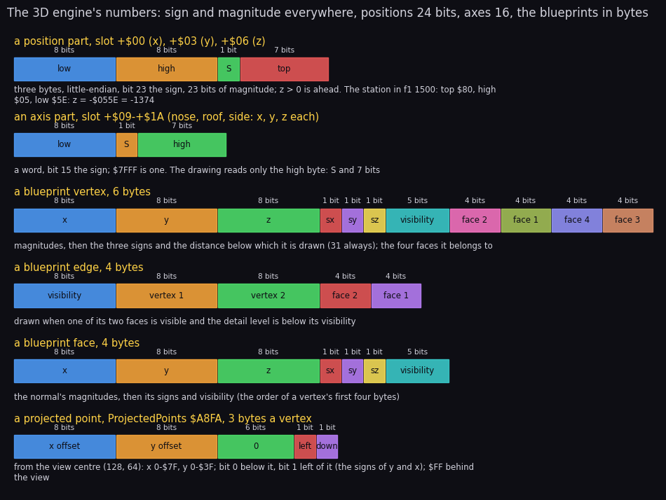

How to read it: one row a format, its fields left to right in memory order, each byte's bits from bit 7 down, the
width under each field. The note under the row says what the field means. `python3 tools/fig_3d.py formats`.

The frames of reference:

| Frame | Axes | Kept as | Who changes it |
| --- | --- | --- | --- |
| the world | the player at the origin; x right, y up, z ahead | each ship's x, y, z: 24 bits (slot `+$00`-`+$08`) | MovePosition, MoveShip |
| a ship | its nose, roof and side, unit vectors in world axes | three words each (slot `+$09`-`+$1A`), `$7FFF` = 1 | TurnAxis, TurnOwn, Orthogonalise, TidyAxis |
| the blueprint | the ship's own: x along the side, y the roof, z the nose | bytes, 0-255 a part, the signs apart | nothing (`src/res/ships`) |
| the view | the view's x across, y up, z the depth | ViewMatrix `$A994`: the three axes' high bytes, 7 bits and a sign | ViewMatrixSetup |
| the screen | 256 x 128 pixels, the centre (128, 64) | ProjectedPoints `$A8FA`: offsets and quadrant bits | ProjectAdd |

The view is the front view's world turned for the other three: the rear flips x and z, the left and right views
exchange x and z (DrawShip picks the depth from `+$06` or `+$00` by the view's bit 1). The drawing reads only the
high byte of each axis part: seven bits of magnitude, about 0.8 % a step.

## 2. The universe turns

The player never moves. Every pass, UpdateShip `$9F82` carries each ship round the origin by the player's roll and
pitch and moves it along z by the player's speed (MovePosition `$A173`, on the full 24-bit parts through
CombineParts `$A1EA`). It then turns the ship's three axes by the same angles, so the ship keeps its attitude to the
universe. TurnAxis `$A0AB` does one axis, on the high bytes, with RotatePart `$A0FD` (A = D + B × C / 256):

```asm
TurnAxis:
  LD A,(TurnRates+$0001)
  XOR $80
  SRA A
  RES 6,A
  LD C,A
  LD B,(IX+$03)
  LD D,(IX+$05)
  CALL RotatePart
  LD (IX+$05),A
  LD A,(TurnRates)
  XOR $80
  LD C,A
  LD B,(IX+$03)
  LD D,(IX+$01)
  CALL RotatePart
  LD (IX+$01),A
  LD A,(TurnRates)
  LD C,A
  LD B,(IX+$01)
  LD D,(IX+$03)
  CALL RotatePart
  LD (IX+$03),A
  LD A,(TurnRates+$0001)
  SRA A
  RES 6,A
  LD C,A
  LD B,(IX+$05)
  LD D,(IX+$03)
  CALL RotatePart
  LD (IX+$03),A
  LD DE,$0006
  ADD IX,DE
  RET
```

```text
roll = TurnRates, pitch = TurnRates+1 halved (sign and magnitude, about 1/256 radian a unit)
z = z - pitch · y          the old y
x = x - roll · y
y = y + roll · x           the new x
y = y + pitch · z          the new z
```

These are four small-angle rotations: cos taken as 1 and sin as the angle. Such a step does not keep a vector's
length. After many passes the axes grow or shrink, and the nose and the roof stop being square. Two routines repair
that:

- **Orthogonalise** `$AE69` makes the roof square to the nose again: roof -= nose × (roof · nose), from the high
  bytes (DotProduct `$A6AC`).
- **TidyAxis** `$9F41` brings an axis back to unit length. It multiplies each part by 1 - (x² + y² + z² - 1) / 2,
  the first-order correction, with the squares read from the table at `$BF00`.

```asm
TidyAxis:
  LD H,$BF
  LD L,(IX+$01)
  SLA L
  LD A,(HL)
  LD L,(IX+$03)
  SLA L
  ADD A,(HL)
  LD L,(IX+$05)
  SLA L
  ADD A,(HL)
  SRA A
  SRA A
  NEG
  XOR $80
  LD B,A
  CALL TidyPart
  CALL TidyPart
  CALL TidyPart
  RET
```

UpdateSlot tidies a flying ship's three axes every pass (UpdateSlotMove: Orthogonalise, then TidyAxis three
times). The title tidies only the nose and the roof (TurnTitleShip), because DrawShip makes the side afresh from
them each time (4).

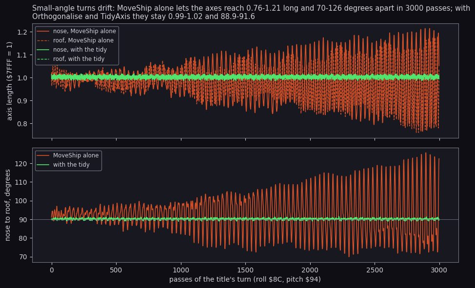

How to read it: the top panel is the length of the nose (solid) and the roof (dashed) after each pass, `$7FFF` = 1.
The bottom one is the angle between them, which should be 90°. Red is MoveShip alone, green MoveShip followed by
Orthogonalise and TidyAxis, as TurnTitleShip does. Without the tidy, 3000 passes (the title runs one a pass of
about seven frames) reach lengths of 0.76 to 1.21 and angles of 70° to 126°. A ship drawn from such axes would
stretch and shear. With the tidy, they stay within 0.99 to 1.02 and 88.9° to 91.6°. `python3 tools/fig_3d.py
drift`.

## 3. A ship's own turn and speed

Then the ship flies itself. MoveShip `$9FFD`:

1. TurnOwn `$A127` three times (an axis part each) turns the nose towards the roof by the pitch (TurnRates+1), the
   side towards the roof by the roll (TurnRates) and the roof back by both. UpdateShip feeds those from the slot's
   counters `+$1E` and `+$1D`, and the title from fixed bytes: pitch `$8C`, roll `$94` (TurnTitleShip's comment
   names them the other way round).
2. The speed `+$1B` takes the acceleration `+$1C`, clamped between 0 and the blueprint's top speed (four times it
   for a ship with behaviour bit 0).
3. MoveAlongAxis `$A04B` three times adds speed × the nose's part to x, y and z.

```text
MoveShip(ship, roll, pitch):
    for each axis: TurnOwn          # the same small-angle steps as 2, the ship's own rates
    speed = clamp(speed + acceleration, 0, top)
    position += speed · nose        # three MultiplySpeed products, sign and magnitude
```

A ship's tactics set the counters and the acceleration ([7](07-objects.md) 7.7). The stardust goes through the same
turn as the ships, on its own 16-bit parts ([6](06-rendering.md) 6.7).

## 4. From the blueprint to the screen

DrawShip `$A6DF` draws one ship. It runs once a pass for each slot in use, only in the four space views:

```text
DrawShip(ship):
    depth = z (front, rear) or x (the sides); behind the view (its sign against the view's): return
    depth at or below the blueprint's size (+$01): return              # the camera is inside it
    the screen point: DividePoint(x, depth), DividePoint(y, depth)
    the gunsight test (SightTarget), the explosion's point if destroyed (5)
    depth's high byte past the dot distance (+$0B): PlotPixel four pixels, return
    DrawWireframe:
        ViewMatrixSetup: side = nose x roof (three DifferenceOfProducts), ViewMatrix from the three axes
        level = min(2 · depth's high byte, 31) - 2                     # the detail level
        FaceVisibility: FaceVisible[f] for each face
        ProjectVertices: ProjectedPoints[v] for each vertex needed
        DrawEdges: DrawLine for each edge with a visible face
        a firing ship: a line from its gun vertex (+$14) to a random point at the edge
```

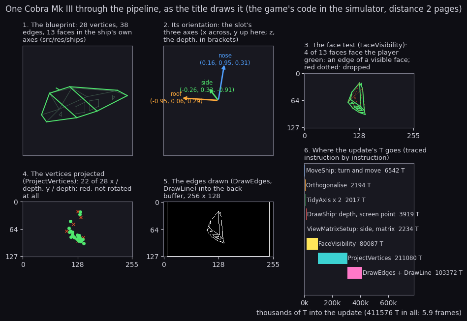

How to read it:

- **Panel 1** is the blueprint as `src/res/ships/ships.txt` holds it, drawn in its own axes.
- **Panel 2** is the slot's three axes for this pass, x across and y up, with the depth part in brackets.
- **Panel 3** has the edges in green when one of their two faces passed the face test, dotted red when not.
- **Panel 4** has the projected vertices in green and the ones ProjectVertices skipped as red crosses. The crosses
  are where the same pass puts them with every face counted visible.
- **Panel 5** is what DrawEdges left in the back buffer.
- **Panel 6** is the update traced instruction by instruction, a bar per routine from its entry to the next one.

For this pose and distance (2 pages), 4 of the 13 faces face the player, and 22 of the 28 vertices are rotated. The
update costs 411 576 T, 5.9 TV frames:

| Stage | Routine | T |
| --- | --- | ---: |
| the ship's turn and speed | MoveShip | 6 542 |
| the roof squared, two axes tidied | Orthogonalise, TidyAxis | 4 211 |
| the depth and the screen point | DrawShip | 3 919 |
| the side axis and the matrix | ViewMatrixSetup | 2 234 |
| the face test | FaceVisibility | 80 087 |
| the vertices | ProjectVertices | 211 080 |
| the edges | DrawEdges with DrawLine | 103 372 |

`python3 tools/fig_3d.py pipeline` prints this table.

### The matrix

ViewMatrixSetup `$AECC` computes the side as a cross product of the nose and the roof, on their high bytes. It
writes the side back into the slot, then copies the three axes' high bytes into ViewMatrix in rows:

| ViewMatrix | `+$01` | `+$03` | `+$05` |
| --- | --- | --- | --- |
| row x | side x | roof x | nose x |
| row y (`+$07`-`+$0B`) | side y | roof y | nose y |
| row z (`+$0D`-`+$11`) | side z | roof z | nose z |

The columns are the ship's axes, so a blueprint vertex (vx, vy, vz) becomes vx · side + vy · roof + vz · nose: one
row against the vertex gives one world part. Because the side is recomputed here every time, it never drifts on its
own. The side's own tidy in UpdateSlot is undone the next time the ship is drawn.

### The face test

FaceVisibility `$BCD4` decides each face before any vertex is touched:

```text
FaceVisibility:
    a ship with no faces (the plate): FaceVisible[0] = 1, done
    for each face f:
        too far for the level (visibility != 31 and level >= visibility): FaceVisible[f] = 0
        else: n = the normal rotated by the matrix and scaled by +$13 (NormalPart, three times)
              FaceVisible[f] = (n · (the ship's position + n) < 0)      # FaceDot: it faces the player
                  (NormalPart adds the position to the scaled normal; FaceDot sums the three products)
```

A face is visible when its outward normal points back towards the player. The plate has no faces and is drawn whole
from every side.

### The vertices

ProjectVertices `$A9C9` walks the vertices. A vertex is rotated and divided only when the detail level lets it
through and one of its four faces is visible:

```asm
ProjectVertex:
  PUSH AF
  LD A,(PointOffset)
  ADD A,$03
  LD (PointOffset),A
  LD A,(IX+$03)
  AND $1F
  CP $1F
  JR Z,ProjectVertexFaces
  LD B,A
  LD A,(ShipDistance)
  CP B
  JR NC,ProjectVertexHidden
ProjectVertexFaces:
  LD A,(IX+$04)
  CALL EitherFace
  JR NZ,ProjectVerticesIfNotZero
  LD A,(IX+$05)
  CALL EitherFace
ProjectVerticesIfNotZero:
  JP NZ,Project
```

A skipped vertex leaves its ProjectedPoints entry as it was: no edge that needs it will be drawn, so nothing reads
it. Project `$ACA2` rotates the vertex in one of three ways:

- **RotateVertexScaled** `$AA2B`: three MultiplyScaled products a row, the vertex part shifted up first;
- **RotateVertexSmall** `$AB73`: for small parts;
- **RotateVertexReuse** `$ABC0`: for a vertex that repeats the last one's magnitudes with other signs, the last
  products with new signs and no multiplication.

ProjectAdd `$ACDF` then adds the ship's position (AddDoubled `$AB4F`) and divides by the depth.

### The projection

DividePoint `$AC69` returns C = 256 × x / depth, saturated at 255. The simulator gives 64 for x = 100 at depth 400,
128 for 100 at 200, and 255 once x reaches the depth. The screen point is the centre plus that offset, so:

- a point is on screen while |x| < depth / 2 and |y| < depth / 4 (offsets below `$80` and `$40`);
- the front view spans 2 × atan(1/2) = 53° across and 2 × atan(1/4) = 28° up and down;
- one pixel is the same angle either way, and the screen's 2:1 shape gives the narrower vertical field.

ProjectedPoints keeps x and y as offsets from (128, 64) and a quadrant byte: bit 0 below the centre, bit 1 left of
it, the signs of y and x. A vertex behind the view gets `$FF` there, and DrawEdges draws none of its edges.

### The detail level

The detail level is the depth's high byte doubled, less 2, at most 29. A vertex, an edge or a face is used while the
level is below its visibility byte (31 means always). Far away only the big edges remain; near, the small details
(the Cobra's engine vents, the Viper's guns) come in.

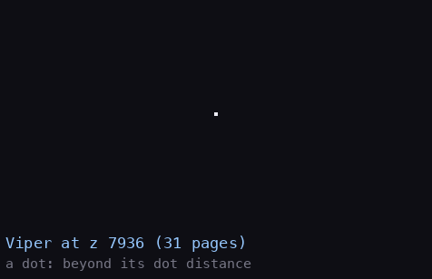

How to read it: one picture a step of the distance, its page and the state named above it. Beyond the blueprint's
dot distance (`+$0B`, `$17` for the Viper) the ship is PlotPixel's four XORed pixels. Then it is a wireframe whose
small edges come in as the level drops. `python3 tools/fig_ships_anim.py approach`.

### The edges

DrawEdges `$AE01` walks the edges. An edge is drawn when the level lets it through, one of its two faces is
visible, and both its ends are in front (PointOf `$AE50`: quadrant bit 7 clear). It packs the two quadrants into C
and calls DrawLine (7). The face test removes the hidden lines, and a convex hull needs nothing more:

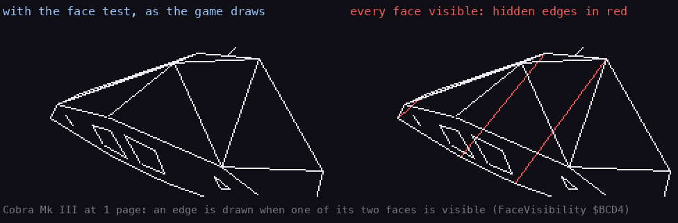

How to read it: left, the game's drawing; right, the same turn with FaceVisibility answered "all visible", so every
edge whose level passes is drawn. `python3 tools/fig_ships_anim.py hidden`.

The 19 blueprints drawn this way, each at the nearest whole page that keeps it inside the view:

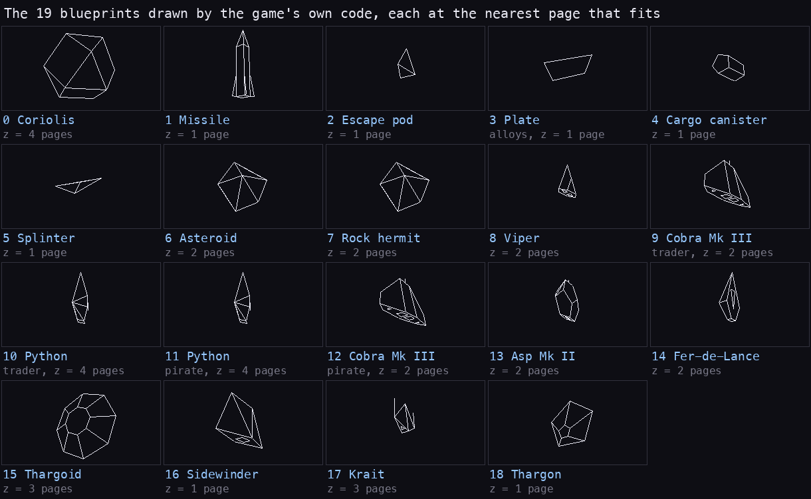

How to read it: one view a blueprint, the name and role, the distance in pages (z / 256). The short lines off the
hulls are blueprint edges, not artefacts: the Krait's two prongs (edges 3-5 and 4-6, to vertices at x = ±90, z = 87)
and the Cobra's gun (vertices 20-21 on the nose axis); the emulator draws them too (above).

`python3 tools/fig_ships_anim.py gallery` writes this still and the turning GIF of [1](01-game-design.md) 1.5; `one` draws
each ship alone for [the ships](ships.md).

## 5. The explosion

A destroyed ship is not drawn as a wireframe. DrawShip sees its flags (`+$20` bit 4) and calls ExplosionPoint
`$A8AC`, which stores the screen point, the size and the quadrant in `+$1C`-`+$1F` and sets bit 5 (state 11). In the
same pass HitFlash `$8F0D` (in `src/game/circles.asm`) runs for each slot in state 11. With the circle code patched
to draw on the screen instead of the back buffer, it:

1. colours the view red (FillAttrsVector with L = `$0A`);
2. draws 15 filled circles from the ship's point, growing by 2 pixels each (DrawCircleDI);
3. puts the colours back (L = `$0F`) and clears bit 4.

UpdateSlot then frees the slot, pays the bounty and plays the sound ([7](07-objects.md) 7.1). There are no flying
fragments: the explosion is one red disc that grows over a pass.

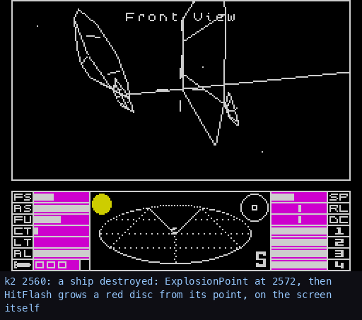

How to read it: `k2`'s screen every frame, the frame number above. ExplosionPoint ran at 2572 (its first run in `k2`'s
L1; three runs in all). The view's ink turns red and the disc grows from the ship's point until the next pass
copies the back buffer over it. `python3 tools/fig_design.py scenes` writes it with the other scene GIFs.

## 6. The arithmetic

The Z80 has no multiply. The products are quarter squares from the table of n² the kickoff builds at `$BE00` (low
bytes) and `$BF00` (high bytes), [3](03-build-and-load.md) 3.7:

```text
b × c = ((b + c) / 2)² - ((b - c) / 2)²
Multiply8 (HL = b × c):          two 16-bit table reads and a subtraction, 128 T
Multiply8High (A = b × c / 256): two high-byte reads and a subtraction, 83 T
```

Multiply8 `$AB34`:

```asm
Multiply8:
  LD A,B
  SUB C
  JR NC,Multiply8Now
  NEG
Multiply8Now:
  SRL A                 ; |b - c| / 2
  LD H,$BE
  LD L,A
  LD E,(HL)
  INC H
  LD D,(HL)             ; DE = its square
  DEC H
  LD A,B
  ADD A,C
  RRA                   ; (b + c) / 2, the carry rotated in
  LD L,A
  LD A,(HL)
  INC H
  LD H,(HL)
  LD L,A                ; HL = its square
  AND A
  SBC HL,DE
  RET
```

The halving drops the low bit when b + c is odd. The simulator ran both over all 65 536 inputs:

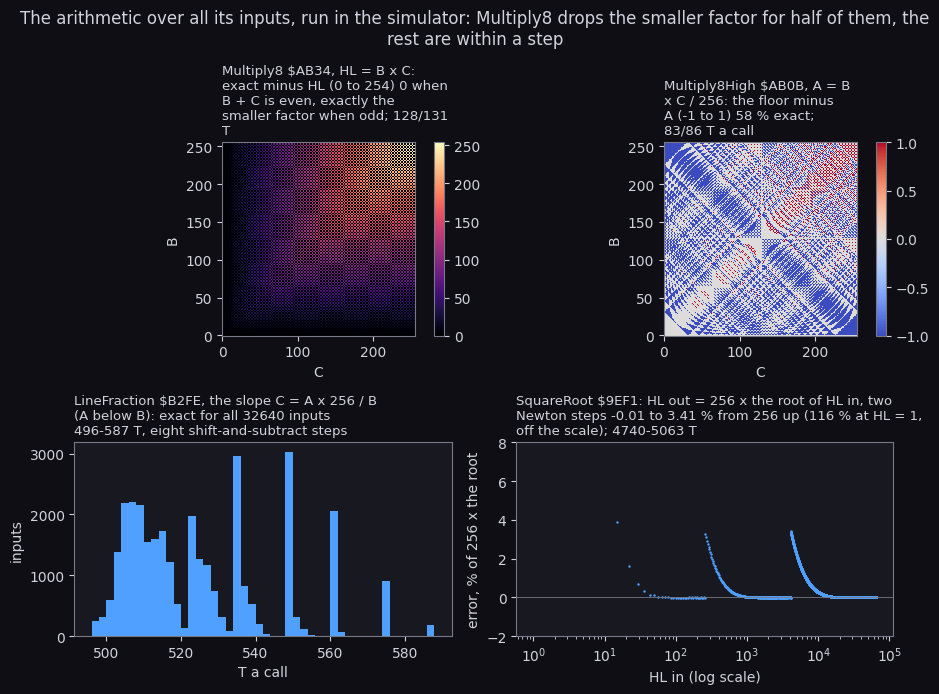

How to read it: each panel is one routine run in the simulator over its inputs. The first two are maps over B
(up) and C (across), coloured by the exact result minus the routine's. The third is LineFraction's T over every
A below B, all exact. The fourth is SquareRoot's error against 256 × the root, on a log scale of the input.
`python3 tools/fig_3d.py maths` prints the numbers.

| Routine | What | Error over all inputs | T |
| --- | --- | --- | ---: |
| Multiply8 `$AB34` | HL = B × C | 0 when B + C is even; exactly min(B, C) short when odd (half the inputs, at most 254) | 128 or 131 |
| Multiply8High `$AB0B` | A = B × C / 256 | -1 to +1 against the floor, 58 % exact | 83 or 86 |
| LineFraction `$B2FE` | C = A × 256 / B, A < B | exact for all 32 640 inputs | 496-587 |
| DividePoint `$AC69` | C = 256 × x / depth, saturated | the floor (spot checks) | 529-1082 |
| SquareRoot `$9EF1` | HL = 256 × the root of HL | -0.01 to +3.4 % from 256 up; +116 % at HL = 1 | 4740-5063 |

For odd b + c the routine computes (b + c - 1)² / 4 - (|b - c| - 1)² / 4 = bc - min(b, c), and the simulator
confirms that for every input. The vertex code keeps only the high byte of such a product, where 254 is less than one
unit. The square root's error jumps at 256 and 4096, where it rescales its input, then falls as Newton's two steps
from `$8000` converge.

How often they run, over the recordings, is in [runtime-analysis](runtime-analysis.md) 6: Multiply8High 7315 times,
Multiply8 3298. In one Cobra update the simulator counts:

- 336 Multiply8High, 51 Multiply8 and 153 MultiplyScaled;
- 53 DividePoint;
- 28 DrawLine.

## 7. The line drawer

DrawLine `$B044` draws every line of the view. Its two ends come as offsets from the centre, with quadrant bits in
C: bits 2 and 3 for the first end (D E), bits 0 and 1 for the second (H L). Bit 0 or 2 means below the centre, bit 1
or 3 left of it. The steps:

1. DrawLine gives each end an outcode. Both ends out on the same side: nothing is drawn.
2. ClipLine `$B18A` moves an outside end to the window's edge along the slope.
3. LineOctant `$B3A7` takes the differences, and LineFraction the slope as an 8-bit fraction.
4. LineAddress `$B308` finds the start's back-buffer address and pixel mask.
5. LineSetup `$B0E0` patches one of four loops and jumps into it.

The line is drawn from the first end towards the second. The simulator drew 32 lines from the centre outwards:

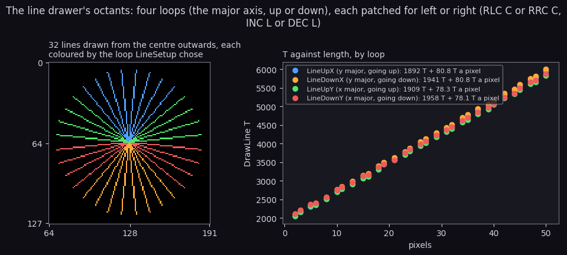

How to read it: left, the lines, each pixel coloured by the loop that drew it (the window cropped to x 64-191).
Right, DrawLine's T against the pixels of 124 more lines, 31 lengths in each loop's direction, and the fitted
cost. `python3 tools/fig_3d.py octants` prints the fits.

| Loop | Draws | A step | On the fraction's carry | Patched by LineSetup | Cost (simulator) |
| --- | --- | --- | --- | --- | ---: |
| LineUpX `$B434` | steep lines going up | a row up (`DEC H`) | a pixel left or right | `RLC C` or `RRC C`; `INC L` or `DEC L` at the byte edge | 1892 T + 80.8 T a pixel |
| LineDownX `$B485` | steep lines going down | a row down (`INC H`) | the same | the same | 1941 T + 80.8 |
| LineUpY `$B464` | shallow lines going up | a pixel across | a row up | the same | 1909 T + 78.3 |
| LineDownY `$B4B1` | shallow lines going down | a pixel across | a row down | the same | 1958 T + 78.1 |

The names say the vertical direction and the axis that moves on the carry. The eight octants are four loops times
left or right. LineSetup writes the rotate opcode's second byte (`$01` RLC C, `$09` RRC C), the byte step (`$2C`
INC L, `$2D` DEC L) and the slope into the loop's `ADD A,$00`, then jumps in. The y-major loop going down, as the
build has it:

```asm
LineDownX:
  LD A,(HL)
  OR C
  LD (HL),A
  DEC D
  RET Z
  LD A,E
  ADD A,$00
  LD E,A
  JR NC,LineDownXNext
  RRC C
  JR C,LineDownXByte
LineDownXNext:
  DJNZ LineDownXRow
  LD B,$08
  LD A,H
  SUB $07
  LD H,A
  LD A,L
  ADD A,$20
  LD L,A
  JP NC,LineDownX
```

Each pixel is ORed: the back buffer is empty at the start of the pass (ClearView), so there is nothing to erase.
UpdateShips patches the four `OR C` to `XOR C` (`$B435`, `$B465`, `$B486`, `$B4B2`) while the sun is large, so a line
across the sun's filled disc shows dark ([6](06-rendering.md) 6.4). The simulator's fit, about 1900 T plus 80 T a
pixel, agrees with the fit over the recordings' lines, 1848 T plus 87.1 ([runtime-analysis](runtime-analysis.md) 3).

**How to read it.** The title's Python drawn edge by edge with the running T, one picture an edge (`python3
tools/fig_rt_lines.py`, [runtime-analysis](runtime-analysis.md) 3):

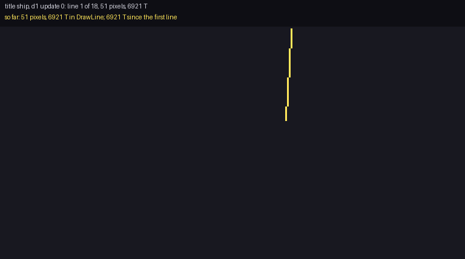

## 8. What the optimisations buy

Each figure below is measured in the simulator: one title update (turn, tidy and DrawShip) at the gallery's
distance, the mean of eight passes, unless the row says otherwise.

| Optimisation | Where | Measured | Without it |
| --- | --- | --- | --- |
| a dot for a far ship | DrawShip, the blueprint's `+$0B` | the Viper beyond page `$17`: 15 431 T an update | 146 000-234 000 T as a wireframe: 10-15 times dearer |
| the detail level | ProjectVertices, DrawEdges, FaceVisibility | the Viper at pages 12-20: 146 000 T | 234 000 T at page 2: the far Viper saves 37 % |
| quarter-squares products | Multiply8, Multiply8High | 128 and 83 T a product | the shift-and-add MulBits: a median of 368 T ([runtime-analysis](runtime-analysis.md) 6) |
| high bytes only | the matrix, the normals, the tidy | 7-bit factors: Multiply8High, 83 T | 16-bit products: several Multiply8 each |
| reused products | RotateVertexReuse | 3 of the Cobra's 25 rotated vertices | three MultiplyScaled each |
| patched loops | LineSetup | the direction in the code, not tested per pixel | a test per pixel in a general loop |
| a fill by the stack | ClearView ([6](06-rendering.md) 6.3) | the view emptied with `PUSH` | erasing each line again, as the BBC does |
| one pass, several frames | UpdateShips | a pass every few frames (about six in the station scene, [7](07-objects.md) 7.2) | - |

The face test is the exception. It is there for the picture, not for speed: with every face counted visible, the
same Cobra update costs 383 549 T instead of 416 953. The 80 087 T of FaceVisibility cost more than the 6 skipped
vertices and the hidden edges save. The Viper shows the same, 201 022 T against 231 648.

The whole update for each blueprint at its gallery distance (`python3 tools/fig_3d.py costs`):

| Blueprint | Pages | T an update | Frames |
| --- | ---: | ---: | ---: |
| Cobra Mk III (both) | 2 | 417 000 | 5.97 |
| Asp Mk II | 2 | 312 239 | 4.47 |
| Thargoid | 3 | 301 423 | 4.31 |
| Missile | 1 | 271 458 | 3.88 |
| Coriolis | 4 | 257 944 | 3.69 |
| Fer-de-Lance | 2 | 255 947 | 3.66 |
| Asteroid, Rock hermit | 2 | 241 588 | 3.46 |
| Python (both) | 4 | 241 400 | 3.45 |
| Viper | 2 | 231 647 | 3.31 |
| Thargon | 1 | 214 037 | 3.06 |
| Sidewinder | 1 | 195 952 | 2.80 |
| Krait | 3 | 179 639 | 2.57 |
| Cargo canister | 1 | 174 301 | 2.49 |
| Splinter | 1 | 110 377 | 1.58 |
| Escape pod | 1 | 103 110 | 1.48 |
| Plate (alloys) | 1 | 76 668 | 1.10 |

These replace the estimates [runtime-analysis](runtime-analysis.md) 3 made from the Python's rates. The Cobra (421k
estimated), the Asp (314k) and the Thargoid (301k) were close. The Coriolis (306k) and the Fer-de-Lance (298k) cost
less, because their visible share is smaller than the Python's.

## 9. Against the BBC

The BBC side is the cassette version's source as Mark Moxon annotates it ([bbc-comparison](bbc-comparison.md)).

| Part | Spectrum | BBC (cassette) | Same? |
| --- | --- | --- | --- |
| the numbers | sign and magnitude: positions 24 bits, axes 16 with `$7FFF` = 1 | the same (`INWK`: x, y, z three bytes, `nosev` etc. two, `&6000` = 1) | the formats yes, the unit no |
| the turn of the universe | TurnAxis, MovePosition: four small-angle steps | `MVS4`, `MVEIT` | in kind; the order differs ([bbc-comparison](bbc-comparison.md) 5) |
| the tidy | Orthogonalise (roof -= nose × (roof · nose)), TidyAxis on each axis, the side from a cross product at each draw | `TIDY`: the nose normalised, one roof part solved from the dot product, the side the cross product | no: a Gram-Schmidt step and a first-order length fix against an exact solve |
| the products | quarter squares from a table | shift and add (`MULT1`, `MLU2`) | no |
| the projection | 256 × x / z, saturated at 255 (one byte) | 256 × x / z into two bytes (`LL61`, `LL28`) | the formula yes; the Spectrum cannot reach past the screen's edge |
| the face test | FaceVisibility: the rotated normal against the position | `LL9` part 5 | yes |
| the detail level | the depth's high byte doubled, less 2, against each visibility byte | `XX4`, from the depth's high byte, against the same bytes | yes in kind |
| the blueprint edge | visibility, vertex, vertex, the two faces (4 bytes) | visibility and the faces, the faces, vertex × 4, vertex × 4 | the same fields in another order |
| the lines | ORed into a back buffer emptied each pass, then copied to the screen | EORed onto the screen; each ship's lines kept in a line heap and drawn again to erase them (`LL155`) | no |
| the line drawer | four loops patched by LineSetup | `LOIN`: shallow and steep halves, each pixel EORed | no |
| an explosion | a red disc of 15 growing filled circles (HitFlash) | a cloud of particles (`DOEXP`) | no |
| a far ship | four XORed pixels | a dot (`LL9` part 2, beyond the visibility distance) | yes in kind |

The Spectrum keeps the BBC's geometry: the same blueprints, face tests, detail levels and projection formula. It
replaces the drawing. A back buffer cleared by the stack and ORed into costs a copy each pass, but no erase and no
line heap. The BBC can draw straight onto the screen, because EOR undoes itself.
