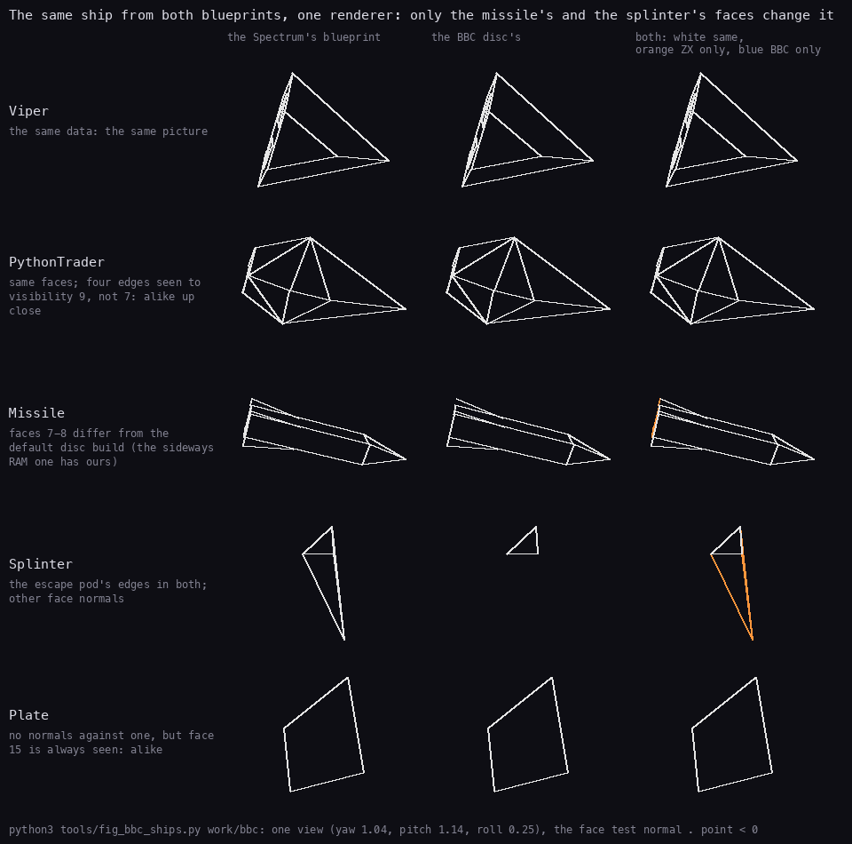
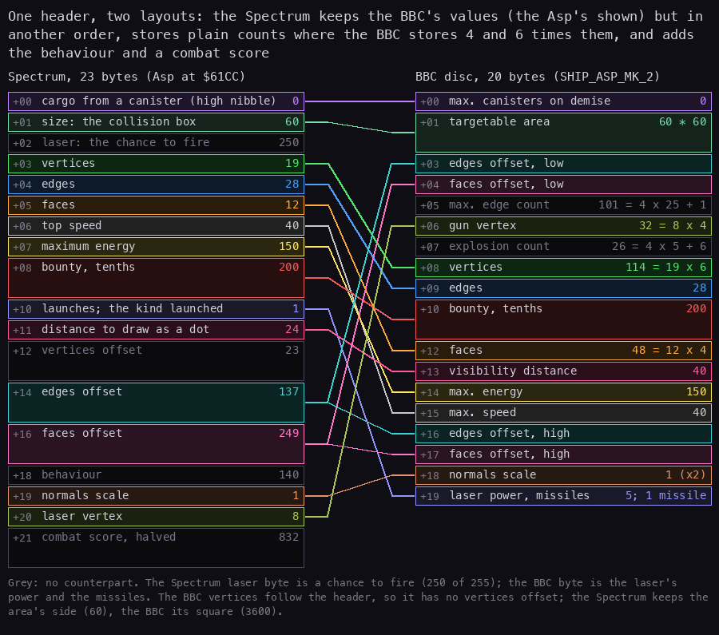
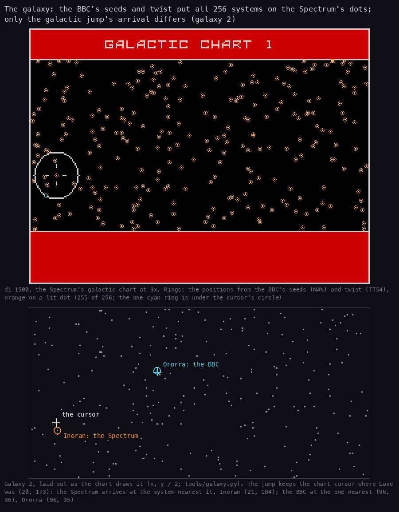
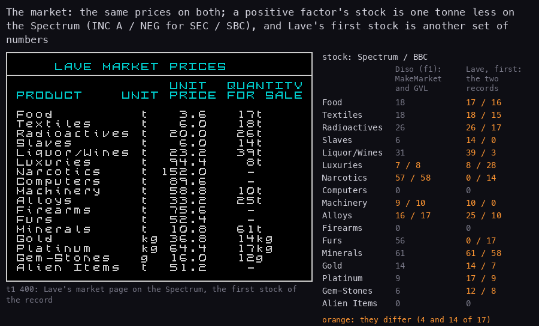
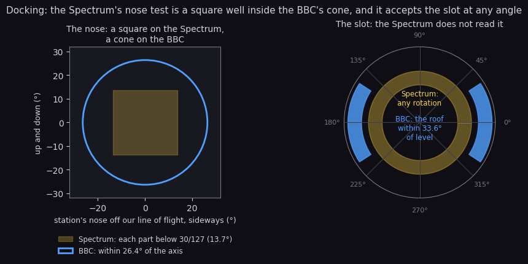
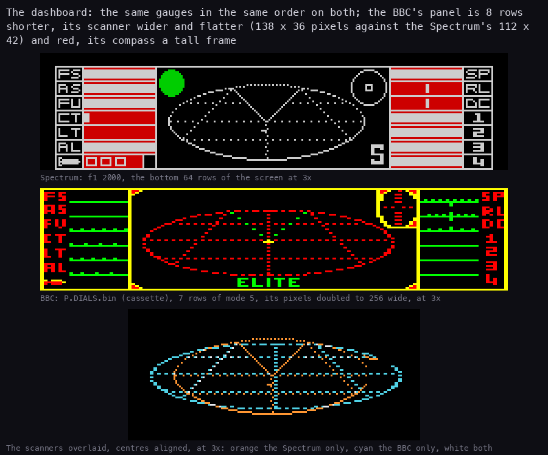
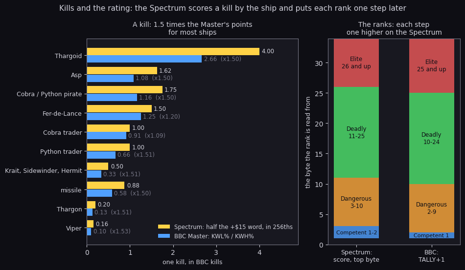

# Elite on the Spectrum against BBC Elite

What this covers: the Spectrum game (Torus for Firebird, 1985) set against the original, BBC Elite (Bell and
Braben, Acornsoft 1984), table by table and routine by routine. The ship blueprints, the galaxy's generation, the
market, the equipment prices, the arithmetic, the flight model, the kills and the rating, the missions and the
commander file. Each row names the Spectrum's address and the BBC's label; what is the same is said to be the same
only where both sides were read (or compared by `tools/bbc_compare.py`), and the last section lists what the
Spectrum changed. The Spectrum side is this case's source (`src/game`, `src/res/ships/ships.txt`); the BBC side is
Mark Moxon's annotated sources (bbcelite.com), fetched once into `work/bbc/` and not part of the case:

| Source | Repository (github.com/markmoxon/...) | Commit | Files used |
| --- | --- | --- | --- |
| BBC cassette | `elite-source-code-bbc-micro-cassette` | `6ba1c7f6` | `elite-source.asm` |
| BBC disc | `elite-source-code-bbc-micro-disc` | `379deffe` | `elite-ships-[a-p].asm`, `elite-missile.asm`, `elite-source-docked.asm`, `elite-source-flight.asm` |
| BBC Master | `elite-source-code-bbc-master` | `b892ec6b` | `elite-data.asm` (the kill points `KWL%`, `KWH%`) |
| 6502 Second Processor | `elite-source-code-6502-second-processor` | `e0c24681` | `elite-source.asm` (the kill tally) |

The recordings it rests on ([Terms](README.md#terms)): `d1` and `f1` (the galaxy, Lave's and Diso's markets), `dk`
(docking by hand and by the computer), `k2` (the kill scores and the rating), `t1` (prices paid). The tables
below are printed by:

```bash
python3 tools/bbc_compare.py work/bbc --all     # ships, market, equipment, galaxy seeds, kill points, tokens
```

## 1. The ship blueprints

The Spectrum has 19 blueprints (Side A; Side B swaps the Krait for an Adder, [3](03-build-and-load.md) 3.12).
`--ships` matches each with the BBC disc ship of the same shape (the Stairway to Hell build, the disc source's
default; the missile also against the sideways RAM build) and compares the vertices (signed x, y, z, the
visibility distance, the four faces), the edges (the vertex pair and the two faces) and the face normals, then the
header values both formats carry. The two headers are laid out differently (the Spectrum's is in [7](07-objects.md)
7.3), so only the shared values are compared.

| Spectrum | BBC | vertices | edges | faces | energy | speed | bounty (tenths) | visibility |
| --- | --- | --- | --- | --- | --- | --- | --- | --- |
| Asp | Asp Mk 2 | same | same | same | 150 | 40 | 200 | 24 vs 40 |
| RockHermit | Asteroid | same | same | same | 180 vs 60 | 30 | 0 vs 5 | 50 |
| Asteroid | Asteroid | same | same | same | 60 | 30 | 5 | 50 |
| Canister | Canister | same | same | same | 17 | 15 | 0 | 12 |
| CobraTrader | Cobra Mk 3 | same | same | same | 150 | 28 | 0 | 50 |
| CobraPirate | Cobra Mk 3 P | same | same | same | 150 | 28 | 175 | 50 |
| Coriolis | Coriolis | same | same | same | 240 | 0 | 0 | 120 |
| EscapePod | Escape Pod | same | same | same | 17 | 8 | 0 | 8 |
| FerDeLance | Fer De Lance | same | same | same | 160 | 30 | 0 | 30 vs 40 |
| Krait | Krait | same | same | same | 80 | 30 | 100 | 20 vs 25 |
| Missile | Missile | same | same | differs; same as the sideways RAM disc | 2 | 44 | 0 | 14 |
| Plate | Plate | same | same | 0 vs 1 | 16 | 16 | 0 | 12 vs 5 |
| PythonTrader | Python | same | same pairs and faces, other visibility | same | 250 | 20 | 0 | 40 |
| PythonPirate | Python P | same | same pairs and faces, other visibility | same | 250 | 20 | 200 | 40 |
| Sidewinder | Sidewinder | same | same | same | 70 | 37 | 50 | 20 |
| Splinter | Splinter | same | same | differs | 20 | 10 | 0 | 10 vs 8 |
| Thargoid | Thargoid | same | same | same | 240 | 39 | 500 | 55 |
| Thargon | Thargon | same | same | same | 20 | 30 | 50 | 20 |
| Viper | Viper | same | same | same | 140 vs 100 | 32 | 0 | 23 |

14 of the 19 are the BBC shapes byte for byte once both are written as signed numbers. The rest:

- **The Pythons** have the same 26 edges between the same vertices with the same two faces each; four edges
  (12-15) carry visibility distance 9 where the BBC has 7, so they stay drawn a little farther out. Up close the
  two draw the same lines.
- **The missile**: in the default disc build (and Ian Bell's) faces 7 and 8 are `0, 160, 110` and `0, 64, 4`
  (visibility 0); the sideways RAM disc and the BBC cassette have `0, 32, 0` and `0, 0, -176`, and so does the
  Spectrum. The table's "same as the sideways RAM disc" is that check.
- **The splinter** takes the escape pod's six edges on the BBC (its edges offset points back into the pod's
  blueprint), the same six the Spectrum stores in its own blueprint; the **Thargon** likewise takes the canister's
  15 edges, the same as ours. The splinter's four face normals differ: the Spectrum's are `177, 12, -148` and so
  on, the BBC source lists `35, 0, 4` and so on, with the faces offset's low byte written `+ 24`.
- **The plate** has no face normals where the BBC has one; both draw every edge, as the plate's edges all name
  face 15 and face 15 is always taken as seen.



**How to read it.** Each row is one ship drawn three times from the same view by the same hidden-line test (an edge is
drawn when one of its two faces turns towards the eye; face 15 always counts as seen): from the Spectrum's blueprint,
from the BBC disc's, and both overlaid, white where both draw an edge and orange where only the Spectrum does. The
Viper, the Python and the plate come out line for line alike; the missile loses four of its edges on the BBC data (short
ones, at the left end) and the splinter three of its six, both because of the face normals above. The test is the
renderer's in outline, not either game's code, so the figure shows what the data differences can do, not a recorded
frame.

```bash
python3 tools/fig_bbc_ships.py work/bbc
```

The header values agree except five visibility distances, the Viper's energy (140, BBC 100) and the Rock Hermit.
The Spectrum's Rock Hermit is a full blueprint of its own with the asteroid's shape, 180 energy and no bounty,
where the BBC disc has one asteroid. The bounties are the same tenths of a credit: `k2` was paid 50.0 Cr for a
Thargoid and 5.0 Cr for a Thargon ([scenes](scenes.md) 3), the BBC's 500 and 50.



**How to read it.** The Asp's two headers side by side, a box a field with its offset and value, the Spectrum's 23
bytes (`$61CC`) at the left and the BBC disc's 20 at the right; a line joins the fields that hold the same thing.
Where the BBC stores a multiple the box says so: 114 vertex bytes are the Spectrum's 19 vertices x 6, 48 face bytes
its 12 faces x 4. Grey boxes have no counterpart: the Spectrum's laser byte is a chance to fire, its behaviour, its
combat score and its vertices offset (the BBC's vertices follow the header) are its own, and the BBC's edge and explosion counts are not stored on the Spectrum. The values
are read from both files by `tools/bbc_compare.py`.

```bash
python3 tools/fig_bbc_compare.py work/bbc formats
```

## 2. The galaxy

| Part | Spectrum | BBC | Same? |
| --- | --- | --- | --- |
| galaxy 1's seeds | the record `$D08E` (DefaultCommander `$D232`): `5A4A 0248 B753` | `NA%`: `EQUW &5A4A, &0248, &B753` | yes |
| the twist | Twist `$E063`: s0, s1, s2 = s1, s2, s0 + s1 + s2 | `TT54` | yes |
| the names | SystemName `$E01C`, the pairs StdPairs `$FDB3` | `cpl`, `QQ16` | yes: the 32 pairs `ALLEXEGEZACEBISOUSESARMAINDIREA?ERATENBERALAVETIEDORQUANTEISRION` |
| the system data | SystemData `$E08C` | `TT24` | yes: the same economy, government, tech level, population and productivity |
| the next galaxy | GalaxyJump `$DC4E`, TwistSeed `$DC83`: each seed byte rotated left, the legal status cleared, the arrival at the system nearest the chart cursor | `Ghy`: each byte rotated left (`ASL A / ROL`), `FIST` cleared, the arrival at the system nearest (96, 96) | the seeds yes; the arrival no |

So every system has the same name, position and data as on the BBC: `tools/galaxy.py --check` finds Lave as
system 7 of galaxy 1 at (20, 173), a rich agricultural dictatorship of tech level 5 with 2.5 billion people, and
Diso, Leesti, Zaonce, Reorte and Riedquat around it. Those are the BBC's values (`NA%` puts the commander at
`QQ0` 20, `QQ1` 173). `d1` showed the data page of Lave. `gx` jumped to galaxy 2 with the cursor on Lave's
place and landed at Inoran (21, 184), the system of galaxy 2 nearest it; the BBC would have chosen the system
nearest (96, 96), Ororra ([scenes](scenes.md) 4).



**How to read it.** The top is `d1`'s galactic chart at 1500, the Spectrum's own screen at 3x, with a ring at each
of the 256 positions computed from the BBC's `NA%` seeds and `TT54` twist: 255 rings sit on a lit dot (orange) and
the last (cyan) is under the cursor's circle, which hides its dot. The bottom is galaxy 2 drawn the same way, the
cross at the cursor the jump keeps (Lave's 20, 173): the Spectrum arrives at Inoran next to it, the BBC would
arrive at Ororra, the system nearest (96, 96).

```bash
python3 tools/fig_bbc_compare.py work/bbc galaxy
```

The planet descriptions come from the same grammar and almost the same words: `--tokens` prints every BBC disc
token the description grammar reaches beside the Spectrum's token of the same number, and three of the words
differ. [The galaxy](galaxy.md) 8 goes through the galaxy part by part against the BBC, with the descriptions.

## 3. The market and the prices

The commodity table `$701B` (four bytes a commodity: base price, factor with its sign in bit 7 and the units in
bits 5-6, base quantity, mask) is the BBC's `QQ23` byte for byte, all 17 entries. MakeMarket `$E148` is the BBC's
`GVL` with one change, in the stock of a commodity whose factor is positive:

```
MakeMarketQuantity:
  LD E,A
  INC HL
  LD B,(HL)
  INC HL
  LD C,(HL)
  INC HL
  LD A,(CommanderRest+$0007)
  AND C
  ADD A,B
  LD B,A
  LD A,E
  BIT 7,D
  JR NZ,MakeMarketStock
  INC A
  NEG
MakeMarketStock:
  ADD A,B
```

and the BBC's lines for the same step (cassette, `GVL`):

```
 LDY QQ19+1
 BMI TT157
 SEC
 SBC QQ19+3
 JMP TT158
.TT157
 CLC
 ADC QQ19+3
```

In words:

```
product = economy x (factor AND $1F)
f       = fluctuation AND mask
Spectrum: stock = base quantity + f + (-(product + 1))     factor positive: INC A / NEG
BBC:      stock = base quantity + f - product              factor positive: SEC / SBC
both:     stock = base quantity + f + product              factor negative
```

`INC A / NEG` makes -(product + 1), one more than the BBC takes away. A worked case is Diso's machinery at the arrival
of `f1` (economy 6, fluctuation `$A6`): factor +6, base quantity 40, mask 7, so product 36 and f 6. The Spectrum
stocks 40 + 6 - 36 - 1 = 9, which is what `f1`'s snapshot at 2500 holds ([10](10-gameplay-logic.md) 10.3); the
BBC formula gives 10. The price is the same on both, (base + f + product) x 4 tenths: (117 + 6 + 36) x 4 = 636,
63.6 Cr, as `f1` shows.

The first market differs as well. Both keep Lave's stock in the default commander, but not the same numbers: the
Spectrum's DefaultCommander holds at `$D27C` (`$D232` + `$4A`, copied to the record's MarketStock `$D09E` at a new
game) food 17, textiles 18, radioactives 26, slaves 14, liquor 39; the BBC's `NA%` holds `AVL` 16, 15, 17, 0, 3.
Neither is what its market routine makes at Lave (economy 5) with fluctuation 0: MakeMarket gives 16, 15, 17, 0,
20 and `GVL` the same, and only 9 of the 17 `AVL` values agree with `GVL`'s. Both games start from a stored stock of
their own ([10](10-gameplay-logic.md) 10.3).



**How to read it.** The left is `t1`'s market page at Lave at frame 400, the first stock of the record as the
player sees it. The table at the right gives each commodity's stock as Spectrum / BBC, orange where they differ:
the middle column is Diso at the arrival of `f1` (economy 6, fluctuation `$A6`) by MakeMarket and by `GVL`, one
tonne apart for the four commodities with a positive factor and stock left; the right column is the two default
commanders' Lave stocks, 14 of 17 different. The prices are not shown twice because both formulas give the same.

```bash
python3 tools/fig_bbc_compare.py work/bbc market
```

The equipment prices (EquipmentPrices `$705F`, three bytes an item) are the BBC disc's `PRXS` except one:

| Item | BBC disc `PRXS` (Cr) | Spectrum (Cr) |
| --- | ---: | ---: |
| fuel | per light year | per light year |
| missile, large cargo bay, E.C.M. | 30, 400, 600 | 30, 400, 600 |
| pulse, beam, military, mining laser | 400, 1000, 6000, 800 | 400, 1000, 6000, 800 |
| fuel scoops, escape pod, energy bomb | 525, 1000, 900 | 525, 1000, 900 |
| energy unit, galactic hyperdrive | 1500, 5000 | 1500, 5000 |
| docking computers | 1000 | **1500** |

The laser powers are the BBC's too: pulse and beam `$0F` (the BBC's `POW` 15), military `$17` (the BBC's `Armlas`,
`INT(128.5 + 1.5 x POW)` = 151, whose low seven bits are 23), mining `$32` (`Mlas` 50).

## 4. The arithmetic

The Z80 has no multiply, like the 6502, and the Spectrum's routines solve the same problems another way (the
drawing side of this, the projection, the clipping and the lines, is set against the BBC in
[the 3D engine](3d-engine.md) 9):

| Job | Spectrum | BBC cassette |
| --- | --- | --- |
| 8 x 8 bits | Multiply8 `$AB34`: quarter squares, (a + b)² / 4 - (a - b)² / 4 from a table | `MULT1`, `MLU1`, `MULTU`: shift and add, a bit at a time |
| square root | SquareRoot `$9EF1`: scaled to 12 bits, then two Newton steps r = (r + n / r) / 2 from `$8000` (SquareRootCore `$9F18`) | `LL5`: the bit-pair method, one result bit a step |
| the random byte | Random `$B799`: two bytes | `DORND`: four bytes |
| the axes' drift | Orthogonalise and TidyAxis `$9F41` on every ship every pass | `TIDY` on one ship a pass, each every 16 passes |

The random generator is the BBC's cut in half. `DORND` keeps two two-byte sequences, the "feeder" `RAND`, `RAND+2`
and the "main" `RAND+1`, `RAND+3`, and returns the main one:

```
.DORND
 LDA RAND
 ROL A
 TAX
 ADC RAND+2
 STA RAND
 STX RAND+2
 LDA RAND+1
 TAX
 ADC RAND+3
 STA RAND+1
 STX RAND+3
 RTS
```

The Spectrum keeps the feeder alone and returns it:

```
Random:
  PUSH HL
  PUSH BC
  LD HL,(RandomSeed)
  LD A,H
  ADC A,A
  LD B,A
  ADC A,L
  LD H,A
  LD L,B
  LD (RandomSeed),HL
  POP BC
  POP HL
  RET
```

```
b = 2 x h + carry          (ADC A,A)
a = b + l + the carry out of b
h, l = a, b                return a
```

From the seed `$F562` (RandomSeed `$B7AA` at the start) with the carry clear: b = `$EA` with a carry out, a =
`$EA` + `$62` + 1 = `$14D`, so the byte is `$4D` and the seed becomes `$4DEA`. The BBC's `DORND` would return the
main sequence's byte instead. [runtime-analysis.md](runtime-analysis.md) 5 measures the Spectrum's generator's
period and the three others the game has (the stardust's, the text's, the market's).

## 5. The flight model

| Part | Spectrum | BBC | Same? |
| --- | --- | --- | --- |
| the player stands still, the universe turns | MovePosition `$A173` | `MVEIT` part 6, `MVS4` | yes in kind: small-angle rotations by the roll and pitch rates |
| the rotation's order | z -= pitch·y; x -= roll·y; y += roll·x; y += pitch·z (four CombineParts `$A1EA`) | K2 = y - roll·x; z += pitch·K2; y = K2 - pitch·z; x += roll·y | four multiply-adds on both, in another order and with each step reading another value: the Spectrum turns z by the old y, the BBC by the rolled one |
| the speed | z moves by 2 x (SpeedRate + 1) on its low byte | z moves by the speed `DELTA` | scaled differently |
| a ship's tactics | every fourth pass per slot (UpdateSlot `$9D38`, `AND $03`), missiles every pass | every eighth (`AND #7`), missiles every pass | twice as often |
| docking | the station ahead, its nose pointing back (`+$0E` negative), not hostile, the nose's x and y high bytes below `$1E` (CollideStation) | not hostile, nose within 26°, facing the station, inside a 22° cone, the slot within 33.6° of horizontal (`ISDK`: the roof's x part at least 80 of 96, arccos 80/96; the source's comment says 36.6°) | no: the Spectrum does not check the slot's angle |
| the docking computer | DockKeys `$717B`: in the safe zone, docks at once | `GOIN` (cassette): docks at once | yes |

The Spectrum's docking test, in full:

```
CollideStation:
  BIT 2,(IX+$26)
  JR Z,CollideShip
  BIT 7,(IX+$0E)
  JR Z,CollideTooHard
  BIT 7,(IX+$08)
  JR NZ,CollideTooHard
  BIT 2,(IX+$21)
  JR NZ,CollideTooHard
  LD A,(IX+$0A)
  ADD A,A
  CP $DC
  JR NC,CollideTooHard
  LD B,A
  LD A,(IX+$0C)
  ADD A,A
  CP $DC
  JR NC,CollideTooHard
  CP $3C
  JR NC,CollideStationCrash
  LD A,B
  CP $3C
  JR NC,CollideStationCrash
  LD A,$01
  LD (Docked),A
  RET
```

```
station (role bit 2), its nose's z negative (pointing at the player), its z positive (ahead), not hostile
nx2 = 2 x nose x high, ny2 = 2 x nose y high (sign bit shifted out)
either >= $DC: too hard (the crash branch)
either >= $3C: a crash, the front shield
else: docked
```

The nose's high byte is the cosine scaled to `$7F`, so 2 x it below `$3C` means each of the nose's x and y parts
below 30/127: the station's axis within about 13° of the line of flight on each side. The roof (the slot's
angle) is not read: a Spectrum pilot docks whatever the slot's rotation. `dk` docked by hand at frame 2190 after
the pilot lined up on the station's axis alone ([scenes](scenes.md) 1).



**How to read it.** The left plots where the station's nose may point, in degrees off the line of flight: the
Spectrum's test passes inside the square (each of x and y below 30/127, about 13.7°), the BBC's inside the circle
(`CMP #214`, 26.4° off the axis), so every Spectrum docking would also pass this BBC check. The right is the slot's
rotation around the axis: the Spectrum's ring is whole, as the roof is never read; the BBC passes only the two
blue arcs, the roof within 33.6° of level either way up.

```bash
python3 tools/fig_bbc_compare.py work/bbc docking
```

The instruments the flight model drives are the same ones on both, in the same places:



**How to read it.** The top strip is the Spectrum's dashboard from `f1` at frame 2000 (the screen's bottom 64 rows),
the middle one the BBC cassette's `P.DIALS.bin` drawn from its bytes in mode 5 (four colours, two bits a pixel, each
pixel doubled to the Spectrum's 256 columns). The gauges read FS, AS, FU, CT, LT, AL at the left and SP, RL, DC and
the four energy banks at the right on both. The bottom overlays the two scanner ellipses, centred on each other:
orange is only the Spectrum's, cyan only the BBC's, so the BBC's is the wider and flatter of the two.

```bash
python3 tools/fig_bbc_compare.py work/bbc dashboard
```

## 6. Kills and the rating

A kill's pay is the same idea, the score is not. The BBC cassette, disc and 6502SP count kills: `INC TALLY` once
a kill (`TALLY` two bytes), the rating read from `TALLY+1`. The BBC Master gives each ship a kill value (`KWL%`,
`KWH%`, in 256ths). The Spectrum adds half the blueprint's `+$15` word to a three-byte score (AddCombat
`$D1C7`, [10](10-gameplay-logic.md) 10.6). In 256ths of the BBC's kill, the Spectrum's value is 1.5 times the
Master's for nearly every ship:

| Ship | Spectrum score a kill | in BBC kills (/ 256) | BBC Master kill points | ratio |
| --- | ---: | ---: | ---: | ---: |
| Thargoid | 1024 | 4.000 | 2.664 | 1.50 |
| Asp | 416 | 1.625 | 1.082 | 1.50 |
| Cobra pirate, Python pirate | 448 | 1.750 | 1.164 | 1.50 |
| Fer-de-Lance | 384 | 1.500 | 1.250 | 1.20 |
| Cobra trader | 256 | 1.000 | 0.914 | 1.09 |
| Python trader | 256 | 1.000 | 0.664 | 1.51 |
| Krait, Sidewinder, Rock Hermit | 128 | 0.500 | 0.332 | 1.51 |
| missile | 224 | 0.875 | 0.582 | 1.50 |
| Thargon | 50 | 0.195 | 0.129 | 1.52 |
| Viper | 40 | 0.156 | 0.102 | 1.54 |

`k2` measured three of these: a Thargon 50, a Thargoid 1024, our missile destroyed by a Thargoid's E.C.M. 224
([scenes](scenes.md) 3). The Master came out in 1986, after the Spectrum game, so the 1.5 is a likeness, not
a borrowing either way.

The ranks have the BBC's names and the thresholds sit on the score's high bytes, but the Spectrum's test
(`CP (HL) / JR NC`, StatusScreen `$EF87`) keeps a value equal to a threshold in the rank below. Its top byte runs
Competent 1-2, Dangerous 3-10, Deadly 11-25, Elite 26 and up. The BBC's `TALLY+1` runs Competent 1, Dangerous
2-9, Deadly 10-24, Elite 25 and up. `k2` crossed from `$02FFD0` to `$0300B0` with one Thargoid's 224 and the
status page then said DANGEROUS.



**How to read it.** The bars at the left are one kill of each ship in BBC kills: yellow the Spectrum's score / 256,
blue the BBC Master's `KWL%` / `KWH%`, with the ratio beside it (the cassette counts 1 for every ship). The columns at
the right are the ranks against the byte each game reads them from, the Spectrum's score's top byte and the BBC's
`TALLY+1`: every border sits one higher on the Spectrum.

```bash
python3 tools/fig_bbc_compare.py work/bbc kills
```

## 7. Missions, the law and the commander

| Part | Spectrum | BBC |
| --- | --- | --- |
| missions | three, by the jump count outside galaxy 1 (MissionTriggers `$DDFD`): the nova at 32, the cloak ship at 128, the Thargoid base at 254 | cassette: none. Disc and 6502SP: the Constrictor (kill tally 256, galaxy 1 or 2) and the Thargoid plans (galaxy 3); the dock's briefing pages `BRIEF`, `DEBRIEF` |
| contraband | (slaves + narcotics) x 2 + firearms is the danger that brings pirates (SpawnShip `$BBBA`) | the same formula (`BAD`) is ORed into the legal status `FIST` at every launch |
| the commander file | the 102-byte record, one tape block, only the tape's parity checked | the disc and tape file carry a checksum (`CHK`, `CHK2`) |
| the cash | two words: thousands and tenths below 10000 | four bytes in tenths |

The missions are the Spectrum's own: none of the three is in any BBC version, and the BBC's two are not on the
Spectrum. [scenes](scenes.md) 5 and 6 record the nova and the Thargoid base.

## 8. What is the same and what the Spectrum changed

| Same as the BBC | Changed on the Spectrum |
| --- | --- |
| 14 of 19 ship shapes byte for byte; every speed and bounty | four Python edge visibilities, the missile's (default disc build), the splinter's and the plate's normals; five visibility distances; the Viper's energy; the Rock Hermit a blueprint of its own |
| the galaxy seeds, the twist, the names, the system data, the galactic twist | the galactic jump's arrival: near the chart cursor, not near (96, 96) |
| the commodity table, the price formula | the stock one less for a positive factor; Lave's first stock |
| every equipment price but one; the laser powers | the docking computer 1500 Cr |
| a kill's bounty | the score: half the blueprint's `+$15` into three bytes (1.5 x the Master's kill points), not one a kill |
| the rank names | each threshold one step later |
| the small-angle flight model, the docking computer docking at once | the rotation's order, tactics twice as often, every ship tidied every pass, the docking test without the slot's angle |
| - | the arithmetic (quarter squares, Newton's root), the random generator (the feeder half of `DORND`) |
| - | the missions (nova, cloak ship, Thargoid base by the jump count), the contraband's use, the commander record |
