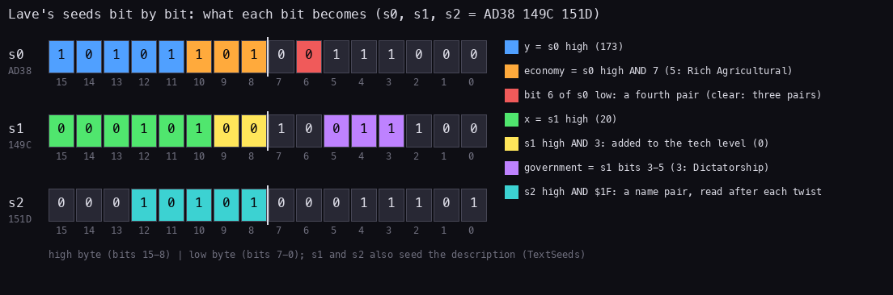
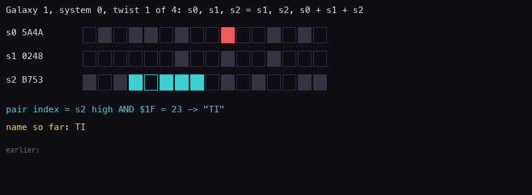
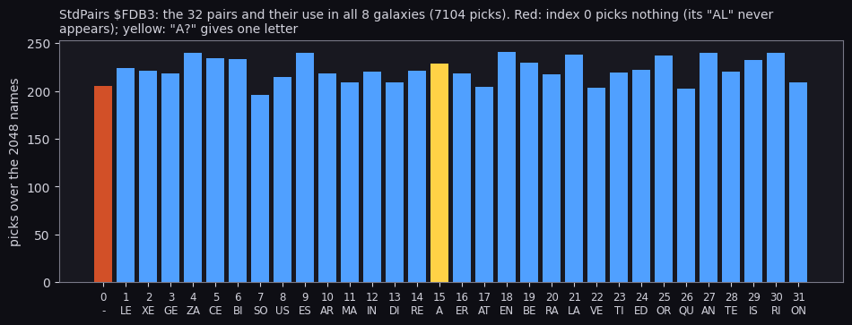
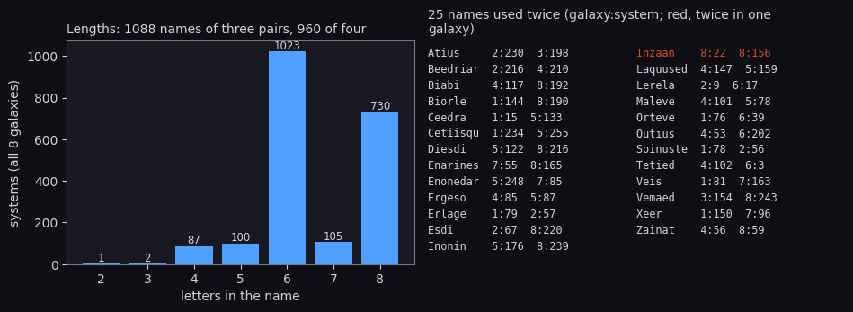
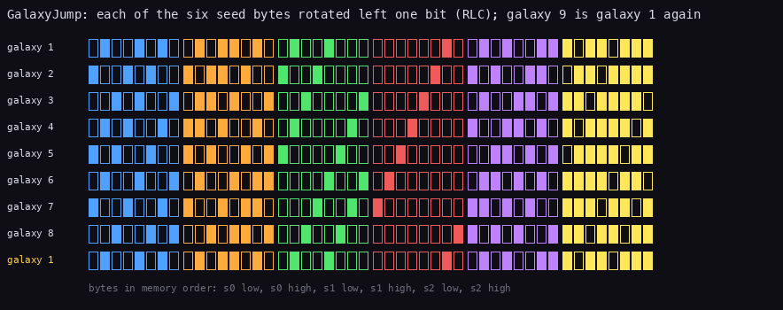
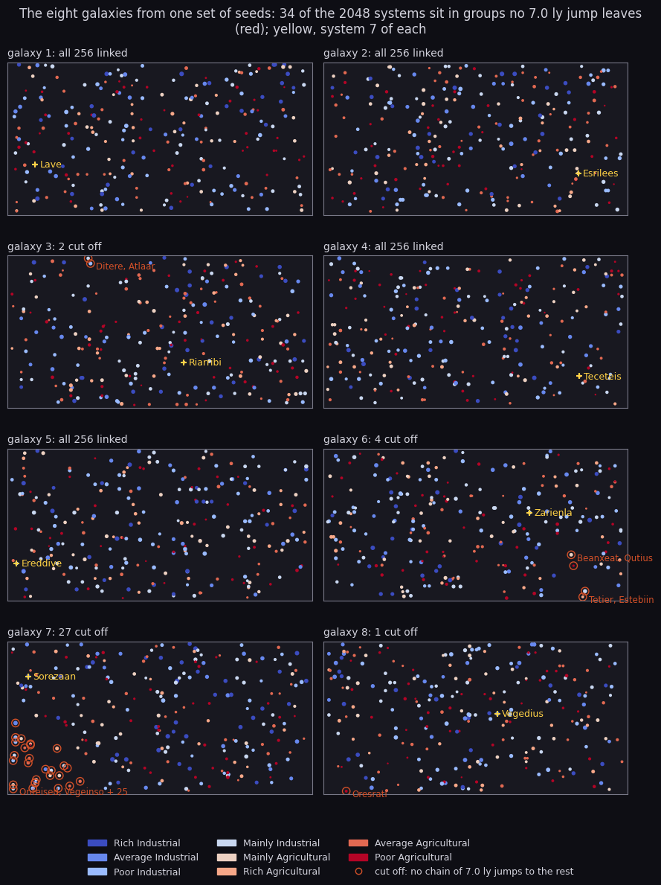
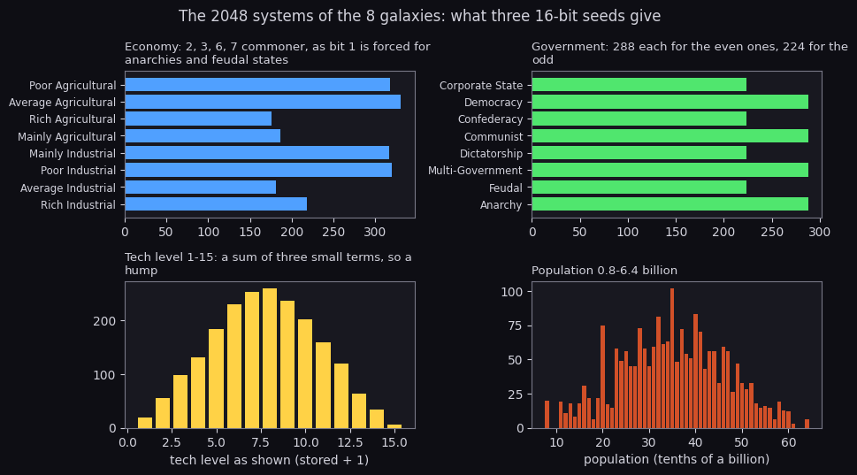

# The galaxy generator

What this covers: how Elite makes 2048 star systems from three 16-bit words, step by step on the game's own code.

- the seeds and what each bit becomes (1);
- the twist: its algebra, its period, why four twists a system, the walk to Lave (2);
- the names: the 32 pairs, Lave and Tibedied pair by pair, the 2048 names counted (3);
- the galactic hyperdrive: the rotation, the eight galaxies' seeds, the cycle (4);
- the system data and what comes after it: distances, the 7.0 ly range, the market (5);
- the descriptions: the grammar and a full expansion (6);
- the eight galaxies: charts, histograms, quirks (7);
- the BBC's generator line by line (8).

[10](10-gameplay-logic.md) 10.1 is the short version. The routines are in `src/game/galaxy.asm`,
`src/game/hyperspace.asm` and `src/game/textprint.asm`. `tools/galaxy.py` is the reference model: it follows the code
step for step from the game image, and `python3 tools/galaxy.py --check` asserts every number below. The recordings
it rests on:

- `d1` drew the galactic chart, the short range chart and the data on Lave;
- `f1` jumped to Diso, and `gx` jumped to galaxy 2 ([scenes](scenes.md) 4);
- `m1` and `m2` flew in galaxies 2 and 3.

Every name, position and data page they show is the model's.

## 1. The seeds

A system is three words, s0, s1 and s2. The galaxy's first system has the galaxy's own seeds, kept in the commander
record at `$D090` (galaxy 1's: `5A4A 0248 B753`, from DefaultCommander `$D232`). Each later system's seeds are made
from the one before. SystemData `$E08C` and SystemName `$E01C` read the bits like this:



How to read it: one row a word, bit 15 on the left, the white bar between the high and the low byte. A coloured bit
is read; the legend gives what it becomes, with Lave's value. Lave's seeds are `AD38 149C 151D`:

- s0's high byte `AD` = 173 is y, and its low three bits `101` = 5 the economy;
- s1's high byte `14` = 20 is x, and its low two bits add 0 to the tech level;
- s1's bits 3-5 (`011` = 3) are the government;
- bit 6 of s0's low byte is 0, so the name has three pairs;
- s2's high byte gives the first name pair (`15` AND `$1F` = 21).

The grey bits are not read by the data. They still feed the twist and the description (TextSeeds takes s1 and s2,
6). `python3 tools/fig_galaxy_md.py seeds`.

## 2. The twist

Twist `$E063`:

```
Twist:
  LD HL,(SystemSeeds)
  LD DE,(SystemSeeds+$0002)
  ADD HL,DE
  EX DE,HL
  LD HL,(SystemSeeds+$0002)
  LD (SystemSeeds),HL
  LD HL,(SystemSeeds+$0004)
  LD (SystemSeeds+$0002),HL
  LD HL,(SystemSeeds+$0002)
  ADD HL,DE
  LD (SystemSeeds+$0004),HL
  RET
```

In pseudocode, with each sum taken modulo 65536:

```
Twist(s0, s1, s2):
    t  = s0 + s1                 # DE
    s0 = s1
    s1 = s2
    s2 = s2 + t                  # s0 + s1 + s2, the carry dropped
```

It is a tribonacci step: the new word is the sum of the last three. As algebra on the column (s0, s1, s2) it is the
matrix

```
| 0 1 0 |
| 0 0 1 |      applied modulo 2^16
| 1 1 1 |
```

and its period on galaxy 1's seeds is 131072 twists (2^17, asserted by `--check`). A galaxy uses 1024 of them: 256
systems of four twists each. The 257th system would be `564A A048 8753`, not the first again: the galaxy does not
wrap, the loops just stop at 256 (SystemCount).

**Why four twists.** NextSystem `$DFC4` is four Twists:

```
NextSystem:
  LD B,$04
NextSystemLoop:
  PUSH BC
  CALL Twist
  POP BC
  DJNZ NextSystemLoop
  RET
```

The name (3) reads s2's high byte after each of up to four twists, so each system owns four consecutive states.
SystemName always twists four times, even for a three-pair name. So naming a system walks the seeds on to the next
one, and a search can name and step in the same pass: FindSystem `$DF24`, behind the charts' PLANET NAME? prompt,
calls SystemName and nothing else to move on (SaveSeeds keeps the seeds of the system it named).

**The walk to Lave.** System 7 is 28 twists from the start:

| System | s0 | s1 | s2 | Name |
| ---: | --- | --- | --- | --- |
| 0 | `5A4A` | `0248` | `B753` | Tibedied |
| 1 | `CD80` | `98B8` | `7A1D` | Qube |
| 2 | `F32A` | `4D9C` | `211B` | Leleer |
| 3 | `D098` | `5394` | `860D` | Biarge |
| 4 | `83DA` | `B420` | `E233` | Xequerin |
| 5 | `B080` | `ACE0` | `778D` | Tiraor |
| 6 | `F95A` | `45D4` | `141B` | Rabedira |
| 7 | `AD38` | `149C` | `151D` | Lave |

Worked, the first twist from system 0: t = `5A4A` + `0248` = `5C92`; s0 = `0248`; s1 = `B753`; s2 = `B753` + `5C92`
= `113E5`, the carry dropped: `13E5`. The next three twists give `CD80 98B8 7A1D`, system 1.



How to read it: one picture a twist, four a system. The three words are drawn bit by bit, filled for 1. The teal
bits are the pair index (s2's high byte AND `$1F`), and the red one is s0's bit 6 (a fourth pair) on a system's
first twist. Under them, the pair read and the name so far; at the bottom, the names already made. The last four
pictures build LAVE. `python3 tools/fig_galaxy_md.py twist`.

## 3. The names

SystemName `$E01C` and NamePair `$E03D`:

```
SystemName:
  LD HL,NameBuffer
  LD (NamePointer),HL
  LD B,$08
SystemNameLoop:
  LD (HL),$00
  INC HL
  DJNZ SystemNameLoop
  LD HL,(SystemSeeds)
  LD A,L
  AND $40
  AND A
  PUSH AF
  CALL NamePair
  CALL NamePair
  CALL NamePair
  POP AF
  JR Z,Twist
NamePair:
  LD HL,(SystemSeeds+$0004)
  LD A,H
  AND $1F
  AND A
  JR Z,Twist
  LD HL,StdPairs
  ADD A,A
  LD D,$00
  LD E,A
  ADD HL,DE
  LD A,(HL)
  INC HL
  PUSH HL
  LD HL,(NamePointer)
  LD (HL),A
  INC HL
  EX DE,HL
  POP HL
  LD A,(HL)
  EX DE,HL
  CP $3F
  JR Z,NamePairNext
  LD (HL),A
  INC HL
NamePairNext:
  LD (NamePointer),HL
```

NamePair falls through into Twist. With bit 6 clear, SystemName ends in `JR Z,Twist`, a plain fourth twist; with
it set, it falls into a fourth NamePair. In pseudocode:

```
SystemName(s):
    four = s0 & $40                       # read once, before any twist
    repeat 3 times, then once more if four:
        i = (s2 >> 8) & $1F
        if i != 0:
            append StdPairs[i][0]
            if StdPairs[i][1] != '?': append StdPairs[i][1]
        Twist
    if not four: Twist                    # four twists either way
```

StdPairs `$FDB3` is 32 pairs, `ALLEXEGEZACEBISOUSESARMAINDIREA?ERATENBERALAVETIEDORQUANTEISRION`:



How to read it: one bar a pair index, its letters under it, its height the picks over all 2048 names (7104 picks).
Two are holes:

- index 0 (red) means "no letters", so its pair AL is never written. 205 picks gave nothing;
- index 15 is `A?` (yellow), and the `?` is left out: one letter.

The rest are picked evenly, about 220 times each: the low five bits of s2's high byte are close to uniform.
`python3 tools/fig_galaxy_md.py pairs`.

**Lave, three pairs.** s0 = `AD38`: bit 6 of `38` is 0, three pairs.

| Twist | s2 | s2 high AND `$1F` | Pair | Name |
| ---: | --- | ---: | --- | --- |
| 1 | `151D` | 21 | LA | LA |
| 2 | `D6F1` | 22 | VE | LAVE |
| 3 | `00AA` | 0 | none | LAVE |
| 4 | `ECB8` | not read | | LAVE |

**Tibedied, four pairs.** s0 = `5A4A`: bit 6 of `4A` is 1, four pairs from s2 = `B753`, `13E5`, `CD80`, `98B8`:
indexes 23, 19, 13, 24, the pairs TI, BE, DI, ED: TIBEDIED.



How to read it: left, the names by length. Six letters (three whole pairs) and eight (four) dominate. Odd lengths
come from `A?` and the shorter ones from index 0. The shortest are Ra (galaxy 1, system 72), Ara (galaxy 1, 245) and
Rea (galaxy 3, 73). Right, the 25 names that two systems share, each as galaxy:system. Only Inzaan (red) is used
twice in one galaxy, as systems 22 and 156 of galaxy 8. `python3 tools/fig_galaxy_md.py names`.

## 4. The galactic hyperdrive

GalaxyJump `$DC4E` in `src/game/hyperspace.asm`:

```
GalaxyJump:
  XOR A
  LD (MissionState),A
  LD A,(NovaMission)
  AND A
  JR Z,GalaxyJumpNext
  XOR A
  LD (NovaMission),A
  LD (SunGrows),A
GalaxyJumpNext:
  LD (Equipment+$0009),A
  LD A,(CommanderRest+$0002)
  INC A
  LD (EquipmentPrices+$0001),A
  AND $07
  LD (CommanderRest+$0002),A
  LD HL,Seeds+$0002
  CALL TwistSeed
  CALL TwistSeed
  CALL TwistSeed
  XOR A
  LD (LegalStatus),A
  CALL FindNearest
  JR JumpArrive
TwistSeed:
  LD E,(HL)
  RLC E
  LD (HL),E
  INC HL
  LD D,(HL)
  RLC D
  LD (HL),D
  INC HL
  RET
```

In pseudocode:

```
GalaxyJump:
    MissionState = 0; NovaMission = 0 (and SunGrows) if it was on
    the galactic hyperdrive flag = 0                      # used up
    galaxy = (galaxy + 1) & 7
    for each of the six seed bytes: rotate left one bit   # RLC: bit 7 into bit 0
    LegalStatus = 0
    the system nearest the chart cursor; arrive there
```

Each byte is rotated on its own, not each word, so eight jumps bring every byte back: galaxy 9 is galaxy 1.



How to read it: one row a galaxy, the six seed bytes in memory order, each in its own colour, filled for 1. Every
byte's pattern slides one place left per row, the leftmost bit coming round to the right. Row 9 is row 1 again.
`python3 tools/fig_galaxy_md.py rotate`.

| Galaxy | s0 | s1 | s2 | System 7 |
| ---: | --- | --- | --- | --- |
| 1 | `5A4A` | `0248` | `B753` | Lave |
| 2 | `B494` | `0490` | `6FA6` | Esrilees |
| 3 | `6929` | `0821` | `DE4D` | Riarribi |
| 4 | `D252` | `1042` | `BD9A` | Teceteis |
| 5 | `A5A4` | `2084` | `7B35` | Ereddive |
| 6 | `4B49` | `4009` | `F66A` | Zarienla |
| 7 | `9692` | `8012` | `EDD4` | Sorezaan |
| 8 | `2D25` | `0124` | `DBA9` | Vegedius |

The arrival is the system of the new galaxy nearest the chart cursor, which stays where it was. `gx` jumped with the
cursor on Lave's place (20, 173) and arrived at Inoran (21, 184) in galaxy 2 ([scenes](scenes.md) 4). The BBC
arrives nearest (96, 96) instead, which in galaxy 2 is Ororra (8).

## 5. The data and what follows from it

SystemData `$E08C` turns the seeds into the data page ([10](10-gameplay-logic.md) 10.1 has its listing and
table):

```
SystemData(s):
    y = s0 >> 8;  x = s1 >> 8
    economy = (s0 >> 8) & 7
    government = (s1 >> 3) & 7
    if government < 2: economy |= 2                    # anarchies and feudal states never rich or average
    tech = (economy ^ 7) + ((s1 >> 8) & 3) + (government >> 1) + (government & 1)   # shown one more
    population = 4 * tech + economy + government + 1   # in 100 millions
    productivity = ((economy ^ 7) + 3) * (government + 4) * population * 8   # M CR
```

Worked for Lave (`AD38 149C 151D`): y = 173, x = 20, economy 5, government 3. The tech level is 2 + 0 + 1 + 1 = 4,
shown as 5. The population is 16 + 5 + 3 + 1 = 25 (2.5 billion), and the productivity 5 x 7 x 25 x 8 = 7000. That
is `d1`'s data page (frame 1300).

What follows from the data:

- **Distances.** JumpDistance `$DFF2` gives 4 x the integer root of dx^2 + (dy / 2)^2 in tenths of a light year,
  the y difference halved first (SquaredDistance `$DFCE`, [10](10-gameplay-logic.md) 10.2). Lave to Diso: dx 9,
  dy 1 / 2 = 0, the root of 81 is 9, 36 tenths: 3.6 ly.
- **The 7.0 ly range.** A full tank reaches 70 tenths: an ellipse 17.5 chart units wide and 35 tall. Section 7
  shows the systems no chain of such jumps reaches.
- **The market.** The seeds give only the economy. MakeMarket `$E148` adds a fluctuation byte that the random
  generator rolls at each arrival, so the same system's prices change from visit to visit
  ([10](10-gameplay-logic.md) 10.3). The route figure of [1](01-game-design.md) 1.6 shows the trades that the
  economies make.

## 6. The descriptions

The data page's last lines ("Lave is most famous for ...") are generated too, from a grammar of text tokens and
its own random generator, seeded from s1 and s2 (TextSeeds `$DECC`):

```
TextRandom:
  LD HL,(TextSeeds)
  SLA L
  EX DE,HL
  LD HL,(TextSeeds+$0002)
  ADC HL,DE
  LD A,H
  LD (TextSeeds),HL
  EX DE,HL
  LD (TextSeeds+$0002),HL
  RET
```

In pseudocode:

```
TextRandom:
    w0, w1 = TextSeeds                       # two words: s1 and s2 at the start
    lo, carry = (w0 & $FF) << 1              # SLA L
    d  = (w0 & $FF00) | (lo & $FF)
    w0 = w1 + d + carry                      # ADC HL,DE
    w1 = d
    return w0 >> 8
```

The description is "other" token 5. A token is a string of letters, pairs, controls and other tokens. A code from
`$5B` to `$80` is a random pick: the row's first token comes from Synonyms `$D5F5`, and TextRandom chooses one of
the five (RandomToken `$D5B4`: below `$33` the first, below `$66` the second, and so on). Control 3 prints the system's name, control 17
the name with IAN (a last vowel dropped), and control 18 a random name of one to four pairs.

The full expansion for Lave, from `tools/galaxy.py` (`describe_steps`), each line the text it made:

```
token $B0
pick $6D: row 86, TextRandom $29, choice 0: token 86              -> "Lave"
  control 3 (the system name)                                     -> "Lave"
token $CA                                                         -> " is "
  token $98                                                       -> "is"
pick $6E: row 140, TextRandom $3D, choice 1: token 141            -> "most famous for its vast rain forests and
                                                                      the Lavian tree warthog"
  token $8C                                                       -> "most famous for its vast rain forests"
    pick $5C: row 21, TextRandom $67, choice 2: token 23          -> "most"
    pick $5B: row 16, TextRandom $A5, choice 3: token 19          -> "famous"
    pick $65: row 61, TextRandom $0D, choice 0: token 61          -> "its vast rain forests"
      token $AF                                                   -> "its "
      pick $5D: row 26, TextRandom $B3, choice 3: token 29        -> "vast"
      pick $5E: row 31, TextRandom $C0, choice 3: token 34        -> "rain forests"
        pick $80: row 125, TextRandom $73, choice 2: token 127    -> "rain"
  token $B2                                                       -> " and "
  pick $65: row 61, TextRandom $33, choice 1: token 62            -> "the Lavian tree warthog"
    token $93                                                     -> "the "
    control 17 (the name + IAN)                                   -> "Lavian"
    pick $5F: row 155, TextRandom $A7, choice 3: token 158        -> "tree"
    pick $60: row 160, TextRandom $DB, choice 4: token 164        -> "warthog"
      pick $7E: row 115, TextRandom $82, choice 2: token 117      -> "warthog"
token $B1                                                         -> ". "
```

Read it top down: each pick shows the random byte and the choice it made. `$29` is below `$33`, so choice 0 of row
86 is the name itself; `$3D` is between `$33` and `$66`, so choice 1 of row 140 is token 141: token `$8C`, " and "
and a pick from row 61. Each pick is RandomToken `$D5B4`: the row's first token plus one for each of `$33`, `$66`,
`$99` and `$CC` the byte reaches.
The result is `d1`'s page: "Lave is most famous for its vast rain forests and the Lavian tree warthog."
`python3 tools/galaxy.py --describe Lave` prints it.

The BBC's Lave has "the Lavian tree grub": the same picks, a different word. 8 lists the tokens that differ.

## 7. The eight galaxies



How to read it: each panel is one galaxy laid out as the galactic chart lays it, coloured by economy and sized by
tech level, system 7 marked. Ringed in red are the systems that a chain of jumps of 7.0 ly or less does not link to
the rest of their galaxy. `python3 tools/fig_galaxies.py galaxies`.

| Galaxy | Cut off | Systems |
| ---: | ---: | --- |
| 3 | 2 | Ditere and Atlaar, a pair on their own |
| 6 | 4 | Beanxeat and Qutius, Tetier and Estebiin: two pairs |
| 7 | 27 | Onteised, Vegeinso and 25 more: a cluster in the bottom left |
| 8 | 1 | Oresrati, alone |

Galaxies 1, 2, 4 and 5 are linked whole. The only way into or out of a cut-off group is the galactic hyperdrive's
arrival, which lands nearest the cursor: a pilot can aim it at one.



How to read it: four histograms over all 2048 systems.

- **Economy.** 2, 3, 6 and 7 are commoner (about 320 each against about 190), because bit 1 is forced on for
  governments 0 and 1.
- **Government.** The even ones have 288 systems each and the odd ones 224, a pattern of bits 3-5 of s1 over the
  1024 twists.
- **Tech level.** A hump from 1 to 15: it is a sum of three small terms. Six systems reach 15, Ceesxe in galaxy 1
  among them.
- **Population.** 0.8 to 6.4 billion. Ceesxe is the most populous, and the highest productivity is 56320 M CR.

`python3 tools/fig_galaxy_md.py hist`.

## 8. Against the BBC, line by line

The BBC side is Mark Moxon's annotated sources ([bbc-comparison](bbc-comparison.md) lists the commits).
`python3 tools/bbc_compare.py work/bbc --galaxy --tokens` prints the comparisons this table rests on.

| Step | Spectrum | BBC | Same? |
| --- | --- | --- | --- |
| galaxy 1's seeds | DefaultCommander `$D232`: `5A4A 0248 B753` | `NA%`: `EQUW &5A4A, &0248, &B753` | yes |
| the twist | Twist `$E063`, 16-bit `ADD HL,DE` twice | `TT54`, byte-wise `ADC` with the carries | yes: the same sums |
| a system | NextSystem `$DFC4`: four Twists | `TT20`: four `TT54` | yes |
| the name | SystemName `$E01C`, 3 or 4 pairs by s0 bit 6, s2 high AND `$1F` | `cpl`: the same test and index | yes |
| the pairs | StdPairs `$FDB3` | `QQ16` | yes: the same 64 letters |
| the data | SystemData `$E08C` | `TT24` | yes: the same formulas |
| the galactic jump | TwistSeed `$DC83` on six bytes | `Ghy`: `ASL A / ROL` on six bytes | yes |
| the arrival | the system nearest the chart cursor | the system nearest (96, 96) | no |
| the text generator | TextRandom `$D5E1` and RandomToken `$D5B4` (`$33`, `$66`, `$99`, `$CC`) | the disc version's `DT6`: `DORND` seeded from s1 and s2 by `TT25`, the steps 51, 102, 153, 204 | yes: the same picks (Lave's description matches word for word but one) |
| the description words | the other set at `$F11C` | `TKN1` | three tokens differ |

The three description tokens that differ, of the 160 tokens 96-255 both versions number alike:

| Token | BBC | Spectrum |
| ---: | --- | --- |
| 117 | GRUB | WARTHOG |
| 121 | ARTS GRADUATE | ASTROPHYSICIST |
| 131 | WIERD | WEIRD |

So every planet with a grub, an arts graduate or a "wierd" thing in its BBC description has a warthog, an
astrophysicist or a "weird" one on the Spectrum. The other differences `--tokens` lists are not description words.
Tokens 106-110 (the BBC's Constrictor mission rumours, "TRY ERRIUS") are empty on the Spectrum. The Spectrum reuses
tokens 111-114, 151-152 and 197-255 for its own screens and missions (GROSS PRODUCTIVITY, COMMANDER SAVED, the
Thargoid mission's briefing).
