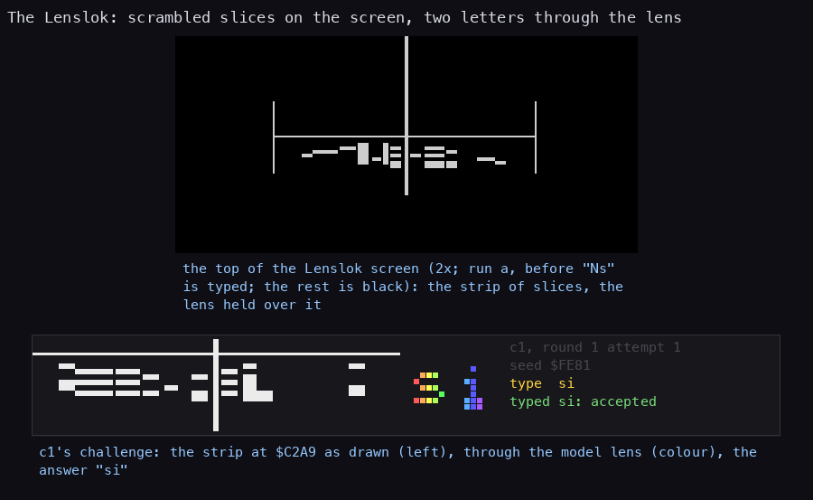
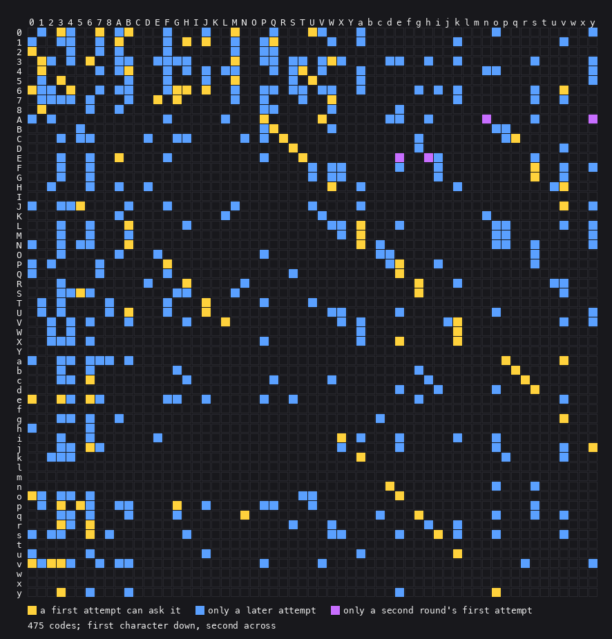

# Lenslok: every code Elite can ask for

When Elite starts, it shows two characters cut into thin strips and shuffled, so the screen looks like noise.
Through the Lenslok lens the strips fall back into place and the two characters can be read. The player types
them and the game starts. This page lists every pair the game can ever show. How it works inside:
[lenslok.md](lenslok.md).

**How to read it.** At the top, the real screen: a row of short white strips between two lines, which reads
as nothing. At the bottom, another code's strip (left) and the same strip as the lens rearranges it (the
coloured characters): "si". The player types "si" and the game starts.

## In short

- The game keeps no list of codes. It makes each code from a random number taken at the moment ENTER is
  pressed, so the same tape asks different codes on every load.
- **475** different codes are possible, out of 3422 two-character pairs.
- Right after loading only **96** of them can come up. The most frequent, "07", comes 4 times
  in 128.
- Upper or lower case does not matter when typing: "SI" is as good as "si".
- These characters never appear in a code: "I", "Y", "f", "l", "m", "t", "w", "x". Nor does the digit 9.
- 10 codes end in "g" or "q": "6g", "Cg", "Cq", "Dg", "Rg", "Sg", "bg", "bq", "eg", "qg". Through the lens the two
  letters look the same, because the game loses the bottom row of the second character (a bug of the original,
  [lenslok.md](lenslok.md) 4.4). The player can only guess; a wrong guess just brings a new code.
- After three wrong answers the game goes back to the screen where the lens width is set. After three more,
  the computer resets.

## The first code after loading (96 codes)

The first code depends only on the random number (128 values), so its chances can be counted exactly.
Each cell is a code and how many of the 128 values give it.

| Code | In 128 | Code | In 128 | Code | In 128 | Code | In 128 | Code | In 128 | Code | In 128 | Code | In 128 | Code | In 128 |
| --- | --- | --- | --- | --- | --- | --- | --- | --- | --- | --- | --- | --- | --- | --- | --- |
| `03` | 3 | `07` | 4 | `0B` | 1 | `0M` | 1 | `0U` | 1 | `1A` | 1 | `1H` | 1 | `1J` | 1 |
| `1Q` | 1 | `20` | 1 | `31` | 2 | `36` | 3 | `3M` | 1 | `3W` | 1 | `41` | 1 | `4B` | 1 |
| `4T` | 1 | `53` | 1 | `5M` | 1 | `5U` | 1 | `60` | 3 | `64` | 3 | `6G` | 1 | `6H` | 1 |
| `6J` | 1 | `6v` | 1 | `7E` | 1 | `7G` | 1 | `7W` | 1 | `81` | 1 | `AP` | 1 | `AV` | 1 |
| `BQ` | 1 | `CR` | 2 | `Cq` | 1 | `DS` | 1 | `EA` | 1 | `ET` | 1 | `Fs` | 3 | `Gs` | 2 |
| `HW` | 1 | `Hv` | 1 | `J5` | 1 | `Jv` | 1 | `LB` | 1 | `La` | 1 | `Ma` | 1 | `NB` | 1 |
| `Na` | 1 | `PF` | 1 | `Pe` | 1 | `Qe` | 1 | `RH` | 1 | `Rg` | 1 | `S5` | 1 | `Sg` | 2 |
| `TJ` | 1 | `UB` | 1 | `UJ` | 1 | `VL` | 2 | `Vk` | 1 | `Wk` | 1 | `Xe` | 2 | `Xk` | 1 |
| `ap` | 1 | `av` | 1 | `bq` | 1 | `c6` | 1 | `cr` | 2 | `ds` | 2 | `e0` | 1 | `e3` | 2 |
| `e6` | 2 | `gv` | 2 | `iX` | 2 | `j6` | 1 | `jy` | 1 | `ka` | 1 | `nd` | 1 | `o0` | 1 |
| `oe` | 1 | `p3` | 1 | `p5` | 1 | `pG` | 1 | `qN` | 1 | `qg` | 1 | `r3` | 1 | `r6` | 1 |
| `s6` | 2 | `si` | 3 | `uk` | 1 | `v0` | 3 | `v2` | 2 | `v3` | 1 | `y3` | 1 | `yo` | 2 |

## Every code the game can ask (475 codes)

A wrong answer brings a new code, made from the last one, so later attempts reach codes the first one
never asks. The codes are grouped by their first character.

| First | Codes |
| --- | --- |
| `0` | `01 03 04 07 0A 0B 0F 0J 0M 0Q 0U 0V 0a 0o 0y` |
| `1` | `10 13 14 17 1A 1F 1H 1J 1M 1P 1Q 1W 1a 1k 1v` |
| `2` | `20 24 27 2A 2F 2M 2P 2Q` |
| `3` | `31 32 34 36 3A 3B 3E 3F 3G 3H 3M 3P 3Q 3S 3T 3V 3W 3X 3d 3e 3h 3k 3s 3y` |
| `4` | `41 47 4A 4B 4F 4H 4J 4L 4M 4Q 4S 4T 4V 4a 4n 4o 4y` |
| `5` | `51 53 5B 5F 5J 5M 5S 5U 5a 5y` |
| `6` | `60 61 62 64 67 6A 6B 6F 6G 6H 6J 6M 6P 6Q 6S 6T 6V 6W 6a 6g 6i 6k 6s 6v` |
| `7` | `71 72 73 74 76 7B 7E 7G 7M 7P 7T 7W 7k 7s 7v` |
| `8` | `81 86 8A 8P 8Q 8W 8e` |
| `A` | `A0 A2 AF AL AP AV Ad Ae Ah An As Ay` |
| `B` | `B5 BP BQ BW Bo Bp` |
| `C` | `C3 C5 C6 CD CG CH CN CP CR Cg Cp Cq` |
| `D` | `DS Dg Dv` |
| `E` | `E3 E6 EA EF EP ET Ee Eh Ei Es` |
| `F` | `F3 F6 FU FW FX Fe Fi Fs Fv Fy` |
| `G` | `G3 G6 GU GW GX Gi Gs Gv` |
| `H` | `H2 H6 HA HD HW Ha Hk Hu Hv` |
| `J` | `J0 J3 J4 J5 JB JF JM JU Ja Jv Jy` |
| `K` | `KA KL KV Kn` |
| `L` | `L3 L6 LB LH LW LX La Le Lo Lp Lv Ly` |
| `M` | `M3 M6 MB MX Ma Mo Mp My` |
| `N` | `N0 N3 N5 N6 NB Na Nc No Np Ns Ny` |
| `O` | `O3 OA OE OP Oc Od Os` |
| `P` | `P0 P2 P7 PF Pd Pe Pi Ps` |
| `Q` | `Q0 Q7 QF QS Qe` |
| `R` | `R3 RD RH RN Rg Rk Ru Rv` |
| `S` | `S3 S4 S5 S6 SG SH SM Sg Sv` |
| `T` | `T1 T3 T8 TF TJ TP TU` |
| `U` | `U1 U3 U8 UB UF UJ UW UX Ue Uo Uy` |
| `V` | `V2 V4 V6 VB VH VL VX Va Vj Vk Vv Vy` |
| `W` | `W2 W4 Wa Wk` |
| `X` | `X2 X3 X4 X6 XP Xa Xe Xk` |
| `a` | `a0 a3 a4 a6 a7 a8 aB ap av` |
| `b` | `b3 b6 bG bg bq` |
| `c` | `c3 c4 c6 cH cQ cW ch cr` |
| `d` | `de di do ds` |
| `e` | `e0 e3 e4 e6 e7 eF eG eJ eP eS eg ev` |
| `g` | `g3 g4 g6 gA gc gv` |
| `h` | `h0 h6` |
| `i` | `i3 i6 iE iX ia ie ik io` |
| `j` | `j3 j4 j6 j7 jX je jo jv jy` |
| `k` | `k2 k3 k4 ka kp kv` |
| `n` | `nd no ns` |
| `o` | `o0 o1 o3 o4 o6 oT oU oe` |
| `p` | `p1 p3 p5 p6 pA pB pG pJ pP pQ pU ps` |
| `q` | `q3 q4 q6 qB qG qN qc qg qo qs qv` |
| `r` | `r3 r4 r6 rS rW rh rk` |
| `s` | `s0 s2 s3 s6 s8 sH sW sX se si sk so sv` |
| `u` | `u0 u6 uJ ua uk` |
| `v` | `v0 v1 v2 v3 v4 v7 vA vB vP vV vr vy` |
| `y` | `y3 y6 yB ye yo` |

**How to read it.** A square is a code: the first character is the row, the second the column. Amber
squares can come right after loading, blue ones only after a wrong answer, violet ones only in the
second round. Dark squares are pairs the game never shows; the empty rows and columns are the
characters it never uses.

## For the technically curious: which number gives which first code

The random number is the Z80's R register, read at `$C29A` when ENTER is pressed. Its top bit is always
set, so it takes 128 values, `$80-$FF`. The game also draws two random "marks" at the outer edges of the
code, which the lens never shows; they do not change the code.

| Number | Code | Number | Code | Number | Code | Number | Code |
| --- | --- | --- | --- | --- | --- | --- | --- |
| `$80` | `Sg` | `$A0` | `64` | `$C0` | `gv` | `$E0` | `7E` |
| `$81` | `si` | `$A1` | `BQ` | `$C1` | `3W` | `$E1` | `Pe` |
| `$82` | `UJ` | `$A2` | `bq` | `$C2` | `Jv` | `$E2` | `pG` |
| `$83` | `VL` | `$A3` | `07` | `$C3` | `jy` | `$E3` | `1H` |
| `$84` | `v3` | `$A4` | `ET` | `$C4` | `60` | `$E4` | `S5` |
| `$85` | `Xk` | `$A5` | `e0` | `$C5` | `Ma` | `$E5` | `s6` |
| `$86` | `v0` | `$A6` | `Gs` | `$C6` | `81` | `$E6` | `41` |
| `$87` | `yo` | `$A7` | `HW` | `$C7` | `03` | `$E7` | `Vk` |
| `$88` | `07` | `$A8` | `53` | `$C8` | `PF` | `$E8` | `v0` |
| `$89` | `CR` | `$A9` | `6v` | `$C9` | `p5` | `$E9` | `Xe` |
| `$8A` | `cr` | `$AA` | `AV` | `$CA` | `36` | `$EA` | `qN` |
| `$8B` | `31` | `$AB` | `ka` | `$CB` | `Sg` | `$EB` | `y3` |
| `$8C` | `Fs` | `$AC` | `0B` | `$CC` | `si` | `$EC` | `1Q` |
| `$8D` | `5U` | `$AD` | `e3` | `$CD` | `6J` | `$ED` | `Cq` |
| `$8E` | `64` | `$AE` | `nd` | `$CE` | `VL` | `$EE` | `c6` |
| `$8F` | `gv` | `$AF` | `36` | `$CF` | `v2` | `$EF` | `4T` |
| `$90` | `iX` | `$B0` | `Qe` | `$D0` | `0M` | `$F0` | `Fs` |
| `$91` | `07` | `$B1` | `qg` | `$D1` | `p3` | `$F1` | `64` |
| `$92` | `LB` | `$B2` | `6H` | `$D2` | `yo` | `$F2` | `7W` |
| `$93` | `20` | `$B3` | `TJ` | `$D3` | `36` | `$F3` | `av` |
| `$94` | `Na` | `$B4` | `s6` | `$D4` | `CR` | `$F4` | `iX` |
| `$95` | `EA` | `$B5` | `03` | `$D5` | `cr` | `$F5` | `1A` |
| `$96` | `oe` | `$B6` | `Wk` | `$D6` | `60` | `$F6` | `La` |
| `$97` | `6G` | `$B7` | `v0` | `$D7` | `Fs` | `$F7` | `31` |
| `$98` | `RH` | `$B8` | `Xe` | `$D8` | `e6` | `$F8` | `e6` |
| `$99` | `r6` | `$B9` | `AP` | `$D9` | `03` | `$F9` | `ds` |
| `$9A` | `07` | `$BA` | `ap` | `$DA` | `Hv` | `$FA` | `o0` |
| `$9B` | `si` | `$BB` | `60` | `$DB` | `J5` | `$FB` | `7G` |
| `$9C` | `uk` | `$BC` | `DS` | `$DC` | `j6` | `$FC` | `Rg` |
| `$9D` | `3M` | `$BD` | `ds` | `$DD` | `4B` | `$FD` | `r3` |
| `$9E` | `v2` | `$BE` | `0U` | `$DE` | `e3` | `$FE` | `1J` |
| `$9F` | `5M` | `$BF` | `Gs` | `$DF` | `NB` | `$FF` | `UB` |

This page is generated by `python3 tools/fig_lenslok_atlas.py` from `tools/lenslok_sim.py enumerate`,
which runs the game's own code in a Z80 simulator over every state the code maker can be in. Edit the
script, not the page.
