# Lenslok: the lens, the screen and the code

Elite's second protection runs after the tape ([03](03-build-and-load.md) 3.7). The game draws two characters cut
into vertical slices and shuffled, and the player reads them through a plastic lens that came in the box. This
article covers the lens, the picture, the code that draws and checks it, every code it can ask (with an atlas of
the challenges), how to answer it with no lens, the history, and how `ELITE48.TAP` gets past it.

All frame numbers are from `c1`: Side A at signal speed with the fast-load trap off (`tools/capture_real_rom.py`,
[03](03-build-and-load.md) 3.9), input `tests/inputs/c1-lenslok.txt`. Addresses are those of the pre-kickoff image,
where the Lenslok code lives at `$C213-$C7FF` until `Kickoff` copies the game over it. Inferences are marked
*inference*.

## 1. What the player does

The box held a folded plastic holder with a lens strip and a sheet of instructions, in two printings (ZXDB's
`Elite_LenslokInstructions.pdf`, both pages):

1. After the load, press ENTER (first printing only). Three vertical lines appear.
2. Lay the unfolded holder flat between the two outer lines. Keys 5 and 8 move the outer lines until they are as
   far apart as the holder is long (second printing: about 5 mm outside each end).
3. Fold the holder into a small table with the lens on top. Stand it on the screen with the lens's centre line over
   the screen's centre line. Close one eye and look straight through the lens. "OK" should appear.
4. Fine-tune with 5 and 8 until "O" and "K" are clear. The second printing adds: "The 'O' will almost definitely be
   clear, but the 'K' may take some adjusting".
5. Press ENTER. Two new characters appear. Type them.
6. A wrong answer gives two new characters. After three attempts, the first printing says the computer resets. The
   second printing says it returns to the size screen for three more attempts, and then resets. The code does what
   the second printing says (4.1).

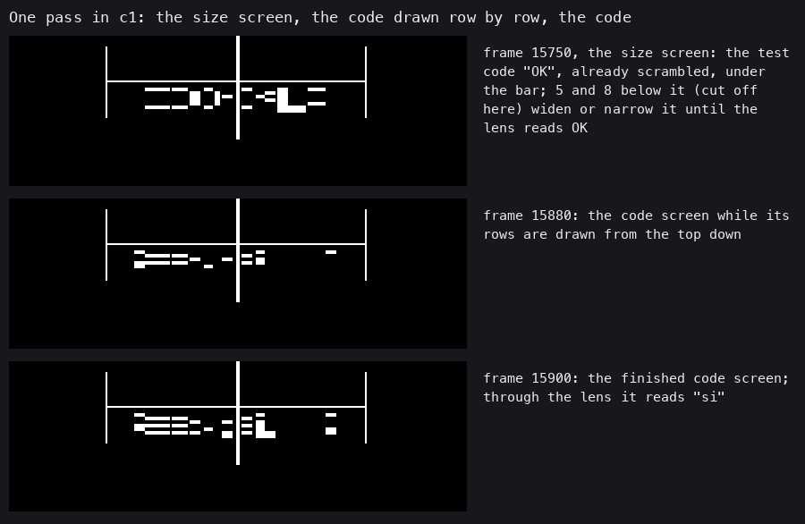

**How to read it.** Real frames of `c1`, top to bottom, the top of each screen at 2x:
- **15750:** the size screen. Under the bar is the test code "OK", already scrambled.
- **15880:** the code screen while its rows are drawn from the top down.
- **15900:** the finished code screen. Through the lens it reads "si".

```bash
python3 tools/fig_lenslok.py     # -> docs/img/lenslok/steps, optics, unscramble, model (.png), slide, width (.gif)
```

## 2. The optics

The lens is a row of thin prisms side by side. Each prism turns the line of sight sideways by its own angle. The eye
looking through prism i sees a narrow strip of screen that need not be under prism i. The game draws column i of the
code in that strip, and the lens puts the columns back side by side. Without the lens, the screen shows the columns
in a shuffled order and at uneven widths, and no character can be read.

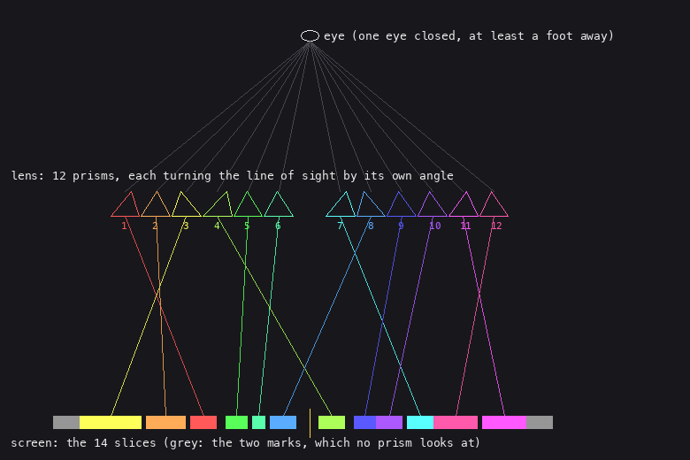

**How to read it.** The eye at the top looks down through the 12 prisms; each coloured line runs from a prism to the
slice of the screen it sees, the grey slices are the marks. *inference:* the figure is a schematic. The case has no lens
to measure (`python3 tools/fig_lenslok.py` draws it from the slice table). The prism positions and angles are not known.
What the figure shows comes from the code: which screen slice each column of the code is drawn into (4.3), and that no
prism may look at the two outer mark slices. The slice widths grow towards the ends, as prisms that bend further would
see a wider strip. This is consistent with the geometry but not proven by it.

Two things follow from the optics and explain the size screen.
- The slices are placed in fixed fractions of the calibrated width, so the picture scales with the TV. The size
  screen measures the TV in screen pixels with the holder as the ruler.
- The lens works only when its centre stands on x = 128 and the eye is straight above it. Moved a few pixels, every
  prism looks at the wrong strip (the GIF below).

## 3. What the game draws

### 3.1 The slices

The table at `$C7B6` describes the picture.
- Byte +0 is the scale: the calibrated width div 11. The size screen stores it; the image holds 13, for the default
  width 144.
- Bytes +1 to +28 are 14 pairs (start, end) in tenths of the scale, signed, measured from the centre line x = 128.
- Bytes +29 to +40 are the permutation.

Slice 1 and slice 14 are the marks: each row of them shows one bit of a random byte. The 12 slices between them carry
the code. At the default width (scale 13) the slices are:

| Slice | Holds | Tenths | x, width (px) |
| ---: | --- | --- | --- |
| 1 | mark 1 | -45 .. -40 | 70, 6 |
| 2 | column 3 | -40 .. -29 | 76, 14 |
| 3 | column 2 | -29 .. -22 | 91, 9 |
| 4 | column 1 | -21 .. -16 | 101, 6 |
| 5 | column 5 | -15 .. -11 | 109, 5 |
| 6 | column 6 | -10 .. -7 | 115, 3 |
| 7 | column 8 | -7 .. -2 | 119, 6 |
| 8 | column 4 | 2 .. 7 | 130, 6 |
| 9 | column 9 | 8 .. 12 | 138, 5 |
| 10 | column 10 | 12 .. 17 | 143, 6 |
| 11 | column 7 | 17 .. 22 | 150, 6 |
| 12 | column 12 | 22 .. 30 | 156, 10 |
| 13 | column 11 | 30 .. 38 | 167, 10 |
| 14 | mark 2 | 38 .. 43 | 177, 6 |

Columns 1-6 are the first character, 7-12 the second. Each glyph comes from the ROM font: its 8 rows, columns 1 to 6
(column 0 is always blank in the ROM font; `SRA` drops column 7). One row of the code is a band 20 % of the scale high
(2 pixels at scale 13), drawn from the bar downwards.

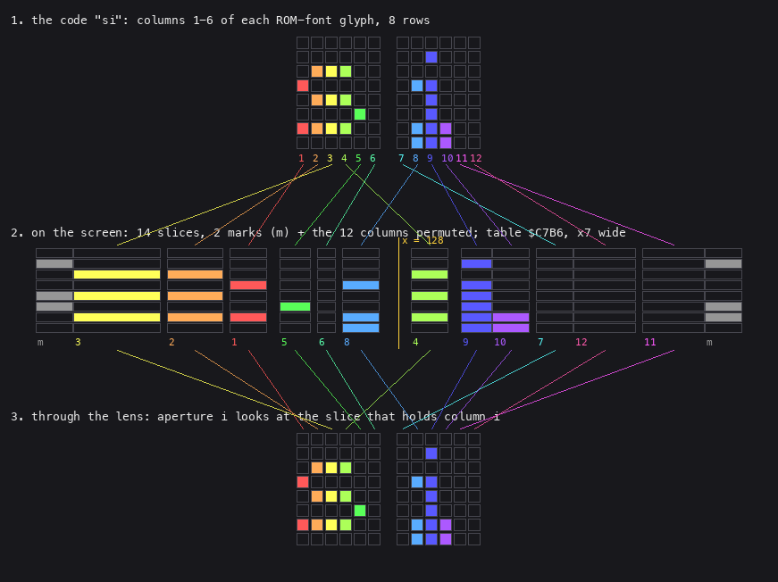

**How to read it.** The code "si" of `c1` in the model of `tools/lenslok.py`, top to bottom:
- **Panel 1:** the twelve glyph columns, each in its own colour.
- **Panel 2:** the slices they are drawn into, at four times the screen width.
- **Panel 3:** what the lens puts back.

### 3.2 One row, worked

Row 2 of "si": the "s" has columns 2-4 lit, the "i" none. Mark 1 is `$32` and mark 2 is `$62`; bit 2 of each is 0.

| Step | Bits (column or slice 1 first) |
| --- | --- |
| glyph columns 1-12 | `011100 000000` |
| column 2 to slot 2, column 3 to slot 1, column 4 to slot 7 | slots 1-12 `110000100000` |
| with the marks (slice 1, slices 2-13, slice 14) | `0 110000100000 0` |
| slices lit | 2 (x 76, 14 px), 3 (x 91, 9 px), 8 (x 130, 6 px) |

### 3.3 Model against emulator

`tools/lenslok.py draw si --marks 32,62` draws the screen from the tables and the ROM font. It matches the emulator's
frame 15900 pixel for pixel (798 pixels lit above the prompt line, 0 differ). Two quirks of the code had to go into the
model before it matched (4.4): the gaps of one pixel between some slices (each slice's start and width are rounded
down separately), and the bottom row of the second character, which repeats its row 6.

**How to read it.** Top left the emulator's frame, top right the model's, both cropped to the strip; below, the two
overlaid at a larger scale: white where both are lit, red or green where only one is (there is none of either).

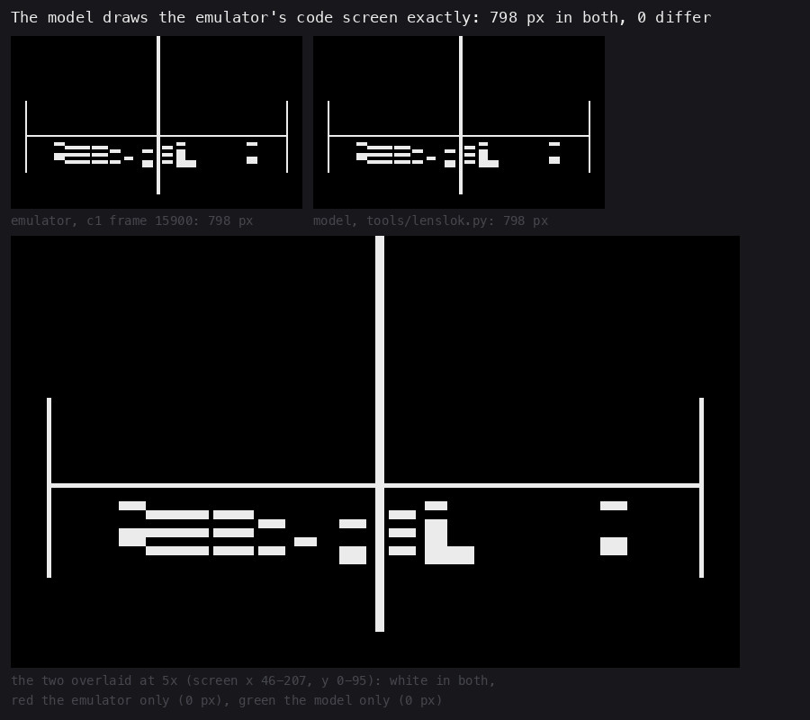

### 3.4 The lens out of place

**How to read it.** The model lens moved sideways over the real frame 15900. The coloured boxes are the strips the 12
prisms look at. Below them is what the eye sees. Only at 0 px does it read "si". One pixel off already cuts strokes,
because the narrowest slice is 3 pixels wide.

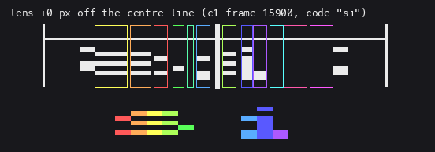

**How to read it.** The second animation keeps the lens fixed. The screen is drawn as the code would draw it for other
calibrated widths, from 80 to 200 pixels. This is why the size screen exists: a lens made for one picture size reads
nothing on another.

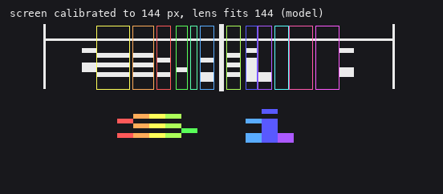

```bash
python3 tools/fig_lenslok.py     # -> model.png, slide.gif, width.gif (with the figures of 1-2)
```


## 4. The code

The Lenslok code is entered from `Kickoff` with `CALL $C213` and returns only on success. Its routines:

| Address | Name | Job |
| --- | --- | --- |
| `$C213` | Lenslok | rounds: a size screen and up to three attempts, then "WRONG - TRY AGAIN" or a reset |
| `$C25D` | LensRound | the size screen, the scale, then the attempt loop |
| `$C414` | SizeScreen | the bracket, the test code "OK", keys 5 / 8 / ENTER |
| `$C4D0` | Bracket | the two posts and the bar |
| `$C2C9` | DrawCode | the centre line, then 8 rows: GlyphRow, Scramble, DrawRow |
| `$C6E6` | GlyphRow | one row of both characters' glyphs into a 12-bit buffer |
| `$C733` | GlyphGather | the row bytes of the code's characters from the ROM font |
| `$C59C` | Scramble | 14 bits: mark 1, the 12 columns in slot order, mark 2 |
| `$C303` | DrawRow | the 14 slices of one row |
| `$C3DF` | FillBlock | one slice of one row, as vertical lines |
| `$C37C` | SetMarks | the two mark bytes |
| `$C6A6` | PickCode | two new characters |
| `$C54B` | PickChar | one character: a digit, an upper- or a lower-case letter |
| `$C519` | IsExcluded | is A in the set at `$C7A9` |
| `$C68E` | Rand | the generator |
| `$C608` | AskCode | "ENTER CODE:", two keys or a timeout |
| `$C664` | CheckCode | the typed pair against the code |
| `$C727` | PrintInline | print the string after the CALL up to `^` |

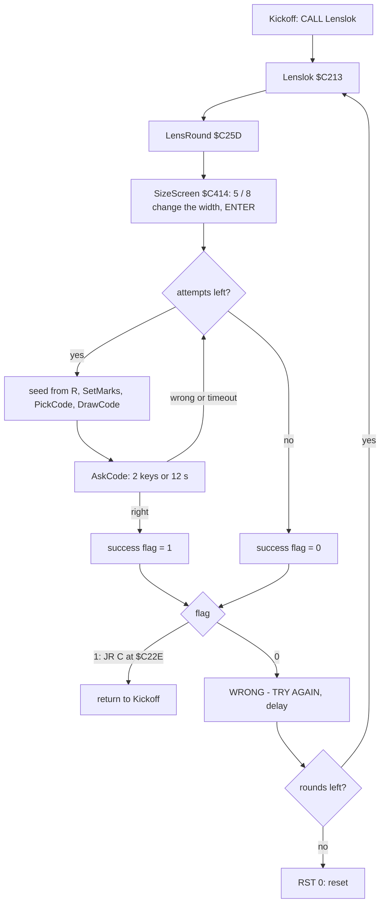

### 4.1 The rounds

Two counters drive the rounds. `$C78A` (rounds, 2 in the image) is never set again, so a second pass through
`Lenslok` counts it down to 0 and resets. `$C77E` (attempts) is set to 4 and decremented before each attempt, which
gives three. The success flag `$C781` is the only result; `Lenslok` tests its bit 0 with `RR A`, `JR C`.

```asm
Lenslok:      ld ix,LensTable       ; $C7B6
              ld iy,$5C3A
              ld a,$02
              call $1601            ; CHAN-OPEN: the screen
              call $0D6B            ; CLS
              call LensRound
              call AtRow20
              ld a,(LensPassed)     ; $C781
              rr a
              jr c,LensDone         ; $C22E: ELITE48.TAP makes this JR
              call PrintInline
WrongText:    defm "  WRONG - TRY AGAIN   ",$5E
              ld hl,$0000
LensDelay:    dec hl
              ld a,h
              or l
              jr nz,LensDelay
              ld a,(LensRounds)     ; $C78A
              dec a
              ld (LensRounds),a
              jr nz,Lenslok
              rst $00
LensDone:     ret
```

```asm
LensRound:    call LensClear
              ; ...
              call SizeScreen       ; A = the width
              ; ...
              call LensDiv          ; BC = width div 11
              ld (ix+$00),c         ; the scale
              call SetMarks
              ; ...
              ld a,$04
              ld (LensAttempts),a   ; $C77E
LensAttempt:  ld a,(LensAttempts)
              dec a
              ld (LensAttempts),a
              jr z,LensFailed
              call LensClear
              call Bracket
              ld a,r
              ld h,a
              ld a,r
              ld l,a
              ld (LensSeed),hl      ; $C784
              call SetMarks
              call PickCode
              call DrawCode
              call AskCode
              jr c,LensAttempt
              ld a,$01
              ld (LensPassed),a
              jr LensRoundEnd
LensFailed:   xor a
              ld (LensPassed),a
LensRoundEnd: ret
```

```text
rounds = 2
repeat:
    width = size_screen()
    scale = width div 11
    passed = false
    for attempt in 1 .. 3:
        seed = (R, R)                      the refresh register, read twice
        marks = two random bytes
        code = pick_code()
        draw(code, marks, scale)
        if ask_code() == code: passed = true; break
    if passed: return
    print "WRONG - TRY AGAIN"; wait
    rounds -= 1
until rounds == 0
reset
```

### 4.2 The generator and the code

`Rand` keeps one byte, the low byte of `$C784`. Each call adds `$31` (49) and returns the new value mod n. The seed
is the refresh register R read twice, at the moment the attempt starts. R counts instructions, so the seed depends on
how long the player took on the size screen, to the instruction. It cannot be known from the image. Bit 7 of R is
not counted, though: the decryptor set it with `LD R,$FF` ([03](03-build-and-load.md) 3.6), so the state always
starts at `$80-$FF`.

```asm
Rand:         push hl
              push bc
              ld hl,(LensSeed)
              ld de,$0031
              add hl,de
              ld h,$00
              ld (LensSeed),hl
              ld b,a
              ld a,l
              ccf
RandMod:      sub b
              jr nc,RandMod
              add a,b
              pop bc
              pop hl
              ret
```

```text
rand(n):
    state = (state + 49) mod 256
    return state mod n
```

`PickChar` draws three candidates and then picks one of them.
- A digit is `Rand(9) + '0'`, so 0-8; 9 never appears.
- An upper-case letter is `Rand(25) + 'A'`, so A-Y.
- A lower-case letter is `Rand(25) + 'a'`, so a-y.
- Each candidate is drawn again while `IsExcluded` finds it in the set at `$C7A9`.
- Then `Rand(3)` picks one of the three.

`PickCode` draws two characters, each again while it is in the previous code (`$C79D`) or in the code being built
(`$C799`). Before the first attempt `$C799` still holds "OK" from the size screen, so O and K can never be the first
code.

```asm
PickChar:     ld a,$07              ; all three kinds
              ld b,$00
              ld hl,LensCandidates  ; $C78D
              ; ...
PickDigit:    ld a,$09
              call Rand
              add a,$30
              call IsExcluded
              jr z,PickDigit
              ld (hl),a
              inc b
              inc hl
              ; ...                 the same with 25, $41 and with 25, $61
PickNth:      ld a,b
              call Rand             ; one of the B candidates
              inc a
              ld hl,LensTimeout+$0001 ; LensCandidates - 1
              ld b,a
PickNthLoop:  inc hl
              djnz PickNthLoop
              ld a,(hl)
              ret
```

```text
pick_char():
    digit = draw rand(9) + '0' until not excluded
    upper = draw rand(25) + 'A' until not excluded
    lower = draw rand(25) + 'a' until not excluded
    return [digit, upper, lower][rand(3)]

pick_code(previous, current = "OK"):
    marks = (rand(128) AND $FE, rand(128) AND $FE)       SetMarks, before PickCode
    for k in 0, 1:
        repeat c = pick_char() while c in previous or c in current
        current[k] = c
    previous = current
```

The `c1` attempt, worked. The seed is `$FE81`, so the state starts at `$81`:

| Draw | n | state | result | meaning |
| ---: | ---: | --- | ---: | --- |
| 1 | 128 | `$B2` | 50 | mark 1 = `$32` |
| 2 | 128 | `$E3` | 99 | mark 2 = 98 = `$62` |
| 3 | 9 | `$14` | 2 | digit "2" |
| 4 | 25 | `$45` | 19 | upper "T" |
| 5 | 25 | `$76` | 18 | lower "s" |
| 6 | 3 | `$A7` | 2 | the lower: **s** |
| 7 | 9 | `$D8` | 0 | digit "0" |
| 8 | 25 | `$09` | 9 | upper "J" |
| 9 | 25 | `$3A` | 8 | lower "i" |
| 10 | 3 | `$6B` | 2 | the lower: **i** |

`tools/lenslok_answer.py FE81` prints `si marks $32 $62 10 draws`. The code `c1` typed is "si", and the game took
it: `CheckCode` ran at frame 16075 and returned NC.

### 4.3 The scramble

`Scramble` builds a row's 14 bits in a 3-byte shift buffer. It first shifts in the row's bit of mark 1 (it rotates
the mark byte right, one bit per row). Then, for output slot k = 1 to 12, it searches the permutation at `$C7B6`+29
for the k and shifts in that glyph column's bit. Last it shifts in mark 2's bit. The permutation's index is read
through `LD A,(IX+d)` at `$C374`, whose displacement byte `$C376` the code increments in place.

```asm
Scramble:     ld a,(LensMark1)      ; $C77F
              rr a
              ld (LensMark1),a
              call SlotShift1       ; mark 1's bit for this row
              ld b,$01              ; slot k
ScrambleSlot: push bc
              ld bc,$0003
              ld hl,RowBits
              ld de,RowCopy
              ldir                  ; the row's 12 glyph bits copied
              ld a,$1D              ; IX+29: the permutation
              ld (PermIndex+$0002),a ; $C376: the displacement of the LD at PermIndex
              pop bc
              push bc
              ld c,$01              ; glyph column c
ScrambleFind: call PermIndex        ; LD A,(IX+d), then INC d
              cp b
              jr z,ScrambleCopy
              inc c
              jr ScrambleFind
ScrambleCopy: ld a,c
              ld hl,RowCopy+$0002
              call ShiftLeft3       ; brings column c's bit out
              call SlotShift1
              pop bc
              inc b
              ld a,$0D
              cp b
              jr nz,ScrambleSlot
              ; ...                 mark 2's bit, then 10 more shifts to align
              ret
```

```text
scramble(columns[1..12], row):
    out = [bit row of mark1]
    for slot in 1 .. 12:
        c = the column with perm[c] == slot           perm = 3 2 1 7 4 5 10 6 8 9 12 11
        out += [columns[c]]
    out += [bit row of mark2]
    return out                                        out[j] lights slice j + 1
```

### 4.4 A bug in the original, and the slice edges

**The glyph gather overruns.** `GlyphGather` copies the code's row bytes into a buffer at `$C7A5` meant for 4 bytes.
Its loop counter is the row loop's counter `B`, which counts down from 8, so on row r it copies 8 - r bytes. These are
the font bytes of row r of the characters at `$C799` onwards: the code, two zero bytes, the previous code (`$C79D`,
which `PickCode` has just set to the code itself), two more zero bytes. Bytes 4 to 7 land on `$C7A9-$C7AC`, the first
four characters of the excluded set "TLWMIYfmwtzl" (`$5E`, `^`, ends it). Each keeps the byte of the last row that
reached it:

| Set byte | Last written on row | Holds |
| --- | ---: | --- |
| `$C7A9` ("T") | 3 | row 3 of the previous code's first character |
| `$C7AA` ("L") | 2 | row 2 of its second character |
| `$C7AB` ("W") | 1 | row 1 of character 0 (a ROM byte below the font, `$3C00` + row) |
| `$C7AC` ("M") | 0 | row 0 of character 0 |

Three effects follow.
- "T", "L", "W" and "M" are never kept out after the first drawing; the size screen's "OK" already overwrites them.
  The worked example depends on it: with the whole set, draw 4's "T" would be drawn again and the answer would be
  "2H", not the "si" the game asked for.
- The two font bytes are sometimes letters or digits, and then that character is kept out of the next code. Row 3
  of "A", "D", "O", "P", "Q", "R", "U", "V" or "W" is `$42`, "B". Row 3 of "i" or "k" is `$30`, "0". Row 2 of "a",
  "e", "o", "s" or "t" is `$38`, "8". So the excluded set changes from one attempt to the next.
  `tools/lenslok_sim.py` runs the real code and models this exactly. `tools/lenslok_answer.py` models only the first
  attempt of a load, where the previous code is empty.
- On row 7 only one byte is copied, so the second character's bottom row still holds its row 6. On row 7 of "si",
  the "i" shows `011100` in place of `000000` (panel 1 above). Row 7 is the only row where "g" and "q" differ, so
  as a second character they draw the same pixels: "Sg" and "Sq" give identical screens. 10 of the 475 codes end in
  "g" or "q" (5.2), and the player can only guess which one was meant.

*inference:* the set was meant to keep out characters that read badly through the lens (I, Y, l against 1, T and L
whose bars fall into one slice). With the overrun only the last eight are reliably kept out.

**The slice edges.** These are not a bug, but they are easy to mistake for one. `DrawRow` scales each slice's start
and its width from the tenths separately, dividing each by 10 and dropping the remainder. The table also leaves a
tenth between some slices (-22 and -21, -16 and -15, -11 and -10, 7 and 8). At width 144 the pixels between the
slices are x 90, 100, 107-108, 114, 118, 136-137, 149 and 166, plus 125-129 around the centre line. These are the
dark gaps in the screens, and the model reproduces each of them.

### 4.5 The question and the answer

`AskCode` prints "ENTER CODE:" on line 20. It then waits up to 600 frames (`$0C` × `$32`, 12 seconds) with `HALT`
for two keys, echoing them with `RST $10`. A timeout counts as a wrong answer. `LensRound` turned caps lock on
(FLAGS2 bit 3), so letters arrive in upper case. `CheckCode` compares each typed key with the code, and a second time
plus `$20`, so an upper-case key also matches a lower-case code character: the case of the code does not matter. Keys come from the ROM's interrupt scan (FLAGS bit 5, LAST_K). With the interrupts off, as the
fast-load trap leaves them in an emulator, no key ever arrives ([03](03-build-and-load.md) 3.9).

```asm
CheckCode:    ld hl,LensCode        ; $C799
              ld de,LensTyped       ; $C7A1
              ld b,$02
CheckNext:    ld a,(de)
              inc de
              cp (hl)
              jr z,CheckOK
              add a,$20
              cp (hl)
              jr nz,CheckBad
CheckOK:      inc hl
              djnz CheckNext
              and a                 ; NC: right
              ret
CheckBad:     scf                   ; C: wrong
              ret
```

## 5. Every code it can ask

### 5.1 No table, a generator with few states

Elite has no list of challenges. A challenge (the code and the two mark bytes) is made at `$C2A0-$C2A8` from three
inputs, and nothing else is read:

- **The generator byte.** The second `LD A,R` at `$C29A` becomes the low byte of the seed. Bit 7 is always set
  (3.6 of [03](03-build-and-load.md)), so there are 128 values, `$80-$FF`.
- **The code buffers.** `$C799` holds the code being built: "OK" at the start of a round, the last code later.
  `$C79D` holds the previous code.
- **The excluded set.** Its first two bytes depend on the previous code (4.4).

The last two depend only on the previous code X. So the challenge maker has three kinds of state:

| State | When | Built how |
| --- | --- | --- |
| first | the first attempt of a load | `c1`'s memory at `$C2A0`, frame 15868 (empty previous code, "OK" drawn) |
| later after X | the second and third attempt of a round | X drawn by DrawCode, X in `$C799` and `$C79D` |
| second round after X | the first attempt of the second round | the size screen's ShowOK has drawn "OK", X in `$C79D` |

`tools/lenslok_sim.py enumerate` walks all of them breadth first. It runs the game's own SetMarks and PickCode
(`$C2A0-$C2A5`) in skoolkit's Z80 simulator for every state and every byte `$80-$FF`. Each new code adds its two
states, which it builds by running DrawCode and ShowOK on the memory the challenge left. Nothing is sampled. The walk
ends when no state yields a new code.

The simulator is checked against the emulator twice:
- Seed `$FE81` from `c1`'s memory draws frame 15900 exactly (798 pixels, 0 differ).
- The three first attempts of the live runs (5.4) give the codes and screens the emulator showed: "60", "yo" and "AV", 0 pixels differ on each screen.

### 5.2 The numbers

| | Count |
| --- | ---: |
| states of the challenge maker | 951 |
| challenges (state × byte) | 121 856 |
| codes any attempt can ask | **475** |
| codes a first attempt can ask (of 128 bytes) | 96 |
| first-attempt codes that only a byte `$00-$7F` would give (kept out by bit 7) | 52 |
| possible pairs of the alphabet (59 characters, no repeat) | 3422 |

The alphabet has 59 characters: digits 0-8, A-Y and a-y. Some codes no state can give, because the generator has
only 128 starting points and the excluded set and the "not in the previous code" rule thin them further. The full
list is generated in [lenslok-codes.md](lenslok-codes.md). Below, every code is placed by its first character (down)
and its second (across).

**How to read it.** A square is a code: amber if a first attempt can ask it, blue only a later attempt, violet only a
second round's first attempt; dark if no state gives it.

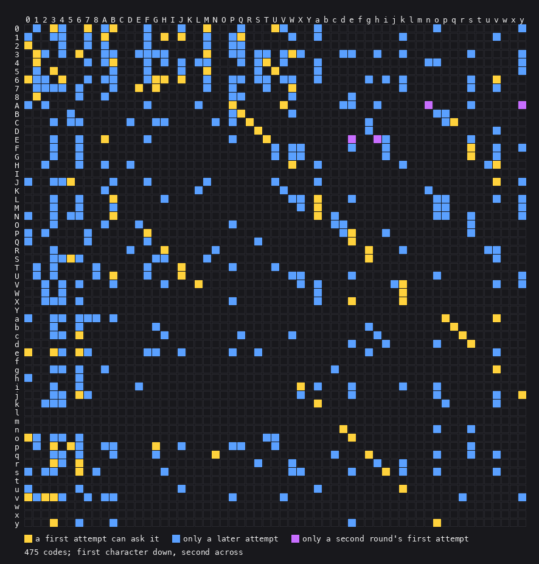

```bash
python3 tools/lenslok_sim.py enumerate    # all states and challenges -> work/atlas
python3 tools/fig_lenslok_atlas.py        # -> codes.png, atlas-1/2.png, atlas-live.png, wrong.gif, accepted.gif
```

What the matrix shows:
- **Empty rows and columns.** The characters I, Y, f, l, m, t and w appear in no code: they are the excluded set
  that the overrun leaves in place, "IYfmwtzl" (its z is outside the alphabet anyway).
- **No "x" either.** x is not in the set, but no challenge of the 121 856 gives it. Running `pick_char` with that set over all
  256 generator states shows why. Only four states (`$53`, `$6C`, `$84`, `$9D`) give "x" as the lower-case candidate. In
  each of them the next `Rand(3)` picks the digit or the upper-case letter. A step of 49 mod 256 ties the three draws
  to each other, so this is fixed, not chance.
- **The g / q codes.** 10 codes end in "g" or "q": 6g, Cg, Cq, Dg, Rg, Sg, bg, bq, eg and qg. Through the lens their
  second character is either letter (4.4). Five of them can be a first code, from 6 of the 128 bytes (`$80` Sg, `$A2`
  bq, `$B1` qg, `$CB` Sg, `$ED` Cq, `$FC` Rg). So in about one load in 21, even a perfectly read lens leaves the
  player a coin toss. Over all states 5 242 of the 121 728 reachable challenges (4.3 %) end in g or q.

### 5.3 The atlas of first attempts

For each of the 128 bytes a first attempt can start from, each cell shows:
- the byte;
- the screen as the game's DrawCode draws it at width 144 (simulator, equal to the emulator, 5.1);
- what the model lens shows, each glyph column in its colour;
- the code to type;
- the read-back check.

The check reads each lens view like the eye would. It samples the 12 columns at the centre of the slices the lens
looks at, and matches each half against all 62 glyphs of the ROM font (0-9, A-Z, a-z), over all 8 rows as the game
draws them (row 7 of the second character is its row 6, 4.4). It passes when each half matches exactly one glyph and
that glyph is the code's character. **Result: 122 of 128 first-attempt challenges and 13 of 13 live ones pass**
(`python3 tools/lenslok_sim.py check`, `work/atlas/check.json`).

The other 6 are the g / q codes of 5.2. In each of them the lens reads the first character right, and the second
matches both "g" and "q", the code's character among them. The atlas marks them amber, "(row 7)". No cell reads a
wrong character: the model lens never contradicts the code.

**How to read it.** A cell a byte `$80-$FF`: the byte, the screen DrawCode draws, the model lens's view with each glyph
column in its colour, the code to type, and the read-back (amber for the g / q cells).

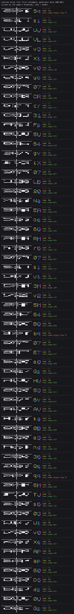

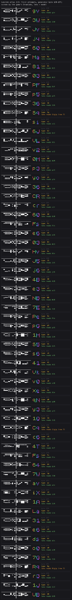

### 5.4 In the emulator

`tools/lenslok_live.py` gives 13 real challenges, never patching the game.
- **Branching.** Each run seeks `c1` to frame 15760 (the size screen) and makes the history live there with
  `time_travel resume`. It then presses ENTER after 0, 7 or 13 frames. One frame later moves R by `$24`, so the
  seeds differ.
- **Answers.** A wrong answer is "99": `Rand(9)` never gives the digit 9. A right answer is computed by running the
  game's code in the simulator on the memory saved at `$C2A0`; it is not read from `$C799`.
- **The three runs:**
  - Run a: five wrong answers, then the computed one: accepted.
  - Run b: six wrong answers, two rounds, then the reset (RST 0).
  - Run c: the computed answer at once: accepted.

**How to read it.** The sheet shows each real frame at `$C2A9`, with `c1`'s own challenge first: under each, the lens
view, the code, what was typed and what the game did.

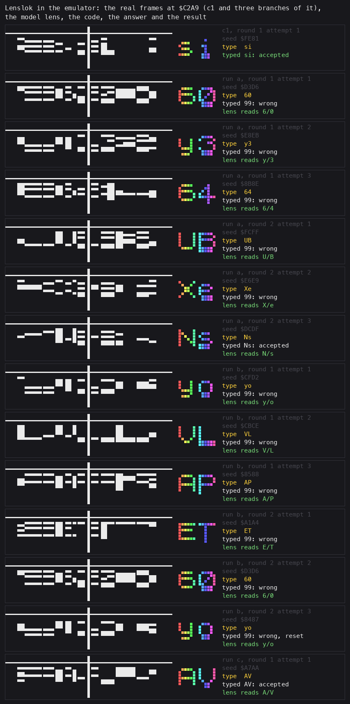

**How to read it.** A wrong answer: "99" is typed, the screen clears and a new code is drawn (run a, attempt 1 to attempt 2, real
frames every 2 frames):

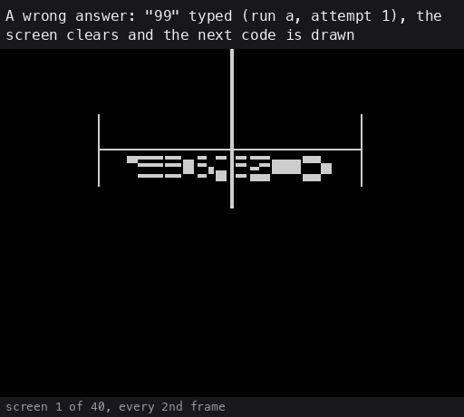

**How to read it.** The computed answer "Ns" (run a, second round, attempt 3), real frames every 2 frames: the game
takes it and starts:

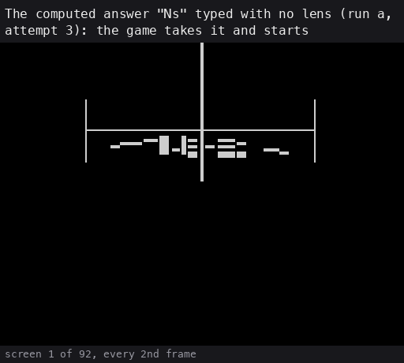

### 5.5 Answering without the lens

The answer is fixed once the seed is written to `$C784` at `$C29D`, and the code above computes it with no other
input. Over the WebAPI or MCP:

1. Run to `$C2A0` (`run_until_pc`).
2. Read the 64 KB memory.
3. Run `tools/lenslok_sim.attempt` on it, which runs `$C2A0-$C2A8` in the simulator. For a first attempt the seed
   alone is enough: `python3 tools/lenslok_answer.py FE81` answers "si".

Reading `$C799-$C79A` after the drawing gives the same two characters. The models exist to explain them and to list
them all, not because the reading is hard. The game is never patched.

## 6. History

*Sources: Wikipedia's Lenslok article, the Crash article it cites, ZXDB's instruction sheet. Nothing here was
checked against other primary sources.*

- Lenslok was designed by John Frost and marketed in 1985 by ASAP Developments, a company of J Rothschild Holdings.
  The sheet's footer says "LENSLOK IS A TRADEMARK OF A.S.A.P. DEVELOPMENTS".
- Firebird's Elite was the first Spectrum game to use it. Wikipedia lists ACE (Cascade), Advanced Music System
  (Firebird), Fighter Pilot, Tomahawk and TT Racer (Digital Integration), Graphic Adventure Creator and Moon Cresta
  (Incentive), Jewels of Darkness and OCP Art Studio (Rainbird), The Price of Magik (Level 9) and Supercharge
  (Digital Precision).
- The problems Wikipedia reports: the lens had to suit the TV's size and the viewing position, and many players
  could not get a readable picture. Some games shipped with the wrong lens, so they could not be started at all
  (Crash, "Lok-ed Out", https://spectrumcomputing.co.uk/page.php?issue_id=993&page=9). The second printing of the
  instruction sheet, with photographs, a 5 mm margin, "sway your head" and a second round of attempts, reads as an
  answer to those complaints (*inference*).
- Later Elite releases dropped Lenslok. Simon Owen's LensKey shows a Lenslok screen through a software lens.

## 7. The crack: `ELITE48.TAP`

`ELITE48.TAP` (the tape `elite-skoolkit` describes) loads with no Softlock and no decryption. Its BASIC:

```text
1 BORDER 0: INK 0: PAPER 0: CLEAR 65448: PRINT AT 21,11;"LOADING"; AT 0,0
2 LOAD "" CODE
3 RANDOMIZE USR 65449
```

The CODE block is 37 bytes at `$FFA9`, outside the build; their disassembly:

```asm
Crack:        di
              ld sp,$FFFF
              ld a,r
              or $80
              ld r,a                ; bit 7 of R, as the decryptor leaves it
              scf
              ld a,$FF
              ld ix,$4000
              ld de,$BFA9
              call $0556            ; LD-BYTES
              di
              xor $DC
              jr nz,Crack
              ld a,$18
              ld ($C22E),a          ; JR C,LensDone becomes JR LensDone
              ei
              jp $D079              ; the NOPs before CALL Lenslok
```

```text
load 49065 bytes at $4000 (the whole memory up to the loader)
if A != $DC: start again
make the Lenslok's success test unconditional
enable the interrupts; continue the kickoff at its CALL Lenslok
```

- **The image.** The 49065 bytes at `$4000-$FFA8` equal the memory of the protected Side A after its second ROM
  block, byte for byte over `$4000-$FFA7`, the loading screen and the chunk leftovers included. Compared with
  `tools/image.py`'s steps 1-4 run without the kickoff's copy: 0 bytes differ. The cracker saved the memory at
  `$D079` and resumes there.
- **The check.** The data block is one byte longer than the loader asks for (payload 49066 bytes, DE = 49065).
  LD-BYTES stores 49065 bytes and reads the 49066th (`$F6`) as the parity byte. The block's own parity byte `$DC`
  is never read. The ROM's check then fails (carry clear), but A holds the XOR of everything read: exactly `$DC`
  when every byte arrived right. The crack ignores the carry and tests A against `$DC`. *inference:* the extra byte
  makes a copier that loads blocks by their header lengths store a wrong last byte, or decline. unreal-ng's
  fast-load trap declines the block (its length test) and loads it at signal speed, about 14 600 frames.
- **The Lenslok still runs.** The patch turns `JR C,LensDone` at `$C22E` into `JR LensDone`. The size screen and
  up to three attempts still run, and then `Lenslok` returns whatever was typed. The player presses ENTER and waits
  three timeouts (36 s) or types anything; `k1` below. The `OR $80` keeps the codes the same set the original draws.
  *inference:* a cracker who saw R bit 7 set at `$D079` copied it without needing to know why.
- **What the patch does not keep.** The second round and the reset are gone. The screen-sum key and the decryption
  never run, so the crack also loads on a machine with another ROM.

Recording `k1` (`re_session.py capture --record-load`, `ELITE48.TAP`, `tests/inputs/k1-cracked.txt`: ENTER on
the size screen, then nothing typed) checks the crack in the emulator. Every frame below was found with
`time_travel reverse_continue` on the routine's address:

| Frame | Address | What |
| ---: | --- | --- |
| 13790 | `$FFC0` | LD-BYTES returns: the 49065 bytes loaded at signal speed |
| 13790 | `$C213` | `Lenslok`, entered from `$D079` |
| 13797 | `$C414` | the size screen |
| 14360 | `$C4A0` | ENTER taken |
| 14368, 14992, 15616 | `$C297` | three attempts, each seeded from R |
| 14986, 15610, 16235 | `$C662` | three timeouts, 600 frames each; `CheckCode` never runs |
| 16235 | `$C2B5` | the round fails: success flag 0 |
| 16235 | `$70E0` | the patched `JR` returns anyway, and the game starts: "Load New Commander (Y/N)?" |

## Sources

- The instruction sheet: ZXDB / Spectrum Computing, `Elite_LenslokInstructions.pdf` (both printings), in
  `work/extras/` (not committed).
- Wikipedia, "Lenslok". Crash, "Lok-ed Out" (via Spectrum Computing's magazine pages).
- Cross-checks only: `elite-skoolkit` documents the cracked release's Lenslok routine at the same addresses. Every
  name, model and number above comes from this case's own reading of the code and from `c1`.
