# Runtime analysis: where Elite's T-states go

What this covers: a measured profile of the 48K game while it runs. For each scene it shows where the time goes,
how many TV frames one 3D update takes, and how much of the frame is idle. It follows the cost frame by frame
through a fight, then through the 3D pipeline: the copy of the back buffer, the lines, the wireframe, the circles
and the stardust. It covers the scanner, the four random generators (each checked call by call and then run for
its period), the arithmetic, the beam and the tearing, the keyboard and the sound, the call graph and flame
graphs, and two animations. The code behind every routine named here is in [12](12-routine-reference.md). The
loop it measures is in [4](04-game-loop.md), and the drawing in [6](06-rendering.md).

The recordings it rests on ([Terms](README.md#terms)). These are the TTD recordings of the WALKTHROUGH, re-run
through the access-trace reader of `kit/kitlib.py`. Each instruction of a window is recorded with its T-state,
its registers and its memory and port cycles (`work/<rec>/traces/*.uatr`):

- `d1`: the title, then the docked screens (status, market, data, the two charts) and a launch;
- `f1`: the launch, the flight past the station, a hyperspace countdown and the jump, then empty space;
- `w1`: a jump into witch space with four Thargoids, the fight (the player's laser firing), and the death.

The eleven windows (`tools/rtscenes.py`, each 100 frames, the fight 150):

| Scene | Window | What is on the screen |
| --- | --- | --- |
| title | `d1` 100-200 | the Python turning (the second title ship, after N), the title texts |
| docked: status | `d1` 600-700 | the commander's status page |
| docked: market | `d1` 1030-1130 | the market prices |
| docked: galactic chart | `d1` 1470-1570 | the chart of 256 systems |
| the launch | `f1` 960-1060 | the launch tunnel (rings) and its whistle |
| flight: station, planet | `f1` 1500-1600 | the station's dot ahead, the planet's circle, the stardust |
| flight: jump countdown | `f1` 1820-1920 | the same with the countdown text |
| flight: empty space | `f1` 2400-2500 | the stardust only |
| hyperspace tunnel | `w1` 2100-2200 | the witch-space tunnel's rings |
| combat: 4 Thargoids | `w1` 3470-3620 | the laser firing, the four Thargoids on the scanner |
| death, explosion | `w1` 4280-4380 | the debris, the death sound |

How the time is counted (`tools/eprof.py`). Each instruction's T is charged to the routine it belongs to (*self*)
and to every routine on eprof's shadow call stack (*inclusive*). The stack is built from the CALLs, the RETs and
the interrupt's entry, so an interrupt counts as a call from whatever it cut. A HALT's T is a pseudo-routine
`HALT`. The frame is 69888 T (48K). A *3D update* is one pass of the flight loop's work, counted from one
ClearView call to the next. The *frames an update* is the window's frames divided by its ClearView calls.

```bash
python3 tools/rtscenes.py            # the scene table below (builds work/prof/*.json once, through the traces)
```

## 1. Where the time goes per scene

| Scene | 3D updates | Frames an update | HALT | Heaviest routines (self) |
| --- | ---: | ---: | ---: | --- |
| title (ship turning) | 13 | 7.69 | 1.9 % | CopyThird 15.2 %, PrintOther 12.2 %, PlotChar 5.8 % |
| docked: status | 0 | - | 0 % | CopyRates 37.3 %, FlightLoop 29.4 %, SelectView 11.6 % |
| docked: market | 0 | - | 0 % | CopyRates 37.3 %, FlightLoop 29.4 %, SelectView 11.6 % |
| docked: galactic chart | 0 | - | 0 % | CopyRates 31.9 %, FlightLoop 29.8 %, ChartCursorKeys 15.2 % |
| the launch | 19 | 5.26 | 0 % | SoundPulses 38.1 %, CopyThird 22.6 %, OutlinePixel 9.5 % |
| flight: station, planet | 17 | 5.88 | 4.7 % | CopyThird 21.4 %, ClearView 6.2 %, PrintCode 5.6 % |
| flight: jump countdown | 16 | 6.25 | 5.3 % | CopyThird 19.2 %, PrintCode 7.6 %, PlotChar 6.7 % |
| flight: empty space | 20 | 5.00 | 8.9 % | CopyThird 24.9 %, HALT 8.9 %, ClearView 7.2 % |
| hyperspace tunnel | 20 | 5.00 | 0 % | SoundPulses 32.4 %, CopyThird 24.9 %, OutlinePixel 10.8 % |
| combat: 4 Thargoids | 23 | 6.52 | 3.8 % | CopyThird 19.1 %, SoundSweep 11.3 %, Divide16 7.4 % |
| death, explosion | 6 | 16.67 | 1.8 % | SoundPulses 57.9 %, CopyThird 7.5 %, SoundNoise 4.5 % |

**How to read it.** The first figure groups each scene's self time by module (the `@module` lines of the annotation),
each block named in plain words with the module small beside it: `backbuffer` is ClearView and the copy of the back
buffer to the screen, `drawships` the 3D maths of a ship, `linedraw` DrawLine. Read a bar from the left; the number in a
block is its percentage. Three kinds of scene stand out:

- the flight scenes spend a quarter to a third of the frame on the back buffer (`backbuffer`), mostly the copy to the screen;
- the docked screens draw nothing: the loop spins on the keys about 91 times a frame (9118 passes in `d1`
  600-700), and CopyRates (the controls' rates copied for the next pass) is half of it;
- the launch, the tunnel and the death are a third to two thirds sound. Their pulse trains are played by
  SoundPulses with the CPU held, while nothing else runs.

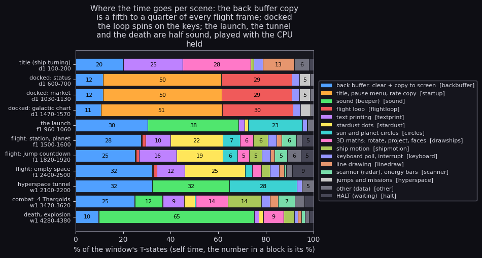

**How to read it.** Six scenes taken apart routine by routine: a panel a scene, a bar a routine (the seven heaviest by
self T, the rest grey), the number its share of the window; a routine keeps its colour in every panel.
CopyThird leads every 3D scene; in the station scene ClearView, the text (PrintCode), the stardust's multiply (MulBits)
and the planet's outline (OutlinePixel) come next.

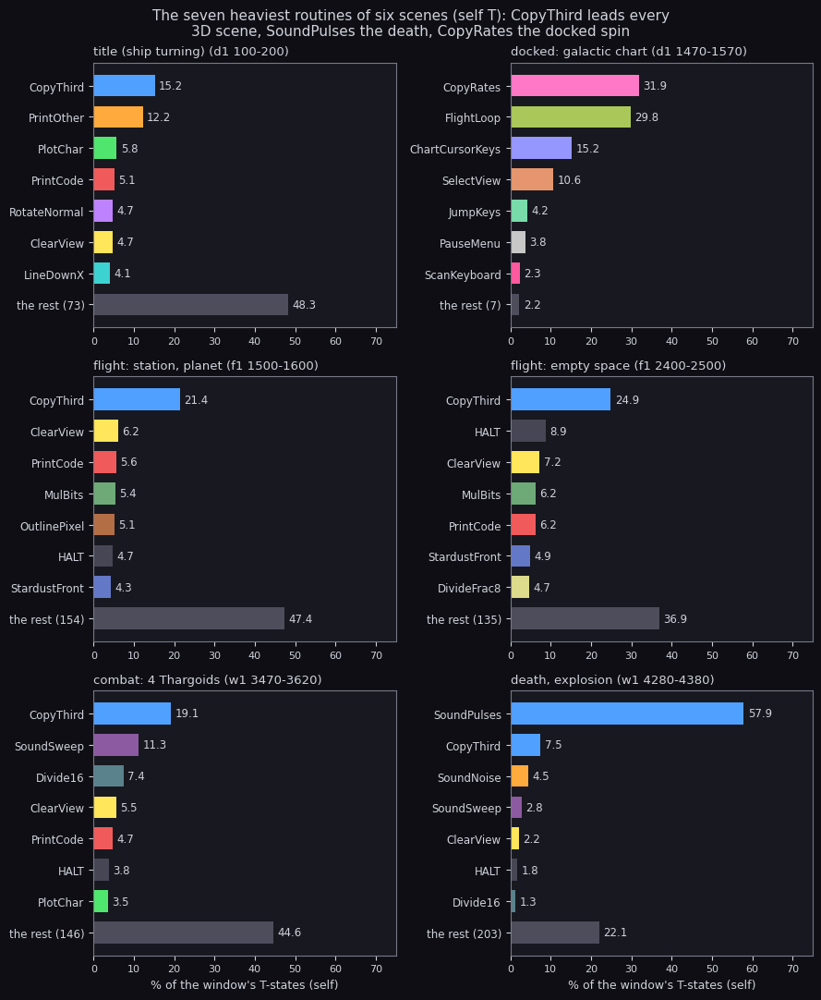

### The frame rate

Elite does not run at a fixed rate. A pass takes as long as its work, and nothing waits for the frame except CloakKey's
HALT ([4](04-game-loop.md)). **How to read it.** The left panel plots the frames an update against the occupied ship
slots (the mean of the window, from the timeline JSON `tools/timeline.py` writes to `work/prof/`). Empty space is the
fastest at 5.00 frames (10 updates a second). Four Thargoids take 6.52, the title's Python 7.69, and the death 16.67,
because GameOver plays its sounds before it draws: a pulse train, the explosion and the launch whistle (the last with
the interrupts off). The right panel is the idle share. All of it is CloakKey's HALT, which runs every second pass
(CloakKeyCount counts the calls). The docked screens and the sound scenes never halt.

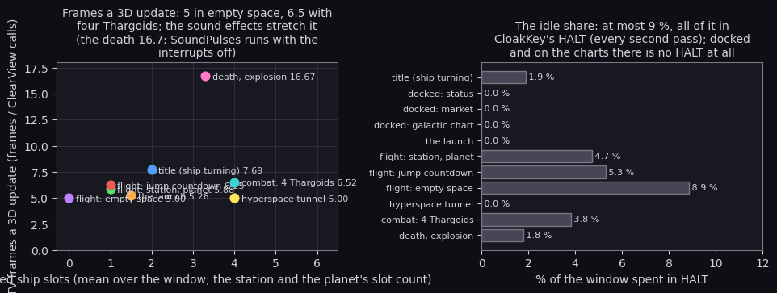

The number of ships matters less than what they cost when drawn. In the fight the four Thargoids are never inside
the front view (only on the scanner), so the 6.52 frames are their movement, tactics and scanner dots plus the
laser, not their wireframes (section 3 gives the wireframe's cost).

A pass of empty space is bimodal (`tools/fig_rt_pass.py`): 19 passes, 320-325k T without CloakKey's HALT and
373-377k T with it. The station's passes are 383-452k T: the same work, the long ones a HALT of a whole frame ([4](04-game-loop.md) 4.5). The fight's run from 376k T up to 620k T (8.87 frames)
when the laser's sound runs. One pass of each, step by step against the TV frames (the yellow ticks), is a Gantt
chart of FlightLoop's calls:

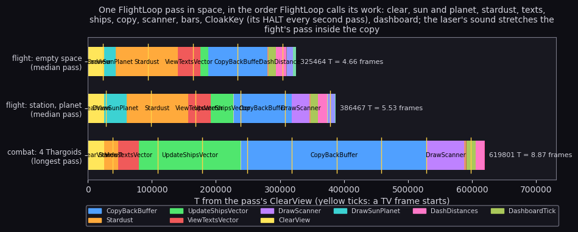

**How to read it.** Read a row from the left. ClearView empties the back buffer. The stardust follows, which is a
quarter of a pass in empty space. Then come the texts, the ships, CopyBackBuffer (four CopyThird calls, about 92k T: 1.3
frames on its own), the scanner, the bars, CloakKey (the dark block when it halts) and the dashboard. In the fight's
longest pass the copy is cut by the interrupt, and inside the interrupt SoundSweep plays the laser for whole frames.

```bash
python3 tools/fig_rt_scenes.py      # -> scenes-modules.png, scenes-top.png, scenes-rate.png, combat-routines.png
python3 tools/fig_rt_pass.py        # -> docs/img/loop/pass.png
```

## 2. Frame by frame through a fight

**How to read it.** The heatmap is routine × frame for the fight (`w1` 3470-3620). A cell's colour is the routine's self
T in that frame (yellow is the whole frame), and the green lines are the 23 ClearView calls. Three rhythms show:

- CopyThird and ClearView pulse once an update;
- the gaps between updates are 5 frames (5 times), 6 (11 times) or 9 (6 times);
- each 9-frame gap holds a SoundSweep block of two or three whole frames: the player's laser, played from the
  interrupt (section 8). The HALT row shows the idle frames of CloakKey.

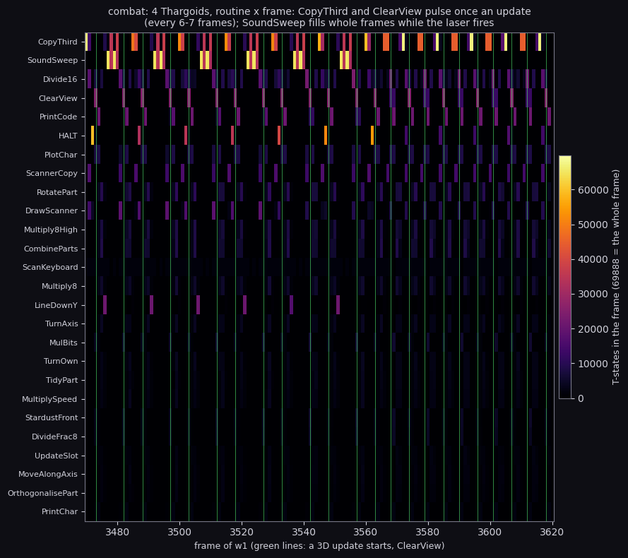

**How to read it.** The same window as stacked bars by module: every frame is full (69888 T), and what fills it changes
inside an update. The 3D maths and the ships come first, then the copy at the end, the scanner and the waits. The
laser's sweep is the red block, 12 frames of it at more than half a frame.

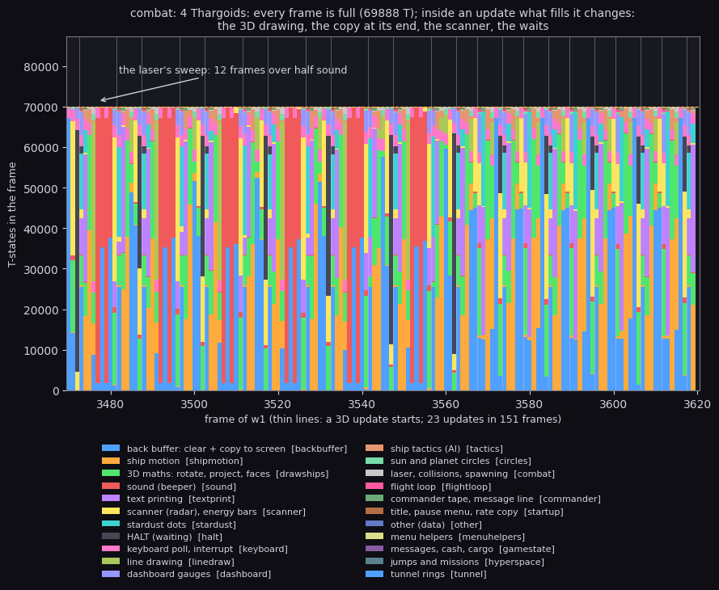

**How to read it.** The station flight (`f1` 1500-1600) for comparison, drawn the same way. It has no sound blocks, its
gaps are 5 frames (4 times) or 6 (12 times), and its HALT comes every second update:

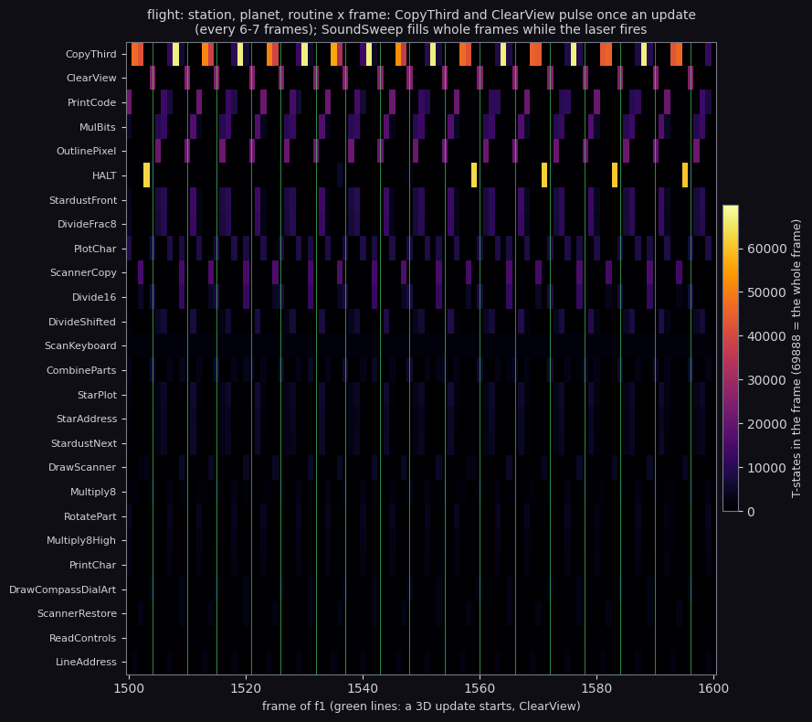
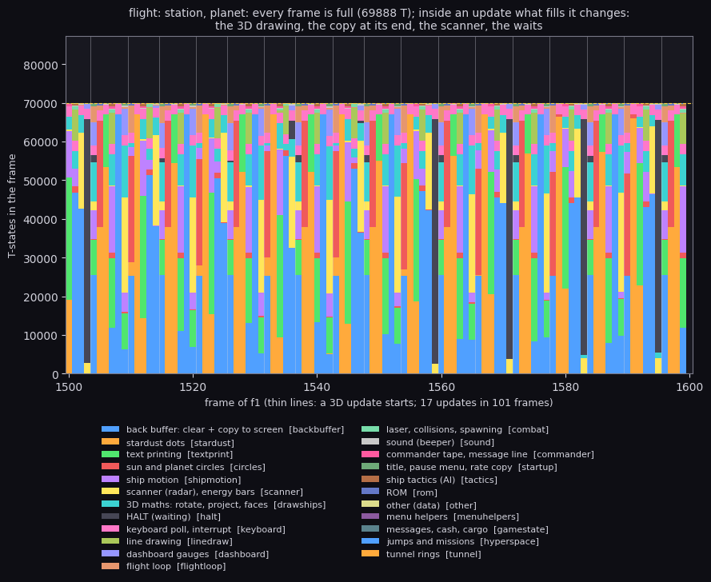

**How to read it.** The fight's 28 heaviest routines, T a frame on a log scale: the coloured bar is the routine's
self T (coloured by module), the grey one its inclusive T with its callees; the dashed line is one frame:

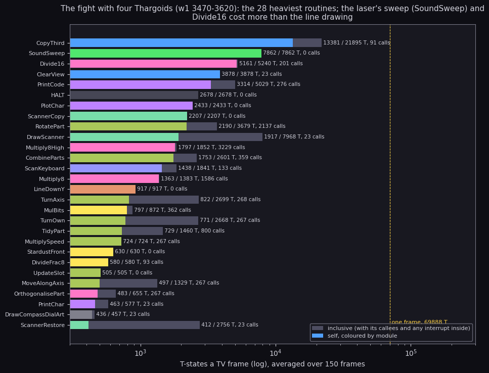

**How to read it.** The animation plays the fight frame by frame. On the left is the screen as it stood at the frame's
end, rebuilt from the trace's start memory with every write applied (no emulator). On the right is the frame's 69888 T
as a bar by module, with the heaviest routine and a mark when a new 3D update starts. The view changes only on the
frames where CopyThird runs. The laser's beams stay on the screen for a whole update, and while SoundSweep runs the bar
is red and the screen holds still.

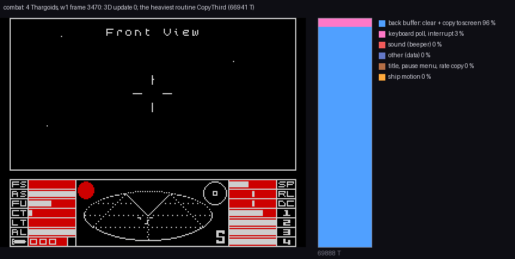

```bash
python3 tools/fig_rt_frames.py --scene combat     # -> combat-heatmap.png, combat-frames.png
python3 tools/fig_rt_frames.py --scene station    # -> station-heatmap.png, station-frames.png
python3 tools/fig_rt_fight.py                     # -> combat-fight.gif (150 pictures)
```

## 3. The 3D pipeline

A ship in a space view goes through these steps (`DrawShip $A6DF`, [6](06-rendering.md)):

1. the depth and the screen point: DividePoint, x / depth and y / depth as fractions;
2. beyond the blueprint's dot distance, four pixels and nothing more;
3. nearer, the faces' visibility: FaceVisibility `$BCD4`, a face's normal against the view;
4. the vertices of visible faces rotated into the view and projected: ProjectVertices;
5. the edges with a visible face drawn as lines: DrawEdges `$AE01`, DrawLine `$B044`.

The lines are ORed into the back buffer, which ClearView emptied at the start of the pass, so there is no erase
pass. They are XORed only while the sun is large: the line's plot is patched to XOR at `$B435`, `$B465`, `$B486`
and `$B4B2`, so the sun's fill does not hide them.

### The cost per vertex, face and edge

Only one ship is drawn up close in the recordings: the title's Python (`d1` 0-470; slot 7 holds the header
ShipPythonTrader `$68E6`, and one update projects 11 vertices and walks 26 edges). The first title shows a Cobra
(ship action `$79`); `d1` pressed N at frame 30, and TitleNext put the next title ship, the Python, in its place
(TitleShipCount `$7470`). The fight's Thargoids never
enter the front view, and the debris of the death is drawn small. The title's 13 updates give these rates
(`tools/fig_ships.py`):

| Step | Routine | Calls | T an update (inclusive / 13) | Rate |
| --- | --- | ---: | ---: | --- |
| project the vertices | ProjectVertices | 13 | 76 530 | 6957 T a vertex (11 vertices) |
| face visibility | FaceVisibility | 13 | 82 715 | 6363 T a face (13 faces) |
| draw the edges | DrawEdges (with DrawLine) | 12 | 98 146 | 3775 T an edge (26 edges) |

One Python up close costs about 257k T: 3.7 TV frames for one drawing. The other blueprints' cost at the same
distance is estimated from their counts with these rates, the share of visible edges taken to be the Python's. The
simulator of [3d-engine](3d-engine.md) 8 has since measured every blueprint: the Cobra, the Asp and the Thargoid
within 1 % of these estimates, the Coriolis (258k T) 16 % and the Fer-de-Lance (256k T) 14 % cheaper. The
estimates: the Cobra, with 28 vertices and 38 edges, is the dearest blueprint at about 421k T (6.0 frames). The Asp (314k T), the Coriolis station (306k T), the Thargoid (301k T) and the
Fer-de-Lance (298k T) come next, then the missile (266k T) and the Python itself. The escape pod and the splinter
cost about a frame, the plate under one.

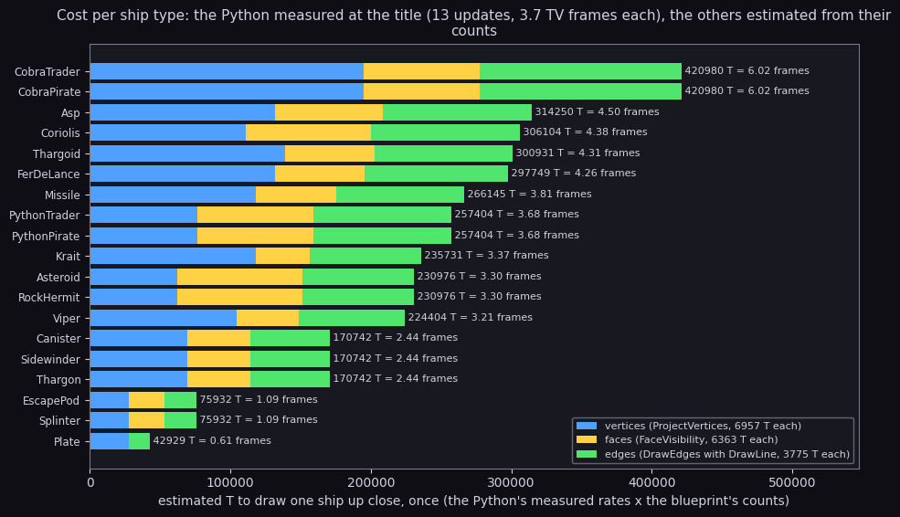

**How to read it.** A bar a blueprint, split into its vertices (blue), faces (yellow) and edges (green), each count
times the Python's measured rate; the label is the total and the TV frames it takes. The blueprints themselves, with
the counts the bars use, are drawn in [7](07-objects.md):

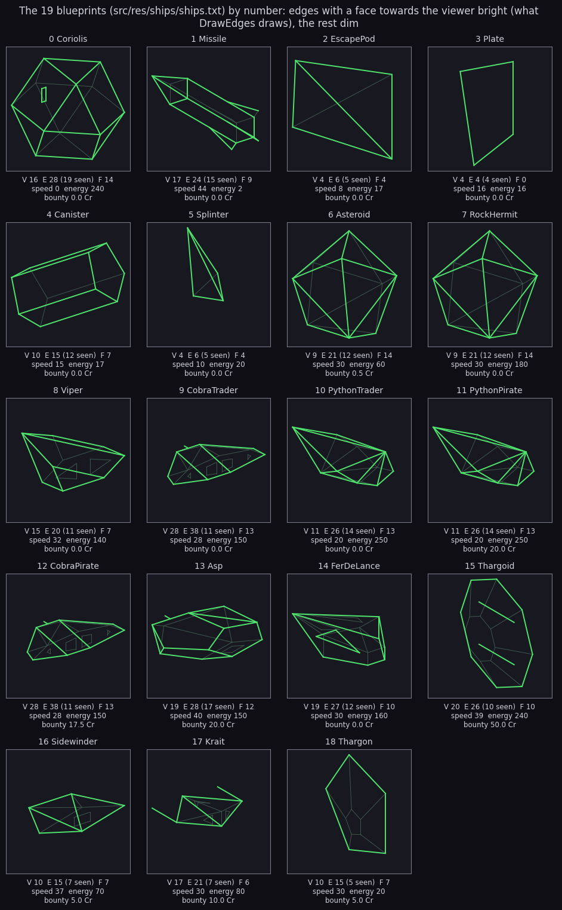

```bash
python3 tools/fig_ships.py        # -> docs/img/runtime/ship-cost.png, docs/img/objects/blueprints.png
```

### The line routine

DrawLine's T against the pixels it set, over every call of four scenes (the interrupt's T left out). It is a
straight line: **1848 T to set up a line, then 87.1 T a pixel**. The set-up covers the outcodes, the octant, the
fraction by LineFraction, and the screen address. So a short edge costs nearly as much as a long one, and the
median T a pixel is 138 for the title's Python but 303 for the fight's short sight lines. Clipping costs nothing
in these windows: no line of the title, the station or the fight was clipped, and the death window's one clipped
call was 4.3 % of its DrawLine time.

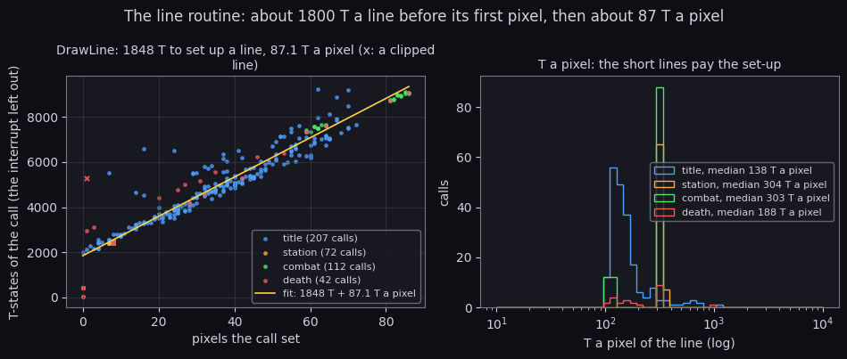

| Scene | DrawLine calls | Pixels | DrawLine T | Clipped |
| --- | ---: | ---: | ---: | ---: |
| title | 207 | 7500 | 1 047 595 | 0 |
| station | 72 | 569 | 175 249 | 0 |
| combat | 112 | 2447 | 411 545 | 0 |
| death | 43 | 706 | 123 927 | 1 call, 5302 T |

One update's lines, each coloured by the T of its call. The Python's 17 visible lines take 88 537 T in DrawLine.
In the fight the "3D" is the laser's four beams (two lines each, from the gun to the screen's edge) and the
gunsight: 8 lines, 42 685 T.

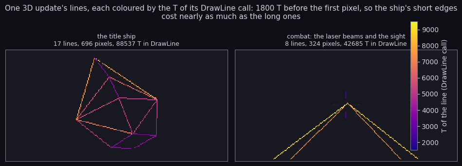

**How to read it.** The title's Python drawn in slow motion, edge by edge, in the order DrawEdges takes them, with the
running T of the update beside it (19 pictures):

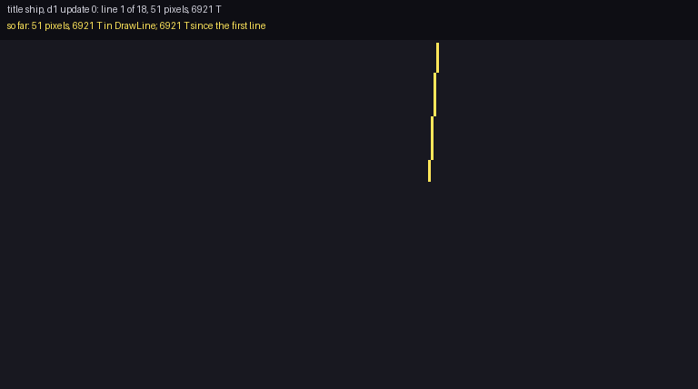

### Circles, the tunnel and the stardust

| Work | Scene | Calls | T a call | Share of the scene |
| --- | --- | ---: | ---: | ---: |
| the tunnel's rings (DrawCircle) | hyperspace tunnel | 322 | 6 855 | 31.6 % |
| the sun and the planet (DrawSunPlanet) | station | 17 | 35 065 | 8.5 % |
| the sun and the planet (DrawSunPlanet) | empty space | 20 | 17 535 | 5.0 % |
| the stardust (Stardust, 16 dots) | station | 17 | 93 560 | 22.8 % |
| the stardust (Stardust, 16 dots) | empty space | 20 | 92 685 | 26.5 % |
| the stardust (Stardust, 4 dots in witch space) | combat | 23 | 21 900 | 4.8 % |

The stardust is the surprise. Its 16 dots cost about 93k T an update in open flight, about 5800 T a dot, as much as
the whole back buffer copy. Each dot is moved through MulBits (the 8 × 8 shift-and-add multiply, 2698 calls in the
windows) and DivideShifted. In the fight it costs a quarter of that, because the fight is in witch space, where
StardustPass moves 4 dots instead of 16 (StarCount `$7F7C`, from WitchSpace). StarPlotAll, which XORs the listed dots into
the buffer, agrees: 1494 T a pass at the station, 330 T in the fight. The circle engine of [6](06-rendering.md) draws the tunnel's rings at
about 6.9k T each: 16 rings an update, 1.6 frames.

The explosions are recorded but not profiled. In `k2` the player destroys a ship: ExplosionPoint `$A8AC` runs 3
times (the first at frame 2572), and HitFlash `$8F0D` draws its 45 filled circles straight onto the screen
([3d-engine](3d-engine.md) 5, [the figure](img/design/explosion.gif)). The death's debris are wireframes like any
other ship.

```bash
python3 tools/fig_ships.py         # -> docs/img/objects/blueprints.png, runtime/ship-cost.png
python3 tools/fig_rt_lines.py      # -> lines-cost.png, wire-cost.png, wire-slowmo.gif
```

## 4. The scanner

The scanner is the ellipse in the middle of the dashboard ([8](08-hud-and-text.md)). DrawScanner `$96D9` runs once
a pass, after CopyBackBuffer, in this order:

1. ScannerRestore: the 11 × 8 bytes of the dashboard's middle cleared, then ScannerCopy puts back the scanner's
   13 × 48-byte background from ScannerSave `$5B00`;
2. for each slot in use (ScannerNext), the ship's x, y and z through Divide16 with DE = `$4000`. A ship within
   range (high byte below `$40` on each axis, x² + z² below `$1600`) becomes a dot of two or three pixels at
   (x · 3/16, z · 5/64) from the centre `$558F`, with a stalk of y · 5/64 lines up or down to it;
3. ScannerTopClear: the 13 × 7 bytes above the ellipse, where a stalk may have run out.

It draws straight onto the screen, not into the back buffer, so it does not wait for the copy.

| Scene | Ships in slots | DrawScanner T a call | T a frame | Share |
| --- | ---: | ---: | ---: | ---: |
| empty space | 0 | 70 | 14 | 0 % (ShipsPresent 0: nothing drawn) |
| station | 1 | 28 350 | 4 819 | 6.9 % |
| combat, 4 Thargoids | 4 | 51 970 | 7 968 | 11.4 % |

The background (ScannerRestore with ScannerCopy) is about 18k T a call. Each ship adds 8.5k-10.5k T, of which
Divide16 is three calls of 1476 T. The fight's scanner, 11.4 %, is half of what UpdateShips takes to move the same
four ships (24.1 %).

## 5. The random generators

Elite has four generators. Each model was checked against every call in the traces of the scenes: the seed read,
the carry at the entry, the bytes written and A at the RET (`tools/fig_rt_prng.py`).

| Generator | Code | Seed | Calls checked | Match | Carry in 0 / 1 | Callers |
| --- | --- | --- | ---: | ---: | --- | --- |
| StarRandom | `$7E86` | HL = StarSeed `$7105` (`$0F22`) | 162 | 162 | 162 / 0 | StarRespawn 162 |
| Random | `$B799` | RandomSeed `$B7AA` (`$F562`) | 45 | 45 | 38 / 7 | CreateShip 15, DebrisNear 12, LaserBeams 7, RandomRoll 6, TacticsAim 5 |
| TextRandom | `$D5E1` | TextSeeds `$DECC`, 4 bytes | 12 | 12 | 12 / 0 | RandomToken 12 |
| Twist | `$E063` | SystemSeeds `$DEC0`, 6 bytes | 4100 | 4100 | 2281 / 1819 | NextSystem 4056, NamePair 35, SystemName 9 |

StarRandom and Random share one step, an additive generator on a 16-bit word (H, L) with the carry flag coming in:

```asm
Random:       ld hl,(RandomSeed)
              ld a,h
              rla                   ; A = 2 H + carry
              ld b,a
              adc a,l               ; H' = A + L + carry
              ld h,a
              ld l,b                ; L' = the old A
              ld (RandomSeed),hl
              ret                   ; A = H'
```

```text
A  = (2·H + c) mod 256,  c1 = the bit shifted out
H' = (A + L + c1) mod 256
L' = A
```

The carry is whatever the caller left. The traces show 0 at 38 of Random's 45 calls and at every one of
StarRandom's. With a fixed carry the step is a permutation of half the seeds onto six cycles of 1, 4, 54, 269,
1121 and 31 319: 32 768 seeds lie on cycles and the others fall into them. Carry 1 gives the same cycle lengths.
Both seeds, StarSeed `$0F22` and RandomSeed `$F562`, lie on the 31 319-cycle, so the stardust and the ships walk
the same sequence at different points. A model that fed the carry out back in would have a period of 33. The game
does not feed it back, which is why the first model failed and the traces settled it. StarSeed is also read by the
misjump test (witch space at one chance in 256), the damage and the market's fluctuation.

TextRandom (the planet descriptions' "goat soup", [8](08-hud-and-text.md)) takes its four bytes from the selected
system's seeds (SelectedSeeds + 2 to + 5). Run from Lave's seeds it does not repeat within 4 194 304 steps.
Twist is Elite's Tribonacci-like step s0, s1, s2 = s1, s2, s0 + s1 + s2 on 16-bit words, four twists a system
(`tools/galaxy.py`). From galaxy 1's seeds its period is 131 072 twists, 32 768 systems: the 256 systems of a
galaxy repeat 128 times.

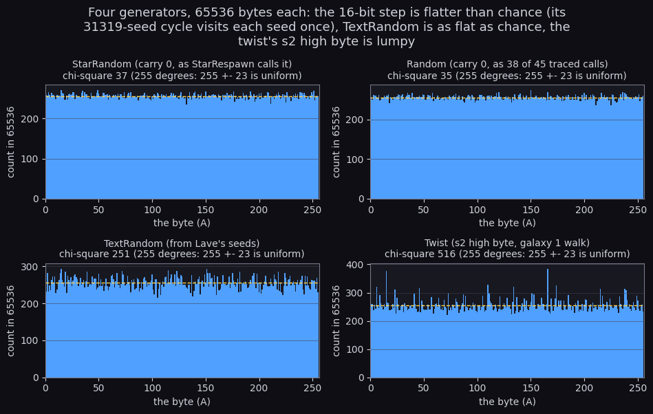

**How to read it.** Each histogram is 65 536 bytes of one generator, with the chi-square for 255 degrees of freedom (255 ± 23 is
uniform). The 16-bit step is *flatter* than chance (37): its 31 319-seed cycle visits each byte value almost
equally. TextRandom is 251, uniform. Twist's s2 high byte is 516, lumpy, as an additive Fibonacci-like generator
on a short word is expected to be.

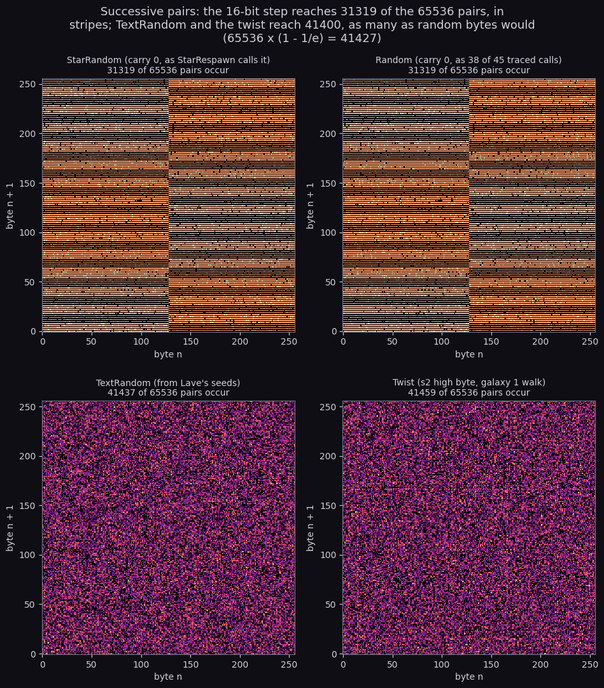

**How to read it.** The pair plots put each byte against the next, a dot a pair. The 16-bit step reaches only 31 319 of
the 65 536 pairs, in stripes: the next byte is a function of the current one and a hidden one. TextRandom and Twist each
fill about 41 400, as random bytes would (41 427).

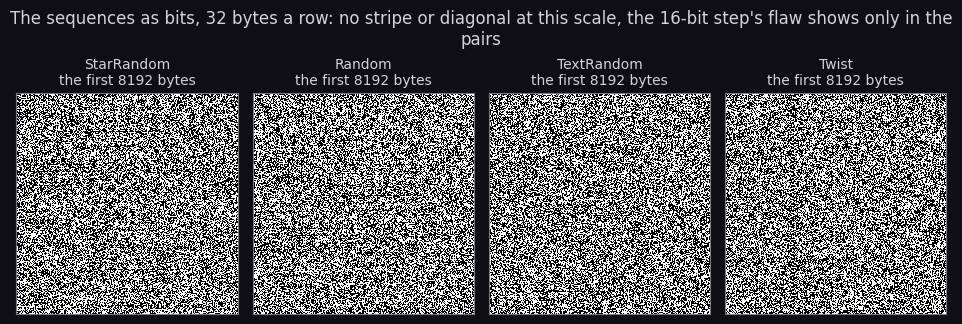
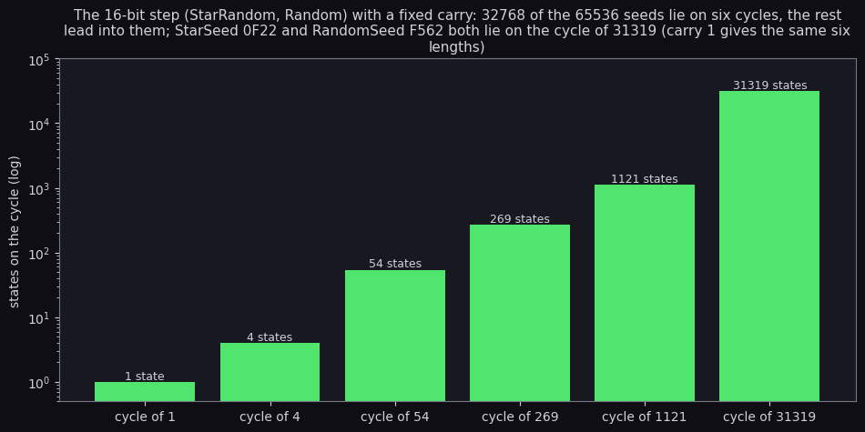

**How to read it.** The first figure is each generator's first 8192 bytes as bits, 32 bytes a row, a set bit white:
the 16-bit step's flaw does not show here, only in the pairs. The second counts the states on each cycle of the
16-bit step with a fixed carry, on a log scale.

**How to read it.** The left panel is the calls a frame of each generator per scene (log above 1), the right one the
callers over all the traced windows (log). The stardust's respawns dominate in flight; Random is called a few times a
second when a ship is made, hit or turned; TextRandom only on the data screen (in these windows); Twist in bursts of
thousands when a chart, the data screen or a jump walks the galaxy (4056 calls of NextSystem in the docked windows).

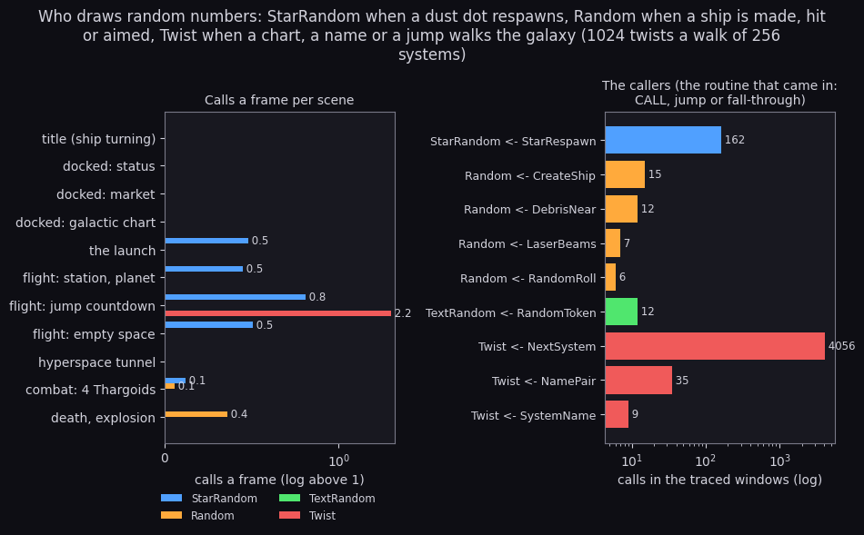

```bash
python3 tools/fig_rt_prng.py          # -> prng-*.png; --check-only prints the call-by-call check
python3 tools/galaxy.py --check       # Lave (7) at (20, 173), the BBC galaxy's data
```

## 6. The arithmetic

The products are quarter squares: b × c = ((b + c) / 2)² − ((b − c) / 2)², from the table of squares the kickoff
builds at `$BE00`/`$BF00` ([3](03-build-and-load.md) 3.7). So an 8-bit product is two table reads and a
subtraction. The divisions are shift-and-subtract loops, and the square root is a Newton iteration on Divide16.
The median T a call over all the scenes (`tools/fig_rt_maths.py`; calls cut by an interrupt left out):

| Routine | Calls | Median T | Min | Max |
| --- | ---: | ---: | ---: | ---: |
| Multiply8High | 7315 | 83 | 83 | 86 |
| Multiply8 | 3298 | 128 | 128 | 131 |
| MultiplyScaled | 728 | 204 | 201 | 228 |
| MulBits | 2698 | 368 | 281 | 430 |
| DivideFraction | 37 | 460 | 456 | 674 |
| LineFraction | 492 | 509 | 496 | 600 |
| DivideFrac8 | 421 | 535 | 377 | 676 |
| DividePoint | 270 | 1042 | 965 | 1068 |
| DivideShifted | 912 | 1092 | 363 | 1237 |
| Divide24 | 74 | 1315 | 1055 | 1863 |
| Divide16 | 308 | 1476 | 1466 | 1490 |
| SquareRoot | 17 | 5054 | 5052 | 5060 |

A division costs 10 to 18 products. The arithmetic's self time is 9 % of the title, 14 % of the fight and 18 % of
the station and empty-space flights. Divide16 alone is 7.4 % of the fight, half of it the scanner's (2782 T a
frame through Divide16Vector).

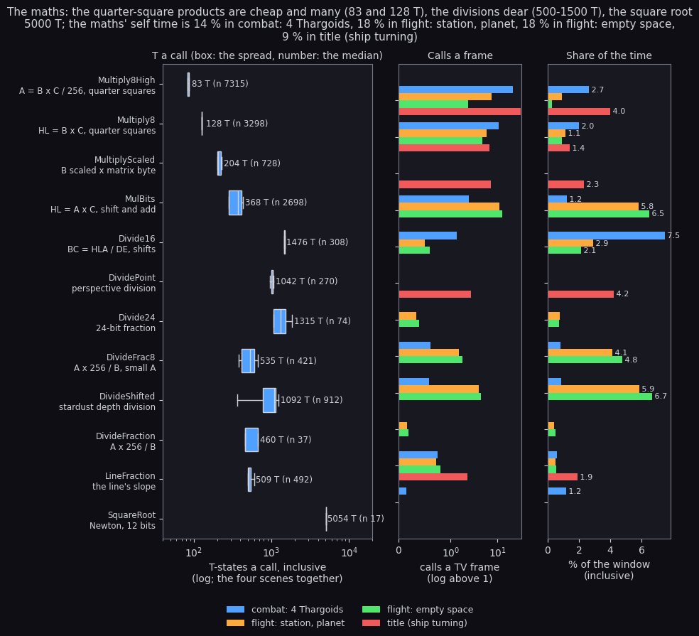

**How to read it.** The left panel is each routine's T a call as a box (the quartiles, the median marked; log scale),
the middle one its calls a frame per scene, the right one its share of the scene's time.

```bash
python3 tools/fig_rt_maths.py         # -> maths.png and the table above
```

## 7. The screen and the beam

The beam is unreal-ng's 48K timing: the interrupt at frame T 1812, paper line 0 at 16 152, 224 T a line
(`kit/beam_timeline.py`). A write to line L before 16 152 + 224 L shows in this frame, after it in the next one.

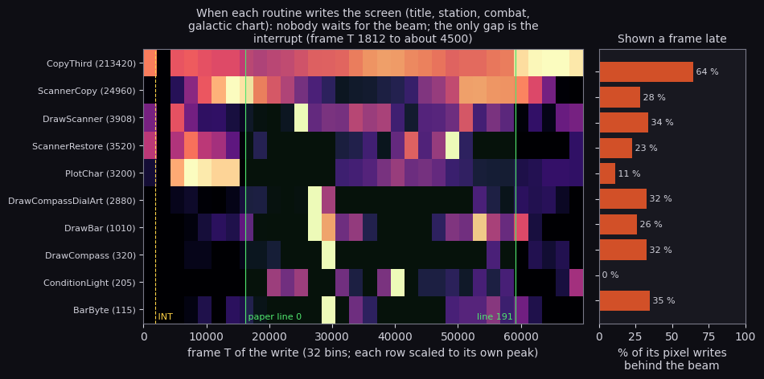

**How to read it.** Each row is a routine's screen writes binned by frame T. No routine waits for the beam: the writes
are spread over the whole frame except the interrupt's few thousand T. CopyThird writes 64 % of its bytes behind the
beam, so they show a frame late.

CopyBackBuffer copies the 4 KB back buffer `$C000-$CFFF` to `$4000-$4FFF` in four CopyThird calls of 1024 bytes: the
even pixel lines of the first third (`$4000`), of the second (`$4800`), then the odd lines (`$4100`, `$4900`). The
buffer's address is the screen's with bit 15 set. A copy takes 89 368-92 212 T (median 91 954), more than a frame. So
every copy is seen half done: in the title's 12 copies, all 12 were caught mid-way by the beam. Because of the order, a
torn frame is not a picture cut in two but a *comb*: the even lines already hold the new pose and the odd lines the old
one. **How to read it.** The figure rebuilds the frame the television showed from the trace, each line as memory held it
when the beam drew it:

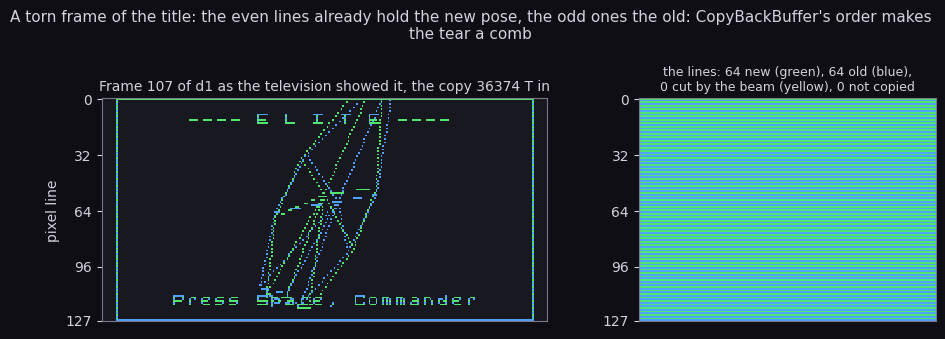

Nothing flickers. There is no erase pass on the screen: the buffer is cleared out of sight. Only the charts' XOR
cursor crosses ([8](08-hud-and-text.md)) are drawn and erased on the screen itself.

```bash
python3 tools/fig_rt_beam.py          # -> beam-bins.png, beam-torn.png
```

## 8. The keyboard, the interrupt and the sound

The frame interrupt (IM2Handler `$FF25`, [5](05-controls.md)) does three things: it scans the keyboard
(ScanKeyboard: eight half-rows into the key bytes, then the joystick), reads the controls into rates
(ReadControls), and plays one slice of the current sound (SoundTick through SoundTickVector `$7125`, [9](09-sound.md)).

| Scene | Interrupts taken / frames | ScanKeyboard T a frame | ReadControls | SoundTick T a frame | Interrupt's share |
| --- | --- | ---: | ---: | ---: | ---: |
| title, docked, flight | 100 / 100 | 1949 | 440 | 88 | 3.9 % |
| combat | 133 / 150 | 1841 | 394 | 7 960 | 14.9 % |
| hyperspace tunnel | 60 / 100 | 1169 | 267 | 52 | 2.4 % |
| death | 40 / 100 | 832 | 178 | 10 750 | 17.0 % |

Without sound the interrupt is 2750 T a frame, 3.9 %, of which the keyboard scan is 1619 T self. The laser's
sweep (SoundSweep, entered by a jump from SoundTick, so eprof counts no CALLs to it) runs inside the interrupt and
lasts longer than a frame. While it runs the interrupts stay off, the next INT is missed, and the main loop waits.
The fight lost 17 of its 150 interrupts this way. The scene sounds (the launch, the tunnel, the death's whistle) are played by
SoundPulses with DI from the main code (SoundPlay `$9551`), so the tunnel took only 60 interrupts in 100 frames,
and the death 40 (Game Over's first pulse train runs with the interrupts on, but each of its slices in the
interrupt is longer than a frame too). The keys are not scanned while a scene sound plays.

| Sound | Where it runs | Scene | Share of the scene |
| --- | --- | --- | ---: |
| SoundPulses (pulse trains) | main code (DI but Game Over's) and the interrupt | the launch / the tunnel / the death | 38.1 % / 32.4 % / 57.9 % |
| SoundSweep (the laser) | the interrupt | combat | 11.3 % |
| SoundNoise (hits) | the interrupt | death | 4.5 % |

## 9. The call graph and flame graphs

The fight's call graph, each edge labelled with the T a frame spent in the callee from that caller (the edges
above 1.5 % of the window; `--threshold 0.005` gives the full graph). The roots are FlightLoop's calls: the trace
window starts inside FlightLoop.

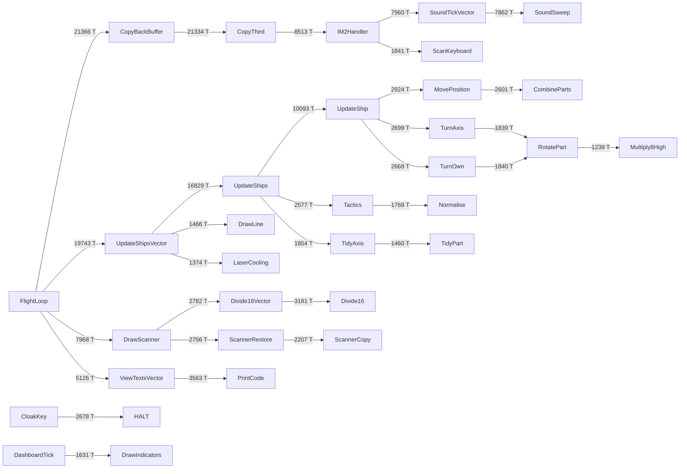

The interrupt hangs under CopyThird because the copy is what it cuts most often: the copy is 1.3 frames long, so
nearly every copy is cut. The ships' update is mostly turning and tidying the axes (TurnAxis, TurnOwn, TidyAxis:
the rotation of each ship's three axes by the player's and its own roll and pitch). Tactics and Normalise come
next, and DrawLine is small.

**How to read it.** The flame graphs show the same as stacks. The bottom row is where the loop was; each box above it is
a routine called from the box under it, as wide as its inclusive T.

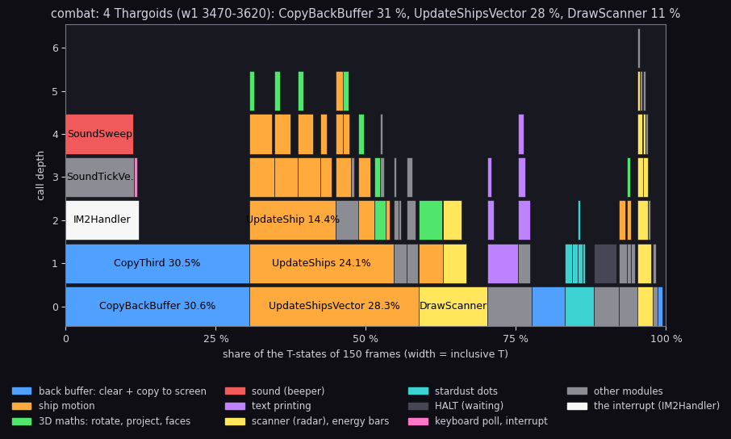
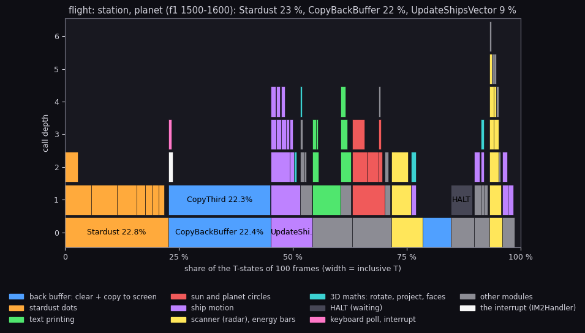
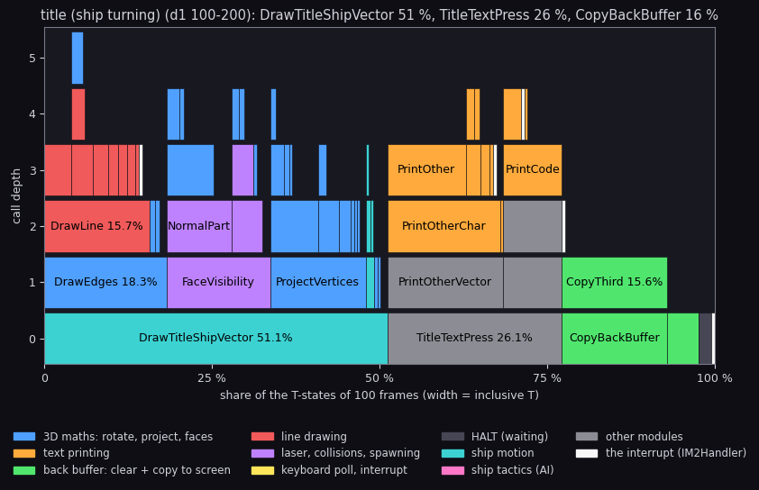
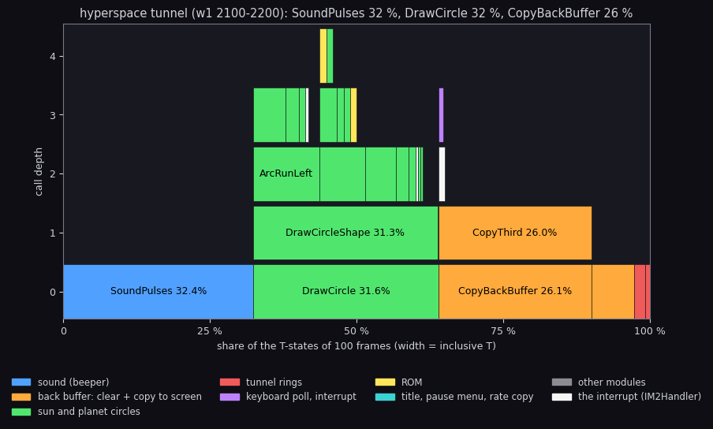

```bash
python3 tools/fig_rt_flame.py                                  # -> flame-combat/station/title/tunnel.png
python3 tools/fig_rt_flame.py --mermaid combat --threshold 0.015   # the graph above
```

## 10. What it adds up to

- **The copy is the frame.** CopyBackBuffer is 1.3 TV frames per update and a fifth to a third of every flight
  scene. It sets the floor of 5 frames an update, together with the stardust (another 1.3 frames in open space) and
  the texts (PrintCode, PlotChar: 8-10 %).
- **The ships are cheap until they are near.** A far ship is a dot. A near Python is about 3.7 frames of
  projection, faces and lines. No recording drew more than one near ship at a time, so the worst case, several
  near ships, is known from the simulator only: 1.1 to 6 frames a ship on top of the floor ([3d-engine](3d-engine.md) 8).
- **Sound stops the world.** The scene sounds hold the CPU with DI, and the laser's sweep runs inside the
  interrupt. Either way keys are not scanned and interrupts are lost.
- **The idle time is a HALT every second pass,** never more than 9 % of a scene.
- **The random numbers are a 16-bit step whose quality comes from its one long cycle,** plus Elite's three-word
  twist for the galaxy.

## 11. Limits and gaps

- The profiled windows show no near ship in combat. A ship destroyed by the player and its explosion are recorded
  in `k2` (ExplosionPoint at frame 2572, HitFlash 45 circles; [scenes](scenes.md)) but not profiled here. The
  per-ship costs other than the Python's come from the simulator ([3d-engine](3d-engine.md) 8), not a recording.
- eprof counts the CALLs to a routine. A routine entered by a jump or a fall-through (SoundSweep, PlotChar,
  ScannerCopy) shows 0 calls but its correct T. The callers figure of section 5 counts entries of any kind.
- The beam figures use unreal-ng's 48K timing; contention is in the T of each instruction as recorded, not
  modelled again.
- The kit has no profile builder across recordings. `tools/eprof.py`, `tools/rtscenes.py` and the `fig_rt_*.py`
  scripts are the case's own, built on `kit/kitlib.py`'s traces ([WALKTHROUGH](../WALKTHROUGH.md)).
