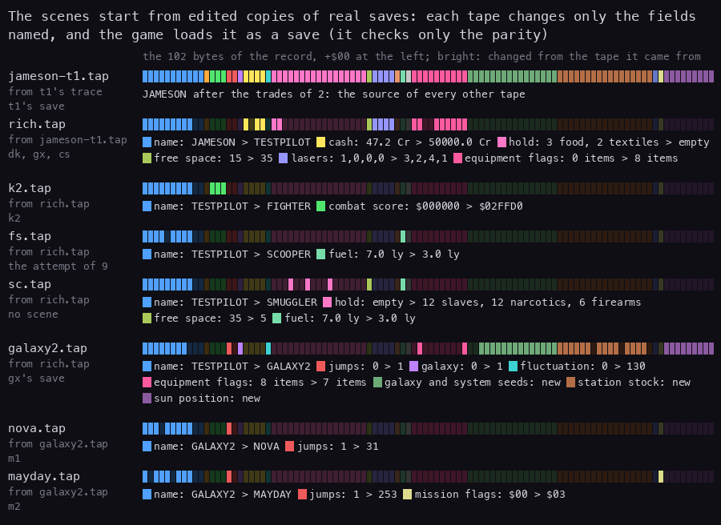
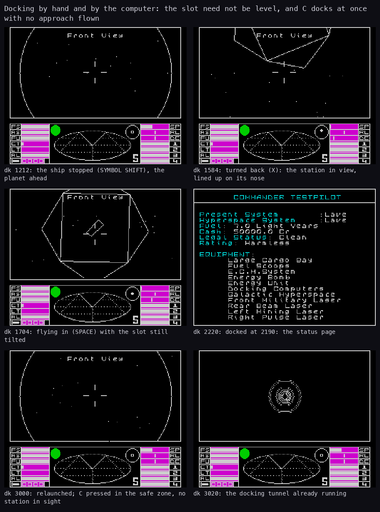
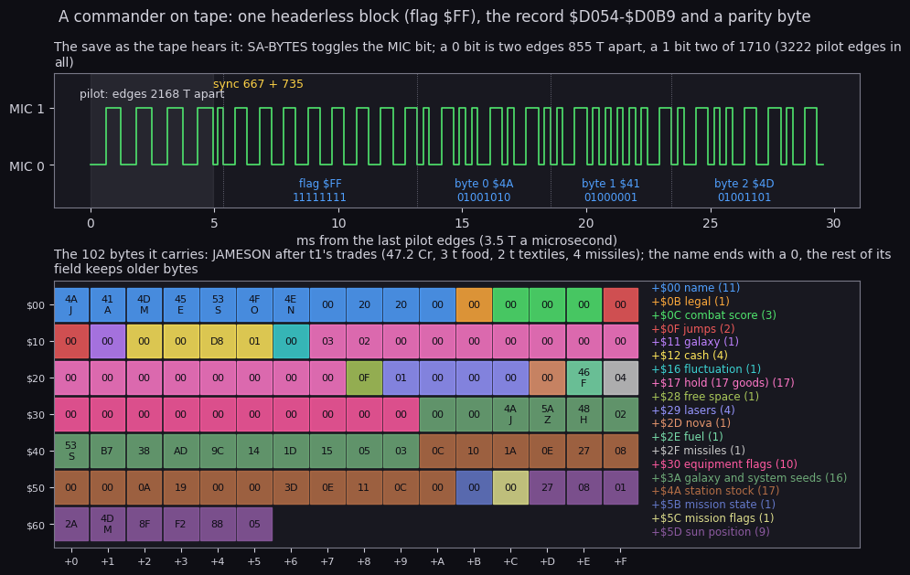
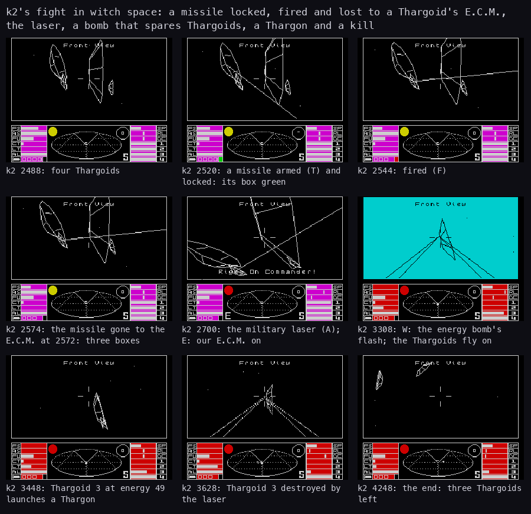
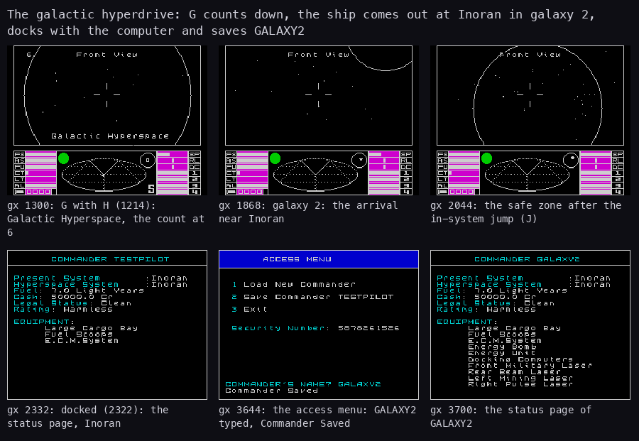
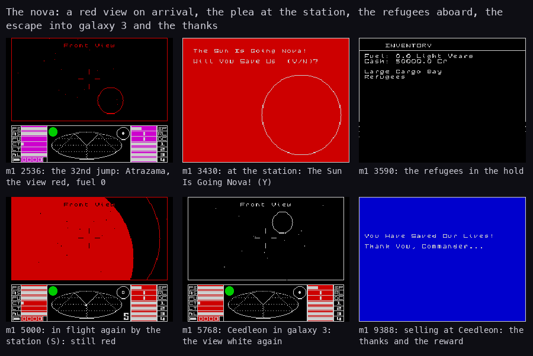
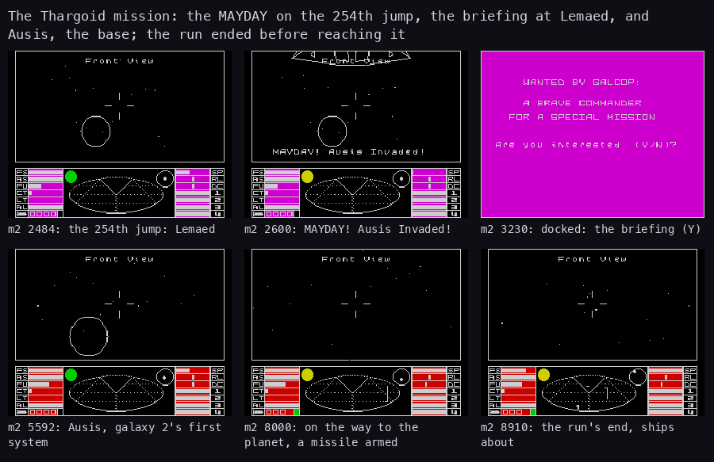
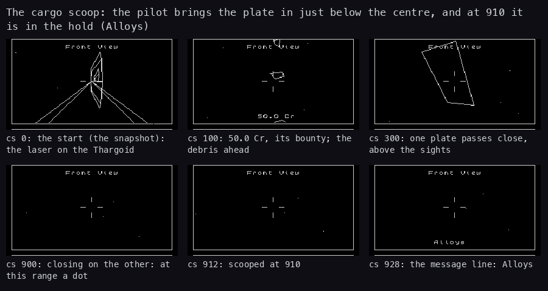
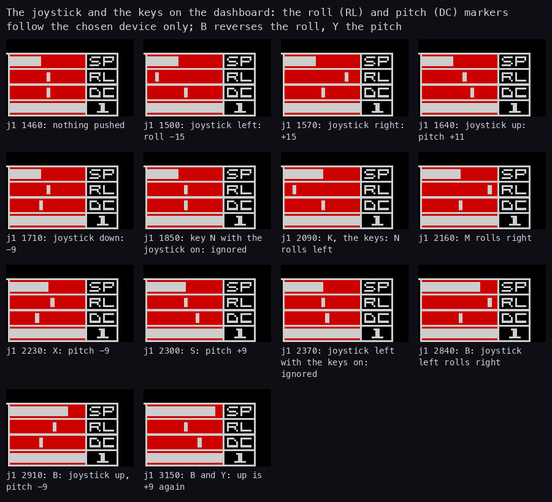
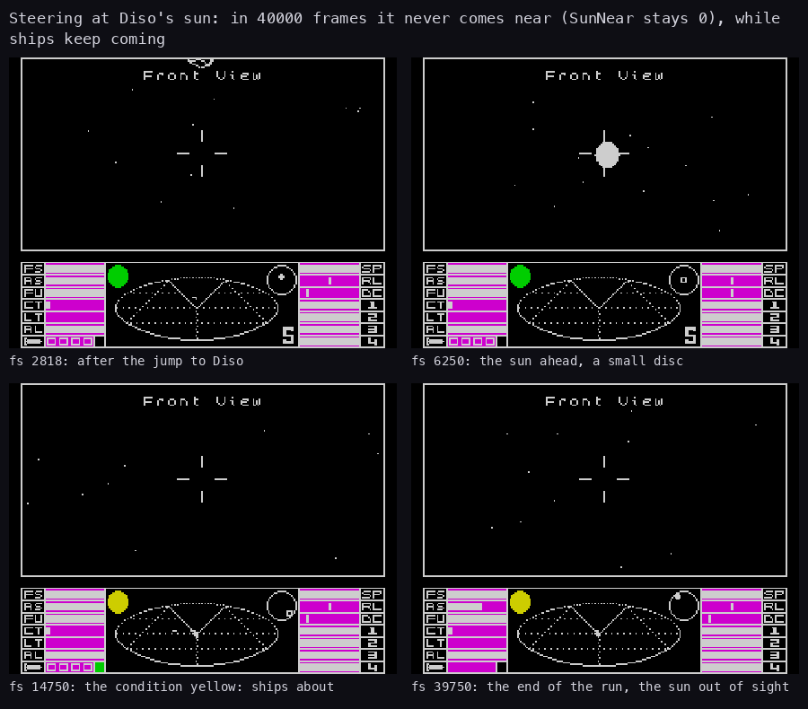

# The recorded scenes

What this covers: the gameplay that the first three recordings (`d1`, `f1`, `w1`) never reached, each played in
the emulator by the game's own keys and recorded:

- the commanders the scenes start from (0);
- docking by hand and by the computer (1);
- trading and a commander saved (2);
- a missile, the E.C.M., the energy bomb, kills and the rating (3);
- the galactic hyperdrive and the commander tape (4);
- the nova mission (5) and the Thargoid mission (6);
- a cargo scoop (7);
- the Kempston joystick and the options (8);
- the fuel scoop at a sun, tried and not reached (9).

Every scene is a plan in `tests/inputs/<rec>-*.py`, played by `tools/elitebot.py` on an unreal-ng instance (WebAPI,
muted) from the title snapshot `work/snaps/title-A.szx` that `c1` left after the Lenslok:

```bash
python3 tools/elitebot.py --work work/live tests/inputs/t1-trade.py --record work/t1
```

The bot only presses keys and reads memory. It never writes the game's memory, and the commanders below are
loaded by the game's own tape loader. The keys each run pressed are in `work/<rec>/inputs.txt`; the frames below
are the recording's own, from its notes (`work/<rec>/capture.json`). Each scene has a strip of its own screens,
drawn by `bash tools/fig_scene_strips.sh` (`tools/fig_scene_strip.py`, a call per scene with its frames, captions
and title); the GIFs of [1](01-game-design.md) show some of them in motion.

## 0. The commanders

A commander is the 102-byte record `$D054-$D0B9` ([10](10-gameplay-logic.md) 10.8). The game saves it as one
headerless tape block and checks nothing on load but the tape's parity. So an edited record loads as a saved one,
and the later scenes start from edited copies of a real save:

1. `t1` saved JAMESON after its trades (2). `tools/tape_from_trace.py` read the block back from the speaker writes
   of the trace `work/t1/traces/2364_0-2490_0.uatr` into `work/tapes/jameson-t1.tap`.
2. `tools/commander_tape.py edit` made the fixtures from it: `rich.tap` (TESTPILOT, 50000.0 Cr, every piece of
   equipment, the four lasers 3, 2, 4, 1). From it came `k2.tap` (FIGHTER, combat score `$02FFD0`), `fs.tap` and
   `sc.tap`.
3. `gx` saved GALAXY2 in galaxy 2 (4); `nova.tap` (31 jumps) and `mayday.tap` (253 jumps, mission flags 3) are
   edits of that save.

| Tape | Name | Changed from its source | Used by |
| --- | --- | --- | --- |
| `jameson-t1.tap` | JAMESON | none: `t1`'s save | the source of `rich.tap` |
| `rich.tap` | TESTPILOT | cash, the hold emptied, the four lasers, the equipment | `dk`, `gx`, `cs` |
| `k2.tap` | FIGHTER | the combat score 80 short of Dangerous | `k2` |
| `galaxy2.tap` | GALAXY2 | none: `gx`'s save | the source of the mission tapes |
| `nova.tap` | NOVA | 31 jumps | `m1` |
| `mayday.tap` | MAYDAY | 253 jumps, the mission flags 3 | `m2` |
| `fs.tap` | SCOOPER | 3.0 ly of fuel | the attempt of 9 |
| `sc.tap` | SMUGGLER | 3.0 ly, 12 t of slaves, 12 t of narcotics, 6 t of firearms | no recorded scene |



How to read it: a row a tape, its source and the scenes that load it on the left. The strip is the 102 bytes of the
record, `+$00` at the left, coloured by field as in the figure of 2: bright where the byte differs from the source
tape, dark where it is the same. Under it the fields that changed, old > new. GALAXY2 differs from TESTPILOT in more
fields because the game wrote it after a galactic jump; the others are edits. Drawn by
`python3 tools/fig_scenes.py commanders` from `work/tapes/*.tap`.

## 1. Docking (`dk`)

`tests/inputs/dk-dock.py`, 3508 frames. The commander tape `rich.tap` was loaded on the title (Y, 1, ENTER; loaded
at 482), and the ship launched at 808. The pilot:

1. stopped the ship (SYMBOL SHIFT) at 1214;
2. turned back to the station (X) from 1234;
3. lined the slot up with the roll and pitch keys from 1584, looking at the station's nose vector in its slot;
4. flew in (SPACE) from 1704.

Docked at 2190: Condition `$7104` 0. The dock test (Collide `$B4D8`, [bbc-comparison](bbc-comparison.md) 5) reads
only the station's nose. Both its x and its y part must be below `$3C` after doubling; the slot's rotation is not
read. The bot did not match the slot's angle and still docked. The tunnel and the status page followed, as for the
docking computer.

The second launch was at 2596. C (the docking computer) was pressed at 3002 in the safe zone, and the dock began at
once: no approach is flown, the docking tunnel ran from 3020, and Condition was 0 at 3408.

Figures: [the manual dock](img/design/dock.gif) and [the docking computer](img/design/dockcomp.gif) (1.4 and 1.6 of
[1](01-game-design.md)).



How to read it: the recording's own screens, left to right and top to bottom, each captioned with its recording, the
frame shown (the nearest kept to the frame named in the text) and what it shows. The slot is still tilted at 1704;
the docking computer's tunnel runs 20 frames after C with no station on the screen.

## 2. Trading and a commander saved (`t1`)

`tests/inputs/t1-trade.py`, 2986 frames, a new game (JAMESON, 100.0 Cr at Lave). All at Lave, at fluctuation 0:

| Frame | Key | What the game did |
| ---: | --- | --- |
| 342 | (docked) | the status page |
| 498 | 2 | buy: 5 t of food at 3.6 and 2 t of textiles at 6.0, 30.0 Cr; the stocks 17 to 12, 18 to 16; cash 70.0 |
| 1110 | 3 | sell: 2 t of food at 3.6; cash 77.2 |
| 1474 | 4 | equip: a missile (item 2) for 30.0; cash 47.2, missiles 4 |
| 1964 | SYMBOL SHIFT, 2 | the access menu: save, the name JAMESON typed |
| 2830 | a key | Commander Saved |

The buy and sell prices are the same number: the market page's price. The stock falls with each tonne bought and
rises with each sold, and the price does not move until the next arrival rolls a new fluctuation
([10](10-gameplay-logic.md) 10.3-10.4). Figure: [the market before and after](img/design/market.png) (1.6 of
[1](01-game-design.md)).

The save is the ROM's SA-BYTES on the record. The signal it writes and the record it carries:



How to read it: top, the MIC bit as SA-BYTES toggled it in `t1`'s trace (time in milliseconds). The pilot's even
edges end, two short sync edges follow, then each bit is two edges, short for 0 and long for 1: the flag `$FF`, then
`$4A` (J), `$41` (A), `$4D` (M). Bottom, the 102 bytes of the record, 16 a row, coloured by field and named on the
right with their offsets. The hold holds 3 and 2 (food, textiles), the cash is `0000 01D8` (0 thousands, 472 tenths:
47.2 Cr), and the missiles are 4. The seeds at `+$3A` start with galaxy 1's `5A4A 0248 B753`, and the stock at
`+$4A` is Lave's after the trades. Drawn by `python3 tools/fig_scenes.py tape`; `python3 tools/commander_tape.py
show work/tapes/jameson-t1.tap` prints the same fields.

The name field quirk: the record keeps the name typed and a 0, and the bytes after the 0 are whatever the field
held before. GALAXY2 (4) shows it: `GALAXY2`, 0, then `T` and a space left from TESTPILOT.

## 3. Combat (`k2`)

`tests/inputs/k2-combat.py`, 4249 frames. FIGHTER (`k2.tap`: the rich commander with the combat score `$02FFD0`)
picked Diso, launched (1066), set the pause menu's misjump option (F) and jumped (1939). The jump ended in witch
space at 2485 among four Thargoids (energy 240 each). The bot's pilot then aimed with the roll and pitch keys
(`work/k2/log.tsv` has its view each step). A key is held 24 frames; the frames below are the presses
(`work/k2/inputs.txt`) or the first runs of the routine named (L1):

| Frame | Event | Score | Cash | Slots |
| ---: | --- | ---: | ---: | --- |
| 2485 | witch space | 196560 | 50000.0 | four Thargoids |
| 2485 | T: a missile armed, locked by 2519 (MissileState 2) | | | |
| 2542 | F (pressed at 2519): fired, the launch sound, missiles 4 to 3 | | | a missile in slot 7 |
| 2572 | the missile destroyed by a Thargoid's E.C.M. (ExplosionPoint; the slot freed and the score paid at 2612, AddCash) | 196784 | | the E.C.M. counter 8 |
| 2613 | E: our E.C.M. | | | |
| 2701-3301 | the military laser (A) | | | Thargoid 3 down to energy 64 |
| 3301 | W: the energy bomb, the flash from 3304 | | | the Thargoids unhurt |
| 3449 | | | | Thargoid 3 at 49; a Thargon launched |
| 4249 | the end | 197858 | 50055.0 | Thargoid 3 and the Thargon gone; a plate |

What it shows:

- **A kill pays twice.** The score rose by 224 when the missile blew up (half the missile blueprint's `+$15`
  word): UpdateSlot `$9D38` pays the score and the bounty for every ship that explodes, our own missile included.
  The Thargoid's kill added 1024 and 50.0 Cr, the Thargon's 50 and 5.0 Cr: 196784 + 1024 + 50 = 197858, and
  50000.0 + 50.0 + 5.0 = 50055.0 ([bbc-comparison](bbc-comparison.md) 6 sets these against the BBC).
- **The rating.** `$02FFD0` + 224 = `$0300B0` crossed the top byte's step from 2 to 3: the status page said
  DANGEROUS from then on.
- **The bomb spares Thargoids.** UpdateSlot skips a ship whose blueprint's `+$06` byte is `$27`, the Thargoid's
  (the comment at BombKill `$9C95`).
- The fight is the [fight GIF](img/design/fight.gif) of [1](01-game-design.md) 1.2.



How to read it: the recording's own screens, left to right and top to bottom, each captioned with its recording, the
frame shown (the nearest kept to the frame named in the text) and what it shows. The missile's box goes green when
it locks (2520); the bomb's flash (3308) leaves the Thargoids flying.

## 4. The galactic hyperdrive and the commander tape (`gx`)

`tests/inputs/gx-galactic.py`, 3800 frames. TESTPILOT launched at 808 and held G with H at 1214. At 1868 the ship
was in galaxy 2:

- the galactic hyperdrive's equipment flag was 0, used up;
- the legal status was 0;
- the arrival was Inoran (21, 184), the system of galaxy 2 nearest the chart cursor, which was left on Lave's place
  (20, 173). The BBC picks the system nearest (96, 96) instead ([bbc-comparison](bbc-comparison.md) 2).

The pilot then flew to the planet with the in-system jump (J), reached the safe zone at 2044, docked with the
computer at 2322, and saved the commander as GALAXY2 (save at 2778, Commander Saved at 3644). The save was read
back from the trace `work/gx/traces/3150_0-3330_0.uatr` into `work/tapes/galaxy2.tap`. Its seeds are galaxy 1's
rotated one bit left byte by byte (GalaxyJump `$DC4E`, [galaxy.md](galaxy.md) 4).

The tape format in one place:

| Part | Value |
| --- | --- |
| block | one headerless block, flag `$FF`, 102 data bytes, a parity byte (104 in all) |
| written by | the ROM's SA-BYTES, entered at `$04C6` past its prologue, from CommanderMenu `$D90A` (2 in the access menu) |
| read by | the ROM's LD-BYTES, entered at `$0562` (1 in the access menu); the parity is the only check |
| content | the record `$D054-$D0B9` as it is in memory, offsets as in the figure of 2 |
| after a load | the record is copied to DefaultCommander `$D232`, so a death restarts from it |



How to read it: the recording's own screens, left to right and top to bottom, each captioned with its recording, the
frame shown (the nearest kept to the frame named in the text) and what it shows.

## 5. The nova (`m1`)

`tests/inputs/m1-nova.py`, 9699 frames. NOVA (`nova.tap`: GALAXY2's save with 31 jumps) at Inoran picked Atrazama
and jumped. The 32nd jump outside galaxy 1 starts the nova (MissionNova `$DE67`, [10](10-gameplay-logic.md) 10.7):

| Frame | Event | Mission flags | Hold free | Galaxy |
| ---: | --- | --- | ---: | ---: |
| 2534 | arrived: NovaMission 1, FUEL LEAK, fuel 0.0 | `$01` | 35 | 2 |
| 2534 | Q: the escape pod | | | |
| 3277 | docked at Atrazama's station | | | |
| 3433 | 2 (buy): THE SUN IS GOING NOVA, WILL YOU SAVE US; Y | | | |
| 3589 | the refugees aboard | `$21` | 0 | 2 |
| 5113 | fuel bought, Vearin picked, launched, H: the jump leaves the nova's system | | | |
| 5769 | arrived at Ceedleon: a galactic jump, NovaMission 0 | `$21` | 0 | 3 |
| 8653 | the safe zone, after the in-system jump, the bomb and the laser | | | |
| 9231 | docked (the docking computer) | | | |
| 9387 | 3 (sell): the reward | `$01` | 35 | 3 |

The reward: 100 g of gem-stones in the hold and 65536 more combat points (128 to 65664: Competent). The view was
red from the arrival to the escape: the [nova GIF](img/design/nova.gif) of [1](01-game-design.md) 1.6. Leaving the
system jumps galaxy whatever system is picked (the hyperspace code: "if galactic or NovaMission: GalaxyJump",
[10](10-gameplay-logic.md) 10.5).



How to read it: the recording's own screens, left to right and top to bottom, each captioned with its recording, the
frame shown (the nearest kept to the frame named in the text) and what it shows. The view stays red until the jump
out of the system (5768).

## 6. The Thargoid mission (`m2`)

`tests/inputs/m2-mayday.py`, 8912 frames. MAYDAY (`mayday.tap`: 253 jumps, the mission flags 3, the nova and the
cloak ship's triggers passed) at Inoran picked Lemaed and jumped:

| Frame | Event | MissionState | Mission flags |
| ---: | --- | ---: | --- |
| 2482 | the 254th jump: the MAYDAY | 1 | `$07` |
| 3030 | docked at Lemaed (after the escape pod) | 1 | |
| 3230 | the briefing: WANTED BY GALCOP ... ARE YOU INTERESTED; Y | | |
| 3386 | accepted | 3 | `$87` (bit 7: the ECM jammer) |
| 5594 | arrived at Ausis, galaxy 2's first system: the station is the Thargoid base | 4 | `$87` |
| 8912 | the end, flying to the planet: an Asp and three Sidewinders about | 4 | |

The run ended at 8912 before the base: ships kept coming on the way to the planet, and the score was 1248 from
the kills on the way. The base's destruction and the debrief (MissionDone
`$D14D`) stay known from the code only.



How to read it: the recording's own screens, left to right and top to bottom, each captioned with its recording, the
frame shown (the nearest kept to the frame named in the text) and what it shows.

## 7. A cargo scoop (`cs`)

Two runs:

1. `tests/inputs/cs-setup.py` (not recorded) loaded `rich.tap`, misjumped into witch space and fought until a
   Thargoid died. At frame 6773 it saved `work/snaps/cs-debris.szx`, with two plates of alloys about 987 ahead.
2. `tests/inputs/cs-scoop.py` was recorded from that snapshot (`--start`), 1010 frames. The pilot steered so that
   the nearest plate would pass a little below the centre, predicting its position 20 frames ahead (`scoop` in
   `tools/elitebot.py`).

At 910 the plate was scooped: alloys 0 to 1, free space 35 to 34, Alloys on the message line. Collide `$B4D8` takes
a scoopable ship (role bit 1) when |x|, |y| and |z| are all below 180, y is negative (below the nose), fuel scoops
are fitted and the hold has room. Above the nose the same plate is a collision. Figure: the
[scoop GIF](img/design/scoop.gif) of [1](01-game-design.md) 1.6.



How to read it: the recording's own screens, left to right and top to bottom, each captioned with its recording, the
frame shown (the nearest kept to the frame named in the text) and what it shows. Only the view is shown: the plate
to scoop is a dot until it is taken.

Recorded runs of the same plan without the snapshot failed: the record mode's timing differs from a plain run, and
the debris of a close kill flew apart before the pilot turned.

## 8. The joystick and the options (`j1`)

`tests/inputs/j1-joystick.py`, 4235 frames. N on the title, then the Kempston pushed left: ControlMethod 1 and a new
game. The Kempston is taken only in the title's second loop, so the first key (N, held 30 frames) is needed. After
the launch each push was held 30 frames and RollRate / PitchRate read:

| Options `$FC0E` | Push | Roll | Pitch | Note |
| --- | --- | ---: | ---: | --- |
| `$8D` | left, right | -15, +15 | 0 | the joystick |
| `$8D` | up, down | 0 | +11, -9 | the pitch is not symmetric |
| `$8D` | fire | | | laser heat 6 |
| `$8D` | key N | 0 | 0 | the keyboard ignored |
| `$8C` (K) | keys N, M, X, S | -15, +15 | -9, +9 | the keyboard |
| `$8C` (K) | left | 0 | | the joystick ignored |
| `$9D` (B) | left, up | +15 | -9 | reversed |
| `$BD` (Y) | up | | +9 | the vertical reversed again |

Then B and Y off, D (damping) and R (recentring) off and on, Q and S (sound) off and on. Each key flipped its bit:
`$8D` to `$85` (D), `$81` (R), `$01` (Q), `$81` (S), `$89` (D), `$8D` (R). Last the pause and 1 went back to the
title. [5](05-controls.md) 5.4-5.5 has the code that turns these bits into rates.



How to read it: the recording's own screens, left to right and top to bottom, each captioned with its recording, the
frame shown (the nearest kept to the frame named in the text) and what it shows. Each picture is the dashboard's
right-hand bars (SP, RL, DC) at the end of a push, so the RL and DC markers show the rates of the table.

## 9. The fuel scoop at a sun (tried)

`tests/inputs/fs-fuel.py` loaded SCOOPER (3.0 ly of fuel, fuel scoops), jumped to Diso and steered at the sun,
pressing J (the in-system jump) whenever the game allowed it. For 40000 frames the sun never came near (SunNear
`$711E` stayed 0). J is refused while the planet is close (PlanetClose `$81A5`), and the ships that kept coming had
to be fought off. The sun skimming (fuel a tenth of a light year at a time, the cabin heating) stays known from the
code only ([10](10-gameplay-logic.md) 10.5).



How to read it: the recording's own screens, left to right and top to bottom, each captioned with its recording, the
frame shown (the nearest kept to the frame named in the text) and what it shows.
